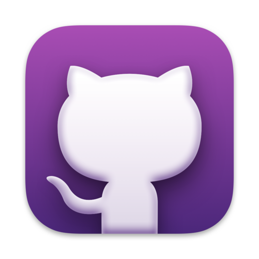

  

    🏆 <strong>Progrés d'aquesta secció:</strong> 0 de 4 superats (0%)
    ⭐ <strong>0 punts</strong>
  

  

    

  

# 0.1 Introducció

Bienvenits al curs de **Programació** **PRG** del *Cicle Formativo Superior de Desenvolupament de Aplicacions Web* **DAW**.

Abans d'entrar en materia, seria convenient i interessant introduir *un parell* de conceptes per a realitzar el nostre treball en classe i en casa de forma més organitzada.

Aquesta primera unitat estarà dedicada a aquest menester. En ella, comentarem, a mode "*manual de supervivencia*", conceptes com: 

| PROGRAMARI |  |  |
| --- | --- | --- |
| **Git** |  | Sistema de control de versions |
| **Github** |  | Plataforma web per a allotjar i compartir projectes de programari i codi font |
| **Github Desktop ** |  | Aplicació gratuïta en que es pot realitzar comandes de Git, com confirmar i inserir canvis, en una interfície gràfica d'usuari, en lloc de mitjançant la línia de comandes |
| **Visual Studio Code** |  | Editor de codi font desenvolupat per *Microsoft* |
| **Antigravity** |  | Editor de codi font desenvolupat per *Google* |

---

## 🎮 Reptes Interactius d'Autoavaluació (+100 XP)

Comprova el teu domini sobre **0.1 Introducció** superant aquests 4 reptes gamificats (+25 punts cadascun):

  
🎯 <strong>Repte 1 (+25 pts):</strong> Quina és la diferència principal entre Git i GitHub?

  

    <button type="button" class="btn-mcq-opt" data-opt="A">A) Git és el sistema de control de versions distribuït instal·lat localment, mentre que GitHub és la plataforma al núvol per a allotjar repositoris Git i col·laborar.</button>
    <button type="button" class="btn-mcq-opt" data-opt="B">B) Git és un compilador de Java i GitHub és l'entorn Visual Studio Code.</button>
    <button type="button" class="btn-mcq-opt" data-opt="C">C) Són exactament el mateix programa amb dos noms comercials.</button>
    <button type="button" class="btn-mcq-opt" data-opt="D">D) Cap de les anteriors és correcta.</button>
  

  

  
🎯 <strong>Repte 2 (+25 pts):</strong> Quina extensió oficial s'instal·la en Visual Studio Code per a programar, compilar i depurar projectes en Java?

  

    <button type="button" class="btn-mcq-opt" data-opt="A">A) Live Server CSS</button>
    <button type="button" class="btn-mcq-opt" data-opt="B">B) SQLite Viewer</button>
    <button type="button" class="btn-mcq-opt" data-opt="C">C) Cap de les anteriors és correcta.</button>
    <button type="button" class="btn-mcq-opt" data-opt="D">D) Extension Pack for Java</button>
  

  

  
✅ <strong>Repte 3 (Vertader o Fals · +25 pts):</strong> L'ordre 'git commit -m "missatge"' registra una instantània dels canvis preparats (staged) a l'historial del repositori local.

  

    <button type="button" class="btn-vf" data-opt="V">Vertader (V)</button>
    <button type="button" class="btn-vf" data-opt="F">Fals (F)</button>
  

  

  
⌨️ <strong>Repte 4 (+25 pts):</strong> Quina ordre de Git s'utilitza per a enviar els commits del repositori local cap al repositori remot en GitHub (git ...)?

  

    <input type="text" class="quiz-input" placeholder="Escriu la resposta..." />
    <button type="button" class="btn-quiz-check">Comprovar</button>
  

  

### 📋 Llista de Comprovació i Rúbrica d'Assoliment

Marca cada criteri a mesura que completes l'estudi o la resolució pràctica d'aquesta pàgina (**0.1 Introducció**):

- [ ] He llegit detingudament la teoria o l'enunciat d'aquesta secció i he anotat els conceptes clau.
- [ ] He revisat els esquemes, taules o blocs de codi i he verificat que sé aplicar-los a l'entorn de treball.
- [ ] He resolt correctament els **4 reptes interactius** superiors obtenint els **100 punts XP**.
- [ ] He descarregat el comprovant oficial en PDF per a adjuntar-lo a la tasca d'**Aules**.

  <h3>📤 Comprovant de Lliurament per a Aules</h3>
  
Quan hages completat els reptes interactius i la llista d'autoavaluació d'aquesta pàgina, introdueix el teu nom i descarrega el teu certificat oficial en PDF per a adjuntar-lo a la tasca d'<strong>Aules</strong>.

  

    <label for="aules-student-name">👤 Nom i Cognoms de l'Alumne/a:</label>
    <input type="text" id="aules-student-name" class="aules-student-name" placeholder="Ex: Joan Garcia Pérez" />
  

  

    0/4 reptes completats (0%) · 0 punts · 0/4 criteris d'autoavaluació
  

  

    <button type="button" class="btn-aules-dl" data-module="PRG" data-unit="UD00" data-activity="ut0001">📥 Descarregar Comprovant PDF</button>
    <button type="button" class="btn-aules-copy">📋 Copiar Resum al Porta-retalls</button>
  

  

