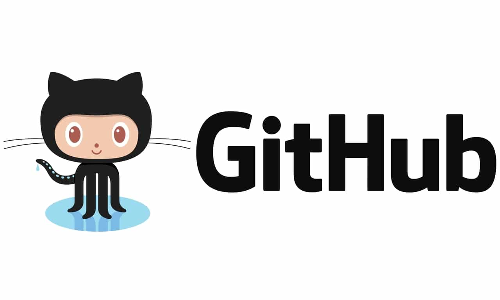
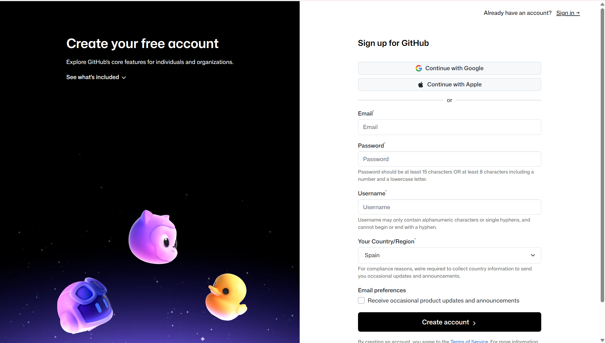
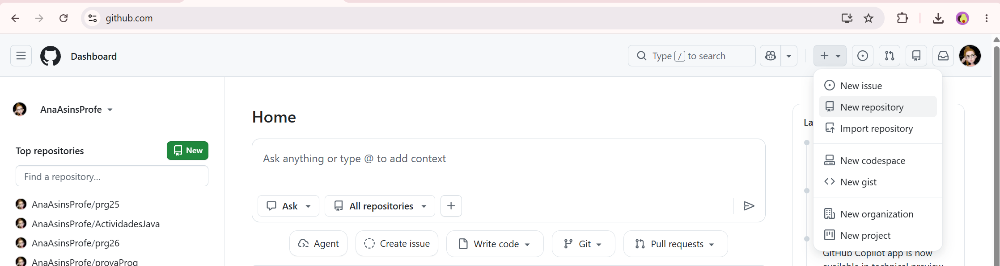
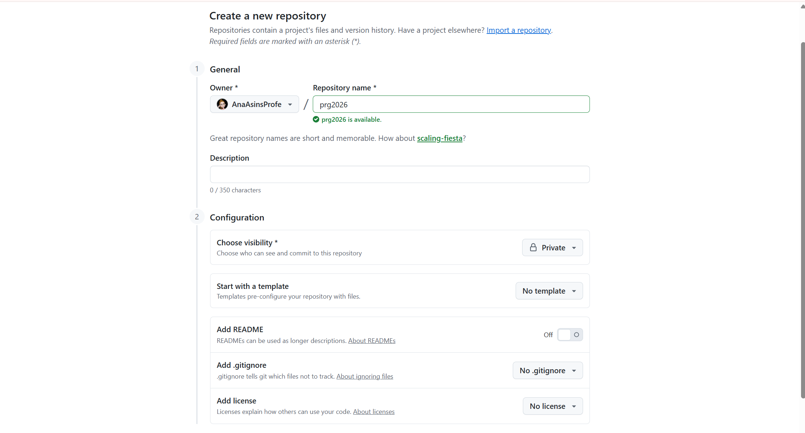
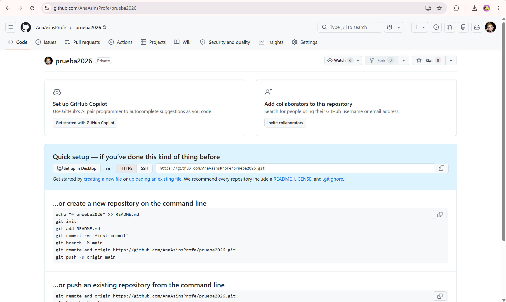
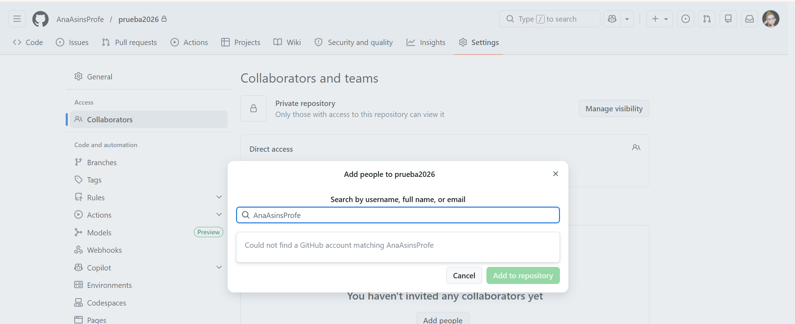

  

    🏆 <strong>Progrés d'aquesta secció:</strong> 0 de 4 superats (0%)
    ⭐ <strong>0 punts</strong>
  

  

    

  

# 0.2 GitHub

Existeixen molts proveïdors d'alojament per a repositorios Git però els més usats són [GitHub](https://github.com/) i [GitLab](https://about.gitlab.com/).

## Què és GitHub?

    

[GitHub](https://github.com/) és el proveïdor d'alojament en la núvol per a repositorios gestionats amb git més usat i el que actualment té alojats més projectes de desenvolupament de programari de codi obert en el món.

La principal avantatge de *GitHub* és que permet albergar un número ilimitado de repositorios tant públics com privats, i que a més ofereix serveis de registre d'errors, solicitud de noves funcionalitats, gestió de tasques, wikis o publicació de pàgines web, per a cada projecte, fins i tot amb el pla bàsic que és gratuït.

## 1. Registre d'usuari en GitHub

Accedir a la pàgina oficial de [GitHub](https://github.com/).

    

## 2. Crear un repositorio remoto en GitHub

Accedim a la nostra compta de GitHub.

En la **esquina superior dreta**, pulsamos en el signe **+** i després en **New repository**

    

Escogemos el nom del repositorio. No té porqué coincidir amb el nom del repositorio local, encara que és l'aconsejable per a no hacernos un lío.

    

> **📌  **
> 

> És important que el repositorio siga privat perquè no puga accedir a ell qualsevol persona.

> **📌  **
> 

> És molt important que **NO INICIALICES EL REPOSITORIO**. Si el repositorio no estuviese buit podria darnos un conflicto.

Pulsarem en **Create Repository** i ens apareixerà una pàgina com la següent:

    

Ahí podem veure la URL del repositorio remoto. Hi ha 2 formes d'accés:

- **mitjançant HTTPS**

- **mitjançant SSH**

Més abaix es indiquen els comandes a executar en el nostre repositorio local. El veiem en el següent punt.

## 3. Afegir colaboradors a un repositorio

> **📌  **
> 

> És obligatori afegir a la profesora com colaboradora perquè puga veure i corregir les teues activitats.

Per a afegir colaboradors al repositorio, seguirem els següents passos:

1. Polsar en la pestanya Settings

1. Polsar en el botó Collaborators

1. Introduir el nom d'usuari de la colaboradora

1. Polsar en el botó Add collaborator

    

---

## 🎮 Reptes Interactius d'Autoavaluació (+100 XP)

Comprova el teu domini sobre **0.2 GitHub** superant aquests 4 reptes gamificats (+25 punts cadascun):

  
🎯 <strong>Repte 1 (+25 pts):</strong> Quina és la diferència principal entre Git i GitHub?

  

    <button type="button" class="btn-mcq-opt" data-opt="A">A) Git és el sistema de control de versions distribuït instal·lat localment, mentre que GitHub és la plataforma al núvol per a allotjar repositoris Git i col·laborar.</button>
    <button type="button" class="btn-mcq-opt" data-opt="B">B) Git és un compilador de Java i GitHub és l'entorn Visual Studio Code.</button>
    <button type="button" class="btn-mcq-opt" data-opt="C">C) Són exactament el mateix programa amb dos noms comercials.</button>
    <button type="button" class="btn-mcq-opt" data-opt="D">D) Cap de les anteriors és correcta.</button>
  

  

  
🎯 <strong>Repte 2 (+25 pts):</strong> Quina extensió oficial s'instal·la en Visual Studio Code per a programar, compilar i depurar projectes en Java?

  

    <button type="button" class="btn-mcq-opt" data-opt="A">A) Live Server CSS</button>
    <button type="button" class="btn-mcq-opt" data-opt="B">B) SQLite Viewer</button>
    <button type="button" class="btn-mcq-opt" data-opt="C">C) Cap de les anteriors és correcta.</button>
    <button type="button" class="btn-mcq-opt" data-opt="D">D) Extension Pack for Java</button>
  

  

  
✅ <strong>Repte 3 (Vertader o Fals · +25 pts):</strong> L'ordre 'git commit -m "missatge"' registra una instantània dels canvis preparats (staged) a l'historial del repositori local.

  

    <button type="button" class="btn-vf" data-opt="V">Vertader (V)</button>
    <button type="button" class="btn-vf" data-opt="F">Fals (F)</button>
  

  

  
⌨️ <strong>Repte 4 (+25 pts):</strong> Quina ordre de Git s'utilitza per a enviar els commits del repositori local cap al repositori remot en GitHub (git ...)?

  

    <input type="text" class="quiz-input" placeholder="Escriu la resposta..." />
    <button type="button" class="btn-quiz-check">Comprovar</button>
  

  

### 📋 Llista de Comprovació i Rúbrica d'Assoliment

Marca cada criteri a mesura que completes l'estudi o la resolució pràctica d'aquesta pàgina (**0.2 GitHub**):

- [ ] He llegit detingudament la teoria o l'enunciat d'aquesta secció i he anotat els conceptes clau.
- [ ] He revisat els esquemes, taules o blocs de codi i he verificat que sé aplicar-los a l'entorn de treball.
- [ ] He resolt correctament els **4 reptes interactius** superiors obtenint els **100 punts XP**.
- [ ] He descarregat el comprovant oficial en PDF per a adjuntar-lo a la tasca d'**Aules**.

  <h3>📤 Comprovant de Lliurament per a Aules</h3>
  
Quan hages completat els reptes interactius i la llista d'autoavaluació d'aquesta pàgina, introdueix el teu nom i descarrega el teu certificat oficial en PDF per a adjuntar-lo a la tasca d'<strong>Aules</strong>.

  

    <label for="aules-student-name">👤 Nom i Cognoms de l'Alumne/a:</label>
    <input type="text" id="aules-student-name" class="aules-student-name" placeholder="Ex: Joan Garcia Pérez" />
  

  

    0/4 reptes completats (0%) · 0 punts · 0/4 criteris d'autoavaluació
  

  

    <button type="button" class="btn-aules-dl" data-module="PRG" data-unit="UD00" data-activity="ut0002">📥 Descarregar Comprovant PDF</button>
    <button type="button" class="btn-aules-copy">📋 Copiar Resum al Porta-retalls</button>
  

  

