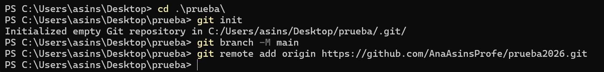
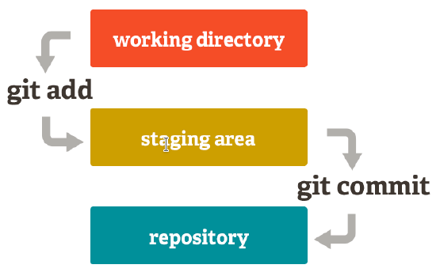
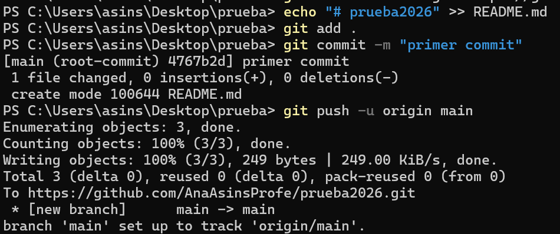

<div class="interactive-progress-tracker">
  <div class="tracker-header">
    <span>🏆 <strong>Progrés d'aquesta secció:</strong> <span class="tracker-count">0 de 4 superats (0%)</span></span>
    <span class="tracker-pts">⭐ <strong>0 punts</strong></span>
  </div>
  <div class="tracker-bar">
    <div class="tracker-fill" style="width: 0%;"></div>
  </div>
</div>

# 0.3 Git

Una vegada creat el repositorio en GitHub, hem d'unir-lo al nostre repositorio local.

El primer pas serà accedir, mitjançant la línia de comandes, al directori que conté el repositorio local.

```java
cd /ruta/al/repositorio/local
```

Una vegada dins, seguirem els següents passos:

## 1. Configuració (`git config`)

Establir el nom d'usuari:

```bash
git config --global user.name "Your-Full-Name"
```

Establir el correu de l'usuari:

```bash
git config --global user.email "your-email-address"
```

Activar el coloreado de l'eixida:

```bash
git config --global color.ui auto
```

Mostrar l'estat original en els conflictos

```bash
git config --global merge.conflictstyle diff3
```

Mostrar la configuració

```bash
git config --list
```

## 2. Creació de repositorios

### 2.1 Creació d'un repositorio nou (`git init`)

Aquest comanda crea una nova carpeta amb el nom del repositorio, que a la seua vegada conté una altra carpeta oculta anomenada .git que conté la base de dades on es registran els canvis en el repositorio.

`git init <nombre-repositorio>` crea un repositorio nou amb el nom `<nombre-repositorio>`.

### 2.2 Còpia de repositorios (`git clone`)

**No és el nostre cas ara mateix**

A partir de que es fa la còpia, els dos repositorios, l'original i la còpia, són independents, és a dir, qualsevol canvi en un d'ells no es veurà reflejado en l'un altre.

`git clone <url-repositorio>` crea una còpia local del repositorio ubicado en l'adreça `<url-repositorio>`.

## 3. Afegir un repositorio remoto (`git remote add`)

**`git remote add <repositorio-remoto> <url>`** crea un enllaç amb el nom `<repositorio-remoto>` a un repositorio remoto ubicado en l'adreça `<url>`.

Quan es afegeix un repositorio remoto a un repositorio, Git seguirá també els canvis del repositorio remoto de manera que es poden descarregar els canvis del repositorio remoto al local i es poden pujar els canvis del repositorio local al remoto.

    



<details markdown="1">

<summary>💡 Nota</summary>

El nom per defecte del repositorio remoto és `origin`. Si no es especifica un nom, s'usarà `origin`.

</details>

## 4. Afegir canvis al repositorio local

Amb *Git*, qualsevol canvi que fem en un projecte ha de passar per tres estats fins a que guarde definitivament en el repositorio.

- **Directori de treball**: És el directori que conté una còpia d'una versió concreta del projecte en la que es està treballant. Pot contindre fitxers que no pertanyen al repositorio.

- **Zona temporal d'intercanvi (staging area)**: és una zona on es guarden els canvis temporalment des del directori de treball abans d'hacerlos definitivos i registrar-los en el repositorio.

- **Repositorio**: És on finalment es guarden els canvis confirmats des de la zona temporal d'intercanvi.

    



### 4.1 Afegir canvis a la zona d'intercanvi temporal (`git add`)

**`git add <fichero>`** afegeix els canvis en el fitxer `<fichero>` del directori de treball a la zona d'intercanvi temporal. `git add <carpeta>` afegeix els canvis en tots els fitxers de la carpeta `<carpeta>` del directori de treball a la zona d'intercanvi temporal. **`git add .`** afegeix tots els canvis de tots fitxers no guardats encara en la zona d'intercanvi temporal.

### 4.2 Confirmar els canvis en el repositorio (`git commit`)

**`git commit -m "mensaje"`** confirma tots els canvis de la zona d'intercanvi temporal añadiéndolos al repositorio i creant una nova versió del projecte. `"mensaje"` és un breve missatge describent els canvis realitzats que es asociará a la nova versió del projecte.

## 5. Pujar canvis a un repositorio remoto (`git push`)

**`git push <remoto> <rama>`** puja al repositorio remoto `<remoto>` els canvis de la rama `<rama>` en el repositorio local.

    



## 6. Descarregar canvis des d'un repositorio remoto (`git pull`)

**`git pull <remoto> <rama>`** descarrega els canvis de la rama `<rama>` del repositorio remoto `<remoto>` i els integra en la última versió del repositorio local, és a dir, en el HEAD.

<details markdown="1">

<summary>💡 Altres comandes útils</summary>

- **`git status`**: Mostra l'estat dels canvis en el repositorio des de la última versió guardada. En particular, mostra els fitxers amb canvis en el directori de treball que no es han afegit a la zona d'intercanvi temporal i els fitxers en la zona d'intercanvi temporal que no es han afegit al repositorio.

- **`git log`**: Mostra l'historial de commits d'un repositorio ordenat cronológicament. Per a cada *commit* mostra el seu codi hash, l'autor, la data, l'hora i el missatge associat. Aquest comanda és molt versátil i mostra la història del repositorio en distints formats depenent dels paràmetres que es li den. Els més comuns són:

  - `--oneline`: mostra cada *commit* en una línia producent una eixida més compacta.

  - **`--graph`**: mostra la història en forma de grafo.

- **`git show`**: Mostra l'usuari, el dia, l'hora i el missatge de l'últim *commit*, així com les diferències amb l'anterior.

  - **`git show <commit>`**: Mostra l'usuari, el dia, l'hora i el missatge del `commit` indicat, així com les diferències amb l'anterior.

</details>


---

## 🎮 Reptes Interactius d'Autoavaluació (+100 XP)

Comprova el teu domini sobre **0.3 Git** superant aquests 4 reptes gamificats (+25 punts cadascun):

<div class="interactive-mcq" data-answer="A" data-hint="Revisa els conceptes teòrics i pràctics d'aquesta secció.">
  <div class="mcq-question">🎯 <strong>Repte 1 (+25 pts):</strong> Quina és la diferència principal entre Git i GitHub?</div>
  <div class="mcq-options">
    <button type="button" class="btn-mcq-opt" data-opt="A">A) Git és el sistema de control de versions distribuït instal·lat localment, mentre que GitHub és la plataforma al núvol per a allotjar repositoris Git i col·laborar.</button>
    <button type="button" class="btn-mcq-opt" data-opt="B">B) Git és un compilador de Java i GitHub és l'entorn Visual Studio Code.</button>
    <button type="button" class="btn-mcq-opt" data-opt="C">C) Són exactament el mateix programa amb dos noms comercials.</button>
    <button type="button" class="btn-mcq-opt" data-opt="D">D) Cap de les anteriors és correcta.</button>
  </div>
  <div class="quiz-feedback"></div>
</div>

<div class="interactive-mcq" data-answer="D" data-hint="Comprova l'apartat corresponent de la unitat.">
  <div class="mcq-question">🎯 <strong>Repte 2 (+25 pts):</strong> Quina extensió oficial s'instal·la en Visual Studio Code per a programar, compilar i depurar projectes en Java?</div>
  <div class="mcq-options">
    <button type="button" class="btn-mcq-opt" data-opt="A">A) Live Server CSS</button>
    <button type="button" class="btn-mcq-opt" data-opt="B">B) SQLite Viewer</button>
    <button type="button" class="btn-mcq-opt" data-opt="C">C) Cap de les anteriors és correcta.</button>
    <button type="button" class="btn-mcq-opt" data-opt="D">D) Extension Pack for Java</button>
  </div>
  <div class="quiz-feedback"></div>
</div>

<div class="interactive-vf" data-answer="V" data-hint="Verifica l'afirmació amb els apunts de la unitat.">
  <div class="vf-statement">✅ <strong>Repte 3 (Vertader o Fals · +25 pts):</strong> L'ordre 'git commit -m "missatge"' registra una instantània dels canvis preparats (staged) a l'historial del repositori local.</div>
  <div class="vf-buttons">
    <button type="button" class="btn-vf" data-opt="V">Vertader (V)</button>
    <button type="button" class="btn-vf" data-opt="F">Fals (F)</button>
  </div>
  <div class="quiz-feedback" style="width: 100%;"></div>
</div>

<div class="interactive-quiz" data-answer="push" data-hint="És el contrari de pull (4 lletres).">
  <div class="quiz-question">⌨️ <strong>Repte 4 (+25 pts):</strong> Quina ordre de Git s'utilitza per a enviar els commits del repositori local cap al repositori remot en GitHub (git ...)?</div>
  <div class="quiz-controls">
    <input type="text" class="quiz-input" placeholder="Escriu la resposta..." />
    <button type="button" class="btn-quiz-check">Comprovar</button>
  </div>
  <div class="quiz-feedback"></div>
</div>

### 📋 Llista de Comprovació i Rúbrica d'Assoliment

Marca cada criteri a mesura que completes l'estudi o la resolució pràctica d'aquesta pàgina (**0.3 Git**):

- [ ] He llegit detingudament la teoria o l'enunciat d'aquesta secció i he anotat els conceptes clau.
- [ ] He revisat els esquemes, taules o blocs de codi i he verificat que sé aplicar-los a l'entorn de treball.
- [ ] He resolt correctament els **4 reptes interactius** superiors obtenint els **100 punts XP**.
- [ ] He descarregat el comprovant oficial en PDF per a adjuntar-lo a la tasca d'**Aules**.

<div class="aules-delivery-card">
  <h3>📤 Comprovant de Lliurament per a Aules</h3>
  <p>Quan hages completat els reptes interactius i la llista d'autoavaluació d'aquesta pàgina, introdueix el teu nom i descarrega el teu certificat oficial en PDF per a adjuntar-lo a la tasca d'<strong>Aules</strong>.</p>
  <div class="aules-student-field">
    <label for="aules-student-name">👤 Nom i Cognoms de l'Alumne/a:</label>
    <input type="text" id="aules-student-name" class="aules-student-name" placeholder="Ex: Joan Garcia Pérez" />
  </div>
  <div class="aules-score-badge">
    <span class="aules-score-count">0/4 reptes completats (0%) · 0 punts · 0/4 criteris d'autoavaluació</span>
  </div>
  <div class="aules-actions">
    <button type="button" class="btn-aules-dl" data-module="PRG" data-unit="UD00" data-activity="ut0003">📥 Descarregar Comprovant PDF</button>
    <button type="button" class="btn-aules-copy">📋 Copiar Resum al Porta-retalls</button>
  </div>
  <div class="aules-toast"></div>
</div>

