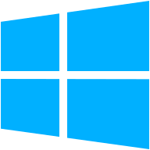
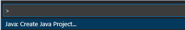
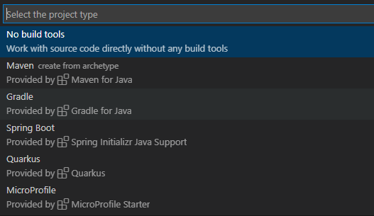
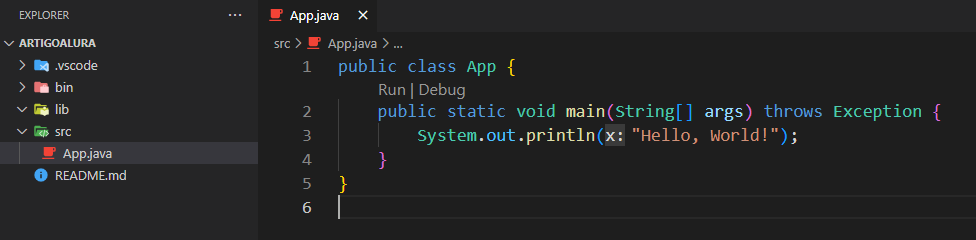
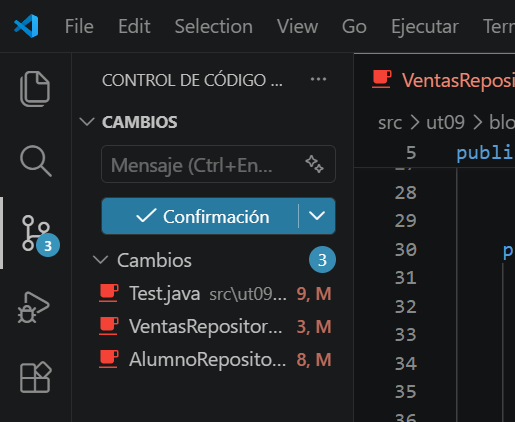

<div class="interactive-progress-tracker">
  <div class="tracker-header">
    <span>🏆 <strong>Progrés d'aquesta secció:</strong> <span class="tracker-count">0 de 4 superats (0%)</span></span>
    <span class="tracker-pts">⭐ <strong>0 punts</strong></span>
  </div>
  <div class="tracker-bar">
    <div class="tracker-fill" style="width: 0%;"></div>
  </div>
</div>

# 0.4 Visual Studio Code

## Què és Visual Studio Code?

**Visual Studio Code** (*VS Code*) és un editor de codi font desenvolupat per *Microsoft*. És àmpliament utilitzat per programadors a causa de la seua flexibilitat, rendiment i gran quantitat d'extensions que permeten personalizar-lo per a diferents llenguatges i tecnologies.

### Característiques clau de VS Code

- **Editor de codi font lleuger**: A diferència dels entorns de desenvolupament integrats (*IDE*) com *Eclipse* o *IntelliJ*, *VS Code* és un editor més lleuger, el que el fa més ràpid i menys demandante de recursos.

- **Suport per a múltiples llenguatges**: Encara que no està dissenyat exclusivament per a Java, *VS Code* suporta molts llenguatges de programació (com *Python*, *JavaScript*, *C++*, i més) a través d'extensions.

- **Extensions**: El seu major fortaleza és el suport d'extensions, que li permet agregar funcionalitats segons el llenguatge o tecnologia que es estiga utilitzant. Per a *Java*, existeixen extensions específiques que faciliten el desenvolupament.

- **Depuració i control de versions**: Inclou eines per a depurar codi, així com integració amb sistemes de control de versions com *Git*.

- **Multiplataforma**: Està disponible per a *Windows*, *macOS* i *Linux*.

### Per què l'usarem per a programar en Java?

1. **Facilitat d'ús**: *VS Code* té una interfície molt intuitiva i fàcil d'usar, el que és ideal si estàs començant en la programació.

1. **Extensions per a Java**: Existeixen extensions oficials de Microsoft i Xarxa Hat que afegeixen suport complet per a Java, incloent eines com IntelliSense (autocompletado de codi), depuració, i maneig de projectes Java.

1. **Lleuger i ràpid**: A diferència d'altres IDEs per a Java com Eclipse o IntelliJ IDEA, VS Code consume menys recursos, per la qual cosa pot ser més còmode si no tens una màquina molt potent.

1. **Personalizable**: Pots adaptar VS Code a les teues necessitats i agregar noves funcionalitats segons avances en el teu aprenentatge de Java.

1. **Integració amb Maven i Gradle**: Si en el futuro necesitas treballar amb eines de construcció com Maven o Gradle, VS Code té suport per a elles.

1. **Terminal integrada**: Té una terminal integrada on pots compilar i executar els teus programes de Java sense necessitat d'eixir de l'editor.

### Instal·lació VS Code

> **📌 En Sistemes operatius:**
> 

#### 📌 


**Pas 1: Descarregar el fitxer .deb**:  

Veu a [https://code.visualstudio.com/](https://code.visualstudio.com/) i descarrega el fitxer `.deb` per a distribucions de *Debian*/*Ubuntu*.  
  

**Pas 2: Instal·lar el fitxer .deb**:  

Obri una terminal i navega fins al directori on descargaste el fitxer. Usa el següent comanda per a instalar-lo:

```java
sudo dpkg -i nombre-del-archivo.deb
```

Si apareix algun error de dependències, corrígelo amb el següent comanda:

```java
sudo apt --fix-broken install
```

#### 📌 



**Pas 1: Descarregar l'instalador**:  

Veu a la pàgina oficial de Visual Studio Code: [https://code.visualstudio.com/](https://code.visualstudio.com/)  

Fes clic en el botó "**Download for Windows**". Açò descargará el fitxer .exe per a la instal·lació.  
  

**Pas 2: Executar l'instalador**:  

Una vegada descargado el fitxer, fes doble clic en ell per a obrir l'instalador.  

Accepta els termes de llicència i segueix els passos de l'assistent d'instal·lació.  
  

**Pas 3: Configurar opcions durant la instal·lació**:  

Durant el procés, pots triar algunes opcions addicionals com:  

    - Crear un accés directe en l'escriptori.  

    - Afegir VS Code al **Path** (recomanat per a obrir VS Code des de la línia de comandes).  

    - Habilitar l'opció d'obrir fitxers des del menú contextual (clic dret).  

    Selecciona les opcions que prefieras i després fes clic en **Instal·lar**.  
  

    **Pas 4: Finalitzar la instal·lació**:  

        Una vegada completada la instal·lació, pots fer clic en **Finalitzar**. VS Code s'obrirà automàticament si seleccionas l'opció "Iniciar Visual Studio Code".
**Instal·lar extensions**:  

    Per a treballar amb *Java*, veu a la pestanya de **Extensions** (icono en la barra lateral esquerra) i cerca l'extensió **Java Extension Pack**. Instálala per a habilitar el suport complet per a *Java*.

### Creació d'un nou projecte java

Per a executar la majoria dels comandes, usem la tecla Ctrl+ Shift + P (també es pot des de: menú *Veure → Paleta de comandes*). 

Per a iniciar un nou projecte Java, obrir la paleta de comandes i alegir l'opció Java: Create Java Project....

    



Es pot observar que obri una nova pantalla amb diverses opcions de projectes Java. El Codi VS té una extensió per a facilitar la creació amb qualsevol opció elegida: *Maven, Gradle, Spring Boot, Quarkus o MicroProfile*.

    



Eligirem l'opció **No build tools** només per a veure algunes opcions bàsiques del VS Code.

La carpeta que es tria és la carpeta on es va a generar el projecte javav i, després d'aquest pas, es pedirá el nom del projecte. Al proceder, es crearà una estructura de paquet, amb les carpetes `.vscode` (que conté el fitxer settings.json), la carpeta `bin` (que contendrá els fitxers amb extensió .class), la carpeta `lib`( on es troben els recursos o bibliotecas que s'utilitzen en l'aplicació) i la carpeta **`src`** (on es troba el codi font, en el nostre cas, les classes).

Es crea per defecte, dins del projecte, la primera classe, la **App.java**, amb el mètode *main* és el nostre famoso **Hello, World!**

    



## GitHub integrat en VS Code

Entre les funcionalitats integrades en VS Code podem trobar el maneig de repositorios Git, funció que ens permet gestionar els nostres repositorios d'una forma molt més cómoda i visual.

    




---

## 🎮 Reptes Interactius d'Autoavaluació (+100 XP)

Comprova el teu domini sobre **0.4 Visual Studio Code** superant aquests 4 reptes gamificats (+25 punts cadascun):

<div class="interactive-mcq" data-answer="A" data-hint="Revisa els conceptes teòrics i pràctics d'aquesta secció.">
  <div class="mcq-question">🎯 <strong>Repte 1 (+25 pts):</strong> Quina és la diferència principal entre Git i GitHub?</div>
  <div class="mcq-options">
    <button type="button" class="btn-mcq-opt" data-opt="A">A) Git és el sistema de control de versions distribuït instal·lat localment, mentre que GitHub és la plataforma al núvol per a allotjar repositoris Git i col·laborar.</button>
    <button type="button" class="btn-mcq-opt" data-opt="B">B) Git és un compilador de Java i GitHub és l'entorn Visual Studio Code.</button>
    <button type="button" class="btn-mcq-opt" data-opt="C">C) Són exactament el mateix programa amb dos noms comercials.</button>
    <button type="button" class="btn-mcq-opt" data-opt="D">D) Cap de les anteriors és correcta.</button>
  </div>
  <div class="quiz-feedback"></div>
</div>

<div class="interactive-mcq" data-answer="D" data-hint="Comprova l'apartat corresponent de la unitat.">
  <div class="mcq-question">🎯 <strong>Repte 2 (+25 pts):</strong> Quina extensió oficial s'instal·la en Visual Studio Code per a programar, compilar i depurar projectes en Java?</div>
  <div class="mcq-options">
    <button type="button" class="btn-mcq-opt" data-opt="A">A) Live Server CSS</button>
    <button type="button" class="btn-mcq-opt" data-opt="B">B) SQLite Viewer</button>
    <button type="button" class="btn-mcq-opt" data-opt="C">C) Cap de les anteriors és correcta.</button>
    <button type="button" class="btn-mcq-opt" data-opt="D">D) Extension Pack for Java</button>
  </div>
  <div class="quiz-feedback"></div>
</div>

<div class="interactive-vf" data-answer="V" data-hint="Verifica l'afirmació amb els apunts de la unitat.">
  <div class="vf-statement">✅ <strong>Repte 3 (Vertader o Fals · +25 pts):</strong> L'ordre 'git commit -m "missatge"' registra una instantània dels canvis preparats (staged) a l'historial del repositori local.</div>
  <div class="vf-buttons">
    <button type="button" class="btn-vf" data-opt="V">Vertader (V)</button>
    <button type="button" class="btn-vf" data-opt="F">Fals (F)</button>
  </div>
  <div class="quiz-feedback" style="width: 100%;"></div>
</div>

<div class="interactive-quiz" data-answer="push" data-hint="És el contrari de pull (4 lletres).">
  <div class="quiz-question">⌨️ <strong>Repte 4 (+25 pts):</strong> Quina ordre de Git s'utilitza per a enviar els commits del repositori local cap al repositori remot en GitHub (git ...)?</div>
  <div class="quiz-controls">
    <input type="text" class="quiz-input" placeholder="Escriu la resposta..." />
    <button type="button" class="btn-quiz-check">Comprovar</button>
  </div>
  <div class="quiz-feedback"></div>
</div>

### 📋 Llista de Comprovació i Rúbrica d'Assoliment

Marca cada criteri a mesura que completes l'estudi o la resolució pràctica d'aquesta pàgina (**0.4 Visual Studio Code**):

- [ ] He llegit detingudament la teoria o l'enunciat d'aquesta secció i he anotat els conceptes clau.
- [ ] He revisat els esquemes, taules o blocs de codi i he verificat que sé aplicar-los a l'entorn de treball.
- [ ] He resolt correctament els **4 reptes interactius** superiors obtenint els **100 punts XP**.
- [ ] He descarregat el comprovant oficial en PDF per a adjuntar-lo a la tasca d'**Aules**.

<div class="aules-delivery-card">
  <h3>📤 Comprovant de Lliurament per a Aules</h3>
  <p>Quan hages completat els reptes interactius i la llista d'autoavaluació d'aquesta pàgina, introdueix el teu nom i descarrega el teu certificat oficial en PDF per a adjuntar-lo a la tasca d'<strong>Aules</strong>.</p>
  <div class="aules-student-field">
    <label for="aules-student-name">👤 Nom i Cognoms de l'Alumne/a:</label>
    <input type="text" id="aules-student-name" class="aules-student-name" placeholder="Ex: Joan Garcia Pérez" />
  </div>
  <div class="aules-score-badge">
    <span class="aules-score-count">0/4 reptes completats (0%) · 0 punts · 0/4 criteris d'autoavaluació</span>
  </div>
  <div class="aules-actions">
    <button type="button" class="btn-aules-dl" data-module="PRG" data-unit="UD00" data-activity="ut0004">📥 Descarregar Comprovant PDF</button>
    <button type="button" class="btn-aules-copy">📋 Copiar Resum al Porta-retalls</button>
  </div>
  <div class="aules-toast"></div>
</div>

