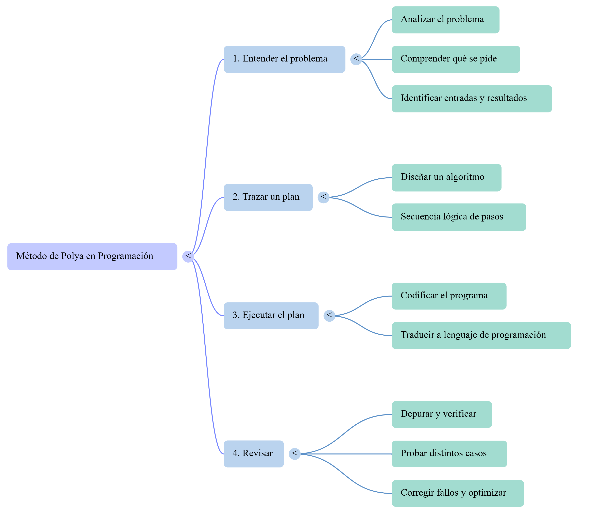
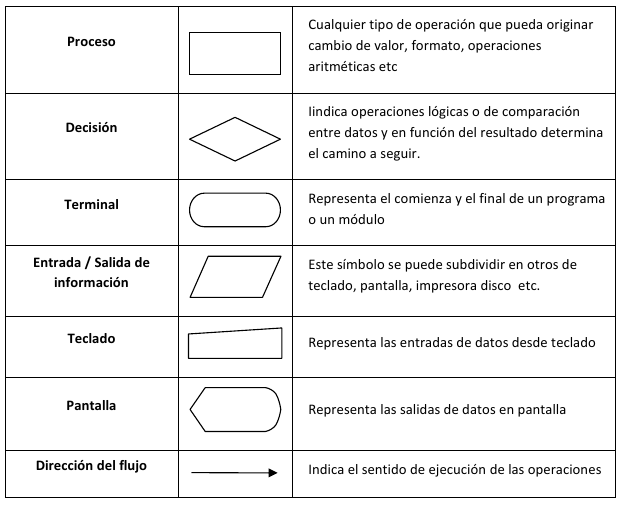
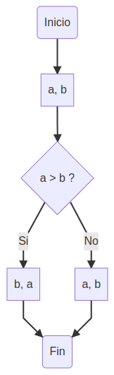

<div class="interactive-progress-tracker">
  <div class="tracker-header">
    <span>🏆 <strong>Progrés d'aquesta secció:</strong> <span class="tracker-count">0 de 4 superats (0%)</span></span>
    <span class="tracker-pts">⭐ <strong>0 punts</strong></span>
  </div>
  <div class="tracker-bar">
    <div class="tracker-fill" style="width: 0%;"></div>
  </div>
</div>

# 1.1 Pensa com un programador i dissenya algoritmes

## 1. Pensa com un programador i dissenya algoritmes

La **programació** és, en esencia, una forma sistemática de resoldre **problemes** mitjançant ordinadors. Perquè un problema siga resoluble per una computadora, ha de poder expresar-se de forma mecánica i automàtica, sense ambigüetats.

### 1.1. Resolució de Problemes: El Mètode de Polya

El matemátic George Polya formuló un mètode heurístic de quatre operacions mentals per a resoldre problemes, el qual es alinea perfectament amb les fases de desenvolupament de programari:

| Fase del Mètode de Polya | Operació en Programació | Objectiu principal |
| --- | --- | --- |
| **1. Entendre el problema** | **Analitzar el problema** | Comprendre què es demana, identificar dades d'entrada i resultats esperats. |
| **2. Trazar un pla** | **Dissenyar un algoritme** | Trobar una seqüència lògica de passos per a resoldre el problema. |
| **3. Executar el pla** | **Codificar el programa** | Traduir l'algoritme dissenyat a un llenguatge de programació (ej. Java). |
| **4. Revisar** | **Depurar i verificar** | Provar el programa amb distints casos per a corregir fallades i optimizar-lo. |

    



### 1.2. Què és un Algoritme?

Un **algoritme** és un conjunt de passos o instruccions lògiques, ordenades i acotades, dissenyades per a resoldre un problema o realitzar una tasca.

> **📌 Exemple**
> 

> Un exemple d'un algoritme clàssic i senzill de la vida cotidiana són els passos a seguir per a desayunar:

```java
Inicio
    Sentarse en la mesa
    Servir café con leche y azúcar
    Si tengo tiempo Entonces
        Mientras tenga apetito Hacer
            Untar mantequilla y mermelada en una tostada
            Comer la tostada
        Fin Mientras
    Fin Si
    Beber café con leche
    Levantarse
Fin
```

#### 1.2.1. Característiques Fonamentals d'un Algoritme

- **Generalitat:** Ha de servir per a resoldre qualsevol cas del problema (usant variables), no només un concret.

- **Finitud:** Ha d'acabar obligatòriament després d'un número determinat de passos.

- **Definibilitat:** Cada pas ha de ser clar i no donar peu a dobles interpretacions (sense ambigüetats).

- **Eficiència:** Ha de resoldre el problema consument el mínim temps i recursos possibles.

### 1.3. Representació de Algoritmes

Els algoritmes són **independents dels llenguatges de programació** i del maquinari. Per a diseñar-los abans de programar, s'utilitzen principalment dos mètodes estructurats:

#### 1.3.1. Pseudocodi

És un llenguatge descriptivo intermedi entre el llenguatge humà i el de programació, ideal per a estructurar la lògica sense preocupar-se per la sintaxi estricta del compilador.

> **📌 Exemple: Mostrar dos números ordenats de menor a major:**
> 

```java
Inicio
    Leer (A, B)
    Si (A > B) Entonces
        Escribir (B, A)
    SiNo
        Escribir (A, B)
    FinSi
Fin
```

#### 1.3.2. Diagrama de Flux

És una representació gràfica que utilitza símbols estàndard connectats per flechas (línies de flux) per a indicar la seqüència d'operacions:

    



> **📌 Exemple: Mostrar dos números ordenats de menor a major:**
> 

> 
    



### 1.4. Algoritmes enfront de Programes

La diferència fonamental és que un **algoritme** és la lògica abstracta de solució, mentre que un **programa** és la plasmació física d'aquest algoritme escrita en un llenguatge de programació específic perquè la computadora puga ejecutar-lo.

Quan un problema és complex, aplicamos l'estratègia de **"Divideix i vencerás"** amb dos variants:

- **Disseny descendent (Top-Down):** Descomponer un problema gran en subproblemas més senzills.

- **Disseny modular:** Resoldre cada subproblema de forma independent mitjançant mòduls o subprogramas per a després integrar-los.


---

## 🎮 Reptes Interactius d'Autoavaluació (+100 XP)

Comprova el teu domini sobre **1.1 Pensa com un programador i dissenya algoritmes** superant aquests 4 reptes gamificats (+25 punts cadascun):

<div class="interactive-mcq" data-answer="A" data-hint="Revisa els conceptes teòrics i pràctics d'aquesta secció.">
  <div class="mcq-question">🎯 <strong>Repte 1 (+25 pts):</strong> Quin component de l'ecosistema Java s'encarrega d'interpretar i executar el codi intermedari (Bytecode .class) fent que el programa siga independent de la plataforma?</div>
  <div class="mcq-options">
    <button type="button" class="btn-mcq-opt" data-opt="A">A) La Màquina Virtual de Java (JVM - Java Virtual Machine).</button>
    <button type="button" class="btn-mcq-opt" data-opt="B">B) L'editor de text Notepad.</button>
    <button type="button" class="btn-mcq-opt" data-opt="C">C) El sistema gestor de bases de dades SQLite.</button>
    <button type="button" class="btn-mcq-opt" data-opt="D">D) Cap de les anteriors és correcta.</button>
  </div>
  <div class="quiz-feedback"></div>
</div>

<div class="interactive-mcq" data-answer="D" data-hint="Comprova l'apartat corresponent de la unitat.">
  <div class="mcq-question">🎯 <strong>Repte 2 (+25 pts):</strong> Segons les convencions de codi net (Clean Code) en Java, com s'han d'anomenar les classes i les constants?</div>
  <div class="mcq-options">
    <button type="button" class="btn-mcq-opt" data-opt="A">A) Les classes en minúscules amb guions i les constants en camelCase.</button>
    <button type="button" class="btn-mcq-opt" data-opt="B">B) Tots els identificadors han de començar per un número.</button>
    <button type="button" class="btn-mcq-opt" data-opt="C">C) Cap de les anteriors és correcta.</button>
    <button type="button" class="btn-mcq-opt" data-opt="D">D) Les classes en PascalCase (p. ex. CompteBancari) i les constants en UPPER_SNAKE_CASE (p. ex. IVA_GENERAL).</button>
  </div>
  <div class="quiz-feedback"></div>
</div>

<div class="interactive-vf" data-answer="V" data-hint="Verifica l'afirmació amb els apunts de la unitat.">
  <div class="vf-statement">✅ <strong>Repte 3 (Vertader o Fals · +25 pts):</strong> En Java, la classe String és immutable i per a comparar el contingut de dues cadenes de text s'ha d'utilitzar el mètode .equals() en lloc de l'operador ==.</div>
  <div class="vf-buttons">
    <button type="button" class="btn-vf" data-opt="V">Vertader (V)</button>
    <button type="button" class="btn-vf" data-opt="F">Fals (F)</button>
  </div>
  <div class="quiz-feedback" style="width: 100%;"></div>
</div>

<div class="interactive-quiz" data-answer="javac" data-hint="Java Compiler (5 lletres).">
  <div class="quiz-question">⌨️ <strong>Repte 4 (+25 pts):</strong> Quina ordre del JDK s'utilitza en la terminal per a compilar un fitxer font HolaMundo.java i generar HolaMundo.class?</div>
  <div class="quiz-controls">
    <input type="text" class="quiz-input" placeholder="Escriu la resposta..." />
    <button type="button" class="btn-quiz-check">Comprovar</button>
  </div>
  <div class="quiz-feedback"></div>
</div>

### 📋 Llista de Comprovació i Rúbrica d'Assoliment

Marca cada criteri a mesura que completes l'estudi o la resolució pràctica d'aquesta pàgina (**1.1 Pensa com un programador i dissenya algoritmes**):

- [ ] He llegit detingudament la teoria o l'enunciat d'aquesta secció i he anotat els conceptes clau.
- [ ] He revisat els esquemes, taules o blocs de codi i he verificat que sé aplicar-los a l'entorn de treball.
- [ ] He resolt correctament els **4 reptes interactius** superiors obtenint els **100 punts XP**.
- [ ] He descarregat el comprovant oficial en PDF per a adjuntar-lo a la tasca d'**Aules**.

<div class="aules-delivery-card">
  <h3>📤 Comprovant de Lliurament per a Aules</h3>
  <p>Quan hages completat els reptes interactius i la llista d'autoavaluació d'aquesta pàgina, introdueix el teu nom i descarrega el teu certificat oficial en PDF per a adjuntar-lo a la tasca d'<strong>Aules</strong>.</p>
  <div class="aules-student-field">
    <label for="aules-student-name">👤 Nom i Cognoms de l'Alumne/a:</label>
    <input type="text" id="aules-student-name" class="aules-student-name" placeholder="Ex: Joan Garcia Pérez" />
  </div>
  <div class="aules-score-badge">
    <span class="aules-score-count">0/4 reptes completats (0%) · 0 punts · 0/4 criteris d'autoavaluació</span>
  </div>
  <div class="aules-actions">
    <button type="button" class="btn-aules-dl" data-module="PRG" data-unit="UD01" data-activity="ut0101">📥 Descarregar Comprovant PDF</button>
    <button type="button" class="btn-aules-copy">📋 Copiar Resum al Porta-retalls</button>
  </div>
  <div class="aules-toast"></div>
</div>

