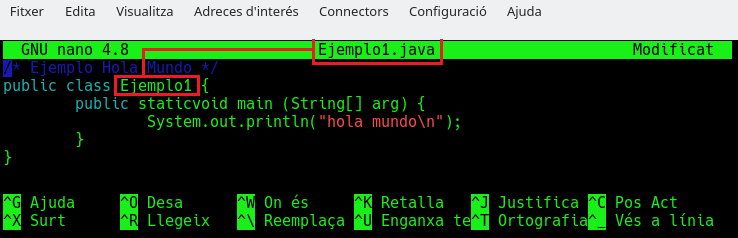
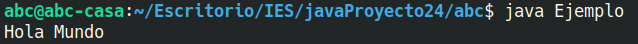

<div class="interactive-progress-tracker">
  <div class="tracker-header">
    <span>🏆 <strong>Progrés d'aquesta secció:</strong> <span class="tracker-count">0 de 4 superats (0%)</span></span>
    <span class="tracker-pts">⭐ <strong>0 punts</strong></span>
  </div>
  <div class="tracker-bar">
    <div class="tracker-fill" style="width: 0%;"></div>
  </div>
</div>

# 1.2 El llenguatge Java

## 1. Què i com és Java?

Java és un llenguatge senzill d'aprendre, amb una sintaxi semblant a la de C++, però en la que es han eliminat elements complicats i que poden originar errors. Java és un llenguatge orientat a objectes, amb la qual cosa elimina moltes preocupacions al programador i permet la utilització de gran quantitat de bibliotecas ja definides, evitant reescribir codi que ja existeix. És un llenguatge de programació creat per a satisfacer noves necessitats que els llenguatges existents fins al moment no eren capaços de solventar.

Una de les principals virtudes de Java és la seua independència del maquinari, ja que el codi que es genera és vàlid per a qualsevol plataforma. Aquest codi serà executat sobre una màquina virtual denominada Maquina Virtual Java (*MVJ* o *JVM* – *Java Virtual Machine*), que interpretará el codi convirtiéndolo a codi específic de la plataforma que el suporta. D'aquesta manera el programa es escriu una única vegada i pot hacerse funcionar en qualsevol lloc. Lema del llenguatge: "*Write onze, run everywhere*".

Abans de que apareciera Java, el llenguatge C era un dels més extendits per la seua versatilitat. Però quan els programes escritos en C aumentaven de volum, el seu maneig comenzava a complicar-se. Mitjançant les tècniques de programació estructurada i programació modular es conseguían reduir aquestes complicacions, però no era suficient.

Va ser llavors quan la Programació Orientada a Objectes (*POO*) entra en escena, aproximant notablement la construcció de programes al pensament humà i fent més senzill tot el procés. Els problemes es divideixen en objectes que tenen propietats i interactúan amb altres objectes, d'aquesta manera, el programador pot centrar-se en cada objecte per a programar internament els elements i funcions que el componen.

Les característiques principals de llenguatge Java es resum a continuació:

- 

El codi generat pel compilador Java és independent de l'arquitectura.

- 

Està totalment orientat a objectes.

- 

El seu sintaxi és similar a C i C++.

- 

És distribuït, preparado per a aplicacions TCP/IP.

- 

Disposa d'un ampli conjunt de bibliotecas.

- 

És robusto, realitzant comprobacions del codi en temps de compilació i d'ejecució.

- 

La seguretat està garantitzada, ja que les aplicacions Java no accedeixen a zones delicades de memòria o de sistema. (*ejem, ejem!*).

## 2. Estructura i Blocs Fonamentals d'un Programa Java

En Java, tota instrucció ejecutable es organitza en classes i mètodes. 

> **📌 Exemple: HolaMundo**
> 

> Vegem el clàssic exemple per a mostrar una salutació per consola:

```java
public class HolaMundo {
    // Punto de entrada: el método main es lo primero que ejecuta Java
    public static void main(String[] args) {
        /* Muestra el mensaje por pantalla e introduce 
        un salto de línea al final */
        System.out.println("Hola Mundo!");
    }
}
```

- **Classe (`public class HolaMundo`):** En Java, el nom de la classe pública ha de coincidir exactament amb el nom del fitxer (`HolaMundo.java`).

- **Mètode `main`:** És el punt d'inici obligatori de qualsevol aplicació Java estàndard.

- **Instruccions:** Totes les sentències i anomenades a mètodes acaben obligatòriament amb punt i coma (`;`).

### 2.1. Sangrado o Indentació

La indentació consisteix en deixar una sangría en el marge esquerre de cada línia dins d'un bloc `{ ... }`. Açò millora drásticament la lectura del codi.

- Es recomana usar entre **2 i 4 espais** (o un tabulador).

- Es aconseja limitar l'ample de les línies de codi a uns **70-90 caràcters** perquè quepan completes en qualsevol pantalla o editor sense necessitat de scroll horitzontal.

## 3. Compilar i executar un programa Java. Ús de la consola.

Vegem els passos per a compilar i interpretar el nostre primer programa escrit en llenguatge Java: 

Pas 1. Creació del codi font   -->   Pas 2. Compilació del programa   -->   Pas 3. Ejecució del programa.

### Pas 1: Creació del codi font

Abrimos un editor de text (dóna igual qual siga, sempre que siga capaç d'emmagatzemar “text sense format” en codi ASCII). Una vegada obert escribirem el nostre primer programa, que mostrarà un text “Hola Món” en la consola. De moment no et preocupes si no entiendes el que escribes, més avant li darem sentit. Ara només volem veure si podem executar java en el nostre equip.

El codi del nostre programa en Java serà el següent:

```java
/* Ejemplo Hola Mundo */
public class HolaMundo {
    public static void main(String[ ] arg) {
        System.out.println("Hola Mundo");
    }
}
```

A continuació guardamos el nostre fitxer i li posem com nom `HolaMundo.java`. Hem de seguir una norma dictada per Java, **hem de fer coincidir nom del fitxer i nom del programa**, tant en majúscules com en minúscules, i l'extensió del fitxer hi haurà de ser sempre `.java`.

    



> **📌  **
> 

> Hem de recordar exactament la ruta on guardamos el fitxer d'exemple `HolaMundo.java`.

### Pas 2: Compilació del programa

Anem a proceder a compilar i interpretar aquest xicotet programa Java (no et preocupes si encara no entiendes el significat de les paraules compilar i interpretar, el verás en el mòdul de *Entorns de Desenvolupament*). Per a això usarem la consola. Una vegada en la consola hem de colocarnos en la ruta on prèviament guardamos el fitxer `HolaMundo.java`.

A continuació darem la instrucció perquè es realitze **el procés de compilació del programa**, per al que escribirem `javac HolaMundo.java`, on `javac` és el nom del compilador (***java c**ompiler*) que transformará el programa que hem escrit nosaltres en llenguatge Java al llenguatge de la màquina virtual Java (`bytecode`), dando com resultat un nou fitxer `HolaMundo.class` que es crearà en aquest mateix directori. Comprova que no aparega cap error i que javac estiga instal·lat en el teu sistema (des de la consola el pots comprovar amb el comanda `javac --version` i hauria d'apareix el número de versió que tens instal·lada). Si apareixen els dos fitxers tant `HolaMundo.java` (codi font) com `HolaMundo.class` (bytecode creat pel compilador) pots continuar.

```bash
$ javac HolaMundo.java
```

### Pas 3: Ejecució del programa

Finalment, anem a pedirle a l'intèrpret que execute el programa, és a dir, que transforme el codi de la màquina virtual Java en codi màquina interpretable pel nostre ordinador i l'execute. Per a això escribirem en la finestra consola: `java HolaMundo`.

El resultat serà que es ens mostra la cadena `Hola Mundo`. Si logramos visualitzar aquest text en pantalla, ja hem desenvolupat el nostre primer programa en Java.

#### 📌 sh

```bash
$ java HolaMundo
```

#### 📌 Resultat




---

## 🎮 Reptes Interactius d'Autoavaluació (+100 XP)

Comprova el teu domini sobre **1.2 El llenguatge Java** superant aquests 4 reptes gamificats (+25 punts cadascun):

<div class="interactive-mcq" data-answer="A" data-hint="Revisa els conceptes teòrics i pràctics d'aquesta secció.">
  <div class="mcq-question">🎯 <strong>Repte 1 (+25 pts):</strong> Quin component de l'ecosistema Java s'encarrega d'interpretar i executar el codi intermedari (Bytecode .class) fent que el programa siga independent de la plataforma?</div>
  <div class="mcq-options">
    <button type="button" class="btn-mcq-opt" data-opt="A">A) La Màquina Virtual de Java (JVM - Java Virtual Machine).</button>
    <button type="button" class="btn-mcq-opt" data-opt="B">B) L'editor de text Notepad.</button>
    <button type="button" class="btn-mcq-opt" data-opt="C">C) El sistema gestor de bases de dades SQLite.</button>
    <button type="button" class="btn-mcq-opt" data-opt="D">D) Cap de les anteriors és correcta.</button>
  </div>
  <div class="quiz-feedback"></div>
</div>

<div class="interactive-mcq" data-answer="D" data-hint="Comprova l'apartat corresponent de la unitat.">
  <div class="mcq-question">🎯 <strong>Repte 2 (+25 pts):</strong> Segons les convencions de codi net (Clean Code) en Java, com s'han d'anomenar les classes i les constants?</div>
  <div class="mcq-options">
    <button type="button" class="btn-mcq-opt" data-opt="A">A) Les classes en minúscules amb guions i les constants en camelCase.</button>
    <button type="button" class="btn-mcq-opt" data-opt="B">B) Tots els identificadors han de començar per un número.</button>
    <button type="button" class="btn-mcq-opt" data-opt="C">C) Cap de les anteriors és correcta.</button>
    <button type="button" class="btn-mcq-opt" data-opt="D">D) Les classes en PascalCase (p. ex. CompteBancari) i les constants en UPPER_SNAKE_CASE (p. ex. IVA_GENERAL).</button>
  </div>
  <div class="quiz-feedback"></div>
</div>

<div class="interactive-vf" data-answer="V" data-hint="Verifica l'afirmació amb els apunts de la unitat.">
  <div class="vf-statement">✅ <strong>Repte 3 (Vertader o Fals · +25 pts):</strong> En Java, la classe String és immutable i per a comparar el contingut de dues cadenes de text s'ha d'utilitzar el mètode .equals() en lloc de l'operador ==.</div>
  <div class="vf-buttons">
    <button type="button" class="btn-vf" data-opt="V">Vertader (V)</button>
    <button type="button" class="btn-vf" data-opt="F">Fals (F)</button>
  </div>
  <div class="quiz-feedback" style="width: 100%;"></div>
</div>

<div class="interactive-quiz" data-answer="javac" data-hint="Java Compiler (5 lletres).">
  <div class="quiz-question">⌨️ <strong>Repte 4 (+25 pts):</strong> Quina ordre del JDK s'utilitza en la terminal per a compilar un fitxer font HolaMundo.java i generar HolaMundo.class?</div>
  <div class="quiz-controls">
    <input type="text" class="quiz-input" placeholder="Escriu la resposta..." />
    <button type="button" class="btn-quiz-check">Comprovar</button>
  </div>
  <div class="quiz-feedback"></div>
</div>

### 📋 Llista de Comprovació i Rúbrica d'Assoliment

Marca cada criteri a mesura que completes l'estudi o la resolució pràctica d'aquesta pàgina (**1.2 El llenguatge Java**):

- [ ] He llegit detingudament la teoria o l'enunciat d'aquesta secció i he anotat els conceptes clau.
- [ ] He revisat els esquemes, taules o blocs de codi i he verificat que sé aplicar-los a l'entorn de treball.
- [ ] He resolt correctament els **4 reptes interactius** superiors obtenint els **100 punts XP**.
- [ ] He descarregat el comprovant oficial en PDF per a adjuntar-lo a la tasca d'**Aules**.

<div class="aules-delivery-card">
  <h3>📤 Comprovant de Lliurament per a Aules</h3>
  <p>Quan hages completat els reptes interactius i la llista d'autoavaluació d'aquesta pàgina, introdueix el teu nom i descarrega el teu certificat oficial en PDF per a adjuntar-lo a la tasca d'<strong>Aules</strong>.</p>
  <div class="aules-student-field">
    <label for="aules-student-name">👤 Nom i Cognoms de l'Alumne/a:</label>
    <input type="text" id="aules-student-name" class="aules-student-name" placeholder="Ex: Joan Garcia Pérez" />
  </div>
  <div class="aules-score-badge">
    <span class="aules-score-count">0/4 reptes completats (0%) · 0 punts · 0/4 criteris d'autoavaluació</span>
  </div>
  <div class="aules-actions">
    <button type="button" class="btn-aules-dl" data-module="PRG" data-unit="UD01" data-activity="ut0102">📥 Descarregar Comprovant PDF</button>
    <button type="button" class="btn-aules-copy">📋 Copiar Resum al Porta-retalls</button>
  </div>
  <div class="aules-toast"></div>
</div>

