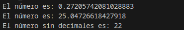
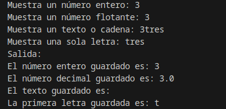

<div class="interactive-progress-tracker">
  <div class="tracker-header">
    <span>🏆 <strong>Progrés d'aquesta secció:</strong> <span class="tracker-count">0 de 4 superats (0%)</span></span>
    <span class="tracker-pts">⭐ <strong>0 punts</strong></span>
  </div>
  <div class="tracker-bar">
    <div class="tracker-fill" style="width: 0%;"></div>
  </div>
</div>

# 1.8 Eines útils (Math, Random i Scanner)

## 1. La llibreria Math

Java proporciona de forma nativa la classe **`Math`**  per a realitzar operacions matemàtiques avançades, càlcul de potències, raíces, redondeos i generació de números aleatorios.

### 1.1. Constants matemàtiques (`Math.PI` i la gravetat)

La classe `Math` incorpora constants matemàtiques fonamentals definides amb alta precisió (`double`):

- **`Math.PI`**: Número $\pi$ ($3.141592653589793\dots$).

- **`Math.E`**: Base dels logaritmes naturals o número de Euler ($2.718281828459045\dots$).

```java
// Ejemplo de uso de constantes:
System.out.println("Número PI: " + Math.PI);
System.out.println("Número E:  " + Math.E);

// Ejemplo: Conversión de grados sexagesimales a radianes (rad = grados * (PI / 180))
double grados = 180.0;
double radianes = grados * (Math.PI / 180.0);
System.out.println(grados + " grados equivalen a: " + radianes + " radianes");
```

### 1.2. Mètodes matemátics imprescindibles

| Mètode | Descripció | Exemple | Resultat |
| --- | --- | --- | --- |
| **`Math.pow(base, exp)`** | Eleva la `base` al `exponente`. Retorna sempre un `double`. | `Math.pow(2, 3)` | `8.0` |
| **`Math.sqrt(x)`** | Calcula l'arrel cuadrada de $x$. Retorna `double`. | `Math.sqrt(25)` | `5.0` |
| **`Math.abs(x)`** | Retorna el valor absoluto (elimina el signe negatiu). | `Math.abs(-15)` | `15` |
| **`Math.max(a, b)`** | Retorna el número major entre dos valors. | `Math.max(10, 20)` | `20` |
| **`Math.min(a, b)`** | Retorna el número menor entre dos valors. | `Math.min(10, 20)` | `10` |
| **`Math.round(x)`** | Redondea a l'enter més próximo (a l'alza si el decimal és $\ge .5$). | `Math.round(4.6)` | `5` |
| **`Math.floor(x)`** | Redondea cap a abaix (sòl matemátic). | `Math.floor(4.9)` | `4.0` |
| **`Math.ceil(x)`** | Redondea cap a adalt (sostre matemátic). | `Math.ceil(4.1)` | `5.0` |

> **📌 Casting amb `Math.pow()`**
> 

> Atès que `Math.pow()` retorna sempre un valor de tipus `double`, si deseas guardar el resultat en una variable entera (`int`) hauràs de realitzar un *cast* explícit:

```java
int potencia = (int) Math.pow(2, 3); // 8
```

### 1.3. Generació de números aleatorios (`Math.random`)

El mètode `Math.random()` genera un número decimal pseudoaleatorio de tipus `double` en el rang semiabierto **$[0.0, 1.0)$**, és a dir, major o igual que `0.0` i estrictament menor que `1.0`.

```java
double aleatorio = Math.random(); // Ejemplo: 0.73481293847
```

#### Obtenció d'enters mitjançant escalado i casting

Per a transformar eixe número decimal en un enter utilizable dins d'un joc o aplicació:

- **Decimal entre 0.0 i 100.0 (excluido el 100):**
    

```java
double decimal0a100 = Math.random() * 100;
```

- **Enter entre 0 i 99:**
    

```java
int entero0a99 = (int)(Math.random() * 100);
```

- **Enter entre 1 i 100:**
    

```java
int entero1a100 = (int)(Math.random() * 100) + 1;
```

#### Fórmula general per a generar un enter en el rang `[min, max]`

Per a obtindre un enter aleatorio entre qualsevol mínim i màxim (tots dos inclosos):

`numero = (int)(Math.random() * (max - min + 1)) + min;`

```java
// Ejemplo: Tirada de un dado estándar de 6 caras (1 a 6)
int dado = (int)(Math.random() * (6 - 1 + 1)) + 1; // (int)(Math.random() * 6) + 1
```

> **📌 Exemple demostrativo:**
> 

#### 📌 Java

```java
double numero;
int entero;
numero = Math.random();
System.out.println("El número es: " + numero);
numero = Math.random() * 100;
System.out.println("El número es: " + numero);
entero = (int)(Math.random() * 100);
System.out.println("El número sin decimales es: " + entero);

// Simulación de un dado (1 a 6):
int dado = (int)(Math.random() * 6) + 1;
System.out.println("Tirada de dado: " + dado);
```

#### 📌 Resultat



## 2. La classe Random

La classe **`Random`** (perteneciente al paquet `java.util`) és una eina especialitzada per a la generació de números pseudoaleatorios de diversos tipus de dades (enters, reals, booleans...).

A diferència de `Math.random()`, que únicament retorna un valor `double` en el rang $[0.0, 1.0)$ i requereix operacions d'escalado i *casting*, la classe `Random` ofereix mètodes directos i més cómodos, com `nextInt()`.

### 2.1. Passos per a utilitzar `Random`

    1º) **Importar la classe**:

```java
import java.util.Random;
// o bien importar todo el paquete util:
import java.util.*;
```

    2º) **Instanciar l'objecte generador** (habitualment anomenat `ran` o `rnd`):

```java
Random ran = new Random();
```

    3º) **Anomenar al mètode corresponent segons el tipus de dada que es desitja obtindre**:

| Mètode | Descripció | Exemple | Rang resultant |
| --- | --- | --- | --- |
| **`nextInt()`** | Genera un enter qualsevol (positiu o negatiu). | `ran.nextInt()` | Tot el rang de `int` ($-2^{31}$ a $2^{31}-1$) |
| **`nextInt(n)`** | Genera un enter entre `0` (inclòs) i `n` (excluido). | `ran.nextInt(100)` | `0` a `99` ($[0, n-1]$) |
| **`nextDouble()`** | Genera un decimal entre `0.0` (inclòs) i `1.0` (excluido). | `ran.nextDouble()` | $[0.0, 1.0)$ (igual que `Math.random()`) |
| **`nextBoolean()`** | Genera un valor booleà aleatorio (`true` o `false`). | `ran.nextBoolean()` | `true` o `false` |

### 2.2. Generació d'enters en un rang personalitzat `[min, max]`

Per a obtindre un enter aleatorio comprendido entre un mínim (`min`) i un màxim (`max`), tots dos inclusive, s'utilitza la fórmula:

```java
int numero = ran.nextInt(max - min + 1) + min;
```

**Exemples habituals:**

- **Tirada d'un donat de 6 caras (`[1, 6]`):**
    

```java
int dado = ran.nextInt(6) + 1; // ran.nextInt(6) genera 0..5; al sumar 1 obtenemos 1..6
```

- **Número enter entre 1 i 100 (`[1, 100]`):**
    

```java
int numero = ran.nextInt(100) + 1; // 0..99 + 1 => 1..100
```

- **Rang amb números negativos (per exemple, temperaturas entre `-10` i `40`):**
    

```java
int temp = ran.nextInt(40 - (-10) + 1) + (-10); // ran.nextInt(51) - 10 => -10 a 40
```

### 2.3. Comparativa: `Math.random()` vs `Random`

| Característica | `Math.random()` | Classe `Random` |
| --- | --- | --- |
| **Paquet** | `java.lang` (no requereix `import`) | `java.util` (requereix `import java.util.Random;`) |
| **Instanciació** | No (mètode estàtic directe) | Sí (requereix crear un objecte amb `new Random()`) |
| **Tipus generats** | Sempre `double` en $[0.0, 1.0)$ | Múltiples tipus (`int`, `double`, `boolean`, etc.) |
| **Comoditat per a enters** | Requereix escalado i *cast*: `(int)(Math.random() * N)` | Mètode directe: `ran.nextInt(N)` |

> **📌 Exemple demostrativo amb `Random`:**
> 

#### 📌 Java

```java
import java.util.Random;

public class EjemploRandom {
    public static void main(String[] args) {
        // 1. Instanciar el objeto Random
        Random ran = new Random();

        // 2. Número entero entre 0 y 99:
        int aleatorio0a99 = ran.nextInt(100);
        System.out.println("Número entre 0 y 99: " + aleatorio0a99);

        // 3. Simulación de un dado (1 a 6):
        int dado = ran.nextInt(6) + 1;
        System.out.println("Tirada de dado (1 a 6): " + dado);

        // 4. Decimal aleatorio entre 0.0 y 1.0:
        double decimal = ran.nextDouble();
        System.out.println("Decimal aleatorio: " + decimal);

        // 5. Booleano (simulación de cara o cruz):
        boolean moneda = ran.nextBoolean();
        System.out.println("Lanzamiento de moneda: " + (moneda ? "Cara" : "Cruz"));
    }
}
```

#### 📌 Resultat

```java
Número entre 0 y 99: 47
Tirada de dado (1 a 6): 5
Decimal aleatorio: 0.8319402517820145
Lanzamiento de moneda: Cara
```

## 3. La classe Scanner

La classe `Scanner` permet llegir dades introduïts pel usuari des del teclat.

    1º) Per a això haurem de, primer, importar la llibreria `util`:
    

```java
import java.util.*;
```

    2º) Seguidament inicialitzar una variable (en l'exemple `sc`) de tipus Scanner:
    

```java
Scanner sc = new Scanner (System.in);
```

    3º) Per a guardar en les variables corresponents (int, float, double, string, char...):
    

```java
entero = sc.nextInt();

decimal = sc.nextFloat();
//o
decimal = sc.nextDouble();

cadena = sc.nextLine();

letra = sc.next().charAt(0);

booleano = sc.nextBoolean(); //Solo admite como respuesta 'true' o 'false'
```

> **📌 Atenció! Neteja del búfer després de llegir números**
> 

> A l'utilitzar `nextInt()`, `nextFloat()` o `nextDouble()`, el mètode llegix únicament el valor numèric i **deixa el salt de línia (Enter) en el búfer**.

> Si a continuació uses `sc.nextLine()`, aquest recogerá d'immediat eixe salt de línia residual i no esperará a que l'usuari escriga, provocant fallades o capturant una cadena buida.

> **Solució:** Col·loca un `sc.nextLine();` de neteja després del número i abans de llegir el text:

```java
entero = sc.nextInt();
sc.nextLine(); // Limpia el salto de línea pendiente del búfer
cadena = sc.nextLine(); // Ahora sí esperará a que el usuario escriba
```

> **📌 En el següent exemple podem observar millor l'expuesto:**
> 

#### 📌 Java

```java
// importar libreria
import java.util.*;

public class Mostrarinformacion {
    public static void main (String[] args){
        Scanner sc = new Scanner (System.in);
        int entero;
        float decimal;
        String cadena;
        char letra;

        // guardar cadena y convertir a valores y tipos correspondientes:
        System.out.print("Muestra un número entero: ");
        entero = sc.nextInt();

        System.out.print("Muestra un número flotante: ");
        decimal = sc.nextFloat(); //recordar poner coma para el decimal

        System.out.print("Muestra un texto o cadena: ");
        cadena = sc.next(); //solo mostrará la primera palabra
        cadena = sc.nextLine(); //solo mostrará la primera palabra       

        System.out.print("Muestra una sola letra: ");
        letra = sc.next().charAt(0); //solo mostrará la primera letra

        // mostrar en ventana los valores:
        System.out.println("Salida:");
        System.out.println("El número entero guardado es: "+entero);     
        System.out.println("El número decimal guardado es: "+decimal);     
        System.out.println("El texto guardado es: "+cadena);     
        System.out.println("La primera letra guardada es: "+letra);    
    }
}
```

#### 📌 Resultat




---

## 🎮 Reptes Interactius d'Autoavaluació (+100 XP)

Comprova el teu domini sobre **1.8 Eines útils (Math, Random i Scanner)** superant aquests 4 reptes gamificats (+25 punts cadascun):

<div class="interactive-mcq" data-answer="A" data-hint="Revisa els conceptes teòrics i pràctics d'aquesta secció.">
  <div class="mcq-question">🎯 <strong>Repte 1 (+25 pts):</strong> Quin component de l'ecosistema Java s'encarrega d'interpretar i executar el codi intermedari (Bytecode .class) fent que el programa siga independent de la plataforma?</div>
  <div class="mcq-options">
    <button type="button" class="btn-mcq-opt" data-opt="A">A) La Màquina Virtual de Java (JVM - Java Virtual Machine).</button>
    <button type="button" class="btn-mcq-opt" data-opt="B">B) L'editor de text Notepad.</button>
    <button type="button" class="btn-mcq-opt" data-opt="C">C) El sistema gestor de bases de dades SQLite.</button>
    <button type="button" class="btn-mcq-opt" data-opt="D">D) Cap de les anteriors és correcta.</button>
  </div>
  <div class="quiz-feedback"></div>
</div>

<div class="interactive-mcq" data-answer="D" data-hint="Comprova l'apartat corresponent de la unitat.">
  <div class="mcq-question">🎯 <strong>Repte 2 (+25 pts):</strong> Segons les convencions de codi net (Clean Code) en Java, com s'han d'anomenar les classes i les constants?</div>
  <div class="mcq-options">
    <button type="button" class="btn-mcq-opt" data-opt="A">A) Les classes en minúscules amb guions i les constants en camelCase.</button>
    <button type="button" class="btn-mcq-opt" data-opt="B">B) Tots els identificadors han de començar per un número.</button>
    <button type="button" class="btn-mcq-opt" data-opt="C">C) Cap de les anteriors és correcta.</button>
    <button type="button" class="btn-mcq-opt" data-opt="D">D) Les classes en PascalCase (p. ex. CompteBancari) i les constants en UPPER_SNAKE_CASE (p. ex. IVA_GENERAL).</button>
  </div>
  <div class="quiz-feedback"></div>
</div>

<div class="interactive-vf" data-answer="V" data-hint="Verifica l'afirmació amb els apunts de la unitat.">
  <div class="vf-statement">✅ <strong>Repte 3 (Vertader o Fals · +25 pts):</strong> En Java, la classe String és immutable i per a comparar el contingut de dues cadenes de text s'ha d'utilitzar el mètode .equals() en lloc de l'operador ==.</div>
  <div class="vf-buttons">
    <button type="button" class="btn-vf" data-opt="V">Vertader (V)</button>
    <button type="button" class="btn-vf" data-opt="F">Fals (F)</button>
  </div>
  <div class="quiz-feedback" style="width: 100%;"></div>
</div>

<div class="interactive-quiz" data-answer="javac" data-hint="Java Compiler (5 lletres).">
  <div class="quiz-question">⌨️ <strong>Repte 4 (+25 pts):</strong> Quina ordre del JDK s'utilitza en la terminal per a compilar un fitxer font HolaMundo.java i generar HolaMundo.class?</div>
  <div class="quiz-controls">
    <input type="text" class="quiz-input" placeholder="Escriu la resposta..." />
    <button type="button" class="btn-quiz-check">Comprovar</button>
  </div>
  <div class="quiz-feedback"></div>
</div>

### 📋 Llista de Comprovació i Rúbrica d'Assoliment

Marca cada criteri a mesura que completes l'estudi o la resolució pràctica d'aquesta pàgina (**1.8 Eines útils (Math, Random i Scanner)**):

- [ ] He llegit detingudament la teoria o l'enunciat d'aquesta secció i he anotat els conceptes clau.
- [ ] He revisat els esquemes, taules o blocs de codi i he verificat que sé aplicar-los a l'entorn de treball.
- [ ] He resolt correctament els **4 reptes interactius** superiors obtenint els **100 punts XP**.
- [ ] He descarregat el comprovant oficial en PDF per a adjuntar-lo a la tasca d'**Aules**.

<div class="aules-delivery-card">
  <h3>📤 Comprovant de Lliurament per a Aules</h3>
  <p>Quan hages completat els reptes interactius i la llista d'autoavaluació d'aquesta pàgina, introdueix el teu nom i descarrega el teu certificat oficial en PDF per a adjuntar-lo a la tasca d'<strong>Aules</strong>.</p>
  <div class="aules-student-field">
    <label for="aules-student-name">👤 Nom i Cognoms de l'Alumne/a:</label>
    <input type="text" id="aules-student-name" class="aules-student-name" placeholder="Ex: Joan Garcia Pérez" />
  </div>
  <div class="aules-score-badge">
    <span class="aules-score-count">0/4 reptes completats (0%) · 0 punts · 0/4 criteris d'autoavaluació</span>
  </div>
  <div class="aules-actions">
    <button type="button" class="btn-aules-dl" data-module="PRG" data-unit="UD01" data-activity="ut0108">📥 Descarregar Comprovant PDF</button>
    <button type="button" class="btn-aules-copy">📋 Copiar Resum al Porta-retalls</button>
  </div>
  <div class="aules-toast"></div>
</div>

