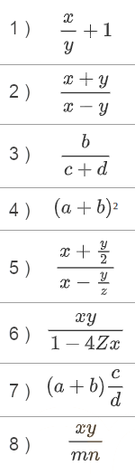
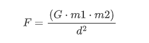

<div class="interactive-progress-tracker">
  <div class="tracker-header">
    <span>🏆 <strong>Progrés d'aquesta secció:</strong> <span class="tracker-count">0 de 4 superats (0%)</span></span>
    <span class="tracker-pts">⭐ <strong>0 punts</strong></span>
  </div>
  <div class="tracker-bar">
    <div class="tracker-fill" style="width: 0%;"></div>
  </div>
</div>

# Activitats pràctiques UT1

> **📌 Empaquetar activitats**
> 

> Empaqueta les activitats, dins de la carpeta **`ut01/bloqueX`**

## Bloc 1.0

> **📌 Empaquetar activitats**
> 

> Aquestes activitats poden ser realitzades en paper si el consideras oportuno. També es admet en programes com 'Draw.io'.

### Activitat 01

Usant els exemples de representació d'algoritmes edtudiats en els primers apartats de la unitat, crea **el pseudocodi i diagrama de flux** dels següents exercicis. *Són exercicis relativament senzills, l'objectiu és que pensemos què passos són necessaris i de què condicions hauríem d'avaluar per a continuar:*

1. Calcular el major de tres números.

1. Verificar si un número és positiu, negatiu o zero.

1. Intercanvi de valors de dos variables.

1. Comprovar si un número està dins d'un rang.

1. Determinar si una persona és major d'edat.

1. Comprovar si un número  de 5 xifres és capicúa.

1. Verificar si un número és parell o impar.

1. Calcular la mitjana de 3 números.

1. Determinar si un any és bisiesto.

1. Calcular l'àrea d'un triangulo.

## Bloc 1.1

> **📌 Empaquetar activitats**
> 

> Crea un document PDF amb la solució a les següents activitats.

### Activitat 02

Escriu les següents expressions seguint la sintaxi de Java.

        



### Activitat 03

Indica quals seran els valors de les variables després d'executar cada un dels següents fragments de codi. **Resol l'exercici sense escriure els programes corresponents i probar-los:**

prova 1
    `int a=3, b = 2;     a = b + b;     b = a + a;`

prova 2
    `int a=3,b=0;     b = b - 1;     a = a + b;`

prova 3
    `int a, b=5;   b++;    ++b;    a= b+1;`

prova 4
    `int a = 5,b;     b = a++;`

prova 5
    `int a = 5,b;  b = ++a;`

prova 6
    `int a=2, b=3;     b+=a;`

prova 7
    `int a=2, b=3;     b-=a;   a=-b;`

prova 8
    `int a=2, b=3;     b%=a;`

prova 9
    `int a=2,b=3,c=4;  a = --b + c++;  b+=a;`

### Activitat 04

Siguen 4 variables enteras:

```java
int m, j, p, v ;
```

que contenen respectivament l'edat de Miguel, Juliol, Pablo i Vicente.

Expressar les següents afirmacions utilitzant operadors lògics i relacionals

Exemple:  `Miguel es mayor de edad.`

Solució: `m >= 18`

1. *Miguel és menor d'edat.*

1. *Miguel és major que Juliol*

1. *Miguel és el més viejo.*

1. *Miguel és el més joven.*

1. *Miguel  no és el més joven.*

1. *Miguel no és el més viejo.*

1. *Algun d'ells és major d'edat.*

1. *Miguel i Juliol són els més jóvenes.*

1. *Entre tots tenen més de 100 anys.*

1. *Entre Miguel i Juliol suman més edat que Pablo.*

1. *Entre Miguel i Juliol suman més edat que Pablo i Vicente juntos.*

1. *Si els ordenamos per edades de menor a major, Juliol és el segon.*

1. *Si els ordenamos per edades de menor a major, Juliol és el segon i Pablo el tercer.*

1. *Almenys un d'ells és menor d'edat.*

1. *Almenys dos d'ells són menors d'edat.*

1. *Tots són menors d'edat.*

1. *Només dos d'ells són menors d'edat.*

1. *Almenys dos d'ells nacieron el mateix any.*

1. *Només dos d'ells nacieron el mateix any.*

1. *Almenys un d'ells és menor que Juliol*

1. *Només un d'ells és menor que Juliol*

1. *Miguel és major d'edat i algun dels altres és menor d'edat.*

## Bloc 1.2

### Activitat 06

Indicar què valor retornarà l'ejecució del següent programa:

```java
public class activ06 {
    public static void main(String[] args) {
        int num = 5;
        num += num - 1 * 4 + 1;
        System.out.println(num);
    }
}
```

### Activitat 07

Indicar què valor retornarà l'ejecució del següent programa:

```java
public class activ07 {
    public static void main(String[] args) {
        int num = 4;
        num %= 7 * num % 3 * 3;
        System.out.println(num);
    }
}
```

### Activitat 08

Provar la E/S elemental: Escriu el xicotet programa que apareix a continuació.

```java
import java.util.*;

public class EntradaSalida {
    public static void main (String arg[]){
        Scanner sc = new Scanner(System.in);
        int a, b;
        System.out.println("Introduce un número entero");
        a = sc.nextInt();
        System.out.println("Introduce otro número entero");
        b = sc.nextInt();
        System.out.println("Los números introducidos son " + a + " y " + b);
    }
}
```

Ejecútalo per a veure com es comporta el programa.

- Què ocorre si quan ens demana un número enter li donem un número real? I si li donem un caràcter no numèric?

- Què ocorre si eliminamos la instrucció `import java.util.*`;

### Activitat 09

Averigua mitjançant pruebas:

1. És possible escriure dos instruccions en la mateixa línia d'un programa?

1. Es pot "romper" una instrucció entre diverses línies?

1. Alguns llenguatges de programació donen un valor per defecte a les variables quan les declaramos sense inicializar-les. Altres no permeten usar el contingut d'una variable que no haja sigut prèviament inicialitzada. Quin és comportament de Java?

### Activitat 10

Crea un programa on creus variables per als següents dades:

- Nom

- Inicial del nom

- Cognoms

- Inicials (nom i cognoms)

- Població

- Edat

- Indicador de si creu que va a aprobar programació

- Hores a la setmana que dedica a estudiar (mínim un quart d'hora).

Pots utilitzar el següent codi per a començar i emplenar el cos del mètode `main` amb la qual cosa consideres.

```java
public class DatosPersonales {
    public static void main (String arg[]){

    }
}
```

### Activitat 11

Modifica el programa anterior perquè siga l'usuari el que introduzca la informació a emmagatzemar en les variables. Utilitza la libreria 'Scanner' importandola amb l'ordre `import java.util.*`

## Bloc 1.3

> **📌 Empaquetar activitats**
> 

> Empaqueta les activitats, dins de la carpeta **`ut01/bloque3`**

### Activitat 12

Modificar el següent programa perquè compile i funcione:

```java
public class activ12 {
    public static void main(String[] args) {
        int n1 = 50, n2 = 30,
        boolean suma = 0;
        suma = n1 + n2;
        System.out.println("LA SUMA ES: " + suma);
    }
}
```

### Activitat 13

Modificar el següent programa perquè compile i funcione:

```java
public class activ13 {
    public static void main(String[] args) { 
        int numero = 2;
        cuad = numero * número;
        System.out.println("EL CUADRADO DE "+NUMERO+" ES: "+cuad);
    }
}
```

### Activitat 14

Fes un programa que demane a l'usuari tres números reals i mostre per pantalla el resultat de multiplicar-los.

### Activitat 15

Realitza un conversor de pesetas a euros (`euros = pesetas / 166.386`). 
La quantitat de pesetas que es vol convertir ha de ser introducida pel usuari. Una vegada hecha la conversió, es mostrarà per pantalla el resultat en pesetas i en euros.

### Activitat 16

Escriu un programa que calcule l'àrea d'un triángulo ( `area = (base * altura) / 2` ).
La base i l'alçària han de ser introduïdes pel usuari. Al finalitzar el calculo, el programa mostrarà el resultat per pantalla. 

### Activitat 17

Realitza un conversor de KB a MB. ( `MB = KB/1024` ). La quantitat de KB ha de ser introducida pel usuari.

### Activitat 18

Experimenta què passa si en el següent programa inicializas la variable *realLlarg* amb un valor amb diversos decimals. El programa continua compilant?. Què resultat dóna? Després inténtalo assignant un valor superior al rang dels enters (*per exemple, 3000000000.0*).

```java
public class ConversionExplicita {
    public static void main (String [] args) {
        double realLlarg = 300.0;
        // Asignación incorrecta. ¿Un real tiene decimales, no?
        long enterLlarg = (long) realLlarg;
        // Asignación incorrecta. ¿Un entero largo tiene un rango mayor que un entero, no?
        int enter = (int) enterLlarg;
        System.out.println (enter);
    }
}
```

## Bloc 1.4

> **📌 Empaquetar activitats**
> 

> Empaqueta les activitats, dins de la carpeta **`ut01/bloque4`**

### Activitat 19

Fes un programa que mostre en pantalla de forma tabulada la taula de veritat d'una expressió de disyunció entre dos variables booleanas.

### Activitat 20 `Fuerza`

La fuerza d'atracció entre dos masas m1 i m2 separades per una distància d, està donada per la fórmula:

    



*on G és la constant de gravitació universal G= 6.693 · 10 ^(–11).*

Escriure un programa que lea la masa de dos cuerpos i la distància entre ells i a continuació obtenga la seua fuerza d'atracció.

### Activitat 21 `Circulo`

Escriure un programa que calcule la longitud de la circunferencia i l'àrea del cercle per a un valor del ràdio introduït per teclat.

### Activitat 22

Realitzar un programa que calcule el preu d'un producte tenint en compte que el producte val 120 €, té un descompte del 15% i el IVA que es li aplica és del 21%.

## Bloc 1.5

> **📌 Empaquetar activitats**
> 

> Empaqueta les activitats, dins de la carpeta **`ut01/bloque5`**

### Activitat 23 `Medidas`

Escriure un programa que convertisca una mesura donada en pies als seus equivalents en *yardas*, *polzades*, *centímetros*  i *metros*, sabent que:

   1 *peu* = 12 *polzades*

   1 *yarda* = 3 *pies*

   1 *polzada* = 2.54 *cm*

   1 *m* = 100 *cm*

### Activitat 24 `UltimaCifra`

Escriure un programa que mostre la última xifra d'un número enter que introdueix l'usuari per teclat. *Pista: Què retorna a%10 ?*

```java
Introduce un número entero: 3761
La última cifra de 3761 es 1
```

### Activitat 25 `PenultimaCifra`

Escriure un programa que mostre la penúltima xifra d'un número enter que introdueix l'usuari per teclat.

```java
Introduce un número entero: 3761
La última cifra de 3761 es 6
```

Una vegada hayas comprobado que el programa funciona correctament, prova què ocorre si l'usuari introdueix un valor d'una sola xifra (per exemple 4). Explica el resultat mostrat pel programa.

### Activitat 26 `Redondear1`

`Math.round(x)` redondea x de manera que aquest queda sense decimals. (*`Math.round(35.5289)` dóna com resultat `36`)*

Tracta d'escriure un programa en el que l'usuari introduzca un número real i a continuació es mostre redondeado a un només decimal. 

*Pista : combinar productes, divisions i Math.round()*

Exemple d'ejecució:

```java
Introduce un número real: 35.5289
El número 35.5289, redondeado a un decimal es 35.5
```

### Activitat 27

Realitza un programa en Java que genere el número premiado del Cupón de la ONZE. 

*Pista: Usa Math.random()*


---

## 🎮 Reptes Interactius d'Autoavaluació (+100 XP)

Comprova el teu domini sobre **Activitats pràctiques UT1** superant aquests 4 reptes gamificats (+25 punts cadascun):

<div class="interactive-mcq" data-answer="A" data-hint="Revisa els conceptes teòrics i pràctics d'aquesta secció.">
  <div class="mcq-question">🎯 <strong>Repte 1 (+25 pts):</strong> Quin component de l'ecosistema Java s'encarrega d'interpretar i executar el codi intermedari (Bytecode .class) fent que el programa siga independent de la plataforma?</div>
  <div class="mcq-options">
    <button type="button" class="btn-mcq-opt" data-opt="A">A) La Màquina Virtual de Java (JVM - Java Virtual Machine).</button>
    <button type="button" class="btn-mcq-opt" data-opt="B">B) L'editor de text Notepad.</button>
    <button type="button" class="btn-mcq-opt" data-opt="C">C) El sistema gestor de bases de dades SQLite.</button>
    <button type="button" class="btn-mcq-opt" data-opt="D">D) Cap de les anteriors és correcta.</button>
  </div>
  <div class="quiz-feedback"></div>
</div>

<div class="interactive-mcq" data-answer="D" data-hint="Comprova l'apartat corresponent de la unitat.">
  <div class="mcq-question">🎯 <strong>Repte 2 (+25 pts):</strong> Segons les convencions de codi net (Clean Code) en Java, com s'han d'anomenar les classes i les constants?</div>
  <div class="mcq-options">
    <button type="button" class="btn-mcq-opt" data-opt="A">A) Les classes en minúscules amb guions i les constants en camelCase.</button>
    <button type="button" class="btn-mcq-opt" data-opt="B">B) Tots els identificadors han de començar per un número.</button>
    <button type="button" class="btn-mcq-opt" data-opt="C">C) Cap de les anteriors és correcta.</button>
    <button type="button" class="btn-mcq-opt" data-opt="D">D) Les classes en PascalCase (p. ex. CompteBancari) i les constants en UPPER_SNAKE_CASE (p. ex. IVA_GENERAL).</button>
  </div>
  <div class="quiz-feedback"></div>
</div>

<div class="interactive-vf" data-answer="V" data-hint="Verifica l'afirmació amb els apunts de la unitat.">
  <div class="vf-statement">✅ <strong>Repte 3 (Vertader o Fals · +25 pts):</strong> En Java, la classe String és immutable i per a comparar el contingut de dues cadenes de text s'ha d'utilitzar el mètode .equals() en lloc de l'operador ==.</div>
  <div class="vf-buttons">
    <button type="button" class="btn-vf" data-opt="V">Vertader (V)</button>
    <button type="button" class="btn-vf" data-opt="F">Fals (F)</button>
  </div>
  <div class="quiz-feedback" style="width: 100%;"></div>
</div>

<div class="interactive-quiz" data-answer="javac" data-hint="Java Compiler (5 lletres).">
  <div class="quiz-question">⌨️ <strong>Repte 4 (+25 pts):</strong> Quina ordre del JDK s'utilitza en la terminal per a compilar un fitxer font HolaMundo.java i generar HolaMundo.class?</div>
  <div class="quiz-controls">
    <input type="text" class="quiz-input" placeholder="Escriu la resposta..." />
    <button type="button" class="btn-quiz-check">Comprovar</button>
  </div>
  <div class="quiz-feedback"></div>
</div>

### 📋 Llista de Comprovació i Rúbrica d'Assoliment

Marca cada criteri a mesura que completes l'estudi o la resolució pràctica d'aquesta pàgina (**Activitats pràctiques UT1**):

- [ ] He llegit detingudament la teoria o l'enunciat d'aquesta secció i he anotat els conceptes clau.
- [ ] He revisat els esquemes, taules o blocs de codi i he verificat que sé aplicar-los a l'entorn de treball.
- [ ] He resolt correctament els **4 reptes interactius** superiors obtenint els **100 punts XP**.
- [ ] He descarregat el comprovant oficial en PDF per a adjuntar-lo a la tasca d'**Aules**.

<div class="aules-delivery-card">
  <h3>📤 Comprovant de Lliurament per a Aules</h3>
  <p>Quan hages completat els reptes interactius i la llista d'autoavaluació d'aquesta pàgina, introdueix el teu nom i descarrega el teu certificat oficial en PDF per a adjuntar-lo a la tasca d'<strong>Aules</strong>.</p>
  <div class="aules-student-field">
    <label for="aules-student-name">👤 Nom i Cognoms de l'Alumne/a:</label>
    <input type="text" id="aules-student-name" class="aules-student-name" placeholder="Ex: Joan Garcia Pérez" />
  </div>
  <div class="aules-score-badge">
    <span class="aules-score-count">0/4 reptes completats (0%) · 0 punts · 0/4 criteris d'autoavaluació</span>
  </div>
  <div class="aules-actions">
    <button type="button" class="btn-aules-dl" data-module="PRG" data-unit="UD01" data-activity="ut01actividades">📥 Descarregar Comprovant PDF</button>
    <button type="button" class="btn-aules-copy">📋 Copiar Resum al Porta-retalls</button>
  </div>
  <div class="aules-toast"></div>
</div>

