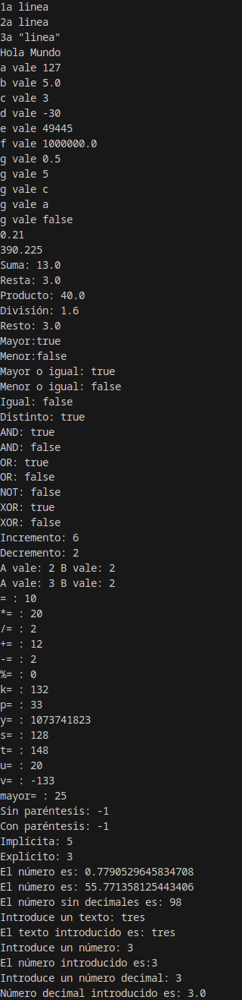

<div class="interactive-progress-tracker">
  <div class="tracker-header">
    <span>🏆 <strong>Progrés d'aquesta secció:</strong> <span class="tracker-count">0 de 4 superats (0%)</span></span>
    <span class="tracker-pts">⭐ <strong>0 punts</strong></span>
  </div>
  <div class="tracker-bar">
    <div class="tracker-fill" style="width: 0%;"></div>
  </div>
</div>

# Exemples guiats UT1

> **📌 Exemple unitat 01**
> 

#### 📌 Java

```java
// variable de clase precisa static para poder usarse dentro de la funcion main()
    static double dto = 0.25;

    public static void main(String[] args) {

        // Declaración y asignación de valores a variables
        byte a;
        a = 127;
        short c = 3;
        int d = -30;
        int e = 0xC125;
        long l = 5L;
        char car1 = 99; //car1 es la letra "c" equivale al ascii 99
        char letra = '\u0061'; //código unicode del carácter "a"
        double b = 5F;
        double f = 1e6;
        float g = 1 / 2F;
        boolean par = false;

        // Declaración y asignación constantes y literales
        final double IVA = 0.21;
        System.out.println("1a linea\n2a linea\n3a \"linea\"");

        //Muestra por pantalla literales y contenidos de variables.
        System.out.println("Hola Mundo");
        System.out.println("a vale " + a);
        System.out.println("b vale " + b);
        System.out.println("c vale " + c);
        System.out.println("d vale " + d);
        System.out.println("e vale " + e);
        System.out.println("f vale " + f);
        System.out.println("g vale " + g);
        System.out.println("g vale " + l);
        System.out.println("g vale " + car1);
        System.out.println("g vale " + letra);
        System.out.println("g vale " + par);

        // uso de la constante
        double precio = 430;
        double preciofinal = precio + ((precio - (precio * dto)) * IVA) - (precio * dto);
        System.out.println(IVA);
        System.out.println(preciofinal);

        // Operadores aritméticos
        double num1, num2, suma, resta, producto, division, resto;
        num1 = 8;
        num2 = 5;
        suma = num1 + num2;     // 13
        resta = num1 - num2;    // 3
        producto = num1 * num2; // 40
        division = num1 / num2; // 1.6
        resto = num1 % num2;    // 3
        System.out.println("Suma: " + suma);
        System.out.println("Resta: " + resta);
        System.out.println("Producto: " + producto);
        System.out.println("División: " + division);
        System.out.println("Resto: " + resto);

        // Operadores Relacionales
        int valor1 = 10;
        int valor2 = 3;
        boolean compara;
        compara = valor1 > valor2; // true
        System.out.println("Mayor:" + compara);
        compara = valor1 < valor2; // false
        System.out.println("Menor:" + compara);
        compara = valor1 >= valor2; // true
        System.out.println("Mayor o igual: " + compara);
        compara = valor1 <= valor2; // false
        System.out.println("Menor o igual: " + compara);
        compara = valor1 == valor2; // false
        System.out.println("Igual: " + compara);
        compara = valor1 != valor2; // true
        System.out.println("Distinto: " + compara);

        //Operadores Lógicos
        double sueldo = 1400;
        int edad = 34;
        boolean logica;
        logica = (sueldo > 1000 & edad < 40);  //true
        System.out.println("AND: " + logica);
        logica = (sueldo > 1000 && edad > 40); //false
        System.out.println("AND: " + logica);
        logica = (sueldo > 1000 | edad > 40);  //true
        System.out.println("OR: " + logica);
        logica = (sueldo < 1000 || edad > 40); //false
        System.out.println("OR: " + logica);
        logica = !(edad < 40);                 //false
        System.out.println("NOT: " + logica);
        logica = (sueldo > 1000 ^ edad > 40);  //true
        System.out.println("XOR: " + logica);
        logica = (sueldo < 1000 ^ edad > 40);  //false
        System.out.println("XOR: " + logica);

        //Operadores Unarios o Unitarios
        int m = 5, n = 3;
        m++; // 6
        n--; // 2
        System.out.println("Incremento: " + m);
        System.out.println("Decremento: " + n);

        int A = 1, B;
        B = ++A; // A vale 2 y B vale 2
        System.out.println("A vale: " + A + " B vale: " + B);
        B = A++; // A vale 3 y B vale 2
        System.out.println("A vale: " + A + " B vale: " + B);

        //Operadores de Asignación
        int dato1 = 10, dato2 = 2, dato;
        dato = dato1;   // dato vale 10
        System.out.println("= : " + dato);
        dato2 *= dato1; // dato2 vale20
        System.out.println("*= : " + dato2);
        dato2 /= dato1; // datos2 vale 2
        System.out.println("/= : " + dato2);
        dato2 += dato1; // dato2 vale 12
        System.out.println("+= : " + dato2);
        dato2 -= dato1; // dato2 vale 2
        System.out.println("-= : " + dato2);
        dato1 %= dato2; // dato1 vale 0
        System.out.println("%= : " + dato1);

        // Operadores de desplazamiento
        int j = 33;
        int k = j << 2;
        // 00000000000000000000000000100001 : j = 33
        // 00000000000000000000000010000100 : k = 33 << 2 ; k = 132
        System.out.println("k= : " + k);
        int o = 132;
        int p = o >> 2;
        // 00000000000000000000000010000100 : o = 132  
        // 00000000000000000000000000100001 : p = 132 >> 2 ; p = 33
        System.out.println("p= : " + p);
        int x = -1;
        int y = x >>> 2;
        // 11111111111111111111111111111111 : x = -1
        // 00111111111111111111111111111111 : y = x >>> 2; y = 1073741823
        System.out.println("y= : " + y);
        int q = 132;   // q: 00000000000000000000000010000100
        int r = 144;   // r: 00000000000000000000000010010000
        int s = q & r; // s: 00000000000000000000000010000000 
        // El resultado da 128
        System.out.println("s= : " + s);
        int t = q | r; // t: 00000000000000000000000010010100 
        // El resultado da 148
        System.out.println("t= : " + t);
        int u = q ^ r; // u: 00000000000000000000000000010100 
        // El resultado da 20 
        System.out.println("u= : " + u);
        int v = ~q;    // v: 11111111111111111111111101111011 
        // El resultado da -133 
        System.out.println("v= : " + v);

        // Operador condicional
        int mayor, exp1 = 15, exp2 = 25;
        mayor=(exp1>exp2)?exp1:exp2;
        // mayor valdrá 25
        System.out.println("mayor= : " + mayor);

        // Prioridad de los operadores
        int x1, y1 = 6, y2 = 2, y3 = 8;
        x1 = y1 + y2 * y3; //22
        System.out.println("Sin paréntesis: " + x);
        x1 = (y1 + y2) * y3; // 64
        System.out.println("Con paréntesis: " + x);

        // Conversión Implícita
        byte origen = 5;
        short destino;
        destino = origen; // 5
        System.out.println("Implícita: " + destino);

        // Conversión Explícita
        byte destino2;
        short origen2 = 3;
        destino2 = (byte) origen2; // 3
        System.out.println("Explícito: " + destino2);

        // comentario de una sola línea

        /* Esto es un comentario
        de varias líneas */

        /** Comentario de documentación.
        Javadoc extrae los comentarios del código y
        genera un archivo html a partir de este tipo de comentarios
        */

        //Generar número aleatorios
        double numero;
        int entero;
        numero = Math.random();
        System.out.println("El número es: "+numero);
        numero = Math.random()*100;
        System.out.println("El número es: "+numero);
        entero = (int)(Math.random()*100);
        System.out.println("El número sin decimales es: "+entero);

        //Introducir texto desde teclado
        String texto;
        System.out.print("Introduce un texto: ");
        texto = System.console().readLine();
        System.out.println("El texto introducido es: "+ texto);

        //Introducir un número entero desde teclado
        String texto2;
        int entero2;
        System.out.print("Introduce un número: ");
        texto2 = System.console().readLine();
        entero2 = Integer.parseInt(texto2);
        System.out.println("El número introducido es:"+entero2);

        //Introducir un número decimal desde teclado
        String texto3;
        double doble3;
        System.out.print("Introduce un número decimal: ");
        texto3 = System.console().readLine();
        doble3 = Double.parseDouble(texto3); // convertimos texto a doble
        System.out.println("Número decimal introducido es: "+doble3);
    }
}
```

#### 📌 Resultat




---

## 🎮 Reptes Interactius d'Autoavaluació (+100 XP)

Comprova el teu domini sobre **Exemples guiats UT1** superant aquests 4 reptes gamificats (+25 punts cadascun):

<div class="interactive-mcq" data-answer="A" data-hint="Revisa els conceptes teòrics i pràctics d'aquesta secció.">
  <div class="mcq-question">🎯 <strong>Repte 1 (+25 pts):</strong> Quin component de l'ecosistema Java s'encarrega d'interpretar i executar el codi intermedari (Bytecode .class) fent que el programa siga independent de la plataforma?</div>
  <div class="mcq-options">
    <button type="button" class="btn-mcq-opt" data-opt="A">A) La Màquina Virtual de Java (JVM - Java Virtual Machine).</button>
    <button type="button" class="btn-mcq-opt" data-opt="B">B) L'editor de text Notepad.</button>
    <button type="button" class="btn-mcq-opt" data-opt="C">C) El sistema gestor de bases de dades SQLite.</button>
    <button type="button" class="btn-mcq-opt" data-opt="D">D) Cap de les anteriors és correcta.</button>
  </div>
  <div class="quiz-feedback"></div>
</div>

<div class="interactive-mcq" data-answer="D" data-hint="Comprova l'apartat corresponent de la unitat.">
  <div class="mcq-question">🎯 <strong>Repte 2 (+25 pts):</strong> Segons les convencions de codi net (Clean Code) en Java, com s'han d'anomenar les classes i les constants?</div>
  <div class="mcq-options">
    <button type="button" class="btn-mcq-opt" data-opt="A">A) Les classes en minúscules amb guions i les constants en camelCase.</button>
    <button type="button" class="btn-mcq-opt" data-opt="B">B) Tots els identificadors han de començar per un número.</button>
    <button type="button" class="btn-mcq-opt" data-opt="C">C) Cap de les anteriors és correcta.</button>
    <button type="button" class="btn-mcq-opt" data-opt="D">D) Les classes en PascalCase (p. ex. CompteBancari) i les constants en UPPER_SNAKE_CASE (p. ex. IVA_GENERAL).</button>
  </div>
  <div class="quiz-feedback"></div>
</div>

<div class="interactive-vf" data-answer="V" data-hint="Verifica l'afirmació amb els apunts de la unitat.">
  <div class="vf-statement">✅ <strong>Repte 3 (Vertader o Fals · +25 pts):</strong> En Java, la classe String és immutable i per a comparar el contingut de dues cadenes de text s'ha d'utilitzar el mètode .equals() en lloc de l'operador ==.</div>
  <div class="vf-buttons">
    <button type="button" class="btn-vf" data-opt="V">Vertader (V)</button>
    <button type="button" class="btn-vf" data-opt="F">Fals (F)</button>
  </div>
  <div class="quiz-feedback" style="width: 100%;"></div>
</div>

<div class="interactive-quiz" data-answer="javac" data-hint="Java Compiler (5 lletres).">
  <div class="quiz-question">⌨️ <strong>Repte 4 (+25 pts):</strong> Quina ordre del JDK s'utilitza en la terminal per a compilar un fitxer font HolaMundo.java i generar HolaMundo.class?</div>
  <div class="quiz-controls">
    <input type="text" class="quiz-input" placeholder="Escriu la resposta..." />
    <button type="button" class="btn-quiz-check">Comprovar</button>
  </div>
  <div class="quiz-feedback"></div>
</div>

### 📋 Llista de Comprovació i Rúbrica d'Assoliment

Marca cada criteri a mesura que completes l'estudi o la resolució pràctica d'aquesta pàgina (**Exemples guiats UT1**):

- [ ] He llegit detingudament la teoria o l'enunciat d'aquesta secció i he anotat els conceptes clau.
- [ ] He revisat els esquemes, taules o blocs de codi i he verificat que sé aplicar-los a l'entorn de treball.
- [ ] He resolt correctament els **4 reptes interactius** superiors obtenint els **100 punts XP**.
- [ ] He descarregat el comprovant oficial en PDF per a adjuntar-lo a la tasca d'**Aules**.

<div class="aules-delivery-card">
  <h3>📤 Comprovant de Lliurament per a Aules</h3>
  <p>Quan hages completat els reptes interactius i la llista d'autoavaluació d'aquesta pàgina, introdueix el teu nom i descarrega el teu certificat oficial en PDF per a adjuntar-lo a la tasca d'<strong>Aules</strong>.</p>
  <div class="aules-student-field">
    <label for="aules-student-name">👤 Nom i Cognoms de l'Alumne/a:</label>
    <input type="text" id="aules-student-name" class="aules-student-name" placeholder="Ex: Joan Garcia Pérez" />
  </div>
  <div class="aules-score-badge">
    <span class="aules-score-count">0/4 reptes completats (0%) · 0 punts · 0/4 criteris d'autoavaluació</span>
  </div>
  <div class="aules-actions">
    <button type="button" class="btn-aules-dl" data-module="PRG" data-unit="UD01" data-activity="ut01ejemplos">📥 Descarregar Comprovant PDF</button>
    <button type="button" class="btn-aules-copy">📋 Copiar Resum al Porta-retalls</button>
  </div>
  <div class="aules-toast"></div>
</div>

