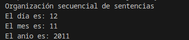
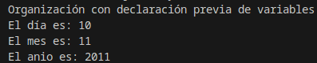
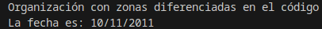

<div class="interactive-progress-tracker">
  <div class="tracker-header">
    <span>🏆 <strong>Progrés d'aquesta secció:</strong> <span class="tracker-count">0 de 4 superats (0%)</span></span>
    <span class="tracker-pts">⭐ <strong>0 punts</strong></span>
  </div>
  <div class="tracker-bar">
    <div class="tracker-fill" style="width: 0%;"></div>
  </div>
</div>

# 2.2 Sentències i blocs

Aquest epígrafe l'utilitzarem per a reafirmar qüestions que són obvias i que en el transcurso d'anteriors unitats es han donat per sabides. Encara que, a vegades, és convenient recordar. El farem com un conjunt de FAQs:

- 

**Com es escriu un programa senzill?** Si volem que un programa senzill realitze instruccions o sentències per a obtindre un determinat resultat, és necessari col·locar éstas una darrere de la una altra, exactament en l'ordre en que han d'executar-se.

- 

**Podrien colocar-se totes les sentències una darrere d'una altra, separades per punts i comes en una mateixa línia?** Clar que sí, però no és molt recomanable. Cada sentència ha d'estar escrita en una línia, d'aquesta manera el teu codi serà molt més llegible i la localització d'errors en els teus programes serà més senzilla i ràpida. De fet, quan s'utilitzen eines de programació, els errors solen asociar-se a un número o números de línia.

- 

**Pot una mateixa sentència ocupar diverses línies en el programa?** Sí. Existeixen sentències que, per la seua mida, poden generar diverses línies. Però sempre finalizarán amb un punt i coma.

- 

**En Java totes les sentències es acaben amb punt i coma?** Sí. Si darrere d'una sentència ha de vindre una altra, posarem un punt i coma. Escrivint la següent sentència en una nova línia. Però en algunes ocasions, sobre tot quan utilitzem estructures de control de flux, darrere de la capçalera d'una estructura d'aquest tipus no ha de colocar-se punt i coma. No et preocupes, el entenderás quan analicemos cada una d'elles.

- 

**Què és la sentència nula en Java?** La sentència nula és una línia que no conté cap instrucció i en la que només existeix un punt i coma. Com el seu nom indica, aquesta sentència no fa res.

- 

**Què és un bloc de sentències?** És un conjunt de sentències que es tanca entre claus i que es ejecutaría com si fóra una única ordre. Serveix per a agrupar sentències i per a clarificar el codi. Els blocs de sentències són utilitzats en Java en la pràctica totalitat d'estructures de control de flux, classes, mètodes, etc. La següent taula mostra dos formes de construir un bloc de sentències.

| Bloc de sentències 1 | Bloc de sentències 2 |
| --- | --- |
| `{sentencia1; sentencia2; ...; sentenciaN;}` | `{` `sentencia1;` `sentencia2;` `...;` `sentenciaN;` } |

- **En un bloc de sentències, éstas han d'estar colocades amb un ordre exacte?** En certs casos sí, encara que si al final de la seua ejecució s'obté el mateix resultat, podrien ocupar diferents posicions en el nostre programa.

> **📌 Has de conèixer**
> 

> Observa els tres fitxers que et ofrecemos a continuació i compara el seu codi font. Verás que els tres obtenen el mateix resultat, però l'organització de les sentències que els componen és diferent entre ells.

<details markdown="1">

<summary>💡 Exemple 1</summary>

En aquest primer fitxer, les sentències estan colocades en ordre seqüencial.

#### 📌 Java

```java
package organizacion_sentencias1;
    /*
     * Organización de sentencias secuencial
     */
    public class Organizacion_sentencias_1 {
      public static void main(String[] args) {
        System.out.println ("Organización secuencial de sentencias");
        int dia=12;
        System.out.println ("El día es: " + dia);
        int mes=11;
        System.out.println ("El mes es: " + mes);
        int anio=2011;
         System.out.println ("El anio es: " + anio);
    }
}
```

#### 📌 Resultat



</details>

<details markdown="1">

<summary>💡 Exemple 2</summary>

En aquest segon fitxer, es declaran al principi les variables necessàries. En Java no és imprescindible fer-ho així, però sí que abans d'utilitzar qualsevol variable ésta ha d'estar prèviament declarada. Encara que la declaració d'aquesta variable pot hacerse en qualsevol lloc del nostre programa.

#### 📌 Java

```java
package organizacion_sentencias2;
    /*
     * Organización de sentencias con declaración previa de variables
     */
    public class Organizacion_sentencias_2 {
      public static void main(String[] args) {
        // Zona de declaración de variables
        int dia=10;
        int mes=11;
        int anio=2011;
        System.out.println ("Organización con declaración previa de variables");
        System.out.println ("El día es: " + dia);
        System.out.println ("El mes es: " + mes);
        System.out.println ("El anio es: " + anio);
    }
}
```

#### 📌 Resultat



</details>

<details markdown="1">

<summary>💡 Exemple 3</summary>

En aquest tercer fitxer, podràs apreciar que es ha organitzat el codi en les següents parts: declaració de variables, petició de dades d'entrada, processament d'aquestes dades i obtenció de l'eixida. Aquest tipus d'organització està més estandaritzada i fa que els nostres programes ganen en legibilitat.

#### 📌 Java

```java
package organizacion_sentencias3;
    /*
     * Organización de sentencias en zonas diferenciadas
     * según las operaciones que se realicen en el código
     */
    public class Organizacion_sentencias_3 {
      public static void main(String[] args) {
        // Zona de declaración de variables
        int dia;
        int mes;
        int anio;
        String fecha;
        //Zona de inicialización o entrada de datos
        dia=10;
        mes=11;
        anio=2011;
        fecha="";
        //Zona de procesamiento
        fecha=dia+"/"+mes+"/"+anio;
        //Zona de salida
        System.out.println ("Organización con zonas diferenciadas en el código");
        System.out.println ("La fecha es: " + fecha);
    }
}
```

#### 📌 Resultat



</details>


---

## 🎮 Reptes Interactius d'Autoavaluació (+100 XP)

Comprova el teu domini sobre **2.2 Sentències i blocs** superant aquests 4 reptes gamificats (+25 punts cadascun):

<div class="interactive-mcq" data-answer="A" data-hint="Revisa els conceptes teòrics i pràctics d'aquesta secció.">
  <div class="mcq-question">🎯 <strong>Repte 1 (+25 pts):</strong> Quina diferència fonamental hi ha entre un bucle 'while' i un bucle 'do-while' en Java?</div>
  <div class="mcq-options">
    <button type="button" class="btn-mcq-opt" data-opt="A">A) El bucle 'while' avalua la condició abans d'entrar (pot executar-se 0 vegades), mentre que 'do-while' l'avalua al final (s'executa com a mínim 1 vegada).</button>
    <button type="button" class="btn-mcq-opt" data-opt="B">B) El bucle 'do-while' no necessita punt i coma final ni condició booleana.</button>
    <button type="button" class="btn-mcq-opt" data-opt="C">C) El bucle 'while' només funciona amb variables de tipus String.</button>
    <button type="button" class="btn-mcq-opt" data-opt="D">D) Cap de les anteriors és correcta.</button>
  </div>
  <div class="quiz-feedback"></div>
</div>

<div class="interactive-mcq" data-answer="D" data-hint="Comprova l'apartat corresponent de la unitat.">
  <div class="mcq-question">🎯 <strong>Repte 2 (+25 pts):</strong> Quin bloc d'estructura s'utilitza en Java per a capturar i gestionar possibles errors en temps d'execució (com InputMismatchException en llegir amb Scanner)?</div>
  <div class="mcq-options">
    <button type="button" class="btn-mcq-opt" data-opt="A">A) switch - case</button>
    <button type="button" class="btn-mcq-opt" data-opt="B">B) if - else</button>
    <button type="button" class="btn-mcq-opt" data-opt="C">C) Cap de les anteriors és correcta.</button>
    <button type="button" class="btn-mcq-opt" data-opt="D">D) try - catch</button>
  </div>
  <div class="quiz-feedback"></div>
</div>

<div class="interactive-vf" data-answer="V" data-hint="Verifica l'afirmació amb els apunts de la unitat.">
  <div class="vf-statement">✅ <strong>Repte 3 (Vertader o Fals · +25 pts):</strong> La sentència 'break' dins d'un bucle finalitza immediatament l'execució del bucle, mentre que 'continue' salta a la següent iteració.</div>
  <div class="vf-buttons">
    <button type="button" class="btn-vf" data-opt="V">Vertader (V)</button>
    <button type="button" class="btn-vf" data-opt="F">Fals (F)</button>
  </div>
  <div class="quiz-feedback" style="width: 100%;"></div>
</div>

<div class="interactive-quiz" data-answer="finally" data-hint="Comença per 'final' i acaba en 'ly'.">
  <div class="quiz-question">⌨️ <strong>Repte 4 (+25 pts):</strong> Quina paraula clau de Java permet executar un bloc de codi al final d'un try-catch tant si s'ha produït una excepció com si no?</div>
  <div class="quiz-controls">
    <input type="text" class="quiz-input" placeholder="Escriu la resposta..." />
    <button type="button" class="btn-quiz-check">Comprovar</button>
  </div>
  <div class="quiz-feedback"></div>
</div>

### 📋 Llista de Comprovació i Rúbrica d'Assoliment

Marca cada criteri a mesura que completes l'estudi o la resolució pràctica d'aquesta pàgina (**2.2 Sentències i blocs**):

- [ ] He llegit detingudament la teoria o l'enunciat d'aquesta secció i he anotat els conceptes clau.
- [ ] He revisat els esquemes, taules o blocs de codi i he verificat que sé aplicar-los a l'entorn de treball.
- [ ] He resolt correctament els **4 reptes interactius** superiors obtenint els **100 punts XP**.
- [ ] He descarregat el comprovant oficial en PDF per a adjuntar-lo a la tasca d'**Aules**.

<div class="aules-delivery-card">
  <h3>📤 Comprovant de Lliurament per a Aules</h3>
  <p>Quan hages completat els reptes interactius i la llista d'autoavaluació d'aquesta pàgina, introdueix el teu nom i descarrega el teu certificat oficial en PDF per a adjuntar-lo a la tasca d'<strong>Aules</strong>.</p>
  <div class="aules-student-field">
    <label for="aules-student-name">👤 Nom i Cognoms de l'Alumne/a:</label>
    <input type="text" id="aules-student-name" class="aules-student-name" placeholder="Ex: Joan Garcia Pérez" />
  </div>
  <div class="aules-score-badge">
    <span class="aules-score-count">0/4 reptes completats (0%) · 0 punts · 0/4 criteris d'autoavaluació</span>
  </div>
  <div class="aules-actions">
    <button type="button" class="btn-aules-dl" data-module="PRG" data-unit="UD02" data-activity="ut0202">📥 Descarregar Comprovant PDF</button>
    <button type="button" class="btn-aules-copy">📋 Copiar Resum al Porta-retalls</button>
  </div>
  <div class="aules-toast"></div>
</div>

