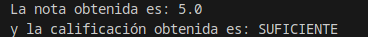
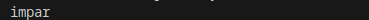
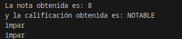

<div class="interactive-progress-tracker">
  <div class="tracker-header">
    <span>🏆 <strong>Progrés d'aquesta secció:</strong> <span class="tracker-count">0 de 4 superats (0%)</span></span>
    <span class="tracker-pts">⭐ <strong>0 punts</strong></span>
  </div>
  <div class="tracker-bar">
    <div class="tracker-fill" style="width: 0%;"></div>
  </div>
</div>

# 2.3 Estructures de selecció (if-else, switch)

Com conseguimos que els nostres programes puguen prendre decisions? Per a començar, el farem a través de les estructures de selecció. Aquestes estructures constan d'una sentència especial de decisió i d'un conjunt de seqüències d'instruccions.

El funcionament és senzill, la sentència de decisió serà evaluada i ésta retornarà un valor (vertader o fals), en funció del valor retornat s'executarà una seqüència d'instruccions o una altra.

> **📌 Exemple**
> 

> Per exemple, si el valor d'una variable és major o igual que 5 es imprime per pantalla la paraula APROBADO i si és menor, es imprime SUSPENSO. Per a aquest exemple, la comprovació del valor de la variable serà la sentència especial de decisió. La impressió de la paraula APROBADO serà una seqüència d'instruccions i la impressió de la paraula SUSPENSO serà una altra. Cada seqüència estarà associada a cada un dels resultats que pot arrojar l'avaluació de la sentència especial de decisió.

Les estructures de selecció es divideixen en:

- 

Estructures de selecció simples o estructura **if**.

- 

Estructures de selecció composta o estructura **if­else**.

- 

Estructures de selecció basades en el **operador condicional**.

- 

Estructures de selecció múltiples o estructura **switch**.

A continuació, detallarem les característiques i funcionament de cada una d'elles. És important que a través dels exemples que veurem, pugues determinar en què circunstancias utilitzar cada una d'aquestes estructures. Encara que un mateix problema pot ser resuelto amb diferents estructures i fins i tot, amb diferents combinacions d'éstas.

## 1. Estructura `if`, `if ­else`, `if else if`

L'estructura `if` és una estructura de selecció o estructura condicional, en la que es avalua una expressió lògica o sentència de decisió i en funció del resultat, s'executa una sentència o un bloc d'éstas.
L'estructura `if` pot presentar-se de les següents formes:

### 1.1 Estructura `if` simple

```java
if (expresión-lógica)
    sentencia1;
```

```java
if (expresión-lógica)
{
    sentencia1;
    sentencia2;
    ...;
    sentenciaN;
}
```

Si l'avaluació de l'expressió‐lògica ofereix un resultat vertader, s'executa la sentencia1 o bé el bloc de sentències associat. Si el resultat d'aquesta avaluació és fals, no s'executarà cap instrucció associada a l'estructura condicional.

<details markdown="1">

<summary>💡 Exemple `if`</summary>

#### 📌 Java

```java
int edad = 22;
if (edad > 18) {
    System.out.printf("%d es mayor que 18\n", edad);
}
```

#### 📌 Resultat


</details>

### 1.2 Estructura `if` de doble alternativa

```java
if (expresión-lógica)
    sentencia1;
else
    sentencia2;
```

```java
if (expresión-lógica){
    sentencia1;
    ...;
    sentenciaN;
} else {
    sentencia1;
    ...;
    sentenciaN;
}
```

Si l'avaluació de l'expressió‐lògica ofereix un resultat vertader, s'executarà la primera sentència o el primer bloc de sentències. Si, pel contrari, l'avaluació de l'expressió‐lògica ofereix un resultat fals, no s'executarà la primera sentència o el primer bloc i sí s'executarà la segona sentència o el segon bloc.

> **📌 Funcionament d'un `if`**
> 

> Fent una interpretació cercana al pseudocodi tindríem que si es compleix la condició (expressió lògica), s'executarà un conjunt d'instruccions i si no es compleix, s'executarà un altre conjunt d'instruccions. 

<details markdown="1">

<summary>💡 Exemple `if-else`</summary>

#### 📌 Java

```java
int temperatura = 22;
if (temperatura > 25) {
    System.out.println("Debemos abrigarnos!");
} else {
    System.out.println("Voy a ponerme pantalón corto.");
}
```

#### 📌 Resultat


</details>

Cal tindre en compte que la clàusula `else` de la sentència `if` no és obligatòria. En alguns casos no necessitarem utilitzar-la, però sí es recomana quan és necessari dur a terme alguna acció en el cas que l'expressió lògica no es complisca.

En aquells casos en els que no existeix clàusula `else`, si l'expressió lògica és falsa, simplement es continuarán executant les següents sentències que apareguen sota l'estructura condicional `if`.

Els condicionals `if` e `if-else` poden anidar-se, de tal forma que dins d'un bloc de sentències pot incluir-se un altre `if` o `if-else`. El nivell d'anidament queda a criteri del programador, però si éste és massa profundo podria provocar problemes d'eficiència i legibilitat en el codi. En altres ocasions, un nivell d'anidament excesivo pot denotar la necessitat d'utilització d'altres estructures de selecció més adequades.

Quan s'utilitza anidament d'aquest tipus d'estructures, és necessari posar especial atenció en saber a què `if` està associada una clàusula `else`. Normalment, un `else` estarà associat amb el `if` inmediatament superior o més cercano que existisca dins del mateix bloc i que no es trobe ja associat a un altre `else`.

**Estructura `if else if`.**

Aquesta estructura és una alternativa a l'anidació de sentències `if else` funciona de mode que si es compleix una condició executa unes sentències i el cas contrari comprova una altra condició executant unes sentències si es compleix i així sucesivament. Vegem un exemple amb `if` imbricats:

```java
if (condicion1) {
    sentencias1;
} else {
    if (condicion2) {
        sentencias2;
    } else {
        if (condicion3) {
            sentencias3;
        } else {
            sentencias4;
        }
    }
}
```

El mateix exemple usant `if else if` quedaria d'aquesta manera:

```java
if (condicion1) {
    sentencias1;
} else if (condicion2) {
    sentencias2;
} else if (condicion3) {
    sentencias3;
} else {
    sentencias4;
}
```

<details markdown="1">

<summary>💡 Exemple `if-else-if`</summary>

#### 📌 Java

```java
int temperatura = 3;
boolean nevando = true;

if (temperatura > 25) {
    // Si la temperatura es mayor que 25 ...
    System.out.println("A la playa!!!");

} else if (temperatura > 15) {
    // si es mayor que 15 y no es mayor que 25 ..
    System.out.println("A la montaña!!!");

} else if (temperatura < 5 && nevando) {
    // si es menor que 5 y esta nevando y no es mayor que 15 ni mayor que 25
    System.out.println("A esquiar!!!");

} else {
    // si la tempera  no es mayor que 25 ni que 15 ni menor que 5 si esta nevando
    System.out.println("A descansar... zZz");
}
```

#### 📌 Resultat


</details>

<details markdown="1">

<summary>💡 Exemple complet `if` e `if-else`</summary>

Per a completar la informació que has de saber sobre les estructures `if` e `if‐else`, observa el següent codi. En ell podràs analitzar el programa que realitza el càlcul de la nota d'un examen de tipus test. A més de calcular el valor de la nota, es ofereix com eixida la qualificació no numèrica d'aquest examen. Per a obtenerla, es combinarán les diferents estructures condicionals aprendides fins a ara.
Presta especial atenció als comentaris incorporats en el codi font, així com a la forma de combinar les estructures condicionals i a les expressions lògiques utilitzades en elles.

#### 📌 Java

```java
public class Sentencias_Condicionales {
    /* Realizar el cálculo de la nota de un examen de tipo test.
     * Para ello, tendremos en cuenta el númerototal de pregunta, 
     * los aciertos y los errores. Dos errores anulan una respuesta correcta.
     * Finalmente, se muestra por pantalla la nota obtenida, así
     * como su calificación no numérica.
     *
     * La obtención de la calificación no numérica se ha realizado
     * combinando varias estructuras condicionales, mostrando expresiones
     * lógicas compuestas, así como anidamiento.
     */
    public static void main(String[] args) {
        // Declaración e inicialización de variables
        int num_aciertos = 12;
        int num_errores = 3;
        int num_preguntas = 20;
        float nota = 0;
        String calificacion = "";

        //Procesamiento de datos
        nota = ((num_aciertos - (num_errores / 2)) * 10) / num_preguntas;

        if (nota < 5) {
            calificacion = "INSUFICIENTE";
        } else {
            /* Cada expresión lógica de estos if está compuesta por dos
             * expresiones lógicas combinadas a través del operador Y o AND
             * que se representa con el símbolo &&. De tal manera, que para
             * que la expresión lógica se cumpla (sea verdadera) la variable
             * nota debe satisfacer ambas condiciones simultáneamente
             */
            if (nota >= 5 && nota < 6) {
                calificacion = "SUFICIENTE";
            }
            if (nota >= 6 && nota < 7) {
                calificacion = "BIEN";
            }
            if (nota >= 7 && nota < 9) {
                calificacion = "NOTABLE";
            }
            if (nota >= 9 && nota <= 10) {
                calificacion = "SOBRESALIENTE";
            }
        }

        //Salida de información
        System.out.println("La nota obtenida es: " + nota);
        System.out.println("y la calificación obtenida es: " + calificacion);
    }
}
```

#### 📌 Resultat



</details>

## 2. Operador ternario `(?:)`

El **operador condicional (`? :`)** avalua una condició booleana i retorna un valor si es compleix (`true`) o un altre si no es compleix (`false`), tot en una única expressió:

```java
resultado = (condicion) ? valorSiVerdadero : valorSiFalso;
```

**Condicions:**

- 

La condició ha de ser una expressió booleana, és a dir, que es evalúe com `true` o `false`.

- 

Si la condició es compleix (true), l'operador retorna el valor indicat després del signe d'interrogació `?`.

- 

Si la condició no es compleix (false), retorna el valor indicat després dels dos punts `:`.

- 

L'operador condicional pot utilitzar-se tant per a assignar valors a variables com dins d'expressions més complexes.

- 

Els valors devueltos en totes dues ramas (vertader i fals) han de ser del mateix tipus o de tipus compatibles.

<details markdown="1">

<summary>💡 Exemple operador condicional `(?:)`</summary>

#### 📌 Java

```java
int numero = 8;
    String resultado = (numero % 2 == 0) ? "par" : "impar";
    System.out.println("El número es " + resultado);
```

#### 📌 Resultat

El número és parell

</details>

### 2.1 Ternarios imbricats i indentació (*Clean Code*)

Quan necessitem triar entre **tres o més opcions**, podem encadenar un altre operador ternario després dels dos punts (`:`). 

Perquè el codi siga llegible i fàcil de mantindre, **mai l'escribas en una sola línia llarga**; indéntalo en diverses línies alineant els signes `?` i `:` com una escala de decisió:

<details markdown="1">

<summary>💡 Exemple: Indentació de ternarios imbricats</summary>

```java
int numero = 0;

// ❌ Mal: difícil de leer en una sola línea
// String signo = (numero > 0) ? "Positivo" : (numero < 0) ? "Negativo" : "Cero";

// ✅ Bien: indentado por niveles de decisión
String signo = (numero > 0) ? "Positivo"
             : (numero < 0) ? "Negativo"
             : "Cero";

System.out.println("El número es: " + signo);
```

</details>

> **📌 Activitat `ClasificadorNotas`**
> 

#### 📌 Enunciat

> Escriu un programa en Java anomenat `ClasificadorNotas.java` que demane a l'usuari una nota entera entre `0` i `10` per teclat (`Scanner`) i, **utilitzant únicament l'operador ternario (`? :`)** (sense usar sentències `if`), mostre per pantalla:

> 1. **Ternario simple:** Una variable `estado` que almacene `"Aprobado"` si la nota és major o igual a 5, o `"Suspendido"` en cas contrari.

> 1. **Ternario imbricat (indentat en diverses línies):** Una variable `calificacion` que almacene:

> 1. `"Insuficiente"` si la nota és menor que 5.

> 1. `"Suficiente"` si és menor que 6.

> 1. `"Bien"` si és menor que 7.

> 1. `"Notable"` si és menor que 9.

> 1. `"Sobresaliente"` en cas contrari.

#### 📌 Exemple d'ejecució

```java
Introduce tu nota (0-10): 7
Estado: Aprobado
Calificación: Notable
```

#### 📌 Pista

Si en el primer nivell ja has comprobado `nota < 5`, en el següent escalón (`:`) ja saps que la nota és com a mínim 5, per la qual cosa basta amb avaluar `nota < 6`.

#### 📌 Lliurament

Revisa que els noms de classe i variables complisquen les convencions de Java (`UpperCamelCase` i `lowerCamelCase`), comprova la indentació en VSCode i **puja el fitxer `ClasificadorNotas.java` a la tasca corresponent en Aules**.

## 3. Estructura `switch`

Què podem fer quan el nostre programa ha de triar entre més de dos alternatives? Una possible solució podria ser emprar estructures if imbricades, encara que no sempre aquesta solució és la més eficient. Quan estem ante aquestes situacions podem utilitzar l'estructura de selecció múltiple `switch`. En la següent taula es mostra tant la sintaxi, com el funcionament d'aquesta estructura.

**Sintaxi:**

```java
switch (expresion) {
    case valor1:
        sentencia1_1;
        sentencia1_2;
        ....
        break;
    case valor2:
    ....
        case valorN:
        sentenciaN_1;
        sentenciaN_2;
        ....
        break;
    default:
        sentencias-default;
}
```

**Condicions:**

- On *expressió* ha de ser del tipus `char`, `byte`, `short` o `int`, i les *constants* de cada `case` han de ser d'aquest tipus o d'un tipus compatible.

- La `expresion` ha d'anar entre parèntesis.

- Cada `case` portarà associat un `valor` i es finalizará amb dos punts (`:`).

- El bloc de sentències associat a la clàusula `default` pot finalitzar amb una sentència de ruptura `break` o no.

**Funcionament:**

- Les diferents alternatives d'aquesta estructura estaran precedides de la clàusula *case* que s'executarà quan el valor associat al case coincida amb el valor obtingut a l'avaluar l'expressió del switch.

- En les clàusules *case*, no poden indicar-se expressions condicionals, rangs de valors o llistes de valors (altres llenguatges de programació sí el permeten). Caldrà associar una clàusula *case* a cada un dels valors que deban ser tenits en compta.

- La clàusula *default* serà utilitzada per a indicar un cas per defecte, les sentències associades a la clàusula *default* es ejecutarán si cap dels valors indicats en les clàusules *case* coincideix amb el resultat de l'avaluació de l'expressió de l'estructura switch.

- La clàusula *default* pot no existir, i per tant, si cap case ha sigut activado finalizaría el switch.

- Cada clàusula *case* pot portar associades una o diverses sentències, sense necessitat de delimitar aquests blocs per mitjà de claus.

- En el moment en el que el resultat de l'avaluació de l'expressió coincideix amb algun dels valors associats a les clàusules *case*, es ejecutarán totes les instruccions associades fins a l'aparició d'una sentència break de ruptura (la sentència break es analizará en epígrafes posteriors).

### 3.1. Expressions switch mejorades

En les [novetats de Java 12](https://picodotdev.github.io/blog-bitix/2019/03/novedades-de-java-12/) es añadió la possibilitat dels switch fueran expressions que retornan un valor en compte de sentències i es evita l'ús de la paraula reservada break.

<details markdown="1">

<summary>💡 Exemple `switch` mejorada</summary>

#### 📌 Java

```java
int entero = 5;

String numericString = switch (entero) {
    case 0 -> "cero";
    case 1, 3, 5, 7, 9 -> "impar";
    case 2, 4, 6, 8, 10 -> "par";
    default -> "error";
};
System.out.println(numericString); //impar
```

#### 📌 Resultat



</details>

En Java 13 en compte d'únicament el valor a retornar es permet crear blocs de sentències per a cada rama `case` i retornar el valor amb la paraula reservada `yield`. En els blocs de sentències pot haver algun càlcul més complex que directament retornar el valor desitjat.

<details markdown="1">

<summary>💡 Exemple `switch` amb `yield`</summary>

```java
int entero2 = 4;

String numericString2 = switch (entero2) {
    case 0 -> {
        String value = calculaCero();
        yield value;
    }
    case 1, 3, 5, 7, 9 -> {
        String value = calculaImpar();
        yield value;
    }

    case 2, 4, 6, 8, 10 -> {
        String value = calculaPar();
        yield value;
    }

    default -> {
        String value = calculaDefecto();
        yield value;
    }
};
System.out.println(numericString); //calculaPar()
```

</details>

En resum, es ha de comparar el valor d'una expressió amb un conjunt de constants, si el valor de l'expressió coincideix amb algun valor d'aquestes constants, es ejecutarán els blocs d'instruccions associats a cada una d'elles. Si no existiese coincidencia, es ejecutarían una sèrie d'instruccions per defecte.

<details markdown="1">

<summary>💡 Exemple complet `switch`</summary>

Comprova el següent fragment de codi en el que es resol el càlcul d'un examen de tipus test, utilitzant l'estructura `switch`.

#### 📌 Java

```java
public class P3_2_condicional_switch {

    /*
     * Realizar el cálculo de la nota de un examen de tipo test. 
     * Para ello, tendremos en cuenta el número total de preguntas, los aciertos y
     * los errores. Dos errores anulan una respuesta correcta.
     *
     * La nota que vamos a obtener será un número entero.
     *
     * Finalmente, se muestra por pantalla la nota obtenida, así como su
     * calificación no numérica.
     *
     * La obtención de la calificación no numérica se ha realizado utilizando la
     * estructura condicional múltiple o switch.
     *
     */
    public static void main(String[] args) {
        // Declaración e inicialización de variables
        int num_aciertos = 17;
        int num_errores = 3;
        int num_preguntas = 20;
        int nota = 0;
        String calificacion = "";
        //Procesamiento de datos
        nota = ((num_aciertos - (num_errores / 2)) * 10) / num_preguntas;
        switch (nota) {
            case 5:
                calificacion = "SUFICIENTE";
                break;
            case 6:
                calificacion = "BIEN";
                break;
            case 7:
                calificacion = "NOTABLE";
                break;
            case 8:
                calificacion = "NOTABLE";
                break;
            case 9:
                calificacion = "SOBRESALIENTE";
                break;
            case 10:
                calificacion = "SOBRESALIENTE";
                break;
            default:
                calificacion = "INSUFICIENTE";
        }
        //Salida de información
        System.out.println("La nota obtenida es: " + nota);
        System.out.println("y la calificación obtenida es: " + calificacion);

        //Expresiones switch mejoradas JAVA 12
        int entero = 5;

        String numericString = switch (entero) {
            case 0 -> "cero";
            case 1, 3, 5, 7, 9 -> "impar";
            case 2, 4, 6, 8, 10 -> "par";
            default -> "error";
        };
        System.out.println(numericString); //impar

        //Expresiones switch mejoradas JAVA 13

        int entero2 = 4;

        String numericString2 = switch (entero2) {
            case 0 -> {
                String value = calculaCero();
                yield value;
            }
            case 1, 3, 5, 7, 9 -> {
                String value = calculaImpar();
                yield value;
            }

            case 2, 4, 6, 8, 10 -> {
                String value = calculaPar();
                yield value;
            }

            default -> {
                String value = calculaDefecto();
                yield value;
            }
        };
        System.out.println(numericString); //calculaPar()
    }
    static String calculaCero() {return "";};
    static String calculaImpar() {return "";};
    static String calculaPar() {return "";};
    static String calculaDefecto() {return "";};
}
```

#### 📌 Resultat



</details>


---

## 🎮 Reptes Interactius d'Autoavaluació (+100 XP)

Comprova el teu domini sobre **2.3 Estructures de selecció (if-else, switch)** superant aquests 4 reptes gamificats (+25 punts cadascun):

<div class="interactive-mcq" data-answer="A" data-hint="Revisa els conceptes teòrics i pràctics d'aquesta secció.">
  <div class="mcq-question">🎯 <strong>Repte 1 (+25 pts):</strong> Quina diferència fonamental hi ha entre un bucle 'while' i un bucle 'do-while' en Java?</div>
  <div class="mcq-options">
    <button type="button" class="btn-mcq-opt" data-opt="A">A) El bucle 'while' avalua la condició abans d'entrar (pot executar-se 0 vegades), mentre que 'do-while' l'avalua al final (s'executa com a mínim 1 vegada).</button>
    <button type="button" class="btn-mcq-opt" data-opt="B">B) El bucle 'do-while' no necessita punt i coma final ni condició booleana.</button>
    <button type="button" class="btn-mcq-opt" data-opt="C">C) El bucle 'while' només funciona amb variables de tipus String.</button>
    <button type="button" class="btn-mcq-opt" data-opt="D">D) Cap de les anteriors és correcta.</button>
  </div>
  <div class="quiz-feedback"></div>
</div>

<div class="interactive-mcq" data-answer="D" data-hint="Comprova l'apartat corresponent de la unitat.">
  <div class="mcq-question">🎯 <strong>Repte 2 (+25 pts):</strong> Quin bloc d'estructura s'utilitza en Java per a capturar i gestionar possibles errors en temps d'execució (com InputMismatchException en llegir amb Scanner)?</div>
  <div class="mcq-options">
    <button type="button" class="btn-mcq-opt" data-opt="A">A) switch - case</button>
    <button type="button" class="btn-mcq-opt" data-opt="B">B) if - else</button>
    <button type="button" class="btn-mcq-opt" data-opt="C">C) Cap de les anteriors és correcta.</button>
    <button type="button" class="btn-mcq-opt" data-opt="D">D) try - catch</button>
  </div>
  <div class="quiz-feedback"></div>
</div>

<div class="interactive-vf" data-answer="V" data-hint="Verifica l'afirmació amb els apunts de la unitat.">
  <div class="vf-statement">✅ <strong>Repte 3 (Vertader o Fals · +25 pts):</strong> La sentència 'break' dins d'un bucle finalitza immediatament l'execució del bucle, mentre que 'continue' salta a la següent iteració.</div>
  <div class="vf-buttons">
    <button type="button" class="btn-vf" data-opt="V">Vertader (V)</button>
    <button type="button" class="btn-vf" data-opt="F">Fals (F)</button>
  </div>
  <div class="quiz-feedback" style="width: 100%;"></div>
</div>

<div class="interactive-quiz" data-answer="finally" data-hint="Comença per 'final' i acaba en 'ly'.">
  <div class="quiz-question">⌨️ <strong>Repte 4 (+25 pts):</strong> Quina paraula clau de Java permet executar un bloc de codi al final d'un try-catch tant si s'ha produït una excepció com si no?</div>
  <div class="quiz-controls">
    <input type="text" class="quiz-input" placeholder="Escriu la resposta..." />
    <button type="button" class="btn-quiz-check">Comprovar</button>
  </div>
  <div class="quiz-feedback"></div>
</div>

### 📋 Llista de Comprovació i Rúbrica d'Assoliment

Marca cada criteri a mesura que completes l'estudi o la resolució pràctica d'aquesta pàgina (**2.3 Estructures de selecció (if-else, switch)**):

- [ ] He llegit detingudament la teoria o l'enunciat d'aquesta secció i he anotat els conceptes clau.
- [ ] He revisat els esquemes, taules o blocs de codi i he verificat que sé aplicar-los a l'entorn de treball.
- [ ] He resolt correctament els **4 reptes interactius** superiors obtenint els **100 punts XP**.
- [ ] He descarregat el comprovant oficial en PDF per a adjuntar-lo a la tasca d'**Aules**.

<div class="aules-delivery-card">
  <h3>📤 Comprovant de Lliurament per a Aules</h3>
  <p>Quan hages completat els reptes interactius i la llista d'autoavaluació d'aquesta pàgina, introdueix el teu nom i descarrega el teu certificat oficial en PDF per a adjuntar-lo a la tasca d'<strong>Aules</strong>.</p>
  <div class="aules-student-field">
    <label for="aules-student-name">👤 Nom i Cognoms de l'Alumne/a:</label>
    <input type="text" id="aules-student-name" class="aules-student-name" placeholder="Ex: Joan Garcia Pérez" />
  </div>
  <div class="aules-score-badge">
    <span class="aules-score-count">0/4 reptes completats (0%) · 0 punts · 0/4 criteris d'autoavaluació</span>
  </div>
  <div class="aules-actions">
    <button type="button" class="btn-aules-dl" data-module="PRG" data-unit="UD02" data-activity="ut0203">📥 Descarregar Comprovant PDF</button>
    <button type="button" class="btn-aules-copy">📋 Copiar Resum al Porta-retalls</button>
  </div>
  <div class="aules-toast"></div>
</div>

