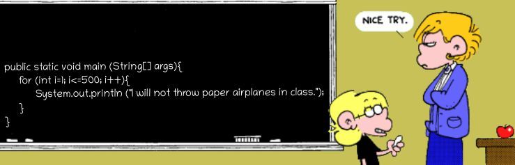
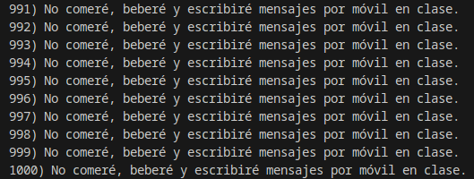
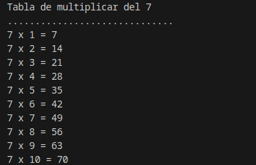
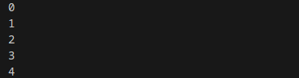
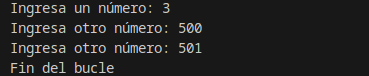
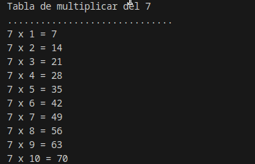
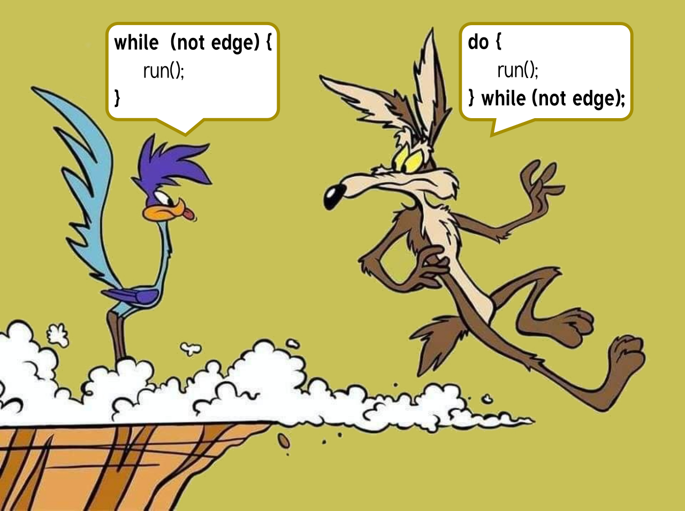
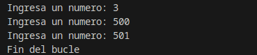
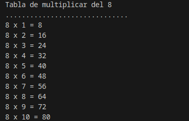
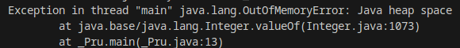

<div class="interactive-progress-tracker">
  <div class="tracker-header">
    <span>🏆 <strong>Progrés d'aquesta secció:</strong> <span class="tracker-count">0 de 4 superats (0%)</span></span>
    <span class="tracker-pts">⭐ <strong>0 punts</strong></span>
  </div>
  <div class="tracker-bar">
    <div class="tracker-fill" style="width: 0%;"></div>
  </div>
</div>

# 2.4 Estructures de repetició (while, do-while, for)

Els nostres programes ja són capaços de controlar la seua ejecució tenint en compte determinades condicions, però encara hem d'aprendre un conjunt d'estructures que ens permeta repetir una seqüència d'instruccions determinada. La funció d'aquestes estructures és repetir l'ejecució d'una sèrie d'instruccions tenint en compte una condició.
A aquest tipus d'estructures es les denomina estructures de repetició, estructures repetitivas, bucles o estructures iterativas. En Java existeixen quatre classes de bucles:

- Bucle `for` (repeteix per a).

- Bucle `for/in` (repeteix per a cada).

- Bucle `while` (repeteix mentre).

- Bucle `do while` (repeteix fins a).

Els bucles `for` i `for/in` es consideran bucles controlats per comptador. Pel contrari, els bucles `while` i `do...while` es consideran bucles controlats per successos.

La utilització d'uns bucles o altres per a solucionar un problema dependrà en gran mesura de les següents preguntes:

- Sabem a priori quantes vegades necessitem repetir un conjunt d'instruccions?

- Sabem si hem de repetir un conjunt d'instruccions si una condició satisface un conjunt de valors?

- Sabem fins a quan hem d'estar repitent un conjunt d'instruccions?

- Sabem si hem d'estar repitent un conjunt d'instruccions mentre es complisca una condició?

Aquestes i altres preguntes tindran la seua resposta en cuanto analicemos cada una d'estructures repetitivas en detall.

> **📌 Equivalencia entre estructures repetitivas**
> 

> Estudia cada tipus d'estructura repetitiva, coneix el seu funcionament i podràs arribar a la conclusió de que alguns d'aquests bucles són equivalents entre sí. Un mateix problema, podrà ser resuelto emprant diferents tipus de bucles i obtindre els mateixos resultats. 

## 1. Estructura `for`

Hem indicat anteriorment que el bucle `for` és un bucle controlat per comptador. Aquest tipus de bucle té les següents característiques:

- S'executa un número determinat de vegades.

- Utilitza una variable contadora que controla les iteracions del bucle.

En general, existeixen tres operacions que es duen a terme en aquest tipus de bucles:

- Es inicializa la variable contadora.

- Es avalua el valor de la variable comptador, per mitjà d'una comparació del seu valor amb el número d'iteracions especificat.

- Es modifica o actualitza el valor del comptador a través d'incrementos o decrementos d'éste, en cada una de les iteracions.

> **📌 Consideracions**
> 

> - La inicializació de la variable contadora ha de realizase correctament per a garantir que el bucle lleve a cabo, almenys, la primera repetició del seu codi intern.

> - La condició de terminació del bucle ha de variar en l'interior del mateix; de no ser així, podem caer en la creació d'un bucle infinit. Qüestió que s'ha d'evitar per tots els mitjans.

> - És necessari estudiar el número de vegades que es repeteix el bucle, ja que ha d'ajustar-se al número de vegades estipulado.

Sintaxi estructura `for` amb una única sentència:

```java
for (inicialización; condición; iteración)
    sentencia;
```

Sintaxi estructura `for` amb un bloc de sentències:

```java
for (inicialización; condición; iteración) {
    sentencia1;
    sentencia2;
    ...
    sentenciaN;
}
```

on:

- `inicialización` és una expressió en la que es inicializa una variable de control, que serà l'encargada de controlar el final del bucle.

- `condición` és una expressió que evaluará la variable de control. Mentre la condició siga falsa, el cos del bucle estarà repitiéndose. Quan la condició es complisca, terminará l'ejecució del bucle.

- `iteración` indica la manera en la que la variable de control va canviant en cada iteració del bucle. Podrà ser mitjançant increment o decremento, i no només d'un en un.



> **📌 Exemple `for`**
> 

#### 📌 Exemple `for`

```java
for(int i=1;i<=1000;i++)
    System.out.printf(i + ") No comeré, beberé y escribiré mensajes por móvil en clase.");
```

#### 📌 Resultat



<details markdown="1">

<summary>💡 Exemple repetició `for` per a realitzar la taula de multiplicar</summary>

Observa el següent fitxer Java i podràs analitzar un exemple d'utilització del bucle `for` per a la impressió per pantalla de la taula de multiplicar del set. Llegix atentament els comentaris inclosos en el codi, ja que aclaran algunes qüestions interesantes sobre aquest bucle.

#### 📌 Java

```java
public class Repetitiva_For {
    /* 
     * En este ejemplo se utiliza la estructura repetitiva for
     * para representar en pantalla la tabla de multiplicar del siete
     */
     public static void main(String[] args) {
        // Declaración e inicialización de variables
        int numero = 7;
        int contador;
        int resultado = 0;

        //Salida de información
        System.out.println("Tabla de multiplicar del " + numero);
        System.out.println(".............................. ");

        //Utilizamos ahora el bucle for
        for (contador = 1; contador <= 10; contador++) {
            /* La cabecera del bucle incorpora la inicialización de la variable
            * de control, la condición de multiplicación hasta el 10 y el
            * incremento de dicha variable de uno en uno en cada iteración del
            * bucle.
            * En este caso contador++ incrementará en una unidad el valor de
            * dicha variable.
            */
            resultado = contador * numero;
            System.out.println(numero + " x " + contador + " = " + resultado);
            /* A través del operador + aplicado a cadenas de caracteres,
            * concatenamos los valores de las variables con las cadenas de
            * caracteres que necesitamos para representar correctamente la
            * salida de cada multiplicación.
            */
        }
    }
}
```

#### 📌 Resultat



</details>

## 2. Estructura `for`/`in`

Al costat de l'estructura `for`, `for`/`in` també es considera un bucle controlat per comptador. Aquest bucle és una millora incorporada en la versió 5.0. de Java. 

Aquest tipus de bucles permet realitzar recorrits sobre arrays i col·leccions d'objectes. Els arrays són col·leccions de variables que tenen el mateix tipus i es referencian per un nom comú. Així mateix, les col·leccions d'objectes són objectes que es diu són iterables, o que es pot iterar sobre ells.
Aquest bucle és nombrado també com bucle `for` mejorado, o bucle `foreach`. En altres llenguatges de programació existeixen bucles molt parecits a aquest.

La sintaxi és la següent:

```java
for (declaración: expresión) {
    sentencia1;
    ...
    sentenciaN;
}
```

On...:

- `expresion` és un array o una col·lecció d'objectes.

- `declaración` és la declaració d'una variable del qual tipus siga compatible amb expressió. Normalment, serà el tipus i el nom de la variable a declarar.

> **📌 Exemple `foreach`**
> 

#### 📌 Java

```java
for (int i : Arrays.asList(0, 1, 2, 3, 4)) {
    System.out.println(i);
}
```

#### 📌 Resultat



El funcionament consisteix en que per a cada element de l'expressió, guarda l'element en la variable declarada i fes les instruccions contenides en el bucle. Després, en cada una de les iteracions del bucle tindrem en la variable declarada l'element actual de l'expressió. Per tant, per al cas dels arrays i de les col·leccions d'objectes, es recorrerá des del primer element que els forma fins a l'últim.

Observa el contingut del codi representat en la següent imatge, pots apreciar com es construeix un bucle d'aquest tipus i la seua utilització sobre un array.

Els bucles `for`/`in` permitirán al programador despreocupar-se del número de vegades que es ha d'iterar, però no sabremos en què iteració ens trobem excepte que es afegisca artificialment alguna variable contadora que ens puga oferir aquesta informació.

> **📌 Ús de la sentència `foreach`**
> 

> Aquesta estructura tomará sentit quan avancemos en el curs i vegem els **Arrays** i les **col·leccions de Objectes**.

## 3. Estructura `while`

El bucle `while` és la primera de les estructures de repetició controlades per successos que estudiarem. La utilització d'aquest bucle respon al plantejament de la següent pregunta: Què podem fer si l'únic que sabem és que es han de repetir un conjunt d'instruccions mentre es complisca una determinada condició?.

La característica fonamental d'aquest tipus d'estructura repetitiva estriba en ser útil en aquells casos en els que les instruccions que formen el cos del bucle podria ser necessari ejecutar-les o no. És a dir, en el bucle `while` sempre es evaluará la condició que el controla, i si aquesta condició és certa, el cos del bucle s'executarà una vegada, i es seguirá executant mentre la condició siga certa. Però si en l'avaluació inicial de la condició ésta no és vertadera, el cos del bucle no s'executarà.

> **📌  **
> 

> És imprescindible que en l'interior del bucle `while` es realitze alguna acció que modifique la condició que controla l'ejecució del mateix, en cas contrari estaríamos ante un bucle infinit.

Sintaxi estructura `while` amb una única sentència:

```java
while (condición)
    sentencia;
```

Sintaxi estructura `while` amb un bloc de sentències:

```java
while (condición) {
    sentencia1;
    ...
    sentenciaN;
}
```

**Funcionament:**
Mentre la condició siga certa, el bucle es repetirá, executant la/s instrucció/és del seu interior.

En el moment en el que la condició no es complisca, el control del flux del programa pasará a la següent instrucció que existisca justo darrere del bucle `while`.

La condició es evaluará sempre al principi, i podrà donar-se el cas de que les instruccions contenides en ell no arriben a executar-se mai si no es satisface la condició de partida.

> **📌 Exemple `while`**
> 

#### 📌 Java

```java
Scanner sc = new Scanner(System.in);

System.out.print("Ingresa un número: ");
int numero = sc.nextInt();

while(numero <= 500) {
    System.out.print("Ingresa otro número: ");
    numero = sc.nextInt();
}
System.out.println("Fin del bucle");
```

#### 📌 Resultat



<details markdown="1">

<summary>💡 Exemple repetició `while` per a realitzar la taula de multiplicar</summary>

#### 📌 Java

```java
public class Repetitiva_While {

    public static void main(String[] args) {
        // Declaración e inicialización de variables
        int numero = 7;
        int contador;
        int resultado = 0;
        //Salida de información
        System.out.println("Tabla de multiplicar del " + numero);
        System.out.println(".............................. ");
        //Utilizamos ahora el bucle while
        contador = 1; //inicializamos la variable contadora
        while (contador <= 10) //Establecemos la condición del bucle
        {
            resultado = contador * numero;
            System.out.println(numero + " x " + contador + " = " + resultado);
            //Modificamos el valor de la variable contadora, para hacer que el
            //bucle pueda seguir iterando hasta llegar a finalizar
            contador++;
        }
    }
}
```

#### 📌 Resultat



</details>

## 4. Estructura `do-while`

La segona de les estructures repetitivas controlades per successos és `do-while`. En aquest cas, la pregunta que ens planteamos és la següent: Què podem fer si l'únic que sabem és que es han d'executar, **almenys una vegada**, un conjunt d'instruccions i seguir repitiéndose fins a que es complisca una determinada condició?.

La característica fonamental d'aquest tipus d'estructura repetitiva estriba en ser útil en aquells casos en els que les instruccions que formen el cos del bucle necessiten ser ejecutades, almenys, una vegada i repetir la seua ejecució fins a que la condició siga vertadera. Per tant, en aquesta estructura repetitiva sempre s'executa el cos del bucle una primera vegada.

> **📌  **
> 

> És imprescindible que en l'interior del bucle es realitze alguna acció que modifique la condició que controla l'ejecució del mateix, en cas contrari estaríamos ante un bucle infinit.

Sintaxi estructura `while` amb una única sentència:

```java
do
    sentencia;
while (condición);
```

Sintaxi estructura `while` amb un bloc de sentències:

```java
do {
    sentencia1;
    ...
    sentenciaN;
} while (condición);
```

**Funcionament:**

El cos del bucle s'executa la primera vegada, a continuació es evaluará la condició i, si ésta és falsa, el cos el bucle volverá a repetir-se. El bucle finalizará quan l'avaluació de la condició siga vertadera. 

En eixe moment el control del flux del programa pasará a la següent instrucció que existisca justo darrere del bucle do‐while. La condició es evaluará sempre després d'una primera ejecució del cos del bucle, per la qual cosa no es donarà el cas de que les instruccions contenides en ell no arriben a executar-se mai.



> **📌 Exemple `do-while`**
> 

#### 📌 Java

```java
public class Repetitiva_While {

    public static void main(String[] args) {
        Scanner sc = new Scanner(System.in);
        int numero;
        do {
            System.out.print("Ingresa un numero: ");
            numero = sc.nextInt();
        }
        while(numero <= 500);
        System.out.println("Fin del bucle");
    }
}
```

#### 📌 Resultat



<details markdown="1">

<summary>💡 Exemple repetició `do-while` per a realitzar la taula de multiplicar</summary>

#### 📌 Java

```java
public class Repetitiva_DoWhile {

    public static void main(String[] args) {
        // Declaración e inicialización de variables
        int numero = 7;
        int contador;
        int resultado = 0;

        //Salida de información
        System.out.println("Tabla de multiplicar del " + numero);
        System.out.println(".............................. ");
        //Utilizamos ahora el bucle do-while
        contador = 1; //inicializamos la variable contadora
        do {
            resultado = contador * numero;
            System.out.println(numero + " x " + contador + " = " + resultado);
            //Modificamos el valor de la variable contadora, para hacer que el
            //bucle pueda seguir iterando hasta llegar a finalizar
            contador++;
        } while (contador <= 10); //Establecemos la condición del bucle
    }
}
```

#### 📌 Resultat



</details>

> **📌  Bucles infinitos **
> 

## 5. Bucles infinitos

> Un dels errors més comuns a l'implementar qualsevol tipus de bucle és que mai puga eixir, és a dir, el bucle s'executa durant un número infinit de vegades. Açò succeeix quan la condició falla per alguna raó.

> **📌 Exemple 1**
> 

```java
// bucle infinito porque la condición no es apta
// la condición; debería haber sido i>0.
for (int i = 5; i != 0; i -= 2) {
        System.out.println(i);
}
```

> **📌 Exemple 2**
> 

```java
int x = 5; 
// bucle infinito porque la actualización
// no se proporciona
while (x == 5) {
    System.out.println("En el bucle");
}
```

Un altre inconvenient és que pot estar agregant alguna cosa en el seu objecte de col·lecció a través d'un bucle i pot **quedar-se sense memòria**. Si intentas executar el següent programa, després d'un temps, es producirá una excepció de falta de memòria. 

> **📌 Exemple 3**
> 

#### 📌 Java

```java
/* Se hace uso de la colección ArrayList, pero de momento solo necesitamos saber que se comporta como un casillero al que vamos asignando elementos (que evidentemente ocupan memoria).*/
// Programa Java para la excepción de falta de memoria.
import java.util.ArrayList;
public class HeapSpace {
    public static void main(String[] args) {
        ArrayList<Integer> ar = new ArrayList<>();
        for (int i = 0; i < Integer.MAX_VALUE; i++) {
            ar.add(i);
        }
    }
}
```

#### 📌 Resultat




---

## 🎮 Reptes Interactius d'Autoavaluació (+100 XP)

Comprova el teu domini sobre **2.4 Estructures de repetició (while, do-while, for)** superant aquests 4 reptes gamificats (+25 punts cadascun):

<div class="interactive-mcq" data-answer="A" data-hint="Revisa els conceptes teòrics i pràctics d'aquesta secció.">
  <div class="mcq-question">🎯 <strong>Repte 1 (+25 pts):</strong> Quina diferència fonamental hi ha entre un bucle 'while' i un bucle 'do-while' en Java?</div>
  <div class="mcq-options">
    <button type="button" class="btn-mcq-opt" data-opt="A">A) El bucle 'while' avalua la condició abans d'entrar (pot executar-se 0 vegades), mentre que 'do-while' l'avalua al final (s'executa com a mínim 1 vegada).</button>
    <button type="button" class="btn-mcq-opt" data-opt="B">B) El bucle 'do-while' no necessita punt i coma final ni condició booleana.</button>
    <button type="button" class="btn-mcq-opt" data-opt="C">C) El bucle 'while' només funciona amb variables de tipus String.</button>
    <button type="button" class="btn-mcq-opt" data-opt="D">D) Cap de les anteriors és correcta.</button>
  </div>
  <div class="quiz-feedback"></div>
</div>

<div class="interactive-mcq" data-answer="D" data-hint="Comprova l'apartat corresponent de la unitat.">
  <div class="mcq-question">🎯 <strong>Repte 2 (+25 pts):</strong> Quin bloc d'estructura s'utilitza en Java per a capturar i gestionar possibles errors en temps d'execució (com InputMismatchException en llegir amb Scanner)?</div>
  <div class="mcq-options">
    <button type="button" class="btn-mcq-opt" data-opt="A">A) switch - case</button>
    <button type="button" class="btn-mcq-opt" data-opt="B">B) if - else</button>
    <button type="button" class="btn-mcq-opt" data-opt="C">C) Cap de les anteriors és correcta.</button>
    <button type="button" class="btn-mcq-opt" data-opt="D">D) try - catch</button>
  </div>
  <div class="quiz-feedback"></div>
</div>

<div class="interactive-vf" data-answer="V" data-hint="Verifica l'afirmació amb els apunts de la unitat.">
  <div class="vf-statement">✅ <strong>Repte 3 (Vertader o Fals · +25 pts):</strong> La sentència 'break' dins d'un bucle finalitza immediatament l'execució del bucle, mentre que 'continue' salta a la següent iteració.</div>
  <div class="vf-buttons">
    <button type="button" class="btn-vf" data-opt="V">Vertader (V)</button>
    <button type="button" class="btn-vf" data-opt="F">Fals (F)</button>
  </div>
  <div class="quiz-feedback" style="width: 100%;"></div>
</div>

<div class="interactive-quiz" data-answer="finally" data-hint="Comença per 'final' i acaba en 'ly'.">
  <div class="quiz-question">⌨️ <strong>Repte 4 (+25 pts):</strong> Quina paraula clau de Java permet executar un bloc de codi al final d'un try-catch tant si s'ha produït una excepció com si no?</div>
  <div class="quiz-controls">
    <input type="text" class="quiz-input" placeholder="Escriu la resposta..." />
    <button type="button" class="btn-quiz-check">Comprovar</button>
  </div>
  <div class="quiz-feedback"></div>
</div>

### 📋 Llista de Comprovació i Rúbrica d'Assoliment

Marca cada criteri a mesura que completes l'estudi o la resolució pràctica d'aquesta pàgina (**2.4 Estructures de repetició (while, do-while, for)**):

- [ ] He llegit detingudament la teoria o l'enunciat d'aquesta secció i he anotat els conceptes clau.
- [ ] He revisat els esquemes, taules o blocs de codi i he verificat que sé aplicar-los a l'entorn de treball.
- [ ] He resolt correctament els **4 reptes interactius** superiors obtenint els **100 punts XP**.
- [ ] He descarregat el comprovant oficial en PDF per a adjuntar-lo a la tasca d'**Aules**.

<div class="aules-delivery-card">
  <h3>📤 Comprovant de Lliurament per a Aules</h3>
  <p>Quan hages completat els reptes interactius i la llista d'autoavaluació d'aquesta pàgina, introdueix el teu nom i descarrega el teu certificat oficial en PDF per a adjuntar-lo a la tasca d'<strong>Aules</strong>.</p>
  <div class="aules-student-field">
    <label for="aules-student-name">👤 Nom i Cognoms de l'Alumne/a:</label>
    <input type="text" id="aules-student-name" class="aules-student-name" placeholder="Ex: Joan Garcia Pérez" />
  </div>
  <div class="aules-score-badge">
    <span class="aules-score-count">0/4 reptes completats (0%) · 0 punts · 0/4 criteris d'autoavaluació</span>
  </div>
  <div class="aules-actions">
    <button type="button" class="btn-aules-dl" data-module="PRG" data-unit="UD02" data-activity="ut0204">📥 Descarregar Comprovant PDF</button>
    <button type="button" class="btn-aules-copy">📋 Copiar Resum al Porta-retalls</button>
  </div>
  <div class="aules-toast"></div>
</div>

