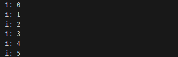
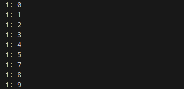
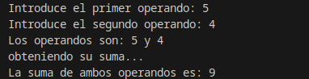

<div class="interactive-progress-tracker">
  <div class="tracker-header">
    <span>🏆 <strong>Progrés d'aquesta secció:</strong> <span class="tracker-count">0 de 4 superats (0%)</span></span>
    <span class="tracker-pts">⭐ <strong>0 punts</strong></span>
  </div>
  <div class="tracker-bar">
    <div class="tracker-fill" style="width: 0%;"></div>
  </div>
</div>

# 2.5 Sentències de salt (break, continue, return)

Saltar o no saltar? he ahí la qüestió. En la gran majoria de llibres de programació i publicacions de Internet, sempre es ens recomana que prescindamos de sentències de salt incondicional, és més, es desaconseja el seu ús per provocar una mala estructuració del codi i un increment en la dificultat per al manteniment dels mateixos. Però Java incorpora certes sentències o estructures de salt que és necessari conèixer i que poden sernos útils en algunes parts dels nostres programes.

Aquestes estructures de salt corresponen a les sentències `break`, `continue`, les etiquetes de salt i la sentència `return`. Passem ara a analitzar el seu sintaxi i funcionament.

## 1. Sentències `break` i `continue`

Es tracta de dos instruccions que permeten modificar el comportament d'altres estructures o sentències de control, simplement pel fet d'estar incloses en algun punt de la seua seqüència d'instruccions.

La sentència **`break`** incidirá sobre les estructures de control `switch`, `while`, `for` i `do- while` del següent mode:

- 

Si apareix una sentència `break` dins de la seqüència d'instruccions de qualsevol de les estructures mencionades anteriorment, aquesta estructura terminará inmediatament. 

- 

Si apareix una sentència `break` dins d'un bucle imbricat només finalizará la sentència d'iteració més interna, el resta s'executa de forma normal.

És a dir, que `break` serveix per a romper el flux de control d'un bucle, encara que no es haja cumplido la condició del bucle. Si colocamos un `break` dins del codi d'un bucle, quan es abast el `break`, automàticament es saldrá del bucle passant a executar-se la següent instrucció inmediatament després d'ell.

> **📌 Exemple `break`**
> 

#### 📌 Java

```java
public class EjemploBreak {
    public static void main(String args[]){
        for (int i = 0; i < 10; i++) {
            if(i == 6) {
                break;
            }
            System.out.println("i: " + i);
        }
    }
}
```

#### 📌 Resultat



La sentència **`continue`** incidirá sobre les sentències o estructures de control `while`, `for` i `do while` del següent mode:

- 

Si apareix una sentència `continue` dins de la seqüència d'instruccions de qualsevol de les sentències anteriorment indicades, aquesta sentència donarà per terminada la iteració actual i s'executa una nova iteració, avaluant de nou l'expressió condicional del bucle.

- 

Si apareix en l'interior d'un bucle imbricat només afectará a la sentència d'iteració més interna, el resta es ejecutaría de forma normal.

És a dir, la sentència `continue` forzará a que s'execute la següent iteració del bucle, sense tindre en compte les instruccions que pudiera haver després del `continue`, i fins al final del codi del bucle.

> **📌 Exemple `continue`**
> 

#### 📌 Java

```java
public class EjemploContinueFor {

    public static void main(String args[]){
        for (int i = 0; i < 10; i++) {
            if(i == 6) {
                continue;
            }
            System.out.println("i: " + i);
        }
    }
}
```

#### 📌 Resultat



## 2. Sentència `return`

Ja sabem com modificar l'ejecució de bucles i estructures condicionals múltiples, però *Podríem modificar l'ejecució d'un mètode*? *És possible fer que éstos detengan la seua ejecució abans de que finalice el codi associat a ells*? Sí, és possible, a través de la sentència `return` podrem conseguir-lo.
La sentència `return` pot utilitzar-se de dos formes:

- Per a acabar l'ejecució del mètode on estiga escrita, amb la qual cosa transferirá el control al punt des del que es va fer l'anomenada al mètode, continuant el programa per la sentència inmediatament posterior.

- Per a retornar o retornar un valor, sempre que al costat de `return` s'incloga una expressió d'un tipus determinat. Per tant, en el lloc on es invocó al mètode s'obtendrá el valor resultant de l'avaluació de l'expressió que acompañava al mètode.

En general, una sentència `return` sol aparèixer al final d'un mètode, d'aquesta manera el mètode tindrà una entrada i una eixida. També és possible utilitzar una sentència `return` en qualsevol punt d'un mètode, amb la qual cosa éste finalizará en el lloc on es trobe aquest `return`. 

> **📌  **
> 

> No serà recomanable incloure més d'un `return` en un mètode i per regla general, haurà d'anar al final del mètode com hem comentado.

El valor de retorn és opcional, si l'haguera hauria de de ser del mateix tipus o d'un tipus compatible al tipus del valor de retorn definit en la capçalera del mètode, podent ser des d'un enter a un objecte creat per nosaltres. Si no el tinguera, el tipus de retorn seria `void`, i `return` serviría per a eixir del mètode sense necessitat d'arribar a executar totes les instruccions que es troben després del `return`.

<details markdown="1">

<summary>💡 Exemple `return`</summary>

En el següent fitxer java encontrarás el codi d'un programa que obté la suma de dos números, emprant per a això un mètode senzill que retorna el valor de la suma dels números que es li han passat com paràmetres.  

Presta atenció als comentaris i fíjate en les conversions a enter de l'entrada dels operands per consola.

#### 📌 Java

```java
import java.io.*;

public class Sentencia_Return {

    private static BufferedReader stdin = new BufferedReader(
            new InputStreamReader(System.in));

    public static int suma(int numero1, int numero2) {
        int resultado;
        resultado = numero1 + numero2;
        return resultado; //Mediante return devolvemos el resultado de la suma
    }

    public static void main(String[] args) throws IOException {
        //Declaración de variables
        String input; //Esta variable recibirá la entrada de teclado
        int primer_numero, segundo_numero; //Estas variables almacenarán los operandos

        // Solicitamos que el usuario introduzca dos números por consola
        System.out.print("Introduce el primer operando: ");
        input = stdin.readLine(); //Leemos la entrada como cadena de caracteres
        primer_numero = Integer.parseInt(input); //Transformamos a entero lo introducido
        System.out.print("Introduce el segundo operando: ");
        input = stdin.readLine(); //Leemos la entrada como cadena de caracteres
        segundo_numero = Integer.parseInt(input); //Transformamos a entero lo introducido

        //Imprimimos los números introducidos
        System.out.println("Los operandos son: " + primer_numero + " y " + segundo_numero);
        System.out.println("obteniendo su suma... ");

        //Invocamos al método que realiza la suma, pasándole los parámetros adecuados
        System.out.println("La suma de ambos operandos es: " + 
                suma(primer_numero, segundo_numero));
    }
}
```

#### 📌 Resultat



</details>


---

## 🎮 Reptes Interactius d'Autoavaluació (+100 XP)

Comprova el teu domini sobre **2.5 Sentències de salt (break, continue, return)** superant aquests 4 reptes gamificats (+25 punts cadascun):

<div class="interactive-mcq" data-answer="A" data-hint="Revisa els conceptes teòrics i pràctics d'aquesta secció.">
  <div class="mcq-question">🎯 <strong>Repte 1 (+25 pts):</strong> Quina diferència fonamental hi ha entre un bucle 'while' i un bucle 'do-while' en Java?</div>
  <div class="mcq-options">
    <button type="button" class="btn-mcq-opt" data-opt="A">A) El bucle 'while' avalua la condició abans d'entrar (pot executar-se 0 vegades), mentre que 'do-while' l'avalua al final (s'executa com a mínim 1 vegada).</button>
    <button type="button" class="btn-mcq-opt" data-opt="B">B) El bucle 'do-while' no necessita punt i coma final ni condició booleana.</button>
    <button type="button" class="btn-mcq-opt" data-opt="C">C) El bucle 'while' només funciona amb variables de tipus String.</button>
    <button type="button" class="btn-mcq-opt" data-opt="D">D) Cap de les anteriors és correcta.</button>
  </div>
  <div class="quiz-feedback"></div>
</div>

<div class="interactive-mcq" data-answer="D" data-hint="Comprova l'apartat corresponent de la unitat.">
  <div class="mcq-question">🎯 <strong>Repte 2 (+25 pts):</strong> Quin bloc d'estructura s'utilitza en Java per a capturar i gestionar possibles errors en temps d'execució (com InputMismatchException en llegir amb Scanner)?</div>
  <div class="mcq-options">
    <button type="button" class="btn-mcq-opt" data-opt="A">A) switch - case</button>
    <button type="button" class="btn-mcq-opt" data-opt="B">B) if - else</button>
    <button type="button" class="btn-mcq-opt" data-opt="C">C) Cap de les anteriors és correcta.</button>
    <button type="button" class="btn-mcq-opt" data-opt="D">D) try - catch</button>
  </div>
  <div class="quiz-feedback"></div>
</div>

<div class="interactive-vf" data-answer="V" data-hint="Verifica l'afirmació amb els apunts de la unitat.">
  <div class="vf-statement">✅ <strong>Repte 3 (Vertader o Fals · +25 pts):</strong> La sentència 'break' dins d'un bucle finalitza immediatament l'execució del bucle, mentre que 'continue' salta a la següent iteració.</div>
  <div class="vf-buttons">
    <button type="button" class="btn-vf" data-opt="V">Vertader (V)</button>
    <button type="button" class="btn-vf" data-opt="F">Fals (F)</button>
  </div>
  <div class="quiz-feedback" style="width: 100%;"></div>
</div>

<div class="interactive-quiz" data-answer="finally" data-hint="Comença per 'final' i acaba en 'ly'.">
  <div class="quiz-question">⌨️ <strong>Repte 4 (+25 pts):</strong> Quina paraula clau de Java permet executar un bloc de codi al final d'un try-catch tant si s'ha produït una excepció com si no?</div>
  <div class="quiz-controls">
    <input type="text" class="quiz-input" placeholder="Escriu la resposta..." />
    <button type="button" class="btn-quiz-check">Comprovar</button>
  </div>
  <div class="quiz-feedback"></div>
</div>

### 📋 Llista de Comprovació i Rúbrica d'Assoliment

Marca cada criteri a mesura que completes l'estudi o la resolució pràctica d'aquesta pàgina (**2.5 Sentències de salt (break, continue, return)**):

- [ ] He llegit detingudament la teoria o l'enunciat d'aquesta secció i he anotat els conceptes clau.
- [ ] He revisat els esquemes, taules o blocs de codi i he verificat que sé aplicar-los a l'entorn de treball.
- [ ] He resolt correctament els **4 reptes interactius** superiors obtenint els **100 punts XP**.
- [ ] He descarregat el comprovant oficial en PDF per a adjuntar-lo a la tasca d'**Aules**.

<div class="aules-delivery-card">
  <h3>📤 Comprovant de Lliurament per a Aules</h3>
  <p>Quan hages completat els reptes interactius i la llista d'autoavaluació d'aquesta pàgina, introdueix el teu nom i descarrega el teu certificat oficial en PDF per a adjuntar-lo a la tasca d'<strong>Aules</strong>.</p>
  <div class="aules-student-field">
    <label for="aules-student-name">👤 Nom i Cognoms de l'Alumne/a:</label>
    <input type="text" id="aules-student-name" class="aules-student-name" placeholder="Ex: Joan Garcia Pérez" />
  </div>
  <div class="aules-score-badge">
    <span class="aules-score-count">0/4 reptes completats (0%) · 0 punts · 0/4 criteris d'autoavaluació</span>
  </div>
  <div class="aules-actions">
    <button type="button" class="btn-aules-dl" data-module="PRG" data-unit="UD02" data-activity="ut0205">📥 Descarregar Comprovant PDF</button>
    <button type="button" class="btn-aules-copy">📋 Copiar Resum al Porta-retalls</button>
  </div>
  <div class="aules-toast"></div>
</div>

