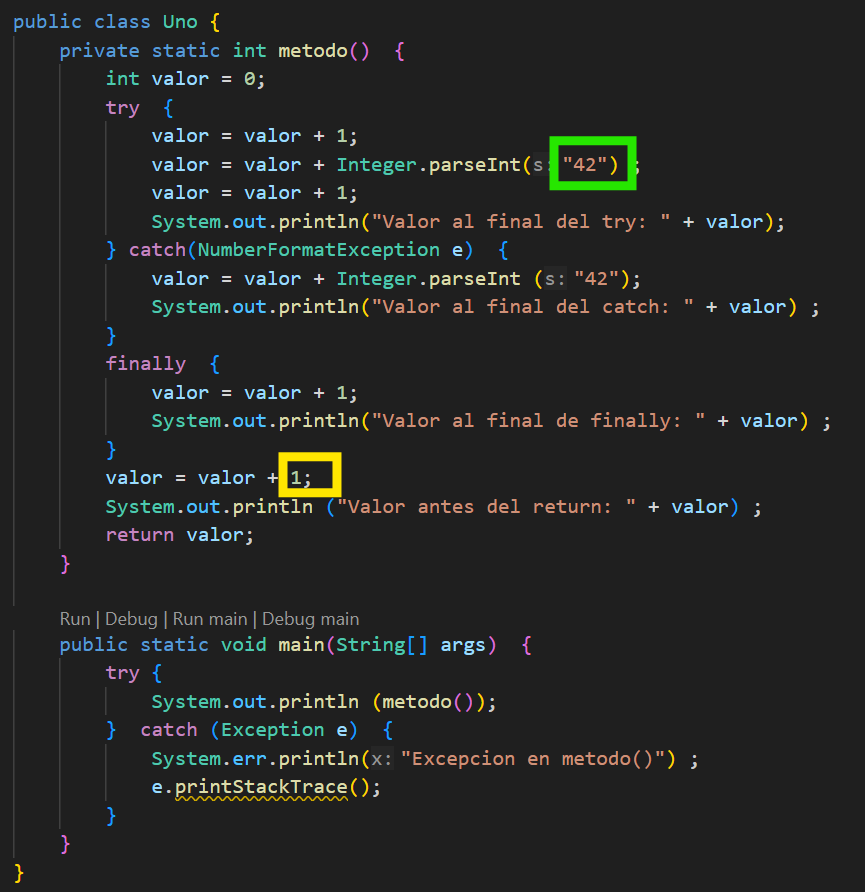

<div class="interactive-progress-tracker">
  <div class="tracker-header">
    <span>🏆 <strong>Progrés d'aquesta secció:</strong> <span class="tracker-count">0 de 4 superats (0%)</span></span>
    <span class="tracker-pts">⭐ <strong>0 punts</strong></span>
  </div>
  <div class="tracker-bar">
    <div class="tracker-fill" style="width: 0%;"></div>
  </div>
</div>

# Activitats pràctiques UT2

> **📌 Empaquetar activitats**
> 

> Empaqueta les activitats, dins de la carpeta **`ut02/bloqueX`**

## Bloc 2.1 - Estructures de selecció

### Activitat 28

Realitza un programa en Java que tinga les variables *edat*, *nivell d'estudios* e *ingresos*. En elles emmagatzemarà els valors introduïts pel usuari. 

A continuació, crea una variable `boolean`  anomenada *jasp* . Aquesta emmagatzemarà el valor vertader si l'edat és menor o igual a 28 i el nivell d'estudios és major a 3, o bé l'edat és menor de 30 i els ingresos superiors a 28000. En cas contrari emmagatzemar el valor fals.

### Activitat 01 `MenorDeDos`

Escriu un programa que mostre el menor de dos números enters introduïts per teclat.

### Activitat 02 `MenorDeTres`

Escriu un programa que mostre el menor de tres números enters introduïts per teclat. 

Fes dos versions:

- una utilitzant els operadors lògics necessaris (`&&`,`||`, ...) i 

- una altra sense utilitzar cap (caldrà usar sentències `if else` imbricades)

### Activitat 03 `NotasTexto`

Escriu un programa que acepte de l'usuari la *nota* d'un examen (valor numèric entre *1* i *10*) i mostre el literal corresponent a aquesta nota segons (*insuficiente*, *suficient*, *bé*, *notable*, *sobresaliente*).

Fer-ho utilitzant la sentència `if...else if...else`. 

La nota que introdueix l'usuari haurà de ser un valor enter.

### Activitat 04 `NotasTexto2`

Escriu un programa que acepte de l'usuari la *nota* d'un examen (valor numèric entre 1 i 10) i mostre el literal corresponent a aquesta nota segons (insuficiente, suficient, bé, notable, sobresaliente). 

Fer-ho utilitzant la sentència `switch`. 

La nota que introdueix l'usuari haurà de ser un valor enter.

### Activitat 05 `Hora`

Realitza un programa que demane una *hora* per teclat i que mostre després *bons dies*, *bones tardes* o *bones nits* segons l'hora. 

Es utilizarán els trams de *6* a *12*, de *13* a *20* i de *21* a 5 respectivament. 

Només es tenen en compta les hores, els minuts no s'han d'introduir per teclat.

### Activitat 06 `DiasDelMes2`

Escriure un programa que lea de teclat el número d'un *mes* (*1* a *12*) i visualice el número de dies que té el mes. Resoldre utilitzant la sentència `switch`.

### Activitat 07 `ParImpar`

Escriu un programa en Java que demane a l'usuari un número enter i mostre per pantalla si el número és parell o impar, utilitzant l'operador condicional `(? :)` en lloc d'una estructura `if`.

### Activitat 08 `Bisiesto`

Escriu un programa que determine si un any introduït per teclat és o no bisiesto. 

Un any és bisiesto si és múltiplo de 4 (per exemple 1984). No obstant això, els anys múltiplos de 100 no són bisiestos, excepte que siguen múltiplos de 400, en del qual cas si el són (per exemple 1800 no és bisiesto i 2000 si l'és). 

Per a fer el programa, implementa un mètode dins de la classe que reba un *any* i retorne *true* si l'any és bisiesto i *false* en cas que no els siga.

En pseudocodi seria alguna cosa així:

```java
SI ((año divisible por 4 Y año no divisible por 100) O (año divisible por 400))ENTONCES
        es bisiesto
    SINO
        no es bisiesto
    FIN_SI
```

### Activitat 09 `LetraNif`

Escriu un programa que lea de teclat un *nif* (sense guions ni punts). 

- Si el *nif* introduït porta la lletra, es comprobará si aquesta és correcta i es li indicará a l'usuari si l'és o no. 

- Si el *nif* no porta lletra, es calculará la que li correspon i es mostrarà a l'usuari. 

> **📌 Pista**
> 

> Alguns mètodes que et ayudaran són: 

```java
- String.charAt(index);
- Integer.parseInt(String);
- String.toUpperCase();
- String.length();
- String.substring(index1, index2);
```

## Bloc 2.2 - Estructures de repetició

### Activitat 10 `SencillosWhile`

Crea una classe anomenada `SencillosWhile` i crea en ella mètodes que realicen les següents tasques usant la sentència `while`:

- **`imparesHastaN`**: Donat un nº enter `n` introduït pel usuari, mostrar els números impares que hi ha entre 1 i `n`. 

  - Per exemple, si n és 8, mostrarà 1 3 5 7

- **`nImpares`**: Donat un nº enter `n` introduït pel usuari, mostrar els `n` primers números impares. 

  - Per exemple, si `n` és 3, mostrarà 1 3 5 (3 primers impares)

- **`cuentaAtras`**: Donat un enter `n` introduït pel usuari, mostrar una compta arrere partint de `n`: `n`, `n-1`, …. 5, 4, 3, 2, 1, 0

  - Per exemple, si `n`és 7, mostrarà 7 6 5 4 3 2 1 0

- **`sumaNPrimeros`**: Donat un enter `n` introduït pel usuari, mostrar la suma dels números entre 1 i `n`.

  - Per exemple, si n és 4, mostrarà 10.

- **`mostrarDivisoresN`**: Donat un enter `n` introduït pel usuari, mostrar tots els seus divisors, inclosos el 1 i el mateix `n`. 

  - Per exemple, si `n` és 12 mostraría 1, 2, 3, 4, 6 i 12

- **`sumaDivisoresN`**: Donat un enter `n` introduït pel usuari, mostrar la suma de tots els seus divisors, sense incloure al propi `n`. 

  - Per exemple, si `n` és 12 sumará 1, 2, 3, 4 i 6 = 16

Després crea un mètode `main` que comprove el funcionament de cada un dels anteriors.

### Activitat 11 `SencillosFor`

Crea una classe anomenada `SencillosFor` i crea en ella els mateixos mètodes que en el Activitat anterior, però utilitzant la sentència `for` en lloc de `while`.

### Activitat 12    `Tablas de multiplicar`

Fes dos programes, un que mostre per pantalla la taula de multiplicar del 3, i un altre, la del 5. Els dos han de ser exactament iguals, lletra per lletra, excepte en un únic literal dins de tot el codi. Has d'usar les estructures de repetició `for.`

### Activitat 13

Transforma el següent bucle for en un bucle while:

```java
for (int i=5; i<15; i++) { 
    System.out.println(i);
}
```

### Activitat 14

Crea un programa que mostre per pantalla els *5* primers números parells. 

### Activitat 15

Crea un programa que mostre els números del *1* al *100* sense mostrar els múltiplos de *5*.

### Activitat 16 `Primo`

Escriu un programa en el que l'usuari escriga un número enter i es li diga si es tracta o no d'un número primo. 
Recorda que un nº primo és aquell que només és divisible per *1* i per sí mateix.

### Activitat 17 `Signo`

Llegir un número i indicar si és positiu o negatiu. El procés es repetirá fins a que es introduzca un *0*.

> **📌 Consejo**
> 

> Usa l'operador `do...while` perquè el procés es repita fins a introduir un *0*

### Activitat 18 `Containers`

La capacitat d'un buque que transporta containers està limitada tant per la quantitat de containers com pel pes, podent transportar un màxim de *100* containers i un màxim de *700* tonelades.

Realitza un programa en el que es vaja introducent el pes dels containers (en tonelades) a mesura que es carreguen en el barco, fins a que es arribe al màxim de capacitat. Mostra al final la quantitat de containers cargats i el pes total. 

En el moment en que es desee carregar un container que faça que la carrega total supere les 700 tonelades, es donarà per finalitzada la carrega, encara que pudieran existir containers menys pesants amb possibilitat de ser cargats.

### Activitat 19 `Notas`

Realitza un programa que permeta introduir les notes d'un examen dels alumnes d'un curs. L'usuari anirà introducent les notes una després d'una altra. Es considerará finalitzat el procés d'introducció de notes quan l'usuari introduzca una nota negativa. 

Al final, el programa mostrarà:

- El número de notes introduïdes.

- El número d'aprovats (major o igual a *5* punts)

- La nota mitjana

### Activitat 20 `Billetes`

Realitzar un programa que donat un importe en euros ens indique el mínim número de billetes i la quantitat sobrante d'euros. Has d'usar `while.`

```java
¿Cuántos euros tienes?: 232
1 billete de 200 €
1 billete de 20 €
1 billete de 10 €
Sobran 2 €
```

### Activitat 21 `Segundos`

Escriure un programa que, donada una quantitat de segons, introducida per teclat, la desglose en dies, hores, minuts i segons Has d'usar `while`.

Exemple d'ejecució:

```java
Introduce cantidad de segundos: 3661
3661 segundos son:
0 dias
1 horas
1 minutos
1 segundos
```

## Bloc 2.3 - Estructures de selecció i repetició

### Activitat 22 `CuentaAdelante`

Escriu un programa que demane a l'usuari dos enters: `inicio` i `salto`. Després, mitjançant un bucle `while`, mostre tots els números començant en `inicio`, sumant `salto` cada vegada, mentre el número siga `<=100`.

- Per exemple, si `inicio = 5` i `salto = 7`, mostrarà: 5, 12, 19, 26, ..., <=100.

### Actividad 23 `CalculoIMC`

Pide al usuario su *peso (kg)* y *altura (m)* y calcula el `IMC = peso / (altura²)`. Usa condicionales `if-else` para clasificarlo según:

- < 18,5 → “bajo peso”

- 18,5-24,9 → “peso normal”

- 25-29,9 → “sobrepeso”

- >= 30 → “obesitat”

Després, repeteix el procés en un bucle `do-while` fins a que l'usuari vulga eixir (introducent alçària = 0).

### Activitat 24 `TablaMultiplicar`

Escriu un programa que demane un número enter `n` (major que 0), i un altre enter `fin` (major que 0). Mitjançant un bucle `for`, mostra la taula de multiplicar de `n`, *des de n × 1 fins a n × fi*. 

### Activitat 25 `ContadorLetras`

Demana a l'usuari que introduzca una cadena de text (String). Recorre cada caràcter amb un bucle `for` i compta, usant `condicionales`:

- Quantes vocals hi ha (a, e, i, o, u — pots ignorar tildes).

- Quantes consonantes hi ha (lletres que no són vocals).

- Quants números hi ha.

- Quants caràcters que no siguen lletres ni números.

Mostra els resultats al final.

### Activitat 26 `FizzBuzz`

Escriu un programa que recorra els números del 1 al 50 amb un bucle for. Per a cada número:

- si és múltiplo de 3 i de 5 → imprime “FizzBuzz”

- si és múltiplo només de 3 → imprime “Fizz”

- si és múltiplo només de 5 → imprime “Buzz”

- en un altre cas → imprime el número.

### Activitat 27 `FizzBuzz2`

Modifica el programa anterior perquè l'usuari puga introduir els múltiplos `a` i `b` en lloc de 3 i 5, i el límit `superior` (en lloc de 50).

### Activitat 28 `NumeroPerfecto`

Demana a l'usuari un enter `n` (major que 0). Usa un bucle `while` per a hallar tots els seus *divisors propis* (menors que n) i usa `condicionales` per a sumar-los. 

Després informa si n és *perfecto* (la suma dels seus divisors propis és igual a n), *defectivo* (la suma és menor que n) o *excesivo* (la suma és major que n).

### Activitat 29 `Fibonacci`

Demana a l'usuari un enter `limite`. Utilitzant un bucle `while`, genera la seqüència de *Fibonacci (1, 1, 2, 3, 5, 8…)* fins a que el següent número seria **major que limite**. 

### Activitat 30 `Adivinar`

El programa genera un número aleatorio entre **1 i 100** (pots usar `Random` o `Math.random()`). 

Després, en un bucle `do-while`, solicita a l'usuari que adivine el número. Després de cada intento, usa `condicionales` per a decirle a l'usuari *més alt*, *més sota*, o *correcte*. 

Quan l'adivine, mostra quants intentos ha necesitado.

### Activitat 31 `ValidaContra`

Demana a l'usuari que introduzca una contrasenya. Usa un bucle perquè torne a demanar la contrasenya fins a que complisca totes aquestes condicions:

- Longitud mínima de 8 caràcters.

- Conté almenys una lletra mayúscula.

- Conté almenys un dígito.

> **📌 Consejo**
> 

> Usa condicionals per a analitzar cada condició, i quan la contrasenya siga vàlida acaba el bucle i mostra “Contrasenya aceptada”.

### Activitat 32 `Edades`

Crea un programa que demane a l'usuari la `cantidad` d'edades que desitja emmagatzemar. 

Després, mitjançant un bucle `for` anirà pident cada una de les edades i farà un recuento de quantes pertanyen a cada un dels següents grups: 

- Menor de 18

- Entre 18 i 35

- Entre 36 i 60

- Major de 60

Al final mostra quantes perdonas hi ha en cada grup. 

### Activitat 33 `Edades2`

Repeteix el programa anterior amb un bucle `do ... while` que finalice quan l'usuari introduzca una **edat negativa**.

## Bloc 2.4 - Sentències de salt

### Activitat 34 `Calculadora`

Escriu una classe que continga un mètode per a simular una calculadora. 

Considera que els càlculs possibles són del tipus *num1* *operador* *num2*, on *num1* i *num2* són dos números reals qualssevol i *operador* és una d'entre: +, -, * i /. 

El programa pedirá a l'usuari en primer lloc el valor *num1*, a continuació el *operador* i finalment el valor *num2*. 

Aquestes dades es pasaran a un mètode, que retornarà la solució de l'operació usant l'estructura de salt `return`. 

Resoldre utilitzant instruccions `if else`.

### Activitat 35 `dibujarFiguras2`

Escriu una classe que continga els mètodes que es indiquen a continuació. 

En el mètode `main` solicita a l'usuari les dimensions de les figuras necessàries en cada cas i anomena al mètode corresponent perquè es mostre per pantalla.

1. `void dibRectNumeros3 (int ancho, int alto)` : dibuixa un rectangle utilitzant números, com el següent. En l'exemple ample és *7* i alt és *3*:

```java
1 2 3 4 5 6 7 7 6 5 4 3 2 1
1 2 3 4 5 6 7 7 6 5 4 3 2 1
1 2 3 4 5 6 7 7 6 5 4 3 2 1
```

1. `void dibRectAsteriscos1 (int ancho, int alto)` : dibuixa un rectangle utilitzant asteriscos (*) i espais en blanc, com el següent. En l'exemple ample és *7* i alt és *3*:

```java
* * * * * * *
* * * * * * *
* * * * * * *
```

1. `void dibRectAsteriscos2 (int ancho, int alto)` : dibuixa un rectangle utilitzant asteriscos (*), espais en blanc i el caràcter ‘+’, com el següent. En l'exemple ample és *7* i alt és *3*:

```java
* + * + * + *
* + * + * + *
* + * + * + *
```

1. `void dibTriangulo1 (int base)` : dibuixa un triángulo utilitzant asteriscos (*) i espais en blanc, com el següent. En l'exemple base és *5*:

```java
*
* *
* * * 
* * * * 
* * * * *
```

### Activitat 36

Realitza un joc per a adivinar un número `X`. L'usuari compta amb 10 intentos.

Per a això demanar un número `n`, i després anar pident números indicant "*major*" o "*menor*" segons siga major o menor respecte a `X`, fins a que l'adivine o pierda els 10 intentos.

Quan l'usuari acierta, el procés acaba usant la sentència `break`.

### Activitat 37

Realitza el control d'accés a una caixa fort. La combinació serà un número de 4 xifres (aleatoria). 

El programa ens pedirá la combinació per a abrirla. Si no acertamos, es ens mostrarà el missatge "*El siento, eixa no és la combinació*" i si acertamos es ens dirá "*La caixa fort es ha obert satisfactoriament*". Tindrem quatre oportunitats per a obrir la caixa fort.

## Bloc 2.5 - Control d'excepcions

### Activitat 38 `Division`

Programa que solicita dos números enters (*a* i *b*) i mostra el resultat de la seua divisió (a/b).

Asegúrate de controlar les excepcions següents: `ArithmeticException` i `NumberFormatException` o `InputMismatchException`

Ejecútalo indroducent els següents dades:

1. L'usuari introdueix *0* com valor de *b*.

1. L'usuari introdueix lletres quan el programa espera números enters.

1. L'usuari introdueix un número real quan el programa espera un enter.

### Activitat 39 `PrecioVehiculo`

Crea una classe vehicle amb els atributs: marca, model i preu. A més, aquesta contendrá un constructor que recibirá les dades per paràmetre i els getters i setters dels tres atributs. 

Crea un mètode extra per a retornar el preu del vehicle amb IVA.  

Controlar amb excepcions que el preu del vehicle introduït són números i que el càlcul del mètode *Preu Final amb IVA* no retorne error.

Les dades del vehicle seran introduïts pel usuari en la funció `main`. Després es sacará per pantalla la marca, el model i el preu final (amb IVA).

### Activitat 40 `NotaMedia`

Introdueix *codis d'alumnes, nom* i *nota* fins a que es introduzca un codi d'alumne negatiu. Retornar la nota mitjana dels alumnes de la classe. Controlar amb Excepcions que les notes introduïdes són números i que si no es introdueixen alumnes el càlcul de la mitjana no retorne error (divisió entre 0).

### Activitat 41 `Posicion`

Crea un programa que solicita a l'usuari el seu *nom* i una *posició* dins del nom. Es mostra a l'usuari la lletra del nom de la qual posició es ha indicat. Per exemple:

```java
Introduce nombre: Javi
Introduce posición: 2
En la posición 2 de Javi está la letra a
```

Imagina que l'usuari introdueix el nom *Javi* i la posició *10*. Captura aquesta excepció per a traure un missatge d'error per pantalla. 

Ajuda:  L'excepció producida serà de tipus: `StringIndexOutOfBoundsException`.

## Bloc 2.6

### Activitat 42 `Transportes`

Una empresa de transportes cobra 30€ per cada bulto que transporta. A més, si el pes total de tots els bultos supera els 300 kilos, cobra 0.9€ per cada kg extra. Finalment si el trasporte ha de realitzar-se en dissabte, cobra un plus de 60€. L'empresa no realitza la comanda si cal transportar més de 30 bultos, si el pes total supera els 1000 kg o si es solicita fer-ho en diumenge. 

Realitzar un programa que solicite el número de bultos, el dia de la setmana (valor entre 1 i 7) i el pes de cada un dels bultos i mostre el cost del transport en cas que puga realitzar-se o un missatge adequat en cas contrari.

### Activitat 43 `Compra`

Crea una funció o mètode anomenat `impFinal`, que calcule l'importe final d'una compra. 

Els paràmetres que es li pasarán a la funció són: 

- El `precio` del producte

- Les `cantidad de unidades` comprades

- El `porcentaje de iva`  

- El `porcentaje de descuento`

El mètode `main` ha de demanar per teclat el preu del producte, les unitats adquirides, el percentatge de IVA i el percentatge de descompte i traure per pantalla el `Importe final` de la Factura. Controla les excepcions per a asegurarte de que les dades introduïts són del tipus correcte.

### Activitat 44 `Salario`

Escriu un programa que calcule el salario semanal d'un trabajador tenint en compte que les hores ordinarias (40 primeres hores de treball) es pagan a 12 euros l'hora. A partir de l'hora 41, es pagan a 16 euros l'hora.

### Activitat 45 `Pregunta45`

Indica què es mostrarà per pantalla quan s'execute aquesta classe i per què:



- 

Que passa si cambias el *42* enmarcado en verd per un String? Quin és l'eixida ara?

- 

I si cambias el *1* enmarcado en groc per `Integer.parseInt("a")`? Què sacará en eixe cas?

### Activitat 46 `SumaTope`

Escriu un programa que permeta anar introducent una sèrie indeterminada de números mentre la seua suma no supere el valor 10000. Quan açò últim ocurra, s'ha de mostrar el total acumulado, el comptador dels números introduïts i la mitjana.

Recorda controlar les excepcions en cas que el valor introduït no siga un número o que al calcular la mitjana es divida entre 0. 

### Activitat 47 `NotaProgramacion`

Calcula la nota d'un trimestre de l'assignatura Programació. El programa pedirá les dos notes que ha sacado l'alumne en els dos primers controls. 

- Si la mitjana dels dos controls dóna un número major o igual a 5, l'alumne està aprobado i es mostrarà la mitjana. 

- En cas que la mitjana siga un número menor que 5, l'alumne hi haurà tingut que fer l'examen de recuperació que es qualifica com apto o no apto, per tant s'ha de preguntar a l'usuari Quin ha sigut el resultat de la recuperació? (apto/no apto). 

  - Si el resultat de la recuperació és apto, la nota serà un 5; en cas contrari, la nota serà 1.

Exemple 1:

```java
Nota del primer control: 7 Nota del segundo control: 10
Tu nota de Programación es 8.5
```

Exemple 2:

```java
Nota del primer control: 6 Nota del segundo control: 3
¿Cuál ha sido el resultado de la recuperación? (apto/no apto): apto
Tu nota de Programación es 5
```

Exemple 3:

```java
Nota del primer control: 6 Nota del segundo control: 3
¿Cuál ha sido el resultado de la recuperación? (apto/no apto): no apto
Tu nota de Programación es 1
```

### Activitat 48 `SumaSiguientes`

Realitza un programa que sume els 100 números següents a un número enter i positiu introduït per teclat. S'ha de comprovar que el dada introduït és correcte (que és un número positiu) i traure l'excepció corresponent en cas contrari.

## Bloc 2.6 - Validació de Dades i Gestió Bàsica de Errors

> **📌 Activitat 2.6.1: Calculadora de Divisions Segura (`CalculadoraDivisionSegura.java`)**
> 

> Desenvolupa una aplicació de consola especialitzada en divisions enteras:

  
> 1. Solicita a l'usuari dos números enters: el **dividendo** i el **divisor**.
  
> 1. Realitza l'operació en un mètode independent: `public static int dividir(int a, int b) throws ArithmeticException`.
  
> 1. Gestiona de forma diferenciada:
    

      
>   - La divisió entre zero (`ArithmeticException`).
      
>   - La introducció de lletres o símbols (`InputMismatchException`).
    

  
  
> 1. Limpia correctament el flux del `Scanner` quan es produïsca un error d'entrada.
  
> 1. Utilitza obligatòriament un bloc `finally` que informe de que l'operació ha concluido i tancament el recurs.

> **📌 Activitat 2.6.2: Conversor de Preus amb Auditoría de Seguretat (`ConversorPreciosSeguro.java`)**
> 

> Desenvolupa un sistema capaç de convertir preus introduïts com text:

  
> 1. L'usuari introdueix el preu d'un producte en format text (ej: `"24.95"`).
  
> 1. Intenta convertir-lo a número decimal amb `Double.parseDouble()`.
  
> 1. Captura l'excepció `NumberFormatException` si l'usuari introdueix comes `,` o lletres, mantenint en tal cas l'últim preu vàlid registrat.
  
> 1. Utilitza obligatòriament un bloc `finally` per a emitir el missatge de registre d'auditoría.


---

## 🎮 Reptes Interactius d'Autoavaluació (+100 XP)

Comprova el teu domini sobre **Activitats pràctiques UT2** superant aquests 4 reptes gamificats (+25 punts cadascun):

<div class="interactive-mcq" data-answer="A" data-hint="Revisa els conceptes teòrics i pràctics d'aquesta secció.">
  <div class="mcq-question">🎯 <strong>Repte 1 (+25 pts):</strong> Quina diferència fonamental hi ha entre un bucle 'while' i un bucle 'do-while' en Java?</div>
  <div class="mcq-options">
    <button type="button" class="btn-mcq-opt" data-opt="A">A) El bucle 'while' avalua la condició abans d'entrar (pot executar-se 0 vegades), mentre que 'do-while' l'avalua al final (s'executa com a mínim 1 vegada).</button>
    <button type="button" class="btn-mcq-opt" data-opt="B">B) El bucle 'do-while' no necessita punt i coma final ni condició booleana.</button>
    <button type="button" class="btn-mcq-opt" data-opt="C">C) El bucle 'while' només funciona amb variables de tipus String.</button>
    <button type="button" class="btn-mcq-opt" data-opt="D">D) Cap de les anteriors és correcta.</button>
  </div>
  <div class="quiz-feedback"></div>
</div>

<div class="interactive-mcq" data-answer="D" data-hint="Comprova l'apartat corresponent de la unitat.">
  <div class="mcq-question">🎯 <strong>Repte 2 (+25 pts):</strong> Quin bloc d'estructura s'utilitza en Java per a capturar i gestionar possibles errors en temps d'execució (com InputMismatchException en llegir amb Scanner)?</div>
  <div class="mcq-options">
    <button type="button" class="btn-mcq-opt" data-opt="A">A) switch - case</button>
    <button type="button" class="btn-mcq-opt" data-opt="B">B) if - else</button>
    <button type="button" class="btn-mcq-opt" data-opt="C">C) Cap de les anteriors és correcta.</button>
    <button type="button" class="btn-mcq-opt" data-opt="D">D) try - catch</button>
  </div>
  <div class="quiz-feedback"></div>
</div>

<div class="interactive-vf" data-answer="V" data-hint="Verifica l'afirmació amb els apunts de la unitat.">
  <div class="vf-statement">✅ <strong>Repte 3 (Vertader o Fals · +25 pts):</strong> La sentència 'break' dins d'un bucle finalitza immediatament l'execució del bucle, mentre que 'continue' salta a la següent iteració.</div>
  <div class="vf-buttons">
    <button type="button" class="btn-vf" data-opt="V">Vertader (V)</button>
    <button type="button" class="btn-vf" data-opt="F">Fals (F)</button>
  </div>
  <div class="quiz-feedback" style="width: 100%;"></div>
</div>

<div class="interactive-quiz" data-answer="finally" data-hint="Comença per 'final' i acaba en 'ly'.">
  <div class="quiz-question">⌨️ <strong>Repte 4 (+25 pts):</strong> Quina paraula clau de Java permet executar un bloc de codi al final d'un try-catch tant si s'ha produït una excepció com si no?</div>
  <div class="quiz-controls">
    <input type="text" class="quiz-input" placeholder="Escriu la resposta..." />
    <button type="button" class="btn-quiz-check">Comprovar</button>
  </div>
  <div class="quiz-feedback"></div>
</div>

### 📋 Llista de Comprovació i Rúbrica d'Assoliment

Marca cada criteri a mesura que completes l'estudi o la resolució pràctica d'aquesta pàgina (**Activitats pràctiques UT2**):

- [ ] He llegit detingudament la teoria o l'enunciat d'aquesta secció i he anotat els conceptes clau.
- [ ] He revisat els esquemes, taules o blocs de codi i he verificat que sé aplicar-los a l'entorn de treball.
- [ ] He resolt correctament els **4 reptes interactius** superiors obtenint els **100 punts XP**.
- [ ] He descarregat el comprovant oficial en PDF per a adjuntar-lo a la tasca d'**Aules**.

<div class="aules-delivery-card">
  <h3>📤 Comprovant de Lliurament per a Aules</h3>
  <p>Quan hages completat els reptes interactius i la llista d'autoavaluació d'aquesta pàgina, introdueix el teu nom i descarrega el teu certificat oficial en PDF per a adjuntar-lo a la tasca d'<strong>Aules</strong>.</p>
  <div class="aules-student-field">
    <label for="aules-student-name">👤 Nom i Cognoms de l'Alumne/a:</label>
    <input type="text" id="aules-student-name" class="aules-student-name" placeholder="Ex: Joan Garcia Pérez" />
  </div>
  <div class="aules-score-badge">
    <span class="aules-score-count">0/4 reptes completats (0%) · 0 punts · 0/4 criteris d'autoavaluació</span>
  </div>
  <div class="aules-actions">
    <button type="button" class="btn-aules-dl" data-module="PRG" data-unit="UD02" data-activity="ut02actividades">📥 Descarregar Comprovant PDF</button>
    <button type="button" class="btn-aules-copy">📋 Copiar Resum al Porta-retalls</button>
  </div>
  <div class="aules-toast"></div>
</div>

