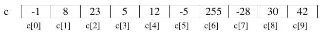

<div class="interactive-progress-tracker">
  <div class="tracker-header">
    <span>🏆 <strong>Progrés d'aquesta secció:</strong> <span class="tracker-count">0 de 4 superats (0%)</span></span>
    <span class="tracker-pts">⭐ <strong>0 punts</strong></span>
  </div>
  <div class="tracker-bar">
    <div class="tracker-fill" style="width: 0%;"></div>
  </div>
</div>

# 3.2.1 Ús d'arrays unidimensionals

Un array és una col·lecció d'elements del mateix tipus, que tenen un nom o identificador comú.

- Es pot accedir a cada component de l'array de forma individual per a consultar o modificar el seu valor. 

- L'accés als components es realitza mitjançant un subíndice, que ve donat per la posició que ocupa l'element dins de l'array.

En la següent figura es mostra un array `c` d'enters:

    



> **📌 Es ordenan a partir de l'índex 0**
> 

> El primer subíndice d'un array és el zero. L'últim subíndice és la longitud de l'array menys un.


El número de components d'un array es estableix inicialment al crear-lo i no és possible cambiar-lo de mida. És per açò que reben el nom d'estructures de dades estátiques.

## Declaració i creació

Per a poder utilitzar un array cal **declarar-lo i crear-lo**:

```java
tipo nombreVariable[] = new tipo[numElementos];
// o
tipo[] nombreVariable = new tipo[numElementos];
```

En la **declaració** es estableix el nom de la variable i el tipus dels components. Per exemple:

```java
double lluvia1[];   // lluvia1 es un array de double
double[] lluvia2;   // lluvia2 es un array de double
```

En la declaració anterior no es ha establit el número de components. El número de components es indica en la **creació**, que es fa utilitzant l'operador **`new`**:

```java
lluvia1 = new double[31];
```

Amb aquesta instrucció es estableix que el número d'elements de l'array `lluvia` són 31, reservant amb això el compilador espai consecutivo per a 31 components individuals de tipus `double`.

Les dos instruccions anteriors es poden unir en una sola:

```java
double lluvia2[] = new double[31];
```

El valor mitjançant el qual es defineix el número d'elements de l'array ha de ser una expressió entera, però no té per què ser un literal com en l'exemple anterior. El mida d'un array es pot establir durant l'ejecució, com en el següent exemple:

```java
// usamos un array para almacenar las edades de un grupo de personas
// la variable numPersonas contiene el número de personas del grupo
// y se asigna en tiempo de ejecución
Scanner teclado = new Scanner(System.in);

System.out.print("Introduce cuantos elementos debe tener el array edad[]:");
int numPersonas = teclado.nextInt();

int edad[] = new int[numPersonas];
```

## Accés als components

Com ja hem aquest, l'accés als components de l'array es realitza mitjançant subíndices. La sintaxi per a referir-se a un component de l'array és la següent:

```java
nombreVariable[subíndice]
```

Després de declarar l'array `lluvia`, es disposa de 31 components de tipus `double` numerades des de la *0* a la *30* i accesibles mitjançant la notació: `lluvia[0]` (component primera), `lluvia[1]` (component segona) i així sucesivament fins a la última component `lluvia[30]`.

Amb cada una de les components de l'array de `double` lluvia és possible efectuar totes les operacions que podrien realitzar-se amb variables individuals de tipus `double`, per exemple, donades les declaracions anteriors, les següents instruccions serien vàlides:

```java
System.out.print("Introduce el dato para el componente 0: ");
edad[0] = teclado.nextInt(); //25

System.out.println("El componente [0] vale " + edad[0]);
edad[1] = edad[0] + 1;
edad[2] = edad[0] + edad[1];
edad[2]++;
System.out.println("El componente [1] vale " + edad[1]); //26
System.out.println("El componente [2] vale " + edad[2]); //52
```

A més, cal tindre en compte que el subíndice ha de ser una expressió entera, per la qual cosa també són vàlides expressions com les següents:

```java
int i;
...
edad[i] = edad[i + 1];
edad[i + 2] = edad[i];
```

## Inicializació

Quan creem un array, Java inicializa automàticament els seus components:

- Amb *0* quan els components són de tipus numèric.

- Amb *false* quan els components són `boolean`.

- Amb el caràcter de ASCII, quan els components són `char`.

- Amb `null` quan són objectes (`Strings`, etc).

Aun així, és probable que aquests no siguen els valors amb els que volem inicialitzar l'array. Tenim llavors dos possibilitats:

  a) Accedir individualment als components de l'array per a darles valor:

```java
int edad2[] = new int[10];
edad2[0] = 25;
edad2[1] = 10;
...
edad2[9] = 12;
```

  b) inicialitzar l'array en la declaració de la següent forma:

```java
int edad3[] = {25,10,23,34,65,23,1,67,54,12};
```

Enumerant els valors amb els que es vol inicialitzar cada component, encerrats entre claus. De fer-ho així, no cal crear l'array amb l'operador `new`. Java crea l'array amb tants components com valors hem posat entre claus.

> **📌 Un exemple pràctic**
> 

> Ja hem resuelto en temes anteriors el problema de retornar el nom d'un mes donat el seu número. 

> Anem a resolver-lo ara ayudándonos d'arrays:

```java
public static String nombreMes(int mes){
    String nombre[] = {" " ,"enero", "febrero", "marzo", "abril",
                       "mayo", "junio", "julio","agosto",
                       "septiembre", "octubre", "noviembre", "diciembre"};
    return nombre[mes];
}
```

> El mètode defineix un array de `String` que es inicializa amb els noms dels dotze mesos. La primera component de l'array (`nombre[0]`) es deixa buida, de forma que gener quede emmagatzemat en `nombre[1]`.
> 
Retornar el nom del mes indicat es redueix a retornar el component de l'array del qual número indica el paràmetre mes: `nombre[mes]`.

## Arrays com paràmetres. Pas de paràmetres per referència

Fins al moment només es ha considerado el pas de paràmetres per valor; de manera que qualsevol canvi que el mètode realitze sobre els paràmetres formals no modifica el valor que té el paràmetre real amb el que es anomena al mètode. En java, tots els paràmetres de tipus simples/primitius (`byte`, `short`, `int`, `long`, `float`, `double`,  `boolean`, `char`) es passen per valor.

Pel contrari, els **arrays no són variables de tipus primitiu**, i com qualsevol un altre objecte, **es passen sempre per referència**.

**En** el pas de **paràmetres per referència** el que **es passa** en realitat al mètode és **l'adreça de la variable o objecte**. És per açò que el paper del paràmetre formal és el de ser una referència al paràmetre real; l'anomenada al mètode no provoca la creació d'una nova variable. D'aquesta forma, les modificacions que el mètode puga realitzar sobre aquests paràmetres es realitzen efectivament sobre els paràmetres reals. En aquest cas, tots dos paràmetres (formal i real) es poden considerar com la mateixa variable amb dos noms, un en el mètode llamante i un altre en l'anomenat o invocado, però fan referència a la mateixa posició de memòria.

> **📌 Exemple**
> 

> En el següent exemple, la variable `a`, de tipus primitiu, no canvia de valor després de l'anomenada al mètode. No obstant això la variable `v`, array d'enters, si es veu afectada pels canvis que s'han realitzat sobre ella en el mètode:

```java
public static void main(String[] args){
    int p = 1;
    int v[] = {1,1,1};

    metodo(v,p);                //Pasar un array como parámetro

    System.out.println(p);      // Muestra 1
    System.out.println(v[0]);   // Muestra 2
}

public static void metodo(int x[], int y){ //recibir un array como parámetro
    x[0]++;
    y++;
}
```

> **📌 Passar un array com argument en un mètode**
> 

> Com podem observar, per a passar un array a un mètode, simplement usem el nom de la variable en l'anomenada.
> 
> 
En la capçalera del mètode, no obstant això, hem d'utilitzar els claudàtors `[]` per a indicar que el paràmetre és un array.

## L'atribut `length`

Totes les variables de tipus array tenen un atribut `length` que permet consultar el número de components de l'array. El seu ús es realitza posponent `.length` al nom de la variable:

```java
double estatura[] = new double[25];
...
System.out.println(estatura.length); // Mostrará por pantalla: 25
```

## `String[] args` en el `main`

El mètode `main` pot rebre arguments des de la línia de comandes. Per a això, el mètode `main` rep un paràmetre (`String args[]`). Veiem que es tracta d'un array de `Strings`. L'ús de l'atribut `length` ens permet comprovar si es ha anomenat al programa de forma correcta o no. Vegem un exemple per a saber si és Navitat. Es hi haurà anomenat correctament si l'array `args` conté dos components (dia, mes):

```java
public class EsNavidad {
    public static void main(String[] args) {
        if (args.length != 2) {
            System.out.println("ERROR:");
            System.out.println("Llame al programa de la siguiente forma:");
            System.out.println("java EsNavidad dia mes");

        } else {
            // args[0] es el día
            // args[1] es el mes
            if ((Integer.valueOf(args[0]) == 25) && (Integer.valueOf(args[1]) == 12)) {
                    System.out.println("ES NAVIDAD!");
            } else {
                System.out.println("No es navidad :(");
            }
        }
    }
}
```

> **📌 Un poquito de ...**
> 

> 
>


---

## 🎮 Reptes Interactius d'Autoavaluació (+100 XP)

Comprova el teu domini sobre **3.2.1 Ús d'arrays unidimensionals** superant aquests 4 reptes gamificats (+25 punts cadascun):

<div class="interactive-mcq" data-answer="A" data-hint="Revisa els conceptes teòrics i pràctics d'aquesta secció.">
  <div class="mcq-question">🎯 <strong>Repte 1 (+25 pts):</strong> Si declarem un array 'int[] notes = new int[5];' en Java, quins són els índexs vàlids del primer i de l'últim element?</div>
  <div class="mcq-options">
    <button type="button" class="btn-mcq-opt" data-opt="A">A) El primer element és notes[0] i l'últim és notes[4].</button>
    <button type="button" class="btn-mcq-opt" data-opt="B">B) El primer element és notes[1] i l'últim és notes[5].</button>
    <button type="button" class="btn-mcq-opt" data-opt="C">C) Els índexs comencen en -1.</button>
    <button type="button" class="btn-mcq-opt" data-opt="D">D) Cap de les anteriors és correcta.</button>
  </div>
  <div class="quiz-feedback"></div>
</div>

<div class="interactive-mcq" data-answer="D" data-hint="Comprova l'apartat corresponent de la unitat.">
  <div class="mcq-question">🎯 <strong>Repte 2 (+25 pts):</strong> Quina col·lecció del Java Collections Framework (JCF) permet emmagatzemar parelles clau-valor (Key-Value) amb cerca ràpida per clau única?</div>
  <div class="mcq-options">
    <button type="button" class="btn-mcq-opt" data-opt="A">A) ArrayList&lt;E&gt;</button>
    <button type="button" class="btn-mcq-opt" data-opt="B">B) HashSet&lt;E&gt;</button>
    <button type="button" class="btn-mcq-opt" data-opt="C">C) Cap de les anteriors és correcta.</button>
    <button type="button" class="btn-mcq-opt" data-opt="D">D) HashMap&lt;K, V&gt;</button>
  </div>
  <div class="quiz-feedback"></div>
</div>

<div class="interactive-vf" data-answer="V" data-hint="Verifica l'afirmació amb els apunts de la unitat.">
  <div class="vf-statement">✅ <strong>Repte 3 (Vertader o Fals · +25 pts):</strong> Tot mètode recursiu ha de tindre com a mínim un cas base que detinga les crides recursives per a evitar un error StackOverflowError.</div>
  <div class="vf-buttons">
    <button type="button" class="btn-vf" data-opt="V">Vertader (V)</button>
    <button type="button" class="btn-vf" data-opt="F">Fals (F)</button>
  </div>
  <div class="quiz-feedback" style="width: 100%;"></div>
</div>

<div class="interactive-quiz" data-answer="length" data-hint="Longitud en anglès (6 lletres).">
  <div class="quiz-question">⌨️ <strong>Repte 4 (+25 pts):</strong> Quina propietat (sense parèntesis) s'utilitza en Java per a obtindre la grandària d'un array primitiu (p. ex. notes.___)?</div>
  <div class="quiz-controls">
    <input type="text" class="quiz-input" placeholder="Escriu la resposta..." />
    <button type="button" class="btn-quiz-check">Comprovar</button>
  </div>
  <div class="quiz-feedback"></div>
</div>

### 📋 Llista de Comprovació i Rúbrica d'Assoliment

Marca cada criteri a mesura que completes l'estudi o la resolució pràctica d'aquesta pàgina (**3.2.1 Ús d'arrays unidimensionals**):

- [ ] He llegit detingudament la teoria o l'enunciat d'aquesta secció i he anotat els conceptes clau.
- [ ] He revisat els esquemes, taules o blocs de codi i he verificat que sé aplicar-los a l'entorn de treball.
- [ ] He resolt correctament els **4 reptes interactius** superiors obtenint els **100 punts XP**.
- [ ] He descarregat el comprovant oficial en PDF per a adjuntar-lo a la tasca d'**Aules**.

<div class="aules-delivery-card">
  <h3>📤 Comprovant de Lliurament per a Aules</h3>
  <p>Quan hages completat els reptes interactius i la llista d'autoavaluació d'aquesta pàgina, introdueix el teu nom i descarrega el teu certificat oficial en PDF per a adjuntar-lo a la tasca d'<strong>Aules</strong>.</p>
  <div class="aules-student-field">
    <label for="aules-student-name">👤 Nom i Cognoms de l'Alumne/a:</label>
    <input type="text" id="aules-student-name" class="aules-student-name" placeholder="Ex: Joan Garcia Pérez" />
  </div>
  <div class="aules-score-badge">
    <span class="aules-score-count">0/4 reptes completats (0%) · 0 punts · 0/4 criteris d'autoavaluació</span>
  </div>
  <div class="aules-actions">
    <button type="button" class="btn-aules-dl" data-module="PRG" data-unit="UD03" data-activity="ut0301">📥 Descarregar Comprovant PDF</button>
    <button type="button" class="btn-aules-copy">📋 Copiar Resum al Porta-retalls</button>
  </div>
  <div class="aules-toast"></div>
</div>

