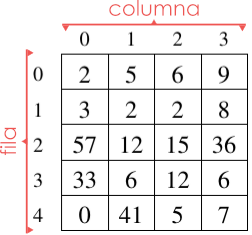
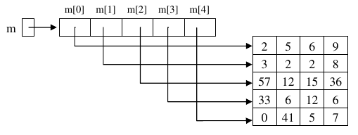

<div class="interactive-progress-tracker">
  <div class="tracker-header">
    <span>🏆 <strong>Progrés d'aquesta secció:</strong> <span class="tracker-count">0 de 4 superats (0%)</span></span>
    <span class="tracker-pts">⭐ <strong>0 punts</strong></span>
  </div>
  <div class="tracker-bar">
    <div class="tracker-fill" style="width: 0%;"></div>
  </div>
</div>

# 3.2.3 Arrays bidimensionals i multidimensionals (Matrius)

Els arrays bidimensionals, també anomenats matrius, són molt similars als arrays que hem vist fins a ara. També són una col·lecció d'elements del mateix tipus que es agrupen sota un mateix nom de variable. 

No obstant això:

- 

Els seus elements estan organitzats en **files** i **columnes**. Tenen, per tant una alçària (files) i una amplària (columnes), i per això es els anomena bidimensionals.

- 

A cada component d'una matriu es accedeix mitjançant dos subíndices: el primer es refereix al número de fila i el segon al número de columna. 

En la següent figura: `m[0][0]` és `2`, `m[0][3]` és `9` i `m[2][0]` és `57`.



- Com veiem, files i columnes es numeran a partir del `0`.

Seguint l'exemple dels punts anteriors, si es quisiera extender el tractament l'estudio de la pluviositat, per a abarcar no només els dies d'un mes sinó els de tot un any, es podria definir, per exemple, un array de 366 elements, que mantuviera de forma correlativa les dades de pluviositat d'una zona dia a dia. Amb això, per exemple, el dada corresponent al dia 3 de febrer ocuparía la posició 34 de l'array, mentre que el corresponent al 2 de juliol ocuparía el 184.

Una aproximació més convenient per a la representació d'aquestes dades consistiría en utilitzar una matriu amb 12 files (una per mes) i 31 columnes (una per cada dia del mes). Açò permitiría una descripció més ajustada a la realitat i, sobre tot, simplificaría els càlculs de la posició real de cada dia en l'estructura de dades. L'element `[0][3]` correspondería, per exemple, a les lluvias del 4 de gener.

## Matrius en Java

> **📌 Matriu ó Array?**
> 

> En Java, una matriu és, en realitat un array en el que cada component és, a la seua vegada, un array. Aquest d'una altra manera, una matriu d'enters és un array d'arrays d'enters.

Açò, que no és igual en altres llenguatges de programació, té certes conseqüències en la declaració, creació i ús de les matrius en Java:

- 

Una matriu, en Java, pot tindre distint número d'elements en cada fila.

- 

La creació de la matriu es pot fer en un només pas o fila per fila.

- 

Si `m` és una matriu d'enters...  

    _ `m[i][j]` és l'enter de la fila `i`, columna `j`.  

    _ `m[i]` és un array d'enters.  

    _ `m.length` és el número de files de `m`.  

    _ `m[i].length` és el número de columnes de la fila `i`.  

- 

Podríem dibuixar la matriu `m` de l'exemple anterior d'una forma més cercana a com Java les representa internament:

       



   

## Declaració de matrius

El codi següent declara una matriu (array bidimensional) d'elements de tipus `double`, i la crea perquè tinga `5` files i `4` columnes (matriu de 5x4):

```java
double m1[][] = new double[5][4];
```

La següent declaració és equivalent a l'anterior encara que en la pràctica és menys utilitzada a no ser que vulguem que cada fila tinga un número distint d'elements:

```java
double m2[][] = new double [5][];
m2[0] = new double[4];
m2[1] = new double[4];
m2[2] = new double[4];
m2[3] = new double[4];
m2[4] = new double[4];
```

És possible inicialitzar cada un dels subarrays amb un mida diferent (encara que el tipus base elemental ha de ser sempre el mateix per a tots els components). Per exemple:

```java
double m3[][] = new double [5][];
m3[0] = new double[3];
m3[1] = new double[4];
m3[2] = new double[14];
m3[3] = new double[10];
m3[4] = new double[9];
```

## Inicializació

La forma d'inicialitzar una matriu d'enters de, per exemple [4][3], seria:

```java
int m4[][] = {
                {7,2,4},
                {8,2,5},
                {9,4,3},
                {1,2,4}
              };
```

    


## Recorregut

El recorregut es fa de forma similar al d'un array encara que, atès que hi ha dos subíndices, serà necessari utilitzar dos bucles imbricats: un que es ocupe de recórrer les files i un altre que es ocupe de recórrer les columnes.

El següent fragment de codi recorre una matriu `m4` per a imprimir els seus elements un a un.

#### 📌 JAVA

```java
//recorrido por filas
System.out.println("\nRecorrido por filas: ");
for (int f = 0; f < m4.length; f++) {
    for (int c = 0; c < m4[f].length; c++) {
        System.out.print(m4[f][c] + " ");
    }
    System.out.println("");
}
```

#### 📌 EIXIDA

```java
//Recorrido por filas:
7 2 4 
8 2 5 
9 4 3 
1 2 4
```

El recorregut es ha fet per files, és a dir, es imprimen tots els elements d'una fila i després es passa a la següent. Com habíamos indicat anteriorment, `m.length` representa el número de files de `m`, mentre que `m[i].length` el número de columnes de la fila `i`.

També és possible fer el recorregut per columnes: imprimir la columna 0, després la 1, etc:

#### 📌 JAVA

```java
System.out.println("\nRecorrido por columnas: ");
int numFilas = m4.length;
int numColumnas = m4[0].length;
for (int c = 0; c < numColumnas; c++) {
    for (int f = 0; f < numFilas; f++) {
        System.out.print(m4[f][c] + " ");
    }
    System.out.println("");
}
```

#### 📌 EIXIDA

```java
//Recorrido por columnas: 
7 8 9 1 
2 2 4 2 
4 5 3 4
```

o, directament ...

#### 📌 JAVA

```java
System.out.println("\nRecorrido por columnas versión 2: ");
for (int c = 0; c < m4[0].length; c++) {
    for (int f = 0; f < m4.length; f++) {
        System.out.print(m4[f][c] + " ");
    }
    System.out.println("");
}
```

#### 📌 EIXIDA

```java
//Recorrido por columnas versión 2: 
7 8 9 1 
2 2 4 2 
4 5 3 4
```

En aquest cas, per a un funcionament correcte del recorregut seria necessari que totes les columnes tingueren igual número d'elements, ja que en el bucle extern, es pren com referència per al número de columnes la longitud de m[0], és a dir el número d'elements de la primera fila.

> **📌 Exemple complet de Arrays i els seus recorrits**
> 

> Enllaç a exercici complet de Arrays i els seus recorrits.

# Arrays multidimensionals

En el punt anterior hem vist que podem definir arrays dels quals elements són alhora arrays, obtenent una estructura de dades a la que es accedeix mitjançant dos subíndices, que hem anomenat arrays bidimensionals o matrius.

Aquest *anidament* d'estructures es pot generalitzar, de forma que podríem construir arrays de més de dos dimensions. En realitat Java no posa límit al número de subíndices d'un array. Podríem fer declaracions com les següents:

```java
//Notas de 10 alum. en 5 asign. en 3 eval.
int notas[][][] = new int[10][5][3]; 

//El alumno 2, para la asignatura 3 de la primera evaluación ha sacado un 5
notas[2][3][1]=5;

double w[][][][][] = new double [2][7][10][4][10];
```

> **📌 Arrays amb més de 3 dimensions**
> 

> No obstant això, trobar exemples en els que siguen necessaris arrays de més de tres dimensions és bastant raro, i encara quan els trobem solemos utilitzar arrays d'un o dos subíndices perquè ens resulta menys complex manejar-los.


---

## 🎮 Reptes Interactius d'Autoavaluació (+100 XP)

Comprova el teu domini sobre **3.2.3 Arrays bidimensionals i multidimensionals (Matrius)** superant aquests 4 reptes gamificats (+25 punts cadascun):

<div class="interactive-mcq" data-answer="A" data-hint="Revisa els conceptes teòrics i pràctics d'aquesta secció.">
  <div class="mcq-question">🎯 <strong>Repte 1 (+25 pts):</strong> Si declarem un array 'int[] notes = new int[5];' en Java, quins són els índexs vàlids del primer i de l'últim element?</div>
  <div class="mcq-options">
    <button type="button" class="btn-mcq-opt" data-opt="A">A) El primer element és notes[0] i l'últim és notes[4].</button>
    <button type="button" class="btn-mcq-opt" data-opt="B">B) El primer element és notes[1] i l'últim és notes[5].</button>
    <button type="button" class="btn-mcq-opt" data-opt="C">C) Els índexs comencen en -1.</button>
    <button type="button" class="btn-mcq-opt" data-opt="D">D) Cap de les anteriors és correcta.</button>
  </div>
  <div class="quiz-feedback"></div>
</div>

<div class="interactive-mcq" data-answer="D" data-hint="Comprova l'apartat corresponent de la unitat.">
  <div class="mcq-question">🎯 <strong>Repte 2 (+25 pts):</strong> Quina col·lecció del Java Collections Framework (JCF) permet emmagatzemar parelles clau-valor (Key-Value) amb cerca ràpida per clau única?</div>
  <div class="mcq-options">
    <button type="button" class="btn-mcq-opt" data-opt="A">A) ArrayList&lt;E&gt;</button>
    <button type="button" class="btn-mcq-opt" data-opt="B">B) HashSet&lt;E&gt;</button>
    <button type="button" class="btn-mcq-opt" data-opt="C">C) Cap de les anteriors és correcta.</button>
    <button type="button" class="btn-mcq-opt" data-opt="D">D) HashMap&lt;K, V&gt;</button>
  </div>
  <div class="quiz-feedback"></div>
</div>

<div class="interactive-vf" data-answer="V" data-hint="Verifica l'afirmació amb els apunts de la unitat.">
  <div class="vf-statement">✅ <strong>Repte 3 (Vertader o Fals · +25 pts):</strong> Tot mètode recursiu ha de tindre com a mínim un cas base que detinga les crides recursives per a evitar un error StackOverflowError.</div>
  <div class="vf-buttons">
    <button type="button" class="btn-vf" data-opt="V">Vertader (V)</button>
    <button type="button" class="btn-vf" data-opt="F">Fals (F)</button>
  </div>
  <div class="quiz-feedback" style="width: 100%;"></div>
</div>

<div class="interactive-quiz" data-answer="length" data-hint="Longitud en anglès (6 lletres).">
  <div class="quiz-question">⌨️ <strong>Repte 4 (+25 pts):</strong> Quina propietat (sense parèntesis) s'utilitza en Java per a obtindre la grandària d'un array primitiu (p. ex. notes.___)?</div>
  <div class="quiz-controls">
    <input type="text" class="quiz-input" placeholder="Escriu la resposta..." />
    <button type="button" class="btn-quiz-check">Comprovar</button>
  </div>
  <div class="quiz-feedback"></div>
</div>

### 📋 Llista de Comprovació i Rúbrica d'Assoliment

Marca cada criteri a mesura que completes l'estudi o la resolució pràctica d'aquesta pàgina (**3.2.3 Arrays bidimensionals i multidimensionals (Matrius)**):

- [ ] He llegit detingudament la teoria o l'enunciat d'aquesta secció i he anotat els conceptes clau.
- [ ] He revisat els esquemes, taules o blocs de codi i he verificat que sé aplicar-los a l'entorn de treball.
- [ ] He resolt correctament els **4 reptes interactius** superiors obtenint els **100 punts XP**.
- [ ] He descarregat el comprovant oficial en PDF per a adjuntar-lo a la tasca d'**Aules**.

<div class="aules-delivery-card">
  <h3>📤 Comprovant de Lliurament per a Aules</h3>
  <p>Quan hages completat els reptes interactius i la llista d'autoavaluació d'aquesta pàgina, introdueix el teu nom i descarrega el teu certificat oficial en PDF per a adjuntar-lo a la tasca d'<strong>Aules</strong>.</p>
  <div class="aules-student-field">
    <label for="aules-student-name">👤 Nom i Cognoms de l'Alumne/a:</label>
    <input type="text" id="aules-student-name" class="aules-student-name" placeholder="Ex: Joan Garcia Pérez" />
  </div>
  <div class="aules-score-badge">
    <span class="aules-score-count">0/4 reptes completats (0%) · 0 punts · 0/4 criteris d'autoavaluació</span>
  </div>
  <div class="aules-actions">
    <button type="button" class="btn-aules-dl" data-module="PRG" data-unit="UD03" data-activity="ut0304">📥 Descarregar Comprovant PDF</button>
    <button type="button" class="btn-aules-copy">📋 Copiar Resum al Porta-retalls</button>
  </div>
  <div class="aules-toast"></div>
</div>

