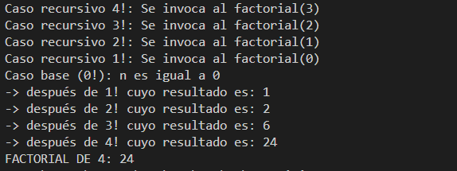
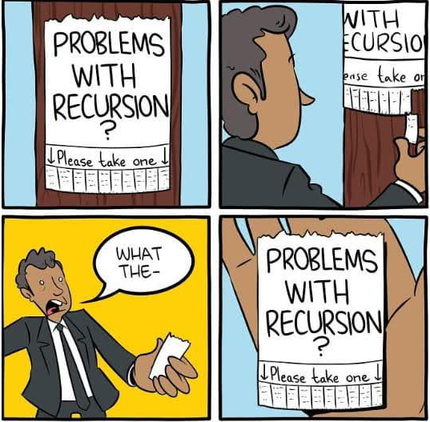
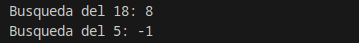

<div class="interactive-progress-tracker">
  <div class="tracker-header">
    <span>🏆 <strong>Progrés d'aquesta secció:</strong> <span class="tracker-count">0 de 4 superats (0%)</span></span>
    <span class="tracker-pts">⭐ <strong>0 punts</strong></span>
  </div>
  <div class="tracker-bar">
    <div class="tracker-fill" style="width: 0%;"></div>
  </div>
</div>

# 3.4 Algoritmes recursivos (Recursivitat)

A l'hora de crear programes complexos, un dels aspectes que diferència el bon programador de l'aficionado és la seua capacitat de fer algoritmes eficients. És a dir, que siguen capaços de resoldre el problema planteado en el mínim de passos. En el cas d'un programa, açò significa la necessitat d'executar el mínim número d'instruccions possible. Ciertament, si el resultat ha de ser exactament el mateix, sempre serà millor fer una tasca en 10 passos que en 20, intentant evitar passos que en realitat són innecesarios. Per tant, l'etapa de disseny d'un algoritme és bastant important i cal pensar bé una estratègia eficient. Ara bé, normalment, els algoritmes més eficients també són més difícils de pensar i codificar, ja que no sempre són evidentes.

## Aplicació de la recursivitat

A menudo encontraréis que explicar de paraula la idea general d'una estratègia pot ser senzill, però traducirla a instruccions de Java ja no l'és tant. 

Retomamos ara el cas de la cerca dicotómica o binària, atès que cal anar repitent uns passos en sucesivas iteracions, està més o menys clar que el problema planteado per a realitzar cerques eficients es basa en una estructura de repetició. Però no es recorren tots els elements i l'índex no es incrementa un a un, sinó que es va canviant a valors molt diferents per a cada iteració. No és un cas evidente. Precisament, aquest exemple no es ha triat a l'atzar, ja que és un cas en el que us pot anar bé aplicar un nou concepte que permet facilitar la definició d'algoritmes complexos on hi ha repeticions.

> **📌 Definició**
> 

> La **recursivitat** és una forma de descriure un procés per a resoldre un problema de manera que, al llarg d'aquesta descripció, s'usa el procés mateix que es està describent, però aplicat a un cas més simple.

    


De fet, tal vegada sense donar-se compta d'això, ja es ha usat recursivitat per a descriure com resoldre un problema. Per a veure què significa exactament la definició formal a penes descrita, es repetirá el text en qüestió, però remarcant l'aspecte recursiu de la descripció:

"*Generalment, la millor estratègia per a adivinar un número secreto entre 0 i N seria primer provar N/2. Si no es ha encertat, llavors si el número secreto és més alt es intenta adivinar entre (N/2 + 1) i N. Si era més sota, es intenta adivinar el valor entre 0 i N-1. Per a cada cas, es torna a provar el valor que hi ha en el centre del nou intervalo. I així sucesivament, fins a adivinar-lo.*"

És a dir, **el procés d'adivinar un número es basa en el procés d'intentar adivinar un número!** Açò sembla fer trampas, ja que és com usar la mateixa paraula que es vol definir a la seua pròpia definició. Però fíjate en un detall molt important; els nous usos del procés de "*adivinar*" són casos més simples, ja que primer es adivina entre *N* valors possibles, després entre N/2 valors, després entre *N/4*, etc. Aquest fet no és casual i d'ell depèn poder definir un procés recursiu de manera correcta.

> **📌  **
> 

> Un altre exemple de recursivitat en Informàtica és la definició de les inicials del sistema operatiu *GNU* volen dir "**G**NU is **N**ot **U**nix"

## Implementació de la recursivitat

La implementació de la recursivitat dins del codi font d'un programa es realitza a nivell de mètode.

> **📌 Una altra definició**
> 

> Un **mètode recursiu** és aquell que, dins del seu bloc d'instruccions, té alguna invocació a ell mateix.

El bloc de codi d'un mètode recursiu sempre es basa en una **estructura de selecció múltiple**, on cada rama és d'algun dels dos casos possibles descritos a continuació.

- D'una banda, en el **cas base**, que conté un bloc instruccions dins de les quals no hi ha cap anomenada al mètode mateix. S'executa quan es considera que, a partir dels paràmetres d'entrada, el problema ja és suficientement simple com per a ser resuelto directament. 

En el cas de la *cerca binària*, seria quan la posició intermèdia és exactament el valor que es està cercant, o bé quan ja es pot decidir que l'element a cercar no existeix.

- D'altra banda, existeix el **cas recursiu**, que conté un bloc d'instruccions dins de les quals hi ha una anomenada al mètode mateix, atès que es considera que encara no es pot resoldre el problema fàcilment. Ara bé, els valors usats com paràmetres d'aquesta nova anomenada han de ser diferents als originals. Concretament, seran uns valors que tiendan a acercar-se al cas base. 

En el cas de la *cerca binària*, es correspon a la cerca sobre la mitad dels valors originals, ja siga cap a la mitad inferior o superior. Aquest és un cas en el que l'intervalo de posicions on es farà la nova cerca es va acercant al cas base, ja que tarde o temprano, anomenada després d'anomenada, l'espai de cerca es anirà reduint fins a que, o bé es troba l'element, o queda clar que no està.

> **📌 Metodología dels casos recursivos**
> 

> Dins de l'estructura de selecció sempre ha d'haver, **almenys**, **un cas base** i **un recursiu**. 
> 
> 
Normalment, els algoritmes recursivos més senzills tenen un de cada. 
> 
> 
És imprescindible que els casos recursivos sempre garanticen que sucesivas anomenades van aproximant els valors dels paràmetres d'entrada a algun cas base, ja que, en cas contrari, el programa mai acaba i es produeix el mateix efecte que en un bucle infinit.

### Càlcul recursiu de l'operació factorial

Com exemple del funcionament d'un mètode recursiu, es empezará amb un cas senzill. Es tracta del càlcul de l'anomenada operació **factorial** d'un valor enter positiu. Aquesta és unària i es expressa amb l'operador exclamació (per exemple, *4!*, 20!, *3!*). El resultat d'aquesta operació és la multiplicació de tots els valors des del *1* fins a l'indicat (7! = *1 * 2 * 3 * 4 * 5 * 6 * 7*). Normalment, la definició matemática d'aquesta operació es fa de manera recursiva:

- **cas base**:  `0! = 1` 

- **cas recursiu**: `n! = N * (n - 1)!` 

Així ja que, tened en compta que el cas recursiu realitza un càlcul que depèn d'usar la pròpia definició de l'operació, però quan el fa és amb un nou valor inferior a l'original, per la qual cosa es garanteix que, en algun moment, es farà una anomenada recursiva que desembocará en el cas base. Quan açò ocurra, la cadena d'anomenades recursivas acabará. Una manera de veure açò és desarrollant pas a pas aquesta definició:

| anomenada | implementació |  |
| --- | --- | --- |
| 1ª anomenada) | 4! = 4 * (4 - 1)! | 4 * **(3)!** |
| 2ª anomenada) | 4 * 3! = 4 * (3 * (3-1))! | 4 * 3 * **(2)!** |
| 3ª anomenada) | 4 * 3 * 2! = 4 * 3 * (2 * (2-1))! | 4 * 3 * 2 * **(1)!** |
| 4ª anomenada) | 4 * 3 * 2 * 1! = 4 * 3 * 2 * (1 * (1 - 1))! | 4 * 3 * 2 * 1 * **(0)!** |
| retorn) | 4 * 3 * 2 * 1 * 0! = 4 * 3 * 2 * 1 * (1) | 24 |

En aquest codi es han afegit algunes sentències per a escriure informació per pantalla, de forma que es vea amb més detall com funciona un mètode recursiu. Veréis que, inicialment, es duen a terme una sèrie d'invocacions del cas recursiu, un després d'un altre, fins a que es arriba a una anomenada que executa el cas base. És a partir de llavors quan, a mesura que es van executant les sentències `return` del cas recursiu, realment es va acumulant el càlcul. Una altra forma de verlo és depurant el programa.

La seua implementació en Java seria la següent:

#### 📌 Java

```java
package UT04;

public class Recursividad {

public static void main(String[] args) {
   //factorial
   System.out.println("FACTORIAL DE 4: " + factorial(4));
   [...]      
}

/*
 * Método recursivo que calcula el factorial
 */
public static int factorial(int n) {
   if (n == 0) {
      //Caso base: Se sabe el resultat directamente
      System.out.println("Caso base: n es igual a 0");
      return 1;
   } else {
      //Caso recursivo: Para calcularlo hay que invocar al método recursivo
      //El valor del nuevo parámetro de entradad se ha de modificar, de
      //manera que se vaya acercando al caso base
      System.out.println("Caso recursivo " + n + "!: Se invoca al factorial(" + (n - 1) + ")");
      int res = n * factorial(n - 1);
      System.out.println("-> después de " + n + "! cuyo resultado es: " + res);
      return res;
   }
}
// [...]
```

#### 📌 Eixida

    



    



### Càlcul recursiu de la cerca dicotómica

A continuació es mostra el codi de l'algoritme recursiu de cerca dicotómica o binària sobre un array. Observad atentament els comentaris, els quals identifican els casos base i recursivos. En aquest cas, hi ha més d'un cas base i recursiu.

#### 📌 Java

```java
package UT04;

public class RecursividadBusquedaBinaria {

    public static void main(String[] args) {
        // [...]
        // busqueda binaria recursiva
        int array[] = {2, 4, 6, 8, 10, 12, 14, 16, 18, 20};

        int buscaDieciocho = BusquedaBinaria(array, 0, array.length - 1, 18);
        System.out.println("Busqueda del 18: " + buscaDieciocho);

        int buscaCinco = BusquedaBinaria(array, 0, array.length - 1, 5);
        System.out.println("Busqueda del 5: " + buscaCinco);
        // [...]
    }

    // [...]
    public static int BusquedaBinaria(int array[], int izq, int der, int valor) {
        if (izq > der) {
            // Caso base: No se ha encontrado el valor
            return -1;
        }
        // Se calcula la posición central entre los dos índices de búsqueda
        int medio = (izq + der) / 2;
        if (array[medio] == valor){
            // caso base: Es igual, por tanto, se ha encontrado
            return medio;
        } else if (array[medio] > valor) {
            // Caso recursivo: Si el valor es menor que la posición que se ha 
            // consultado, entonces hay que seguir buscando por la parte 
            // "derecha" del array
            return BusquedaBinaria(array, izq, medio - 1, valor);
        } else {
            // Caso recursivo: Si el valor es mayor que la posición que se ha
            // consultado, entonces hay que seguir buscando por la parte 
            // "izquierda" del array
            return BusquedaBinaria(array, medio + 1, der, valor);
        } else {

        }
    }
    // [...]
}
```

#### 📌 Eixida

 



 

Pràcticament qualsevol problema que es pot resoldre amb un algoritme recursiu també es pot resoldre amb sentències d'estructures de repetició (de manera iterativa). Però molt a menudo la seua implementació serà molt menys evidente i les interaccions entre instruccions bastant més complexes que l'opció recursiva (una vegada es entén aquest concepte, clar).

#### Algoritme ja existent

Més enllà de ser un exercici d'algorítmica, resultaría molt més adequat utilitzar la versió ja incorporada en la llibreria estàndard del llenguatge de programació Java:

```java
import java.util.Arrays;

[...]

public int busquedaBinaria (int numeros[], int numero) {
    return Arrays.binarySearch(numeros, numero);
}
```

## Desbordament de pila (stack overflow)

Les versions recursivas de moltes rutinas poden executar-se un poc més lentament que els seus equivalents iterativos a causa de la sobrecàrrega addicional de les anomenades a mètodes addicionals. Demasiades anomenades recursivas a un mètode podrien causar un **desbordament de la pila**.

Com l'emmagatzematge per als paràmetres i les variables locals estan en la pila i cada anomenada nova crea una nova còpia d'aquestes variables, és possible que la pila es haja agotado. Si açò ocorre, el sistema de temps d'ejecució (run-time) de Java causará una excepció. No obstant això, probablement no hauràs de preocuparte per açò a menys que una rutina recursiva es torne *loca*.

La principal avantatge de la recursivitat és que alguns tipus d'algoritmes es poden implementar de forma més clara i més recursiva del que poden ser iterativament. Per exemple, l'algoritme de classificació [Quicksort](https://es.wikipedia.org/wiki/Quicksort) és bastant difícil d'implementar de forma iterativa. A més, alguns problemes, especialment els relacionats amb la **IA**, semblen prestar-se a **solucions recursivas**.

```java
package UT04;

public class Recursividad {

    public static void main(String[] args) {
        [...]        
        //desbordamiento de pila
        desbordamientoPila(10);
    }

    [...]

    public static int desbordamientoPila(int n) {
        // condición base incorrecta (esto provoca un desbordamiento de la pila).
        if (n == 100) {
            return 1;
        } else {
            return n * desbordamientoPila(n - 1);
        }
    }
}
```

En l'exemple anterior si es anomena a `desbordamientoPila(10)`, llamará a `desbordamientoPila (9)`, `desbordamientoPila(8)`, `desbordamientoPila(7)`, etc., però el número mai arribarà a 100. Per tant, no es assoleix la condició base. Si la memòria es agota amb aquests mètodes en la pila, provocará un error de desbordament de pila (`java.lang.StackOverflowError`).

> **📌  **
> 

> A l'escriure mètodes recursivos, ha de tindre una instrucció condicional, com un `if`, en algun lloc per a forçar el retorn del mètode sense que s'execute l'anomenada recursiva. Si no el fa, una vegada que anomene al mètode, mai retornará. Aquest tipus d'error és molt comú quan es treballa amb recursivitat.

> **📌 Exemple complet de recursivitat**
> 

> Enllaç a exercici complet de recursivitat.


---

## 🎮 Reptes Interactius d'Autoavaluació (+100 XP)

Comprova el teu domini sobre **3.4 Algoritmes recursivos (Recursivitat)** superant aquests 4 reptes gamificats (+25 punts cadascun):

<div class="interactive-mcq" data-answer="A" data-hint="Revisa els conceptes teòrics i pràctics d'aquesta secció.">
  <div class="mcq-question">🎯 <strong>Repte 1 (+25 pts):</strong> Si declarem un array 'int[] notes = new int[5];' en Java, quins són els índexs vàlids del primer i de l'últim element?</div>
  <div class="mcq-options">
    <button type="button" class="btn-mcq-opt" data-opt="A">A) El primer element és notes[0] i l'últim és notes[4].</button>
    <button type="button" class="btn-mcq-opt" data-opt="B">B) El primer element és notes[1] i l'últim és notes[5].</button>
    <button type="button" class="btn-mcq-opt" data-opt="C">C) Els índexs comencen en -1.</button>
    <button type="button" class="btn-mcq-opt" data-opt="D">D) Cap de les anteriors és correcta.</button>
  </div>
  <div class="quiz-feedback"></div>
</div>

<div class="interactive-mcq" data-answer="D" data-hint="Comprova l'apartat corresponent de la unitat.">
  <div class="mcq-question">🎯 <strong>Repte 2 (+25 pts):</strong> Quina col·lecció del Java Collections Framework (JCF) permet emmagatzemar parelles clau-valor (Key-Value) amb cerca ràpida per clau única?</div>
  <div class="mcq-options">
    <button type="button" class="btn-mcq-opt" data-opt="A">A) ArrayList&lt;E&gt;</button>
    <button type="button" class="btn-mcq-opt" data-opt="B">B) HashSet&lt;E&gt;</button>
    <button type="button" class="btn-mcq-opt" data-opt="C">C) Cap de les anteriors és correcta.</button>
    <button type="button" class="btn-mcq-opt" data-opt="D">D) HashMap&lt;K, V&gt;</button>
  </div>
  <div class="quiz-feedback"></div>
</div>

<div class="interactive-vf" data-answer="V" data-hint="Verifica l'afirmació amb els apunts de la unitat.">
  <div class="vf-statement">✅ <strong>Repte 3 (Vertader o Fals · +25 pts):</strong> Tot mètode recursiu ha de tindre com a mínim un cas base que detinga les crides recursives per a evitar un error StackOverflowError.</div>
  <div class="vf-buttons">
    <button type="button" class="btn-vf" data-opt="V">Vertader (V)</button>
    <button type="button" class="btn-vf" data-opt="F">Fals (F)</button>
  </div>
  <div class="quiz-feedback" style="width: 100%;"></div>
</div>

<div class="interactive-quiz" data-answer="length" data-hint="Longitud en anglès (6 lletres).">
  <div class="quiz-question">⌨️ <strong>Repte 4 (+25 pts):</strong> Quina propietat (sense parèntesis) s'utilitza en Java per a obtindre la grandària d'un array primitiu (p. ex. notes.___)?</div>
  <div class="quiz-controls">
    <input type="text" class="quiz-input" placeholder="Escriu la resposta..." />
    <button type="button" class="btn-quiz-check">Comprovar</button>
  </div>
  <div class="quiz-feedback"></div>
</div>

### 📋 Llista de Comprovació i Rúbrica d'Assoliment

Marca cada criteri a mesura que completes l'estudi o la resolució pràctica d'aquesta pàgina (**3.4 Algoritmes recursivos (Recursivitat)**):

- [ ] He llegit detingudament la teoria o l'enunciat d'aquesta secció i he anotat els conceptes clau.
- [ ] He revisat els esquemes, taules o blocs de codi i he verificat que sé aplicar-los a l'entorn de treball.
- [ ] He resolt correctament els **4 reptes interactius** superiors obtenint els **100 punts XP**.
- [ ] He descarregat el comprovant oficial en PDF per a adjuntar-lo a la tasca d'**Aules**.

<div class="aules-delivery-card">
  <h3>📤 Comprovant de Lliurament per a Aules</h3>
  <p>Quan hages completat els reptes interactius i la llista d'autoavaluació d'aquesta pàgina, introdueix el teu nom i descarrega el teu certificat oficial en PDF per a adjuntar-lo a la tasca d'<strong>Aules</strong>.</p>
  <div class="aules-student-field">
    <label for="aules-student-name">👤 Nom i Cognoms de l'Alumne/a:</label>
    <input type="text" id="aules-student-name" class="aules-student-name" placeholder="Ex: Joan Garcia Pérez" />
  </div>
  <div class="aules-score-badge">
    <span class="aules-score-count">0/4 reptes completats (0%) · 0 punts · 0/4 criteris d'autoavaluació</span>
  </div>
  <div class="aules-actions">
    <button type="button" class="btn-aules-dl" data-module="PRG" data-unit="UD03" data-activity="ut0305">📥 Descarregar Comprovant PDF</button>
    <button type="button" class="btn-aules-copy">📋 Copiar Resum al Porta-retalls</button>
  </div>
  <div class="aules-toast"></div>
</div>

