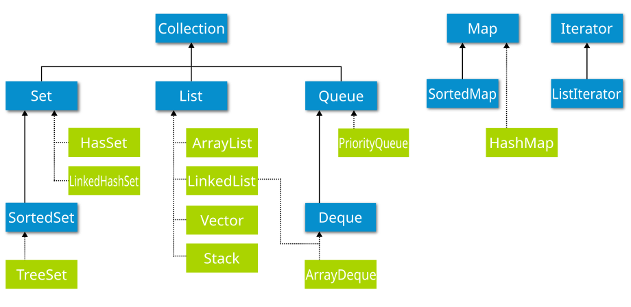
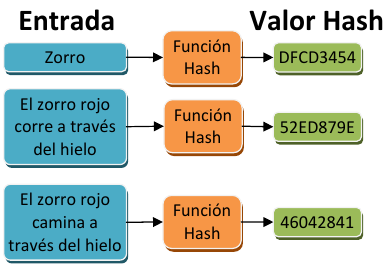
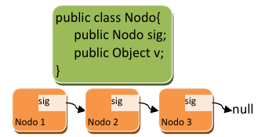
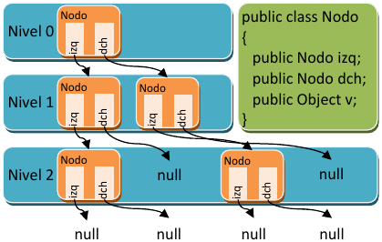
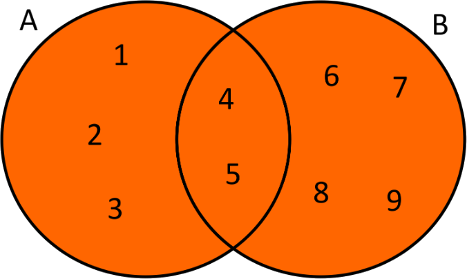
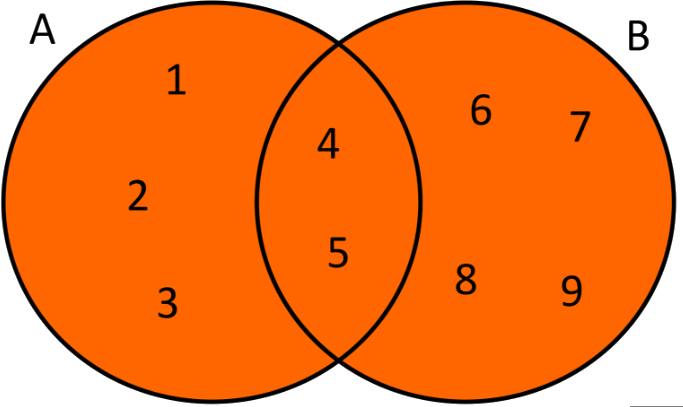
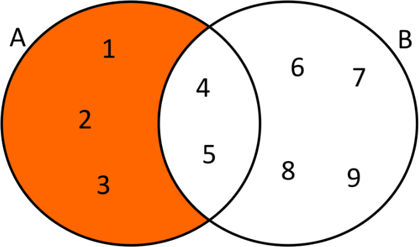
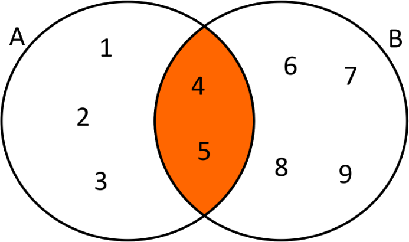
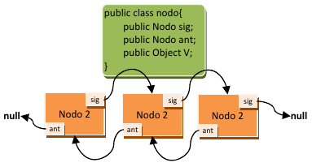

<div class="interactive-progress-tracker">
  <div class="tracker-header">
    <span>🏆 <strong>Progrés d'aquesta secció:</strong> <span class="tracker-count">0 de 4 superats (0%)</span></span>
    <span class="tracker-pts">⭐ <strong>0 punts</strong></span>
  </div>
  <div class="tracker-bar">
    <div class="tracker-fill" style="width: 0%;"></div>
  </div>
</div>

# 3.1 Introducció a les estructures de dades

## 1. Introducció

    



*Què consideras una col·lecció*? Ja que segurament al pensar en el terme es et ve a la cabeza una col·lecció de llibres o alguna cosa semblant, i la idea no va molt desencaminada. **Una col·lecció a nivell de programari és un grup d'elements emmagatzemats de forma conjunta en una mateixa estructura**; això són les **col·leccions**.

Les col·leccions defineixen un conjunt d'interfícies, classes genériques i algoritmes que permeten manejar grups d'objectes, tot això enfocado a potenciar la reusabilitat del programari i facilitar les tasques de programació. Et parecerá increíble el temps que es ahorra emprant col·leccions i com es redueix la complexitat del programari usándolas adequadament. Les col·leccions permeten emmagatzemar i manipular grups d'objectes que, a priori, estan relacionats entre sí (encara que no és obligatori que estiguen relacionats, el lògic és que si s'emmagatzemen juntos és perquè tenen alguna relació entre sí), podent treballar amb qualsevol tipus d'objecte (d'ahí que es empleen els genérics en les col·leccions).

A més, les col·leccions permeten realitzar algunes operacions útils sobre els elements emmagatzemats, tals com cerca o ordenació. En alguns casos és necessari que els objectes emmagatzemats complisquen algunes condicions (que implementen algunes interfícies), per a poder fer ús d'aquests algoritmes. 

Les col·leccions són en general elements de programació que estan disponibles en molts llenguatges de programació. En alguns llenguatges de programació el seu ús és alguna cosa més complex (com és el cas de C++), però en Java el seu ús és bastant senzill.

Les col·leccions en Java parten d'una sèrie d'interfícies bàsiques. Cada interfície defineix un model de col·lecció i les operacions que es poden dur a terme sobre les dades emmagatzemats, per la qual cosa és necessari conocerlas. La interfície inicial, a través de la qual es han construido el resta de col·leccions, és la interfície **`java.util.Collection`**, que defineix les operacions comuns a totes les col·leccions derivades. 

A continuació es mostren els mètodes més importants definits per aquesta interfície, tingues en compte que `Collection` és una interfície genérica on `<E>` és el paràmetre de tipus (podria ser qualsevol classe):

| mètode | descripció |
| --- | --- |
| **`int size()`** | retorna el número d'elements de la col·lecció. |
| **`boolean isEmpty()`** | retornará vertader si la col·lecció està buida. |
| **`boolean contains (Object element)`** | retornará vertader si la col·lecció té l'element passat com paràmetre. |
| **`boolean add(E element)`** | permitirá afegir elements a la col·lecció. |
| **`boolean remove(Object element)`** | permitirá eliminar elements de la col·lecció. |
| **`Iterator<E> iterator()`** | permitirá crear un *iterador* per a recórrer els elements de la col·lecció (açò es veu més avant, no et preocupes). |
| **`Object[] toArray()`** | permet passar la col·lecció a un *array* d'objectes tipus `Object`. |
| **`boolean containsAll(Collection<?> c)`** | permet comprovar si una col·lecció conté els elements existents en una altra col·lecció, si és així, retorna vertader. |
| **`boolean addAll(Collection<?> extends E> c)`** | permet afegir tots els elements d'una col·lecció a una altra col·lecció, sempre que siguen del mateix tipus (o deriven del mateix tipus base). |
| **`boolean removeAll(Collection<?> c)`** | si els elements de la col·lecció passada com paràmetre estan en la nostra col·lecció, s'eliminen, el resta es queden. |
| **`boolean retainAll(Collection<?> c)`** | si els elements de la col·lecció passada com paràmetre estan en la nostra col·lecció, es deixen, el resta s'eliminen. |
| **`void clear()`** | vaciar la col·lecció. |

Més avant veurem com s'usen aquests mètodes, serà quan vegem les implementacions (classes genériques que implementan alguna de les interfícies derivades de la interfície `Collection`).

<details markdown="1">

<summary>💡 Exemple 2.01: utilització de mètodes de la interfície `Collection`</summary>

Per a això, utilitzarem un `TreeSet`:

```java
package UT07.P2_Collection;

import java.util.TreeSet;
import java.util.Collection;
import java.util.Iterator;

public class EjemploColeccion {
    public static void main(String[] args) {
        // Crear una colección de tipo TreeSet
        Collection<String> nombres = new TreeSet<>();

        // Añadir elementos con add(E element)
        nombres.add("Ana");
        nombres.add("Luis");
        nombres.add("Carlos");

        // Imprimir la colección
        System.out.println("Colección inicial: " + nombres);

        // Tamaño de la colección con size()
        System.out.println("Número de elementos: " + nombres.size());

        // Verificar si está vacía con isEmpty()
        System.out.println("¿Está vacía?: " + nombres.isEmpty());

        // Verificar si contiene un elemento con contains(Object element)
        System.out.println("¿Contiene 'Luis'?: " + nombres.contains("Luis"));

        // Eliminar un elemento con remove(Object element)
        nombres.remove("Carlos");
        System.out.println("Después de eliminar 'Carlos': " + nombres);

        // Convertir la colección en un array con toArray()
        Object[] array = nombres.toArray();
        System.out.print("Elementos convertidos en array: ");
        for (Object item : array) {
            System.out.print(item + " ");
        }
        System.out.println();

        // Crear otra colección
        Collection<String> otrosNombres = new TreeSet<>();
        otrosNombres.add("Ana");
        otrosNombres.add("Pepe");

        // Verificar si contiene todos los elementos de otra colección con containsAll(Collection<?> c)
        System.out.println("¿Contiene todos los elementos de 'otrosNombres'?: " + nombres.containsAll(otrosNombres));

        // Añadir todos los elementos de otra colección con addAll(Collection<?> extends E> c)
        nombres.addAll(otrosNombres);
        System.out.println("Después de añadir 'otrosNombres': " + nombres);

        // Eliminar todos los elementos de otra colección con removeAll(Collection<?> c)
        nombres.removeAll(otrosNombres);
        System.out.println("Después de eliminar 'otrosNombres': " + nombres);

        // Volver a agregar elementos para probar retainAll()
        nombres.add("Ana");
        nombres.add("Pepe");
        nombres.add("Juan");

        // Retener solo los elementos que están en otra colección con retainAll(Collection<?> c)
        nombres.retainAll(otrosNombres);
        System.out.println("Después de retener solo 'otrosNombres': " + nombres);

        // Crear un iterador con iterator()
        Iterator<String> iterador = nombres.iterator();
        System.out.print("Elementos recorridos con iterator(): ");
        while (iterador.hasNext()) {
            System.out.print(iterador.next() + " ");
        }
        System.out.println();

        // Vaciar la colección con clear()
        nombres.clear();
        System.out.println("Después de clear(): " + nombres);
        System.out.println("¿Está vacía ahora?: " + nombres.isEmpty());
    }
}
```

</details>

## 2. Conjunts (sets)

*Amb què relacionarías els conjunts?* Segur que amb les matemàtiques. Els conjunts són un **tipus de col·lecció que no admet duplicats**, derivats del concepte matemátic de conjunt.

La interfície **`java.util.Set`** defineix com han de ser els conjunts, i implementa la interfície `Collection`, encara que **no afegeix cap operació nova**. Les implementacions (classes genériques que implementan la interfície `Set`) més usades són les següents:

#### 🔄  **java.util.HashSet**

Conjunt que emmagatzema els objectes usant taules hash (estructura de dades formada básicament per un array on la posició de les dades va determinada per una funció hash, permetent localitzar la informació de forma extraordinariament ràpida. Les dades estan ordenats en la taula en base a un resum numèric dels mateixos (en hexadecimal generalment) obtingut a partir d'un algoritme per a càlcul de resums, denominades funcions hash. El resum no té significat per a un ser humà, es tracta simplement d'un mecanisme per a obtindre un número associat a un conjunt de dades. El resum, d'un bon algoritme hash, no es sembla en res al contingut emmagatzemat) la qual cosa acelera enormement l'accés als objectes emmagatzemats.

**Inconvenients**:  

- Les dades es ordenan pel resum obtingut, i no pel valor emmagatzemat, així que no emmagatzemen els objectes de forma ordenada (al contrari, poden aparèixer completament desordenats).  

- Necessiten bastant memòria.



<details markdown="1">

<summary>💡 Exemple 2.02: ús de `HashSet`</summary>

Per a crear un conjunt, simplement creem el `HashSet` indicant el tipus d'objecte que va a emmagatzemar, atès que és una classe genérica que pot treballar amb qualsevol tipus de dada hem de crear-lo com segueix (no olvides fer la importació de **`java.util.HashSet`** primer):

```java
HashSet<Integer> conjunto = new HashSet<Integer>();

HashSet<Integer> conjunto = new HashSet<>();         //a partir de Java 7
```

Després podrem anar emmagatzemant objectes dins del conjunt usant el mètode `add` (definit per la interfície `Set`). Els objectes que es poden inserir seran sempre del tipus especificat al crear el conjunt:

```java
int n = 10;
if ( !conjunto.add(n) ){
    System.out.println("Número ya en la lista.");
}
```

Si l'element ja està en el conjunt, el mètode `add` retornará `false` indicant que no es poden inserir duplicats. Si tot va bé, retornará `true`.

</details>

<details markdown="1">

<summary>💡 Exemple 2.03: ús de `HashSet`</summary>

Realitza un xicotet programa que pregunte a l'usuari 5 números diferents (almacenándolos en un `HashSet`), i que després calcule la suma dels mateixos (usant un bucle `for‐each`).  
  

**Solució**  
   Una solució possible podria ser la següent. Fíjate en la solució i verás que l'ús de conjunts ha simplificado enormement l'exercici, permetent al programador o la programadora centrar-se en altres aspectes:

```java
package UT07.P2_Sets;

import java.util.HashSet;
import java.util.Scanner;

public class EjemploHashSet {

    public static void main(String[] args) {
        HashSet<Integer> conjunto = new HashSet<Integer>();
        Scanner teclado = new Scanner(System.in);
        int numero;
        do {
            try {
                System.out.print("Introduce un número " + (conjunto.size() + 1) + ": ");
                numero = teclado.nextInt();
                if (!conjunto.add(numero)) {
                    System.out.println("Número ya en la lista. Introducir otro.");
                }
            } catch (NumberFormatException e) {
                System.out.println("Número erróneo.");
            }
        } while (conjunto.size() < 5);
        // Calcular la suma
        Integer suma = 0;
        for (Integer i : conjunto) {
            suma = suma + i;
        }
        System.out.println("La suma es: " + suma);
    }
}
```

</details>

#### 🔗 **java.util.LinkedHashSet**

Conjunt que emmagatzema objectes combinant taules hash, per a un accés ràpid a les dades, i llistes enlazades (estructura de dades que emmagatzema els objectes enlazándolos entre sí a través d'un apuntador de memòria o puntero, mantenint un ordre, que generalment és el del moment d'inserció, però que pot ser un altre. Cada dada s'emmagatzema en una estructura anomenada **node** en la que existeix un *camp*, generalment anomenat *següent*, que conté l'adreça de memòria del següent node (amb el següent dada) per a conservar l'ordre. L'ordre d'emmagatzematge és el d'inserció, per la qual cosa es pot dir que és una estructura ordenada a mitjanes.  

Si no hi ha següent node, es indica posant nul (null) en la variable que conté el següent node.

Les llistes enlazades tenen un montón d'operacions associades en les que no anem a profunditzar: eliminació d'un node de la llista, inserció d'un node al final, al principi o entre dos nodes, etc.

Gràcies a les col·leccions podrem utilitzar llistes enlazades sense tindre que complicarnos en detalls de programació.

**Inconvenients**: necessiten bastant memòria i és alguna cosa més lenta que `HashSet`.



<details markdown="1">

<summary>💡 Exemple 2.04: ús de `LinkedHashSet`</summary>

```java
package UT07.P2_Sets;

import java.util.LinkedHashSet;

public class EjemploLinkedHashSet {

    public static void main(String[] args) {
        LinkedHashSet<Integer> ls = new LinkedHashSet<>();
        ls.add(4);
        ls.add(3);
        ls.add(1);
        ls.add(99);
        for (Integer item : ls) {
            System.out.print(item + " ");
        }
    }
}
```

Al ser un LinkedHashSet, els valors ixen ordenats segons el moment d'inserció en el conjunt).

Resultat mostrat per pantalla:

```java
4 3 1 99
```

</details>

#### 🌲 **java.util.TreeSet**

Conjunt que emmagatzema els objectes usant unes estructures conegudes com árboles roig‐negre. Són més lentas que els dos tipus anteriors. però tenen una gran avantatge: les dades emmagatzemats es ordenan per valor. És a dir, que encara que s'inserten els elements de forma desordenada, internament es ordenan depenent del valor de cada un.

L'estructura `TreeSet` internament árboles. Els árboles són com les llistes però molt més complexos. En compte de tindre un únic element següent, poden tindre dos o més elements següents, formant estructures organitzades i jeràrquiques.

Els nodes es diferencian en dos tipus: nodes pare i nodes fill; un node pare pot tindre diversos nodes fill associats (depèn del tipus d'arbre), dando lloc a una estructura que sembla un arbre invertido (d'ahí el seu nom).

En la figura d'abaix es pot apreciar un arbre on cada node pot tindre dos fills, denominats esquerre (izq) i dret (dch). Ja que un node fill pot també ser pare a la seua vegada, els árboles es solen visualitzar per al seu estudio per nivells per a entenderlos millor, on cada nivell conté fills dels nodes del nivell anterior, excepte el primer nivell (que no té pare).

 



 

Els árboles són estructures complexes de manejar i que permeten operacions molt sofisticades. Els árboles usats en els `TreeSet`, els árboles roig‐negre, són árboles auto-ordenats, és a dir, que a l'inserir un element, aquest queda ordenat pel seu valor de forma que al recórrer l'arbre, passant per tots els nodes, els elements ixen ordenats. L'exemple mostrat en la imatge és simplement un arbre binari, el més simple de tots.

<details markdown="1">

<summary>💡 Exemple 2.05: ús de `TreeSet`</summary>

```java
package UT07.P2_Sets;

import java.util.TreeSet;

public class EjemploTreeSet {

    public static void main(String[] args) {
        TreeSet<Integer> ts = new TreeSet<>();
        ts.add(4);
        ts.add(3);
        ts.add(1);
        ts.add(99);
        for (Integer item : ts) {
            System.out.print(item + " ");
        }
    }
```

Al ser un TreeSet el resultat ix ordenat per valor.

Resultat mostrat per pantalla:

```java
1 3 4 99
```

</details>

| Característica | 🔄 **HashSet** | 🔗 **LinkedHashSet** | 🌲 **TreeSet** |
| --- | --- | --- | --- |
| **Ordre d'elements** | No manté ordre | Manté ordre d'inserció | **Ordenat de forma natural** |
| **Velocitat de cerca** | **Molt ràpida (O(1))** | Ràpida (O(1)) | Més lenta (O(log n)) |
| **Velocitat d'inserció** | **Molt ràpida (O(1))** | Ràpida (O(1)) | Més lenta (O(log n)) |
| **Ús de memòria** | **Sota** | Alt (per la llista enllaçada) | Alt (per l'estructura d'arbre) |
| **Ús recomanat** | Quan la velocitat és prioritat i no importa l'ordre | Quan es necessita ordre d'inserció | Quan es necessita ordenar automàticament els elements |
| **Estructura interna** | Taula Hash | Taula Hash + Llista enllaçada | Arbre roig-negre |

### 2.2.  Accés

I ara et preguntarás, *com accedo als elements emmagatzemats en un conjunt?* Per a obtindre els elements emmagatzemats en un conjunt **cal usar iteradors**, que permeten obtindre els elements del conjunt un a un de forma seqüencial (no hi ha una altra forma d'accedir als elements d'un conjunt, és el seu inconvenient).

Els iteradors es veuen en major profunditat més avant, de moment, usarem iteradors de forma transparent, a través d'una estructura `for` especial, denominada bucle **`for-each`** o bucle "*per a cada*". En el següent codi s'usa un bucle *foreach*, en ell la variable i va prenent tots els valors emmagatzemats en el conjunt fins a que arriba a l'últim:

```java
for (Integer item: conjunto) {
    System.out.println("Elemento almacenado:" + item);
}
```

### 2.3. Operar amb elements

Com podria copiar els elements d'un conjunt d'un a un altre? Cal usar un bucle for i recórrer tota la llista per a això? Què va! Per a facilitar aquesta tasca, els conjunts, i les col·leccions en general, faciliten un montón d'operacions per a poder combinar les dades de diverses col·leccions. Ja es vieron en un apartat anterior, ací simplement anem posar un exemple del seu ús.

Partim del següent exemple, en el que hi ha dos col·leccions de diferent tipus, cada una amb 4 números enters:

    



```java
TreeSet<Integer> a = new TreeSet<Integer>();
a.add(1); a.add(2); a.add(3); a.add(4); a.add(5);           // a: 1, 2, 3, 4 y 5

LinkedHashSet<Integer> b = new LinkedHashSet<Integer>();
b.add(4); b.add(5); b.add(6); b.add(7); b.add(8); b.add(9); // b: 4, 5, 6, 7, 8 y 9
```

En l'exemple anterior, el literal de número es converteix automàticament a la classe embolcall `Integer` sense tindre que fer res, la qual cosa és una avantatge. Vegem les formes de combinar totes dues col·leccions:

- **Unió**. Afegir tots els elements del conjunt **b** en el conjunt **a**.

```java
a.addAll(b);
```

       



   

    En el conjunt **`a`** estaran tots els del conjunt **a**, afegint els del **b**, però sense repetir els que ja estan (4, 5): 

```java
1, 2, 3, 4, 5, 6, 7, 8, 9, 10
```

- **Diferència**. Eliminar els elements del conjunt **b** que puguen estar en el conjunt **a**.

```java
a.removeAll(b);
```

       



   

    En el conjunt **`a`** estaran tots els elements del conjunt **a**, que no estiguen en el conjunt **b**: 

```java
1, 2, 3
```

- **Intersecció**. Retiene els elements comuns a tots dos conjunts.

```java
a.retainAll(b);
```

       



   

    En el conjunt **`a`** estaran tots els elements del conjunt **a**, que també estan en el conjunt **b**:

```java
4, 5
```

> **📌 Recorda**
> 

> Aquestes operacions són comuns a totes les col·leccions.

<details markdown="1">

<summary>💡 Exemple 2.06: operacions en conjunts (sets)</summary>

```java
package UT07.P2_Sets;

import java.util.Collection;
import java.util.LinkedHashSet;
import java.util.TreeSet;

public class EjemploSets {

    private static void imprimirColeccion(Collection<?> c) {
        for (Object item : c) {
            System.out.print(item.toString() + " ");
        }
        System.out.println("");
    }

    public static void main(String[] args) {
        TreeSet<Integer> conjuntoA = new TreeSet<>();
        conjuntoA.add(1);
        conjuntoA.add(2);
        conjuntoA.add(3);
        conjuntoA.add(4);
        conjuntoA.add(5); // Elementos del conjunto A: 1, 2, 3, 4, 5

        LinkedHashSet<Integer> conjuntoB = new LinkedHashSet<>();
        conjuntoB.add(4);
        conjuntoB.add(5);
        conjuntoB.add(6);
        conjuntoB.add(7); 
        conjuntoB.add(8); 
        conjuntoB.add(9); // Elementos del conjunto B: 4, 5, 6, 7, 8 y 9

        conjuntoA.addAll(conjuntoB);
        imprimirColeccion(conjuntoA); // Unión: 1 2 3 4 5 6 7 8 9

        conjuntoA.removeAll(conjuntoB);
        imprimirColeccion(conjuntoA); // Diferencia: 1 2 3

        //recolocamos todo como al principio
        conjuntoA.add(4);
        conjuntoA.add(5);
        conjuntoA.add(6);

        conjuntoA.retainAll(conjuntoB);
        imprimirColeccion(conjuntoA); // Intersección: 4 5

    }
}
```

</details>

### 2.4. Ordenació

Per defecte, els `TreeSet` ordenan els seus elements de forma ascendent, però, *es podria canviar l'ordre d'ordenació*? Els `TreeSet` tenen un conjunt d'operacions addicionals, a més de les que inclou pel fet de ser un conjunt, que permet entre altres coses, canviar la forma d'ordenar els elements. Açò és especialment útil quan el tipus d'objecte que s'emmagatzema no és un simple número, sinó alguna cosa més complex (un article per exemple). **`TreeSet` és capaç d'ordenar tipus bàsics (números, cadenes i dates) però un altre tipus d'objectes no pot ordenar-los amb tanta facilitat**.

Per a indicar a un `TreeSet` com ha d'ordenar els elements, hem de decirle quan un element va abans o després que un altre, i quan són iguals. Per a això, **utilitzem la interfície genérica** **`java.util.Comparator`**, usada en general en algoritmes d'ordenació, com veurem més avant.

Es tracta de crear una classe que implement aquesta interfície, així de fàcil. Aquesta interfície requereix d'un únic mètode que ha de calcular si un objecte passat per paràmetre és major, menor o igual que un altre del mateix tipus. Vegem un exemple general de com implementar un comparador per a una hipotética classe `Objeto`:

```java
class ComparadorDeObjetos implements Comparator<Objeto> {

    public int compare(Objeto o1, Objeto o2) { 
        // ... implementación del método compare
    }
}
```

La interfície `Comparator` obliga a implementar un únic mètode, és el mètode `compare` , el qual té dos paràmetres: els dos elements a comparar. Les regles són senzilles, a l'hora de personalitzar aquest mètode:

- Si el primer objecte (o1) **<** el segundo (o2), debe retornar un número **entero negativo**.

- Si el primer objeto (o1) **>** el segon (o2), ha de retornar un número **enter positiu**.

- Si tots dos són iguals, ha de retornar **0**.

A vegades, quan l'ordre que han de tindre els elements és diferent a l'ordre real (per exemple quan ordenamos els números en ordre invers), la definició d'abans pot ser un poc liosa, així que és recomanable en tals casos pensar de la següent forma:

- Si el primer objecte (o1) ha d'anar abans que el segon objecte (o2), retornar enter negatiu.

- Si el primer objecte (o1) ha d'anar després que el segon objecte (o2), retornar enter positiu.

- Si tots dos són iguals, ha de retornar 0.

Una vegada creat el comparador simplement hem de pasar-lo com paràmetre en el moment de la creació al `TreeSet` , i les dades internament mantendrán aquesta ordenació:

```java
TreeSet<Objeto> ts = new TreeSet<Objeto>(new ComparadorDeObjetos());
```

> **📌 Una altra forma d'ordenació**
> 

> Hi ha una altra manera de definir aquesta ordenació, però l'estudiarem més a fons en el punt **7.4 Comparadors**.

<details markdown="1">

<summary>💡 Exemple 2.07: ús interfície genérica `Comparator`</summary>

#### 📌 Classe `Estudiante`

```java
package UT07.P2_Comparator;

import java.io.*;
import java.util.*;

class Estudiante {
  private int id;
  private String nombre;

  public Estudiante(int valor, String nombre) {
    this.id = valor;
    this.nombre = nombre;
  }

  public String getNombre() {
    return this.nombre;
  }

  public int getId() {
    return this.id;
  }
}

// Comparador mediante atributo entero
class IdComparator implements Comparator<Estudiante> {
  public int compare(Estudiante e1, Estudiante e2) {
    return e1.getId()-e2.getId();
  }
}
// Comparador mediante atributo String 
class NombreComparator implements Comparator<Estudiante> {
  public int compare(Estudiante e1, Estudiante e2) {
    return e1.getNombre().compareTo(e2.getNombre());
  }
}
```

#### 📌 Classe `TestEstudiante`

```java
package UT07.P2_Comparator;

class TestEstudiante {

  public static void main (String[] args){
    // Crear TreeSet con Comparador con objeto Estudiante
    TreeSet<Estudiante> tsId = new TreeSet<Estudiante>(new IdComparator());

    tsId.add(new Estudiante(450,"Laura"));
    tsId.add(new Estudiante(341,"Esther"));
    tsId.add(new Estudiante(134,"Daniel"));
    tsId.add(new Estudiante(590,"Jorge"));

    System.out.println("Ordenación por marca:");
    for(Estudiante elemento : tsId) {
    System.out.print(elemento.getNombre()+"\t"+elemento.getId());
       System.out.println();
    }  

    System.out.println();
    TreeSet<Estudiante> tsNombre= new TreeSet<Estudiante>(new NombreComparator());

    tsNombre.add(new Estudiante(450,"Laura"));
    tsNombre.add(new Estudiante(341,"Esther"));
    tsNombre.add(new Estudiante(134,"Daniel"));
    tsNombre.add(new Estudiante(590,"Jorge"));

    System.out.println("Ordenación por nombre:");
    for(students elemento : tsNombre) {
       System.out.print(elemento.getNombre() +"\t"+ elemento.getId());
       System.out.println();
    }
  }
}
```

#### 📌 Eixida

```java
Ordenación por marca:
Daniel  134
Esther  341
Laura   450
Jorge   590

Ordenación por nombre:
Daniel  134
Esther  341
Jorge   590
Laura   450
```

</details>

## 3. Llistes

    



*En què es diferencia una llista d'un conjunt*? Les llistes són elements de programació un poc més avançats que els conjunts. El seu avantatge és que amplían el conjunt d'operacions de les col·leccions afegint operacions extra. Vegem algunes d'elles:

- Sí **poden emmagatzemar duplicats**. Si no volem duplicats, cal verificar manualment que l'element no estiga en la llista abans de la seua inserció.

- **Accés posicional**. Podem accedir a un element indicant la seua posició en la llista.

- **Cerca**. És possible cercar elements en la llista i obtindre la seua posició. En els conjunts, al ser col·leccions sense aportar res nou, només es podia comprovar si un conjunt contenía o no un element, retornant vertader o fals. Les llistes mejoran aquest aspecte.

- **Extracció de sublistas**. És possible obtindre una llista que continga només una part dels elements de forma molt senzilla.

En Java, per a les llistes es disposa d'una interfície anomenada **`java.util.List`**, i dos implementacions (**`java.util.LinkedList`** i **`java.util.ArrayList`**), amb diferències significativas entre elles. Els mètodes de la interfície **`List`**, que obviament estaran en totes les implementacions, i que permeten les operacions anteriors són:

| mètode | descripció |
| --- | --- |
| **`E get(int index)`** | el mètode `get` permet obtindre un element partint de la seua posició (index). |
| **`E set(int index, E element)`** | el mètode `set` permet canviar l'element emmagatzemat en una posició de la llista (index), per un altre (element). |
| **`void add(int index, E element)`** | es afegeix una altra versió del mètode `add`, en la qual es pot inserir un element (element) en la llista en una posició concreta (index), desplazant els existents. |
| **`E remove(int index)`** | es afegeix una altra versió del mètode `remove`, aquesta versió permet eliminar un element indicant la seua posició en la llista (desplazant els existents a esquerra). |
| **`boolean addAll(int index, Collection<? extends E> c)`** | es afegeix una altra versió del mètode `addAll` , que permet inserir una col·lecció passada per paràmetre en una posició de la llista, desplazant el resta d'elements. |
| **`int indexOf(Object o)`** | el mètode `indexOf` permet conèixer la posició (índex) d'un element, si aquest element no està en la llista retornará `‐1`. |
| **`int lastIndexOf(Object o)`** | el mètode `lastIndexOf` ens permet obtindre la última ocurrència de l'objecte en la llista (atès que la llista sí pot emmagatzemar duplicats). |
| **`List<E> subList(int from, int to)`** | el mètode `subList` genera una sublista (una vista parcial de la llista) amb els elements comprendits entre la posició inicial (inclosa) i la posició final (no inclosa). |

> **📌 A tindre en compte sobre `List`**
> 

> Tingues en compte que els elements d'una llista comencen a numerar-se per *0*. És a dir, que el primer element de la llista és el *0*.
> 
> 
Tingues en compte també que `List` és una interfície genérica, per la qual cosa `<E>` correspon amb el tipus base usat com paràmetre genéric al crear la llista.

### 3.1. Ús

I, *com s'usen les llistes*? Ja que per a usar una llista farem ús de les seues implementacions **`LinkedList`** i **`ArrayList`**. Vegem un exemple del seu ús i després obtendrás resposta a aquesta pregunta.

<details markdown="1">

<summary>💡 Exemple 2.08: ús de classe `LinkedList` (vàlid també per a `ArrayList`)</summary>

Abans de res no olvides importar les classes `java.util.LinkedList` i `java.util.ArrayList` segons siga necessari. 
En aquest exemple s'usen els mètodes d'accés posicional a la llista:

```java
// declaración y creación del LinkedList de enteros.
LinkedList<Integer> ll = new LinkedList<>();

ll.add(1);   // añade un elemento al final de la lista.
ll.add(3);   // añade otro elemento al final de la lista.

ll.add(1,2); // añade en la posición 1 el elemento 2.

// suma los valores contenidos en la posición 1 y 2, y lo agrega al final.
ll.add(ll.get(1) + ll.get(2)); 

ll.remove(0); // elimina el primer elementos de la lista.

// contenido final de la lista:
// recorrer la colección:
for (Integer elemento: ll){
    System.out.print(elemento + " ");
}
// devuelve: 2 3 5
```

</details>

<details markdown="1">

<summary>💡 Exemple 2.09: ús de `ArrayList`, obtindre posició d'element en la llista</summary>

```java
ArrayList<Integer> al = new ArrayList<>(); // declaración y creación del ArrayList de enteros.

al.add(10); 
al.add(11); // añadimos dos elementos a la lista.

al.set(al.indexOf(11), 12); // sustituimos el 11 por el 12, primero lo buscamos y luego lo reemplazamos.
```

En l'exemple anterior, s'empra tant el mètode `indexOf` per a obtindre la posició d'un element, com el mètode `set` per a reemplaçar el valor en una posició, una combinació molt habitual.

L'exemple anterior generará un `ArrayList` que contendrá dos números, el 10 i el 12. 

</details>

<details markdown="1">

<summary>💡 Exemple 2.10: ús `ArrayList`, més complex</summary>

```java
al.addAll(0, ll.subList(1, ll.size()));
```

> **📌 Cura**
> 

> `subList` ==> Retorna una vista de la porció d'aquesta llista entre l'especificat `fromIndex`, inclusive, i `toIndex`, exclusivo ([API de Java](https://docs.oracle.com/javase/8/docs/api/java/util/List.html#subList-int-int-)).

Aquest exemple és especial perquè usa sublistas. S'usa el mètode `size` per a obtindre el mida de la llista. Després el mètode `subList` per a extraer una sublista de la llista (que incluía en origen els números 2, 3 i 5), des de la posició 1 fins al final de la llista (la qual cosa dejaría fóra al primer element). I finalment, s'usa el mètode `addAll` per a afegir tots els elements de la sublista al `ArrayList` anterior des de la seua posició 0. I quedaria:

```java
3, 5, 10 y 12.
```

Has de saber que les operacions aplicades a una sublista repercuten sobre la llista original. Per exemple, si executem el mètode `clear` sobre una sublista, es borrarán tots els elements de la sublista, però també es borrarán aquests elements de la llista original:

```java
al.subList(0, 2).clear();
```

El mateix ocorre a l'afegir un element, es afegeix en la sublista i en la llista original.

</details>

<details markdown="1">

<summary>💡 Exemple 2.11: ús de `LinkedList` i `ArrayList`</summary>

```java
package UT07.P2_Lists;

import java.util.ArrayList;
import java.util.Collection;
import java.util.LinkedList;

public class EjemploListas2 {

    // método para imprimir colecciones:
    private static void imprimirColeccion(Collection<?> c) {
        for (Object elemento : c) {
            System.out.print(elemento.toString() + " ");
        }
        System.out.println("");
    }

    public static void main(String[] args) {
      LinkedList<Integer> ll = new LinkedList<>(); //declaración+creación LinkedList
      ll.add(1);        //añade un elemento al final de la lista
      ll.add(3);        //añade otro elemento al final de la lista
      ll.add(1, 2);     //añade en la posición 1 el elemento 2
      ll.add(t.get(1) + ll.get(2)); //suma contendio de posición 1 y 2, y agrega al final
      ll.remove(0);     //elimina el primer elementos de la lista
      imprimirColeccion(ll); //2 3 5 

      ArrayList<Integer> al = new ArrayList<>(); //declaración+creación ArrayList
      al.add(10);
      al.add(11);   //añadimos dos elementos a la lista.
      al.set(al.indexOf(11), 12); //sustituimos el 11 por el 12, primero lo buscamos y luego lo reemplazamos.

      al.addAll(0, t.subList(1, t.size()));
      imprimirColeccion(al); //3 5 10 12 

      al.subList(0, 2).clear();
      imprimirColeccion(al); //10 12 
    }
}
```

</details>

### 3.2. `LinkedList` i `ArrayList`

*I en què es diferencia un* `LinkedList` *d'un* `ArrayList` ?

#### 🔗 LinkedList

Utilitzen llistes doblement enlazades, que són llistes enlazades (com es vió en un apartat anterior), però que permeten anar cap a arrere en la llista d'elements. Els elements de la llista es encapsulan en els anomenats nodes.

Els nodes van enlazats uns a altres per a no perdre l'ordre i no limitar el mida d'emmagatzematge. Tindre un doble enllaç significa que en cada node s'emmagatzema la informació de quin és el següent node i a més, de quin és el node anterior. Si un node no té node següent o node anterior, s'emmagatzema `null`(o nul) per a tots dos casos.

#### 🔢 ArrayList

Aquests es implementan utilitzant arrays que es van redimensionant conforme es necessita més espai o menys. La redimensió és transparent a nosaltres, no ens enteramos quan es produeix, però això redunda en una diferència de rendiment notable depenent de l'ús. Els **ArrayList** són més rápits pel que fa a accés als elements, accedir a un element segons la seua posició és més ràpid en un array que en una llista doblement enllaçada (cal recórrer la llista). En canvi, eliminar un element implica moltes més operacions en un array que en una llista enllaçada de qualsevol tipus.

*I açò què vol dir*? Que si es van a realitzar moltes operacions d'eliminació d'elements sobre la llista, convé usar una llista enllaçada (`LinkedList`), però si no es van a realitzar moltes eliminacions, sinó que solament es van a inserir i consultar elements per posició, convé usar una llista basada en arrays redimensionats (`ArrayList` ).

| Característica | 🔗 **LinkedList** | 🔢 **ArrayList** |
| --- | --- | --- |
| **Estructura** | Llista doblement enllaçada (nodes amb referències a l'anterior i següent). | Array redimensionable (elements contiguos en memòria). |
| **Accés a elements** | **Lent** (O(n)), cal recórrer la llista. | **Ràpid** (O(1)), accés directe per índex. |
| **Inserció/Eliminació** | **Ràpida** (O(1) si es té el node, O(n) si cal buscar-lo). | **Lenta** (O(n)), ja que cal desplazar elements. |
| **Ús de memòria** | Més memòria per referències addicionals (`next` i `prev`). | Menys memòria, només emmagatzema les dades. |
| **Redimensionament** | No necessita, es expande dinámicament sense còpies. | Pot requerir redimensionament i còpia de dades. |
| **Ideal per a...** | Moltes insercions/eliminacions en el mitjà de la llista. | Moltes consultes i accés ràpid a elements per índex. |
| **Interfícies addicionals** | Implementa `Queue` i `Deque` (ús com pila o cola). | No implementa `Queue` ni `Deque`. |

`LinkedList` té altres avantatges que ens pot portar al seu ús. Implementa les interfícies `java.util.Queue` i `java.util.Deque`. Aquestes interfícies permeten fer ús de les llistes com si fueran una cola de prioritat o una pila, respectivament.

#### ➡️ colas

També conegudes com colas de prioritat, són una llista però que aportan mètodes per a treballar de forma diferent. *Tu saps el que és fer cola perquè et atiendan en una ventanilla*? Ja que igual. Es tracta de que el primer que arriba és el primer en ser atendido (`FIFO`, *First In First Out* en anglès). Simplement es aportan tres mètodes nous:

| mètode | descripció |
| --- | --- |
| **`boolean add(E e)`** i **`boolean offer(E e)`** | retornarán true si es ha pogut inserir l'element al final de la `LinkedList`. |
| **`E poll()`** | retornará el primer element de la `LinkedList` i el eliminará de la mateixa. A l'inserir al final, els elements més antics sempre estan al principi. Retornará null si la llista està buida. |
| **`E peek()`** | retornará el primer element de la `LinkedList` però no el eliminará, permet examinar-lo. Retornará null si la llista està buida. |

Aquests mètodes estan disponibles en les llistes enlazades `LinkedList` .

#### 📚 pilas

Molt menys usades, són tot el contrari a les llistes. Una pila és igual que una montaña de llibres o de fulls en blanc, per a afegir llibres/fulls noves es posen damunt del resta, i per a retirar una es coge la primera que hi ha damunt de totes. En les pilas l'últim en arribar és el primer en ser atendido (`LIFO`, *Last In First Out* en anglès). Per a això es proveen de tres mètodes: 

| **Mètode** | **Descripció** | **Exemple de Ús** | **Resultat** |
| --- | --- | --- | --- |
| **`void push(E item)`** | Agrega un element en la part superior de la pila. | `stack.push(10);` | Insereix `10` en la pila. |
| **`E pop()`** | Elimina i retorna l'element en la part superior de la pila. | `int x = stack.pop();` | Extrae i retorna l'últim element inserit. Si la pila està buida, llança `EmptyStackException`. |
| **`E peek()`** | Mostra l'element en la part superior sense eliminar-lo. | `int y = stack.peek();` | Retorna l'element en la cima sense modificar la pila. Si la pila està buida, llança `EmptyStackException`. |

<details markdown="1">

<summary>💡 Exemple 2.12: ús `Stack` (pila)</summary>

```java
import java.util.Stack;

public class EjemploStack {
    public static void main(String[] args) {
        Stack<Integer> stack = new Stack<>();

        // Agregar elementos a la pila
        stack.push(10);
        stack.push(20);
        stack.push(30);

        System.out.println("Elemento en la cima: " + stack.peek()); // 30
        System.out.println("Elemento eliminado: " + stack.pop());  // 30
        System.out.println("Elemento en la cima después de pop: " + stack.peek()); // 20
    }
}
```

</details>

Les pilas s'usen menys i farem menys hincapié en elles. Simplement tingues en mente que, tant les colas com les pilas, són una llista enllaçada sobre la que es fan operacions especials.

### 3.3. A tindre en compte

No és el mateix usar les col·leccions (llistes i conjunts) amb objectes inmutables (`Strings`, `Integer`, etc.) que amb objectes mutables. Els objectes inmutables no poden ser modificats després de la seua creació, per la qual cosa quan es incorporen a la llista, a través dels mètodes `add` , es passen per còpia (és a dir, es realitza una còpia dels mateixos). En canvi els objectes mutables (com les classes que tu pots crear), no es copian, i això pot produir efectes no desitjats.

Imagínate la següent classe, que conté un número:

```java
class Test {
    public Integer num;
    Test (int num) {
        this.num = new Integer(num); 
    }
}
```

La classe d'abans és mutable, per la qual cosa no es passa per còpia a la llista. Ara imagina el següent codi en el que es crea una llista que usa aquest tipus d'objecte, i en el que s'insereixen dos objectes:

```java
Test p1 = new Test(11); // se crea un objeto Test donde el entero que contiene vale 11.
Test p2 = new Test(12); // se crea otro objeto Test donde el entero que contiene vale 12.
LinkedList<Test> lista = new LinkedList<Test>(); // creamos una lista enlazada para objetos tipo Test.

lista.add(p1); // añadimos el primero objeto test.
lista.add(p2); // añadimos el segundo objeto test.

for (Test p:lista){
    System.out.println(p.num); // mostramos la lista de objetos.
}
```

*Què mostraría per pantalla el codi anterior*? Simplement mostraría els números 11 i 12.

Ara bé, *què passa si modificamos el valor d'un dels números dels objectes test*? *Què es mostrarà a l'executar el següent codi*?

```java
p1.num = 44;

for (Test p:lista){
    System.out.println(p.num);
}
```

El resultat d'executar el codi anterior és que es mostren els números 44 i 12. El número ha sigut modificat i no hem tingut que tornar a inserir l'element en la llista perquè en la llista es cambie també. Açò és perquè en la llista no s'emmagatzema una còpia de l'objecte Test, sinó un apuntador a aquest objecte (només hi ha una còpia de l'objecte a la que es fa referència des de distints llocs).

> **📌 Cita**
> 

> *Controlar la complexitat és l'esencia de la programació.* [Brian Kernighan](https://es.wikipedia.org/wiki/Brian_Kernighan)

<details markdown="1">

<summary>💡 Exemple 2.13: ús de `ArrayList`</summary>

Tenim la classe `Producto` amb:

- Dos atributs: *nom* (`String`) i *quantitat* (`int`).

- Un constructor amb paràmetres.

- Un constructor sense paràmetres.

- Mètodes `get` i `set` associats als atributs.

#### 📌 `Producto.java`

```java
package UT07.P2_Lists;

public class Producto {

  //Atributos
  private String nombre;
  private int cantidad;

  //Métodos
  //Constructor con parámetros donde asignamos el valor dado a los atributos
  public Producto(String nombre, int cantidad) {
    this.nombre = nombre;
    this.cantidad = cantidad;
  }

  //Constructor sin parámetros donde inicializamos los atributos
  public Producto() {
    //La palabra reservada null se utiliza para inicializar los objetos,
    //indicando que el puntero del objeto no apunta a ninguna dirección
    //de memoria. No hay que olvidar que String es una clase.
    this.nombre = null;
    this.cantidad = 0;
  }

  //Metodo get y set
  public String getNombre() {
    return nombre;
  }

  public void setNombre(String nombre) {
    this.nombre = nombre;
  }

  public int getCantidad() {
    return cantidad;
  }

  public void setCantidad(int cantidad) {
    this.cantidad = cantidad;
  }
}
```

#### 📌 Classe `Ejemplo06.java`

En el programa principal creem una llista de productes i realitzem operacions sobre ella:

```java
package UT07.P2_Lists;

import java.util.ArrayList;

public class EjemploListas {

  public static void main(String[] args) {

    //Definimos 5 instancias de la clase Producto
    Producto p1 = new Producto("Pan", 6);
    Producto p2 = new Producto("Leche", 2);
    Producto p3 = new Producto("Manzanas", 5);
    Producto p4 = new Producto("Brocoli", 2);
    Producto p5 = new Producto("Carne", 2);

    //Definir un ArrayList
    ArrayList<Producto> lista = new ArrayList<>();

    //Colocar instancias de producto en ArrayList
    lista.add(p1);
    lista.add(p2);
    lista.add(p3);
    lista.add(p4);

    //Añadimos "Carne" en la posición 1 de la lista
    lista.add(1, p5);

    //Añadimos "Carne" en la última posición
    lista.add(p5);

    //Imprimir el contenido del ArrayList
    System.out.println(" - Lista con " + lista.size() + " elementos");

    for (Producto p : lista) {
      System.out.println(p.getNombre() + " : " + p.getCantidad());
    }

    p5.setCantidad(99); //cambiamos la cantidad al producto, ¿cambiará la lista?

    ((Producto)lista.get(1)).setCantidad(66);

    System.out.println(p5.getCantidad());

    //Imprimir el contenido del ArrayList
    System.out.println(" - Lista con " + lista.size() + " elementos");

    for (Producto p : lista) {
       System.out.println(p.getNombre() + " : " + p.getCantidad());
    }

    //Eliminar todos los valores del ArrayList
    lista.clear();
    System.out.println(" - Lista final con " + lista.size() + " elementos");
  }
}
```

</details>

## 4. Mapes - conjunts de parells [clau/valor]

*Com almacenarías les dades d'un diccionari*? Tenim d'una banda cada paraula i per un altre el seu significat. Per a resoldre aquest problema existeixen precisament els arrays asociativos. Un tipus d'array asociativo són els **mapes** o diccionarios, que permeten emmagatzemar parells de valors coneguts com *clau* i *valor*. La clau s'utilitza per a accedir al valor, com una entrada d'un diccionari permet accedir a la seua definició.

En Java existeix la interfície **`java.util.Map`** que defineix els mètodes que han de tindre els mapes, i existeixen tres implementacions principals d'aquesta interfície: 🔀 **`java.util.HashMap`**, 🌳 **`java.util.TreeMap`** i 🔗 **`java.util.LinkedHashMap`**. *Et suenan*? Clar que sí. Cada una d'elles, respectivament, té característiques similars a `HashSet` , `TreeSet` i `LinkedHashSet` , tant en funcionament intern com en rendiment.

Els mapes utilitzen classes genériques per a donar extensibilitat i flexibilitat, i permeten definir un tipus base per a la clau, i un altre tipus diferent per al valor. Vegem un exemple de com crear un mapa, que és extensible als altres dos tipus de mapes:

```java
HashMap<String,Integer> t = new HashMap<>();
```

El mapa anterior permet usar cadenes com claus i emmagatzemar de forma associada a cada clau, un número enter. Vegem els mètodes principals de la interfície `Map`, disponibles en totes les implementacions. En els exemples, `V` és el tipus base usat per al valor (`Value`) i `K` el tipus base usat per a la clau (`Key`):

| Mètode. | Descripció. |
| --- | --- |
| `V put(k key, v value);` | Insereix un parell d'objectes clau (key) i valor (value) en el mapa. Si la clau ja existeix en el mapa, llavors retornará el valor associat que tenia abans, si la clau no existía, llavors retornará null. |
| `V get(Object key);` | Obté el valor associat a una clau ja emmagatzemada en el mapa. Si no existeix la clau, retornará null. |
| `V remove(Object key);` | Elimina la clau i el valor associat. Retorna el valor associat a la clau, per si el volem utilitzar per a alguna cosa, o null, si la clau no existeix. |
| `boolean containsKey(Object key);` | Retornará true si el mapa té emmagatzemada la clau passada per paràmetre, false en qualsevol un altre cas. |
| `boolean containsValue(Object value);` | Retornará true si el mapa té emmagatzemat el valor passat per paràmetre, false en qualsevol un altre cas. |
| `int size();` | Retornará el número de parells clau i valor emmagatzemat en el mapa. |
| `boolean isEmpty();` | Retornará true si el mapa està buit, false en qualsevol un altre cas. |
| `void clear();` | Buida el mapa. |

<details markdown="1">

<summary>💡 Exemple 2.14: ús de `HashMap`</summary>

```java
package UT07.P2_Maps;

import java.util.HashMap;

public class EjemploMaps {

  public static void main(String[] args) {
     HashMap<String, Integer> hm = new HashMap<>();

     //Insertamos un solo elemento A con valor 1
     hm.put("A", 1);

     //Busqueda por clave
     if (hm.containsKey("A")) {
       System.out.printf("Contiene la clave A. Su valor es: %d\n", hs.get("A"));
     }

     //Busqueda por valor
     if (hm.containsValue(0)) {
       System.out.println("Contiene el valor 0");
     }

     //Eliminar el elemento con clave A
     hm.remove("A");

     //Ahora añadimos varios elementos para imprimirlos
     hm.put("A", 1);
     hm.put("E", 12);
     hm.put("I", 15);
     hm.put("O", 0);
     hm.put("U", 0);

     //Recorremos el mapa y lo imprimimos
     for (String elemento : hm.keySet()) {
        System.out.printf( "Clave: %s. Valor: %d\n",
                            elemento, 
                            hm.get(elemenoto) );
     }
  }
}
```

</details>

> **📌 Un poquito de ...**
> 

>


---

## 🎮 Reptes Interactius d'Autoavaluació (+100 XP)

Comprova el teu domini sobre **3.1 Introducció a les estructures de dades** superant aquests 4 reptes gamificats (+25 punts cadascun):

<div class="interactive-mcq" data-answer="A" data-hint="Revisa els conceptes teòrics i pràctics d'aquesta secció.">
  <div class="mcq-question">🎯 <strong>Repte 1 (+25 pts):</strong> Si declarem un array 'int[] notes = new int[5];' en Java, quins són els índexs vàlids del primer i de l'últim element?</div>
  <div class="mcq-options">
    <button type="button" class="btn-mcq-opt" data-opt="A">A) El primer element és notes[0] i l'últim és notes[4].</button>
    <button type="button" class="btn-mcq-opt" data-opt="B">B) El primer element és notes[1] i l'últim és notes[5].</button>
    <button type="button" class="btn-mcq-opt" data-opt="C">C) Els índexs comencen en -1.</button>
    <button type="button" class="btn-mcq-opt" data-opt="D">D) Cap de les anteriors és correcta.</button>
  </div>
  <div class="quiz-feedback"></div>
</div>

<div class="interactive-mcq" data-answer="D" data-hint="Comprova l'apartat corresponent de la unitat.">
  <div class="mcq-question">🎯 <strong>Repte 2 (+25 pts):</strong> Quina col·lecció del Java Collections Framework (JCF) permet emmagatzemar parelles clau-valor (Key-Value) amb cerca ràpida per clau única?</div>
  <div class="mcq-options">
    <button type="button" class="btn-mcq-opt" data-opt="A">A) ArrayList&lt;E&gt;</button>
    <button type="button" class="btn-mcq-opt" data-opt="B">B) HashSet&lt;E&gt;</button>
    <button type="button" class="btn-mcq-opt" data-opt="C">C) Cap de les anteriors és correcta.</button>
    <button type="button" class="btn-mcq-opt" data-opt="D">D) HashMap&lt;K, V&gt;</button>
  </div>
  <div class="quiz-feedback"></div>
</div>

<div class="interactive-vf" data-answer="V" data-hint="Verifica l'afirmació amb els apunts de la unitat.">
  <div class="vf-statement">✅ <strong>Repte 3 (Vertader o Fals · +25 pts):</strong> Tot mètode recursiu ha de tindre com a mínim un cas base que detinga les crides recursives per a evitar un error StackOverflowError.</div>
  <div class="vf-buttons">
    <button type="button" class="btn-vf" data-opt="V">Vertader (V)</button>
    <button type="button" class="btn-vf" data-opt="F">Fals (F)</button>
  </div>
  <div class="quiz-feedback" style="width: 100%;"></div>
</div>

<div class="interactive-quiz" data-answer="length" data-hint="Longitud en anglès (6 lletres).">
  <div class="quiz-question">⌨️ <strong>Repte 4 (+25 pts):</strong> Quina propietat (sense parèntesis) s'utilitza en Java per a obtindre la grandària d'un array primitiu (p. ex. notes.___)?</div>
  <div class="quiz-controls">
    <input type="text" class="quiz-input" placeholder="Escriu la resposta..." />
    <button type="button" class="btn-quiz-check">Comprovar</button>
  </div>
  <div class="quiz-feedback"></div>
</div>

### 📋 Llista de Comprovació i Rúbrica d'Assoliment

Marca cada criteri a mesura que completes l'estudi o la resolució pràctica d'aquesta pàgina (**3.1 Introducció a les estructures de dades**):

- [ ] He llegit detingudament la teoria o l'enunciat d'aquesta secció i he anotat els conceptes clau.
- [ ] He revisat els esquemes, taules o blocs de codi i he verificat que sé aplicar-los a l'entorn de treball.
- [ ] He resolt correctament els **4 reptes interactius** superiors obtenint els **100 punts XP**.
- [ ] He descarregat el comprovant oficial en PDF per a adjuntar-lo a la tasca d'**Aules**.

<div class="aules-delivery-card">
  <h3>📤 Comprovant de Lliurament per a Aules</h3>
  <p>Quan hages completat els reptes interactius i la llista d'autoavaluació d'aquesta pàgina, introdueix el teu nom i descarrega el teu certificat oficial en PDF per a adjuntar-lo a la tasca d'<strong>Aules</strong>.</p>
  <div class="aules-student-field">
    <label for="aules-student-name">👤 Nom i Cognoms de l'Alumne/a:</label>
    <input type="text" id="aules-student-name" class="aules-student-name" placeholder="Ex: Joan Garcia Pérez" />
  </div>
  <div class="aules-score-badge">
    <span class="aules-score-count">0/4 reptes completats (0%) · 0 punts · 0/4 criteris d'autoavaluació</span>
  </div>
  <div class="aules-actions">
    <button type="button" class="btn-aules-dl" data-module="PRG" data-unit="UD03" data-activity="ut0306">📥 Descarregar Comprovant PDF</button>
    <button type="button" class="btn-aules-copy">📋 Copiar Resum al Porta-retalls</button>
  </div>
  <div class="aules-toast"></div>
</div>

