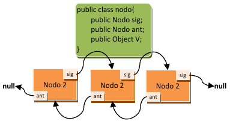

<div class="interactive-progress-tracker">
  <div class="tracker-header">
    <span>🏆 <strong>Progrés d'aquesta secció:</strong> <span class="tracker-count">0 de 4 superats (0%)</span></span>
    <span class="tracker-pts">⭐ <strong>0 punts</strong></span>
  </div>
  <div class="tracker-bar">
    <div class="tracker-fill" style="width: 0%;"></div>
  </div>
</div>

# 3.2.5 Col·leccions dinàmiques: ArrayList

## 1. Llistes

    



*En què es diferencia una llista d'un conjunt*? Les llistes són elements de programació un poc més avançats que els conjunts. El seu avantatge és que amplían el conjunt d'operacions de les col·leccions afegint operacions extra. Vegem algunes d'elles:

- Sí **poden emmagatzemar duplicats**. Si no volem duplicats, cal verificar manualment que l'element no estiga en la llista abans de la seua inserció.

- **Accés posicional**. Podem accedir a un element indicant la seua posició en la llista.

- **Cerca**. És possible cercar elements en la llista i obtindre la seua posició. En els conjunts, al ser col·leccions sense aportar res nou, només es podia comprovar si un conjunt contenía o no un element, retornant vertader o fals. Les llistes mejoran aquest aspecte.

- **Extracció de sublistas**. És possible obtindre una llista que continga només una part dels elements de forma molt senzilla.

En Java, per a les llistes es disposa d'una interfície anomenada **`java.util.List`**, i dos implementacions (**`java.util.LinkedList`** i **`java.util.ArrayList`**), amb diferències significativas entre elles. Els mètodes de la interfície **`List`**, que obviament estaran en totes les implementacions, i que permeten les operacions anteriors són:

| mètode | descripció |
| --- | --- |
| **`E get(int index)`** | el mètode `get` permet obtindre un element partint de la seua posició (index). |
| **`E set(int index, E element)`** | el mètode `set` permet canviar l'element emmagatzemat en una posició de la llista (index), per un altre (element). |
| **`void add(int index, E element)`** | es afegeix una altra versió del mètode `add`, en la qual es pot inserir un element (element) en la llista en una posició concreta (index), desplazant els existents. |
| **`E remove(int index)`** | es afegeix una altra versió del mètode `remove`, aquesta versió permet eliminar un element indicant la seua posició en la llista (desplazant els existents a esquerra). |
| **`boolean addAll(int index, Collection<? extends E> c)`** | es afegeix una altra versió del mètode `addAll` , que permet inserir una col·lecció passada per paràmetre en una posició de la llista, desplazant el resta d'elements. |
| **`int indexOf(Object o)`** | el mètode `indexOf` permet conèixer la posició (índex) d'un element, si aquest element no està en la llista retornará `‐1`. |
| **`int lastIndexOf(Object o)`** | el mètode `lastIndexOf` ens permet obtindre la última ocurrència de l'objecte en la llista (atès que la llista sí pot emmagatzemar duplicats). |
| **`List<E> subList(int from, int to)`** | el mètode `subList` genera una sublista (una vista parcial de la llista) amb els elements comprendits entre la posició inicial (inclosa) i la posició final (no inclosa). |

> **📌 A tindre en compte sobre `List`**
> 

> Tingues en compte que els elements d'una llista comencen a numerar-se per *0*. És a dir, que el primer element de la llista és el *0*.
> 
> 
Tingues en compte també que `List` és una interfície genérica, per la qual cosa `<E>` correspon amb el tipus base usat com paràmetre genéric al crear la llista.

### 1.1. Ús

I, *com s'usen les llistes*? Ja que per a usar una llista farem ús de les seues implementacions **`LinkedList`** i **`ArrayList`**. Vegem un exemple del seu ús i després obtendrás resposta a aquesta pregunta.

<details markdown="1">

<summary>💡 Exemple 2.08: ús de classe `ArrayList`</summary>

Abans de res no olvides importar la classe `java.util.ArrayList`. 
En aquest exemple s'usen els mètodes d'accés posicional a la llista:

```java
//declaració
ArrayList<Integer> al = new ArrayList<>();
ArrayList<Integer> al2 = new ArrayList<>();
ArrayList<Empleado> em = new ArrayList<>();
ArrayList<String> sr = new ArrayList<>();

//Afegir elements
al.add(10); 
al.add(11);
al2.add(8);
al2.add(9);
em.add(new Empleado("33445666V", "Pepe", "Martínez", "mañana", 1700));
sr.add("Hola");
sr.add("Adios");

//Acceder a elemento
em.get(0);

//buscar elemento
int indice = al.indexOf(11);
int indice2 = sr.indexOf("Hola");

//reemplazar elemento (buscado arriba)
al.set(indice, 15);
sr.set(indice2, "ey");

//Recorrer array --> foreach
for (String string : sr) {
    System.out.println(sr);
}

//Recorrer array --> for
for (int i = 0; i < al.size(); i++) {
    System.out.println(al.get(i));
}

//Combinar dos Arrays
al.addAll(0, al2);

//Eliminar elemento
al.remove(0);
sr.removeFirst();
em.removeLast();
al.clear();
```

</details>

<details markdown="1">

<summary>💡 Exemple 2.11: ús de `LinkedList` i `ArrayList`</summary>

```java
package UT07.P2_Lists;

import java.util.ArrayList;
import java.util.Collection;
import java.util.LinkedList;

public class EjemploListas2 {

    // método para imprimir colecciones:
    private static void imprimirColeccion(Collection<?> c) {
        for (Object elemento : c) {
            System.out.print(elemento.toString() + " ");
        }
        System.out.println("");
    }

    public static void main(String[] args) {
      LinkedList<Integer> ll = new LinkedList<>(); //declaración+creación LinkedList
      ll.add(1);        //añade un elemento al final de la lista
      ll.add(3);        //añade otro elemento al final de la lista
      ll.add(1, 2);     //añade en la posición 1 el elemento 2
      ll.add(t.get(1) + ll.get(2)); //suma contendio de posición 1 y 2, y agrega al final
      ll.remove(0);     //elimina el primer elementos de la lista
      imprimirColeccion(ll); //2 3 5 

      ArrayList<Integer> al = new ArrayList<>(); //declaración+creación ArrayList
      al.add(10);
      al.add(11);   //añadimos dos elementos a la lista.
      al.set(al.indexOf(11), 12); //sustituimos el 11 por el 12, primero lo buscamos y luego lo reemplazamos.

      al.addAll(0, t.subList(1, t.size()));
      imprimirColeccion(al); //3 5 10 12 

      al.subList(0, 2).clear();
      imprimirColeccion(al); //10 12 
    }
}
```

</details>

### 1.2. `LinkedList` i `ArrayList`

*I en què es diferencia un* `LinkedList` *d'un* `ArrayList` ?

#### 🔗 LinkedList

Utilitzen llistes doblement enlazades, que són llistes enlazades (com es vió en un apartat anterior), però que permeten anar cap a arrere en la llista d'elements. Els elements de la llista es encapsulan en els anomenats nodes.

Els nodes van enlazats uns a altres per a no perdre l'ordre i no limitar el mida d'emmagatzematge. Tindre un doble enllaç significa que en cada node s'emmagatzema la informació de quin és el següent node i a més, de quin és el node anterior. Si un node no té node següent o node anterior, s'emmagatzema `null`(o nul) per a tots dos casos.

#### 🔢 ArrayList

Aquests es implementan utilitzant arrays que es van redimensionant conforme es necessita més espai o menys. La redimensió és transparent a nosaltres, no ens enteramos quan es produeix, però això redunda en una diferència de rendiment notable depenent de l'ús. Els **ArrayList** són més rápits pel que fa a accés als elements, accedir a un element segons la seua posició és més ràpid en un array que en una llista doblement enllaçada (cal recórrer la llista). En canvi, eliminar un element implica moltes més operacions en un array que en una llista enllaçada de qualsevol tipus.

*I açò què vol dir*? Que si es van a realitzar moltes operacions d'eliminació d'elements sobre la llista, convé usar una llista enllaçada (`LinkedList`), però si no es van a realitzar moltes eliminacions, sinó que solament es van a inserir i consultar elements per posició, convé usar una llista basada en arrays redimensionats (`ArrayList` ).

| Característica | 🔗 **LinkedList** | 🔢 **ArrayList** |
| --- | --- | --- |
| **Estructura** | Llista doblement enllaçada (nodes amb referències a l'anterior i següent). | Array redimensionable (elements contiguos en memòria). |
| **Accés a elements** | **Lent** (O(n)), cal recórrer la llista. | **Ràpid** (O(1)), accés directe per índex. |
| **Inserció/Eliminació** | **Ràpida** (O(1) si es té el node, O(n) si cal buscar-lo). | **Lenta** (O(n)), ja que cal desplazar elements. |
| **Ús de memòria** | Més memòria per referències addicionals (`next` i `prev`). | Menys memòria, només emmagatzema les dades. |
| **Redimensionament** | No necessita, es expande dinámicament sense còpies. | Pot requerir redimensionament i còpia de dades. |
| **Ideal per a...** | Moltes insercions/eliminacions en el mitjà de la llista. | Moltes consultes i accés ràpid a elements per índex. |
| **Interfícies addicionals** | Implementa `Queue` i `Deque` (ús com pila o cola). | No implementa `Queue` ni `Deque`. |

`LinkedList` té altres avantatges que ens pot portar al seu ús. Implementa les interfícies `java.util.Queue` i `java.util.Deque`. Aquestes interfícies permeten fer ús de les llistes com si fueran una cola de prioritat o una pila, respectivament.

### 1.3. A tindre en compte

No és el mateix usar les col·leccions (llistes i conjunts) amb objectes inmutables (`Strings`, `Integer`, etc.) que amb objectes mutables. Els objectes inmutables no poden ser modificats després de la seua creació, per la qual cosa quan es incorporen a la llista, a través dels mètodes `add` , es passen per còpia (és a dir, es realitza una còpia dels mateixos). En canvi els objectes mutables (com les classes que tu pots crear), no es copian, i això pot produir efectes no desitjats.

Imagínate la següent classe, que conté un número:

```java
class Test {
    public Integer num;
    Test (int num) {
        this.num = new Integer(num); 
    }
}
```

La classe d'abans és mutable, per la qual cosa no es passa per còpia a la llista. Ara imagina el següent codi en el que es crea una llista que usa aquest tipus d'objecte, i en el que s'insereixen dos objectes:

```java
Test p1 = new Test(11); // se crea un objeto Test donde el entero que contiene vale 11.
Test p2 = new Test(12); // se crea otro objeto Test donde el entero que contiene vale 12.
LinkedList<Test> lista = new LinkedList<Test>(); // creamos una lista enlazada para objetos tipo Test.

lista.add(p1); // añadimos el primero objeto test.
lista.add(p2); // añadimos el segundo objeto test.

for (Test p:lista){
    System.out.println(p.num); // mostramos la lista de objetos.
}
```

*Què mostraría per pantalla el codi anterior*? Simplement mostraría els números 11 i 12.

Ara bé, *què passa si modificamos el valor d'un dels números dels objectes test*? *Què es mostrarà a l'executar el següent codi*?

```java
p1.num = 44;

for (Test p:lista){
    System.out.println(p.num);
}
```

El resultat d'executar el codi anterior és que es mostren els números 44 i 12. El número ha sigut modificat i no hem tingut que tornar a inserir l'element en la llista perquè en la llista es cambie també. Açò és perquè en la llista no s'emmagatzema una còpia de l'objecte Test, sinó un apuntador a aquest objecte (només hi ha una còpia de l'objecte a la que es fa referència des de distints llocs).

> **📌 Cita**
> 

> *Controlar la complexitat és l'esencia de la programació.* [Brian Kernighan](https://es.wikipedia.org/wiki/Brian_Kernighan)

<details markdown="1">

<summary>💡 Exemple 2.13: ús de `ArrayList`</summary>

Tenim la classe `Producto` amb:

- Dos atributs: *nom* (`String`) i *quantitat* (`int`).

- Un constructor amb paràmetres.

- Un constructor sense paràmetres.

- Mètodes `get` i `set` associats als atributs.

#### 📌 `Producto.java`

```java
package UT07.P2_Lists;

public class Producto {

  //Atributos
  private String nombre;
  private int cantidad;

  //Métodos
  //Constructor con parámetros donde asignamos el valor dado a los atributos
  public Producto(String nombre, int cantidad) {
    this.nombre = nombre;
    this.cantidad = cantidad;
  }

  //Constructor sin parámetros donde inicializamos los atributos
  public Producto() {
    //La palabra reservada null se utiliza para inicializar los objetos,
    //indicando que el puntero del objeto no apunta a ninguna dirección
    //de memoria. No hay que olvidar que String es una clase.
    this.nombre = null;
    this.cantidad = 0;
  }

  //Metodo get y set
  public String getNombre() {
    return nombre;
  }

  public void setNombre(String nombre) {
    this.nombre = nombre;
  }

  public int getCantidad() {
    return cantidad;
  }

  public void setCantidad(int cantidad) {
    this.cantidad = cantidad;
  }
}
```

#### 📌 Classe `Ejemplo06.java`

En el programa principal creem una llista de productes i realitzem operacions sobre ella:

```java
package UT07.P2_Lists;

import java.util.ArrayList;

public class EjemploListas {

  public static void main(String[] args) {

    //Definimos 5 instancias de la clase Producto
    Producto p1 = new Producto("Pan", 6);
    Producto p2 = new Producto("Leche", 2);
    Producto p3 = new Producto("Manzanas", 5);
    Producto p4 = new Producto("Brocoli", 2);
    Producto p5 = new Producto("Carne", 2);

    //Definir un ArrayList
    ArrayList<Producto> lista = new ArrayList<>();

    //Colocar instancias de producto en ArrayList
    lista.add(p1);
    lista.add(p2);
    lista.add(p3);
    lista.add(p4);

    //Añadimos "Carne" en la posición 1 de la lista
    lista.add(1, p5);

    //Añadimos "Carne" en la última posición
    lista.add(p5);

    //Imprimir el contenido del ArrayList
    System.out.println(" - Lista con " + lista.size() + " elementos");

    for (Producto p : lista) {
      System.out.println(p.getNombre() + " : " + p.getCantidad());
    }

    p5.setCantidad(99); //cambiamos la cantidad al producto, ¿cambiará la lista?

    ((Producto)lista.get(1)).setCantidad(66);

    System.out.println(p5.getCantidad());

    //Imprimir el contenido del ArrayList
    System.out.println(" - Lista con " + lista.size() + " elementos");

    for (Producto p : lista) {
       System.out.println(p.getNombre() + " : " + p.getCantidad());
    }

    //Eliminar todos los valores del ArrayList
    lista.clear();
    System.out.println(" - Lista final con " + lista.size() + " elementos");
  }
}
```

</details>


---

## 🎮 Reptes Interactius d'Autoavaluació (+100 XP)

Comprova el teu domini sobre **3.2.5 Col·leccions dinàmiques: ArrayList** superant aquests 4 reptes gamificats (+25 punts cadascun):

<div class="interactive-mcq" data-answer="A" data-hint="Revisa els conceptes teòrics i pràctics d'aquesta secció.">
  <div class="mcq-question">🎯 <strong>Repte 1 (+25 pts):</strong> Si declarem un array 'int[] notes = new int[5];' en Java, quins són els índexs vàlids del primer i de l'últim element?</div>
  <div class="mcq-options">
    <button type="button" class="btn-mcq-opt" data-opt="A">A) El primer element és notes[0] i l'últim és notes[4].</button>
    <button type="button" class="btn-mcq-opt" data-opt="B">B) El primer element és notes[1] i l'últim és notes[5].</button>
    <button type="button" class="btn-mcq-opt" data-opt="C">C) Els índexs comencen en -1.</button>
    <button type="button" class="btn-mcq-opt" data-opt="D">D) Cap de les anteriors és correcta.</button>
  </div>
  <div class="quiz-feedback"></div>
</div>

<div class="interactive-mcq" data-answer="D" data-hint="Comprova l'apartat corresponent de la unitat.">
  <div class="mcq-question">🎯 <strong>Repte 2 (+25 pts):</strong> Quina col·lecció del Java Collections Framework (JCF) permet emmagatzemar parelles clau-valor (Key-Value) amb cerca ràpida per clau única?</div>
  <div class="mcq-options">
    <button type="button" class="btn-mcq-opt" data-opt="A">A) ArrayList&lt;E&gt;</button>
    <button type="button" class="btn-mcq-opt" data-opt="B">B) HashSet&lt;E&gt;</button>
    <button type="button" class="btn-mcq-opt" data-opt="C">C) Cap de les anteriors és correcta.</button>
    <button type="button" class="btn-mcq-opt" data-opt="D">D) HashMap&lt;K, V&gt;</button>
  </div>
  <div class="quiz-feedback"></div>
</div>

<div class="interactive-vf" data-answer="V" data-hint="Verifica l'afirmació amb els apunts de la unitat.">
  <div class="vf-statement">✅ <strong>Repte 3 (Vertader o Fals · +25 pts):</strong> Tot mètode recursiu ha de tindre com a mínim un cas base que detinga les crides recursives per a evitar un error StackOverflowError.</div>
  <div class="vf-buttons">
    <button type="button" class="btn-vf" data-opt="V">Vertader (V)</button>
    <button type="button" class="btn-vf" data-opt="F">Fals (F)</button>
  </div>
  <div class="quiz-feedback" style="width: 100%;"></div>
</div>

<div class="interactive-quiz" data-answer="length" data-hint="Longitud en anglès (6 lletres).">
  <div class="quiz-question">⌨️ <strong>Repte 4 (+25 pts):</strong> Quina propietat (sense parèntesis) s'utilitza en Java per a obtindre la grandària d'un array primitiu (p. ex. notes.___)?</div>
  <div class="quiz-controls">
    <input type="text" class="quiz-input" placeholder="Escriu la resposta..." />
    <button type="button" class="btn-quiz-check">Comprovar</button>
  </div>
  <div class="quiz-feedback"></div>
</div>

### 📋 Llista de Comprovació i Rúbrica d'Assoliment

Marca cada criteri a mesura que completes l'estudi o la resolució pràctica d'aquesta pàgina (**3.2.5 Col·leccions dinàmiques: ArrayList**):

- [ ] He llegit detingudament la teoria o l'enunciat d'aquesta secció i he anotat els conceptes clau.
- [ ] He revisat els esquemes, taules o blocs de codi i he verificat que sé aplicar-los a l'entorn de treball.
- [ ] He resolt correctament els **4 reptes interactius** superiors obtenint els **100 punts XP**.
- [ ] He descarregat el comprovant oficial en PDF per a adjuntar-lo a la tasca d'**Aules**.

<div class="aules-delivery-card">
  <h3>📤 Comprovant de Lliurament per a Aules</h3>
  <p>Quan hages completat els reptes interactius i la llista d'autoavaluació d'aquesta pàgina, introdueix el teu nom i descarrega el teu certificat oficial en PDF per a adjuntar-lo a la tasca d'<strong>Aules</strong>.</p>
  <div class="aules-student-field">
    <label for="aules-student-name">👤 Nom i Cognoms de l'Alumne/a:</label>
    <input type="text" id="aules-student-name" class="aules-student-name" placeholder="Ex: Joan Garcia Pérez" />
  </div>
  <div class="aules-score-badge">
    <span class="aules-score-count">0/4 reptes completats (0%) · 0 punts · 0/4 criteris d'autoavaluació</span>
  </div>
  <div class="aules-actions">
    <button type="button" class="btn-aules-dl" data-module="PRG" data-unit="UD03" data-activity="ut0307">📥 Descarregar Comprovant PDF</button>
    <button type="button" class="btn-aules-copy">📋 Copiar Resum al Porta-retalls</button>
  </div>
  <div class="aules-toast"></div>
</div>

