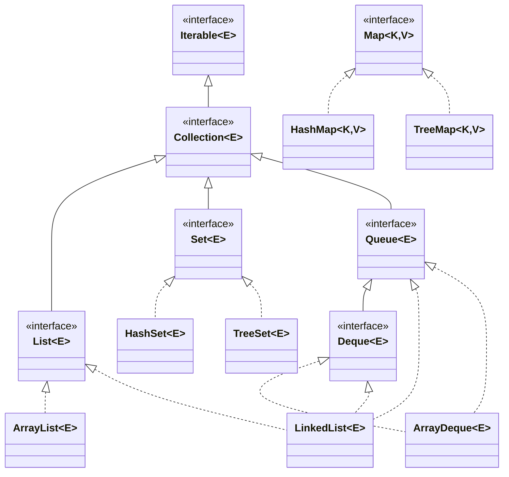
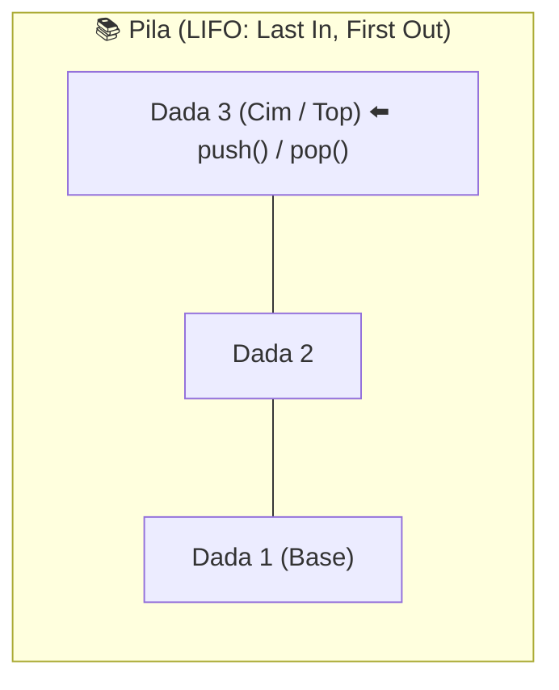
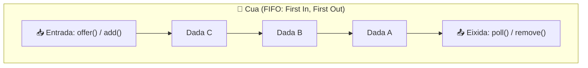

<div class="interactive-progress-tracker">
  <div class="tracker-header">
    <span>🏆 <strong>Progrés d'aquesta secció:</strong> <span class="tracker-count">0 de 4 superats (0%)</span></span>
    <span class="tracker-pts">⭐ <strong>0 punts</strong></span>
  </div>
  <div class="tracker-bar">
    <div class="tracker-fill" style="width: 0%;"></div>
  </div>
</div>

# 3.5 Estructures dinàmiques de dades: List, Set, Queue, Deque i Map (JCF)

> **📌 📋 Informació Curricular i Resultats d'aprenentatge**
> 

> **Mòdul:** Programació (PRG — Codi 0485) | 1º DAW | IES Mestre Ramón Esteve

> **Resultat d'aprenentatge:** `RA6` *(Escriu programes que manipulen informació seleccionant i utilitzant tipus avançats de dades)*.

> **Criteris d'avaluació associats:**

  
> - `CEb`: Identificació de les avantatges de les estructures dinàmiques enfront de estátiques.
  
> - `CEc`: Selecció i ús de col·leccions adequades segons els requeriments del programari.
  
> - `CEd`: Operacions d'inserció, consulta, modificació i esborrat d'elements.
  
> - `CEe`: Ús d'iteradors i prevenció d'errors de modificació concurrente.
  
> - `CEf`: Implementació i gestió d'estructures de tipus Pila (LIFO) i Cola (FIFO).
  
> - `CEg`: Utilització de diccionarios / mapes asociativos (clau-valor).

## 1. De Arrays Estátics a Estructures Dinàmiques

Fins a ara, per a emmagatzemar seqüències d'elements hem utilitzat **arrays tradicionals** (ej. `int[] numeros = new int[5];`). Encara que són ultrarrápits i eficients en memòria, presentan tres limitacions crítiques en aplicacions reals:

  
1. **Mida fix i inmutable:** La capacitat es fixa a l'instanciar i no pot alterar-se. Si es llena, cal reservar un array nou més gran i copiar els elements a mano un a un.
  
1. **Sense operacions d'alt nivell incorporades:** Inserir en una posició intermèdia, eliminar compactant el buit o cercar sense un bucle manual exige escriure algoritmes auxiliares.
  
1. **Desperdicio o escasez de memòria:** Sobredimensionar ("per si potser") malgasta memòria; quedar-se corto provoca errors de desbordament d'índex (`ArrayIndexOutOfBoundsException`).

Per a solucionar açò, Java incorpora en el seu paquet estàndard `java.util` el **Java Collections Framework (JCF)**: un ecosistema unificado d'interfícies, classes i implementacions de **estructures dinàmiques de dades** que redimensionan automàticament el seu espai en la memòria dinàmica (*Heap*) segons les necessitats del programa.

> **📌 ⚠️ Col·leccions i Tipus Primitius: Ús obligatori de Wrappers!**
> 

> Les col·leccions de Java **només poden emmagatzemar objectes**, mai tipus primitius directos. Gràcies al *Autoboxing*, utilitzem els seus classes embolcall (*Wrappers*):

```java
// ❌ Error de compilación: los genéricos no admiten primitivos
// List<int> lista = new ArrayList<int>();

// ✅ Correcto (usando clase envoltorio Integer):
List<Integer> lista = new ArrayList<>();
lista.add(10); // Autoboxing automático: de int a Integer
```

## 2. Jerarquia del Java Collections Framework (JCF)

El framework de col·leccions està organitzat en una arquitectura jeràrquica limpia basada en interfícies i implementacions:



> **📌 💡 Regla d'oro d'arquitectura: Polimorfisme de Interfícies**
> 

> Declara sempre les variables amb el tipus de la **interfície més general** (`List`, `Set`, `Map`) i instància amb la **classe concreta** (`ArrayList`, `HashSet`, `HashMap`). D'aquesta manera el teu codi desacopla el disseny de la implementació interna:

```java
// ✅ Práctica recomendada por Clean Code (Polimorfismo de Interfaces):
List<String> alumnos = new ArrayList<>();
Set<String> codigos = new HashSet<>();
Map<String, Double> notas = new HashMap<>();

// ⚠️ Desaconsejado (acoplamiento rígido a la clase concreta):
ArrayList<String> alumnosMal = new ArrayList<>();
```

## 3. Llistes (`List`): Elements Ordenats i Duplicats

Una **Llista** (`List<E>`) representa una seqüència indexada d'elements:

  
- **Característiques:** Permet elements repetits (duplicats), manté el **ordre d'inserció** i permet accés per índex numèric posicional base `0`.

### 3.1. Comparativa tècnica: `ArrayList` vs `LinkedList`

| Característica | `ArrayList` | `LinkedList` |
| --- | --- | --- |
| **Estructura interna** | Array dinàmic redimensionable internament. | Nodes doblement enlazats en memòria. |
| **Accés aleatorio (`get(i)`)** | ⚡ Ultrarrápido `O(1)` per puntero directe. | 🐢 Lent `O(n)`, recorre node a node. |
| **Inserció/Esborrat al final** | ⚡ Ràpid `O(1)` amortitzat. | ⚡ Ràpid `O(1)`. |
| **Inserció/Esborrat a l'inici/mitjà** | 🐢 Lent `O(n)` (desplaza tots els elements). | ⚡ Ràpid `O(1)` (reconecta enllaços de nodes). |
| **Recomanació estàndard** | **Ús per defecte en el 95% d'aplicacions.** | Ideal per a colas, pilas o insercions masivas continuas. |

### 3.2. Mètodes fonamentals de `List` en acció

```java
package ut3.colecciones;

import java.util.ArrayList;
import java.util.List;

public class EjemploListas {
    public static void main(String[] args) {
        List<String> lenguajes = new ArrayList<>();

        // 1. Inserción (al final o en posición específica)
        lenguajes.add("Java");
        lenguajes.add("Python");
        lenguajes.add("JavaScript");
        lenguajes.add(1, "TypeScript"); // Inserta en posición 1 desplazando el resto

        // 2. Consulta y tamaño
        System.out.println("Total elementos: " + lenguajes.size()); // 4
        System.out.println("Elemento en índice 0: " + lenguajes.get(0)); // Java
        System.out.println("¿Contiene Python?: " + lenguajes.contains("Python")); // true
        System.out.println("Posición de Java: " + lenguajes.indexOf("Java")); // 0

        // 3. Modificación
        lenguajes.set(2, "Kotlin"); // Sustituye el valor del índice 2

        // 4. Eliminación (por índice o por objeto exacto)
        lenguajes.remove(0); // Elimina por índice
        lenguajes.remove("Python"); // Elimina por coincidencia de objeto

        // 5. Estado y vaciado
        System.out.println("¿Lista vacía?: " + lenguajes.isEmpty());
        lenguajes.clear(); // Elimina todos los elementos
    }
}
```

## 4. Pilas (*Stacks* - LIFO) i Colas (*Queues* - FIFO)

Són estructures restringides dissenyades per a modelar fluxos de treball secuencials en la lògica de negoci:



*(L'últim en entrar és el primer en eixir: Operacions de Desfer / Undo, crides recursives).*



*(El primer en entrar és el primer en ser atés: Torns d'espera, cues d'impressió, buffers).*

| **PILA (LIFO: *Last In, First Out*)** | **COLA (FIFO: *First In, First Out*)** |
| --- | --- |

### 4.1. Pilas: LIFO (*Last In, First Out*)

> **📌 ⚠️ Avís sobre la classe obsoleta `java.util.Stack`**
> 

> Encara que Java inclou históricament la classe `Stack`, és una classe *legacy* desaconsellada. La pròpia documentació oficial de Oracle recomana utilitzar la interfície moderna **`Deque`** implementada mitjançant **`ArrayDeque`**:

```java
package ut3.colecciones;

import java.util.ArrayDeque;
import java.util.Deque;

public class EjemploPila {
    public static void main(String[] args) {
        // Uso recomendado oficial de Oracle: Deque implementado por ArrayDeque
        Deque<String> pilaNavegacion = new ArrayDeque<>();

        // Apilar elementos en la cima (push)
        pilaNavegacion.push("https://iesramonesteve.es");
        pilaNavegacion.push("https://aules.edu.gva.es");
        pilaNavegacion.push("https://github.com");

        // Consultar cima sin extraer (peek)
        System.out.println("Página actual: " + pilaNavegacion.peek()); // github.com

        // Desapilar al pulsar botón 'Atrás' (pop)
        System.out.println("Cerrando: " + pilaNavegacion.pop()); // Extrae github.com
        System.out.println("Regresando a: " + pilaNavegacion.peek()); // aules.edu.gva.es
    }
}
```

### 4.2. Colas: FIFO (*First In, First Out*)

En Java s'utilitza la interfície **`Queue`** implementada habitualment amb `LinkedList` o `ArrayDeque`:

```java
package ut3.colecciones;

import java.util.LinkedList;
import java.util.Queue;

public class EjemploCola {
    public static void main(String[] args) {
        Queue<String> colaAtencion = new LinkedList<>();

        // 1. Encolar clientes al final (offer)
        colaAtencion.offer("Cliente 1: Ana Asins");
        colaAtencion.offer("Cliente 2: Bernat Gómez");
        colaAtencion.offer("Cliente 3: Carla Navarro");

        // 2. Consultar el siguiente sin retirarlo
        System.out.println("Siguiente en turno: " + colaAtencion.peek());

        // 3. Desencolar por orden estricto de llegada (poll)
        while (!colaAtencion.isEmpty()) {
            String atendido = colaAtencion.poll();
            System.out.println("-> Atendiendo en ventanilla a: " + atendido);
        }
    }
}
```

### 4.3. Comparativa de mètodes: Pila vs Cola

| Operació | Mètode en Pila (`Deque`) | Mètode en Cola (`Queue`) | Comportament si està buida |
| --- | --- | --- | --- |
| **Inserir** | `push(e)` | `offer(e)` | Afegeix l'element a l'estructura. |
| **Extraer** | `pop()` | `poll()` | `pop()` llança excepció; `poll()` retorna `null`. |
| **Consultar** | `peek()` | `peek()` | Retorna l'element cima/frontal sense retirar-lo. |

## 5. Conjunts (`Set`): Elements Únics sense Duplicats

Un **Conjunt** (`Set<E>`) és una col·lecció que **garanteix matemáticament la no repetició d'elements**. Si intentas inserir un element duplicat amb `.add()`, Java retornarà `false` i no modificará el conjunt.

### 5.1. Implementacions principals de `Set`

| Implementació | Ordenació dels elements | Rendiment | Cas d'ús típic |
| --- | --- | --- | --- |
| **`HashSet`** | **Sense ordre garantitzat** (usa taula Hash interna). | ⚡ `O(1)` Ultrarrápido | Eliminar duplicats on l'ordre no importe. |
| **`LinkedHashSet`** | Manté el **ordre d'inserció** exacte. | ⚡ `O(1)` Ràpid | Eliminar duplicats respetant l'ordre en que llegaron. |
| **`TreeSet`** | **Ordenats automàticament** (alfabétic/numèric) o per `Comparator`. | ⚖️ `O(log n)` Equilibrado | Llistes de valors únics sempre ordenats automàticament. |

### 5.2. Eliminació de duplicats i ordenació alfabética

```java
package ut3.colecciones;

import java.util.*;

public class EjemploSets {
    public static void main(String[] args) {
        List<String> ciudadesConDuplicados = List.of(
            "Valencia", "Alicante", "Castellón", "Valencia", "Alicante"
        );

        // 1. Eliminar duplicados instantáneamente con HashSet (sin orden fijo):
        Set<String> unicas = new HashSet<>(ciudadesConDuplicados);
        System.out.println("HashSet (sin duplicados): " + unicas);

        // 2. TreeSet: sin duplicados y ordenados alfabéticamente de forma automática:
        Set<String> ordenadas = new TreeSet<>(ciudadesConDuplicados);
        System.out.println("TreeSet (alfabético): " + ordenadas);
        // Salida: [Alicante, Castellón, Valencia]
    }
}
```

### 5.3. Operacions matemàtiques de conjunts (Álgebra de conjunts)

Els mètodes de `Set` permeten resoldre operacions complexes de conjunts en una sola instrucció:

```java
Set<Integer> conjuntoA = new HashSet<>(Set.of(1, 2, 3, 4));
Set<Integer> conjuntoB = new HashSet<>(Set.of(3, 4, 5, 6));

// 1. UNIÓN (A ∪ B)
Set<Integer> union = new HashSet<>(conjuntoA);
union.addAll(conjuntoB); // [1, 2, 3, 4, 5, 6]

// 2. INTERSECCIÓN (A ∩ B)
Set<Integer> interseccion = new HashSet<>(conjuntoA);
interseccion.retainAll(conjuntoB); // [3, 4]

// 3. DIFERENCIA (A - B)
Set<Integer> diferencia = new HashSet<>(conjuntoA);
diferencia.removeAll(conjuntoB); // [1, 2]
```

## 6. Mapes / Diccionarios (`Map`): Estructura Clau-Valor

Un **Mapa** (`Map<K, V>`) associa parelles de dades formades per una **clau única (`Key`)** i un **valor associat (`Value`)**:

  
- Les **claus no poden duplicar-se**. Si insertas una clau ja existent mitjançant `put()`, es sobrescribe el seu valor anterior.
  
- Els **valors sí poden repetir-se**.

### 6.1. Implementacions de `Map`

  
- **`HashMap`:** L'opció estàndard de màxima velocitat (temps constant `O(1)`). No garanteix cap ordre en les claus.
  
- **`LinkedHashMap`:** Recorda l'ordre d'inserció de les parelles.
  
- **`TreeMap`:** Manté les claus permanentement ordenades per la seua ordre natural o `Comparator` (temps `O(log n)`).

### 6.2. Mètodes esencials de `Map`

```java
package ut3.colecciones;

import java.util.HashMap;
import java.util.Map;

public class EjemploMap {
    public static void main(String[] args) {
        // Clave: DNI (String) -> Valor: Nombre de alumno (String)
        Map<String, String> usuarios = new HashMap<>();

        // 1. Insertar o actualizar (put)
        usuarios.put("12345678A", "Laura Martínez");
        usuarios.put("87654321B", "Marc Esteve");
        usuarios.put("11223344C", "Nuria Soler");

        // Si repetimos la clave, se actualiza el valor asociado:
        usuarios.put("12345678A", "Laura Martínez Gómez");

        // 2. Obtener un valor por clave (get)
        System.out.println("Usuario con DNI 87654321B: " + usuarios.get("87654321B"));

        // 3. Obtener con valor por defecto si no existe (getOrDefault)
        String resultado = usuarios.getOrDefault("99999999Z", "Usuario no registrado");
        System.out.println("Búsqueda DNI 99999999Z: " + resultado);

        // 4. Comprobaciones de existencia rápidas O(1)
        System.out.println("¿Existe el DNI 11223344C?: " + usuarios.containsKey("11223344C")); // true
        System.out.println("¿Existe el nombre Marc?: " + usuarios.containsValue("Marc Esteve")); // true

        // 5. Eliminar por clave
        usuarios.remove("11223344C");
        System.out.println("Total usuarios activos: " + usuarios.size());
    }
}
```

## 7. Formes Professionals de Recórrer Col·leccions (Iteració)

### 7.1. Bucle `for-each` (Recomanat per a només lectura)

Sintaxi limpia i directa quan només volem consultar elements sense alterar la col·lecció:

```java
List<String> frutas = List.of("Manzana", "Plátano", "Naranja");
for (String fruta : frutas) {
    System.out.println("Fruta: " + fruta);
}
```

### 7.2. El perill del `for-each`: `ConcurrentModificationException`

> **📌 💥 Regla d'oro: MAI elimines elements d'una llista dins del seu propi bucle for-each!**
> 

> El següent codi compila perfectament, però **fallará críticament en ejecució**:

```java
List<String> frutas = new ArrayList<>(List.of("Manzana", "Plátano", "Naranja"));

// ❌ ERROR CRÍTICO EN EJECUCIÓN: Lanza ConcurrentModificationException
for (String fruta : frutas) {
    if (fruta.equals("Plátano")) {
        frutas.remove(fruta); // ¡FALLO! Modificar la lista durante su propia iteración
    }
}
```

### 7.3. La solució segura: `Iterator` o `removeIf()`

Per a eliminar elements de manera segura durant el recorregut disposem de dos vías estàndard:

```java
// ✅ Opción 1: Con Iterator (Clásica y universal en todas las versiones de Java)
Iterator<String> it = frutas.iterator();
while (it.hasNext()) {
    String fruta = it.next();
    if (fruta.equals("Plátano")) {
        it.remove(); // Seguro: el iterador actualiza su puntero interno
    }
}

// ✅ Opción 2: Con removeIf y expresión Lambda (Moderna y recomendada desde Java 8)
frutas.removeIf(fruta -> fruta.equals("Plátano"));
```

### 7.4. Com recórrer un `Map` (Claus, Valors i Parelles)

Un `Map` no implementa `Iterable` de forma directa, per la qual cosa es itera a través de les seues vistes de col·lecció:

```java
Map<String, Double> precios = Map.of("Pan", 1.20, "Leche", 0.95, "Café", 2.50);

// Forma 1 (La más eficiente): Recorrer parejas Clave - Valor con entrySet()
for (Map.Entry<String, Double> entrada : precios.entrySet()) {
    System.out.println("Producto: " + entrada.getKey() + " -> " + entrada.getValue() + " €");
}

// Forma 2: Con forEach y expresión Lambda concisa
precios.forEach((producto, precio) -> {
    System.out.printf("%-10s : %5.2f €%n", producto, precio);
});
```

## 8. Taula de Decisió: Què Estructura Triar? (*Cheat Sheet*)

Utilitza aquest diagrama de flux mental per a respondre sempre a la pregunta de l'examen o del projecte:

```bash
¿Necesitas pares Clave - Valor?
  ├── SÍ ──► MAP
  │           ├── ¿Importa el orden alfabético de clave? ──► TreeMap
  │           ├── ¿Importa el orden de inserción? ────────► LinkedHashMap
  │           └── ¿Solo máxima velocidad O(1)? ───────────► HashMap
  │
  └── NO ──► ¿Importa que NO haya elementos duplicados?
              ├── SÍ ──► SET
              │           ├── ¿Orden natural/alfabético? ─► TreeSet
              │           ├── ¿Orden de inserción? ───────► LinkedHashSet
              │           └── ¿Solo eliminar duplicados? ─► HashSet
              │
              └── NO ──► ¿Flujo estricto de entrada/salida?
                          ├── ¿Último en entrar sale primero? (LIFO) ─► Deque / ArrayDeque (Pila)
                          ├── ¿Primero en entrar sale primero? (FIFO) ─► Queue / LinkedList (Cola)
                          └── ¿Acceso aleatorio por índice numérico? ─► List / ArrayList
```

## 9. Casos Pràctics Complets i Resolts

### Cas Pràctic 1: Simulació de Cola de Suport (FIFO) i Pila de Desfer (LIFO)

```java
package ut3.practicas;

import java.util.ArrayDeque;
import java.util.Deque;
import java.util.LinkedList;
import java.util.Queue;

public class GestionSoporteTecnico {
    public static void main(String[] args) {
        // COLA (FIFO): Los tickets se atienden en riguroso orden de llegada
        Queue<String> colaTickets = new LinkedList<>();
        colaTickets.offer("Ticket #101: Fallo al iniciar sesión");
        colaTickets.offer("Ticket #102: Error 404 en el checkout");
        colaTickets.offer("Ticket #103: Olvido de contraseña");

        // PILA (LIFO): Historial de acciones realizadas para permitir 'Deshacer'
        Deque<String> historialAcciones = new ArrayDeque<>();

        System.out.println("=== ATENDIENDO TICKETS (COLA FIFO) ===");
        while (!colaTickets.isEmpty()) {
            String ticketActual = colaTickets.poll();
            System.out.println("-> Procesando: " + ticketActual);
            historialAcciones.push("Atendido " + ticketActual);
        }

        System.out.println("\n=== HISTORIAL DE ACCIONES PARA DESHACER (PILA LIFO) ===");
        while (!historialAcciones.isEmpty()) {
            System.out.println("<- Deshaciendo última acción: " + historialAcciones.pop());
        }
    }
}
```

### Cas Pràctic 2: Comptador de Freqüència de Paraules amb `Map` i `Set`

```java
package ut3.practicas;

import java.util.*;

public class AnalizadorTextoWeb {
    public static void main(String[] args) {
        String texto = "java es genial y aprender java es divertido con programacion en java";

        // 1. Separamos palabras con expresión regular (espacios en blanco)
        String[] palabras = texto.toLowerCase().split("\\s+");

        // 2. Usamos un Map para contabilizar frecuencias
        Map<String, Integer> frecuencias = new HashMap<>();
        for (String p : palabras) {
            frecuencias.put(p, frecuencias.getOrDefault(p, 0) + 1);
        }

        // 3. Mostramos palabras ordenadas alfabéticamente usando un TreeMap
        Map<String, Integer> frecuenciasOrdenadas = new TreeMap<>(frecuencias);

        System.out.println("=== FRECUENCIA DE PALABRAS ===");
        System.out.printf("%-15s : %s%n", "PALABRA", "APARICIONES");
        System.out.println("---------------------------------");
        for (Map.Entry<String, Integer> entry : frecuenciasOrdenadas.entrySet()) {
            System.out.printf("%-15s : %d veces%n", entry.getKey(), entry.getValue());
        }

        // 4. Mostrar vocabulario único sin duplicados usando un Set
        Set<String> palabrasUnicas = new TreeSet<>(Arrays.asList(palabras));
        System.out.println("\nTotal de palabras únicas: " + palabrasUnicas.size());
        System.out.println("Vocabulario: " + palabrasUnicas);
    }
}
```


---

## 🎮 Reptes Interactius d'Autoavaluació (+100 XP)

Comprova el teu domini sobre **3.5 Estructures dinàmiques de dades: List, Set, Queue, Deque i Map (JCF)** superant aquests 4 reptes gamificats (+25 punts cadascun):

<div class="interactive-mcq" data-answer="A" data-hint="Revisa els conceptes teòrics i pràctics d'aquesta secció.">
  <div class="mcq-question">🎯 <strong>Repte 1 (+25 pts):</strong> Si declarem un array 'int[] notes = new int[5];' en Java, quins són els índexs vàlids del primer i de l'últim element?</div>
  <div class="mcq-options">
    <button type="button" class="btn-mcq-opt" data-opt="A">A) El primer element és notes[0] i l'últim és notes[4].</button>
    <button type="button" class="btn-mcq-opt" data-opt="B">B) El primer element és notes[1] i l'últim és notes[5].</button>
    <button type="button" class="btn-mcq-opt" data-opt="C">C) Els índexs comencen en -1.</button>
    <button type="button" class="btn-mcq-opt" data-opt="D">D) Cap de les anteriors és correcta.</button>
  </div>
  <div class="quiz-feedback"></div>
</div>

<div class="interactive-mcq" data-answer="D" data-hint="Comprova l'apartat corresponent de la unitat.">
  <div class="mcq-question">🎯 <strong>Repte 2 (+25 pts):</strong> Quina col·lecció del Java Collections Framework (JCF) permet emmagatzemar parelles clau-valor (Key-Value) amb cerca ràpida per clau única?</div>
  <div class="mcq-options">
    <button type="button" class="btn-mcq-opt" data-opt="A">A) ArrayList&lt;E&gt;</button>
    <button type="button" class="btn-mcq-opt" data-opt="B">B) HashSet&lt;E&gt;</button>
    <button type="button" class="btn-mcq-opt" data-opt="C">C) Cap de les anteriors és correcta.</button>
    <button type="button" class="btn-mcq-opt" data-opt="D">D) HashMap&lt;K, V&gt;</button>
  </div>
  <div class="quiz-feedback"></div>
</div>

<div class="interactive-vf" data-answer="V" data-hint="Verifica l'afirmació amb els apunts de la unitat.">
  <div class="vf-statement">✅ <strong>Repte 3 (Vertader o Fals · +25 pts):</strong> Tot mètode recursiu ha de tindre com a mínim un cas base que detinga les crides recursives per a evitar un error StackOverflowError.</div>
  <div class="vf-buttons">
    <button type="button" class="btn-vf" data-opt="V">Vertader (V)</button>
    <button type="button" class="btn-vf" data-opt="F">Fals (F)</button>
  </div>
  <div class="quiz-feedback" style="width: 100%;"></div>
</div>

<div class="interactive-quiz" data-answer="length" data-hint="Longitud en anglès (6 lletres).">
  <div class="quiz-question">⌨️ <strong>Repte 4 (+25 pts):</strong> Quina propietat (sense parèntesis) s'utilitza en Java per a obtindre la grandària d'un array primitiu (p. ex. notes.___)?</div>
  <div class="quiz-controls">
    <input type="text" class="quiz-input" placeholder="Escriu la resposta..." />
    <button type="button" class="btn-quiz-check">Comprovar</button>
  </div>
  <div class="quiz-feedback"></div>
</div>

### 📋 Llista de Comprovació i Rúbrica d'Assoliment

Marca cada criteri a mesura que completes l'estudi o la resolució pràctica d'aquesta pàgina (**3.5 Estructures dinàmiques de dades: List, Set, Queue, Deque i Map (JCF)**):

- [ ] He llegit detingudament la teoria o l'enunciat d'aquesta secció i he anotat els conceptes clau.
- [ ] He revisat els esquemes, taules o blocs de codi i he verificat que sé aplicar-los a l'entorn de treball.
- [ ] He resolt correctament els **4 reptes interactius** superiors obtenint els **100 punts XP**.
- [ ] He descarregat el comprovant oficial en PDF per a adjuntar-lo a la tasca d'**Aules**.

<div class="aules-delivery-card">
  <h3>📤 Comprovant de Lliurament per a Aules</h3>
  <p>Quan hages completat els reptes interactius i la llista d'autoavaluació d'aquesta pàgina, introdueix el teu nom i descarrega el teu certificat oficial en PDF per a adjuntar-lo a la tasca d'<strong>Aules</strong>.</p>
  <div class="aules-student-field">
    <label for="aules-student-name">👤 Nom i Cognoms de l'Alumne/a:</label>
    <input type="text" id="aules-student-name" class="aules-student-name" placeholder="Ex: Joan Garcia Pérez" />
  </div>
  <div class="aules-score-badge">
    <span class="aules-score-count">0/4 reptes completats (0%) · 0 punts · 0/4 criteris d'autoavaluació</span>
  </div>
  <div class="aules-actions">
    <button type="button" class="btn-aules-dl" data-module="PRG" data-unit="UD03" data-activity="ut03colecciones">📥 Descarregar Comprovant PDF</button>
    <button type="button" class="btn-aules-copy">📋 Copiar Resum al Porta-retalls</button>
  </div>
  <div class="aules-toast"></div>
</div>

