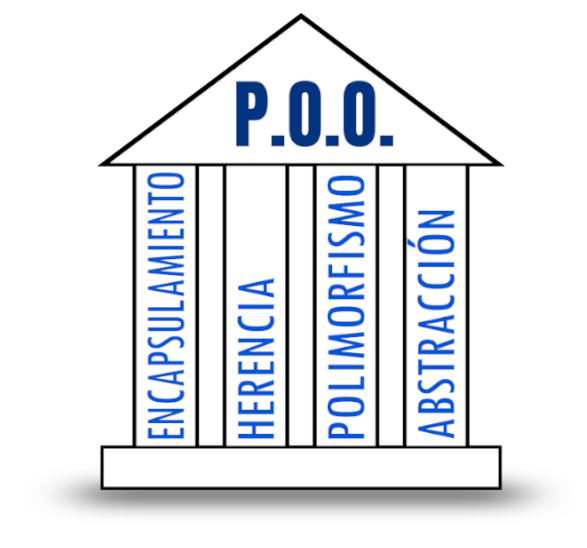

  

    🏆 <strong>Progrés d'aquesta secció:</strong> 0 de 4 superats (0%)
    ⭐ <strong>0 punts</strong>
  

  

    

  

# 4.1 Introducció al paradigma orientat a objectes

**Orientat a objectes** fa referència a una forma diferent d'acometer la tasca del desenvolupament de programari, enfront d'altres models com el de la programació imperativa, la programació funcional o la programació lògica. Suposa una reconsideració dels mètodes de programació, de la forma de pensar en la resolució de problemes i, ante tot, de la forma d'estructurar la informació.

La **programació orientada a objectes (POO)** és un model per a l'elaboració de programes que es ha impuesto en els últims anys. Aquest auge s'ha de, en part, a que aquesta forma de programar està fuertement basada en la representació de la realitat; però també a que refuerza l'ús de bons criteris aplicables al desenvolupament de programes.

> **📌  **
> 

> L'orientació a objectes no és un tipus de llenguatge de programació. És una metodología de treball per a crear programes.

En POO, un programa és una col·lecció d'objectes que es relacionen entre sí de distintes formes.

> **📌 Un poquito de ...**
> 

>

---

## 🎮 Reptes Interactius d'Autoavaluació (+100 XP)

Comprova el teu domini sobre **4.1 Introducció al paradigma orientat a objectes** superant aquests 4 reptes gamificats (+25 punts cadascun):

  
🎯 <strong>Repte 1 (+25 pts):</strong> Quin principi de la Programació Orientada a Objectes consisteix a declarar els atributs d'una classe com a 'private' i proporcionar mètodes públics controlats (getters i setters)?

  

    <button type="button" class="btn-mcq-opt" data-opt="A">A) Encapsulament (Encapsulation).</button>
    <button type="button" class="btn-mcq-opt" data-opt="B">B) Herència múltiple.</button>
    <button type="button" class="btn-mcq-opt" data-opt="C">C) Recursivitat lineal.</button>
    <button type="button" class="btn-mcq-opt" data-opt="D">D) Cap de les anteriors és correcta.</button>
  

  

  
🎯 <strong>Repte 2 (+25 pts):</strong> Quina és la funció de la paraula clau 'this' dins d'un mètode o constructor d'una classe en Java?

  

    <button type="button" class="btn-mcq-opt" data-opt="A">A) Destrueix l'objecte actual de la memòria RAM.</button>
    <button type="button" class="btn-mcq-opt" data-opt="B">B) Importa tots els paquets de la llibreria java.util.</button>
    <button type="button" class="btn-mcq-opt" data-opt="C">C) Cap de les anteriors és correcta.</button>
    <button type="button" class="btn-mcq-opt" data-opt="D">D) Fa referència a la instància (objecte) actual sobre la qual s'està executant el mètode o constructor.</button>
  

  

  
✅ <strong>Repte 3 (Vertader o Fals · +25 pts):</strong> Un membre declarat amb el modificador 'static' pertany a la pròpia classe i és compartit per totes les instàncies d'eixa classe.

  

    <button type="button" class="btn-vf" data-opt="V">Vertader (V)</button>
    <button type="button" class="btn-vf" data-opt="F">Fals (F)</button>
  

  

  
⌨️ <strong>Repte 4 (+25 pts):</strong> Quin operador reservat de Java s'utilitza per a invocar un constructor i reservar memòria per a un nou objecte?

  

    <input type="text" class="quiz-input" placeholder="Escriu la resposta..." />
    <button type="button" class="btn-quiz-check">Comprovar</button>
  

  

### 📋 Llista de Comprovació i Rúbrica d'Assoliment

Marca cada criteri a mesura que completes l'estudi o la resolució pràctica d'aquesta pàgina (**4.1 Introducció al paradigma orientat a objectes**):

- [ ] He llegit detingudament la teoria o l'enunciat d'aquesta secció i he anotat els conceptes clau.
- [ ] He revisat els esquemes, taules o blocs de codi i he verificat que sé aplicar-los a l'entorn de treball.
- [ ] He resolt correctament els **4 reptes interactius** superiors obtenint els **100 punts XP**.
- [ ] He descarregat el comprovant oficial en PDF per a adjuntar-lo a la tasca d'**Aules**.

  <h3>📤 Comprovant de Lliurament per a Aules</h3>
  
Quan hages completat els reptes interactius i la llista d'autoavaluació d'aquesta pàgina, introdueix el teu nom i descarrega el teu certificat oficial en PDF per a adjuntar-lo a la tasca d'<strong>Aules</strong>.

  

    <label for="aules-student-name">👤 Nom i Cognoms de l'Alumne/a:</label>
    <input type="text" id="aules-student-name" class="aules-student-name" placeholder="Ex: Joan Garcia Pérez" />
  

  

    0/4 reptes completats (0%) · 0 punts · 0/4 criteris d'autoavaluació
  

  

    <button type="button" class="btn-aules-dl" data-module="PRG" data-unit="UD04" data-activity="ut0401">📥 Descarregar Comprovant PDF</button>
    <button type="button" class="btn-aules-copy">📋 Copiar Resum al Porta-retalls</button>
  

  

