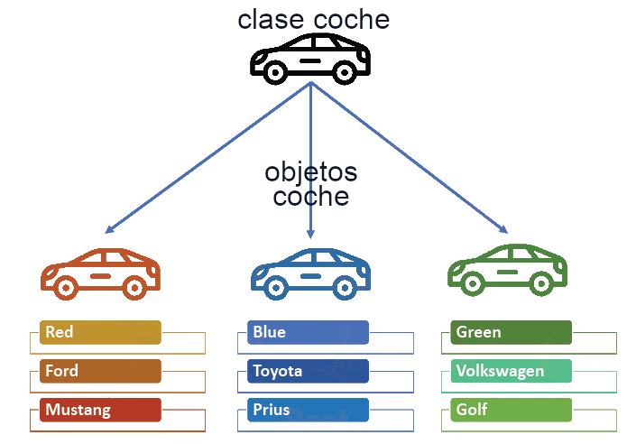

  

    🏆 <strong>Progrés d'aquesta secció:</strong> 0 de 4 superats (0%)
    ⭐ <strong>0 punts</strong>
  

  

    

  

# 4.3 Objectes i classes

Les classes estan compostes per atributs i mètodes. Una classe especifíca les característiques comuns d'un conjunt d'objectes. 

D'aquesta forma els programes que escribas estaran formats per un conjunt de classes a partir de les quals irás creant objectes que es interrelacionarán uns amb altres.

## 1. El concepte d'objecte

Des del començament del mòdul llevas utilitzant el concepte d'objecte per a desenvolupar els teus programes d'exemple. 

Podem descriure un **objecte** com una **entitat que conté informació i que és capaç de realitzar certes operacions amb eixa informació**. Segons els valors que tinga eixa informació l'objecte tindrà un estat determinat i segons les operacions que puga dur a terme amb eixes dades seran responsables d'un comportament concret.

> **📌  **
> 

> Entre les característiques fonamentals d'un objecte es troben:
>    - la identitat, els objectes són únics i per tant distinguibles entre sí, encara que puga haver objectes exactament iguals, 
>    - un estat, els atributs que descriuen a l'objecte i els valors que tenen en cada moment, i 
>    - un determinat comportament, accions que es poden realitzar sobre l'objecte.

Alguns exemples d'objectes que podríem imaginar podrien ser:

- Un cotxe de color roig, marca *SEAT*, model *León* , de l'any *2021*. En aquest exemple tenim una sèrie d'atributs, com el color (en aquest cas roig), la marca, el model, l'any, etc. Així mateix també podríem imaginar determinades característiques com la quantitat de combustible que li queda, o el número de kilómetros recorrits fins al moment.

- Un cotxe de color groc, marca *Opel*, model *Moka*, de l'any *2019*.

- Un altre cotxe de color groc, marca *Opel*, model *Moka* i també de l'any *2019*. Es trataría d'un altre objecte amb les mateixes propietats que l'anterior, però seria un segon objecte.

- Un cocodrilo de quatre metros de longitud i de vint anys d'edat. 

- Un cercle de ràdio 2 centímetros, amb centre en les coordenades (0,0) i farciment de color groc.

- Un cercle de ràdio 3 centímetros, amb centre en les coordenades (1,2) i farciment de color verd.

Si observas els exemples anteriors podràs distingir sense demasiada dificultat almenys tres familias d'objectes diferents, que no tenen res que veure una amb una altra:

- Els cotxes.

- Els cercles.

- Els cocodrilos.

És de suposar llavors que cada objecte tindrà determinades possibilitats de comportament (accions) depenent de la família a la que pertenezcan. Per exemple, en el cas dels cotxes podríem imaginar accions com: *arrancar*, *frenar*, *acelerar*, *canviar de marxa*, *etc*. En el cas dels cocodrilos podrías imaginar altres accions com: *desplazar-se*, *comer*, *dormir*, *cazar*, *etc*. Per al cas del cercle es podrien plantear accions com: *càlcul de la superfície del cercle*, *càlcul de la longitud de la circunferencia que el rodea*, *etc*.

D'altra banda, també podrías imaginar alguns atributs dels quals valors podrien anar canviant en funció de les accions que es realizaran sobre l'objecte: *ubicació del cotxe* (*coordenades*), *velocitat* *instantánea*, *kilómetros recorrits*, *velocitat mitjana*, *quantitat de combustible en el depósito*, *etc*. En el cas dels cocodrilos podrías imaginar altres atributs com: *pes actual*, el *número de dientes actuals* (anirà perdent alguns al llarg de la seua vida), el *número de presas que ha cazado fins al moment*, *etc*.

Com pots veure, un objecte pot ser qualsevol cosa que pugues descriure en termes d'atributs i accions. 

> **📌  **
> 

> Un objecte no és més que la representació de qualsevol entitat concreta o abstracta que pugues percibir o imaginar i que puga resultar d'utilitat per a modelar els elements l'entorn del problema que deseas resoldre.

## 2. El concepte de classe

Està clar que dins d'un mateix programa tindràs l'oportunitat de trobar decenas, cientos o fins i tot milers d'objectes. En alguns casos no es parecerán en res uns a altres, però també podràs observar que hi haurà molts que tinguen un gran semblant, compartent un mateix comportament i uns mateixos atributs. Hi haurà molts objectes que només es diferenciaran pels valors que prenen alguns d'eixos atributs.

És ací on entra en escena el concepte de **classe**. Està clar que no podem definir l'estructura i el comportament de cada objecte cada vegada que va a ser utilitzat dins d'un programa, ja que l'escriptura del codi seria una tasca interminable i redundante. La idea és poder disposar d'una **plantilla o model per a cada conjunt d'objectes que siguen del mateix tipus, és a dir, que tinguen els mateixos atributs i un comportament similar.**

> **📌  **
> 

> Una classe consisteix en la definició d'un tipus d'objecte. Es tracta d'una descripció detallada de com van a ser els objectes que pertenezcan a eixa classe indicant què tipus d'informació contendrán (atributs) i com es podrà interactuar amb ells (comportament).

Com resum, una classe consisteix en un plantilla en la que es especifican:

- Els atributs que van a ser comuns a tots els objectes que pertenezcan a eixa classe (informació).

- Els mètodes que permeten interactuar amb eixos objectes (comportament).

A partir d'aquest moment podràs parlar ja sense confusió d'objectes i de classes,sabent que els primers són instàncies concretes de les segones, que no són més que una abstracció o definició.

Si ens tornem a fixar en els exemples d'objectes de l'apartat anterior podríem observar que les classes serien el que clasificamos com "familias" d'objectes (*cotxes*, *cocodrilos* i *cercles*). 

> **📌 Classe vs Objecte**
> 

> En el llenguatge cotidiano de molts programadors pot ser habitual la confusió entre els termes **classe** i **objecte**. Encara que normalment el context ens permet distingir si ens estem refirent realment a una classe (definició abstracta) o a un objecte (instància concreta), cal tindre cura amb el seu ús per a no donar lloc a interpretacions erróneas, especialment durant el procés d'aprenentatge.

> **📌 Un poquito de ...**
> 

>

---

## 🎮 Reptes Interactius d'Autoavaluació (+100 XP)

Comprova el teu domini sobre **4.3 Objectes i classes** superant aquests 4 reptes gamificats (+25 punts cadascun):

  
🎯 <strong>Repte 1 (+25 pts):</strong> Quin principi de la Programació Orientada a Objectes consisteix a declarar els atributs d'una classe com a 'private' i proporcionar mètodes públics controlats (getters i setters)?

  

    <button type="button" class="btn-mcq-opt" data-opt="A">A) Encapsulament (Encapsulation).</button>
    <button type="button" class="btn-mcq-opt" data-opt="B">B) Herència múltiple.</button>
    <button type="button" class="btn-mcq-opt" data-opt="C">C) Recursivitat lineal.</button>
    <button type="button" class="btn-mcq-opt" data-opt="D">D) Cap de les anteriors és correcta.</button>
  

  

  
🎯 <strong>Repte 2 (+25 pts):</strong> Quina és la funció de la paraula clau 'this' dins d'un mètode o constructor d'una classe en Java?

  

    <button type="button" class="btn-mcq-opt" data-opt="A">A) Destrueix l'objecte actual de la memòria RAM.</button>
    <button type="button" class="btn-mcq-opt" data-opt="B">B) Importa tots els paquets de la llibreria java.util.</button>
    <button type="button" class="btn-mcq-opt" data-opt="C">C) Cap de les anteriors és correcta.</button>
    <button type="button" class="btn-mcq-opt" data-opt="D">D) Fa referència a la instància (objecte) actual sobre la qual s'està executant el mètode o constructor.</button>
  

  

  
✅ <strong>Repte 3 (Vertader o Fals · +25 pts):</strong> Un membre declarat amb el modificador 'static' pertany a la pròpia classe i és compartit per totes les instàncies d'eixa classe.

  

    <button type="button" class="btn-vf" data-opt="V">Vertader (V)</button>
    <button type="button" class="btn-vf" data-opt="F">Fals (F)</button>
  

  

  
⌨️ <strong>Repte 4 (+25 pts):</strong> Quin operador reservat de Java s'utilitza per a invocar un constructor i reservar memòria per a un nou objecte?

  

    <input type="text" class="quiz-input" placeholder="Escriu la resposta..." />
    <button type="button" class="btn-quiz-check">Comprovar</button>
  

  

### 📋 Llista de Comprovació i Rúbrica d'Assoliment

Marca cada criteri a mesura que completes l'estudi o la resolució pràctica d'aquesta pàgina (**4.3 Objectes i classes**):

- [ ] He llegit detingudament la teoria o l'enunciat d'aquesta secció i he anotat els conceptes clau.
- [ ] He revisat els esquemes, taules o blocs de codi i he verificat que sé aplicar-los a l'entorn de treball.
- [ ] He resolt correctament els **4 reptes interactius** superiors obtenint els **100 punts XP**.
- [ ] He descarregat el comprovant oficial en PDF per a adjuntar-lo a la tasca d'**Aules**.

  <h3>📤 Comprovant de Lliurament per a Aules</h3>
  
Quan hages completat els reptes interactius i la llista d'autoavaluació d'aquesta pàgina, introdueix el teu nom i descarrega el teu certificat oficial en PDF per a adjuntar-lo a la tasca d'<strong>Aules</strong>.

  

    <label for="aules-student-name">👤 Nom i Cognoms de l'Alumne/a:</label>
    <input type="text" id="aules-student-name" class="aules-student-name" placeholder="Ex: Joan Garcia Pérez" />
  

  

    0/4 reptes completats (0%) · 0 punts · 0/4 criteris d'autoavaluació
  

  

    <button type="button" class="btn-aules-dl" data-module="PRG" data-unit="UD04" data-activity="ut0403">📥 Descarregar Comprovant PDF</button>
    <button type="button" class="btn-aules-copy">📋 Copiar Resum al Porta-retalls</button>
  

  

