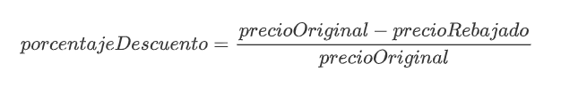
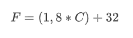
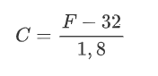

<div class="interactive-progress-tracker">
  <div class="tracker-header">
    <span>🏆 <strong>Progrés d'aquesta secció:</strong> <span class="tracker-count">0 de 4 superats (0%)</span></span>
    <span class="tracker-pts">⭐ <strong>0 punts</strong></span>
  </div>
  <div class="tracker-bar">
    <div class="tracker-fill" style="width: 0%;"></div>
  </div>
</div>

# Activitats pràctiques UT4

> **📌 Empaquetar activitats**
> 

> Empaqueta les activitats, dins de la carpeta **`ut04/bloqueX`**

## Bloc 4.0

### Activitat 01 `Rebajas`

Crea una classe **`Rebajas`** amb un mètode `descubrePorcentaje()` que descubra el descompte aplicat en un producte. El mètode rep el preu original del producte i el rebajado i retorna el percentatge aplicat. Podem calcular el descompte realitzant l'operació:

    



Ajuda:  Implementa el mètode com mètode de classe (`static`).

### Activitat 02 `Numero`

Realitza una classe **`Numero`** que almacene un número enter i tinga les següents característiques:

- Constructor per defecte que inicializa a 0 el número intern.

- Constructor que inicializa el número intern.

- Mètode `anyade` que permet sumarle un número al valor intern.

- Mètode `resta` que resta un número al valor intern.

- Mètode `getValor`. Retorna el valor intern.

- Mètode `getDoble`. Retorna el doble del valor intern.

- Mètode `getTriple`. Retorna el triple del valor intern.

- Mètode `setNumero`. Inicializa de nou el valor intern.

### Activitat 03 `Rectangulo`

Crea una classe **`Rectangulo`** que represente un rectangle amb atributs `ancho` i `alto` (de tipus decimal). Implementa:

- Un constructor per defecte que inicialice a 1 les dimensions del rectangle.

- Un constructor amb paràmetres que reba l'amplària i l'alçària per paràmetres.

- Getters i setters per a tots dos atributs.

- Mètodes `calcularArea()` i `calcularPerimetro()` que retornen aquests valors.

- Escriu el mètode principal `main` en una altra classe ejecutable anomenada **`TestRectangulo`** per a verificar que tot funciona correctament instanciant un rectangle de cada tipus.

### Activitat 04 `Circulo`

Crea una classe **`Circulo`** que represente una figura circular amb un atribut `radio` (tipus decimal). Implementa:

- Un constructor per defecte que inicialice el ràdio a 1.0.

- Un constructor que acepte el ràdio personalitzat per paràmetre.

- Getters i setters.

- Mètodes `calcularArea()` (`Math.PI * radio * radio`) i `calcularLongitud()` (`2 * Math.PI * radio`).

- Escriu una classe ejecutable **`TestCirculo`** per a provar el correcte funcionament.

## Bloc 4.1

### Activitat 05 `MiNumero`

Realitza una classe **`MiNumero`** que proporcione el doble, triple i cuádruple d'un número proporcionat en el seu constructor (realitza un mètode per a `doble`, un altre per a `triple` i un altre per a `cuádruple`). Fes que la classe tinga un mètode `main` i comprova els distints mètodes.

### Activitat 06 `CalculoPrecio`

Dissenya una classe **`CalculoPrecio`** que calcule la factura de venda d'un producte. La classe ha d'emmagatzemar la quantitat comprada i el preu unitario de l'article. Implementa:

- Un constructor que reba tots dos atributs.

- Un mètode `calcularTotal()` que multiplique el preu per la quantitat.

- Un mètode `calcularTotalConDescuento()` que aplique un descompte del 10% si l'importe total calculat prèviament supera els 100€; en cas contrari, no aplicarà cap descompte.

- Crea un mètode `main` que comprove totes dues situacions pident la informació a l'usuari.

## Bloc 4.2

### Activitat 07 `Coche`

Crea la classe **`Coche`** amb dos atributs: `marca` i `modelo`. 

Crea dos constructors: Un no pren paràmetres i l'un altre sí. Els dos constructors inicializarán els atributs de la classe.

Crea també els getters i setters de tots dos atributs. 

Dins de la funcion main, crea dos objectes (cada objecte anomena a un constructor distint) i verifica que tot funciona correctament.

### Activitat 08 `Cuenta`

Crea una classe anomenada **`Cuenta`** que tindrà els següents atributs: `titular` i `cantidad` (pot tindre decimals).

Al crear una instància de l'objecte Compta, el titular serà obligatori i la quantitat és opcional. Crea dos constructors que complisquen l'anterior, és a dir, hem de crear dos mètodes constructors amb el mateix nom (el de la classe), però distints paràmetres.

Crea els seus mètodes *get*, *set* i el mètode `mostrarDatos` que mostre Totes les dades de la compta per pantalla (println). 

A més, tindrà dos mètodes especials:

- `ingresar(double cantidad)`: es ingresa una quantitat a la compta, **si la quantitat introducida és negativa, no es farà res.**

- `retirar(double cantidad)`: es retira una quantitat a la compta, **si restant la quantitat actual a la que ens passen és negativa, la quantitat de la compta passa a ser 0 retirant l'importe màxim en funció de la quantitat disponible en l'objecte**.

Crear una classe principal **`TestCuenta`** ejecutable (funció main):

- Crear una instància de l'objecte Compta anomenada `cuentaParticular1` amb el nom del titular.

- Crear una instància de l'objecte Compta anomenada `cuentaEmpresa1` amb el nom del titular i una quantitat inicial de dinero.

- Mostrar el titular de la instància `cuentaParticular1`.

- Mostrar el saldo de la instància `cuentaEmpresa1`.

- Ingresar 1000 € en la instància `cuentaParticular1`.

- Retirar 500 € en la instància `cuentaEmpresa1`.

- Mostrar les dades de les dos instàncies de l'objecte `Cuenta`.

### Activitat 09 `Libro`

Crea una classe anomenada **`Libro`** que guarde la informació de cada un dels llibres d'una biblioteca. La classe ha de guardar les següents propietats:

- `título`

- `autor`

- `editorial`

- `número de ejemplares totales`

- `número de prestados`

La classe contendrá els següents mètodes:

- Constructor per defecte.

- Constructor amb paràmetres.

- Mètodes Setters/getters.

- Mètode `prestamo` que increment l'atribut corresponent cada vegada que es realitze un préstamo del llibre. No es podran prestar llibres dels que no queden exemplars disponibles per a prestar. Retorna `true` si es ha pogut realitzar l'operació i `false` en cas contrari.

- Mètode `devolucion` que decrement l'atribut corresponent quan es produïsca la devolució d'un llibre. No es podran retornar llibres que no es hagen prestado. Retorna `true` si es ha pogut realitzar l'operació i `false` en cas contrari.

- Mètode `perdido` que decrement l'atribut número d'exemplars per perdida d'exemplar. No es podran retornar llibres que no tinguen exemplars. Retorna `true` si es ha pogut realitzar l'operació i `false` en cas contrari.

- Mètode `mostrarDatos` per a mostrar les dades dels llibres.

Crear una classe principal **`TestLibro`** ejecutable (mètode main):

- Crear una instància de l'objecte llibre `libroInformatica1` amb les dades d'un llibre.

- Consultar el títol de la instància `libroInformatica1`.

- Canviar l'editorial de la instància `libroInformatica1` per Anaya.

- Realitza el préstamo de la instància `libroInformatica1`.

- Realitza un altre préstamo de la instància `libroInformatica1`.

- Mostra els llibres prestats de la instància `libroInformatica1`.

- Realitza la devolució de la instància `libroInformatica1`.

- Mostra els llibres prestats de la instància `libroInformatica1`.

- Gestiona la pèrdua d'un exemplar de la instància `libroInformatica1`.

- Mostra els exemplars de la instància `libroInformatica1`.

- Mostra totes les dades de la instància `libroInformatica1`.

### Activitat 10 `Mascota`

Crea una classe **`Mascota`** amb els atributs: `nombre` (String), `especie` (String) i `edad` (int). Implementa:

- Un constructor amb paràmetres per a inicialitzar tots els atributs de l'objecte.

- Getters i setters per a cada atribut.

- Un mètode `hacerSonido()` que imprima per pantalla un sonido genéric (per exemple, "Fent un sonido de mascota!").

- Crea una classe principal anomenada **`TestMascota`** on es instancien 3 objectes de tipus `Mascota` (per exemple, un perro, un gato i un loro), es muestren els seus atributs i s'execute el mètode `hacerSonido()` per a cada una.

### Activitat 11 `Pelicula`

Crea una classe **`Pelicula`** per a emmagatzemar informació cinematográfica. Ha de posseir:

- Atributs: `titulo` (String), `director` (String), `duracion` (int, en minuts) i `genero` (String).

- Constructor amb paràmetres.

- Mètodes getters i setters.

- Un mètode `esLarga()` que retorne `true` si la duració de la película és superior a 120 minuts, i `false` en cas contrari.

- Crea una classe ejecutable **`TestPelicula`** que instancie diverses películas i comprove quins d'elles superan el límit llamant al mètode `esLarga()`.

## Bloc 4.3

### Activitat 12 `Password`

Crear una classe anomenada **`Password`** amb les següents característiques:

Propietats:

- `clave`

- `longitud`

Els mètodes que implementa seran:

- Un constructor sense paràmetres que generará una clau aleatoria amb longitud 8.

- Un constructor que recibirá per paràmetre un `int` que li indicará la longitud de la clau a generar.

- `generarClave()`: genera la clau de l'objecte amb la longitud que tinga.

- Mètode *get* per a clau i longitud.

- Mètode *set* per a clau i longitud.

Crear una classe principal **`TestPassword`** que comprove tots els mètodes creats.

### Activitat 13 `Producto`

Crear una classe anomenada **`Producto`** amb:

Atributs:

- `codProducto`

- `nombreProducto`

- `descripcion`

- `categoria`

- `peso`

- `precio`

- `stock`

Mètodes:

- `Producto`: Permet crear una instància amb les dades d'un producte.

- `aumentaStock`: Permet aumentar el stock d'unitats del producte. Es li passa el dada de *unitats* que aumentamos.

- `disminuyeStock`: Permet disminuir el stock d'unitats del producte. Es li passa el dada de *unitats* que disminuimos.

- `ivaProducto`: Permet calcular el IVA aplicat al preu del producte. Es li passa el dada del *percentatge* *de IVA*.

- `mostrarDatos`: Mostra les dades del producte.

Crear una classe principal **`TestProducto`** ejecutable que:

- Crear dos instàncies de la classe `Producto` anomenades `productoHardware` i `productoSoftware`.

- Mostrar les dades dels dos objectes `Producto` que hem creat.

- Aumenta el stock d'unitats del `productoHardware` en 12 unitats.

- Disminuir el stock d'unitats del `productoSoftware` en 5 unitats.

- Calcula el IVA dels dos objectes `Producto` que hem creat.

- Mostrar les dades dels dos objectes `Producto`, així com els seus importes de IVA i els preus finals de cada una de les instàncies.

### Activitat 14 `Empleado`

Dissenya una classe anomenada **`Empleado`** amb:

- Atributs: `nombre`, `cargo` (String), `salarioBase` (double) i `antiguedad` (int, en anys).

- Constructor per a inicialitzar tots els atributs de l'empleat.

- Getters i setters.

- Un mètode `calcularSalarioNeto()` que calcule i retorne el salario final aplicant la següent lògica: es suma un plus de 50€ al `salarioBase` per cada any d'antigüetat (`antiguedad * 50`) i es li resta un 15% en concepte de retenció fiscal.

- Crea una classe principal **`TestEmpleado`** que instancie diversos empleats i mostre el desglose i resultat final per pantalla.

## Bloc 4.4

### Activitat 15 `Calculadora`

Crea una classe anomenada **`Calculadora`** que continga mètodes estátics per a realitzar operacions matemàtiques bàsiques: `suma`, `resta`, `multiplicación` i `división`. Tots ells recibiran els números necessaris com paràmetres. Després, escriu el mètode principal `main` que faça ús d'aquests mètodes.

### Activitat 16 `Temperatura`

Crear una classe anomenada **`Temperatura`** amb dos mètodes estátics:

- `celsiusToFarenheit`: Converteix graus *Celsius* a *Farenheit*.

      



  

- `farenheitToCelsius`: Converteix graus *Farenheit* a *Celsius*.

      



  

Ajuda:  Implementa els mètodes com mètodes de classe.

### Activitat 17 `ConversorUnidades`

Crea una classe anomenada **`ConversorUnidades`** que continga mètodes estátics de conversió sense necessitat d'instanciar la classe:

- `kilometrosAMillas(double km)`: converteix kilómetros a millas marinas (1 milla = 1.852 km).

- `litrosAGalones(double litros)`: converteix litros a galones (1 galón = 3.785 litros).

- `kgALibras(double kg)`: converteix kilogramos a libras (1 kg = 2.204 libras).

- Desenvolupa el mètode `main` que anomene a aquests mètodes de classe utilitzant valors introduïts per codi.

## Bloc 4.5

### Activitat 18 `Moto`

A partir de la següent classe **`Moto`**:

```java
public class Moto {

      private int velocidad;

      public Moto() {
        this.velocidad=0;
      }
  }
```

Afegeix els següents mètodes:

- `int getVelocidad`: Retorna la velocitat de l'objecte moto.

- `void acelera(int mas)`: Permet aumentar la velocitat de l'objecte moto.

- `void frena(int menos)`: Permet reduir la velocitat de l'objecte moto.

### Activitat 19 `Consumo`

Implementa una classe **`Consumo`**, la qual forma part del "ordinador de a bordo" d'un cotxe i té les següents característiques:

Atributs:

- `kilometros`

- `litros`:. Litros de combustible consumido.

- `vmed`: Velocitat mitjana.

- `pgas`: Preu de la gasolina.

Mètodes:

- `getTiempo`: Indicará el temps empleat en realitzar el viatge.

- `consumoMedio`: Consumo mitjà del vehicle (en litros cada 100 kilómetros).

- `consumoEuros`: Consumo mitjà del vehicle (en euros cada 100 kilómetros).

Recorda: No olvides crear un constructor per a la classe que establezca el valor dels atributs. Tria el tipus de dades més apropiat per a cada atribut.

### Activitat 20 `Viaje`

Crea una classe anomenada **`Viaje`** que represente els costos de transport d'un recorregut. Ha de comptar amb:

- Atributs: `distancia` (double, en km) i `precioCombustible` (double).

- Constructor amb paràmetres.

- Un mètode `calcularCostePeajes(int numPeajes, double precioPeaje)` que calcule i retorne el cost total en concepte de peatges.

- Un mètode `calcularCosteTotal(int numPeajes, double precioPeaje)` que retorne la suma del cost de peatges i el cost del combustible consumido. (Asume que el vehicle té un consumo fix de 6.5 litros cada 100 kilómetros).

- Comprova el seu funcionament en la classe principal `main` passant diferents paràmetres.

## Bloc 4.6

### Activitat 21 `Calculadora2`

Modifica la Activitat 15 `Calculadora` (crea **`Calculadora`**) perquè es añadan altres operacions matemàtiques com `potencia` (es li pasará la `base` i la `potencia`) , `generaAleatorio` (es li pasarán el límit mínim i el límit màxim en el que crear aquest número enter). Després, modifica el mètode principal que faça ús d'aquests mètodes.

### Activitat 22 `AnalisisTexto`

Dissenya una classe **`AnalisisTexto`** que reba un String en el seu constructor. Utilitzant mètodes predefinits de la classe `String`, implementa els següents mètodes dinàmics:

- `int contarPalabras()`: retorna el número de paraules que componen el text (pots cercar els espais en blanc).

- `String reemplazarEspacios(char nuevoChar)`: retorna la cadena amb tots els espais sustituits pel nou caràcter.

- `boolean contienePalabra(String palabra)`: retorna `true` si el text original conté la paraula indicada, sense distingir entre majúscules i minúscules.

- Comprova el seu funcionament en una classe ejecutable de prova.

## Bloc 4.7

### Activitat 23 `Finanzas`

Realitza una classe **`Finanzas`** que convertisca dólars a euros i viceversa. Codifica els mètodes `dolaresToEuros(double dolares)` i `eurosToDolares(double euros)`. Prova que aquesta classe funciona correctament fent conversions entre euros i dólars. La classe ha de tindre:

- Un constructor `finanzas()` per defecte el qual estableix el canvi Dólar-Euro en *1.02*.

- Un constructor `finanzas(double cambio)`, el qual permitirá configurar el canvi Dólar-euro a una quantitat personalitzada.

### Activitat 24 `Persona`

Crea una classe anomenada **`Persona`** amb un constructor que reba paràmetres per al `nombre` i la `edad`, així com els seus `getters` i `setters`i un mètode `mostrarDatos()` que mostre totes les dades per pantalla. Després, en el mètode principal, crea 3 instàncies de la classe `Persona` utilitzant el constructor i mostra la informació de cada persona.

### Activitat 25 `Estudiante`

Dissenya una classe **`Estudiante`** que almacene `nombre`, `matricula` i tres notes decimals (`nota1`, `nota2`, `nota3`). Implementa:

- Un constructor per defecte que deje les dades buits.

- Un constructor que inicialice únicament el `nombre` i la `matricula`.

- Un constructor complet que reba tots els atributs i les tres notes.

- Un mètode `calcularPromedio()` que retorne la nota mitjana.

- Comprova el funcionament instanciant estudiants amb cada constructor i visualitzant el promedio en la funció ejecutable.

## Bloc 4.8

### Activitat 26 - Paquet: gestionHospital.

#### Classe Pacient

La classe `Paciente` permet representar un pacient mitjançant els atributs: `nombre` (cadena), `edad` (enter), `estado` (enter entre 1 -més grave- i 5 -menys grave-, 6 si està curado), i amb les següents operacions:

- 

`public Paciente (String n, int e)`. Constructor d'un objecte `Paciente` de nom `n`, de `e` anys i del qual estat és un valor aleatorio entre 1 i 5.

- 

`public int getEdad()`. Consultor que retorna edat.

- 

`public int getEstado()`. Consultor que retorna estat.

- 

`public void mejorar()`. Modificador que incrementa en un l'estat del pacient (millora al pacient)

- 

`public void empeorar()`. Modificador que decrementa en un l'estat del pacient (empeora al pacient)

- 

`public String toString()`. Transforma el pacient en un `String`. Per exemple,

```java
Pepe Pérez 46 5
```

- 

`public int compareTo(Paciente o)`. Permet comparar dos pacients. Es considera menor el pacient més leve. A igual gravetat, es considera menor el pacient més joven. Exemple:

- 

Tenint a `David 40 3`, `Pepe 25 3` i `Juan 35 5`:

```java
David.compareTo(Juan) = 2
Juan.compareTo(Pepe) = -2
David.compareTo(Pepe) = 15
```

#### Classe TestPaciente

Dissenyar una classe Java `TestPaciente` que permeta provar la classe `Paciente` i els seus mètodes. Per a això es desarrollará el mètode `main` en el que:

- Es crearán dos pacients: *"Antonio" de 20 anys* i *"Miguel" de 30 anys*.

- Imprimir l'estat inicial dels dos pacients.

- Mostrar les dades del que es considere menor (segons el criteri de `compareTo` de la classe `Paciente`).

- Aplicar "mejoras" al pacient més grave fins a que els dos pacients tinguen el mateix estat.

- Imprimir l'estat final dels dos pacients.

> **📌  **
> 

ARRAYS

#### Classe Hospital

La classe **Hospital** conté la informació de les camas d'un hospital, així com dels pacients que les ocupen. Un Hospital té un número màxim de camas `MAXC` = 200 i per a representar-les s'utilitzarà un array (anomenat `listaCamas`) d'objectes de tipus Pacient juntament amb un atribut (`numLibres`) que indique el número de camas lliures de l'hospital en un moment donat. El número de cada cama coincideix amb la seua posició en l'array de pacients (la posició 0 no s'utilitza), de manera que `listaCamas[i]` és el Pacient que ocupa la cama `i` o és `null` si la cama està lliure. Les operacions d'aquesta classe són:

- 

`public Hospital()`: Constructor d'un hospital. Quan es crea un hospital, totes les camas estan lliures.

- 

`public int getNumLibres()`: Consultor del número de camas lliures.

- 

`public boolean hayLibres()`: Retorna true si en l'hospital hi ha camas lliures i retorna false en cas contrari.

- 

`public int primeraLibre()`: Retorna el número de la primera cama lliure de l'array `listaCamas` si hi ha camas lliures o retorna un 0 si no les hi ha.

- 

`public void ingresarPaciente(String n, int e) throws HospitalLlenoException`: Si hi ha camas lliures, la primera d'elles (la de número menor) passa a estar ocupada pel pacient de nom `n` i edat `e`. Si no hi ha camas lliures, llança una excepció.

- 

`private void darAltaPaciente(int i)`: La cama `i` de l'hospital passa a estar lliure. (Afectará al número de camas lliures)

- 

`public void darAltas()`: Es millora l'estat (mètode `mejorar()` de `Paciente`) de cada un dels pacients de l'hospital i a aquells pacients sanos (del qual estat és 6) es els dóna l'alta médica (invocant al mètode `darAltaPaciente`).

- 

`public String toString()`: Retorna un `String` amb la informació de les camas de l'hospital. Per exemple,

```java
1 María Medina 30 4
2 Pepe Pérez 46 5
3 libre
4 Juan López 50 1
5 libre
...
199 Andrés Sánchez 29 3
```

#### Classe GestorHospital

En la classe `GestorHospital` es probará el comportament de les classes anteriors. El programa haurà de:

- Crear un hospital.

- Ingresar a cinc pacients amb les dades simulats introduïts directament en el programa.

- Realitzar el procés de `darAltas` mentre que el número d'habitacions lliures de l'hospital no arribe a una quantitat (per exemple 198).

- Mostrar les dades de l'hospital quan es considere oportuno per a comprovar la correcció de les operacions que es fan.

### Activitat 27 - Paquet: gestorcorreoelectronic

#### Classe Missatge

La classe `Mensaje`. D'un missatge coneixem:

- `Codigo (int)` Número que permet identificar als missatges.

- `Emisor (String)`: email de l'emissor.

- `Destinatario (String)`: email del destinatari.

- `Asunto (String)`

- `Texto (String)`

Desenvolupar els següents mètodes:

- Constructor que reba totes les dades, excepte el codi, que es generará automàticament (nº consecutivo). Ajuda: utilitza una variable de classe `static`.

- Consultors de tots els atributs.

- `public boolean equals(Object o)`: Dos missatges són iguals si tenen el mateix codi.

- `public static boolean validarEMail(String email)`: Mètode estàtic que retorna true o false indicant si l'adreça de correu indicada és vàlida o no. Una adreça és vàlida si té la forma `direccion@subdominio.dominio`.

- `public String toString()`.

#### Classe TestCorreo

Amb la classe `TestCorreo` probarem les classes i mètodes desarrollats.

- Crea diversos missatges amb les dades que introduzca l'usuari i muéstralos per pantalla.

- Prova el mètode `validarEMail` de la classe Missatge amb les adreces següents (només la primera és correcta) :  

       - `tuCorreo@gmail.com`   

       - `tuCorreogmail.com`  

       - `tuCorreo@gmail`   

       - `tuCorreo.com@gmail`   

> **📌  **
> 

ARRAYS

#### Classe TestCarpetas

Amb la classe `TestCarpetas` probarem les classes i mètodes desarrollats:

- Crea dos carpetes de correu de nom `Mensajes recibidos` i `Mensajes eliminados respectivamente`.

- Crea diversos missatges i añádelos a `Mensajes recibidos`.

- Mueve el missatge de codi 1 des de la `Mensajes recibidos` a `Mensajes elimiminados`.

- Mostra el contingut de les carpetes abans i després de cada operació (*afegir*, *mover*,...).

### Activitat 28 - Paquet: contrarreloj

#### Classe Corredor

La classe `Corredor` representa a un participante en la carrera. Els seus atributs són el dorsal (enter), el nom (string) i el temps en segons (double) que li ha costado completar el recorregut. Els mètodes amb els que compta són:

- 

`public Corredor(int d, String n)`: Constructor a partir del dorsal i el nom. Per defecte el temps tardado és 0.

- 

`public double getTiempo()`: Retorna el temps tardado pel corredor.

- 

`public int getDorsal()`: Retorna el dorsal del corredor.

- 

`public String getNombre()`: Retorna el nom del corredor.

- 

`public void setTiempo(double t) throws IllegalArgumentException`: Estableix el temps tardado pel corredor. Llançarà l'excepció si el temps indicat és negatiu.

- 

`public void setTiempo(double t1, double t2) throws IllegalArgumentException`: Estableix el temps tardado pel corredor. 

`t1` indica l'hora de començament i `t2` l'hora de finalizació (expresades en segons). La diferència en segons entre els dos dades servirà per a establir el temps tardado pel `Corredor`.

Llançarà l'excepció si el temps resultant és negatiu.

- `public String toString()`: Retorna un String amb les dades del corredor, de la forma:

```java
(234) - Juan Ramirez - 2597 segundos
```

- 

`public boolean equals(Object o)`: Retorna true si els corredors tenen el mateix dorsal i false en cas contrari.

- 

`public int compareTo (Corredor o)`: Un corredor és menor que un altre si té menor dorsal.

- 

`public static int generarDorsal()`: Retorna un número de dorsal generat secuencialment. Per a això la classe farà ús d'un atribut `static int siguienteDorsal` que incrementará cada vegada que es genere un nou dorsal.

#### Classe TestCorredor

Dissenyar una classe Java `TestCorredor` que permeta provar la classe Corredor i els seus mètodes. Per a això es desarrollará el mètode `main` en el que:

- Es crearán dos corredors: El nom el indicará l'usuari mentre que el dorsal es generará utilitzant el mètode `generarDorsal()` de la classe.

- Es establecerá el temps d'arribada del primer corredor a 300 segons i el del segon a 400. 

- Es mostraran les dades de tots dos corredors (`toString`).

> **📌  **
> 

ARRAYS

#### Classe Listacorredors

La classe `ListaCorredores` permet representar a un conjunt de corredors. En la llista, com a màxim hi haurà 200 corredors, encara que pot haver menys d'eixe número. S'utilitzarà un array, anomenat llista, de 200 elements juntament amb una propietat `numCorredores` que permeta saber cuentos corredors hi ha realment. Mètodes:

- 

`public ListaCorredores()`: Constructor. Crea la llista de corredors, inicialment buida.

- 

`public void anyadir(Corredor c) throws ElementoDuplicadoException`: Afegeix un corredor al final de la llista de corredors, sempre i quan el corredor no estiga ja en la llista, en del qual cas es llançarà `ElementoDuplicadoException`

- 

`public void insertarOrdenado(Corredor c)`: Insereix un corredor en la posició adequada de la llista de manera que aquesta es mantenga ordenada crecientement pel temps d'arribada. Per a poder realitzar la inserció ha d'averiguar-se la posició que ha d'ocupar el nou element i, abans de añadir-lo a l'array, desplazar l'element que ocupa eixa posició i tots els posteriors, una posició a la dreta.

- 

`public Corredor quitar(int dorsal) throws ElementoNoEncontradoException`: Quita de la llista al corredor del qual dorsal es indica. L'array ha de mantenerse compacto, és a dir, tots els elements posteriors a l'eliminat han de desplazar-se una posició a l'esquerra. El mètode retorna el Corredor quitado de la llista. Si no es troba es llança `ElementoNoEncontradoException`. 

- 

`public String toString()`: Retorna un `String` amb la informació de la llista de corredors. Els minuts apareixeran formateats amb 2 decimals. Per exemple:

```java
Posición: 0
 Dorsal: 234
 Nombre: Juan Ramirez
 Tiempo: 25.97 minutos

Posición: 1
 Dorsal: 26
 Nombre: José González
 Tiempo: 29.70 minutos
```

(Classe `Contrarreloj`) Realitzar un programa que simule una contrarreloj. Per a portar el control d'una carrera contrarreloj es mantenen dos llistes de corredors (dos objectes de tipus `ListaCorredores`):

- (`hanSalido`) Una amb els que han salido, que té als corredors per ordre d'eixida. L'atribut temps d'aquests corredors serà 0. Perquè els corredors es mantengan per ordre d'eixida, es añadirán a la llista utilitzant el mètode afegir.

- (`hanLlegado`) Una altra amb els corredors que hi ha llegado a la meta. A mesura que els corredors arriben a la meta es els extrae de la primera llista, es els assigna un temps i es els insereix ordenadament en aquesta segona llista.

En el mètode `main` realitzar un programa que mostre un menú amb les següents opcions:

1. `Salida`: Per a registrar que un corredor ha començat la contrarreloj i ix de la línia d'eixida. Solicita a l'usuari el nom d'un corredor i el seu dorsal, i l'afegeix a la llista de corredors que han salido.

1. `Llegada`: Per a registrar que un corredor ha llegado a la meta. Solicita a l'usuari el dorsal d'un corredor i el temps d'arribada (en segons). Quita al corredor de la llista de corredors que `hanSalido`, li assigna el temps que ha tardado i l'insereix (ordenadament) en la llista de corredors que `hanLlegado`

1. `Clasificación`: Mostra la llista de corredors que `hanLlegado`. Atès que aquesta llista està ordenada per temps, mostrar-la per pantalla ens dóna la classificació.

1. `Salir`: Ix del programa.

### Activitat 29 - Paquet: reservasLibreria

#### Classe Client

Quan un `cliente` demana un llibre i la llibreria no el té, el client pot fer una reserva de manera que quan el reciban en la llibreria li avisen per telèfon. 

De cada reserva s'emmagatzema: 

- 

`Nif` del client (`String`).

- 

`Nombre` del client (`String`).

- `Teléfono` del client (`String`).

- `Código` del llibre reservat. (`entero`).

- Numero de `ejemplares` (`entero`).

#### Classe Reserva

Dissenyar la classe `Reserva`, de manera que contemple la informació descrita i implementar:

- `public Reserva(String nif, String nombre, String tel, int codigo, int ejemplares)`: Constructor que rep totes les dades de la reserva.

- `public Reserva(String nif, String nombre, String tel, int codigo)`: Constructor que rep les dades del client i el codi del llibre. Estableix el número d'exemplars a un. 

- Consultors de tots els atributs.

- `public void setEjemplares(int ejemplares)`: Modificador del número d'exemplars. Estableix el número d'exemplars al valor indicat com paràmetre. 

- `public String toString(): que devuelva un`String` amb les dades de la reserva

- `public boolean equals(Object o)`: Dos reserves són iguals si són del mateix client i reservan el mateix llibre.

- `public int compareTo(Object o)`: És menor la reserva del qual codi de llibre és menor. El paràmetre és de tipus `Object` així que revisa si has de fer alguna "adaptació".

#### Classe TestReservas

Dissenyar una classe Java `TestReservas` que permeta provar la classe `Reserva` i els seus mètodes.

Per a això es desarrollará el mètode `main` en el que:

- Es creen dos reserves amb les dades que introdueix l'usuari. Les reserves no poden ser iguals (equals). Si la segona reserva és igual a la primera es pedirá de nou les dades de la segona a l'usuari.

- Es increment en un el número d'exemplars de totes dues reserves.

- Es mostre la menor i a continuació la major.

> **📌  **
> 

ARRAYS

#### Classe ListaReservas

Dissenyar una classe `ListaReservas` que implement una llista de reserves. Com a màxim pot haver 100 reserves en la llista. S'utilitzarà un array de Reserves que ocuparem a partir de la posició 0 i un atribut que indique el número de reserves. Les reserves existents ocuparán les primeres posicions de l'array (sense espais en blanc). Implementar els següents mètodes:

- `public void reservar(String nif, String nombre, String telefono, int libro, int ejemplares) throws ListaLlenaException, ElementoDuplicadoException`: Crea una reserva i l'afegeix a la llista. Llança `ElementoDuplicadoException` si la reserva ja estava en la llista. Llança `ListaLlenaException` si la llista de reserves està llena.

- `public void cancelar(String nif, int libro) throws ElementoNoEncontradoException`. Donat un nif de client i un codi de llibre, anular la reserva corresponent. Llançar `ElementoNoEncontradoException` si la reserva no existeix.

- `public String toString()`: Retorna un `String` amb les dades de totes les reserves de la llista.

- `public int numEjemplaresReservadosLibro(int codigo)`: Retorna el número d'exemplars que hi ha reservats en total d'un llibre determinat.

- `public void reservasLibro(int codigo)`: Donat un codi de llibre, mostra el nom i el telèfon de tots els clients que han reservat el llibre.

#### Classe GestionReservas

Realitzar un programa `GestionReservas` que, utilitzant un menú, permeta:

- Realitzar reserva. Permet a l'usuari realitzar una reserva.

- Anular reserva: Es anula la reserva que indique l'usuari (Nif de client i codi de llibre).

- Comanda: L'usuari introdueix un codi de llibre i el programa mostra el nº de reserves que es han fet del llibre. Aquesta opció de menú li resultará útil a l'usuari per a poder fer la comanda d'un llibre determinat.

- Recepció: Quan l'usuari rep un llibre vol anomenar per telèfon als clients que el reservaron. Solicitar a l'usuari un codi de llibre i mostrar les dades (nom i telèfon) dels clients que el tenen reservat.

## Bloc 4.4 - Encapsulació i Validació Robusta en Classes

> **📌 Activitat: Validació de Registre de Usuari (`RegistroUsuario.java`)**
> 

> Dissenya una classe robusta aplicant encapsulació estricta i validació de dades en constructors i setters:

  
> 1. Crea la classe `Usuario` amb atributs privats `nombre` i `edad`.
  
> 1. Defineix un constructor complet i mètodes *getter* i *setter*.
  
> 1. Valida que la **edat** estiga comprendida estrictament entre 18 i 100 anys. Si el valor està fora de rang, no l'aceptes (llança un avís o `IllegalArgumentException`).
  
> 1. En el programa principal, solicita l'edat per teclat dins d'un bucle `while` que no termine fins a que l'usuari introduzca una edat admisible.
  
> 1. Sobrescribe el mètode `toString()` per a imprimir les dades de l'usuari amb format limpio i professional.


---

## 🎮 Reptes Interactius d'Autoavaluació (+100 XP)

Comprova el teu domini sobre **Activitats pràctiques UT4** superant aquests 4 reptes gamificats (+25 punts cadascun):

<div class="interactive-mcq" data-answer="A" data-hint="Revisa els conceptes teòrics i pràctics d'aquesta secció.">
  <div class="mcq-question">🎯 <strong>Repte 1 (+25 pts):</strong> Quin principi de la Programació Orientada a Objectes consisteix a declarar els atributs d'una classe com a 'private' i proporcionar mètodes públics controlats (getters i setters)?</div>
  <div class="mcq-options">
    <button type="button" class="btn-mcq-opt" data-opt="A">A) Encapsulament (Encapsulation).</button>
    <button type="button" class="btn-mcq-opt" data-opt="B">B) Herència múltiple.</button>
    <button type="button" class="btn-mcq-opt" data-opt="C">C) Recursivitat lineal.</button>
    <button type="button" class="btn-mcq-opt" data-opt="D">D) Cap de les anteriors és correcta.</button>
  </div>
  <div class="quiz-feedback"></div>
</div>

<div class="interactive-mcq" data-answer="D" data-hint="Comprova l'apartat corresponent de la unitat.">
  <div class="mcq-question">🎯 <strong>Repte 2 (+25 pts):</strong> Quina és la funció de la paraula clau 'this' dins d'un mètode o constructor d'una classe en Java?</div>
  <div class="mcq-options">
    <button type="button" class="btn-mcq-opt" data-opt="A">A) Destrueix l'objecte actual de la memòria RAM.</button>
    <button type="button" class="btn-mcq-opt" data-opt="B">B) Importa tots els paquets de la llibreria java.util.</button>
    <button type="button" class="btn-mcq-opt" data-opt="C">C) Cap de les anteriors és correcta.</button>
    <button type="button" class="btn-mcq-opt" data-opt="D">D) Fa referència a la instància (objecte) actual sobre la qual s'està executant el mètode o constructor.</button>
  </div>
  <div class="quiz-feedback"></div>
</div>

<div class="interactive-vf" data-answer="V" data-hint="Verifica l'afirmació amb els apunts de la unitat.">
  <div class="vf-statement">✅ <strong>Repte 3 (Vertader o Fals · +25 pts):</strong> Un membre declarat amb el modificador 'static' pertany a la pròpia classe i és compartit per totes les instàncies d'eixa classe.</div>
  <div class="vf-buttons">
    <button type="button" class="btn-vf" data-opt="V">Vertader (V)</button>
    <button type="button" class="btn-vf" data-opt="F">Fals (F)</button>
  </div>
  <div class="quiz-feedback" style="width: 100%;"></div>
</div>

<div class="interactive-quiz" data-answer="new" data-hint="Nou en anglès (3 lletres).">
  <div class="quiz-question">⌨️ <strong>Repte 4 (+25 pts):</strong> Quin operador reservat de Java s'utilitza per a invocar un constructor i reservar memòria per a un nou objecte?</div>
  <div class="quiz-controls">
    <input type="text" class="quiz-input" placeholder="Escriu la resposta..." />
    <button type="button" class="btn-quiz-check">Comprovar</button>
  </div>
  <div class="quiz-feedback"></div>
</div>

### 📋 Llista de Comprovació i Rúbrica d'Assoliment

Marca cada criteri a mesura que completes l'estudi o la resolució pràctica d'aquesta pàgina (**Activitats pràctiques UT4**):

- [ ] He llegit detingudament la teoria o l'enunciat d'aquesta secció i he anotat els conceptes clau.
- [ ] He revisat els esquemes, taules o blocs de codi i he verificat que sé aplicar-los a l'entorn de treball.
- [ ] He resolt correctament els **4 reptes interactius** superiors obtenint els **100 punts XP**.
- [ ] He descarregat el comprovant oficial en PDF per a adjuntar-lo a la tasca d'**Aules**.

<div class="aules-delivery-card">
  <h3>📤 Comprovant de Lliurament per a Aules</h3>
  <p>Quan hages completat els reptes interactius i la llista d'autoavaluació d'aquesta pàgina, introdueix el teu nom i descarrega el teu certificat oficial en PDF per a adjuntar-lo a la tasca d'<strong>Aules</strong>.</p>
  <div class="aules-student-field">
    <label for="aules-student-name">👤 Nom i Cognoms de l'Alumne/a:</label>
    <input type="text" id="aules-student-name" class="aules-student-name" placeholder="Ex: Joan Garcia Pérez" />
  </div>
  <div class="aules-score-badge">
    <span class="aules-score-count">0/4 reptes completats (0%) · 0 punts · 0/4 criteris d'autoavaluació</span>
  </div>
  <div class="aules-actions">
    <button type="button" class="btn-aules-dl" data-module="PRG" data-unit="UD04" data-activity="ut04actividades">📥 Descarregar Comprovant PDF</button>
    <button type="button" class="btn-aules-copy">📋 Copiar Resum al Porta-retalls</button>
  </div>
  <div class="aules-toast"></div>
</div>

