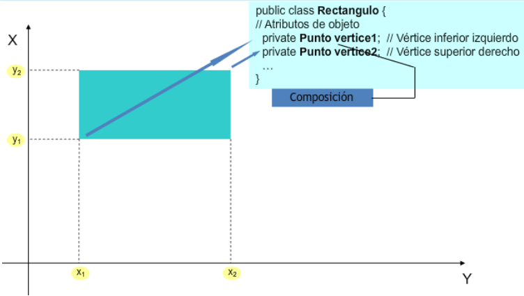
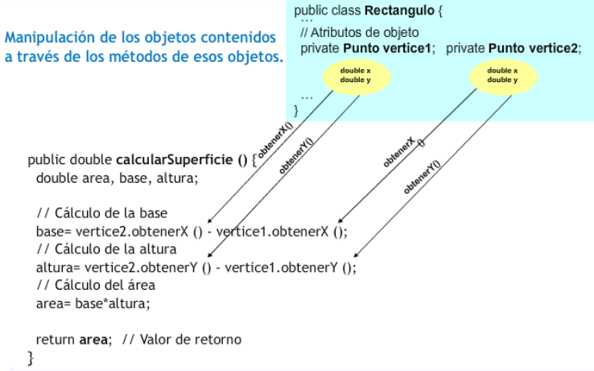

<div class="interactive-progress-tracker">
  <div class="tracker-header">
    <span>🏆 <strong>Progrés d'aquesta secció:</strong> <span class="tracker-count">0 de 4 superats (0%)</span></span>
    <span class="tracker-pts">⭐ <strong>0 punts</strong></span>
  </div>
  <div class="tracker-bar">
    <div class="tracker-fill" style="width: 0%;"></div>
  </div>
</div>

# 5.2 Composició de classes

## 1. Sintaxi de la composició

Per a indicar que una classe conté objectes d'una altra classe no és necessària cap sintaxi especial. Cada un d'eixos objectes no és més que un atribut i, per tant, ha de ser declarat com tal:

```java
class <nombreClase> {
  [modificadores] <NombreClase1> nombreAtributo1;
  [modificadores] <NombreClase2> nombreAtributo2;
  <NombreClase3>[] listado;
  ...    
}
```

En unitats anteriors has treballat amb la classe `Punto`, que definía les coordenades d'un punt en el plànol, i amb la classe `Rectangulo`, que definía una figura de tipus rectangle també en el plànol a partir de dos dels seus vértices (inferior esquerre i superior dret). Tal com hem formalitzat ara els tipus de relacions entre classes, sembla bastant clar que ací tendrías un cas de composició: "*un rectangle conté punts*". Per tant, podrías ara redefinir els atributs de la classe `Rectangulo` (quatre números reals) com dos objectes de tipus `Punto`:

```java
class Rectangulo {
  private Punto vertice1;
  private Punto vertice2;
  ...
}
```

Ara els mètodes d'aquesta classe hauran de tindre en compte que ja no hi ha quatre atributs de tipus `double`, sinó dos atributs de tipus `Punto` (cada un dels quals contendrá en el seu interior dos atributs de tipus `double`).

<details markdown="1">

<summary>💡 Exemple 2.01: Revisa amb cura el següent exemple</summary>

Intenta reescribir els següents els mètodes de la classe `Rectangulo` tenint en compte ara la seua nova estructura d'atributs (dos objectes de la classe `Punto`, en lloc de quatre elements de tipus `double`):

- 

Mètode `calcularSuperfice`, que calcula i retorna l'àrea de la superfície encerrada per la figura.

- 

Mètode `calcularPerimetro`, que calcula i retorna la longitud del perímetro de la figura.

**Solució**  

En tots dos casos la interfície no es veu modificada en absoluto (des de fóra el seu funcionament és el mateix), però internament hauràs de tindre en compte que ja no existeixen els atributs `x1`, `y1`, `x2`, `y2`, de tipus `double`, sinó els atributs `vertice1` i `vertice2` de tipus `Punto`.

```java
public class Punto {
    private double x;
    private double y;

    public Punto(double x, double y) {
        this.x = x;
        this.y = y;
    }

    public double getX() {
        return x;
    }

    public void setX(double x) {
        this.x = x;
    }

    public double getY() {
        return y;
    }

    public void setY(double y) {
        this.y = y;
    }
}
```

En la següent presentació pots observar detalladament el procés complet d'elaboració de la classe `Rectangulo` fent ús de la classe `Punto`:

1) Objectes de tipus `Rectangulo` compost per objectes de tipus `Punto`:



2) Classe `Rectangulo` i el seu mètode `calcularSuperficie`:



```java
public class Rectangulo {
    // Atributos de objeto
    private Punto vertice1;  // Vértice inferior izquierdo
    private Punto vertice2;  // Vértice superior derecho

    public double calcularSuperficie (){
        // cálculo de la base
        double base = vertice2.obtenerX() - vertice1.obtenerX();
        // cálculo de la altura
        double altura = vertice2.obtenerY() - vertice1.obtenerY();
        // cálculo del área
        double area = base * altura;
        return area;   // valor de retorno
    }
}
```

</details>

## 2. Ús de la composició

### 2.1. Preservació de l'ocultació

Com ja has observado, la relació de composició no té més misterio a l'hora d'implementar-se que simplement declarar atributs de les classes que necesites dins de la classe que estés diseñant.

Ara bé, quan escribas classes que contenen objectes d'altres classes (la qual cosa serà el més habitual) hauràs de tindre un poc de **precaució amb aquells mètodes que retornen informació sobre els atributs de la classe** (mètodes *consultors* o de tipus *get*).

Com ja viste en la unitat dedicada a la creació de classes, el normal sol ser declarar els atributs com privats (o protegits, com veurem un poc més avant) per a ocultar-los als possibles clients de la classe (altres objectes que en el futuro harán ús de la classe). Perquè altres objectes puguen accedir a la informació contenida en els atributs, o almenys a una part d'ella, hauran de fer-ho a través de mètodes que sirvan d'interfície, de manera que només es podrà tindre accés a aquella informació que el creador de la classe haja considerado oportuna. Del mateix mode, els atributs solament seran modificats des dels mètodes de la classe, que decidirán com i sota què circunstancias han de realitzar-se eixes modificacions. Amb eixa metodología d'accés es tenia perfectament separada la part de manipulació interna dels atributs de la interfície amb l'exterior.

Fins a ara els mètodes de tipus *get* devolvían tipus primitius, és a dir, còpies del contingut (a vegades amb algun tipus de modificació o de format) que havia emmagatzemat en els atributs, però els atributs seguían "a excepte" com elements privats de la classe. Però, a partir d'aquest moment, al tindre objectes dins de les classes i no només tipus primitius, és possible que en un determinat moment interese retornar un objecte complet.

> **📌 Cura al retornar atributs de tipus objecte**
> 

> Quan vayas a retornar un objecte habrás d'obrar amb molta precaució. Si en un mètode de la classe retorna directament un objecte que és un atribut, **estarás ofrecent directament una referència a un objecte atribut que probablement has definit com privat**.
> 
> 
D'aquesta forma estàs volvent a fer públic un atribut que inicialment era privat!

> Per a evitar eixe tipus de situacions (oferir a l'exterior referències a objectes privats) pots optar per diverses alternatives, procurant sempre evitar la devolució directa d'un atribut que siga un objecte:

> opció 1) Retornar sempre tipus primitius.

> opció 2) Atès que sempre no va a ser possible retornar tipus primitius, una altra possibilitat és **crear un nou objecte que siga una còpia de l'atribut que vols retornar i utilitzar eixe objecte com valor de retorn**. És a dir, crear una còpia de l'objecte especialment per a devolver-lo. D'aquesta manera, el codi client d'eixe mètode podrà manipular al seu antojo eixe nou objecte, ja que no serà una referència a l'atribut original, sinó un nou objecte amb el mateix contingut.

> opció 3) Has de tindre en compte que és possible que en alguns casos sí es necesite realment la referència a l'atribut original (alguna cosa molt habitual en el cas d'atributs estátics). En tals casos, no hi haurà problema en retornar directament l'atribut perquè el codi *llamante* (client) faça l'ús que estime oportuno d'ell.

> **Resument**:
Has d'evitar per tots els mitjans la devolució d'un atribut que siga un objecte, ja que estarías dando directament una referència a l'atribut, visible i manipulable des de fóra; excepte que es trate d'un cas en el que deba ser així.

Per a entendre aquestes situacions un poc millor, podem tornar a la classe `Rectangulo` i observar els seus nous mètodes de tipus *get*.

<details markdown="1">

<summary>💡 Exemple 2.02: Revisa amb cura el següent exemple</summary>

Donada la classe `Rectangulo`, escriu els seus nous mètodes `getVertice1` i `getVertice2` perquè retornen els vértices inferior esquerre i superior dret del rectangle (objectes de tipus `Punto`), tenint en compte la seua nova estructura d'atributs (dos objectes de la classe `Punto`, en lloc de quatre elements de tipus `double`):

#### 📌 


 Solució

**Solució incorrecta**  

Els mètodes d'obtenció de vértices devolverán objectes de la classe `Punto`:

```java
public Punto getVertice1 (){
    return vertice1;
}

public Punto getVertice2 (){
    return vertice2;
}
```

Açò funcionaría perfectament, però deberías tindre cura amb aquest tipus de mètodes que retornen directament una referència a un objecte atribut que probablement has definit com privat.  

Cura!! estàs d'alguna manera fent públic un atribut que va ser declarat com privat**.

#### 📌 


 Solució

**Solució correcta**  

Per a evitar que açò suceda bastaría amb **crear un nou objecte que fóra una còpia de l'atribut que es desitja retornar** (en aquest cas un objecte de la classe `Punto`).

Ací tens la solució per a la nova classe `Rectangulo`:

```java
class Rectangulo {
    private Punto vertice1;
    private Punto vertice2;

    public double calcularSuperficie() {
        double area, base, altura; // Variables locales
        base = vertice2.getX() - vertice1.getX(); // Antes era x2 - x1
        altura = vertice2.getY() - vertice1.getY(); // Antes era y2 - y1
        area = base * altura;
        return area;
    }

    public double calcularPerimetro() {
        double perimetro, base, altura; // Variables locales
        base = vertice2.getX() - vertice1.getX(); // Antes era x2 - x1
        altura = vertice2.getY() - vertice1.getY(); // Antes era y2 - y1
        perimetro = 2 * base + 2 * altura;
        return perimetro;
    }

    /*
    * ASÍ NO!!
    *
    *public Punto getVertice1mal() {
    *    return vertice1;
    *}
    *
    *public Punto getVertice2mal() {
    *    return vertice2;
    *}  
    */

    // Método 1:
    public Punto getVertice1() {
        // Creación de un nuevo punto extrayendo sus atributos:
        double x, y;
        Punto p;
        x = this.vertice1.getX();
        y = this.vertice1.getY();
        p = new Punto(x, y);
        return p;
    }

    // Método 2 (mucho mejor este método):
    public Punto getVertice2() {
        // Utilizando el constructor copia de Punto (si es que está definido)

        // Punto p;
        // p = new Punto(this.vertice2);
        // return p;

        // o más corto:
        // Uso del constructor copia
        return new Punto(this.vertice2);
    }

    public Rectangulo(Punto vertice1, Punto vertice2) {
        // para evitar aliasing (compartir referencia)
        this.vertice1 = new Punto(vertice1); // copia del punto
        this.vertice2 = new Punto(vertice2); // copia del punto
    }

    public static void main(String[] args) {
        Punto puntoA = new Punto(0, 0);
        Punto puntoB = new Punto(5, 5);

        Rectangulo rectA = new Rectangulo(puntoA, puntoB);
        System.out.println("Perímetro del rectanculo A: " + rectA.calcularPerimetro());  //20

        puntoA.setX(4);
        puntoA.setY(4);

        Rectangulo rectB = new Rectangulo(puntoA, puntoB);
        System.out.println("Creo un nuevo rectangulo, pero cambia el Perímetro del anterior");
        System.out.println("Perímetro del rectanculo A: " + rectA.calcularPerimetro());  //20
        System.out.println("Perímetro del rectanculo B: " + rectB.calcularPerimetro());  //4
    }
}
```

D'aquesta manera, es retorna un punt totalment nou que podrà ser manipulado sense cap temor per part del codi client de la classe ja que és una còpia per a ell.

</details>

### 2.2. Anomenades a constructors

Un altre factor que has de considerar, a l'hora d'escriure classes que continguen com atributs objectes d'altres classes, és el seu comportament a l'hora d'instanciar-se. Durant el procés de creació d'un objecte (constructor) de la classe contenedora caldrà tindre en compte també la creació (anomenades a constructors) d'aquells objectes que són continguts.

> **📌 A tindre en compte**
> 

> El constructor de la classe contenedora ha d'invocar als constructors de les classes dels objectes continguts.

En aquest cas cal tindre cura amb les referències a objectes que es passen com paràmetres per a emplenar el contingut dels atributs. **És convenient fer una còpia d'eixos objectes i utilitzar eixes còpies per als atributs ja que si s'utilitza la referència que es ha passat com paràmetre, el codi client de la classe podria tindre accés a ella sense necessitat de passar per la interfície de la classe (volveríamos a deixar oberta una porta pública a alguna cosa que potser siga privat)**.

A més, si l'objecte paràmetre que es pasó al constructor formava part d'un altre objecte, açò podria ocasionar un desagradable efecte colateral si eixos objectes són modificats en el futuro des del codi client de la classe, ja que no saps d'on provienen eixos objectes, si van ser creats especialment per a ser usats pel nou objecte creat o si pertanyen a un altre objecte que podria modificar-los més tarde. És a dir, correrías el risc d'estar "compartent" eixos objectes amb altres parts del codi, sense cap tipus de control d'accés i amb les nefastas conseqüències que això podria tindre: qualsevol canvi d'eixe objecte afectaría a parts del programa supuestament independents, que entienden eixe objecte com suyo.

> **📌 A tindre en compte**
> 

> En el fons, els objectes no són més que variables de tipus referència a la zona de memòria en la que es troba tota la informació de l'objecte en sí mateix. Açò és, pots tindre un únic objecte i múltiples referències a ell. Però només es tracta d'un objecte, i qualsevol modificació des d'una de les seues referències afectaría a totes les resta, ja que estem parlant del mateix objecte.

Recorda també que només es creen objectes quan es anomena a un constructor (ús de `new`). Si realizas asignacions o passos de paràmetres, no es estan copiant o passant còpies dels objectes, sinó simplement de les referències, i per tant es tratará sempre del mateix objecte.

Es tracta d'un efecte similar al que sucedía en els mètodes de tipus *get*, però en aquest cas en sentit contrari (en lloc de que la nostra classe "*regale*" a l'exterior un dels seus atributs objecte mitjançant una referència, en aquesta ocasió es "*adueña*" d'un paràmetre objecte que probablement pertenezca a un altre objecte i que és possible que en el futuro faça ús d'ell).

Per a entendre millor aquests possibles efectes podem continuar amb l'exemple de la classe `Rectangulo` que conté en el seu interior dos objectes de la classe `Punto`. En els constructors del rectangle caldrà incloure tot el necessari per a crear dos instàncies de la classe `Punto` evitant les referències a paràmetres (fent còpies).

<details markdown="1">

<summary>💡 Exemple 2.03: Revisa amb cura el següent exemple</summary>

Intenta reescribir els constructors de la classe `Rectangulo` tenint en compte ara la seua nova estructura d'atributs (dos objectes de la classe `Punto`, en lloc de quatre elements de tipus `double`):  
  

**1º**) Un constructor sense paràmetres (per a sustituir al constructor per defecte) que faça que els valors inicials de les esquinas del rectangle siguen (0,0) i (1,1).  
  

**2º**) Un constructor amb quatre paràmetres, `x1`, `y1`, `x2`, `y2`, que creu un rectangle amb els vértices (`x1`, `y1`) i (`x2`, `y2`).  
  

**3º**) Un constructor amb dos paràmetres, `punto1`, `punto2`, que rellene els valors inicials dels atributs del rectangle amb els valors proporcionats a través dels paràmetres.  
  

**4º**) Un constructor amb dos paràmetres, `base` i `altura`, que creu un rectangle on el vértice inferior dret estiga ubicado en la posició (0,0) i que tinga una base i una alçària tal com indiquen els dos paràmetres proporcionats.  
  

**5º**) Un constructor còpia.

**Solució**  

Durant el procés de creació d'un objecte (constructor) de la classe contenedora (en aquest cas `Rectangulo`) cal tindre en compte també la creació (anomenada a constructors) d'aquells objectes que són continguts (en aquest cas objectes de la classe `Punto`).  
  

**1º**) En el cas del primer constructor, caldrà crear dos punts amb les coordenades (0,0) i (1,1) i asignar-los als atributs corresponents (`vertice1` i `vertice2`):

```java
public Rectangulo (){
    this.vertice1 = new Punto (0,0);
    this.vertice2 = new Punto (1,1);
}
```

**2º**) Per al segon constructor caldrà crear dos punts amb les coordenades x1, y1, x2, y2 que han sigut pasades com paràmetres:

```java
public Rectangulo (double x1, double y1, double x2, double y2){
    this.vertice1 = new Punto (x1, y1);
    this.vertice2 = new Punto (x2, y2);
}
```

**3º**) En el cas del tercer constructor pots utilitzar directament els dos punts que es passen com paràmetres per a construir els vértices del rectangle.

```java
public Rectangulo (Punto vertice1, Punto vertice2) {
    this.vertice1 = vertice1;
    this.vertice2 = vertice2;
}
```

Ara bé, **açò podria ocasionar un efecte colateral no desitjat si eixos objectes de tipus `Punto` són modificats en el futuro des del codi client del constructor** (no saps si eixos punts van ser creats especialment per a ser usats pel rectangle o si pertanyen a un altre objecte que podria modificar-los més tarde).

Per tant, per a aquest cas potser fóra recomanable **crear dos nous punts a imatge i semejanza dels punts que es han passat com paràmetres**. Per a això tendrías dos opcions:

a) Anomenar al constructor de la classe `Punto` amb els valors dels atributs (x, i).

```java
public Rectangulo(Punto vertice1, Punto vertice2) {
    this.vertice1 = new Punto(vertice1.getX(), vertice1.getY());
    this.vertice2 = new Punto(vertice2.getX(), vertice2.getY());
}
```

  

b) Anomenar al constructor còpia de la classe `Punto`, si és que es disposa d'ell.

```java
public Rectangulo (Punto vertice1, Punto vertice2) {
    this.vertice1 = new Punto (vertice1);
    this.vertice2 = new Punto (vertice2);
}
```

**4º**) Per al quart cas, el cas del constructor que rep com paràmetres la *base* i la *alçària*, caldrà crear sendos vértices amb valors (0,0) i (0 + base, 0 + alçària), o el que és el mateix: (0,0) i (base, alçària).

```java
public Rectangulo(double base, double altura) {
    this.vertice1 = new Punto(0,0);
    this.vertice2 = new Punto(base, altura);
}
```

**5º**) Quedaria finalment per implementar el constructor còpia, cinquè cas:

```java
public Rectangulo (Rectangulo r) {
    this.vertice1 = new Punto (r.getVertice1());
    this.vertice2 = new Punto (r.getVertice2());
}
```

En aquest cas novament tornem a clonar els atributs `vertice1` i `vertice2` de l'objecte `r` que es ha passat com paràmetre per a evitar tindre que compartir eixos atributs en els dos rectangles.  
  

Així ara el mètode `main` que comprova la classe `Rectangulo` funciona correctament:

```java
public static void main(String[] args) {
    Punto puntoA = new Punto(0, 0);
    Punto puntoB = new Punto(5, 5);

    Rectangulo rectA = new Rectangulo(puntoA, puntoB);
    System.out.println("Perímetro del rectanculo A: " + rectA.calcularPerimetro());//20

    puntoA.setX(4);
    puntoA.setY(4);

    Rectangulo rectB = new Rectangulo(puntoA, puntoB);
    System.out.println("Creo un nuevo rectangulo, pero cambia el Perímetro del anterior");
    System.out.println("Perímetro del rectanculo A: " + rectA.calcularPerimetro());//20
    System.out.println("Perímetro del rectanculo B: " + rectB.calcularPerimetro());//4
}
```

</details>

## 3. Classes imbricades o internes

En alguns llenguatges, és possible definir una classe dins d'una altra classe (classes internes):

```java
class ClaseContenedora {
  // Cuerpo de la clase
  ...
  class ClaseInterna {
    // Cuerpo de la clase interna
    ...
  }
}
```

Es poden distingir diversos tipus de classes internes:

- 

Classes **internes estátiques** (o classes **imbricades**), declarades amb el modificador `static`.

Aquestes classes imbricades, com miembros d'una classe que són (miembros de `ClaseContenedora`), poden ser declarades amb els modificadors `public`, `protected`, `private` o de `paquete`, com el resta de miembros.  

- 

Classes **internes membre**, conegudes habitualment com classes **internes**. Declarades al màxim nivell de la classe contenedora i no estátiques.

Aquestes classes internes (no estátiques) tenen accés a altres miembros de la classe dins de la que està definida encara que siguen privats (es tracta en cert mode d'un membre més de la classe), mentre que les imbricades (estátiques) no.

Les classes internes s'utilitzen en alguns casos per a:  

- Agrupar classes que només té sentit que existisquen en l'entorn de la classe en la que han sigut definides, de manera que es oculta la seua existència al resta del codi.  

- Incrementar el nivell d'encapsulació i ocultament.  

- Proporcionar un codi font més llegible i fàcil de mantindre (el codi de les classes internes i imbricades està més prop d'on és usat).  

- 

Classes **internes locals**, que es declaran en l'interior d'un bloc de codi (normalment dins d'un mètode).  

- 

Classes **anónimas**, similars a les internes locals, però sense nom (només existirá un objecte d'elles i, al no tindre nom, no tindran constructors). Es solen usar en la gestió d'esdeveniments en els interfícies gràfics.

```java
class ClaseContenedora {
  ...
  static class ClaseAnidadaEstatica {
     ...
  }
  class ClaseInterna {
    ...
  }
}
```

> **📌 Nota**
> 

> En Java és possible definir classes internes i imbricades, permetent totes eixes possibilitats. Encara que per als exemples amb els que vas a treballar no les vas a necessitar per ara.

<details markdown="1">

<summary>💡 Exemple 2.04: ClaseContenedora i ClaseInterna</summary>

```java
public class ClaseContenedora {
    private int valorExterno;

    // Constructor de la clase contenedora
    public ClaseContenedora(int valorExterno) {
        this.valorExterno = valorExterno;
    }

    // Método de la clase contenedora para imprimir el valor externo
    public void imprimirValorExterno() {
        System.out.println("Valor externo: " + valorExterno);
    }

    // Clase interna dentro de la clase contenedora
    public class ClaseInterna {
        private int valorInterno;

        // Constructor de la clase interna
        public ClaseInterna(int valorInterno) {
            this.valorInterno = valorInterno;
        }

        // Método de la clase interna para imprimir el valor interno y externo
        public void imprimirValores() {
            System.out.println("Valor externo: " + valorExterno);
            System.out.println("Valor interno: " + valorInterno);
        }
    }
}
```

```java
public class Ejemplo {
    public static void main(String[] args) {
        // Crear una instancia de la clase contenedora
        ClaseContenedora contenedor = new ClaseContenedora(5);

        // Crear una instancia de la clase interna utilizando la instancia de la clase contenedora
        ClaseContenedora.ClaseInterna interna = contenedor.new ClaseInterna(10);

        // Llamar al método para imprimir el valor interno y externo desde la clase interna
        interna.imprimirValores();
    }
}
```

</details>


---

## 🎮 Reptes Interactius d'Autoavaluació (+100 XP)

Comprova el teu domini sobre **5.2 Composició de classes** superant aquests 4 reptes gamificats (+25 punts cadascun):

<div class="interactive-mcq" data-answer="A" data-hint="Revisa els conceptes teòrics i pràctics d'aquesta secció.">
  <div class="mcq-question">🎯 <strong>Repte 1 (+25 pts):</strong> Quina paraula clau s'utilitza en Java perquè una subclasse herete els atributs i mètodes d'una superclasse, i quina per a implementar una interfície?</div>
  <div class="mcq-options">
    <button type="button" class="btn-mcq-opt" data-opt="A">A) 'extends' per a heretar d'una classe i 'implements' per a implementar una interfície.</button>
    <button type="button" class="btn-mcq-opt" data-opt="B">B) 'implements' per a heretar d'una classe i 'extends' per a una interfície.</button>
    <button type="button" class="btn-mcq-opt" data-opt="C">C) 'inherits' i 'uses'.</button>
    <button type="button" class="btn-mcq-opt" data-opt="D">D) Cap de les anteriors és correcta.</button>
  </div>
  <div class="quiz-feedback"></div>
</div>

<div class="interactive-mcq" data-answer="D" data-hint="Comprova l'apartat corresponent de la unitat.">
  <div class="mcq-question">🎯 <strong>Repte 2 (+25 pts):</strong> Quina característica defineix una classe abstracta ('abstract class') en Java?</div>
  <div class="mcq-options">
    <button type="button" class="btn-mcq-opt" data-opt="A">A) No pot tindre cap atribut ni constructor.</button>
    <button type="button" class="btn-mcq-opt" data-opt="B">B) Tots els seus mètodes han de ser privats i estàtics.</button>
    <button type="button" class="btn-mcq-opt" data-opt="C">C) Cap de les anteriors és correcta.</button>
    <button type="button" class="btn-mcq-opt" data-opt="D">D) No es pot instanciar directament amb 'new' i pot contindre tant mètodes abstractes (sense cos) com mètodes implementats.</button>
  </div>
  <div class="quiz-feedback"></div>
</div>

<div class="interactive-vf" data-answer="V" data-hint="Verifica l'afirmació amb els apunts de la unitat.">
  <div class="vf-statement">✅ <strong>Repte 3 (Vertader o Fals · +25 pts):</strong> El polimorfisme permet que una variable de referència del tipus de la superclasse o interfície apunte a objectes de qualsevol de les seues subclasses i execute el mètode sobreescrit (@Override) en temps d'execució.</div>
  <div class="vf-buttons">
    <button type="button" class="btn-vf" data-opt="V">Vertader (V)</button>
    <button type="button" class="btn-vf" data-opt="F">Fals (F)</button>
  </div>
  <div class="quiz-feedback" style="width: 100%;"></div>
</div>

<div class="interactive-quiz" data-answer="super" data-hint="Fa referència a la superclasse (5 lletres).">
  <div class="quiz-question">⌨️ <strong>Repte 4 (+25 pts):</strong> Quina paraula clau s'utilitza en el constructor d'una subclasse per a invocar el constructor de la seua classe pare?</div>
  <div class="quiz-controls">
    <input type="text" class="quiz-input" placeholder="Escriu la resposta..." />
    <button type="button" class="btn-quiz-check">Comprovar</button>
  </div>
  <div class="quiz-feedback"></div>
</div>

### 📋 Llista de Comprovació i Rúbrica d'Assoliment

Marca cada criteri a mesura que completes l'estudi o la resolució pràctica d'aquesta pàgina (**5.2 Composició de classes**):

- [ ] He llegit detingudament la teoria o l'enunciat d'aquesta secció i he anotat els conceptes clau.
- [ ] He revisat els esquemes, taules o blocs de codi i he verificat que sé aplicar-los a l'entorn de treball.
- [ ] He resolt correctament els **4 reptes interactius** superiors obtenint els **100 punts XP**.
- [ ] He descarregat el comprovant oficial en PDF per a adjuntar-lo a la tasca d'**Aules**.

<div class="aules-delivery-card">
  <h3>📤 Comprovant de Lliurament per a Aules</h3>
  <p>Quan hages completat els reptes interactius i la llista d'autoavaluació d'aquesta pàgina, introdueix el teu nom i descarrega el teu certificat oficial en PDF per a adjuntar-lo a la tasca d'<strong>Aules</strong>.</p>
  <div class="aules-student-field">
    <label for="aules-student-name">👤 Nom i Cognoms de l'Alumne/a:</label>
    <input type="text" id="aules-student-name" class="aules-student-name" placeholder="Ex: Joan Garcia Pérez" />
  </div>
  <div class="aules-score-badge">
    <span class="aules-score-count">0/4 reptes completats (0%) · 0 punts · 0/4 criteris d'autoavaluació</span>
  </div>
  <div class="aules-actions">
    <button type="button" class="btn-aules-dl" data-module="PRG" data-unit="UD05" data-activity="ut0502">📥 Descarregar Comprovant PDF</button>
    <button type="button" class="btn-aules-copy">📋 Copiar Resum al Porta-retalls</button>
  </div>
  <div class="aules-toast"></div>
</div>

