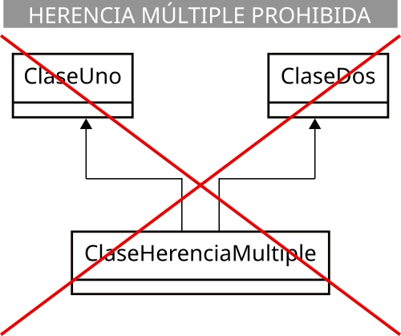

<div class="interactive-progress-tracker">
  <div class="tracker-header">
    <span>🏆 <strong>Progrés d'aquesta secció:</strong> <span class="tracker-count">0 de 4 superats (0%)</span></span>
    <span class="tracker-pts">⭐ <strong>0 punts</strong></span>
  </div>
  <div class="tracker-bar">
    <div class="tracker-fill" style="width: 0%;"></div>
  </div>
</div>

# 5.3 Herència i jerarquías de classes (extends, super)

Com ja has estudiado, l'herència és el mecanisme que permet definir una nova classe a partir d'una altra, podent afegir noves característiques, sense tindre que tornar a escriure tot el codi de la classe base.

La classe de la que es hereda sol ser anomenada *classe base*, *classe madre* o *superclase* (de la que hereda una altra classe, i es heredarán totes aquelles característiques que la classe madre permeta). A la classe que hereda es li sol anomenar *classe hija*, classe derivada o *subclase* (que hereda d'una altra classe, i es heredan totes aquelles característiques que la classe madre permeta).

Una classe derivada pot ser a la seua vegada classe madre d'una altra que herede d'ella i així sucesivament dando lloc a una jerarquia de classes, excepte aquelles que estiguen en la part d'adalt de la jerarquia (només seran classes madre) o en la part d'abaix (només seran classes hijas).

Una classe hija no té accés als miembros privats del seu classe madre, tan només als públics (com qualsevol part del codi tindria) i als protegits (als que només tenen accés les classes derivades i les del mateix paquet). Aquells miembros que siguen privats en la classe base també habrán sigut heretats, però l'accés a ells estarà restringido al propi funcionament de la superclase i només es podrà accedir a ells si la superclase ha dejado algun mitjà indirecto per a fer-ho (per exemple a través d'algun mètode).

Tots els miembros de la superclase, tant atributs com mètodes, són heretats per la subclase. Alguns d'aquests miembros heretats podran ser redefinits o sobrescritos (overriden) i també podran añadir-se nous miembros. D'alguna manera podria decir-se que estàs "ampliant" la classe base amb característiques addicionals o modificant algunes d'elles (procés d'especialització).

> **📌 A tindre en compte**
> 

> Una classe derivada **estén** la funcionalitat de la classe base sense tindre que tornar a escriure el codi de la classe base.

## 1. Sintaxi de l'herència

En Java l'herència es indica mitjançant la paraula reservada `extends`:

```java
[modificador] class ClaseMadre {
  // Cuerpo de la clase
  ...
}

[modificador] class ClaseHija extends ClaseMadre {
  // Cuerpo de la clase
  ...
}
```

Imagina que tens una classe `Persona` que conté atributs com `nombre`, `apellidos` i `fecha de nacimiento`:

#### 📌 Classe Persona

```java
public class Persona {
    String nombre;
    String apellidos;
    LocalDate fechaNacim;
    // ...
}
```

#### 📌 Exemple d'herència en Persona 😄

El teu navegador no suporta la reproducció de videos.

És possible que, més avant, necesites una classe `Alumno` que compartirá eixos atributs (atès que tot alumne és una persona, però amb algunes característiques específiques que l'especializan). En tal cas tendrías la possibilitat de crear una classe `Alumno` que repitiera tots eixos atributs o bé heredar de la classe `Persona`:

```java
public class Alumno extends Persona {
  String grupo;
  double notaMedia;
  ...
}
```

A partir d'ara, un objecte de la classe `Alumno` contendrá els atributs `grupo` i `notaMedia` (propis de la classe `Alumno`), però també `nombre`, `apellidos` i `fechaNacim` (propis del seu classe base `Persona` i que per tant ha heredado).

<details markdown="1">

<summary>💡 Exemple 3.01: Revisa amb cura el següent exemple</summary>

Imagina que també necesitas una classe `Profesor`, que contará amb atributs com *nom*, *cognoms*, *data de naixement*, *especialitat* i *salario*. *Com crearías eixa nova classe i què atributs li añadirías*?  

**Solució**  

Està clar que un `Profesor` és una altra especialització de `Persona`, a l'igual que l'era `Alumno`, així que podrías crear una altra classe derivada de `Persona` i així aprofitar els atributs genérics (*nom*, *cognoms*, *data de naixement*) que posseeix tot objecte de tipus `Persona`. Tan només faltaría añadirle els seus atributs específics (*especialitat* i *salario*):

```java
public class Profesor extends Persona {
    String especialidad;
    double salario;
    ...
}
```

</details>

## 2. Accés a miembros heretats

Com ja has vist anteriorment, *no és possible accedir a miembros privats d'una superclase*. Per a poder accedir a ells podrías pensar en hacerlos públics, però llavors estarías dando l'opció d'accedir a ells a qualsevol objecte extern i és probable que tampoc siga això el deseable. Per a això es inventó el modificador `protected` (*protegido*) que permet l'accés des de classes heredades, però no des de fora de les classes (estrictament parlant, des de fóra del paquet), que serien com miembros privats.

En la unitat dedicada a la utilització de classes ja estudiaste els possibles modificadors d'accés que podia tindre un membre: sense modificador (accés de paquet), públic, privat o protegido.

Ací tens de nou el resum:

| modificador | Mateixa classe | Mateix paquet | Subclase | Un altre paquet |
| --- | --- | --- | --- | --- |
| `public` | ✔ | ✔ | ✔ | ✔ |
| `protected` | ✔ | ✔ | ✔ | ❌ |
| Sense modificador (`package`) | ✔ | ✔ | ❌ | ❌ |
| `private` | ✔ | ❌ | ❌ | ❌ |

> **📌 Els modificadors d'accés són excluyentes**
> 

> Només es pot utilitzar un d'ells en la declaració d'un atribut.

Si en l'exemple anterior de la classe `Persona` es hubieran definit els seus atributs com `private`:

```java
public class Persona {
  private String nombre;
  private String apellidos;
  ...
}
```

Al definir la classe `Alumno` com heredera de `Persona`, no habrías tingut accés a eixos atributs, podent ocasionar un grave problema d'operativitat a l'intentar manipular eixa informació. Per tant, en aquests casos el més recomanable hi hauria sigut **declarar eixos atributs com `protected` o bé sense modificador** (perquè també tinguen accés a ells altres classes del mateix paquet, si és que es considera oportuno):

```java
public class Persona {
  protected String nombre;
  protected String apellidos;
  ...
}
```

> **📌 Privacitat d'atributs**
> 

> Només en aquells casos en els que es desitja explícitament que un membre d'una classe no puga ser accesible des d'una classe derivada hauria d'utilitzar-se el modificador `private`. En el resta de casos és recomanable utilitzar `protected`, o bé no indicar modificador (accés a nivell de paquet).

<details markdown="1">

<summary>💡 Exemple 3.02: Revisa amb cura el següent exemple</summary>

Reescribe les classes `Alumno` i `Profesor` utilitzant el modificador protected per als seus atributs del mateix mode que es ha fet per al seu superclase `Persona`.

**Solució**  

1) Classe `Alumno`. Es tracta simplement d'afegir el modificador d'accés protected als nous atributs que afegeix la classe:

```java
public class Alumno extends Persona {
    protected String grupo;
    protected double notaMedia;
    ...
}
```

2) Classe `Profesor` (exactament igual que en la classe `Alumno`):

```java
public class Profesor extends Persona {
    protected String especialidad;
    protected double salario;
    ...
}
```

</details>

## 3. Utilització de miembros heretats

### 3.1. Atributs

Els atributs heretats per una classe són, a efectes pràctics, iguals que aquells que siguen definits específicament en la nova classe derivada.

En l'exemple anterior la classe `Persona` disponía de tres atributs i la classe `Alumno`, que heredava d'ella, añadía dos atributs més. Des d'un punt de vista funcional podrías considerar que la classe `Alumno` té cinc atributs: tres per ser `Persona` (*nom*, *cognoms*, *data de naixement*) i altres dos més per ser `Alumno` (*grup* i *nota mitjana*).

<details markdown="1">

<summary>💡 Exemple 3.03: Revisa amb cura el següent exemple</summary>

Donades les classes `Alumno` i `Profesor` que has utilitzat anteriorment, implementa mètodes *get* i *set* en les classes `Alumno` i `Profesor` per a treballar amb els seus cinc atributs (tres heretats més dos específics).

**Solució**

1) Classe `Alumno`.  
Es tracta d'heredar de la classe `Persona` i per tant utilitzar amb normalitat els seus atributs heretats com si pertenecieran a la pròpia classe (de fet es pot considerar que li pertanyen, atès que els ha heredado).

```java
import java.time.LocalDate;

public class Alumno extends Persona {

    protected String grupo;
    protected double notaMedia;

    // Método getXXXXX
    public String getNombre() {
        return nombre;
    }

    public String getApellidos() {
        return apellidos;
    }

    public LocalDate getFechaNacimiento() {
        return this.fechaNacimiento;
    }

    public String getGrupo() {
        return grupo;
    }

    public double getNotaMedia() {
        return notaMedia;
    }

    // Métodos setXXXXX
    public void setNombre(String nombre) {
        this.nombre = nombre;
    }

    public void setApellidos(String apellidos) {
        this.apellidos = apellidos;
    }

    public void setFechaNacimiento(LocalDate fechaNacimiento) {
        this.fechaNacimiento = fechaNacimiento;
    }

    public void setGrupo(String grupo) {
        this.grupo = grupo;
    }

    public void setNotaMedia(double notaMedia) {
        this.notaMedia = notaMedia;
    }
}
```

Si et fixes, pots utilitzar sense problema la referència `this` a la pròpia classe amb eixos atributs heretats, ja que pertanyen a la classe: `this.nombre`, `this.apellidos`, etc.

2) Classe `Profesor`.  
Seguim exactament el mateix procediment que amb la classe `Alumno`.

```java
import java.time.LocalDate;

public class Profesor extends Persona {
    String especialidad;
    double salario;

    // Métodos getXXXXX
    public String getNombre() {
        return nombre;
    }

    public String getApellidos() {
        return apellidos;
    }

    public LocalDate getFechaNacimiento() {
        return this.fechaNacimiento;
    }

    public String getEspecialidad() {
        return especialidad;
    }

    public double getSalario() {
        return salario;
    }

    // Métodos setXXXXX
    public void setNombre(String nombre) {
        this.nombre = nombre;
    }

    public void setApellidos(String apellidos) {
        this.apellidos = apellidos;
    }

    public void setFechaNacimiento(LocalDate fechaNacimiento) {
        this.fechaNacimiento = fechaNacimiento;
    }

    public void setSalario(double salario) {
        this.salario = salario;
    }

    public void setESpecialidad(String especialidad) {
        this.especialidad = especialidad;
    }
}
```

Una conclusió que pots extraer d'aquest codi és que has tingut que escriure els mètodes `get` i `set` per als tres atributs heretats, però no hi hauria sigut possible definir eixos sis mètodes en la classe base i així aquestes dos classes derivades hubieran també heredado eixos mètodes? La resposta és afirmativa i de fet és com el vas a fer a partir d'ara. D'eixa manera et habrías evitado tindre que escriure sis mètodes en la classe `Alumno` i altres sis en la classe `Profesor`.

Així que, **recorda!**   

**Es poden heredar tant els atributs com els mètodes**.

Ací tens un exemple de com podrías haver definit la classe `Persona` perquè després es hubieran pogut heredar d'ella els seus mètodes (i no només els seus atributs):

**Solució implementada correctament (I)**

```java
import java.time.LocalDate;

public class Persona {
    protected String nombre;
    protected String apellidos;
    protected LocalDate fechaNacimiento;

    // Métodos getXXXXX
    public String getNombre() {
        return nombre;
    }

    public String getApellidos() {
        return apellidos;
}

    public LocalDate getFechaNacimiento() {
        return this.fechaNacimiento;
    }

    // Métodos setXXXXX
    public void setNombre(String nombre) {
        this.nombre = nombre;
    }

    public void setApellidos(String apellidos) {
        this.apellidos = apellidos;
        }

    public void setFechaNacimiento(LocalDate fechaNacimiento) {
        this.fechaNacimiento = fechaNacimiento;
    }
}
```

</details>

### 3.2. Mètodes

Així que, vist l'exemple del punt anterior, del mateix mode que es heredan els atributs, **també es heredan els mètodes**, convirtiéndose a partir d'eixe moment en altres mètodes més de la classe derivada, al costat dels que hagen sigut definits específicament.

En l'exemple de la classe `Persona`, si dispusiéramos de mètodes *get* i *set* per a cada un dels seus tres atributs (*nom*, *cognoms*, *fechaNacim*), tendrías sis mètodes que podrien ser heretats pels seus classes derivades. Podrías dir llavors que la classe `Alumno`, derivada de `Persona`, té deu mètodes:

- Sis per ser Persona (`getNombre`, `getApellidos`, `getFechaNacim`, `setNombre`, `setApellidos`, `setFechaNacim`).

- Oros quatre més per ser Alumne (`getGrupo`, `setGrupo`, `getNotaMedia`, `setNotaMedia`).

No obstant això, només tendrías que definir eixos quatre últims (els específics) ja que els genérics ja els has heredado de la superclase.

<details markdown="1">

<summary>💡 Exemple 3.04: Revisa amb cura el següent exemple</summary>

```java
public class Profesor extends Persona {
    String especialidad;
    double salario;

    // Métodos getXXXXX
    public String getEspecialidad() {
      return especialidad;
    }

    public double getSalario() {
      return salario;
    }

    // Métodos setXXXXX
    public void setSalario(double salario) {
      this.salario = salario;
    }

    public void setESpecialidad(String especialidad) {
      this.especialidad = especialidad;
    }
}
```

</details>

## 4. Redefinició de mètodes heretats

Una classe pot redefinir alguns dels mètodes que ha heredado del seu classe base. El nou mètode (especialitzat) sustituye a l'heredado. Açò es coneix com sobreescriptura de mètodes.

En qualsevol cas, encara que un mètode siga sobrescrito o redefinido, encara és possible accedir a ell a través de la referència **`super`**, encara que només es podrà accedir a mètodes de la classe madre i no a mètodes de classes superiors en la jerarquia d'herència.

> **📌 Accessibilitat dels mètodes redefinits**
> 

> Els mètodes redefinits poden ampliar la seua accessibilitat respecte a la que ofrezca el mètode original de la superclase, però mai restringirla. Per exemple, si un mètode és declarat com protected o de paquet en la classe base, podria ser redefinido com public en una classe derivada.

> **📌 Mètodes estátics**
> 

> Els mètodes estátics o de classe no poden ser sobrescritos. Els originals de la classe base permanecen inalterables a través de tota la jerarquia d'herència.

<details markdown="1">

<summary>💡 Exemple 3.05: mètode *obtindre* atribut *cognoms* de `Alumne`</summary>

En l'exemple de la classe `Alumno`, podrien redefinir-se alguns dels mètodes heretats. Per exemple, imagina que el mètode *getapellits* retorne la cadena "*Alumne: *" juntament amb els cognoms de l'alumne. En tal cas hi hauria que reescribir eixe mètode per a realizara eixa modificació:

```java
public String getApellidos () {
    return "Alumno: " + apellidos;
}
```

</details>

Quan sobrescribas un mètode heredado en Java pots (**no és necessari)** incloure l'anotació **`@Override`**. Açò indicará al compilador que la teua intenció és sobrescribir el mètode de la classe madre. D'aquesta manera, si et equivocas (per exemple, a l'escriure el nom del mètode) i no l'estàs realment sobrescribent, el compilador producirá un error i així podràs darte compta del fallada. En el cas de l'exemple anterior quedaria:

<details markdown="1">

<summary>💡 Exemple 3.06: mètode *obtindre* atribut *cognoms* de `Alumne` sobreescrito</summary>

```java
@Override
public String getApellidos () {
    return "Alumno: " + apellidos;
}
```

</details>

<details markdown="1">

<summary>💡 Exemple 3.07: Revisa amb cura el següent exemple</summary>

Donades les classes `Persona`, `Alumno` i `Profesor` que has utilitzat anteriorment, redefine el mètode `getNombre` perquè retorne la cadena "*Alumne: *", juntament amb el nom de l'alumne, si es tracta d'un objecte de la classe `Alumno` o bé "*Professor: *", juntament amb el nom del professor, si es tracta d'un objecte de la classe `Profesor`.

**Solució**  

1) Classe `Alumno`.  
A l'heredar de la classe `Persona` tan només és necessari escriure mètodes per als nous atributs (mètodes especialitzats d'accés als atributs especialitzats), ja que els mètodes genérics (d'accés als atributs genérics) ja formen part de la classe a l'haberlos heredado. Eixos són els mètodes que es implementaron en l'exercici anterior (`getGrupo`, `setGrupo`, etc.).

Ara bé, cal escriure un altre mètode més, ja que has de redefinir el mètode `getNombre` perquè tinga un comportament un poc diferent al `getNombre` que es hereda de la classe base `Persona`:

```java
// Método getNombre
@Override
public String getNombre (){
    return "Alumno: " + this.nombre;
}
```

En aquest cas podria decir-se que es "renuncia" al mètode heredado per a redefinir-lo amb un comportament més especialitzat i acorde amb la classe derivada.

2) Classe `Profesor`.  
Seguim exactament el mateix procediment que amb la classe Alumne (redefinició del mètode `getNombre`).

```java
// Método getNombre
@Override
public String getNombre() {
    return "Profesor: " + this.nombre;
}
```

</details>

## 5. Ampliació de mètodes heretats

Fins a ara, has vist que per a redefinir o sustituir un mètode d'una superclase és suficient amb crear un altre mètode en la subclase que tinga el mateix nom que el mètode que es desitja sobrescribir. Però, en altres ocasions, pot que el que necesites no siga sustituir completament el comportament del mètode de la superclase, sinó simplement ampliar-lo.

Per a poder fer açò necesitas poder preservar el comportament antic (el de la superclase) i afegir el nou (el de la subclase). Per a això, pots invocar des del mètode "ampliador" de la classe derivada al mètode "ampliado" de la classe superior (tenint tots dos mètodes el mateix nom). *Com es pot aconseguir això*? Pots fer-ho mitjançant l'ús de la referència **`super`**.

La paraula reservada `super` és una referència a la classe madre de la classe en la que et trobes en cada moment (és alguna cosa similar a `this`, que representava una referència a la classe actual). D'aquesta manera, podrías invocar a qualsevol mètode del teu superclase (si és que es té accés a ell).

<details markdown="1">

<summary>💡 Exemple 3.08: mètode *mostrarDatos* de `Alumne`</summary>

Imagina que la classe `Persona` disposa d'un mètode que permet mostrar el contingut d'algunes dades personals dels objectes d'aquest tipus (*nom*, *cognoms*, etc.).
  
  
D'altra banda, la classe `Alumno` també necessita un mètode similar, però que mostre també la seua informació especialitzada (*grup*, *nota mitjana*, etc.). Com podrías aprofitar el mètode de la superclase per a no tindre que tornar a escriure el seu contingut en la subclase?

**Solució**  

Podria hacerse d'una manera tan senzilla com la següent:

```java
public void mostrarDatos () {
  super.mostrarDatos();  // Llamada al método "mostrar" de la superclase
  // A continuación mostramos la información "especializada" de esta subclase
  System.out.prinln ("Grupo:" + this.grupo);
  System.out.prinln ("Nota media: " + this.notaMedia);
}
```

</details>

Aquest tipus d'ampliacions de mètodes resultan especialment útils per exemple en el cas dels constructors, on es podria anar llamant als constructors de cada superclase encadenadament fins al constructor de la classe en la cúspide de la jerarquia (el constructor de la classe `Object`).

<details markdown="1">

<summary>💡 Exemple 3.09: Revisa amb cura el següent exemple</summary>

Donades les classes `Persona`, `Alumno` i `Profesor`, defineix un mètode `mostrarDatos()` per a la classe `Persona`, que mostre el contingut dels atributs (dades personals) d'un objecte de la classe `Persona`. A continuació, defineix sendos mètodes `mostrarDatos()` especialitzats per a les classes `Alumno` i `Profesor` que "amplíen" la funcionalitat del mètode mostrar original de la classe `Persona`.

**Solució**  

1) Mètode `mostrarDatos()` de la classe `Persona`.

```java
public void mostrarDatos() {
    DateTimeFormatter formatoFecha = DateTimeFormatter.ofPattern("dd/MM/yyyy");
    String stringFecha = formatoFecha.format(this.fechaNacimiento);

    System.out.println ("Nombre:" + this.nombre);
    System.out.println ("Apellidos:" + this.apellidos);
    System.out.printfln ("Fecha nacimiento:" + stringFecha);
}
```

2) Mètode `mostrarDatos()` de la classe `Alumno`. Llamamos al mètode mostrar del seu classe madre (`Persona`) i després afegim la funcionalitat específica per a la subclase `Alumno`:

```java
public void mostrarDatos() {
    super.mostrarDatos();  // Llamada al método "mostrarDatos" de la superclase
    // A continuación mostramos la información "especializada" de esta subclase
    System.out.println ("Grupo:" + this.grupo);
    System.out.println ("Nota media:" + this.notaMedia);
}
```

3) Mètode `mostrarDatos()` de la classe `Profesor`. Llamamos al mètode mostrar del seu classe madre (`Persona`) i després afegim la funcionalitat específica per a la subclase `Profesor`:

```java
public void mostrarDatos() {
    super.mostrarDatos();

    System.out.println ("Especialidad:" + this.especialidad);
    System.out.println ("Salario:" + this.salario);
}
```

</details>

## 6. Constructors i herència

Recorda que quan estudiaste els constructors viste que un constructor d'una classe pot anomenar a un altre constructor de la mateixa classe, prèviament definit, a través de la referència `this`. En aquests casos, la utilització de `this` només podia hacerse en la primera línia de codi del constructor.

Com ja has vist, un constructor d'una classe derivada pot fer alguna cosa semblant per a anomenar al constructor del seu classe base mitjançant l'ús de la paraula `super`. D'aquesta manera, el constructor d'una classe derivada pot anomenar primer al constructor del seu superclase perquè inicialice els atributs heretats i posteriorment es inicializarán els atributs específics de la classe: els no heretats.

> **📌 A tindre en compte a l'utilitzar `super` en un constructor**
> 

> Novament, **aquesta anomenada també ha de ser la primera sentència d'un constructor** (amb la única excepció de que existisca una anomenada a un altre constructor de la classe mitjançant `this`).

Si no s'inclou una anomenada a `super()` dins del constructor, el compilador inclou automàticament una anomenada al constructor per defecte de classe base (anomenada a `super()`). Açò dóna lloc a una anomenada en cadena de constructors de superclase fins a arribar a la classe més alta de la jerarquia (que en Java és la classe `Object`).

En el cas del constructor per defecte (el que crea el compilador si el programador no ha escrit cap), el compilador afegeix el primer de tot, abans de la inicializació dels atributs als seus valors per defecte, una anomenada al constructor de la classe base mitjançant la referència `super`.

A l'hora de destruir un objecte (mètode `finalize`) és important anomenar als finalizadors en l'ordre invers a com van ser anomenats els constructors (primer es liberan els recursos de la classe derivada i després els de la classe base mitjançant l'anomenada `super.finalize()`).

<details markdown="1">

<summary>💡 Exemple 3.10: Constructor de `Alumne` que hereda part del constructor de `Persona`</summary>

Si la classe `Persona` tinguera un constructor d'aquest tipus:

```java
public Persona (String nombre, String apellidos, LocalDate fechaNacim) {
    this.nombe = nombre;
    this.apellidos = apellidos;
    this.fechaNacim = new LocalDate (fechaNacim);
}
```

Podrías llamar-lo des d'un constructor d'una classe derivada (per exemple `Alumno`) de la següent forma:

```java
public Alumno (String nombre, String apellidos, LocalDate fechaNacim, String grupo, double notaMedia) {
    super (nombre, apellidos, fechaNacim);
    this.grupo = grupo;
    this.notaMedia = notaMedia;
}
```

</details>

En realitat es tracta d'un altre recurs més per a optimitzar la reutilització de codi, en aquest cas el del constructor, que encara que no és heredado, sí pots invocar-lo per a no tindre que reescribir-lo.

## 7. La classe `Object` en Java

Totes les classes en Java són descendentes (directos o indirectos) de la classe Object. Aquesta classe defineix els estats i comportaments bàsics que han de tindre tots els objectes. Entre aquests comportaments, es troben:

- La possibilitat de comparar-se.

- La capacitat de convertir-se a cadenes.

- L'habilitat de retornar la classe de l'objecte.

Entre els mètodes que incorpora la classe `Object` i que per tant hereda qualsevol classe en Java tens:

Principals mètodes de la classe `Object`:

| Mètode | Descripció |
| --- | --- |
| `Object()` | Constructor. |
| `clone()` | Mètode clonador: crea i retorna una còpia de l'objecte ("clona" l'objecte). |
| `boolean equals(Object obj)` | Indica si l'objecte passat com paràmetre és igual a aquest objecte. |
| `void finalize()` | Mètode anomenat pel recolector de basura quan éste considera que no queda cap referència a aquest objecte en l'entorn d'ejecució. |
| `int hashCode()` | Retorna un codi hash per a l'objecte. |
| `toString()` | Retorna una representació de l'objecte en forma de String. |

La classe `Object` representa la superclase que es troba en la cúspide de la jerarquia d'herència en Java. Qualsevol classe (fins i tot les que tu implementes) acaven heredant d'ella.

## 8. Herència múltiple

En determinats casos podrías considerar la possibilitat de que es necesite heredar de més d'una classe, per a així disposar dels miembros de dos (o més) classes disjuntas (que no derivan una de la una altra). L'herència múltiple permet fer això: recoger les distintes característiques (atributs i mètodes) de classes diferents formant una nova classe derivada de diverses classes base.

El problema en aquests casos és la possibilitat que existeix de que es produzcan ambigüetats; així, si tuviéramos miembros amb el mateix identificador en classes base diferents, en tal cas, què membre es hereda? Per a evitar açò, els compiladors solen solicitar que ante casos d'ambigüetat, es especifique de manera explícita la classe de la qual es vol utilitzar un determinat membre que puga ser ambiguo.

Ara bé, la possibilitat d'herència múltiple no està disponible en tots els llenguatges orientats a objectes.

> **📌 ...l'estarà en Java?**
> 

> ... no existeix l'herència múltiple de classes.

> 
    




---

## 🎮 Reptes Interactius d'Autoavaluació (+100 XP)

Comprova el teu domini sobre **5.3 Herència i jerarquías de classes (extends, super)** superant aquests 4 reptes gamificats (+25 punts cadascun):

<div class="interactive-mcq" data-answer="A" data-hint="Revisa els conceptes teòrics i pràctics d'aquesta secció.">
  <div class="mcq-question">🎯 <strong>Repte 1 (+25 pts):</strong> Quina paraula clau s'utilitza en Java perquè una subclasse herete els atributs i mètodes d'una superclasse, i quina per a implementar una interfície?</div>
  <div class="mcq-options">
    <button type="button" class="btn-mcq-opt" data-opt="A">A) 'extends' per a heretar d'una classe i 'implements' per a implementar una interfície.</button>
    <button type="button" class="btn-mcq-opt" data-opt="B">B) 'implements' per a heretar d'una classe i 'extends' per a una interfície.</button>
    <button type="button" class="btn-mcq-opt" data-opt="C">C) 'inherits' i 'uses'.</button>
    <button type="button" class="btn-mcq-opt" data-opt="D">D) Cap de les anteriors és correcta.</button>
  </div>
  <div class="quiz-feedback"></div>
</div>

<div class="interactive-mcq" data-answer="D" data-hint="Comprova l'apartat corresponent de la unitat.">
  <div class="mcq-question">🎯 <strong>Repte 2 (+25 pts):</strong> Quina característica defineix una classe abstracta ('abstract class') en Java?</div>
  <div class="mcq-options">
    <button type="button" class="btn-mcq-opt" data-opt="A">A) No pot tindre cap atribut ni constructor.</button>
    <button type="button" class="btn-mcq-opt" data-opt="B">B) Tots els seus mètodes han de ser privats i estàtics.</button>
    <button type="button" class="btn-mcq-opt" data-opt="C">C) Cap de les anteriors és correcta.</button>
    <button type="button" class="btn-mcq-opt" data-opt="D">D) No es pot instanciar directament amb 'new' i pot contindre tant mètodes abstractes (sense cos) com mètodes implementats.</button>
  </div>
  <div class="quiz-feedback"></div>
</div>

<div class="interactive-vf" data-answer="V" data-hint="Verifica l'afirmació amb els apunts de la unitat.">
  <div class="vf-statement">✅ <strong>Repte 3 (Vertader o Fals · +25 pts):</strong> El polimorfisme permet que una variable de referència del tipus de la superclasse o interfície apunte a objectes de qualsevol de les seues subclasses i execute el mètode sobreescrit (@Override) en temps d'execució.</div>
  <div class="vf-buttons">
    <button type="button" class="btn-vf" data-opt="V">Vertader (V)</button>
    <button type="button" class="btn-vf" data-opt="F">Fals (F)</button>
  </div>
  <div class="quiz-feedback" style="width: 100%;"></div>
</div>

<div class="interactive-quiz" data-answer="super" data-hint="Fa referència a la superclasse (5 lletres).">
  <div class="quiz-question">⌨️ <strong>Repte 4 (+25 pts):</strong> Quina paraula clau s'utilitza en el constructor d'una subclasse per a invocar el constructor de la seua classe pare?</div>
  <div class="quiz-controls">
    <input type="text" class="quiz-input" placeholder="Escriu la resposta..." />
    <button type="button" class="btn-quiz-check">Comprovar</button>
  </div>
  <div class="quiz-feedback"></div>
</div>

### 📋 Llista de Comprovació i Rúbrica d'Assoliment

Marca cada criteri a mesura que completes l'estudi o la resolució pràctica d'aquesta pàgina (**5.3 Herència i jerarquías de classes (extends, super)**):

- [ ] He llegit detingudament la teoria o l'enunciat d'aquesta secció i he anotat els conceptes clau.
- [ ] He revisat els esquemes, taules o blocs de codi i he verificat que sé aplicar-los a l'entorn de treball.
- [ ] He resolt correctament els **4 reptes interactius** superiors obtenint els **100 punts XP**.
- [ ] He descarregat el comprovant oficial en PDF per a adjuntar-lo a la tasca d'**Aules**.

<div class="aules-delivery-card">
  <h3>📤 Comprovant de Lliurament per a Aules</h3>
  <p>Quan hages completat els reptes interactius i la llista d'autoavaluació d'aquesta pàgina, introdueix el teu nom i descarrega el teu certificat oficial en PDF per a adjuntar-lo a la tasca d'<strong>Aules</strong>.</p>
  <div class="aules-student-field">
    <label for="aules-student-name">👤 Nom i Cognoms de l'Alumne/a:</label>
    <input type="text" id="aules-student-name" class="aules-student-name" placeholder="Ex: Joan Garcia Pérez" />
  </div>
  <div class="aules-score-badge">
    <span class="aules-score-count">0/4 reptes completats (0%) · 0 punts · 0/4 criteris d'autoavaluació</span>
  </div>
  <div class="aules-actions">
    <button type="button" class="btn-aules-dl" data-module="PRG" data-unit="UD05" data-activity="ut0503">📥 Descarregar Comprovant PDF</button>
    <button type="button" class="btn-aules-copy">📋 Copiar Resum al Porta-retalls</button>
  </div>
  <div class="aules-toast"></div>
</div>

