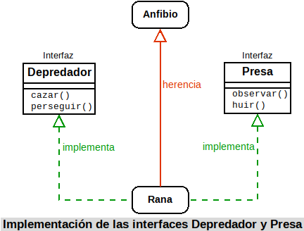
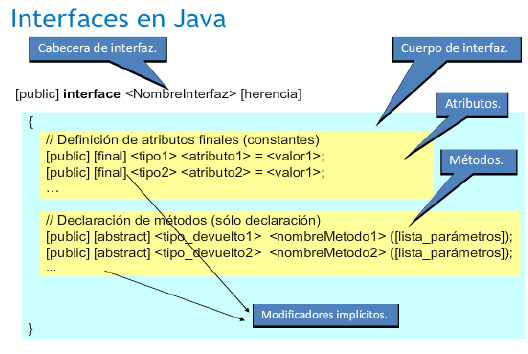
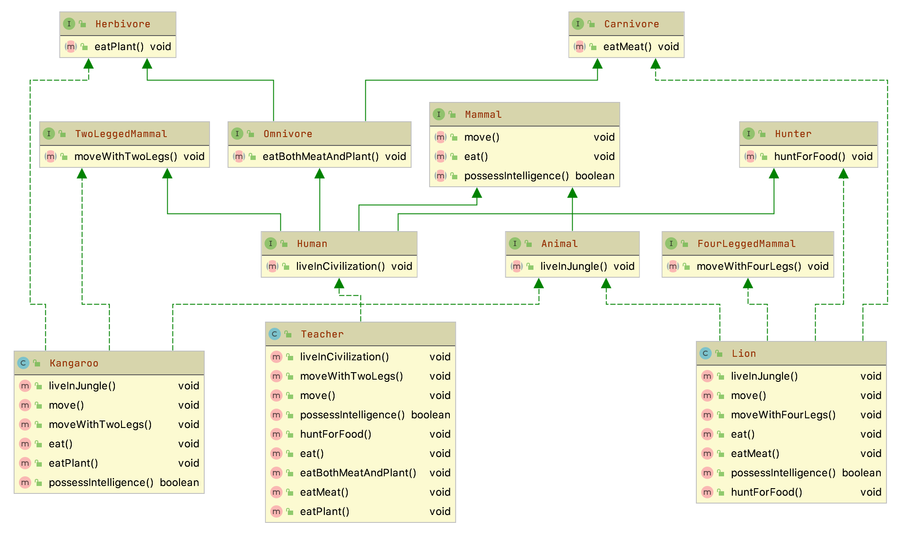

<div class="interactive-progress-tracker">
  <div class="tracker-header">
    <span>🏆 <strong>Progrés d'aquesta secció:</strong> <span class="tracker-count">0 de 4 superats (0%)</span></span>
    <span class="tracker-pts">⭐ <strong>0 punts</strong></span>
  </div>
  <div class="tracker-bar">
    <div class="tracker-fill" style="width: 0%;"></div>
  </div>
</div>

# 5.5 Interfícies (interface, implements)

Has vist com l'herència permet definir especializacions (o extensions) d'una classe base que ja existeix sense tindre que tornar a repetir tot el codi d'ésta. Aquest mecanisme dóna l'oportunitat de que la nova classe especialitzada (o extendida) disponga de tota la interfície que té el seu classe base.

També has estudiado com els mètodes abstractes permeten establir una interfície per a marcar les línies generals d'un comportament comú de superclase que haurien de compartir de totes les subclases.

Si llevamos al límit aquesta idea d'interfície, podrías arribar a tindre una classe abstracta on tots els seus mètodes fueran abstractes. D'aquesta manera estarías dando únicament el marco de comportament, sense cap mètode implementat, de les possibles subclases que heredarán d'eixa classe abstracta. La idea d'una *interfície* (o *interface*) és precisament ésa: disposar d'un mecanisme que permeta especificar quin ha de ser el comportament que han de tindre tots els objectes que formen part d'una determinada classificació (no necessàriament jeràrquica).

Una **interfície** consisteix principalment en una **llista de declaracions de mètodes sense implementar, que caracteritzen un determinat comportament**. Si es desitja que una classe tinga eixe comportament, haurà d'implementar eixos mètodes establits en la interfície. En aquest cas no es tracta d'una relació d'herència (la classe B és una especialització de la classe A, o la subclase B és del tipus de la superclase A), sinó més bé una relació "*d'implementació de comportaments*" (la classe B implementa els mètodes establits en la interfície A, o els comportaments indicats per A són llevats a cabo per B; però no que B siga de classe A).

Imagina que estàs diseñant una aplicació que treballa amb classes que representen distints tipus d'animals. Algunes de les accions que vols que lleven a cabo estan relacionades amb el fet de que alguns animals siguen depredadors (per exemple: *observar una presa*, *perseguirla*, *comérsela*, etc.) o siguen presas (*observar*, *huir*, *esconderse*, etc.). Si creas la classe `León`, aquesta classe podria implementar una interfície `Depredador`, mentre que altres classes com `Gacela` implementarían les accions de la interfície `Presa`. D'altra banda, podrías tindre també el cas de la classe `Rana`, que implementaría les accions de la interfície `Depredador` (ja que és cazador de xicotets insectos), però també la de `Presa` (ja que pot ser cazado i necessita les accions necessàries per a protegerse).



## 1. Concepte d'interfície

**Una interfície en Java consisteix esencialment en una llista de declaracions de mètodes sense implementar, juntament amb un conjunt de constants**.

Aquests mètodes sense implementar indiquen un comportament, un tipus de conducta, encara que no especifican com serà eixe comportament (implementació), ja que això dependrà de les característiques específiques de cada classe que decida implementar eixa interfície. Podria decir-se que una interfície s'encarrega d'establir què comportaments cal tindre (què mètodes), però no diu res de com han de portar-se a cabo eixos comportaments (implementació). Es indica només la forma, no la implementació.

En cert mode podrías imaginar el concepte d'interfície com un guió que diu: "*aquest és el protocol de comunicació que han de presentar totes les classes que implementen aquesta interfície*". Es proporciona una llista de mètodes públics i, si vols dotar al teu classe d'eixa interfície, hauràs de definir tots i cada un d'eixos mètodes públics.

> **📌 En conclusió**
> 

> Una interfície **s'encarrega d'establir unes línies generals sobre els comportaments (mètodes)** que haurien de tindre els objectes de tota classe que implement eixa interfície; és a dir, que no indiquen el que l'objecte és (d'això s'encarrega la classe i els seus superclases), sinó accions (capacitats) que l'objecte hauria de ser capaç de realitzar.

> 
> És per açò que el nom de moltes interfícies en Java acaba amb sufijos del tipus "*‐able*", "*‐or*", "*‐ente*" i coses de l'estil, que signifiquen alguna cosa així com capacitat o habilitat per a fer o ser receptors d'alguna cosa (*configurable*, *serializable*, *modificable*, *clonable*, *ejecutable*, *administrador*, *servidor*, *buscador*, etc.), dando així la idea de que es té la capacitat de dur a terme el conjunt d'accions especificades en la interfície.

Imagínate per exemple la classe `Coche`, subclase de `Vehículo`. Els cotxes són vehículos a motor, la qual cosa implica una sèrie d'accions com, per exemple, arrancar el motor o detener el motor. Eixa acció no la pots heredar de `Vehículo`, ja que no tots els vehículos tenen porqué ser a motor (pensa per exemple en una classe `Bicicleta`), i no pots heredar d'una altra classe ja que ja heredas de `Vehículo`. Una solució podria ser crear una interfície `Arrancable`, que proporcione els mètodes típics d'un objecte a motor (no necessàriament vehículos). D'aquesta manera la classe `Coche` segueix sent subclase de `Vehículo`, però també implementaría els comportaments de la interfície `Arrancable`, els quals podrien ser també implementats per altres classes, hereden o no de `Vehículo` (per exemple una classe `Motocicleta` o bé una classe `Motosierra`). La classe `Coche` implementará el seu mètode arrancar d'una manera, la classe `Motocicleta` el farà d'una altra (encara que bastant semblant) i la classe `Motosierra` d'una altra forma probablement molt diferent, però tots tindran la seua pròpia versió del mètode arrancar com part de la interfície `Arrancable`.

Segons aquesta concepció, podrías hacerte la següent pregunta: *podrà una classe implementar diverses interfícies*? La resposta en aquest cas sí és afirmativa.

> **📌 A tindre en compte**
> 

> Una classe pot adoptar distints models de comportament establits en diferents interfícies. És a dir **una classe pot implementar diverses interfícies**.

### 1.1. Classe abstracta o interfície?

Observant el concepte d'interfície que es acaba de proponer, podria caerse en la tentació de pensar que és pràcticament el mateix que una classe abstracta en la que tots els seus mètodes siguen abstractes.

És cert que en eixe sentit existeix un gran semblant formal entre una classe abstracta i una interfície, pudiéndose en ocasions utilitzar indistintament una o una altra per a obtindre un mateix fi. Però, malgrat eixe gran semblant, existeixen algunes **diferències**, no només formals, sinó també conceptuals, molt importants:

- Una classe no pot heredar de diverses classes, encara que siguen abstractes (herència múltiple). No obstant això sí pot implementar una o diverses interfícies i a més seguir heredant d'una classe.

- Una interfície no pot definir mètodes (no implementa el seu contingut), tan només els declara o enumera.

- Una interfície pot fer que dos classes tinguen un mateix comportament independentment de les seues ubicacions en una determinada jerarquia de classes (no han d'heredar les dos d'una mateixa superclase, ja que no sempre és possible segons la naturalesa i propietats de cada classe).

- Una interfície permet establir un comportament de classe sense a penes donar detalls, ja que eixos detalls encara no són coneguts (dependerán del mode en que cada classe decida implementar la interfície).

- Les interfícies tenen la seua pròpia jerarquia, diferent i independent de la jerarquia de classes.

De tot açò pot deducir-se que una classe abstracta proporciona una interfície disponible només a través de l'herència. Només qui herede d'eixa classe abstracta dispondrá d'eixa interfície. Si una classe no pertany a eixa mateixa jerarquia (no hereda d'ella) no podrà tindre eixa interfície. Això significa que per a poder disposar de la interfície podrías:

1. Tornar a escribirla per a eixa jerarquia de classes. La qual cosa no sembla una bona solució.

1. Fer que la classe herede de la superclase que proporciona la interfície que et interessa, sacándola de la seua jerarquia original i convirtiéndola en classe derivada d'alguna cosa del que conceptualment no hauria de ser una subclase. És a dir, estarías forzant una relació "és un" quan en realitat el més probable és que eixa relació no existisca. Tampoc sembla la millor forma de resoldre el problema.

No obstant això, una interfície sí pot ser implementada per qualsevol classe, permetent que classes que no tinguen cap relació entre sí (pertanyen a distintes jerarquías) puguen compartir un determinat comportament (una interfície) sense tindre que forçar una relació d'herència que no existeix entre elles.

A partir d'ara podem parlar d'una altra possible relació entre classes: la de compartir un determinat comportament (interfície). Dos classes podrien tindre en comú un determinat conjunt de comportaments sense que necessàriament existisca una relació jeràrquica entre elles. Tan només quan haja realment una relació de tipus "és un" es producirá herència.

> **📌 A tindre en compte**
> 

> Si només vas a proporcionar una llista de mètodes abstractes (interfície), sense definicions de mètodes ni atributs d'objecte, sol ser recomanable definir una interfície abans que classe abstracta. És més, quan vayas a definir una supuesta classe base, pots començar declarándola com interfície i només quan veas que necesitas definir mètodes o variables membre, pots llavors convertirla en classe abstracta (no instanciable) o fins i tot en una classe instanciable.

## 2. Definició d'interfícies

La declaració d'una interfície en Java és similar a la declaració d'una classe, encara que amb algunes variacions:

- S'utilitza la paraula reservada `interface` en lloc de `class`.

- Pot utilitzar-se el modificador `public`. Si inclou aquest modificador la interfície ha de tindre el mateix nom que el fitxer `.java` en el que es troba (exactament igual que sucedía amb les classes). Si no es indica el modificador `public`, l'accés serà per omisió o "de paquet" (com sucedía amb les classes).

- Tots els miembros de la interfície (atributs i mètodes) són `public` de manera implícita. No és necessari indicar el modificador `public`, encara que pot hacerse.

- Tots els atributs són de tipus `final` i `public` (tampoc és necessari especificar-lo), és a dir, constants i públics. Cal darles un valor inicial.

- Tots els mètodes són abstractes també de manera implícita (tampoc cal indicar-lo). No tenen cos, tan només la capçalera.



Com pots observar, una interfície consisteix esencialment en una llista d'atributs finals (constants) i mètodes abstractes (sense implementar). El seu sintaxi quedaria llavors:

```java
[public] interface <NombreInterfaz> {
  [public] [final] <tipo1> <atributo1> = <valor1>;
  [public] [final] <tipo2> <atributo2> = <valor2>;
  ...
  [public] [abstract] <tipo_devuelto1> <nombreMetodo1> ([lista_parámetros]);
  [public] [abstract] <tipo_devuelto2> <nombreMetodo2> ([lista_parámetros]);
  ...
}
```

Si et fixes, la declaració dels mètodes acaba en punt i coma, ja que no tenen cos, a l'igual que succeeix amb els mètodes abstractes de les classes abstractes. L'exemple de la interfície `Depredador` que hem vist abans podria quedar llavors així:

```java
public interface Depredador {
  void perseguir (Animal presa);
  void cazar (Animal presa);
  ...
}
```

Seran les classes que implementen aquesta interfície (`León`, `Leopardo`, `Cocodrilo`, `Rana`, `Lagarto`, `Hombre`, etc.) les que definan cada un dels mètodes per dins.

<details markdown="1">

<summary>💡 Exemple 5.01: Revisa amb cura el següent exemple</summary>

Crea una interfície en Java del qual nom siga `Imprimible` i que continga alguns mètodes útils per a mostrar el contingut d'una classe:  
  

**Solució**  

1) Mètode `devolverContenidoString`, que crea un `String` amb una representació de tot el contingut públic (o que es decida que deba ser mostrat) de l'objecte i el retorna. El format serà una llista de parells "*nom=valor*" de cada atribut separat per comes i la llista completa encerrada entre claus: "`{<nombre_atributo_1>=<valor_atributo_1>, ..., <nombre_atributo_n>=<valor_atributo_n>}`".

2) Mètode `devolverContenidoArrayList`, que crea un `ArrayList` de `String` amb una representació de tot el contingut públic (o que es decida que deba ser mostrat) de l'objecte i el retorna.

3) Mètode `devolverContenidoHashMap`, similar a l'anterior, però en lloc retornar en un `ArrayList` els valors dels atributs, es retorna en una `HashMap` en forma de parells (`nombre`, `valor`).
Es tracta simplement de declarar la interfície i incloure en el seu interior eixos tres mètodes:

```java
import java.util.ArrayList;
import java.util.HashMap;

public interface Imprimible {
    String devolverContenidoString();
    ArrayList devolverContenidoArrayList();
    HashMap devolverContenidoHashMap();
}
```

El com es implementarán cada un d'eixos mètodes dependrà exclusivament de cada classe que decida implementar aquesta interfície.

</details>

## 3. Implementació d'interfícies

Com ja has vist, totes les classes que implementan una determinada interfície estan obligades a proporcionar una definició (implementació) dels mètodes d'eixa interfície, adoptant el model de comportament proposat per ésta.

Donada una interfície, qualsevol classe pot especificar aquesta interfície mitjançant el mecanisme denominat implementació d'interfícies. Per a això s'utilitza la paraula reservada *implements*:

```java
class NombreClase implements NombreInterfaz {
```

D'aquesta manera, la classe està dient alguna cosa així com "*la interfície indica els mètodes que he d'implementar, però vaig a ser jo (la classe) qui els implement*".

És possible indicar diversos noms d'interfícies separándolos per comes:

```java
class NombreClase implements NombreInterfaz1, NombreInterfaz2,... {
```

Quan una classe implementa una interfície, ha de **redefinir els seus mètodes novament amb accés públic**. Amb un altre tipus d'accés es producirá un error de compilació. És a dir, que del mateix mode que no es podien restringir permisos d'accés en l'herència de classes, tampoc es pot fer en la implementació d'interfícies.

Una vegada implementada una interfície en una classe, els mètodes d'eixa interfície tenen exactament el mateix tractament que qualsevol un altre mètode, sense cap diferència, podent ser invocats, heretats, redefinits, etc.

En l'exemple dels *depredadors*, al definir la classe `León`, hi hauria que indicar que implementa la interfície `Depredador`:

```java
class Leon implements Depredador {
```

En realitat la definició completa de la classe `Leon` hauria de ser:

```java
class Leon extends Felino implements Depredador {
```

> **📌 Ordre `extends` e `implements`**
> 

> L'ordre de `extends` e `implements` és important, primer es defineix l'herència i a continuació la interfícies que implementa.

I en el seu interior hi hauria que implementar aquells mètodes que continga la interfície:

```java
void perseguir (Animal presa) {
  // Implementación del método perseguir para un león
  ...
}
```

En el cas de classes que pudieran ser alhora `Depredador` i `Presa`, tendrían que implementar totes dues interfícies, com podria succeir amb la classe `Rana`:

```java
class Rana implements Depredador, Presa {
```

Que de manera completa quedaria:

```java
class Rana extends Anfibio implements Depredador, Presa {
```

I en el seu interior hi hauria que implementar aquells mètodes que continguen totes dues interfícies, tant les de `Depredador` (localitzar, cazar, etc.) com les de `Presa` (observar, huir, etc.).

<details markdown="1">

<summary>💡 Exemple 5.02: Revisa amb cura el següent exemple</summary>

Fes que les classes `Alumno` i `Profesor` implementen la interfície `Imprimible` que es ha escrit en l'exercici anterior.

**Solució**  

La primera opció que es et pot ocórrer és pensar que en totes dues classes caldrà indicar que implementan la interfície `Imprimible` i per tant definir els mètodes que ésta inclou: `devolverContenidoString`, `devolverContenidoHashMap` i `devolverContenidoArrayList`.

Si les classes `Alumno` i `Profesor` no heredaran de la mateixa classe hi hauria que fer-ho obligatòriament així, ja que no comparteixen superclase i precisament per a això serveixen les interfícies: per a implementar determinats comportaments que no pertanyen a l'estructura jeràrquica d'herència en la que es troba una classe (d'aquesta manera, classes que no tenen cap relació d'herència podrien compartir interfície).

Però en aquest cas podríem aprofitar que totes dues classes sí són subclases d'una mateixa superclase (heredan de la mateixa) i fer que la interfície `Imprimible` siga implementada directament per la superclase (`Persona`) i d'aquesta manera ahorrarnos bastant codi. Així no faria falta indicar explícitament que `Alumno` i `Profesor` implementan la interfície `Imprimible`, ja que l'estaran fent de forma implícita a l'heredar d'una classe que ja ha implementat eixa interfície (la classe `Persona`, que és pare de totes dues).

Una vegada que els mètodes de la interfície estiguen implementats en la classe `Persona`, tan només caldrà redefinir o ampliar els mètodes de la interfície perquè es adapten a cada classe hija específica (`Alumno` o `Profesor`), ahorrándonos tindre que escriure diverses vegades la part de codi que obté els atributs genérics de la classe `Persona`.

1) Classe `Persona`.
  
Indiquem que es va a implementar la interfície `Imprimible`:

```java
public abstract class Persona implements Imprimible {
...
```

Definim el mètode `devolverContenidoHashMap` a la manera de com ha de ser implementat per a la classe Persona. Podria quedar, per exemple, així:

```java
@Override
public HashMap devolverContenidoHashMap() {
    // Creamos la HashMap que va a ser devuelta
    HashMap contenido = new HashMap();
    // Añadimos los atributos de la clase
    DateTimeFormatter formatoFecha = DateTimeFormatter.ofPattern("dd/MM/yyyy");

    String stringFecha = formatoFecha.format(this.fechaNacimiento);
    contenido.put("nombre", this.nombre);
    contenido.put("apellidos", this.apellidos);
    contenido.put("fechaNacim", stringFecha);
    // Devolvemos la HashMap
    return contenido;
}
```

Del mateix mode, definim també el mètode `devolverContenidoArrayList`:

```java
@Override
public ArrayList devolverContenidoArrayList() {
    // Creamos la ArrayList que va a ser devuelta
    ArrayList contenido = new ArrayList();
    // Añadimos los atributos de la clase
    DateTimeFormatter formato = DateTimeFormatter.ofPattern("d/MM/yyyy");

    String stringFecha = formato.format(this.fechaNacim);
    contenido.add(this.nombre);
    contenido.add(this.apellidos);
    contenido.add(stringFecha);
    // Devolvemos la ArrayList
    return contenido;
}
```

I finalment el mètode `devolverContenidoString`:

```java
@Override
public String devolverContenidoString() {
    DateTimeFormatter formato = DateTimeFormatter.ofPattern("d/MM/yyyy");
    String stringFecha = formato.format(this.fechaNacim);
    String contenido = "{" + this.nombre + ", " + this.apellidos + ", " + stringFecha + "}";
return contenido;
}
```

2) Classe `Alumno`.

Aquesta classe hereda de la classe Persona, de manera que heredará els tres mètodes anteriors. Tan només caldrà redefinirlos perquè, aprovechant el codi ja escrit en la superclase, es afegisca la funcionalitat específica que aporta aquesta subclase.

```java
public class Alumno extends Persona {
...
```

Com pots observar no ha sigut necessari incloure el `implements Imprimible`, ja que el `extends Persona` el porta implícito atès que `Persona` ja implementava eixe interfície. El que farem llavors serà anomenar al mètode que estem redefinent utilitzant la referència a la superclase `super`.

El mètode `devolverContenidoHashMap` podria quedar, per exemple, així:

```java
@Override
public HashMap devolverContenidoHashMap() {
    // Llamada al método de la superclase
    HashMap contenido = super.devolverContenidoHashMap();
    // Añadimos los atributos específicos de la clase
    contenido.put("grupo", this.grupo);
    contenido.put("notaMedia", this.notaMedia);
    // Devolvemos la HashMap rellena
    return contenido;
}
```

3) Classe `Profesor`.
En aquest cas hi hauria que proceder exactament de la mateixa manera que amb la classe Alumne: redefinent els mètodes de la interfície `Imprimible` per a afegir la funcionalitat específica que aporta aquesta subclase, en aquest cas mostrarem la redifinició del mètode `devolverContenidoArrayList()`:

```java
@Override
public ArrayList devolverContenidoArrayList() {
    // Llamada al método de la superclase
    ArrayList contenido = super.devolverContenidoArrayList();
    // Añadimos los atributos específicos de la clase
    contenido.add(this.especialidad);
    contenido.add(this.salario);
    // Devolvemos la ArrayList
    return contenido;
}
```

i la redefinició del mètode `devolverContenidoString()`:

```java
@Override
public String devolverContenidoString() {
    // Llamada al método de la superclase
    String contenido = super.devolverContenidoString();
    //Eliminamos el último carácter, que contiene una llave de cierre.
    contenido = contenido.substring(0, contenido.length() - 1);
    contenido = contenido + ", " + this.especialidad + ", " + this.salario + "}";
    // Devolvemos el String creado.
    return contenido;
}
```

</details>

### 3.1. Un exemple d'implementació d'interfícies: la interfície `Series`

En la forma tradicional d'una interfície, els mètodes es declaran utilitzant només el seu tipus de devolució i firma. Són, esencialment, mètodes abstractes. Per tant, cada classe que inclou aquesta interfície ha d'implementar tots els seus mètodes.

> **📌 A tindre en compte**
> 

> En una interfície, els mètodes són implícitament públics.

> **📌 A tindre en compte**
> 

> **Les variables declarades en una interfície no són variables d'instància**. En canvi, són implícitament *public*, *final*, i *static*, i han d'inicializar-se. Per tant, són esencialment **constants**.

Ací hi ha un exemple d'una definició d'interfície. Especifica la interfície a una classe que genera una sèrie de números.

```java
public interface Series {
  int getSiguiente(); //Retorna el siguiente número de la serie
  void reiniciar();   //Reinicia
  void setComenzar(int x); //Establece un valor inicial
}
```

Aquesta interfície es declara pública perquè puga ser implementada per codi en qualsevol paquet.

**Els mètodes que implementan una interfície han de declarar-se públics.** A més, el tipus del mètode d'implementació ha de coincidir exactament amb el tipus especificat en la definició de la interfície.

<details markdown="1">

<summary>💡 Exemple 5.03</summary>

Ací hi ha un exemple que implementa la interfície de `Series` mostrada anteriorment. Crea una classe anomenada `DeDos`, que genera una sèrie de números, cada un major que l'anterior.

**Solució**  

```java
class DeDos implements Series {
    int iniciar;
    int valor;

    DeDos(){
        iniciar = 0;
        valor = 0;
    }

    public int getSiguiente() {
        valor += 2;
        return valor;
    }

    public void reiniciar() {
        valor = iniciar;
    }

    public void setComenzar(int x) {
        iniciar = x;
        valor = x;
    }
}
```

Observa que els mètodes `getSiguiente()`, `reiniciar()` i `setComenzar()` es declaran utilitzant l'especificador d'accés públic (`public`). Açò és necessari. Sempre que implementes un mètode definit per una interfície, ha d'implementar-se com públic perquè tots els miembros d'una interfície són implícitament públics.

</details>

<details markdown="1">

<summary>💡 Exemple 5.04</summary>

Ací hi ha una classe que demuestra `DeDos`:

#### 📌 Solució

```java
class SeriesDemo {
    public static void main(String[] args) {
        DeDos ob = new DeDos();
        for (int i=0; i<5; i++){
            System.out.println("Siguiente valor es: " + ob.getSiguiente());
        }
        System.out.println("\nReiniciando");
        ob.reiniciar();
        for (int i=0; i<5; i++){
            System.out.println("Siguiente valor es: " + ob.getSiguiente());
        }
        System.out.println("\nIniciando en 100");
        ob.setComenzar(100);
        for (int i=0; i<5; i++){
            System.out.println("Siguiente valor es: " + ob.getSiguiente());
        }
    }
}
```

#### 📌 Eixida

```java
Siguiente valor es: 2
Siguiente valor es: 4
Siguiente valor es: 6
Siguiente valor es: 8
Siguiente valor es: 10
Reiniciando
Siguiente valor es: 2
Siguiente valor es: 4
Siguiente valor es: 6
Siguiente valor es: 8
Siguiente valor es: 10
Iniciando en 100
Siguiente valor es: 102
Siguiente valor es: 104
Siguiente valor es: 106
Siguiente valor es: 108
Siguiente valor es: 110
```

Està permitido i és comú per a les classes que implementan interfícies definir miembros addicionals propis. Per exemple, la següent versió de `DeDos` agrega el mètode `getAnterior()`, que retorna el valor anterior:

</details>

<details markdown="1">

<summary>💡 Exemple 5.05</summary>

Ací hi ha una classe que demuestra `DeDos`:

**Solució**  

```java
class DeDos implements Series {
    int iniciar;
    int valor;
    int anterior;

    DeDos(){
        iniciar = 0;
        valor = 0;
    }

    public int getSiguiente() {
        anterior = valor;
        valor += 2;
        return valor;
    }

    public void reiniciar() {
        valor = iniciar;
        anterior = valor-2;
    }

    public void setComenzar(int x) {
        iniciar = x;
        valor = x;
        anterior = x-2;
    }

    //Añadiendo un método que no está definido en Series
    int getAnterior(){
        return anterior;
    }
}
```

Observa que l'adició de `getAnterior()` requirió un canvi en les implementacions dels mètodes definits per `Series`. No obstant això, atès que la interfície amb eixos mètodes permanece igual, el canvi és continu i no rompe el codi preexistente. Aquesta és una de les avantatges de les interfícies.

</details>

Com es explicó, qualsevol quantitat de classes pot implementar una interfície. Per exemple, ací hi ha una classe anomenada `DeTres` que genera una sèrie que consta de múltiplos de tres:

```java
public class DeTres implements Series{
    int iniciar;
    int valor;

    DeTres(){
        iniciar = 0;
        valor = 0;
    }

    public int getSiguiente() {
        valor += 3;
        return valor;
    }

    public void reiniciar() {
        valor = iniciar;
    }

    public void setComenzar(int x) {
        iniciar = x;
        valor = x;
    }
}
```

## 4. Simulació de l'herència múltiple mitjançant l'ús d'interfícies

> **📌 Emmagatzematge d'una interfície**
> 

> Una interfície no té espai d'emmagatzematge associat (no es van a declarar objectes d'un tipus d'interfície), és a dir, no té implementació.

En algunes ocasions és possible que interese representar la situació de que "una classe X és de tipus A, de tipus B, i de tipus C", sent A, B, C classes disjuntas (no heredan unes d'altres). Hem vist que seria un cas d'herència múltiple que Java no permet.

Per a poder simular alguna cosa així, podrías definir tres interfícies A, B, C que indiquen els comportaments (mètodes) que es haurien de tindre segons es pertenezca a una supuesta classe A, B, o C, però sense implementar cap mètode concret ni atributs d'objecte (només interfície).

D'aquesta manera la classe X podria alhora:

1. Implementar les interfícies A, B, C, que la dotarían dels comportaments que deseava heredar de les classes A, B, C.

1. Heredar d'una altra classe I, que li proporcionaría determinades característiques dins de la seua taxonomía o jerarquia d'objecte (atributs, mètodes implementats i mètodes abstractes).

En l'exemple que hem vist de les interfícies `Depredador` i `Presa`, tendrías un exemple d'açò: la classe `Rana`, que és subclase de `Anfibio`, implementa una sèrie de comportaments propis d'un `Depredador` i, alhora, altres més propis d'una `Presa`. Eixos comportaments (mètodes) no formen part de la superclase `Anfibio`, sinó de les interfícies. Si es decide que la classe `Rana` ha de de dur a terme alguns altres comportaments addicionals, podrien añadir-se a una nova interfície i la classe `Rana` implementaría una tercera interfície.

D'aquesta manera, amb el mecanisme "**una herència però diverses interfícies**", podrien conseguir-se resultats similars als obtinguts amb l'herència múltiple.

Ara bé, del mateix mode que sucedía amb l'herència múltiple, pot donar-se el problema de la colisió de noms a l'implementar dos interfícies que tinguen un mètode amb el mateix identificador. En tal cas pot succeir el següent:

- Si els dos mètodes tenen diferents paràmetres no hi haurà problema encara que tinguen el mateix nom ja que es realitza una sobrecàrrega de mètodes.

- Si els dos mètodes tenen un valor de retorn d'un tipus diferent, es producirá un error de compilació (a l'igual que succeeix en la sobrecàrrega quan la única diferència entre dos mètodes és ésa).

- Si els dos mètodes són exactament iguals en identificador, paràmetres i tipus retornat, llavors solament es podrà implementar un dels dos mètodes. En realitat es tracta d'un només mètode ja que tots dos tenen la mateixa interfície (mateix identificador, mateixos paràmetres i mateix tipus
   retornat).

> **📌 Noms idéntics en diferents interfícies**
> 

> La utilització de noms idéntics en diferents interfícies que poden ser implementades alhora per una mateixa classe pot causar, a més del problema de la colisió de noms, dificultades de legibilitat en el codi, podent donar lloc a confusions. Si és possible **intenta evitar que es produzcan** aquest tipus de situacions.

## 5. Herència d'interfícies

Les interfícies, a l'igual que les classes, també permeten l'herència. Per a indicar que una interfície hereda d'una altra es indica novament amb la paraula reservada `extends`. **Però en aquest cas sí es permet l'herència múltiple d'interfícies.** Si es hereda de més d'una interfície es indica amb la llista d'interfícies separades per comes.

Per exemple, donades les interfícies `InterfazUno` e `InterfazDos`:

```java
public interface InterfazUno {
  // Métodos y constantes de la interfaz Uno
}

public interface InterfazDos {
  // Métodos y constantes de la interfaz Dos
}
```

Podria definir-se una nova interfície que heredara de totes dues:

```java
public interface InterfazCompleja extends InterfazUno, InterfazDos {
  // Métodos y constantes de la interfaz compleja
}
```

<details markdown="1">

<summary>💡 Pot una classe implementar diverses interfícies diferents alhora?</summary>

Observa el següent esquema UML:



Les classes `Kangaroo` i `Lion` implementan diverses classes:  

    - `Kangaroo` : `Herbivore`, `TwoLeggedMammal` i `Animal`  

    - `Lion` : `Animal`, `FourLeggedMammal`, `Hunter` i `Carnivore`

</details>

<details markdown="1">

<summary>💡 Pot una interfície heredar de diverses interfícies diferents alhora?</summary>

Observa l'anterior esquema UML:
Lass interfícies `Human` i `Omnivore` heredan de diverses interfícies:  

- `Human` : de `TwoLeggedMammal`, `Omnivore`, `Mammal` i `Hunter`  

- `Omnivore` : `Herbivore` i `Carnivore`.

</details>

<details markdown="1">

<summary>💡 Exemple 5.06</summary>

Suposem una situació en la que ens interessa deixar constancia de que certes classes han d'implementar una funcionalitat teórica determinada, diferent en cada classe afectada. Estem parlant, ja que, de la definició d'un mètode teóric que algunes classes hauran d'implementar.  
  

Un exemple real pot ser el mètode `calculoImporteJubilacion()` aplicable, de manera diferent, a moltes tipologías de trabajadors i, per tant, podríem pensar en dissenyar una classe `Trabajador` en que un dels seus mètodes fóra `calculoImporteJubilacion()`.  

Aquesta solució és vàlida si estem diseñant una jerarquia de classes a partir de la classe `Trabajador` de la que cuelguen les classes corresponents a les diferents tipologías de trabajadors (*metalúrgics*, *hostelería*, *informàtics*, *professors*...). A més, disposem del concepte de classe abstracta que cada subclase implement obligatòriament el mètode `calculoImporteJubilacion()`.  
  

Però, i si resulta que ja tenim les classes `Profesor`, `Informatico`, `Hostelero` en altres jerarquías de classes? La solució consisteix en fer que aquestes classes derivaran de la classe `Trabajador`, sense abandonar la derivació que pudieran tindre, seria factible en llenguatges orientats a objectes que soportaran l'herència múltiple, però açò no és factible en el llenguatge Java.
Per a superar aquesta limitació, Java proporciona les interfícies.

</details>

> **📌 Definició d'interfície**
> 

> Una interfície és una **maqueta** contenedora d'una llista de mètodes abstractes i dades membre (de tipus primitius o de classes).
> 
Els atributs, si existeixen, són implícitament considerats `static` i `final`.
> 
Els mètodes, si existeixen, són implícitament considerats `public`.

Per a entendre en què ens poden ayudar les interface, necessitem saber:

- Una interfície pot ser implementada per múltiples classes, de manera similar a com una classe pot ser superclase de múltiples classes.  

- Les classes que implementan una interfície estan obligades a sobrescribir tots els mètodes definits en la interfície. Si la definició d'algun dels mètodes a sobrescribir coincideix amb la definició d'algun mètode heredado, aquest desaparece de la classe.  

- Una classe pot implementar múltiples interfícies, a diferència de la derivació, que només es permet una única classe base.  

- Una interfície introdueix un nou tipus de dada, per la que mai hi haurà cap instància, però sí objectes usuaris de la interfície (objectes de les classes que implementan la interfície). Totes les classes que implementan una interfície són compatibles amb el tipus introduït per la interfície.  

- Una interfície no proporciona cap funcionalitat a un objecte (ja que la classe que implementa la interfície és la que ha de definir la funcionalitat de tots els mètodes), però en canvi proporciona la possibilitat de formar part de la funcionalitat d'altres objectes (pasándola per paràmetre en mètodes d'altres classes).  

- L'existència de les interfícies posibilita l'existència d'una jerarquia de tipus (que no ha de confundir-se amb la jerarquia de classes) que permet l'herència múltiple.

- Una interfície no es pot instanciar, però sí es pot fer referència.  

    Així, si `I` és una interfície i `C` és una classe que implementa la interfície, es poden declarar referències al tipus `I` que apunten objectes de `C`:

```java
I obj = new C (<parámetros>);
```

- Les interfícies poden heredar d'altres interfícies i, a diferència de la derivació de classes, poden heredar de més d'una interfície.

Així, si dissenyem la interfície `Trabajador`, podem fer que les classes ja existents (`Profesor`, `Informatico`, `Hostelero` ...) la implementen i, per tant, els objectes d'aquestes classes, a més de ser objectes de les superclases respectivas, passen a ser considerats objectes usuaris del tipus `Trabajador`. Amb aquesta actuació ens veurem obligats a implementar el mètode `calculoImporteJubilacion()` a totes les classes que implementen la interfície.

Algú no experimentado en la gestió d'interfícies pot pensar: *per què tant revuelo amb les interfícies si hubiéramos pogut dissenyar directament un mètode anomenat `calculoImporteJubilacion()` en les classes afectades sense necessitat de definir cap interfície*?

La resposta radica en el fet de que la declaració de la interfície porta implícita la declaració del tipus `Trabajador` i, per tant, podrem utilitzar els objectes de totes les classes que implementen la interfície en qualsevol mètode de qualsevol classe que tinga algun argument referència al tipus `Trabajador` com, per exemple, en un hipotétic mètode d'una hipotética classe anomenada `Hacienda`:

```java
public void enviarBorradorIRPF(Trabajador t) {...}
```

Pel fet d'existir la interfície `Trabajador`, tots els objectes de les classes que la implementan (`Profesor`, `Informatico`, `Hostelero` ...) es poden passar com paràmetre en les anomenades al mètode `enviarBorradorIRPF(Trabajador t)`.

La sintaxi per a declarar una interfície és:

```java
[public] interface <NombreInterfaz> [extends <Nombreinterfaz1>, <Nombreinterfaz2>...] {
    <CuerpoInterfaz>
}
```

Les interfícies també es poden assignar a un paquet. La inexistencia del modificador d'accés públic fa que la interfície siga accesible a nivell del paquet.

Per als noms de les interfícies, es aconseja seguir el mateix criteri que per als noms de les classes.

> **📌 Interfícies en la documentació de Java**
> 

> En la documentació de Java, les interfícies s'identifican ràpidament entre les classes perquè estan en cursiva.

La sintaxi per a declarar una classe que implement una o més interfícies és:

```java
[final] [public] class <NombreClase> [extends <NombreClaseBase>] implements <NombreInterfaz1>, <NomInterfaz2>... {
    <CuerpoDeLaClase>
}
```

Els mètodes de les interfícies a implementar en la classe han de ser obligatòriament d'accés públic.

Així, per exemple:

```java
public interface DiasSemana {
    int LUNES = 1, MARTES = 2, MIERCOLES = 3, JUEVES = 4;
    int VIERNES = 5, SABADO = 6, DOMINGO = 7;
    String[] NOMBRES_DIAS = {"", "lunes", "martes", "miércoles", "jueves", "viernes", "sábado", "domingo"};
}
```

Aquesta definició ens permet utilitzar les constants declarades en qualsevol classe que implement la interfície, de manera tan simple com:

```java
System.out.println (DiasSemana.NOMBRES_DIAS[LUNES]);
```

<details markdown="1">

<summary>💡 Exemple 5.07: disseny d'interfície i implementació en una classe</summary>

Es presentan un parell d'interfícies que incorporen dades (de tipus primitiu i de referència en classe) i mètodes i una classe que les implementa. En la declaració de la classe es veu que només implementa la interfície `B`, però com aquesta interfície deriva de la interfície `A` resulta que la classe està implementant les dos interfícies.

```java
import java.util.Date;

interface A {
    Date ULTIMA_CREACION = new Date(0, 0, 1);
    void metodoA();
}

interface B extends A {
    int VALOR_B = 20;
    // 1 −1 −1900
    void metodoB();
}

public class Anexo5Interfaces implements B {
    private long b;
    private Date fechaCreacion = new Date();

    public Anexo5Interfaces(int factor) {
        b = VALOR_B * factor;
        ULTIMA_CREACION.setTime(fechaCreacion.getTime());
    }

    @Override
    public void metodoA() {
        System.out.println("En metodoA, ULTIMA_CREACION = " + ULTIMA_CREACION);
    }

    @Override
    public void metodoB() {
        System.out.println("En metodoB, b = " + b);
    }

    public static void main(String args[]) {
        System.out.println("Inicialmente, ULTIMA_CREACION = " + ULTIMA_CREACION);
        Anexo5Interfaces obj = new Anexo5Interfaces(5);
        obj.metodoA();
        obj.metodoB();
        A pa = obj;
        B pb = obj;
    }
}
```

Si l'executem obtindrem:

```java
Inicialmente, ULTIMA_CREACION = Mon Jan 01 00:00:00 CET 1900
En metodoA, ULTIMA_CREACION = Thu Aug 26 16:09:47 CEST 2021
En metodoB, b = 100
```

L'exemple serveix per a ilustrar alguns punts:

- Comprovem que les dades membre de les interfícies són `static`, ja que en el mètode `main()` fem referència al dada membre `ULTIMA_CREACION` sense indicar cap objecte de la classe.

- Si hubiéramos intentado modificar les dades `VALOR_B` o `ULTIMA_CREACION` no habríamos pogut perquè és final, però en canvi sí podem modificar el contingut de l'objecte `Date` apuntado per `ULTIMA_CREACION`, que correspon al moment temporal de la última creació d'un objecte ja cada nova creació s'actualitza el seu contingut.

- En les dos últimes instruccions del mètode `main()` veiem que podem declarar variables `pa` i `pb` de les interfícies i utilizar-les per a fer referència a objectes de la classe `EjemploInterfaz()`.

- Per a què podria servirnos `A pa = obj`?

  - **Abstracció**: Si només estem interesats en els mètodes i propietats de la interfície A, podem declarar la referència com tipus *A*. Açò oculta la implementació específica de la classe i només ens permet interactuar amb els mètodes definits en *A*.  

  - **Flexibilitat**: Si més avant cambiamos la implementació perquè *obj* siga una instància d'una altra classe que implementa *A*, no necessitarem canviar el codi que segueix utilitzant `pa`, ja que `pa` és només de tipus *A* i pot apuntar a qualsevol objecte que implement eixa interfície.  

  - **Programació Orientada a Interfícies**: És una bona pràctica programar en funció d'interfícies en lloc d'implementacions concretes. Açò facilita la creació de codi més modular i flexible, ja que les classes poden intercambiar-se fàcilment sempre que implementen la mateixa interfície.

</details>

## 6. Funcions Lambda

Tal com vam veure en la unitat anterior, la implementació dels mètodes d'interfícies és molt susceptible de serlo a través de funcions lambda.

Imaginem una classe `Persona`:

```java
class Persona{
    private String nombre;
    private int edad;
    ...
}
```

I un ArrayList `personas` formada per objectes de tipus `Persona`:

```java
...
ArrayList<Persona> personas = new ArrayList<>();
personas.add(new Persona("Nacho", 52));
personas.add(new Persona("David", 47));
personas.add(new Persona("Pepe",  42));
personas.add(new Persona("Maria", 22));
personas.add(new Persona("Marta", 4));
...
```

Ara volem ordenar el `ArrayList` de `personas` de major a menor edat usant...
Implementació "tradicional" java: `Comparator` o`Comparable`

```java
...
class ComparadorPersona implements Comparator <Persona>{
    @Override
    public int compare(Persona p1, Persona p2){
        return p2.getEdad() - p1.getEdad();
    }
}
...
```

```java
...
personas.sort(new ComparadorPersona());
for (int i = 0; i < personas.size(); i++){
    System.out.println(personas.get(i));
}
...
```

No obstant això, implementat amb funcions Lambda seria...

```java
...
personas.sort((p1, p2) -> p2.getEdad() - p1.getEdad());
for (int i = 0; i < personas.size(); i++){
    System.out.println(personas.get(i));
}
...
```


---

## 🎮 Reptes Interactius d'Autoavaluació (+100 XP)

Comprova el teu domini sobre **5.5 Interfícies (interface, implements)** superant aquests 4 reptes gamificats (+25 punts cadascun):

<div class="interactive-mcq" data-answer="A" data-hint="Revisa els conceptes teòrics i pràctics d'aquesta secció.">
  <div class="mcq-question">🎯 <strong>Repte 1 (+25 pts):</strong> Quina paraula clau s'utilitza en Java perquè una subclasse herete els atributs i mètodes d'una superclasse, i quina per a implementar una interfície?</div>
  <div class="mcq-options">
    <button type="button" class="btn-mcq-opt" data-opt="A">A) 'extends' per a heretar d'una classe i 'implements' per a implementar una interfície.</button>
    <button type="button" class="btn-mcq-opt" data-opt="B">B) 'implements' per a heretar d'una classe i 'extends' per a una interfície.</button>
    <button type="button" class="btn-mcq-opt" data-opt="C">C) 'inherits' i 'uses'.</button>
    <button type="button" class="btn-mcq-opt" data-opt="D">D) Cap de les anteriors és correcta.</button>
  </div>
  <div class="quiz-feedback"></div>
</div>

<div class="interactive-mcq" data-answer="D" data-hint="Comprova l'apartat corresponent de la unitat.">
  <div class="mcq-question">🎯 <strong>Repte 2 (+25 pts):</strong> Quina característica defineix una classe abstracta ('abstract class') en Java?</div>
  <div class="mcq-options">
    <button type="button" class="btn-mcq-opt" data-opt="A">A) No pot tindre cap atribut ni constructor.</button>
    <button type="button" class="btn-mcq-opt" data-opt="B">B) Tots els seus mètodes han de ser privats i estàtics.</button>
    <button type="button" class="btn-mcq-opt" data-opt="C">C) Cap de les anteriors és correcta.</button>
    <button type="button" class="btn-mcq-opt" data-opt="D">D) No es pot instanciar directament amb 'new' i pot contindre tant mètodes abstractes (sense cos) com mètodes implementats.</button>
  </div>
  <div class="quiz-feedback"></div>
</div>

<div class="interactive-vf" data-answer="V" data-hint="Verifica l'afirmació amb els apunts de la unitat.">
  <div class="vf-statement">✅ <strong>Repte 3 (Vertader o Fals · +25 pts):</strong> El polimorfisme permet que una variable de referència del tipus de la superclasse o interfície apunte a objectes de qualsevol de les seues subclasses i execute el mètode sobreescrit (@Override) en temps d'execució.</div>
  <div class="vf-buttons">
    <button type="button" class="btn-vf" data-opt="V">Vertader (V)</button>
    <button type="button" class="btn-vf" data-opt="F">Fals (F)</button>
  </div>
  <div class="quiz-feedback" style="width: 100%;"></div>
</div>

<div class="interactive-quiz" data-answer="super" data-hint="Fa referència a la superclasse (5 lletres).">
  <div class="quiz-question">⌨️ <strong>Repte 4 (+25 pts):</strong> Quina paraula clau s'utilitza en el constructor d'una subclasse per a invocar el constructor de la seua classe pare?</div>
  <div class="quiz-controls">
    <input type="text" class="quiz-input" placeholder="Escriu la resposta..." />
    <button type="button" class="btn-quiz-check">Comprovar</button>
  </div>
  <div class="quiz-feedback"></div>
</div>

### 📋 Llista de Comprovació i Rúbrica d'Assoliment

Marca cada criteri a mesura que completes l'estudi o la resolució pràctica d'aquesta pàgina (**5.5 Interfícies (interface, implements)**):

- [ ] He llegit detingudament la teoria o l'enunciat d'aquesta secció i he anotat els conceptes clau.
- [ ] He revisat els esquemes, taules o blocs de codi i he verificat que sé aplicar-los a l'entorn de treball.
- [ ] He resolt correctament els **4 reptes interactius** superiors obtenint els **100 punts XP**.
- [ ] He descarregat el comprovant oficial en PDF per a adjuntar-lo a la tasca d'**Aules**.

<div class="aules-delivery-card">
  <h3>📤 Comprovant de Lliurament per a Aules</h3>
  <p>Quan hages completat els reptes interactius i la llista d'autoavaluació d'aquesta pàgina, introdueix el teu nom i descarrega el teu certificat oficial en PDF per a adjuntar-lo a la tasca d'<strong>Aules</strong>.</p>
  <div class="aules-student-field">
    <label for="aules-student-name">👤 Nom i Cognoms de l'Alumne/a:</label>
    <input type="text" id="aules-student-name" class="aules-student-name" placeholder="Ex: Joan Garcia Pérez" />
  </div>
  <div class="aules-score-badge">
    <span class="aules-score-count">0/4 reptes completats (0%) · 0 punts · 0/4 criteris d'autoavaluació</span>
  </div>
  <div class="aules-actions">
    <button type="button" class="btn-aules-dl" data-module="PRG" data-unit="UD05" data-activity="ut0505">📥 Descarregar Comprovant PDF</button>
    <button type="button" class="btn-aules-copy">📋 Copiar Resum al Porta-retalls</button>
  </div>
  <div class="aules-toast"></div>
</div>

