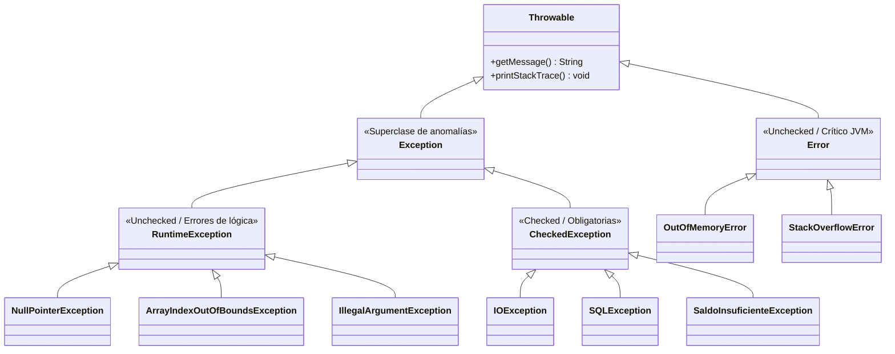

<div class="interactive-progress-tracker">
  <div class="tracker-header">
    <span>🏆 <strong>Progrés d'aquesta secció:</strong> <span class="tracker-count">0 de 4 superats (0%)</span></span>
    <span class="tracker-pts">⭐ <strong>0 punts</strong></span>
  </div>
  <div class="tracker-bar">
    <div class="tracker-fill" style="width: 0%;"></div>
  </div>
</div>

# 5.7 Gestió avançada d'excepcions i excepcions personalitzades

> **📌 📋 Informació Curricular i Resultats d'aprenentatge**
> 

> **Mòdul:** Programació (PRG — Codi 0485) | 1º DAW | IES Mestre Ramón Esteve

> **Professor:** Pepe Cuenca Torres

> **Resultat d'aprenentatge principal:** `RA7` *(Desenvolupa programes aplicant característiques avançades dels llenguatges orientats a objectes i de l'entorn de programació)*.

> **Criteris d'avaluació associats:**

  
> - `CEd`: Identificació i disseny de jerarquías d'excepcions en Java.
  
> - `CEe`: Lanzament i propagació deliberada d'excepcions (`throw` i `throws`).
  
> - `CEf`: Creació i ús de classes d'excepció personalitzades (*Custom Exceptions*) amb herència i atributs de context.
  
> - `CEg`: Gestió segura de recursos mitjançant la instrucció moderna `try-with-resources` (*AutoCloseable*).

## 1. Per què estudiamos les excepcions a fons en la UT5?

En la **UT2** vam veure una primera pren de contacte defensiva amb `try-catch` per a evitar que la consola es cerrase amb números o divisions per zero. No obstant això, en el món real del programari corporativo, **les excepcions són objectes de pleno dret**.

Ara que dominamos els pilars fonamentals de la **Programació Orientada a Objectes (POO)**:

  
- Sabem què és una **Classe**, com definir atributs i mètodes constructors (UT4).
  
- Sabem com funciona la **Herència** mitjançant la paraula clau `extends` (UT5).
  
- Sabem com invocar a la superclase mitjançant `super(...)` i aplicar el **Polimorfisme** (UT5).

Amb aquesta base conceptual sólida, podem comprendre amb total claredat com està dissenyat el sistema de tractament d'errors de Java.

## 2. La Jerarquia de Classes de Excepció en Java

En Java, qualsevol error o situació anómala es representa mitjançant una instància d'una classe que hereda, directa o indirectament, de **`java.lang.Throwable`**:



### 2.1. Comparativa de les tres grans ramas

| Categoria | Superclase | Comprobada per compilador? | Significat i causa habitual | Hem de capturar-la? |
| --- | --- | --- | --- | --- |
| **Errors Crítics del Sistema (`Error`)** | `java.lang.Error` | ❌ No (*Unchecked*) | Fallades irrecuperables de la Màquina Virtual (JVM) o del sistema operatiu (falta de memòria física `OutOfMemoryError`, desbordament de pila recursiva `StackOverflowError`). | **NO.** El programa no pot recuperar-se; ha d'acabar. |
| **Excepcions de Temps de Ejecució (`RuntimeException`)** | `java.lang.RuntimeException` | ❌ No (*Unchecked*) | **Bugs i fallades de lògica del propi programador** (accedir a un índex fora de rang `ArrayIndexOutOfBoundsException`, invocar un mètode sobre una referència `null` amb `NullPointerException`, passar un argument no vàlid amb `IllegalArgumentException`). | **S'han de prevenir amb codi limpio** (condicionals `if (ref != null)`). No és obligatori rodear-les de `try-catch`. |
| **Excepcions Comprobades (*Checked Exceptions*)** | Qualsevol subclase directa de `java.lang.Exception` (excepte RuntimeException) | ✅ **SÍ (Obligatòries)** | Situacions anómalas externes foranes al programador però previsibles en producció (el fitxer a llegir no existeix `FileNotFoundException`, la base de dades es ha caído `SQLException`, la xarxa no respon `IOException`). | **SÍ.** El compilador **obliga per contrato** a gestionar-les: o les capturas amb `try-catch` o les declaras en la firma amb `throws`. |

## 3. Lanzament i Propagació: `throw` vs `throws`

| Paraula Clau | Rol Sintáctic | On es col·loca? | Significat |
| --- | --- | --- | --- |
| `throw` (amb **w**) | **Verb d'acció** (ordre imperativa) | Dins del cos d'un mètode | Instància i llança una excepció inmediatament: `throw new MiExcepcion("Mensaje");` |
| `throws` (amb **s**) | **Clàusula de contrato** (declaració formal) | En la firma / capçalera d'un mètode | Advierte al programador que anomene a aquest mètode de que pot emitir aquest tipus d'excepció: `public void abrir() throws IOException` |

### 3.1. Exemple de `throw` i `throws` en acció

```java
package ut5.excepciones;

public class CalculadoraAvanzada {

    // La cláusula 'throws' en la firma avisa a quien llame a este método
    // de que está obligado a gestionar o volver a propagar la excepción:
    public static double calcularRaizCuadrada(double numero) throws IllegalArgumentException {
        if (numero < 0) {
            // La instrucción 'throw' (verbo) instancia y dispara la excepción inmediatamente:
            throw new IllegalArgumentException(
                "No se puede calcular la raíz cuadrada real de un número negativo: " + numero
            );
        }
        return Math.sqrt(numero);
    }

    public static void main(String[] args) {
        try {
            System.out.println("Raíz de 25: " + calcularRaizCuadrada(25));
            System.out.println("Raíz de -9: " + calcularRaizCuadrada(-9)); // Provoca error
        } catch (IllegalArgumentException e) {
            System.out.println("⚠️ Excepción capturada en main: " + e.getMessage());
        }
    }
}
```

## 4. Creació de Excepcions Personalitzades (*Custom Exceptions*)

Encara que Java compta amb centenares d'excepcions estàndard, en aplicacions professionals necessitem modelar **errors propis del domini del nostre negoci** (ej: `SaldoInsuficienteException`, `VehiculoNoDisponibleException`, `ContrabandoException`).

### 4.1. Com dissenyar una excepció personalitzada?

  
1. **Heredar de la classe adequada:**
    

      
  - Hereda de `Exception` si deseas que siga una **excepció comprobada (checked)** que obligue a l'invocador a gestionar-l'explícitament.
      
  - Hereda de `RuntimeException` si deseas que siga **no comprobada (unchecked)**.
    

  
  
1. **Invocar a la superclase:** En el constructor, passa el missatge descriptivo a la superclase mitjançant `super(mensaje);`.
  
1. **Afegir atributs de context:** Pots emmagatzemar variables d'estat (ej: el saldo actual, l'identificador d'usuari) perquè qui capture l'excepció tinga accés a informació tècnica detallada del problema.

### 4.2. Pas 1: La classe d'excepció personalitzada

```java
package ut5.banco;

/**
 * Excepción personalizada de tipo 'Checked' (hereda de Exception).
 * Incorpora atributos de contexto para aportar información técnica del fallo.
 */
public class SaldoInsuficienteException extends Exception {
    private final double saldoActual;
    private final double importeSolicitado;

    // Constructor que recibe el mensaje y los datos de contexto del problema:
    public SaldoInsuficienteException(String mensaje, double saldoActual, double importeSolicitado) {
        super(mensaje); // Invoca al constructor de java.lang.Exception
        this.saldoActual = saldoActual;
        this.importeSolicitado = importeSolicitado;
    }

    public double getSaldoActual() {
        return saldoActual;
    }

    public double getImporteSolicitado() {
        return importeSolicitado;
    }

    // Método de utilidad para saber cuánto dinero le falta al usuario:
    public double getDeficit() {
        return importeSolicitado - saldoActual;
    }
}
```

### 4.3. Pas 2: La classe de negoci que la utilitza i llança

```java
package ut5.banco;

public class CuentaBancaria {
    private final String iban;
    private final String titular;
    private double saldo;

    public CuentaBancaria(String iban, String titular, double saldoInicial) {
        if (saldoInicial < 0) {
            throw new IllegalArgumentException("El saldo inicial no puede ser negativo.");
        }
        this.iban = iban;
        this.titular = titular;
        this.saldo = saldoInicial;
    }

    public void retirar(double cantidad) throws SaldoInsuficienteException {
        if (cantidad <= 0) {
            throw new IllegalArgumentException("La cantidad a retirar debe ser mayor que cero.");
        }
        if (cantidad > this.saldo) {
            // Disparamos nuestra propia excepción personalizada con contexto completo:
            throw new SaldoInsuficienteException(
                "Operación rechazada: Fondos insuficientes en la cuenta " + iban,
                this.saldo,
                cantidad
            );
        }
        this.saldo -= cantidad;
        System.out.printf("✅ Retirada de %.2f € efectuada. Saldo restante: %.2f €%n", cantidad, saldo);
    }

    public double getSaldo() {
        return saldo;
    }

    public String getIban() {
        return iban;
    }
}
```

## 5. La Instrucció `try-with-resources` (Interfície `AutoCloseable`)

Des de Java 7 existeix la construcció **`try-with-resources`**: qualsevol objecte de la qual classe implement la interfície estàndard **`java.lang.AutoCloseable`** es cerrará de manera **automàtica i garantitzada** al finalitzar el bloc `try`, tant si acaba amb èxit com si es produeix una excepció imprevista.

```java
package ut5.recursos;

import java.util.Scanner;

public class EjemploTryWithResources {
    public static void main(String[] args) {
        // try-with-resources: cualquier objeto que implemente AutoCloseable
        // se cerrará AUTOMÁTICAMENTE al salir del bloque sin necesidad de finally:
        try (Scanner sc = new Scanner(System.in)) {
            System.out.print("Introduce tu nombre: ");
            String nombre = sc.nextLine();
            System.out.println("Hola, " + nombre + ". Tu recurso Scanner se cerrará solo.");
        } // Aquí se invoca sc.close() de forma garantizada incluso si hay un fallo
    }
}
```

> **📌 🌉 Connexió directa amb la UT6: Lectura i Escriptura de Fitxers**
> 

> Memoriza bé el patró `try-with-resources`, perquè en la próxima unitat (**UT6 — Fitxers i Streams**) serà l'estructura obligatòria amb la que treballarem totes les operacions d'entrada/eixida de fitxers (`FileReader`, `BufferedReader`, `PrintWriter`).

## 6. ✍️ Activitats Pràctiques de la Unitat (UT5)

> **📌 Activitat 1: Gestió de Alquiler de Flota de Vehículos (`FlotaVehiculos.java`)**
> 

> Una empresa d'alquiler necessita controlar la disponibilitat de la seua flota mitjançant Programació Orientada a Objectes i Herència:

  
> 1. Crea l'excepció personalitzada comprobada `VehiculoNoDisponibleException extends Exception` que guarde en un atribut la matrícula afectada.
  
> 1. Crea una classe abstracta `Vehiculo` amb atributs protegits `matricula`, `marca`, `alquilado` i el mètode abstracte `public abstract void alquilar() throws VehiculoNoDisponibleException`.
  
> 1. Implementa les subclases `Coche`, `Moto` i `Furgoneta`.
  
> 1. Si un client intenta alquilar un vehicle del qual estat ja és `alquilado == true`, dispara l'excepció personalitzada informant de la matrícula en el missatge.

```java
package ut5.actividades.vehiculos;

// 1. Excepción personalizada con matrícula de contexto
class VehiculoNoDisponibleException extends Exception {
    private final String matricula;
    public VehiculoNoDisponibleException(String matricula, String mensaje) {
        super(mensaje + " [Matrícula: " + matricula + "]");
        this.matricula = matricula;
    }
    public String getMatricula() { return matricula; }
}

// 2. Clase abstracta Vehiculo con método polimórfico
abstract class Vehiculo {
    protected String matricula;
    protected String marca;
    protected boolean alquilado;

    public Vehiculo(String matricula, String marca) {
        this.matricula = matricula;
        this.marca = marca;
        this.alquilado = false;
    }
    public abstract void alquilar() throws VehiculoNoDisponibleException;
    public void devolver() {
        this.alquilado = false;
        System.out.println("Vehículo " + matricula + " devuelto con éxito.");
    }
}

// 3. Subclase concreta Coche
class Coche extends Vehiculo {
    public Coche(String matricula, String marca) { super(matricula, marca); }
    @Override
    public void alquilar() throws VehiculoNoDisponibleException {
        if (alquilado) {
            throw new VehiculoNoDisponibleException(matricula, "El vehículo ya se encuentra reservado actualmente.");
        }
        alquilado = true;
        System.out.println("🚗 Coche " + marca + " (" + matricula + ") alquilado correctamente.");
    }
}
```

> **📌 Activitat 2: Simulador de Passarel·la de Pagaments Multicliente (`PasarelaPagos.java`)**
> 

> Dissenya un sistema financiero polimórfic capaç de treballar amb múltiples passarel·les de pagament:

  
> 1. Crea dos excepcions personalitzades independents:
    

      
>   - `ImporteInvalidoException`: Si l'importe a abonar és menor o igual a 0 €.
      
>   - `SaldoInsuficienteException`: Si l'importe supera el saldo disponible.
    

  
  
> 1. Crea la classe abstracta `MetodoPago` amb mètode `pagar(double importe)` i subclases `TarjetaCredito`, `PayPal` i `Bizum`.
  
> 1. Emmagatzema diverses formes de pagament en una col·lecció polimórfica `List<MetodoPago>`.
  
> 1. Recorre la llista intentant aplicar el mateix càrrec a tots ells.
  
> 1. **Regla estricta:** Captura cada excepció en blocs `catch` independents; està prohibido usar un únic `catch(Exception e)` genéric.

```java
package ut5.actividades.pasarela;

import java.util.List;

class ImporteInvalidoException extends Exception {
    public ImporteInvalidoException(String msg) { super(msg); }
}

abstract class MetodoPago {
    protected String titular;
    protected double saldoDisponible;
    public MetodoPago(String titular, double saldo) {
        this.titular = titular;
        this.saldoDisponible = saldo;
    }
    public void pagar(double importe) throws ImporteInvalidoException, SaldoInsuficienteException {
        if (importe <= 0) {
            throw new ImporteInvalidoException("El importe a pagar debe ser mayor que cero.");
        }
        if (importe > saldoDisponible) {
            throw new SaldoInsuficienteException("Fondos insuficientes", saldoDisponible, importe);
        }
        saldoDisponible -= importe;
        System.out.printf("💳 Cargo de %.2f € realizado con éxito en %s (%s). Restante: %.2f €%n",
                          importe, getClass().getSimpleName(), titular, saldoDisponible);
    }
}
```

## 7. 🏆 Repte de la Unitat: Hub Logístic DistribueixValència

> **📌 Repte de Programació: Triatge Automatitzat amb Excepcions de Seguretat**
> 

> El centre logístic automatitzat de la Comunitat Valenciana necessita un programari de control de paquetería:

  
> 1. Crea la classe `Paquete` amb `codigo`, `pesoKg`, `destino` i `descripcionContenido`.
  
> 1. Implementa dos excepcions personalitzades:
    

      
>   - `PesoExcedidoException`: Es dispara si el paquet supera els 50.0 kg (límit mecánic de la cinta).
      
>   - `ContrabandoException`: Es dispara si la descripció conté termes prohibits (ej: `"explosivo"`, `"químico"`, `"armas"`).
    

  
  
> 1. El mètode `triarPaquete(Paquete p) throws PesoExcedidoException, ContrabandoException` analitza el paquet. Si passa els controls, es afegeix a la cola de reparto; si falla, es detiene la cinta i es registra la incidencia en l'informe de seguretat.

```java
package ut5.retos.hubvalencia;

// 1. Excepciones de Seguridad del Hub Logístico
class ContrabandoException extends Exception {
    private final String mercanciaProhibida;
    public ContrabandoException(String codigo, String mercancia) {
        super("ALERTA SEGURIDAD en paquete " + codigo + ": Mercancía prohibida: " + mercancia);
        this.mercanciaProhibida = mercancia;
    }
    public String getMercancia() { return mercanciaProhibida; }
}

class PesoExcedidoException extends Exception {
    private final double peso;
    public PesoExcedidoException(String codigo, double peso, double limite) {
        super("CINTA DETENIDA en paquete " + codigo + ": Peso (" + peso + " kg) supera límite de " + limite + " kg");
        this.peso = peso;
    }
}
```

## 8. Rúbrica de Avaluació per a Aules

| Criteri d'avaluació | Excelente (4 pts) | Bo (2.5 pts) | Mejorable (1 pt) | No superado (0 pts) |
| --- | --- | --- | --- | --- |
| **Disseny de la Jerarquia (`RA7.d`)** | Hereda de `Exception`/`RuntimeException`, anomena a `super(mensaje)` i inclou atributs propis de context amb getters. | Hereda de `Exception` i anomena a `super`, però sense atributs propis. | Hereda de `Throwable` directament o error de jerarquia. | Error de compilació en la classe d'excepció. |
| **Lanzament i Propagació (`RA7.e`)** | Utilitza amb rigor `throw new ...` ante condicions anómalas i declara la clàusula `throws` en les firmas corresponents. | Llança l'excepció però olvida declarar `throws` en algun mètode. | Confunde `throw` amb `throws`. | No implementa cap lanzament. |
| **Captura i Explotació (`RA7.f`)** | Captura específica per blocs, explota mètodes de l'excepció i usa `finally` o `try-with-resources`. | Captura amb `try-catch` genéric sense explotar els getters de l'excepció. | `catch (Exception e)` ocultant detalls. | No captura excepcions comprobades (error de compilació). |
| **Clean Code i Convencions** | Nomenclatura `...Exception`, atributs `private final` i comentaris clars. | Funcional però descuida visibilitat d'atributs o nomenclatura. | Codi desorganitzat o paquets mezclats. | Codi que no compila. |


---

## 🎮 Reptes Interactius d'Autoavaluació (+100 XP)

Comprova el teu domini sobre **5.7 Gestió avançada d'excepcions i excepcions personalitzades** superant aquests 4 reptes gamificats (+25 punts cadascun):

<div class="interactive-mcq" data-answer="A" data-hint="Revisa els conceptes teòrics i pràctics d'aquesta secció.">
  <div class="mcq-question">🎯 <strong>Repte 1 (+25 pts):</strong> Quina paraula clau s'utilitza en Java perquè una subclasse herete els atributs i mètodes d'una superclasse, i quina per a implementar una interfície?</div>
  <div class="mcq-options">
    <button type="button" class="btn-mcq-opt" data-opt="A">A) 'extends' per a heretar d'una classe i 'implements' per a implementar una interfície.</button>
    <button type="button" class="btn-mcq-opt" data-opt="B">B) 'implements' per a heretar d'una classe i 'extends' per a una interfície.</button>
    <button type="button" class="btn-mcq-opt" data-opt="C">C) 'inherits' i 'uses'.</button>
    <button type="button" class="btn-mcq-opt" data-opt="D">D) Cap de les anteriors és correcta.</button>
  </div>
  <div class="quiz-feedback"></div>
</div>

<div class="interactive-mcq" data-answer="D" data-hint="Comprova l'apartat corresponent de la unitat.">
  <div class="mcq-question">🎯 <strong>Repte 2 (+25 pts):</strong> Quina característica defineix una classe abstracta ('abstract class') en Java?</div>
  <div class="mcq-options">
    <button type="button" class="btn-mcq-opt" data-opt="A">A) No pot tindre cap atribut ni constructor.</button>
    <button type="button" class="btn-mcq-opt" data-opt="B">B) Tots els seus mètodes han de ser privats i estàtics.</button>
    <button type="button" class="btn-mcq-opt" data-opt="C">C) Cap de les anteriors és correcta.</button>
    <button type="button" class="btn-mcq-opt" data-opt="D">D) No es pot instanciar directament amb 'new' i pot contindre tant mètodes abstractes (sense cos) com mètodes implementats.</button>
  </div>
  <div class="quiz-feedback"></div>
</div>

<div class="interactive-vf" data-answer="V" data-hint="Verifica l'afirmació amb els apunts de la unitat.">
  <div class="vf-statement">✅ <strong>Repte 3 (Vertader o Fals · +25 pts):</strong> El polimorfisme permet que una variable de referència del tipus de la superclasse o interfície apunte a objectes de qualsevol de les seues subclasses i execute el mètode sobreescrit (@Override) en temps d'execució.</div>
  <div class="vf-buttons">
    <button type="button" class="btn-vf" data-opt="V">Vertader (V)</button>
    <button type="button" class="btn-vf" data-opt="F">Fals (F)</button>
  </div>
  <div class="quiz-feedback" style="width: 100%;"></div>
</div>

<div class="interactive-quiz" data-answer="super" data-hint="Fa referència a la superclasse (5 lletres).">
  <div class="quiz-question">⌨️ <strong>Repte 4 (+25 pts):</strong> Quina paraula clau s'utilitza en el constructor d'una subclasse per a invocar el constructor de la seua classe pare?</div>
  <div class="quiz-controls">
    <input type="text" class="quiz-input" placeholder="Escriu la resposta..." />
    <button type="button" class="btn-quiz-check">Comprovar</button>
  </div>
  <div class="quiz-feedback"></div>
</div>

### 📋 Llista de Comprovació i Rúbrica d'Assoliment

Marca cada criteri a mesura que completes l'estudi o la resolució pràctica d'aquesta pàgina (**5.7 Gestió avançada d'excepcions i excepcions personalitzades**):

- [ ] He llegit detingudament la teoria o l'enunciat d'aquesta secció i he anotat els conceptes clau.
- [ ] He revisat els esquemes, taules o blocs de codi i he verificat que sé aplicar-los a l'entorn de treball.
- [ ] He resolt correctament els **4 reptes interactius** superiors obtenint els **100 punts XP**.
- [ ] He descarregat el comprovant oficial en PDF per a adjuntar-lo a la tasca d'**Aules**.

<div class="aules-delivery-card">
  <h3>📤 Comprovant de Lliurament per a Aules</h3>
  <p>Quan hages completat els reptes interactius i la llista d'autoavaluació d'aquesta pàgina, introdueix el teu nom i descarrega el teu certificat oficial en PDF per a adjuntar-lo a la tasca d'<strong>Aules</strong>.</p>
  <div class="aules-student-field">
    <label for="aules-student-name">👤 Nom i Cognoms de l'Alumne/a:</label>
    <input type="text" id="aules-student-name" class="aules-student-name" placeholder="Ex: Joan Garcia Pérez" />
  </div>
  <div class="aules-score-badge">
    <span class="aules-score-count">0/4 reptes completats (0%) · 0 punts · 0/4 criteris d'autoavaluació</span>
  </div>
  <div class="aules-actions">
    <button type="button" class="btn-aules-dl" data-module="PRG" data-unit="UD05" data-activity="ut0507">📥 Descarregar Comprovant PDF</button>
    <button type="button" class="btn-aules-copy">📋 Copiar Resum al Porta-retalls</button>
  </div>
  <div class="aules-toast"></div>
</div>

