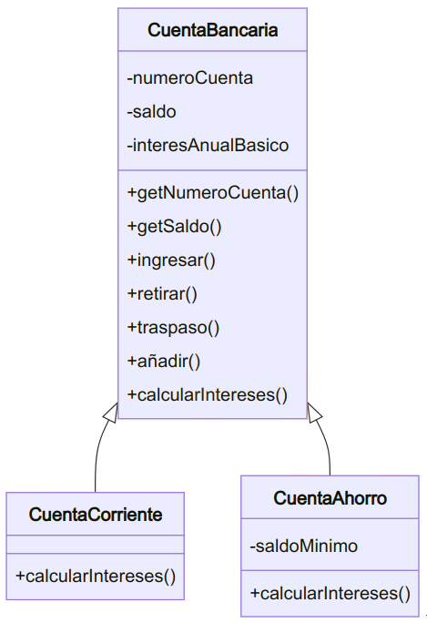
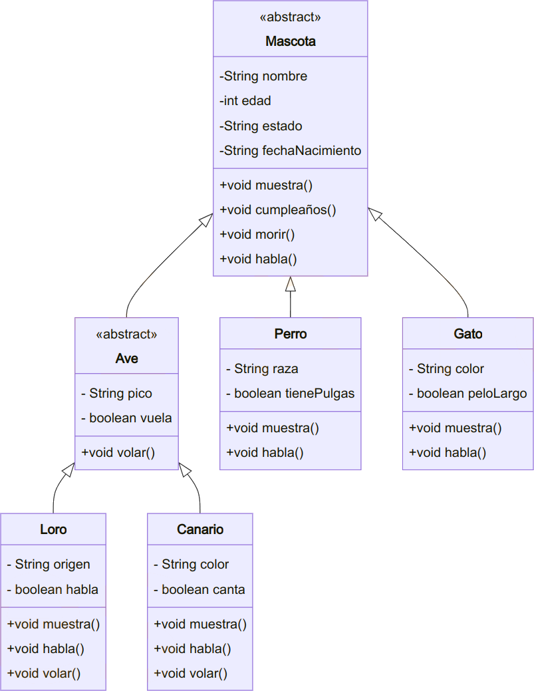

<div class="interactive-progress-tracker">
  <div class="tracker-header">
    <span>🏆 <strong>Progrés d'aquesta secció:</strong> <span class="tracker-count">0 de 4 superats (0%)</span></span>
    <span class="tracker-pts">⭐ <strong>0 punts</strong></span>
  </div>
  <div class="tracker-bar">
    <div class="tracker-fill" style="width: 0%;"></div>
  </div>
</div>

# Activitats pràctiques UT5

> **📌 Empaquetar activitats**
> 

> Empaqueta les activitats, dins de la carpeta **`ut05/bloqueX`**

## Bloc 5.0

### Activitat 01

Donada les següents definicions de classes:

```java
public class Persona {
    private String nombre;
    private int edad;

    public Persona (){
        this.nombre = "";
        this.edad = 0;
    }

    public Persona(String n, int e){
        this.nombre = n;
        this.edad = e;
    }

    public String toString(){
        return "Nombre: " + nombre + "Edad " + edad;
    }

    public final String getNombre (){
        return nombre;
    }

    public final int getEdad(){
        return edad;
    }
}
```

```java
class Estudiante extends Persona {
    private double creditos;

    public Estudiante(String n, int e, double c){
        super(n,e);
        this.creditos = c;
    }

    public String toString(){
        return super.toString() + "\nCreditos: "+ creditos;
    }
}
```

```java
class Empleado extends Persona {
    private double salario;

    public Empleado(String n, int e, double s){
        super(n,e);
        this.salario = s;
    }

    public String toString(){
        return "Nombre: "+ this.nombre +
        "\nSalario: "+ this.salario;
    }
}
```

```java
class Test{
    public static void main(String[] args) {
        Estudiante e = new Estudiante("pepe",18,100);
        System.out.println(e);
    }
}
```

Respon a les següents qüestions justificant les respostes:

a. És necessari l'ús de `this` en el constructor de la classe `Estudiante`?

b. És necessari l'ús de `super` en el mètode `toString` de la classe `Estudiante`?

c. Si quitásemos el constructor de la classe `Estudiante` daría un error de compilació?

d. En el mètode `toString` de la classe `Empleado` per què és incorrecte l'accés que es fa a l'atribut `nombre`? Com es tindria que definir `nombre` en la classe `Persona` per a evitar l'error?

e. Què conseqüència ha d'alguns mètodes de la classe `Persona` es hagen definit `final`?

f. Si el mètode `toString` no es haguera definit en cap de les tres classes daría error el `sout` del mètode `main`?

Pots fer totes les pruebas que consideres necessàries abans de respondre.

### Activitat 02

paquet: **`A02_centroestudios`**

Dissenyar una jerarquia de classes per a modelitzar les aules d'un centre d'estudios.

D'una **`Aula`** es coneix el `código` (numèric), la `longitud` i la `anchura`. Es desitja un mètode que retorne la capacitat de l'aula sabent que aquesta es calcula a partir de la superfície a raó de 1 alumnes per cada 1.4 metros cuadrats de superfície.

A més de les aules, digamos normals, existeixen aules de música i aules d'informàtica. En les aules de música es necessita conèixer si tenen o no piano. De les aules d'informàtica es coneix el número d'ordinadors i la seua capacitat no es calcula en funció de la superfície, sinó a raó de dos alumnes per ordinador.

Implementar el mètode `toString` de cada una de les classes dissenyades perquè retorne:

- 

En les aules normals, el `código` i la `superficie` i la `capacidad`.

- 

En les aules de música i informàtica el text anirà precedido per "*Aula de música*" o "*Aula d'informàtica*", segons corresponda.

Crea també una classe **`TestAula`** per a provar les classes generades.

### Activitat 03

paquet: **`A03_trabajadores`**

Crea una classe `Empleado` i una subclase `Encargado`. 
Per als empleats, crea els atributs: dni, nom, cognoms, sueldoBase, turno (demà, tarde o nit). L'encarregat tindrà a més, l'area de la que s'encarrega i la quantitat d'empleats al seu càrrec.
Els encarregats reben un 10% més de sueldo base que un empleat normal. Implementa aquestes classes amb els seus atributs i mètodes (getters, setters i mostrarDatos).Sobrescribe el mètode `getSueldo()` per als encarregats.

### Activitat 04

paquet: **`A04_juego`**

a) Crear la classe `Dado`, la qual desciende de la classe `Sorteo`. La classe `Dado`, en l'anomenada `lanzar()` mostrarà un número aleatorio del 1 al 6 *(Pots usar la classe `Random`)*. 

b) Crear la classe `Moneda`, la qual desciende de la classe `Sorteo`. Aquesta classe en l'anomenada al mètode `lanzar()` mostrarà les paraules cara o cruz. 

c) Realitzar una classe `testJuego` amb un mètode `main` que comprove tot el realitzat.

### Activitat 05

paquet: **`A05_seguridadEmpleados`**

1. Crear una classe **`Empleado`** amb els atributs `nombre`, `dni` i `sueldoMensual` i un mètode `calcularSueldoAnual()`. El mètode `calcularSueldoAnual()` serà final i no podrà sobrescribir-se.

1. Crear una subclase **`Gerente`** que herede de `Empleado`. En aquesta classe es añadirá un atribut `bono` i un mètode que retorne el sueldo total anual, sumant el bono. El mètode `calcularSueldoBono()` no podrà sobrescribir-se degut a l'ús del modificador `final`.

1. Crear una subclase **`Interno`** que herede de `Empleado` però no puga tindre subclases addicionals utilitzant el modificador `final` en la classe. Afegeix l'atribut `tiempoTrabajado`.

1. Implementar una classe **`TestEmpleados`** que pruebe les restriccions d'herència i sobreescriptura en les subclases. Per a això:

  - Crea un array de 3 empleats. 

  - Inicializa cada un d'ells en un tipus distint dels creats. 

  - Prova els mètodes implementats.

### Activitat 06

paquet: **`A06_animales`**

1. Crear una jerarquia de classes per a modelar diferents tipus d'animals en una granja.

  - Superclase: **`Animal`** (amb atributs `nombre`, `edad` i un mètode `hacerSonido()` que serà sobrescrito per les subclases).

  - Subclases: **`Vaca`**, **`Cerdo`** i **`Gallina`**, cada una amb la seua pròpia implementació del mètode `hacerSonido()`.

1. Crear una classe **`Granja`** que creu un array de 3 animals, inicialice cada un a un tipus diferent d'animal i utilitze el polimorfisme per a anomenar al mètode `hacerSonido()` de cada animal.

### Activitat 07

paquet: **`A07_empresaEmpleados`**

Anem a implementar dos classes que permitan gestionar dades d'empreses i els seus empleats.

Els **empleats** tenen les següents característiques:

- Un empleat té *nom*, *DNI*, *sueldo bruto* (mensual), *edat*, *telèfon* i *adreça*.

- El nom i DNI d'un empleat no poden variar.

- És obligatori que tots els empleats tinguen almenys definit el seu nom, DNI i el sueldo bruto. Els resta dades no són obligatoris.

- Serà necessari un mètode per a imprimir per pantalla la informació d'un empleat (incloent el sueldo bruto i el sueldo neto).

- Serà necessari un mètode per a calcular el sueldo neto d'un empleat. El sueldo neto es calcula descontant del sueldo bruto un percentatge que depèn del IRPF. El percentatge del IRPF depèn del sueldo bruto anual de l'empleat (sueldo bruto x 12 pagas).**(*)**

| **Sueldo bruto anual** | **IRPF** |
| --- | --- |
| Inferior a 12.000 € | 20% |
| De 12.000 a 25.000 € | 30% |
| Més de 25.000 € | 40% |

Per exemple, un empleat amb un sueldo bruto anual de 17.000 € tindrà un 30% de IRPF. Per a calcular el seu sueldo neto mensual es descontará un 30% al seu sueldo bruto mensual.

Les **empreses** tenen les següents característiques:

- Una empresa té *nom* i *CIF* (dades que no poden variar), a més de *telèfon*, *adreça* i *empleats*. Quan es crea una nova empresa aquesta carece d'empleats.

- Seran necessaris mètodes per a:

- Afegir i eliminar empleats a l'empresa.

- Mostrar per pantalla la informació de tots els empleats.

- Calcular la suma total de sueldos brutos de tots els empleats.

- Calcular la suma total de sueldos netos de tots els empleats.

**Implementa les classes** **Empleat** **i Empresa** amb els atributs oportunos, els constructors, els getters/setters oportunos i els mètodes indicats. Pots afegir més mètodes si el veus necessari. Aquestes classes no han de realitzar cap tipus d'entrada per teclat.

**Implementa també** **una classe Programa** amb una funció main per a realitzar pruebas: Crear una o diverses empreses, crear empleats, afegir i eliminar empleats a les empreses, llistar tots els empleats, mostrar el total de sueldos brutos i netos, etc.

El IRPF realment és més complex però es ha simplificado per a no complicar massa aquest Activitat .

## Bloc 5.1 - Herència i jerarquia de classes

### Activitat 08

paquet: **`A08_videojuegos`**

Un salón de videojuegos disposa d'ordinadors en els que els clients poden jugar. A més de jugar en l'estableciment, l'empresa alquila i ven jocs.

a) Dissenyar la classe **`Juego`** seguint les següents especificacions: 

- Atributs `protected`: `titulo` (*String*), `fabricante` (*String*), `año` (*int*).

- Mètode constructor `public Juego(String t, String f, int a)`

- Mètodes consultors de tots els atributs.

- `public String toString()`, que retorna un *String* amb les dades del Joc.

- `public boolean equals(Object o)`: Dos jocs són iguals si tenen el mateix títol, fabricant i any.

b) Dissenyar les classes **`JuegoEnAlquiler`** i **`JuegoEnVenta`** (i altres si es considera oportuno), sabent que, a més dels atributs descritos anteriorment, tenen:

- 

`precio`

- 

`nº de copias disponibles`

- 

La classe `JuegoEnAlquiler` té:

_ un atribut que indica el *número de dies* que es alquila. 

_ un mètode constructor que rep tots les seues dades.

_ un mètode `alquilar` que decrementa el número de còpies disponibles.

_ un mètode `devolver` que incrementa el número de còpies disponibles.

_ `toString()` retorna totes les dades del `JuegoEnAlquiler`.

- 

La classe `JuegoEnVenta` té:

_ un mètode constructor que rep tots les seues dades.

_ un mètode `vender`, que decrementa el número de còpies disponibles.

_ `toString()` retorna totes les dades del `JuegoEnVenta`.

c) Crea també una classe **`TestJuego`** per a provar objectes de les classes `JuegoEnAlquiler` i `JuegoEnVenta`.

### Activitat 09

paquet: **`A09_fnmt`**

La Fabrica Nacional de Moneda i Timbre vol emmagatzemar certa informació tècnica del dinero (billetes i monedas) que emite. En concret, li interessa:

- *Valor*: valor de la moneda o billete, en euros (`double`).

- *Any d'emisió*: any en que va ser emitida la moneda o billete (`int`).

- De les monedas:  

  _ *Diàmetre*: diàmetre de la moneda, en milímetros. (`double`).  

  _ *Pes*: pes de la moneda, en gramos (`double`).

- Dels billetes:  

  _ *Alçària* del billete en mm (`double`).  

  _ *Amplària* del billete en mm (`double`).

a) Dissenyar la classe abstracta **`Dinero`** i els seus subclases **`Moneda`** i **`Billete`**, desarrollant:

- Constructors que reciban les dades necessaris per a inicialitzar els atributs de la classe corresponent.

- Mètode `equals`: dos monedas o billetes són iguals si tenen el mateix any d'emisió i valor.

- Mètode `toString`: que mostre totes les dades del billete o moneda. Els billetes aniran precedits pel text "BILLETE" i les monedas pel text "MONEDA".

b) Dissenyar la classe **`TestDinero`** per a provar les classes desenvolupades. Crear objectes de les classes `Moneda` i `Billete` i mostrar-los per pantalla.

### Activitat 10

paquet: **`A10_vehiculos`**

1. Crear una superclase abstracta **`Vehiculo`** amb l'atribut velocitat i el mètode `acelerar()` i `frenar()`, que seran sobrescritos pels seus subclases.

1. Crear subclases **`Coche`** i **`Moto`** que sobrescriban el mètode `acelerar()` i `frenar()` amb la seua pròpia implementació.

1. Crear una classe **`Carretera`** que permeta afegir diversos vehículos (en un array) i simule una carrera, llamant als mètodes `acelerar()` i `frenar()` dels distints vehículos.
Aquesta recibirá com paràmetres en el constructor la quantitat de vehículos màxima que pot tindre. També has d'implementar el mètode necessari per a afegir un nou vehicle, així com els que consideres oportunos per a poder acelerar o frenar els vehículos existents.

1. Implementar una classe **`TestVehiculos`** per a provar crear una carretera i provar la funcionalitat.

### Activitat 11

paquet: **`A11_centrocomercial`**

Un centre comercial vol mostrar certa informació sobre els televisors que ven. Els televisors poden ser de dos tipus: de tub o LCD. En concret, de cada televisor li interessa mostrar:

- marca (*String*).

- model (*String*).

- preu en euros.

- polzades de la pantalla (*double*).

- resolució: La resolució es mide de forma distinta en els televisors de tub que en els televisors LCD.

- En els TV de tub es mide en lineas.

- En els TV LCD es mide píxels horitzontals x píxels verticals.

a) Dissenyar la classe **`Televisor`** amb els atributs i mètodes comuns als dos tipus de televisors i els seus subclases **`TvTubo`** i **`TvLcd`** amb els atributs i mètodes que siga necessari:

- Constructor de cada classe que permeta inicialitzar totes les dades de la classe.

- `equals`: dos televisions són iguals si són de la mateixa marca i model.

- `public String resulucion()`: retorna un text amb la resolució del televisor, com per exemple "*420 lineas*" o "*800 x 600 píxels*" depenent del tipus de televisor.

- `public String toString()`: retorna un text amb la marca, model, preu, polzades i resolució.

b) Dissenyar la classe **`TestTV`** per a provar les classes dissenyades. Crear alguns objectes de les classes `TvTubo` i `TvLcd` i mostrar-los per pantalla.

### Activitat 12

paquet: **`A12_vehiculos`**

Aconsejable: realitzar el disseny UML abans de començar a programar.

Has de crear diverses classes per a un programari d'una empresa de transport. Implementa la jerarquia de classes necessària per a complir els següents criteris:

- Els vehículos de l'empresa de transport poden ser terrestres, acuátics i aéreos. Els vehículos terrestres poden ser cotxes i motos. Els vehículos acuátics poden ser barcos i submarinos. Els vehículos aéreos poden ser aviones i helicópteros.

- Tots els vehículos tenen matrícula i model (dades que no poden canviar). La matrícula dels cotxes terrestres han d'estar formades per 4 números i 3 lletres. La dels vehículos acuátics per entre 3 i 10 lletres. La dels vehículos aéreos per 4 lletres i 6 números.

- Els vehículos terrestres tenen un número de ruedas (dada que no pot canviar).

- Els vehículos acuátics tenen eslora (dada que no pot canviar).

- Els vehículos aéreos tenen un número d'asientos (dada que no pot canviar).

- Els cotxes poden tindre aire acondicionado o no tener-lo.

- Les motos tenen un color.

- Els barcos poden tindre motor o no tener-lo.

- Els submarinos tenen una profunditat màxima.

- Els aviones tenen un temps màxim de vuelo.

- Els helicópteros tenen un número d'hélices.

- No es permeten vehículos genérics, és a dir, no s'han de poder instanciar objectes que siguen vehículos sense més. Però ha de ser possible instanciar vehículos terrestres, acuátics o aéreos genérics (és a dir, que no siguen cotxes, motos, barcos, submarinos, aviones o helicópteros).

- El disseny ha d'obligar a que totes les classes de vehículos tinguen un mètode imprimir() que imprima per pantalla la informació del vehicle en una sola línia.

Implementa totes les classes necessàries amb: atributs, constructor amb paràmetres, getters/setters i el mètode imprimir. Utilitza **abstracció** i **herència** de la forma més apropiada.

Implementa també una classe Programa per a fer algunes pruebas: Instància diversos vehículos de tot tipus (cotxes, motos, barcos, submarinos, aviones i helicópteros) així com vehículos generics (terrestres, acuátics i aéreos). Crea un ArrayList i afegeix tots els vehículos. Recorre la llista i anomena al mètode imprimir de tots els vehículos.

### Activitat 13

paquet: **`A13_biblioteca`**

1. Crear una jerarquia de classes per a gestionar una biblioteca:

1. Superclase **`Publicacion`** amb atributs `titulo`, `autor`, `año`.

1. Subclases **`Libro`** i **`Revista`**. `Libro` tindrà un atribut `isbn` i `Revista` un atribut `numeroEdicion`.

1. Crear una classe **`Biblioteca`** que continga un arrayList de publicacions i permeta afegir, eliminar i cercar publicacions.

1. Implementar una classe **`TestBiblioteca`** que pruebe totes les funcionalitats de la biblioteca utilitzant les classes heredades.

### Activitat 14

paquet: **`A14_facultad`**

Realitzar una aplicació per a la gestió de la informació de les persones vinculades a una *Facultad*, que es poden classificar en tres tipus: estudiants, professors i personal de servei.

A continuació, es detalla què tipus d'informació ha de gestionar aquesta aplicació:

- Per cada `Persona`, s'ha de conèixer, almenys, el seu *nom* i *cognoms*, el seu *número d'identificació* i el seu *estat civil*.

- Respecte als `Empleados`, siguen del tipus que siguen, cal saber el seu *any d'incorporació* a la facultad i què *número de despatx* tenen assignat.

- Pel que fa als `Estudiantes`, es requereix emmagatzemar el *curs* en el que estan matriculats.

- Per la qual cosa es refereix als `Profesores`, és necessari gestionar a què *departament* pertanyen (llenguatges, matemàtiques, arquitectura, ...).

- Sobre el `Personal de servicio`, cal conèixer a què *secció* estan assignats (biblioteca, decanato, secretaría, ...).

El Activitat  consisteix, en primer lloc, en definir la jerarquia de classes d'aquesta aplicació. A continuació, ha de programar les classes definides en les que, a més dels constructors, cal desenvolupar els mètodes corresponents a les següents accions:

- Canvi de l'estat civil d'una persona.

- Reasignació de despatx a un empleat.

- Matriculació d'un estudiant en un nou curs.

- Canvi de departament d'un professor.

- Traslado de secció d'un empleat del personal de servei.

- Imprimir tota la informació de cada tipus d'individu.

En el mètode `main` crear un array de *persones*. Crear diferents instàncies de les subclases i insertar-les en l'array. Provar els diferents mètodes desarrollats.

### Activitat 15

paquet: **`A15_banco`**

Farem una aplicació que simule el funcionament d'un banco.

Crea una classe `CuentaBancaria` amb els atributs: *iban* i *saldo*. Implementa mètodes per a:

- Consultar els atributs. 

- Ingresar dinero.

- Retirar dinero.

- Traspasar dinero d'una compta a una altra.

Per als tres últims mètodes pot utilitzar-se internament un mètode privat més general anomenat `añadir(...)` que afegisca una quantitat (positiva o negativa) al saldo.

També hi haurà un atribut comú a totes les instàncies anomenat *interesanualbasic*, que en principi pot ser constant.

La classe ha de ser ***abstracta*** i ha de tindre un mètode `calcularIntereses()` que es dejará sense implementar.

També pot ser útil implementar un mètode per a mostrar les dades de la compta.

D'aquesta classe heredarán dos subclases: `CuentaCorriente` i `CuentaAhorro`. La diferència entre totes dues serà la manera de calcular els intereses:

- A la primera es li incrementará el saldo tenint en compte l'interès anual bàsic.

- La segona tindrà una constant de classe anomenada *saldoMinimo*. Si no es arriba a aquest saldo l'interès serà la mitad de l'interès bàsic. Si es supera el saldo mínim l'interès aplicat serà el doble de l'interès anual bàsic.

Implementa una classe principal amb funció main per a provar el funcionament de les tres classes: Crea diverses comptes bancaris de distints tipus, poden estar en un *ArrayList* si el deseas; prova a realitzar ingresos, retirades i transferències; calcula els intereses i muéstralos per pantalla; etc.

El diagrama UML seria:

   



### Activitat 16

paquet: **`A16_inventario`**

1. Crear una jerarquia de classes per a un sistema d'inventari:

1. Superclase **`Producto`** amb atributs `nombre`, `precio` i `cantidad`.

1. Subclases **`ProductoPerecedero`** i **`ProductoNoPerecedero`**. `ProductoPerecedero` tindrà un atribut `fechaCaducidad`, mentre que `ProductoNoPerecedero` tindrà un atribut `garantia` en mesos.

1. Crear una classe **`Inventario`** que gestione una llista de productes i permeta realitzar les següents operacions:

1. Afegir productes.

1. Cercar productes per nom.

1. Imprimir el detall de l'inventari.

1. Implementar una classe **`TestInventario`** per a provar totes les operacions.

## Bloc 5.2 - Interfícies

### Activitat 18

paquet: **`A18_obra`**

Donada la següent jerarquia de classes:

```java
public interface Montador{
    void montar(String x);
    void desmontar(String x);
}

public class Obrero{
    public Obrero(){System.out.println("Se crea Obrero");}
    public void saludar(){System.out.println("Hola, soy Obrero");}
    ...
}

public class Carpintero extends Obrero implements Montador {
    public Carpintero(){System.out.println("Se crea Carpintero");}
    public void montar(String x) {System.out.println("Montando " + x);}
    public void desmontar(String x) {System.out.println("Desmontando " + x);}
    public void clavar() {...}
}

public class Albañil extends Obrero {
    public Albañil() {
        super();
        System.out.println("Se crea Albañil");
    }
    public void levantarMuro(){ 
        System.out.println("Levantando muro …");
    }
}
```

a) Indicar **què línies** del següent fragment de programa **producirán errors de compilació**,

```java
public static void main(String[] args){
    Montador m1 = new Carpintero();
    Montador m2 = new Albañil();
    Obrero o1 = new Carpintero();
    Obrero o2 = new Albañil();
    o1.montar("Mesa");
    o2.levantarMuro();
    m1.saludar();
    m1.montar("Silla");
    ((Albañil)o2).levantarMuro();
    ((Albañil)o1).levantarMuro();
}
```

b) **Una vegada eliminades** les línies amb error, indicar **quin seria l'eixida** per pantalla del programa.

c) **Seria correcta** la instrucció següent?"

```java
Albañil a = new Albañil();
System.out.println(a.toString());
```

### Activitat 19

paquet: **`A19_reservas`**

1. Crear una interfície **`Reservable`** que continga els mètodes `reservar()` i `cancelarReserva()`.

1. Crear classes **`Hotel`** i **`VehiculoAlquiler`** que implementen la interfície `Reservable`, i proporcionen la seua pròpia implementació dels mètodes.

1. Implementar una classe **`Test`** que continga una llista de Reservables i simule el procés de reserva i cancelació de diversos hoteles i vehículos.

### Activitat 20

paquet: **`A20_supermercado`**

**Supermercado**. Creació de Interfícies  (*activitat amb interfícies i polimorfisme*)

Supón que ha de crear distintes classes Java per a descriure els productes que ven un supermercado. 

Per a unificar el codi dels distints programadors de l'equip has de crear les següents Interfícies Java per a descriure algunes característiques dels productes:

- Interfície **`EsLiquido`** : Aquesta interfície indica que els objectes creats a partir de la classe seran líquits, i tindrà els següents mètodes: 

```java
public void setVolumen(double v); 
public double getVolumen(); 
public void setTipoEnvase(String env); 
public String getTipoEnvase();
```

- Interfície **`EsAlimento`** : Aquesta interfície indica que els objectes creats a partir de la classe seran alimentos, i tindrà els següents mètodes: 

```java
public void setCaducidad(LocalDate fc); 
public LocalDate getCaducidad(); 
public int getCalorias();
```

- Interfície **`ConDescuento`** : Aquesta interfície indicará que el producte té descompte i incluirá els següents mètodes: 

```java
public void setDescuento(double des); 
public double getDescuento(); 
public double getPrecioDescuento();
```

**Creació de classes de productes**. Es demana que programes les següents classes de productes, implementant les interfícies que siguen necessàries.

a) Classe **`Detergente`** : Defineix una botella de detergente (has de tindre en compte que aquest producte pot tindre descompte).

Les seues propietats principals seran: *marca* (*String*) i *preu* (*double*).

Inclou altres propietats segons siga necessari a l'hora d'implementar les interfícies. 

- Constructor: programa un constructor que reba com paràmetres una marca i un preu. 

- Mètodes *set* i *get*: programa mètodes set i get per a la marca i el preu.

- Mètodes de les interfícies: implementa els mètodes de les interfícies. 

- Mètode `toString`: programa el mètode toString amb totes les característiques del producte. 

b) Classe **`Cereales`** : Defineix el producte caixa de cereals (aquest producte no té descuentos).

Les propietats del producte seran `marca`, `precio` i `tipo de cereal` (*String*).

- Programa un *constructor* que reba com paràmetres les tres propietats anteriors. 

- Programa els mètodes *set* i *get* per a aquestes propietats. 

- Implementa els mètodes de les interfícies implementades (si és necessari afegeix més propietats a la classe).

A tindre en compte: per al càlcul del mètode `getCalorias()` les calorías seran les següents:

- 5 si el cereal és espelta, 

- 8 si és maíz, 

- 12 si és trigo, i 

- 15 en els resta casos.

- Programa el mètode `toString` per a retornar una cadena amb totes les característiques del producte.

c) Classe `Vino` : Aquesta classe describirá el producte botella de vino (aquest producte és susceptible de tindre descompte).

El producte tindrà com propietats la marca, el tipus de vino, els graus d'alcohol i el preu.

- Programa a l'igual que els productes anteriors un constructor amb aquestes quatre propietats com paràmetres.

- Programa també els mètodes set, get, toString i els mètodes de les interfícies. Afegisca noves propietats si és necessari. 

A tindre en compte: per al càlcul del mètode `getCalorias()` les calorías es calcularán multiplicant per 10 la graduació alcohólica.

d ) Programa de **`TestSupermercado`**: Realitza un programa de prova on creus diversos productes de cada classe. Fes un exemple de polimorfisme creant un *ArrayList* de productes alimenticios i calculant la suma total dels seus calorías.

### Activitat 21

paquet: **`A21_figuras`**

Implementa una **interface** anomenada `iFigura2D` que declare els mètodes:

- `double perimetro()`: Per a retornar el perímetro de la figura.

- `double area()`: Per a retornar l'àrea de la figura.

- `void escalar(double escala)`: Per a escalar la figura (aumentar o disminuir la seua mida). Només cal multiplicar els atributs de la figura per l'escala (> 0).

- `void imprimir()`: Per a mostrar la informació de la figura (atributs, perímetro i àrea) en una sola línia.

Existeixen 4 tipus de figuras.

- **Quadrat**: Els seus quatre costats són iguals.

- **Rectangle**: Té ample i alt.

- **Triángulo**: Té tres costats, base i alçària.

- **Cercle**: Té ràdio.

Crea les 4 classes de figuras de mode que implementen la interface iFigura2D. Defineix els seus mètodes.

Crea una classe **`ProgramaFiguras`** amb un *main* en el que realitzar les següents pruebas:

​   a) Crea un ArrayList figuras.

​   b) Afegeix figuras de diversos tipus.

​   c) Mostra la informació de totes les figuras.

​   d) Escala totes les figuras amb escala = 2.

​   e) Mostra de nou la informació de totes les figuras.

​   f) Escala totes les figuras amb escala = 0.1.

​   g) Mostra de nou la informació de totes les figuras.

<details markdown="1">

<summary>💡 Ajuda formulas</summary>

| Figura | Perímetro | Àrea |
| --- | --- | --- |
| Quadrat | 4*costat | costat^2 |
| Rectangle | 2* ample * alt | ample * alt |
| Triángulo | 3 * costat | (ample * alt) / 2 |
| Cercle | 2 * PI * ràdio | PI * ràdio^2 |

</details>

### Activitat 22

paquet: **`A22_mascotas`**

Implementa una classe anomenada `Inventario` que utilitzarem per a emmagatzemar referències a tots els animals existents en una botiga de mascotas. 

Aquesta classe ha de complir amb els següents requisits: 

- En la botiga existirán 4 tipus d'animals: perros, gatos, loros i canarios. 

- Els animals han d'almacenar-se en un `ArrayList` privat dins de la classe `Inventario`. 

- La classe ha de permetre realitzar les següents accions:

  - Mostrar la llista d'animals (només tipus i nom, 1 línia per animal).

  - Mostrar totes les dades d'un animal concret.

  - Mostrar totes les dades de tots els animals.

  - Inserir animals en l'inventari. 

  - Eliminar animals de l'inventari. 

  - Vaciar l'inventari. 

Implementa les resta classes necessàries per a usar la classe `Inventario`.

El diagrama UML seria:



## Bloc 5.7 - POO Avançada, Herència i Excepcions Personalitzades

> **📌 Activitat 5.7.1: Gestió de Alquiler de Flota de Vehículos (`FlotaVehiculos.java`)**
> 

> Una empresa d'alquiler necessita controlar la disponibilitat de la seua flota aplicant Herència i Excepcions pròpies:

  
> 1. Crea l'excepció personalitzada comprobada `VehiculoNoDisponibleException extends Exception` que guarde en un atribut la matrícula afectada.
  
> 1. Crea una classe abstracta `Vehiculo` amb atributs protegits `matricula`, `marca`, `alquilado` i el mètode abstracte `public abstract void alquilar() throws VehiculoNoDisponibleException`.
  
> 1. Implementa les subclases `Coche`, `Moto` i `Furgoneta`.
  
> 1. Si un client intenta alquilar un vehicle del qual estat ja és `alquilado == true`, dispara l'excepció personalitzada informant de la matrícula en el missatge d'error.

> **📌 Activitat 5.7.2: Passarel·la de Pagaments Multicliente Polimórfica (`PasarelaPagos.java`)**
> 

> Dissenya un sistema financiero polimórfic capaç de treballar amb múltiples mètodes de pagament:

  
> 1. Crea dos excepcions personalitzades independents:
    

      
>   - `ImporteInvalidoException`: Si l'importe és menor o igual a 0 €.
      
>   - `SaldoInsuficienteException`: Si l'importe supera el saldo disponible.
    

  
  
> 1. Crea la classe abstracta `MetodoPago` amb mètode `pagar(double importe)` i subclases `TarjetaCredito`, `PayPal` i `Bizum`.
  
> 1. Emmagatzema diverses formes de pagament en una col·lecció polimórfica `List<MetodoPago>`.
  
> 1. Recorre la llista intentant aplicar el mateix càrrec a tots ells.
  
> 1. **Regla estricta:** Captura cada excepció en blocs `catch` independents; està prohibido usar un únic `catch(Exception e)` genéric.


---

## 🎮 Reptes Interactius d'Autoavaluació (+100 XP)

Comprova el teu domini sobre **Activitats pràctiques UT5** superant aquests 4 reptes gamificats (+25 punts cadascun):

<div class="interactive-mcq" data-answer="A" data-hint="Revisa els conceptes teòrics i pràctics d'aquesta secció.">
  <div class="mcq-question">🎯 <strong>Repte 1 (+25 pts):</strong> Quina paraula clau s'utilitza en Java perquè una subclasse herete els atributs i mètodes d'una superclasse, i quina per a implementar una interfície?</div>
  <div class="mcq-options">
    <button type="button" class="btn-mcq-opt" data-opt="A">A) 'extends' per a heretar d'una classe i 'implements' per a implementar una interfície.</button>
    <button type="button" class="btn-mcq-opt" data-opt="B">B) 'implements' per a heretar d'una classe i 'extends' per a una interfície.</button>
    <button type="button" class="btn-mcq-opt" data-opt="C">C) 'inherits' i 'uses'.</button>
    <button type="button" class="btn-mcq-opt" data-opt="D">D) Cap de les anteriors és correcta.</button>
  </div>
  <div class="quiz-feedback"></div>
</div>

<div class="interactive-mcq" data-answer="D" data-hint="Comprova l'apartat corresponent de la unitat.">
  <div class="mcq-question">🎯 <strong>Repte 2 (+25 pts):</strong> Quina característica defineix una classe abstracta ('abstract class') en Java?</div>
  <div class="mcq-options">
    <button type="button" class="btn-mcq-opt" data-opt="A">A) No pot tindre cap atribut ni constructor.</button>
    <button type="button" class="btn-mcq-opt" data-opt="B">B) Tots els seus mètodes han de ser privats i estàtics.</button>
    <button type="button" class="btn-mcq-opt" data-opt="C">C) Cap de les anteriors és correcta.</button>
    <button type="button" class="btn-mcq-opt" data-opt="D">D) No es pot instanciar directament amb 'new' i pot contindre tant mètodes abstractes (sense cos) com mètodes implementats.</button>
  </div>
  <div class="quiz-feedback"></div>
</div>

<div class="interactive-vf" data-answer="V" data-hint="Verifica l'afirmació amb els apunts de la unitat.">
  <div class="vf-statement">✅ <strong>Repte 3 (Vertader o Fals · +25 pts):</strong> El polimorfisme permet que una variable de referència del tipus de la superclasse o interfície apunte a objectes de qualsevol de les seues subclasses i execute el mètode sobreescrit (@Override) en temps d'execució.</div>
  <div class="vf-buttons">
    <button type="button" class="btn-vf" data-opt="V">Vertader (V)</button>
    <button type="button" class="btn-vf" data-opt="F">Fals (F)</button>
  </div>
  <div class="quiz-feedback" style="width: 100%;"></div>
</div>

<div class="interactive-quiz" data-answer="super" data-hint="Fa referència a la superclasse (5 lletres).">
  <div class="quiz-question">⌨️ <strong>Repte 4 (+25 pts):</strong> Quina paraula clau s'utilitza en el constructor d'una subclasse per a invocar el constructor de la seua classe pare?</div>
  <div class="quiz-controls">
    <input type="text" class="quiz-input" placeholder="Escriu la resposta..." />
    <button type="button" class="btn-quiz-check">Comprovar</button>
  </div>
  <div class="quiz-feedback"></div>
</div>

### 📋 Llista de Comprovació i Rúbrica d'Assoliment

Marca cada criteri a mesura que completes l'estudi o la resolució pràctica d'aquesta pàgina (**Activitats pràctiques UT5**):

- [ ] He llegit detingudament la teoria o l'enunciat d'aquesta secció i he anotat els conceptes clau.
- [ ] He revisat els esquemes, taules o blocs de codi i he verificat que sé aplicar-los a l'entorn de treball.
- [ ] He resolt correctament els **4 reptes interactius** superiors obtenint els **100 punts XP**.
- [ ] He descarregat el comprovant oficial en PDF per a adjuntar-lo a la tasca d'**Aules**.

<div class="aules-delivery-card">
  <h3>📤 Comprovant de Lliurament per a Aules</h3>
  <p>Quan hages completat els reptes interactius i la llista d'autoavaluació d'aquesta pàgina, introdueix el teu nom i descarrega el teu certificat oficial en PDF per a adjuntar-lo a la tasca d'<strong>Aules</strong>.</p>
  <div class="aules-student-field">
    <label for="aules-student-name">👤 Nom i Cognoms de l'Alumne/a:</label>
    <input type="text" id="aules-student-name" class="aules-student-name" placeholder="Ex: Joan Garcia Pérez" />
  </div>
  <div class="aules-score-badge">
    <span class="aules-score-count">0/4 reptes completats (0%) · 0 punts · 0/4 criteris d'autoavaluació</span>
  </div>
  <div class="aules-actions">
    <button type="button" class="btn-aules-dl" data-module="PRG" data-unit="UD05" data-activity="ut05actividades">📥 Descarregar Comprovant PDF</button>
    <button type="button" class="btn-aules-copy">📋 Copiar Resum al Porta-retalls</button>
  </div>
  <div class="aules-toast"></div>
</div>

