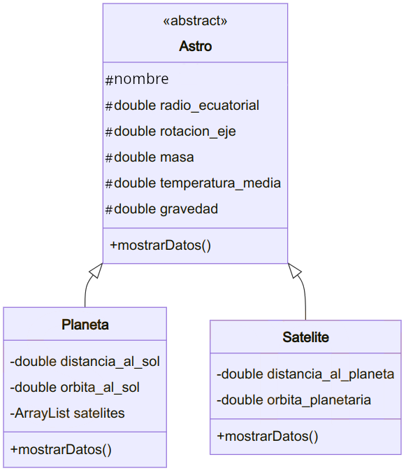

  

    🏆 <strong>Progrés d'aquesta secció:</strong> 0 de 4 superats (0%)
    ⭐ <strong>0 punts</strong>
  

  

    

  

# Reptes de programació UT5

> **📌 Empaquetar reptes**
> 

> Empaqueta les activitats, dins de la carpeta **`ut05`**, en la carpeta **`retos`**.

> Les activitats programades en aquesta secció **Reptes** no són obligatòries.

### Repte 01

paquet: **`R01_preguntas`**

De cada parella d'afirmacions **indica quin és la vertadera**:

a. Es diu que instanciamos una classe quan creem objectes d'aquesta classe.

b. Es diu que instanciamos una classe quan creem una subclase d'aquesta classe.

c. Si una classe és abstracta no es pot instanciar.

d. Si una classe és abstracta no es pot heredar d'ella.

e. Una classe abstracta ha de tindre mètodes abstractes.

f. Una classe pot ser abstracta i no tindre mètodes abstractes.

g. Si una classe té mètodes abstractes ha de ser abstracta.

h. Una classe pot tindre mètodes abstractes i no ser abstracta.

i. Si una classe és abstracta els seus subclases no poden ser abstractes.

j. Una classe abstracta pot tindre subclases que també siguen abstractes.

k. Si un mètode és abstracte en una classe, ha de ser no abstracte en la subclase, o bé, la subclase ha de ser també abstracta.

l. Si un mètode és abstracte en una classe, no pot ser abstracte en les subclases.

m. Si un mètode es defineix final es ha de reescribir en les subclases.

n. Si un mètode es defineix final no es pot reescribir en les subclases.

o. Una classe pot tindre un mètode final i no ser una classe final.

p. Si una classe té un mètode final ha de ser una classe final.

q. Si una classe es defineix final no es poden definir subclases d'ella.

r. Si una classe es defineix final no es pot instanciar.

s. Un mètode definit final i abstract resultaría inútil, ja que mai es podria implementar en les subclases.

t. Un mètode definit final i abstract podria resultar útil.

u. Una classe definida final i abstract resultaría inútil, ja que no es podria instanciar ni heredar d'ella.

v. Una classe definida final i abstract podria resultar útil.

### Repte 02

paquet: **`R02_alimento`**

a. Realitza una classe `Huevo` amb un atribut `tamaño` (`S`, `M`, `L`, `XL`) amb el mètode `toString`. 

b. La classe `Huevo` està composta per dos classes internes, una `Clara` i una altra `Yema`. Totes dues classes tenen un atribut `color` i el mètode `toString`. 

c. Realitza un mètode `main` en el que es creu un objecte de tipus `Huevo`, `Clara` i `Yema`, es li asigne valor als seus atributs i es muestren els valors.

### Repte 03 - Astros

paquet: **`R03_astros`**

Defineix una jerarquia de classes que permeta emmagatzemar dades sobre els planetas i satélites (lunas) que formen part del sistema solar.

Alguns atributs que necessitarem emmagatzemar són: 

- 

*Nom*.

- 

*Masa del cos*.

- *Diàmetre mitjà*.

- *Período de rotació* sobre el seu propi eix.

- *Período de traslació* alrededor del cos que orbitan.

- *Distància mitjana* a eixe cos.

- etc.

Defineix les classes necessàries contenent: 

- Constructors. 

- Mètodes per a recuperar i almacenas atributs.

- Mètode per a mostrar la informació de l'objecte. 

Defineix un mètode, que donat un objecte del sistema solar (planeta o satélite), imprima tota la informació que es disposa sobre el mateix (a més de la seua llista de satélites si els tinguera).

El diagrama UML seria:

Una possible solució seria crear una llista d'objectes, inserir els planetas i satélites (directament mitjançant codi o solicitándolos per pantalla) i després mostrar un xicotet menú que permeta a l'usuari imprimir la informació de l'astro que elija.

### Repte 04 - Hub Logístic DistribueixValència (Triatge Automatitzat i Seguretat)

> **📌 Repte de Programació Avançada: Control de Excepcions en Triatge Logístic**
> 

> El centre logístic automatitzat de la Comunitat Valenciana necessita un programari de control de paquetería:

  
> 1. Crea la classe `Paquete` amb `codigo`, `pesoKg`, `destino` i `descripcionContenido`.
  
> 1. Implementa dos excepcions personalitzades:
    

      
>   - `PesoExcedidoException`: Es dispara si el paquet supera els 50.0 kg (límit mecánic de la cinta transportadora).
      
>   - `ContrabandoException`: Es dispara si la descripció conté termes prohibits (ej: `"explosivo"`, `"químico"`, `"armas"`).
    

  
  
> 1. El mètode `triarPaquete(Paquete p) throws PesoExcedidoException, ContrabandoException` analitza el paquet. Si passa els controls, es afegeix a la cola de reparto; si falla, es detiene la cinta i es registra la incidencia en l'informe de seguretat.

---

## 🎮 Reptes Interactius d'Autoavaluació (+100 XP)

Comprova el teu domini sobre **Reptes de programació UT5** superant aquests 4 reptes gamificats (+25 punts cadascun):

  
🎯 <strong>Repte 1 (+25 pts):</strong> Quina paraula clau s'utilitza en Java perquè una subclasse herete els atributs i mètodes d'una superclasse, i quina per a implementar una interfície?

  

    <button type="button" class="btn-mcq-opt" data-opt="A">A) 'extends' per a heretar d'una classe i 'implements' per a implementar una interfície.</button>
    <button type="button" class="btn-mcq-opt" data-opt="B">B) 'implements' per a heretar d'una classe i 'extends' per a una interfície.</button>
    <button type="button" class="btn-mcq-opt" data-opt="C">C) 'inherits' i 'uses'.</button>
    <button type="button" class="btn-mcq-opt" data-opt="D">D) Cap de les anteriors és correcta.</button>
  

  

  
🎯 <strong>Repte 2 (+25 pts):</strong> Quina característica defineix una classe abstracta ('abstract class') en Java?

  

    <button type="button" class="btn-mcq-opt" data-opt="A">A) No pot tindre cap atribut ni constructor.</button>
    <button type="button" class="btn-mcq-opt" data-opt="B">B) Tots els seus mètodes han de ser privats i estàtics.</button>
    <button type="button" class="btn-mcq-opt" data-opt="C">C) Cap de les anteriors és correcta.</button>
    <button type="button" class="btn-mcq-opt" data-opt="D">D) No es pot instanciar directament amb 'new' i pot contindre tant mètodes abstractes (sense cos) com mètodes implementats.</button>
  

  

  
✅ <strong>Repte 3 (Vertader o Fals · +25 pts):</strong> El polimorfisme permet que una variable de referència del tipus de la superclasse o interfície apunte a objectes de qualsevol de les seues subclasses i execute el mètode sobreescrit (@Override) en temps d'execució.

  

    <button type="button" class="btn-vf" data-opt="V">Vertader (V)</button>
    <button type="button" class="btn-vf" data-opt="F">Fals (F)</button>
  

  

  
⌨️ <strong>Repte 4 (+25 pts):</strong> Quina paraula clau s'utilitza en el constructor d'una subclasse per a invocar el constructor de la seua classe pare?

  

    <input type="text" class="quiz-input" placeholder="Escriu la resposta..." />
    <button type="button" class="btn-quiz-check">Comprovar</button>
  

  

### 📋 Llista de Comprovació i Rúbrica d'Assoliment

Marca cada criteri a mesura que completes l'estudi o la resolució pràctica d'aquesta pàgina (**Reptes de programació UT5**):

- [ ] He llegit detingudament la teoria o l'enunciat d'aquesta secció i he anotat els conceptes clau.
- [ ] He revisat els esquemes, taules o blocs de codi i he verificat que sé aplicar-los a l'entorn de treball.
- [ ] He resolt correctament els **4 reptes interactius** superiors obtenint els **100 punts XP**.
- [ ] He descarregat el comprovant oficial en PDF per a adjuntar-lo a la tasca d'**Aules**.

  <h3>📤 Comprovant de Lliurament per a Aules</h3>
  
Quan hages completat els reptes interactius i la llista d'autoavaluació d'aquesta pàgina, introdueix el teu nom i descarrega el teu certificat oficial en PDF per a adjuntar-lo a la tasca d'<strong>Aules</strong>.

  

    <label for="aules-student-name">👤 Nom i Cognoms de l'Alumne/a:</label>
    <input type="text" id="aules-student-name" class="aules-student-name" placeholder="Ex: Joan Garcia Pérez" />
  

  

    0/4 reptes completats (0%) · 0 punts · 0/4 criteris d'autoavaluació
  

  

    <button type="button" class="btn-aules-dl" data-module="PRG" data-unit="UD05" data-activity="ut05retos">📥 Descarregar Comprovant PDF</button>
    <button type="button" class="btn-aules-copy">📋 Copiar Resum al Porta-retalls</button>
  

  

