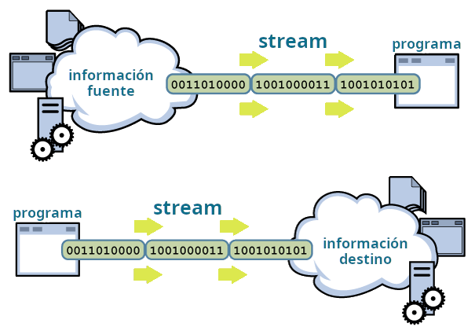
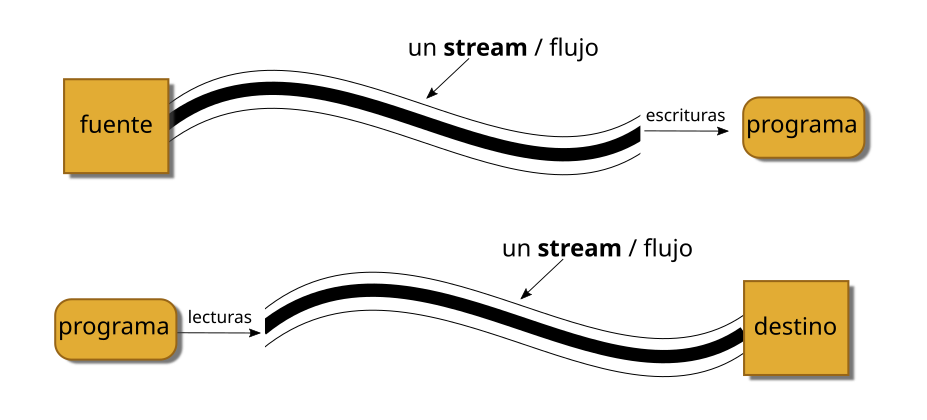
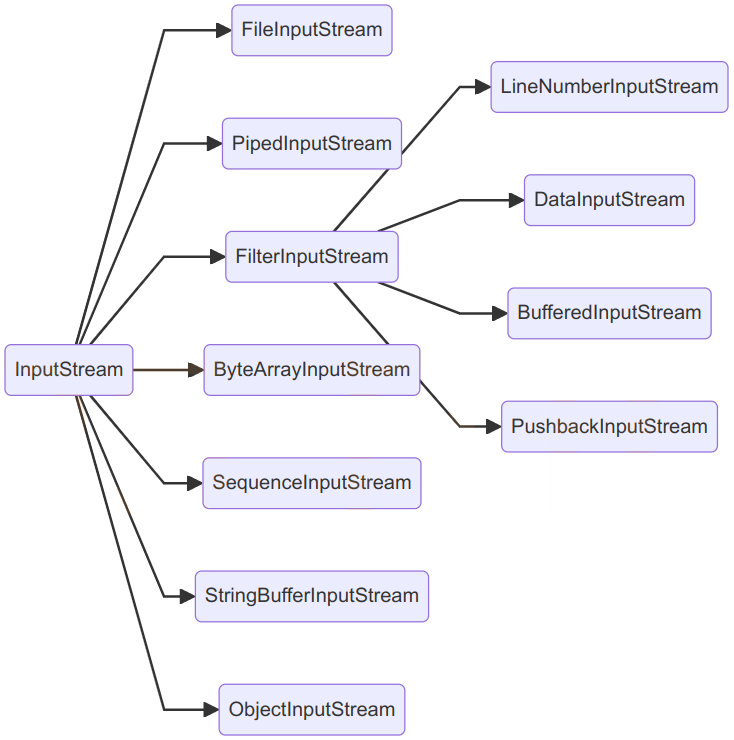
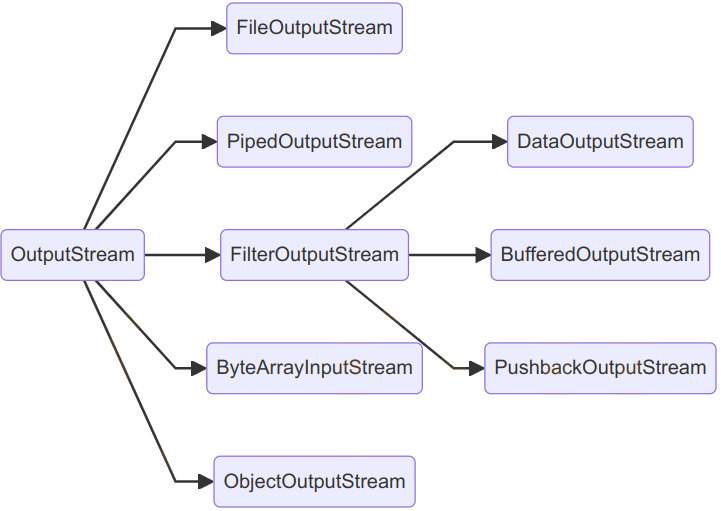
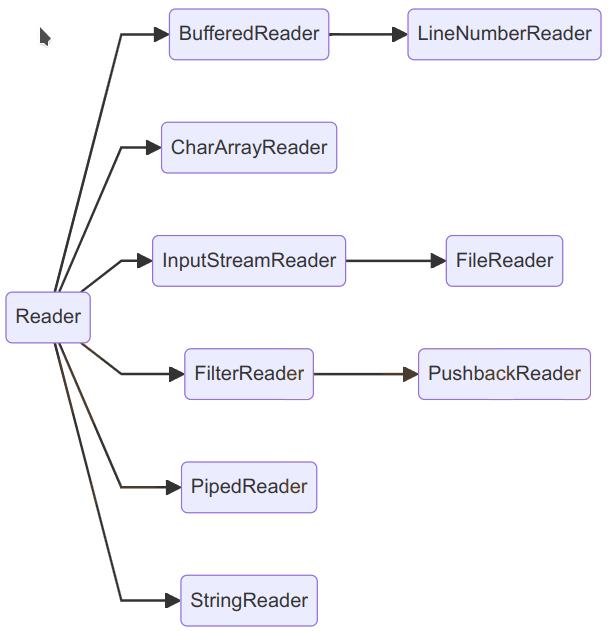
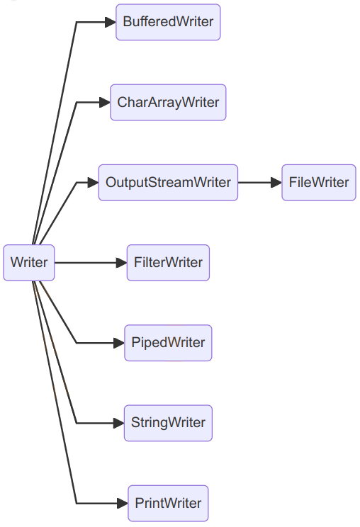
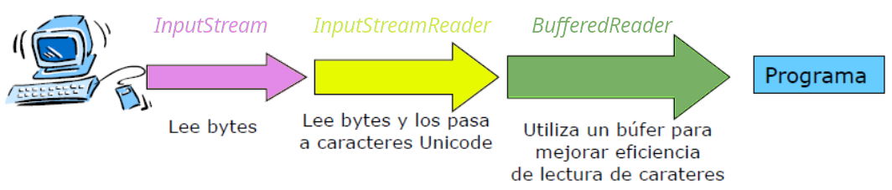

<div class="interactive-progress-tracker">
  <div class="tracker-header">
    <span>🏆 <strong>Progrés d'aquesta secció:</strong> <span class="tracker-count">0 de 4 superats (0%)</span></span>
    <span class="tracker-pts">⭐ <strong>0 punts</strong></span>
  </div>
  <div class="tracker-bar">
    <div class="tracker-fill" style="width: 0%;"></div>
  </div>
</div>

# 6.1 Streams (Fluxos d'entrada i eixida)



Els programes Java realitzen les operacions d'entrada i eixida a través del que es denominen **streams** (traducido: *fluxos*). 

    



Un *stream* és una abstracció de tot allò que produïsca o consuma informació. Podem veure a aquest *stream* com una entitat lògica que, d'altra banda, es encontrará vinculado amb un dispositiu físic. L'eficacia d'aquesta forma d'implementació radica en que les operacions d'entrada i eixida que el programador necessita manejar són les mateixes independentment del dispositiu amb el que estiguem actuant. Serà Java qui es encargue de manejar el dispositiu concret, ja es trate del teclat, el monitor, un sistema de fitxers o un *socket* de xarxa, etc., liberant al nostre codi de tindre que saber amb qui està interactuant.

## 1. Classificació dels Streams

En Java els *streams* es materializan en un conjunt de classes i subclases, contenides en el paquet `java.io`. Totes les classes per a manejar *streams* parten, de quatre classes abstractes: 

| Streams | Orientats a **caràcter** | Orientats a **bytes** |
| --- | --- | --- |
| per a lectura | **`Reader`** | **`InputStream`** |
| per a escriptura | **`Writer`** | **`OutputStream`** |

### 1.1. Streams orientats a byte (byte streams)

Proporcionen un mitjà adequat per al maneig d'entrades i eixides de bytes i el seu ús lógicament està orientat a la lectura i escriptura de dades binaris. El tractament del flux de bytes ve gobernado per dos classes abstractes que són **InputStream** i **OutputStream**. 

Cada una d'aquestes classes abstractes té diverses subclases concretes que controlen les diferències entre els distints dispositius de I/O que es poden utilitzar. Així mateix, aquestes dos classes són les que defineixen els mètodes que els seus subclases tindran implementats i, d'entre totes, destacan les operacions `read()` i `write()` que llegixen i escriuen bytes de dades respectivament.

    



  

    



### 1.2. Streams orientats a caràcter (character streams)

Proporciona un mitjà convenient per al maneig d'entrades i eixides de caràcters. Aquests fluxos **usen codificació Unicode** i, per tant, es poden internacionalitzar. 

Aquest és un mode que Java ens proporciona per a manejar caràcters, però al nivell més sota totes les operacions de I/O són orientades a byte. A l'igual que l'anterior, el flux de caràcters també ve gobernado per dos classes abstractes: **Reader** i **Writer**. Aquestes classes manejan fluxos de caràcters Unicode; i també d'elles derivan subclases concretes que implementan els mètodes definits en elles sent els més destacats els mètodes `read()` i `write()` que, en aquest cas, llegixen i escriuen caràcters de dades respectivament.

    



  

    



Com hem comentado, tant en `Reader` com en `InputStream` trobem un mètode `read()`, en concret `public int read()`. Es observa la diferència entre aquests dos mètodes ens ayudará a comprendre la diferència entre els fluxos orientats a byte i els orientats a caràcter. 

| mètode | retorna |
| --- | --- |
| `int InputStream.read()` | valor entre 0 i 255 |
| `int Reader.read()` | valor entre 0 i 65535 |

Malgrat llamar-se igual, `InputStream.read()` retorna el següent byte de dades llegit del *stream*. El valor que retorna està entre 0 i 255 (ó -1 si es ha llegado al final del *stream*). No obstant això, `Reader.read()`, retorna un valor entre 0 i 65535 (ó -1 si es ha llegado al final del *stream*), corresponent al següent caràcter simple llegit del *stream*.

## 2. Stream estàndard

Existeixen una sèrie de *stream* d'ús comú als quals es denomina *stream estàndard*. El sistema s'encarrega de crear aquests *stream* automàticament. 

| stream | mètodes |
| --- | --- |
| **System.in** Instància de la classe `InputStream`: flux de bytes d'entrada. | Mètodes: - `read()` permet llegir un byte de l'entrada com enter. - `skip(n)` ignora `n` bytes de l'entrada. - `available()` número de bytes disponibles per a llegir en l'entrada. |
| **System.out** Instància de la classe `PrintStream`: flux de bytes d'eixida. | Mètodes: - per a impressió de dades: `print()`, `println()`. - `flush()` buida el buffer d'eixida escrivint el seu contingut.. |
| **System.err** Funcionament similar a `System.out`. | S'utilitza per a enviar missatges d'error (per exemple a un fitxer de log o a la consola). |

Per defecte, `System.in`, `System.out` i `System.err` es troben associats a la consola (teclat i pantalla), però és possible redirigirlos a altres fonts o destinos, com per exemple a un fitxer.

## 3. Utilització de Streams

Per a utilitzar un *stream* cal seguir una sèrie de passos:

**Lectura**:

1º. Obrir el *stream* associat a una font de dades (creació de l'objecte *stream*):

     - Teclat.

     - Fitxer.

     - Socket remoto.

2º. Mentre existisquen dades disponibles:

     - Llegir dades.

3º. Tancar el *stream* (mètode `close`).

**Escriptura**:

1º. Obrir el *stream* associat a una font de dades (creació de l'objecte *stream*):

     - Pantalla.

     - Fitxer.

     - Socket local.

2º. Mentre existisquen dades disponibles:

     - Escriure dades.

3º. Tancar el *stream* (mètode `close`).

> **📌 A tindre en compte:**
> 

> - Els *streams estàndard* ja s'encarrega el sistema d'abrirlos i cerrar-los.

> - Un fallada en qualsevol punt del procés produeix una `IOException`.

## 4. Les classes `InputStream` i `OutputStream`

Com hem aquest anteriorment, proporcionen mètodes per a llegir i escriure, respectivament, un byte d'informació, a través dels seus mètodes `read()` i `write()`.

| classe | mètodes | descripció |
| --- | --- | --- |
| **InputStream** | `int read()` | Llegix un byte d'informació i el retorna com un enter del qual valor estarà entre 0 i 255. Si es detecta el final de les dades d'entrada retorna -1. |
| **OutputStream** | `write (int b)` | Escriu un byte d'informació en el *stream*. El paràmetre és enter, però si el seu valor és superior a 255 es escriuen els 8 bits de menys pes (els més a la dreta). |

## 5. Les classes `Reader` i `Writer`

Permeten, respectivament, llegir i escriure un caràcter en el *stream*.

| classe | mètodes | descripció |
| --- | --- | --- |
| **Reader** | `int read()` | Llegix un caràcter unicode d'informació i el retorna com un enter del qual valor estarà entre 0 i 65565. Si es detecta el final de les dades d'entrada retorna -1. |
| **Writer** | `write (int c)` | Escriu un caràcter unicode en el *stream*. El paràmetre és enter i corresponderá al codi Unicode del caràcter que es escriu. |

## 6. Les classes `InputStreamReader` i `OutputStreamWriter`

Són classes que actuen de puente entre *streams* orientats a bytes i *streams* orientats a caràcter. Podem, per exemple, crear un `InputStreamReader` associat a un `InputStream` i llegir caràcters del `InputStream` associat, a través del `InputStreamReader`.

| classe | mètodes | descripció |
| --- | --- | --- |
| **InputStreamReader** | `InputStreamReader(inputStream)` `int read()` | Constructor: L'objecte es crea a partir d'un `InputStream` (orientat a byte). Leerá informació del `inputStream` associat i la retornarà en forma de caràcters. Es pot indicar el charset a utilitzar. Llegix un caràcter del `InputStream` associat. |
| **OutputStreamWriter** | `OutputStreamWriter(outputStream)` `write(int c)` | Constructor: Crea l'objecte asociándolo a un `outputStream`, en el que escribirá bytes. Es pot indicar el charset a utilitzar. Escriu el caràcter indicat en el `OutputStream` associat. |

## 7. Buffering

Les classes **`BufferedReader`**, **`BufferedWritter`**, **`BufferedInputStream`** i **`BufferedOutputStream`** permeten realitzar *buffering*.

Situades "*per davant*" d'un *stream* acumulan les operacions de lectura i escriptura en una memòria o buffer i quan hi ha suficient informació les operacions es realitzen finalment sobre el dispositiu físic.

Mantenen les mateixes operacions de lectura i escriptura que els seus classes pare però, com hem aquest, redueixen el número d'accessos al dispositiu físic pel ús de *buffers*.

| classe | mètodes | descripció |
| --- | --- | --- |
| **BufferedReader** **BufferedWriter** | `String readLine()` `void write(String s)` `void newLine()` | A més dels mètodes heretats, trobem altres que permeten llegir Strings complets, escriure una línia completa de text i fer salts de línia. |
| **BufferedInputStream** **BufferedOutputStream** |  | Mantenen les mateixes operacions de lectura i escriptura que els seus classes pare però, com hem aquest, redueixen el número d'accessos al dispositiu físic pel ús de buffers. |

## 8. `DataInputStream` i `DataOutputStream`

Realitzen una transformació de la informació abans de ser escrita o després de ser leída. Els bytes leídos o escritos es interpretan com dades corresponents als tipus primitius de Java.

| classe | mètodes | descripció |
| --- | --- | --- |
| **DataInputStream** **DataOutputStream** | `read()`, `readInt()`, `readDouble()`, `readUTF()` `write()`, `writeInt()`, `writeDouble()`, `writeUTF()` … | Que permeten llegir i escriure informació corresponent als distints tipus de dades de Java. |

## 9. `PrintWriter`

| classe | mètodes | descripció |
| --- | --- | --- |
| **PrintWriter** | `print()` `println()` | Aquesta classe (a la que pertany `System.out`) té els mètodes `print` i `println`, que escriuen en el stream d'eixida dades binaris representats en forma de cadenes de caràcters. |

## 10. Combinació de Streams

En moltes ocasions, una sola classe de les vistes no ens dóna la funcionalitat necessària per a poder fer la tasca que es requereix. En tals casos és necessari combinar (imbricar) diversos *Streams* de manera que uns actuen com origen d'informació dels altres, o uns escriuen sobre els altres.

En aquest cas tindríem que combinar tres classes:

    



```java
BufferedReader b = new BufferedReader(new InputStreamReader(System.in));
```

<details markdown="1">

<summary>💡 Exemple: estàndard d'eixida</summary>

En el següent exemple es demana introduir text fins a que es introduzca una línia amb el text "*eixir*". Aquest text s'emmagatzemarà en un fitxer `salida.txt`.  
  

El procés ha de d'estar en un bloc `try..catch`.

```java
package UT06.P1_Flujos;

import java.io.BufferedReader;
import java.io.FileWriter;
import java.io.IOException;
import java.io.InputStreamReader;
import java.io.PrintWriter;

public class P1_2_FlujoEstandarSalida {

  public static void main(String[] args) {
    try {
      // stream de entrada
      // System.in -> captura la entrada desde la consola
      // InputStreamReader(System.in) -> convierte bytes de entrada estándar en caracteres
      // BufferedReader -> para leer líneas completas de texto
      BufferedReader br = new BufferedReader(
                                new InputStreamReader(System.in));
      // stream de salida orientada a caracteres
      PrintWriter out = new PrintWriter(new FileWriter("salida.txt", true));
      String s;
      while (!(s = br.readLine()).equals("salir")) {
         out.println(s);
      }
      out.close();

    } catch (IOException ex) {
      System.out.println("Error: " + ex.getMessage());
    }
  }
}
```

</details>

> **📌 Un poquito de ...**
> 

>


---

## 🎮 Reptes Interactius d'Autoavaluació (+100 XP)

Comprova el teu domini sobre **6.1 Streams (Fluxos d'entrada i eixida)** superant aquests 4 reptes gamificats (+25 punts cadascun):

<div class="interactive-mcq" data-answer="A" data-hint="Revisa els conceptes teòrics i pràctics d'aquesta secció.">
  <div class="mcq-question">🎯 <strong>Repte 1 (+25 pts):</strong> Quina classe de Java I/O s'utilitza habitualment per a llegir fitxers de text línia per línia de forma eficient mitjançant un buffer?</div>
  <div class="mcq-options">
    <button type="button" class="btn-mcq-opt" data-opt="A">A) BufferedReader (embolicant un FileReader).</button>
    <button type="button" class="btn-mcq-opt" data-opt="B">B) ObjectOutputStream.</button>
    <button type="button" class="btn-mcq-opt" data-opt="C">C) ServerSocket.</button>
    <button type="button" class="btn-mcq-opt" data-opt="D">D) Cap de les anteriors és correcta.</button>
  </div>
  <div class="quiz-feedback"></div>
</div>

<div class="interactive-mcq" data-answer="D" data-hint="Comprova l'apartat corresponent de la unitat.">
  <div class="mcq-question">🎯 <strong>Repte 2 (+25 pts):</strong> Quina interfície ha d'implementar una classe en Java perquè els seus objectes es puguen convertir en una seqüència de bytes i guardar-se en un fitxer binari amb ObjectOutputStream?</div>
  <div class="mcq-options">
    <button type="button" class="btn-mcq-opt" data-opt="A">A) java.lang.Runnable</button>
    <button type="button" class="btn-mcq-opt" data-opt="B">B) java.util.Comparator</button>
    <button type="button" class="btn-mcq-opt" data-opt="C">C) Cap de les anteriors és correcta.</button>
    <button type="button" class="btn-mcq-opt" data-opt="D">D) java.io.Serializable</button>
  </div>
  <div class="quiz-feedback"></div>
</div>

<div class="interactive-vf" data-answer="V" data-hint="Verifica l'afirmació amb els apunts de la unitat.">
  <div class="vf-statement">✅ <strong>Repte 3 (Vertader o Fals · +25 pts):</strong> En la comunicació per xarxa amb Sockets TCP en Java, el servidor espera connexions amb ServerSocket.accept() i el client s'hi connecta amb la classe Socket.</div>
  <div class="vf-buttons">
    <button type="button" class="btn-vf" data-opt="V">Vertader (V)</button>
    <button type="button" class="btn-vf" data-opt="F">Fals (F)</button>
  </div>
  <div class="quiz-feedback" style="width: 100%;"></div>
</div>

<div class="interactive-quiz" data-answer="transient" data-hint="Comença per 'trans' i acaba en 'ient'.">
  <div class="quiz-question">⌨️ <strong>Repte 4 (+25 pts):</strong> Quin modificador s'aplica a un atribut d'una classe Serializable si NO volem que eixe atribut es guarde durant la serialització?</div>
  <div class="quiz-controls">
    <input type="text" class="quiz-input" placeholder="Escriu la resposta..." />
    <button type="button" class="btn-quiz-check">Comprovar</button>
  </div>
  <div class="quiz-feedback"></div>
</div>

### 📋 Llista de Comprovació i Rúbrica d'Assoliment

Marca cada criteri a mesura que completes l'estudi o la resolució pràctica d'aquesta pàgina (**6.1 Streams (Fluxos d'entrada i eixida)**):

- [ ] He llegit detingudament la teoria o l'enunciat d'aquesta secció i he anotat els conceptes clau.
- [ ] He revisat els esquemes, taules o blocs de codi i he verificat que sé aplicar-los a l'entorn de treball.
- [ ] He resolt correctament els **4 reptes interactius** superiors obtenint els **100 punts XP**.
- [ ] He descarregat el comprovant oficial en PDF per a adjuntar-lo a la tasca d'**Aules**.

<div class="aules-delivery-card">
  <h3>📤 Comprovant de Lliurament per a Aules</h3>
  <p>Quan hages completat els reptes interactius i la llista d'autoavaluació d'aquesta pàgina, introdueix el teu nom i descarrega el teu certificat oficial en PDF per a adjuntar-lo a la tasca d'<strong>Aules</strong>.</p>
  <div class="aules-student-field">
    <label for="aules-student-name">👤 Nom i Cognoms de l'Alumne/a:</label>
    <input type="text" id="aules-student-name" class="aules-student-name" placeholder="Ex: Joan Garcia Pérez" />
  </div>
  <div class="aules-score-badge">
    <span class="aules-score-count">0/4 reptes completats (0%) · 0 punts · 0/4 criteris d'autoavaluació</span>
  </div>
  <div class="aules-actions">
    <button type="button" class="btn-aules-dl" data-module="PRG" data-unit="UD06" data-activity="ut0601">📥 Descarregar Comprovant PDF</button>
    <button type="button" class="btn-aules-copy">📋 Copiar Resum al Porta-retalls</button>
  </div>
  <div class="aules-toast"></div>
</div>

