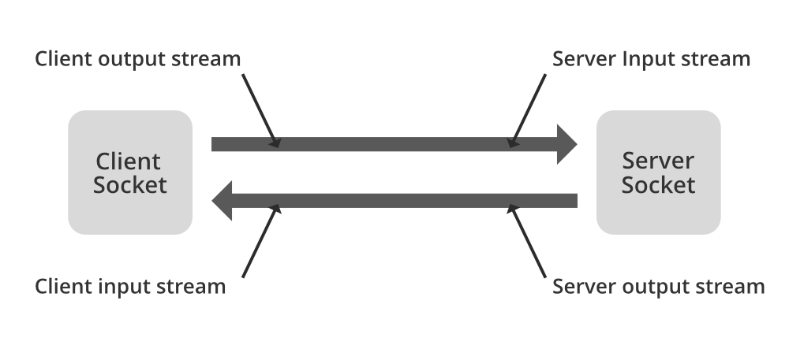

<div class="interactive-progress-tracker">
  <div class="tracker-header">
    <span>🏆 <strong>Progrés d'aquesta secció:</strong> <span class="tracker-count">0 de 4 superats (0%)</span></span>
    <span class="tracker-pts">⭐ <strong>0 punts</strong></span>
  </div>
  <div class="tracker-bar">
    <div class="tracker-fill" style="width: 0%;"></div>
  </div>
</div>

# 6.4 Comunicació per xarxa: Sockets

Els *sockets* són un mecanisme que ens permet establir un enllaç entre dos programes que s'executen independents l'un de l'un altre  (generalment un programa client i un programa servidor). Java, per mitjà de la llibreria `java.net`, ens provee dos classes: `Socket` per a implementar la connexió des del costat del client i **ServerSocket** que ens permitirá manipular la connexió des del costat del servidor.

Cap resaltar que tant el client com el servidor no necessàriament han d'estar implementats en Java, només  han de conèixer les seues adreces IP i el port pel qual es comunicarán.

    



<details markdown="1">

<summary>💡 Exemple</summary>

Per al nostre exemple de *sockets* implementarem tots dos (client i servidor) usant Java i es comunicarán usant el port 10000 (*triar ports en el rang de 1024 fins a 65535*).  
  

La seqüència d'esdeveniments en el nostre exemple serà:

1. El servidor crearà el *socket* i esperará a que el client es conecte o el detengamos.

1. D'altra banda, el client obrirà la connexió amb el servidor i li enviará una frase en minúscules que escribirá l'usuari i la enviará al servidor.

1. Una vegada recibida la frase en minúscules, el servidor la convertirá en majúscules i la retornarà al client.

1. El client mostrarà la frase en majúscules recibida des del servidor i cerrará la connexió.

1. El servidor quedarà a l'espera d'una nova connexió d'un altre client.

#### 📌 Servidor

```java
package UT06.P4_Sockets;

import java.io.*;
import java.net.*;

public class TCPServidor {

  public static void main(String[] args) throws IOException, ClassNotFoundException {
    String FraseClient;
    String FraseMajuscules;
    ServerSocket serverSocket = new ServerSocket(10000);
    Socket clientSocket;
    ObjectInputStream entrada;
    ObjectOutputStream eixida;

    System.out.println("Servidor iniciado y escuchando por el puerto 10000");
    while (true) {
        clientSocket = serverSocket.accept();
        entrada = new ObjectInputStream(clientSocket.getInputStream());
        FraseClient = (String) entrada.readObject();

        System.out.println("La frase recibida es: " + FraseClient);

        eixida = new ObjectOutputStream(clientSocket.getOutputStream());
        FraseMajuscules = FraseClient.toUpperCase();
        System.out.println("El servidor devuelve la frase: " + FraseMajuscules);
        eixida.writeObject(FraseMajuscules);

        clientSocket.close();
        System.out.println("Server esperando una nueva conexión...");
    }
  }
}
```

#### 📌 Client

```java
package UT06.P4_Sockets;

import java.io.*;
import java.net.*;
import java.util.Scanner;

public class TCPClient {

  public static void main(String[] args) throws IOException, ClassNotFoundException {
    Socket socket;
    ObjectInputStream entrada;
    ObjectOutputStream eixida;
    String frase;

    socket = new Socket(InetAddress.getLocalHost(), 10000);
    eixida = new ObjectOutputStream(socket.getOutputStream());

    System.out.println("Introduce la frase a enviar en minúsculas");
    Scanner in = new Scanner(System.in);
    frase = in.nextLine();
    System.out.println("Se envia la frase " + frase);
    eixida.writeObject(frase);

    entrada = new ObjectInputStream(socket.getInputStream());
    System.out.println(
            "La frase recibida es: " + (String) entrada.readObject());

    socket.close();
  }
}
```

</details>


---

## 🎮 Reptes Interactius d'Autoavaluació (+100 XP)

Comprova el teu domini sobre **6.4 Comunicació per xarxa: Sockets** superant aquests 4 reptes gamificats (+25 punts cadascun):

<div class="interactive-mcq" data-answer="A" data-hint="Revisa els conceptes teòrics i pràctics d'aquesta secció.">
  <div class="mcq-question">🎯 <strong>Repte 1 (+25 pts):</strong> Quina classe de Java I/O s'utilitza habitualment per a llegir fitxers de text línia per línia de forma eficient mitjançant un buffer?</div>
  <div class="mcq-options">
    <button type="button" class="btn-mcq-opt" data-opt="A">A) BufferedReader (embolicant un FileReader).</button>
    <button type="button" class="btn-mcq-opt" data-opt="B">B) ObjectOutputStream.</button>
    <button type="button" class="btn-mcq-opt" data-opt="C">C) ServerSocket.</button>
    <button type="button" class="btn-mcq-opt" data-opt="D">D) Cap de les anteriors és correcta.</button>
  </div>
  <div class="quiz-feedback"></div>
</div>

<div class="interactive-mcq" data-answer="D" data-hint="Comprova l'apartat corresponent de la unitat.">
  <div class="mcq-question">🎯 <strong>Repte 2 (+25 pts):</strong> Quina interfície ha d'implementar una classe en Java perquè els seus objectes es puguen convertir en una seqüència de bytes i guardar-se en un fitxer binari amb ObjectOutputStream?</div>
  <div class="mcq-options">
    <button type="button" class="btn-mcq-opt" data-opt="A">A) java.lang.Runnable</button>
    <button type="button" class="btn-mcq-opt" data-opt="B">B) java.util.Comparator</button>
    <button type="button" class="btn-mcq-opt" data-opt="C">C) Cap de les anteriors és correcta.</button>
    <button type="button" class="btn-mcq-opt" data-opt="D">D) java.io.Serializable</button>
  </div>
  <div class="quiz-feedback"></div>
</div>

<div class="interactive-vf" data-answer="V" data-hint="Verifica l'afirmació amb els apunts de la unitat.">
  <div class="vf-statement">✅ <strong>Repte 3 (Vertader o Fals · +25 pts):</strong> En la comunicació per xarxa amb Sockets TCP en Java, el servidor espera connexions amb ServerSocket.accept() i el client s'hi connecta amb la classe Socket.</div>
  <div class="vf-buttons">
    <button type="button" class="btn-vf" data-opt="V">Vertader (V)</button>
    <button type="button" class="btn-vf" data-opt="F">Fals (F)</button>
  </div>
  <div class="quiz-feedback" style="width: 100%;"></div>
</div>

<div class="interactive-quiz" data-answer="transient" data-hint="Comença per 'trans' i acaba en 'ient'.">
  <div class="quiz-question">⌨️ <strong>Repte 4 (+25 pts):</strong> Quin modificador s'aplica a un atribut d'una classe Serializable si NO volem que eixe atribut es guarde durant la serialització?</div>
  <div class="quiz-controls">
    <input type="text" class="quiz-input" placeholder="Escriu la resposta..." />
    <button type="button" class="btn-quiz-check">Comprovar</button>
  </div>
  <div class="quiz-feedback"></div>
</div>

### 📋 Llista de Comprovació i Rúbrica d'Assoliment

Marca cada criteri a mesura que completes l'estudi o la resolució pràctica d'aquesta pàgina (**6.4 Comunicació per xarxa: Sockets**):

- [ ] He llegit detingudament la teoria o l'enunciat d'aquesta secció i he anotat els conceptes clau.
- [ ] He revisat els esquemes, taules o blocs de codi i he verificat que sé aplicar-los a l'entorn de treball.
- [ ] He resolt correctament els **4 reptes interactius** superiors obtenint els **100 punts XP**.
- [ ] He descarregat el comprovant oficial en PDF per a adjuntar-lo a la tasca d'**Aules**.

<div class="aules-delivery-card">
  <h3>📤 Comprovant de Lliurament per a Aules</h3>
  <p>Quan hages completat els reptes interactius i la llista d'autoavaluació d'aquesta pàgina, introdueix el teu nom i descarrega el teu certificat oficial en PDF per a adjuntar-lo a la tasca d'<strong>Aules</strong>.</p>
  <div class="aules-student-field">
    <label for="aules-student-name">👤 Nom i Cognoms de l'Alumne/a:</label>
    <input type="text" id="aules-student-name" class="aules-student-name" placeholder="Ex: Joan Garcia Pérez" />
  </div>
  <div class="aules-score-badge">
    <span class="aules-score-count">0/4 reptes completats (0%) · 0 punts · 0/4 criteris d'autoavaluació</span>
  </div>
  <div class="aules-actions">
    <button type="button" class="btn-aules-dl" data-module="PRG" data-unit="UD06" data-activity="ut0604">📥 Descarregar Comprovant PDF</button>
    <button type="button" class="btn-aules-copy">📋 Copiar Resum al Porta-retalls</button>
  </div>
  <div class="aules-toast"></div>
</div>

