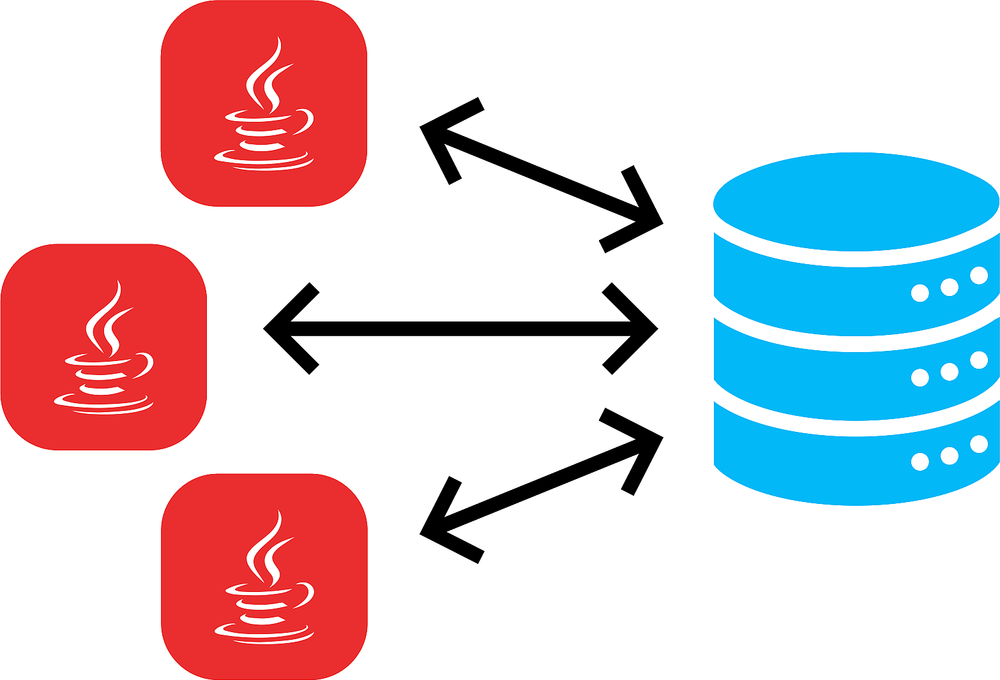

  

    🏆 <strong>Progrés d'aquesta secció:</strong> 0 de 4 superats (0%)
    ⭐ <strong>0 punts</strong>
  

  

    

  

# 7.1 Introducció a la persistència en bases de dades

Hui en dia, la majoria d'aplicacions informàtiques necessiten emmagatzemar i gestionar gran quantitat de dades.

Eixes dades, es solen guardar en **bases de dades relacionals**, ja que éstas són les més extendides actualment.

Les bases de dades relacionals permeten organitzar les dades en **taules** i eixes taules i dades es relacionen mitjançant camps clau. A més es treballa amb el llenguatge estàndard conegut com **SQL**, per a poder realitzar les consultes que deseemos a la base de dades.

> **📌 Base de dades relacional**
> 

> Una base de dades relacional es pot definir d'una manera simple com aquella que presenta la informació en taules amb files i columnes.

Una taula és una sèrie de **files** i **columnes** , en la que cada fila és un **registre** i cada columna és un **camp**. Un camp representa un dada dels elements emmagatzemats en la taula (*NSS*, *nom*, *etc*.). Cada registre representa un element de la taula (la persona *Jose*, la persona *Carmen*, etc.)

No es permet que puga aparèixer dos o més vegades el mateix registre, per la qual cosa un o més camps de la taula formen el que es coneix com **clau primària** (atribut que es tria com identificador en una taula, de manera que no haja dos registres iguals, sinó que es diferencien almenys en eixa clau). Per exemple, en el cas d'una taula que guarda dades de persones, el número de la seguretat social, podria elegir-se com clau primària, ja que sabem que encara que haja dos persones anomenades, per exemple, Juan Pérez Pérez, estem seguros de que el seu número de seguretat social serà distint).

El sistema gestor de bases de dades, en anglès conegut com: **Database Management System** (**DBMS**) , gestiona el mode en que les dades s'emmagatzemen, mantenen i recuperan.

En el cas d'una base de dades relacional, el sistema gestor de base de dades es denomina: **Relational Database Management System** (**RDBMS**).

Tradicionalment, la programació de bases de dades ha sigut com una Torre de Babel: gran quantitat de productes de bases de dades en el mercat, i cada un “parlant” en el seu llenguatge privat amb les aplicacions.

Java, mitjançant **JDBC** (*Java Database Connectivity*, API que permet l'ejecució d'operacions sobre bases de dades des del llenguatge de programació Java, independentment del sistema operatiu on s'execute o de la base de dades a la qual es accedeix), permet simplificar l'accés a base de dades , proporcionant un llenguatge mitjançant el qual les aplicacions poden comunicar-se amb motors de bases de dades. Sun va desenvolupar aquest API per a l'accés a bases de dades, amb tres objectius principals en mente:

- Ser un API amb suport de SQL: poder construir sentències SQL i insertar-les dins d'anomenades al API de Java,

- Aprofitar l'experiència dels APIs de bases de dades existents,

- Ser senzill.

> **📌 Què és una API**
> 

> **API**: *Application Programming Interface* (Interfície de Programació de Aplicacions). Conjunt de regles i protocols que permet a diferents aplicacions o sistemes comunicar-se entre sí. En poques paraules, actua com un intermediario que permet que dos programes informàtics es comuniquen i compartan dades entre ells de manera segura i eficient. Les APIs s'utilitzen comúnment en el desenvolupament de programari per a permetre la integració de diferents sistemes, la creació d'aplicacions de tercers i l'automatització de processos.
> 
> 
Un exemple senzill de API podria ser el servei de pronóstic del temps proporcionat per una companyia meteorológica. Imagina que tens una aplicació de clima en el teu telèfon. Aquesta aplicació necessita mostrar el pronóstic del temps actualitzat, però no té la capacitat de predecir el clima per sí mateixa.
> 
> 
En lloc d'això, l'aplicació utilitza una API proporcionada per una empresa meteorológica. Aquesta API permet que l'aplicació envíe una solicitud amb la ubicació actual de l'usuari i, a canvi, rep dades sobre el clima en eixa ubicació. La API proporciona aquestes dades en un format estructurat, com JSON o XML, que l'aplicació pot interpretar i mostrar de manera comprensible per a l'usuari.
> 
> 
En resum, l'aplicació de clima utilitza la API de l'empresa meteorológica per a obtindre dades actualitzats sobre el pronóstic del temps sense tindre que desenvolupar el seu propi sistema de predicció meteorológica. La API actua com un puente entre l'aplicació i els recursos de la companyia meteorológica, permetent que l'aplicació acceda i utilitze eixos recursos de manera fàcil i eficient.

## 1. Connexió a les BBDD: connectors

Dejemos de moment de costat el desfase Objecte-Relacional i centrémonos ara en l'accés a Base de dades Relacionals des dels llenguatges de programació. El razonarem en general i l'aplicarem a Java.

Des de la década dels 80 que existeixen a pleno rendiment les bases de dades relacionals. Quasi tots els Sistemes gestors de bases de dades (excepte els més xicotets com *Access* o *Base* de LibreOffice) utilitzen l'arquitectura client-servidor. Açò significa que hi ha un ordinador central on està instal·lat el Sistema gestor de bases de dades Relacional que actua com servidor, i hi haurà molts clients que es conectarán al servidor fent peticions sobre la Base de dades.

Els Sistemes gestors de bases de dades inicialment disponían de llenguatges de programació propis per a poder fer els accessos des dels clients. Era molt consistente, però a base de ser molt poc operatiu:

- L'empresa desarrolladora del SGBD debían mantindre un llenguatge de programació, que resultava necessàriament molt costoso, si no querían que quedara desfasado.

- Les empreses usuarias del SGBD, que es conectaven com clients, es encontraven molt ligades al servidor per a tindre que utilitzar el llenguatge de programació per a accedir al servidor, el que no sempre es ajustava a les seues necessitats. A més, el plantear-se canviar de servidor, significava que calia rehacer tots els programes, i per tant una tasca de muchísima envergadura.

Per a poder ser més operatius, calia desvincular els llenguatges de programació dels Sistemes gestors de bases de dades utilitzant uns estàndards de connexió.

---

## 🎮 Reptes Interactius d'Autoavaluació (+100 XP)

Comprova el teu domini sobre **7.1 Introducció a la persistència en bases de dades** superant aquests 4 reptes gamificats (+25 punts cadascun):

  
🎯 <strong>Repte 1 (+25 pts):</strong> Per què és fonamental utilitzar PreparedStatement amb paràmetres '?' en lloc de concatenar cadenes en Statement en accedir a bases de dades amb JDBC?

  

    <button type="button" class="btn-mcq-opt" data-opt="A">A) Perquè precompila la sentència SQL i protegeix l'aplicació contra atacs d'Injecció SQL (SQL Injection).</button>
    <button type="button" class="btn-mcq-opt" data-opt="B">B) Perquè Statement no permet executar consultes SELECT.</button>
    <button type="button" class="btn-mcq-opt" data-opt="C">C) Perquè PreparedStatement no necessita connexió a la base de dades.</button>
    <button type="button" class="btn-mcq-opt" data-opt="D">D) Cap de les anteriors és correcta.</button>
  

  

  
🎯 <strong>Repte 2 (+25 pts):</strong> Quin patró de disseny de programari separa completament la lògica de negoci de la lògica d'accés i persistència a la base de dades mitjançant classes i interfícies dedicades?

  

    <button type="button" class="btn-mcq-opt" data-opt="A">A) Patró Singleton d'impressió.</button>
    <button type="button" class="btn-mcq-opt" data-opt="B">B) Recursivitat indirecta.</button>
    <button type="button" class="btn-mcq-opt" data-opt="C">C) Cap de les anteriors és correcta.</button>
    <button type="button" class="btn-mcq-opt" data-opt="D">D) Patró DAO (Data Access Object).</button>
  

  

  
✅ <strong>Repte 3 (Vertader o Fals · +25 pts):</strong> En JDBC, el mètode executeQuery() s'utilitza per a consultes SELECT (retorna un ResultSet), mentre que executeUpdate() s'utilitza per a INSERT, UPDATE i DELETE.

  

    <button type="button" class="btn-vf" data-opt="V">Vertader (V)</button>
    <button type="button" class="btn-vf" data-opt="F">Fals (F)</button>
  

  

  
⌨️ <strong>Repte 4 (+25 pts):</strong> Quin mètode de l'objecte ResultSet s'invoca dins d'un bucle 'while' per a avançar el cursor a la següent fila de resultats?

  

    <input type="text" class="quiz-input" placeholder="Escriu la resposta..." />
    <button type="button" class="btn-quiz-check">Comprovar</button>
  

  

### 📋 Llista de Comprovació i Rúbrica d'Assoliment

Marca cada criteri a mesura que completes l'estudi o la resolució pràctica d'aquesta pàgina (**7.1 Introducció a la persistència en bases de dades**):

- [ ] He llegit detingudament la teoria o l'enunciat d'aquesta secció i he anotat els conceptes clau.
- [ ] He revisat els esquemes, taules o blocs de codi i he verificat que sé aplicar-los a l'entorn de treball.
- [ ] He resolt correctament els **4 reptes interactius** superiors obtenint els **100 punts XP**.
- [ ] He descarregat el comprovant oficial en PDF per a adjuntar-lo a la tasca d'**Aules**.

  <h3>📤 Comprovant de Lliurament per a Aules</h3>
  
Quan hages completat els reptes interactius i la llista d'autoavaluació d'aquesta pàgina, introdueix el teu nom i descarrega el teu certificat oficial en PDF per a adjuntar-lo a la tasca d'<strong>Aules</strong>.

  

    <label for="aules-student-name">👤 Nom i Cognoms de l'Alumne/a:</label>
    <input type="text" id="aules-student-name" class="aules-student-name" placeholder="Ex: Joan Garcia Pérez" />
  

  

    0/4 reptes completats (0%) · 0 punts · 0/4 criteris d'autoavaluació
  

  

    <button type="button" class="btn-aules-dl" data-module="PRG" data-unit="UD07" data-activity="ut0701">📥 Descarregar Comprovant PDF</button>
    <button type="button" class="btn-aules-copy">📋 Copiar Resum al Porta-retalls</button>
  

  

