<div class="interactive-progress-tracker">
  <div class="tracker-header">
    <span>🏆 <strong>Progrés d'aquesta secció:</strong> <span class="tracker-count">0 de 4 superats (0%)</span></span>
    <span class="tracker-pts">⭐ <strong>0 punts</strong></span>
  </div>
  <div class="tracker-bar">
    <div class="tracker-fill" style="width: 0%;"></div>
  </div>
</div>

# 7.2 Arquitectura i connectors JDBC

Java pot connectar-se amb distints SGBD i en diferents sistemes operatius. Independentment del mètode en que es almacenen les dades ha d'existir sempre un **mediador** entre l'aplicació i el sistema de base de dades i en Java eixa funció la realitza **JDBC**. 

> **📌 El API JDBC**
> 

> Per a la connexió a les bases de dades utilitzarem el API estàndard de JAVA denominada **JDBC** (*Java Data Base Connectivity*).

JDBC és un API inclòs dins del llenguatge Java per a l'accés a bases de dades. Consisteix en un conjunt de classes i interfícies escritas en Java que ofereixen un complet API per a la programació amb bases de dades, per tant és la única solució 100% Java que permet l'accés a bases de dades.

JDBC és una especificació formada per una col·lecció d'interfícies i classes abstractes, que tots els fabricants de drivers han d'implementar si volen realitzar una implementació del seu driver 100% Java i compatible amb JDBC (JDBC-compliant driver). A causa que JDBC està escrit completament en Java també posseeix l'avantatge de ser independent de la plataforma. 

> **📌 A tindre en compte**
> 

> No serà necessari escriure un programa per a cada tipus de base de dades, una mateixa aplicació escrita utilitzant JDBC podrà manejar bases de dades Oracle, Sybase, SQL Server, etc.

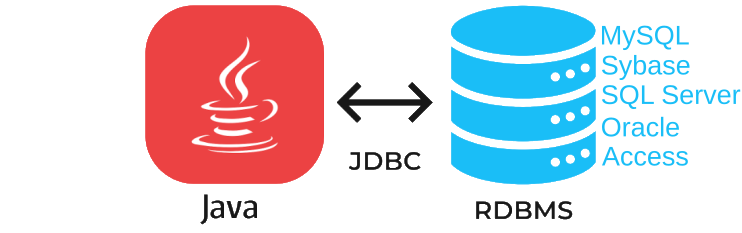

A més podrà executar-se en qualsevol sistema operatiu que posea una Màquina Virtual de Java, és a dir, seran aplicacions completament independents de la plataforma. Altres APIS que es solen utilitzar bastant per a l'accés a bases de dades són DAO (Data Access Objects) i RDO (Remote Data Objects), i ADO (ActiveX Data Objects), però el problema que ofereixen aquestes solucions és que només són per a plataformes Windows.

JDBC té els seus classes en el paquet *java.sql* i altres extensions en el paquet *javax.sql*.

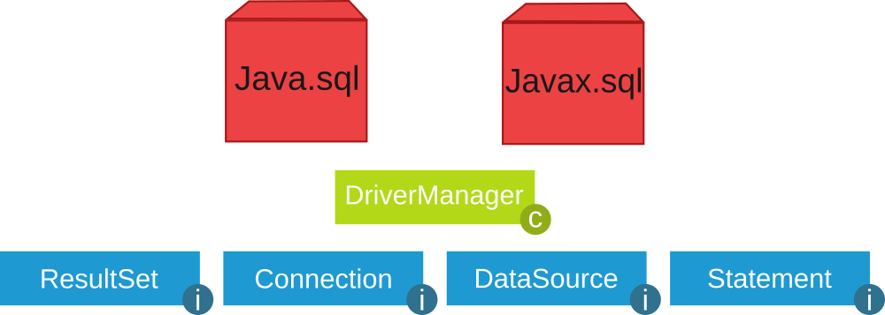

## 1. Funcions del JDBC

Básicament el API JDBC fa possible la realització de les següents tasques:

- Establir una connexió amb una base de dades.

- Enviar sentències SQL.

- Manipular dades.

- Processar els resultats de l'ejecució de les sentències.

## 2. Drivers JDBC

Els drivers ens permeten connectar-nos amb una base de dades determinada. Existeixen **quatre tipus de drivers JDBC**, cada tipus presenta una filosofía de treball diferent. A continuació es passa a comentar cada un dels drivers:

- **JDBC-ODBC bridge plus ODBC driver** (tipus 1): permet al programador accedir a fonts de  dades ODBC existents mitjançant JDBC. El JDBC-ODBC Bridge (puente JDBC-ODBC) implementa operacions JDBC traduciéndolas a operacions ODBC, es troba dins del paquet *sun.jdbc.odbc* i conté llibreries natives per a accedir a ODBC.

Al ser usuari de ODBC depèn de les dll de ODBC i això limita la quantitat de plataformes en on es pot executar l'aplicació.

- **Native-API partly-Java driver** (tipus 2): són similars als drivers de tipo1, en tant en cuanto  també necessiten una configuració en la màquina client. Aquest tipus de driver converteix anomenades JDBC a anomenades de Oracle, Sybase, Informix, DB2 o altres SGBD. Tampoc es poden utilitzar dins d'applets al posseir codi natiu.

- **JDBC-Net pure Java driver** (tipus 3): Aquests controladors estan escritos en Java i s'encarreguen de convertir les anomenades JDBC a un protocol independent de la base de dades i en l'aplicació servidora utilitzen les funcions natives del sistema de gestió de base de dades mitjançant l'ús d'una biblioteca JDBC en el servidor. L'avantatge d'aquesta opció és la portabilitat.

- **JDBC de Java client** (tipus 4): Aquests controladors estan escritos en Java i s'encarreguen de convertir les anomenades JDBC a un protocol independent de la base de dades i en l'aplicació servidora utilitzen les funcions natives del sistema de gestió de base de dades sense necessitat de bibliotecas. L'avantatge d'aquesta opció és la portabilitat. Són com els drivers de *tipus 3* però sense la figura de l'intermediario i tampoc requereixen cap configuració en la màquina client. Els drivers de *tipus 4* es poden utilitzar per a servidors Web de mida xicotet i mitjà, així com per a intranets.

## 3. Instal·lació controlador MySql

1) El primer pas és descarregar des de [https://www.mysql.com/products/connector/](https://www.mysql.com/products/connector/) el connector apropiat.

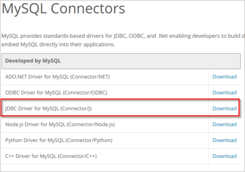

2) Triar Sistema operatiu i versió (*Per a Windows: Platform Independent en ZIP*):

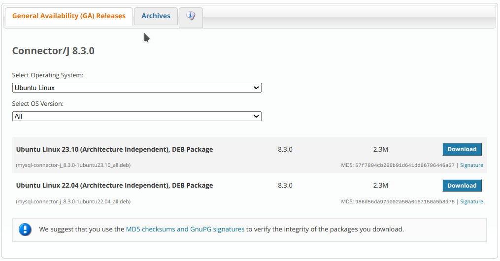

3) Fes clic en **Donwload** i selecciona l'opció: **No thanks, just start download**

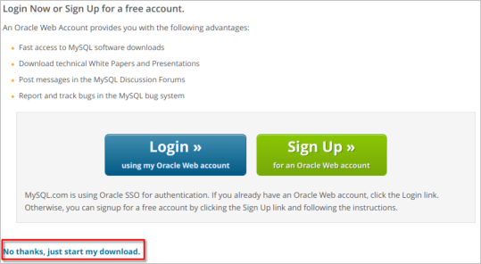

4) Executa el fitxer *deb* (en el cas de *Ubuntu*) descargado (**No necessari en Windows**):


5) Ara haurem d'afegir la llibreria *JDBC* al nostre projecte. Per a això còpia el fitxer `mysql-connector-java-x.x.x.jar` (en Ubuntu es troba en la ruta  `/usr/share/java`) en *JAVA PROJECTS -> Referenced Libraries* de *VS Code*:

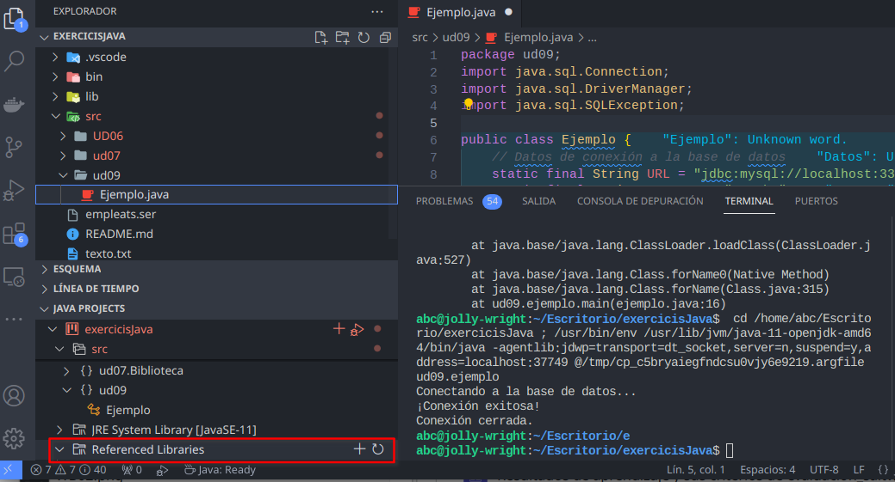

## 4. Carrega del controlador JDBC i connexió amb la BD

El primer pas per a connectar-nos a una base de dades mitjançant JDBC és carregar el controlador apropiat. Aquests controladors es distribuyen en un fitxer `.jar` que provee el fabricant del SGBD i han d'estar accesibles per l'aplicació.

Per a carregar el controlador s'usen les següents sentències:

```java
// clase ConnectToMySql.java
import java.sql.*;

public class ConnectToMySql {
    // JDBC URL, usuario y contraseña de la base de datos  
    private static final String JDBC_URL = "jdbc:mysql://localhost:3306/prueba";
    private static final String USUARIO = "prueba";
    private static final String CONTRASEÑA = "1234";

    public static void main(String[] args) {
        try {
        // Dependiendo de a qué tipo de SGBD queramos conectar cargaremos un controlador u otro

            // Paso 1: Cargar el controlador JDBC de MySQL
            Class<?> c = Class.forName("com.mysql.cj.jdbc.Driver");
            System.out.println("Cargado: " + c.getName());

            //Definir la url de conexión y los parámetros de usuario y contraseña
            // Paso 2: Establecer la conexión con la base de datos
            Connection conexion = DriverManager.getConnection(JDBC_URL, USUARIO, CONTRASEÑA);   
            System.out.println("Conexión completada");

            // Paso 3: Aquí puedes realizar operaciones en la base de datos
            // ...

            // Paso 4: Cerrar la conexión
            conexion.close();
            System.out.println("Conexión cerrada correctamente.");

        } catch (ClassNotFoundException cnfe) {
            System.out.println("ERROR al no encontrarse la clase controlador JDBC: " + cnfe.getMessage());
        } catch (SQLException ex) {
            System.out.println("ERROR al conectar: " + ex.getMessage());
        }
    }
}
```

Observamos les següents qüestions:

- Com ja hem comentado alguna vegada, la sentència `Class.forName()` no seria necessària en moltes aplicacions. Però ens assegura que hem cargado el driver, i per tant el `DriverManager` la sabrá manejar.

- El `DriverManager` és capaç de trobar el driver adequat a través de la url proporcionada (sobre tot si el driver està cargado en memòria), i és qui ens proporciona l'objecte `Connection` per mitjà del mètode `getConnection()`. Existeix una altra forma d'obtindre el `Connection` per mitjà de l'objecte `Driver`, com veurem més avant, però també serà passant indirectament per `DriverManager`.

- Si no es troba la classe del driver (per no tener-lo en les llibreries del projecte, o haver escrit malament el seu nom) es producirá l'excepció `ClassNotFoundException`. És convenient tratar-l'amb `try ... catch`.

- Si no es pot establir la connexió per alguna raó es producirá l'excepció `SQLException`. A l'igual que en el cas anterior, és convenient tratar-l'amb `try ... catch`.

- L'objecte `Connection` mantendrá una connexió amb la Base de dades des del moment de la creació fins al moment de cerrar-l'amb `close()`. És molt important tancar la connexió, no només per a liberar la memòria del nostre ordinador (que al tancar l'aplicació liberaría), sinó sobre tot per a tancar la sessió oberta en el Servidor de Bases de dades.

### 4.1. Connexió alternativa mitjançant `Driver`

Una manera de connectar alternativa a les anteriors és utilitzant l'objecte `Driver`. La classe `java.sql.Driver` pertany a la **API JDBC**, però no és instanciable, i tan només és una interfície, perquè les classes `Driver` dels contenidors hereden d'ella i implementen la manera exacta d'accedir al SGBD corresponent. Com no és instanciable (no podem fer `new Driver()`) la manera de crear-lo és a través del mètode `getDriver()` del `DriverManager`, que seleccionará el driver adequat a partir de la url. Ja només quedarán definir algunes propietats, com l'usuari i la contrasenya, i obtindre el `Connection` per mitjà del mètode `connect()`

La manera de connectar a través d'un objecte `Driver` és més llarga, però més completa ja que es podrien especificar més coses. I potser ayude a entendre el montatge dels controladors dels diferents SGBD en Java.

```java
import java.sql.Connection;
import java.sql.Driver;
import java.sql.DriverManager;
import java.sql.SQLException;
import java.util.Properties;

public class ConnectToMySqlDriver {
    // JDBC URL, usuario y contraseña de la base de datos  
    private static final String JDBC_URL = "jdbc:mysql://localhost:3306/prueba";
    private static final String USUARIO = "prueba";
    private static final String CONTRASEÑA = "1234";

    public static void main(String[] args)  {
        try{
            Driver driver = DriverManager.getDriver(JDBC_URL);

            Properties properties = new Properties();
            properties.setProperty("user", USUARIO);
            properties.setProperty("password", CONTRASEÑA);

            Connection conexion = driver.connect(JDBC_URL, properties);
            System.out.println("Conexión completada a través de Driver");

            // Cerrar la conexión
            conexion.close();
            System.out.println("Conexión cerrada correctamente.");
        } catch (SQLException ex) {
            System.out.println("ERROR al conectar: " + ex.getMessage());
        }
    }
}
```

## 5. Carrega del controlador i de la connexió mitjançant el patró Singleton

Aquest patró de disseny està dissenyat per a restringir la creació d'objectes pertenecientes a una classe.

> **📌 El sinó de `Singleton`**
> 

> La seua intenció consisteix en **garantir que una classe només tinga una instància** i proporcionar un punt d'accés global a ella. 

> 
> El patró `Singleton` es implementa creant en la nostra classe un mètode que crea una instància de l'objecte només si encara no existeix alguna. 

Per a assegurar que la classe no pot ser instanciada novament es regula l'abast del constructor haciéndolo privat. Les situacions més habituals d'aplicació d'aquest patró són aquelles en les que aquesta classe ofereix un conjunt d'utilitats comuns per a totes les capes (com pot ser *el sistema de log*, *connexió a la base de dades*, …) o quan cert tipus de dades ha d'estar disponible per a tots els resta objectes de l'aplicació (en java no hi ha variables globals) El patró *Singleton* provee una única instància global gràcies a que:

- La pròpia classe és responsable de crear la única instància.

- Permet l'accés global a aquesta instància mitjançant un mètode de classe.

- Declara el constructor de classe com privat perquè no siga instanciable directament.

```java
/**
 @see https://stackoverflow.com/questions/6567839/if-i-use-a-singleton-class-for-a-database-connection-can-one-user-close-the-con
 Patron Singleton
 */
public class DatabaseConnection {
    // JDBC URL, usuario y contraseña de la base de datos  
    private static final String JDBC_URL = "jdbc:mysql://localhost:3306/prueba";
    private static final String USUARIO = "prueba";
    private static final String CONTRASEÑA = "1234";

    private static DatabaseConnection dbInstance; //Variable para almacenar la unica instancia de la clase
    private static java.sql.Connection conexion;

    private DatabaseConnection() {
        // El Constructor es privado!!
    }

    public static DatabaseConnection getInstance(){
        //Si no hay ninguna instancia...
        if(dbInstance == null){
            dbInstance = new DatabaseConnection();
        }
        return dbInstance;
    }

    public static java.sql.Connection getConnection(){
        if(conexion == null){
            try {
                conexion = java.sql.DriverManager.getConnection(JDBC_URL, USUARIO, CONTRASEÑA);
                System.out.println("Conexión realizada");

            } catch (java.sql.SQLException ex) {
                System.out.println("ERROR al conectar: " + ex.getMessage());
            }
        }
        return conexion;
    }
}
```

Per a provar el patró Singleton creem, en l'aplicació **[BlueJ](https://es.wikipedia.org/wiki/BlueJ)**, el següent exemple:

( 1 ) Es afegeixen les llibreries des de *Eines -> Preferències -> Llibreries*

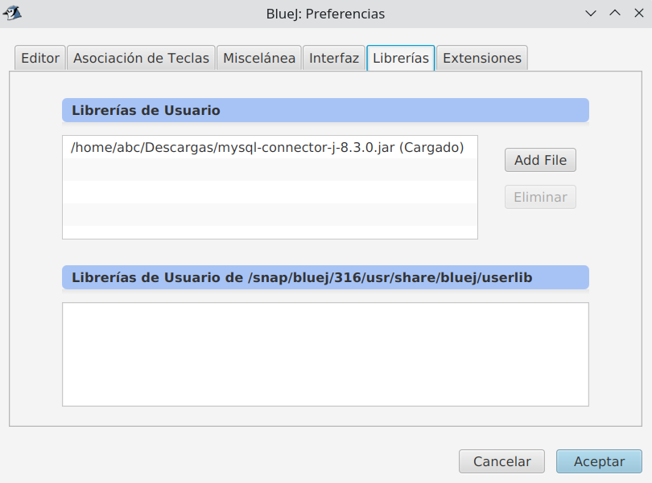

( 2 ) Creem una nova classe `DatabaseConnection` (afegir el codi anterior) en *BlueJ*:

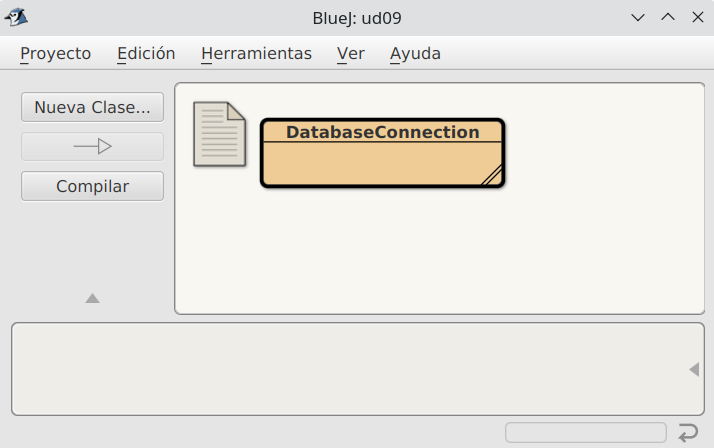

( 3 ) Crearem una nova classe `Test` per a provar la connexió:

```java
import java.sql.*;
public class Test {
    static java.sql.Connection con = DatabaseConnection.getInstance().getConnection();
    public Test(){
        //De momento no hace nada
    }
}
```

  ( 4 ) Unir la classe Test amb la classe DatabaseConnection. 

( 5 ) Compilar totes dues classes:

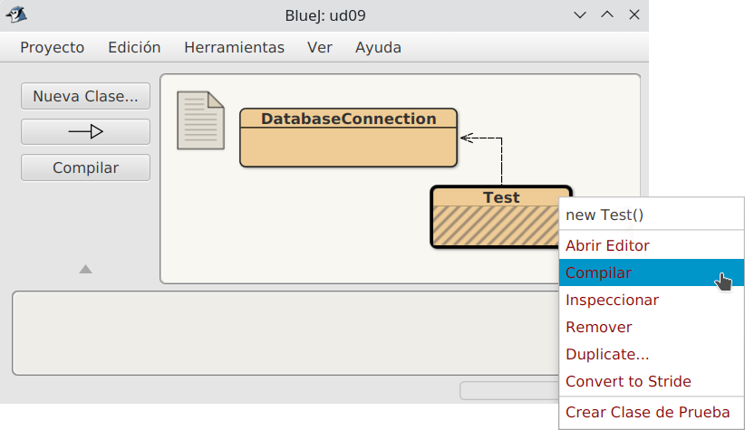

( 6 ) Llançar diversos test (per a comprovar la única connexió a establecida):

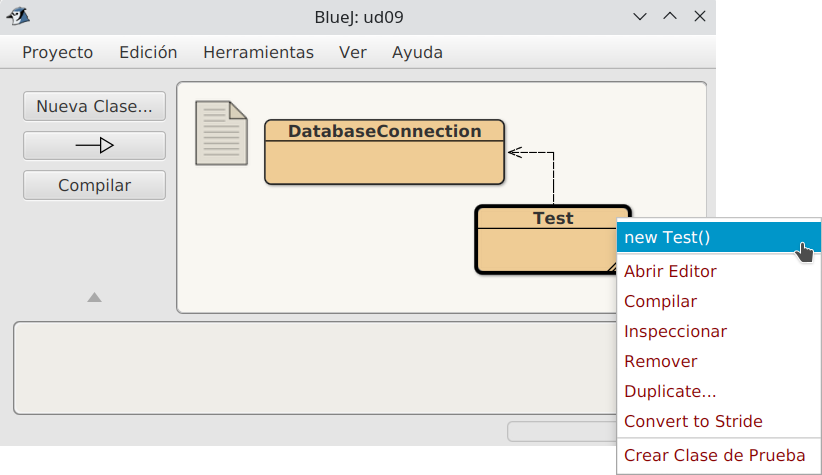

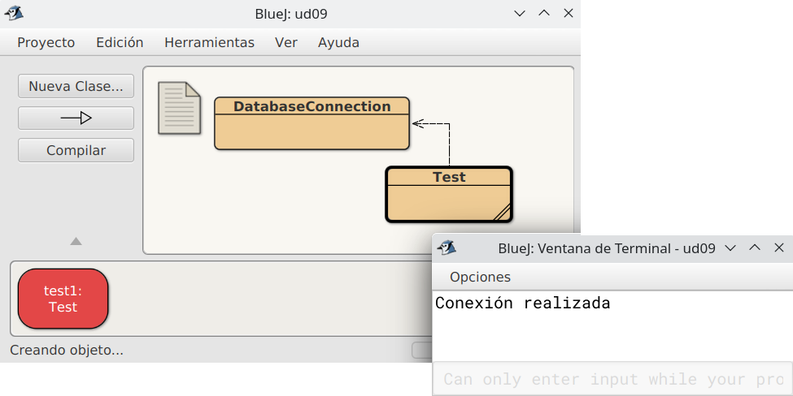


---

## 🎮 Reptes Interactius d'Autoavaluació (+100 XP)

Comprova el teu domini sobre **7.2 Arquitectura i connectors JDBC** superant aquests 4 reptes gamificats (+25 punts cadascun):

<div class="interactive-mcq" data-answer="A" data-hint="Revisa els conceptes teòrics i pràctics d'aquesta secció.">
  <div class="mcq-question">🎯 <strong>Repte 1 (+25 pts):</strong> Per què és fonamental utilitzar PreparedStatement amb paràmetres '?' en lloc de concatenar cadenes en Statement en accedir a bases de dades amb JDBC?</div>
  <div class="mcq-options">
    <button type="button" class="btn-mcq-opt" data-opt="A">A) Perquè precompila la sentència SQL i protegeix l'aplicació contra atacs d'Injecció SQL (SQL Injection).</button>
    <button type="button" class="btn-mcq-opt" data-opt="B">B) Perquè Statement no permet executar consultes SELECT.</button>
    <button type="button" class="btn-mcq-opt" data-opt="C">C) Perquè PreparedStatement no necessita connexió a la base de dades.</button>
    <button type="button" class="btn-mcq-opt" data-opt="D">D) Cap de les anteriors és correcta.</button>
  </div>
  <div class="quiz-feedback"></div>
</div>

<div class="interactive-mcq" data-answer="D" data-hint="Comprova l'apartat corresponent de la unitat.">
  <div class="mcq-question">🎯 <strong>Repte 2 (+25 pts):</strong> Quin patró de disseny de programari separa completament la lògica de negoci de la lògica d'accés i persistència a la base de dades mitjançant classes i interfícies dedicades?</div>
  <div class="mcq-options">
    <button type="button" class="btn-mcq-opt" data-opt="A">A) Patró Singleton d'impressió.</button>
    <button type="button" class="btn-mcq-opt" data-opt="B">B) Recursivitat indirecta.</button>
    <button type="button" class="btn-mcq-opt" data-opt="C">C) Cap de les anteriors és correcta.</button>
    <button type="button" class="btn-mcq-opt" data-opt="D">D) Patró DAO (Data Access Object).</button>
  </div>
  <div class="quiz-feedback"></div>
</div>

<div class="interactive-vf" data-answer="V" data-hint="Verifica l'afirmació amb els apunts de la unitat.">
  <div class="vf-statement">✅ <strong>Repte 3 (Vertader o Fals · +25 pts):</strong> En JDBC, el mètode executeQuery() s'utilitza per a consultes SELECT (retorna un ResultSet), mentre que executeUpdate() s'utilitza per a INSERT, UPDATE i DELETE.</div>
  <div class="vf-buttons">
    <button type="button" class="btn-vf" data-opt="V">Vertader (V)</button>
    <button type="button" class="btn-vf" data-opt="F">Fals (F)</button>
  </div>
  <div class="quiz-feedback" style="width: 100%;"></div>
</div>

<div class="interactive-quiz" data-answer="next" data-hint="Següent en anglès (4 lletres).">
  <div class="quiz-question">⌨️ <strong>Repte 4 (+25 pts):</strong> Quin mètode de l'objecte ResultSet s'invoca dins d'un bucle 'while' per a avançar el cursor a la següent fila de resultats?</div>
  <div class="quiz-controls">
    <input type="text" class="quiz-input" placeholder="Escriu la resposta..." />
    <button type="button" class="btn-quiz-check">Comprovar</button>
  </div>
  <div class="quiz-feedback"></div>
</div>

### 📋 Llista de Comprovació i Rúbrica d'Assoliment

Marca cada criteri a mesura que completes l'estudi o la resolució pràctica d'aquesta pàgina (**7.2 Arquitectura i connectors JDBC**):

- [ ] He llegit detingudament la teoria o l'enunciat d'aquesta secció i he anotat els conceptes clau.
- [ ] He revisat els esquemes, taules o blocs de codi i he verificat que sé aplicar-los a l'entorn de treball.
- [ ] He resolt correctament els **4 reptes interactius** superiors obtenint els **100 punts XP**.
- [ ] He descarregat el comprovant oficial en PDF per a adjuntar-lo a la tasca d'**Aules**.

<div class="aules-delivery-card">
  <h3>📤 Comprovant de Lliurament per a Aules</h3>
  <p>Quan hages completat els reptes interactius i la llista d'autoavaluació d'aquesta pàgina, introdueix el teu nom i descarrega el teu certificat oficial en PDF per a adjuntar-lo a la tasca d'<strong>Aules</strong>.</p>
  <div class="aules-student-field">
    <label for="aules-student-name">👤 Nom i Cognoms de l'Alumne/a:</label>
    <input type="text" id="aules-student-name" class="aules-student-name" placeholder="Ex: Joan Garcia Pérez" />
  </div>
  <div class="aules-score-badge">
    <span class="aules-score-count">0/4 reptes completats (0%) · 0 punts · 0/4 criteris d'autoavaluació</span>
  </div>
  <div class="aules-actions">
    <button type="button" class="btn-aules-dl" data-module="PRG" data-unit="UD07" data-activity="ut0702">📥 Descarregar Comprovant PDF</button>
    <button type="button" class="btn-aules-copy">📋 Copiar Resum al Porta-retalls</button>
  </div>
  <div class="aules-toast"></div>
</div>

