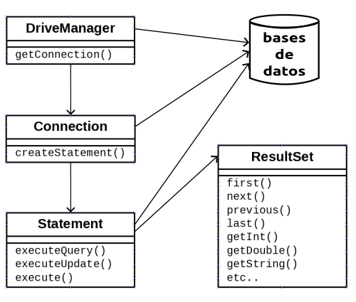
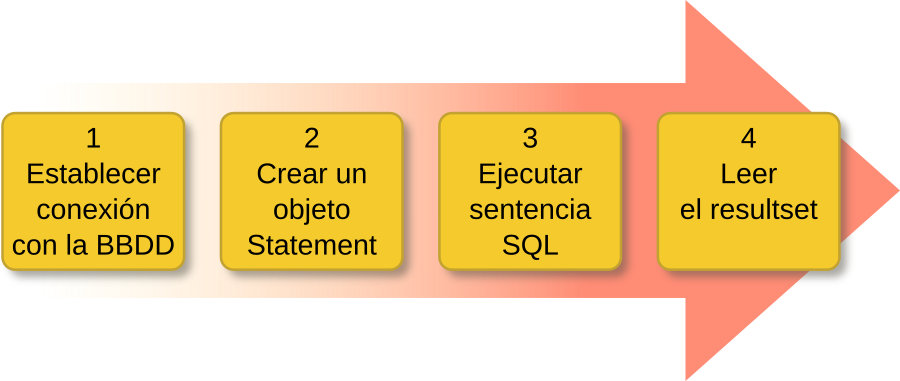
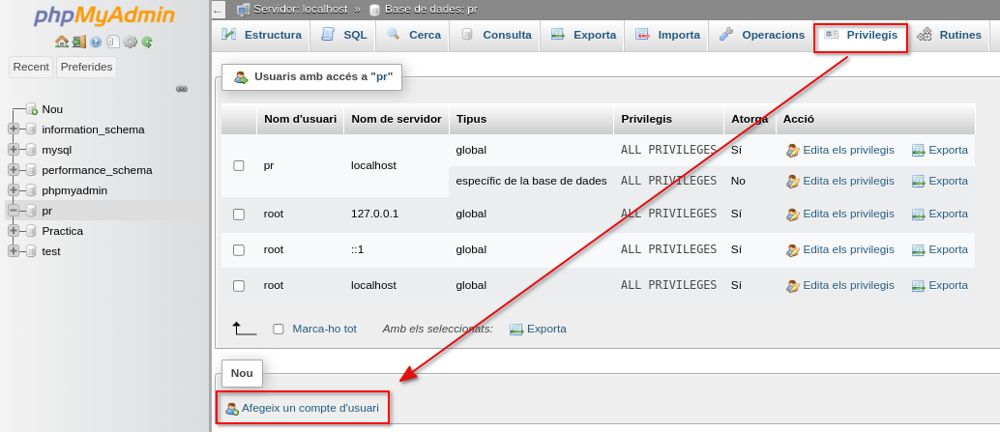
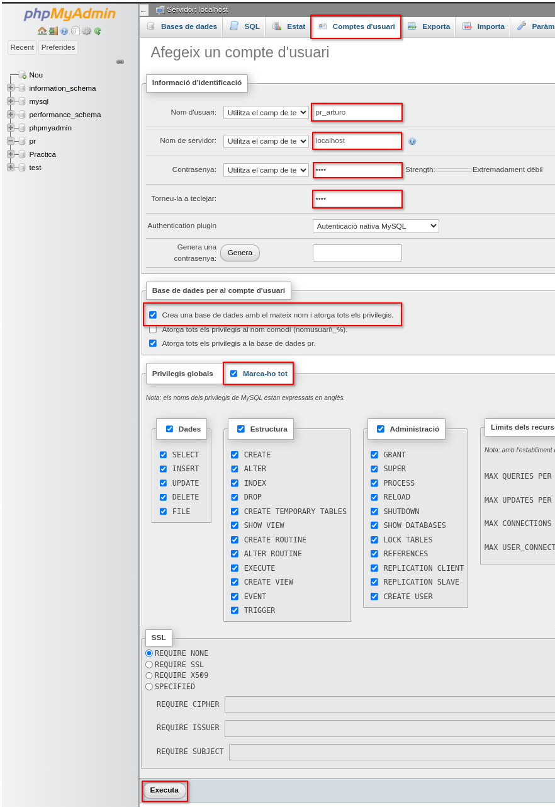

<div class="interactive-progress-tracker">
  <div class="tracker-header">
    <span>🏆 <strong>Progrés d'aquesta secció:</strong> <span class="tracker-count">0 de 4 superats (0%)</span></span>
    <span class="tracker-pts">⭐ <strong>0 punts</strong></span>
  </div>
  <div class="tracker-bar">
    <div class="tracker-fill" style="width: 0%;"></div>
  </div>
</div>

# 7.3 Connexió a bases de dades des de Java

## 1. Carregar el Driver

En un projecte Java que realitze connexions a bases de dades és necessari, abans que res, utilitzar `Class.forname(…).newInstance()` per a carregar dinámicament el Driver que utilitzarem. Açò només és necessari fer-ho una vegada en el nostre programa. Pot llançar excepcions per la qual cosa és necessari utilitzar un bloc *try-catch*.

```java
try {
    Class.forName("com.mysql.cj.jdbc.Driver").newInstance();    

} catch (Exception e) {
    // manejamos el error
}
```

Cal tindre en compte que les classes i mètodes utilitzats per a connectar-se a una base de dades (explicats més avant) funcionen amb tots els drivers disponibles per a Java (JDBC és només un, hi ha molts més). Açò és possible ja que l'estàndard de Java només els defineix com interfícies (*interface*) i cada llibreria driver els implementa (defineix les classes i el seu codi). Per això és necessari utilitzar `Class.forName(…)` per a indicarle a Java què driver utilitzarem.

Aquest nivell d'asbtracció facilita el desenvolupament de projectes ja que si necesitáramos utilitzar un altre sistema de base de dades (que no fóra *MySQL*) només necessitaríem canviar la línia de codi que carrega el driver i poc més. Si cada sistema de base de dades necesitara que utilizáramos distintes classes i mètodes tot seria molt més complicat.



Les quatre classes fonamentals que tota aplicació Java necessita per a connectar-se a una base de dades i executar sentències són: **`DriverManager`**, **`Connection`**, **`Statement`** i **`ResultSet`**. 



## 2. Classe `DriverManager`

**Pas 1: Establir connexió amb la BBDD**

> **📌 Exemple de connexió segons SGBD**
> 

```java
/* Para MySQL:
    jdbc  --> driver
    mysql --> protocolo driver
    localhost:3306/gestionPedidos --> detalles de la conexión
*/
jdbc:mysql://localhost:3306/gestionPedidos

jdbc:odbc:DSN_gestionPedidos                  // para SQL Server

jdbc:oracle:juan@servidor:3306:gestionPedidos // para Oracle
```

Anem a necessitar informació addicional com són les dades de *usuari* i *contrasenya*.

La classe **java.sql.DriverManager** és la capa gestora del driver JDBC. S'encarrega de manejar el Driver apropiat i **permet crear connexions amb una base de dades** mitjançant el mètode estàtic **`getConnection()`** que té dos variants:

```java
DriveManager.getConnection(String url)
// y
DriveManager.getConnection(String url, String user, String password)
```

Aquest mètode intentará establir una connexió amb la base de dades segons la *URL* indicada. Opcionalment es li pot passar el *usuari* i *contrasenya* com argument (també es pot indicar en la pròpia *URL*). Si la connexió és satisfactoria retornarà un objecte **Connection**.

<details markdown="1">

<summary>💡 Exemple de connexió a la base de dades *prova* en localhost</summary>

```java
String url = "jdbc:mysql://localhost:3306/prueba";
Connection conexion = DriverManager.getConnection(url,"root","");
```

</details>

Aquest mètode pot llançar dos tipus d'excepcions (que caldrà manejar amb un *try-catch*):

- **SQLException**: la connexió no ha pogut producir-se. Pot ser per multitud de motivos com una URL malament formada, un error en la xarxa, host o port incorrecte, base de dades no existent, usuari i contrasenya no vàlids, etc.

- **SQLTimeoutException**: es ha superado el *LoginTimeout* sense rebre resposta del servidor.

## 3. Classe `Connection`

**Pas 2. Crear un objecte Statement**

Un objecte **java.sql.Connection representa una** **sessió de** **connexió amb una base de dades**. Una aplicació pot tindre tantes connexions com necesite, ja siga amb una o diverses bases de dades.

El mètode més relevante és **`createStatement()`** que retorna un objecte *Statement* associat a aquesta connexió que permet executar sentències SQL.

El mètode *createStatement()* també pot llançar excepcions de tipus **SQLException**.

```java
Statement st = conexion.createStatement();
```

Quan ja no la necessitem és aconsejable **tancar** **la connexió amb `close()`** per a liberar recursos:

```java
conexion.close();
```

## 4. Classe `Statement`

**Pas 3. Executar sentència SQL**

Un objecte **java.sql.Statement** permet **executar** **sentències SQL** **en** **la base de dades** a través de la connexió amb la que es creó el *Statement* (veure *Pas 2*). Els tres mètodes més comuns d'ejecució de sentències SQL són `executeQuery(…)`, `executeUpdate(…)` i `execute(…)`.

Aquests tres mètodes poden llançar excepcions de tipus **SQLException** i **SQLTimeoutException**.

- **`ResultSet executeQuery(String sql)`**: executa la sentència sql indicada (de tipus *SELECT*). Retorna un objecte *ResultSet* amb les dades proporcionats pel servidor.  

```sql
ResultSet rs = st.executeQuery("SELECT * FROM vendedores");
```

- **`int executeUpdate(String sql)`**: executa la sentència sql indicada (de tipus *DML* com per exemple *INSERT*, *UPDATE* o *DELETE*).  Retorna un número de registres que han sigut insertats, modificats o eliminats.

```sql
int nr = st.executeUpdate ("INSERT INTO vendedores VALUES (1,'Pedro Gil', '2017-04-11', 15000);")
```

Quan ja no el necessitem és aconsejable **tancar el *statement* amb `close()`** per a liberar recursos:

```java
st.close();
```

> **📌 Nota**
> 

> Podríem dir que aquest *resultset* és una espècie de *taula virtual* que s'emmagatzema en memòria amb la informació en el seu interior.

## 5. Classe `ResultSet`

**Pas 4. Llegir el resultset**

Un objecte **java.sql.ResultSet** conté un conjunt de resultats (dades) obtinguts després d'executar una sentència SQL, normalment de tipus SELECT. És una **estructura de dades en forma de taula** amb **registres (files)** que podem recórrer per a accedir a la informació dels seus **camps (columnes)**.

*ResultSet* utilitza internament un cursor que apunta al *registre actual* sobre el que podem operar. Inicialment aquest cursor està situat abans de la primera fila i disposem de diversos mètodes per a desplazar el cursor. El més comú és **`next()`**:

- **`boolean next()`**: mueve el cursor al següent registre. Retorna *true* si va ser possible i *false* en cas contrari (si ja llegamos al final de la taula).

Alguns dels mètodes per a obtindre les dades del registre actual són:

- **`String getString(String columnLabel)`**: retorna un dada *String* de la columna indicada pel seu nom. 

<details markdown="1">

<summary>💡 Per exemple</summary>

```java
rs.getString("nombre");
```

</details>

- **`String getString(int columnIndex)`**: retorna un dada *String* de la columna indicada pel seu nom (la primera columna és la 1, no la zero). 

<details markdown="1">

<summary>💡 Per exemple</summary>

```java
rs.getString(2);
```

</details>

Existeixen mètodes análogos als anteriors per a obtindre valors de tipus *int*, *long*, *float*, *double*, *boolean*, *Date*, *Time*, *Array*, etc. Poden consultar-se tots en la [documentació oficial de Java](https://docs.oracle.com/en/java/javase/11/docs/api/java.sql/java/sql/ResultSet.html).

- **`int getInt(String columnLabel)`**

- **`int getInt(int columnIndex)`**

- **`double getDouble(String columnLabel)`**

- **`double getDouble(int columnIndex)`**

- **`boolean getBoolean(String columnLabel)`**

- **`boolean getBoolean(int columnIndex)`**

- **`Date getDate(String columnLabel)`**

- **`Date getDate(int columnIndex)`**

- etc.

Més avant veurem com es realitza la modificació i inserció de dades.

Tots aquests mètodes poden llançar una **SQLException**.

<details markdown="1">

<summary>💡 Exemple per a recórrer un *ResultSet* anomenat *rs* i mostrar-el per pantalla</summary>

```java
while(rs.next()) {
    int id = rs.getInt("id");
    String nombre = rs.getString("nombre");
    Date fecha = rs.getDate("fecha_ingreso");
    float salario = rs.getFloat("salario");

    System.out.println(id + " " + nombre + " " + fecha + " " + salario);
}
```

</details>

<details markdown="1">

<summary>💡 Exercici previo: crear base de dades</summary>

Per a la realització dels exercicis hauràs de crear una base de dades en el teu SGBD (MySql) de nom `pr_tuNombre`.
Per a això hauràs de de crear un usuari de nom `pr_tuNombre` amb contrasenya `1234` i amb una base de dades amb el mateix nom:





  

Descarrega el fitxer sql **taules.sql** i insértalas en el teu base de dades.   

Per a això, veu a la pestanya de phpMyAdmin `Importa`, selecciona el fitxer descargado anteriorment i ejecútalo.

</details>

<details markdown="1">

<summary>💡 Exemple *Connection*, *Statement* i *ResultSet*</summary>

#### 📌 DbConnect.java

```java
public class DbConnect {
    // JDBC URL, usuario y contraseña de la base de datos  
    private static final String JDBC_URL = "jdbc:mysql://localhost:3306/pr_ana";
    private static final String USUARIO = "pr_ana";
    private static final String CONTRASEÑA = "1234";

    private static DbConnect dbInstance; //Variable para almacenar la unica instancia de la clase
    private static java.sql.Connection conexion;

    private DbConnect() {
        // El Constructor es privado!!
    }

    public static DbConnect getInstance(){
        //Si no hay ninguna instancia...
        if(dbInstance == null){
            dbInstance = new DbConnect();
        }
        return dbInstance;
    }

    public static java.sql.Connection getConnection(){
        if(conexion == null){
            try {
                conexion = java.sql.DriverManager.getConnection(JDBC_URL, USUARIO, CONTRASEÑA);
                System.out.println("Conexión realizada SINGLETON");

            } catch (java.sql.SQLException ex) {
                System.out.println("ERROR al conectar: " + ex.getMessage());
            }
        }
        return conexion;
    }
}
```

#### 📌 Test.java

```sql
import java.sql.*;

public class Test {
    public static void main(String[] args) {
        //Paso 1: Crear y almacenar conexión
        DbConnect.getInstance();
        Connection conexion = DbConnect.getConnection();

        try {
            //Paso 2: Crear el statement
            Statement st = conexion.createStatement();

            // Paso 3: Aquí puedes realizar operaciones en la base de datos

            //Insert
            int nr = st.executeUpdate("INSERT INTO alumnos(nombre) VALUES ('Ana Asins');");
            //Update
            nr = st.executeUpdate("UPDATE alumnos SET edad = 28 WHERE nombre = 'Ana Asins';");

            //Select
            ResultSet rs = st.executeQuery("SELECT * FROM alumnos");
            //Recorrer datos devueltos
            while (rs.next()) {
                String nombre = rs.getString("nombre");
                int edad = rs.getInt("edad");

                System.out.println("El alumno " + nombre + " tiene " +edad + " años.");
            }

            // Paso 4: Cerrar la conexión
            st.close();
            conexion.close();
            System.out.println("Conexión cerrada correctamente.");

        } catch (SQLException ex) {
            System.out.println("ERROR al conectar: " + ex.getMessage());
        }         
    }
}
```

</details>

<details markdown="1">

<summary>💡 Seguint l'exemple anterior...</summary>

Després d'açò, crea un exercici de nom `ListarProveedores.java` en el que es liste tots els proveïdors.

</details>


---

## 🎮 Reptes Interactius d'Autoavaluació (+100 XP)

Comprova el teu domini sobre **7.3 Connexió a bases de dades des de Java** superant aquests 4 reptes gamificats (+25 punts cadascun):

<div class="interactive-mcq" data-answer="A" data-hint="Revisa els conceptes teòrics i pràctics d'aquesta secció.">
  <div class="mcq-question">🎯 <strong>Repte 1 (+25 pts):</strong> Per què és fonamental utilitzar PreparedStatement amb paràmetres '?' en lloc de concatenar cadenes en Statement en accedir a bases de dades amb JDBC?</div>
  <div class="mcq-options">
    <button type="button" class="btn-mcq-opt" data-opt="A">A) Perquè precompila la sentència SQL i protegeix l'aplicació contra atacs d'Injecció SQL (SQL Injection).</button>
    <button type="button" class="btn-mcq-opt" data-opt="B">B) Perquè Statement no permet executar consultes SELECT.</button>
    <button type="button" class="btn-mcq-opt" data-opt="C">C) Perquè PreparedStatement no necessita connexió a la base de dades.</button>
    <button type="button" class="btn-mcq-opt" data-opt="D">D) Cap de les anteriors és correcta.</button>
  </div>
  <div class="quiz-feedback"></div>
</div>

<div class="interactive-mcq" data-answer="D" data-hint="Comprova l'apartat corresponent de la unitat.">
  <div class="mcq-question">🎯 <strong>Repte 2 (+25 pts):</strong> Quin patró de disseny de programari separa completament la lògica de negoci de la lògica d'accés i persistència a la base de dades mitjançant classes i interfícies dedicades?</div>
  <div class="mcq-options">
    <button type="button" class="btn-mcq-opt" data-opt="A">A) Patró Singleton d'impressió.</button>
    <button type="button" class="btn-mcq-opt" data-opt="B">B) Recursivitat indirecta.</button>
    <button type="button" class="btn-mcq-opt" data-opt="C">C) Cap de les anteriors és correcta.</button>
    <button type="button" class="btn-mcq-opt" data-opt="D">D) Patró DAO (Data Access Object).</button>
  </div>
  <div class="quiz-feedback"></div>
</div>

<div class="interactive-vf" data-answer="V" data-hint="Verifica l'afirmació amb els apunts de la unitat.">
  <div class="vf-statement">✅ <strong>Repte 3 (Vertader o Fals · +25 pts):</strong> En JDBC, el mètode executeQuery() s'utilitza per a consultes SELECT (retorna un ResultSet), mentre que executeUpdate() s'utilitza per a INSERT, UPDATE i DELETE.</div>
  <div class="vf-buttons">
    <button type="button" class="btn-vf" data-opt="V">Vertader (V)</button>
    <button type="button" class="btn-vf" data-opt="F">Fals (F)</button>
  </div>
  <div class="quiz-feedback" style="width: 100%;"></div>
</div>

<div class="interactive-quiz" data-answer="next" data-hint="Següent en anglès (4 lletres).">
  <div class="quiz-question">⌨️ <strong>Repte 4 (+25 pts):</strong> Quin mètode de l'objecte ResultSet s'invoca dins d'un bucle 'while' per a avançar el cursor a la següent fila de resultats?</div>
  <div class="quiz-controls">
    <input type="text" class="quiz-input" placeholder="Escriu la resposta..." />
    <button type="button" class="btn-quiz-check">Comprovar</button>
  </div>
  <div class="quiz-feedback"></div>
</div>

### 📋 Llista de Comprovació i Rúbrica d'Assoliment

Marca cada criteri a mesura que completes l'estudi o la resolució pràctica d'aquesta pàgina (**7.3 Connexió a bases de dades des de Java**):

- [ ] He llegit detingudament la teoria o l'enunciat d'aquesta secció i he anotat els conceptes clau.
- [ ] He revisat els esquemes, taules o blocs de codi i he verificat que sé aplicar-los a l'entorn de treball.
- [ ] He resolt correctament els **4 reptes interactius** superiors obtenint els **100 punts XP**.
- [ ] He descarregat el comprovant oficial en PDF per a adjuntar-lo a la tasca d'**Aules**.

<div class="aules-delivery-card">
  <h3>📤 Comprovant de Lliurament per a Aules</h3>
  <p>Quan hages completat els reptes interactius i la llista d'autoavaluació d'aquesta pàgina, introdueix el teu nom i descarrega el teu certificat oficial en PDF per a adjuntar-lo a la tasca d'<strong>Aules</strong>.</p>
  <div class="aules-student-field">
    <label for="aules-student-name">👤 Nom i Cognoms de l'Alumne/a:</label>
    <input type="text" id="aules-student-name" class="aules-student-name" placeholder="Ex: Joan Garcia Pérez" />
  </div>
  <div class="aules-score-badge">
    <span class="aules-score-count">0/4 reptes completats (0%) · 0 punts · 0/4 criteris d'autoavaluació</span>
  </div>
  <div class="aules-actions">
    <button type="button" class="btn-aules-dl" data-module="PRG" data-unit="UD07" data-activity="ut0703">📥 Descarregar Comprovant PDF</button>
    <button type="button" class="btn-aules-copy">📋 Copiar Resum al Porta-retalls</button>
  </div>
  <div class="aules-toast"></div>
</div>

