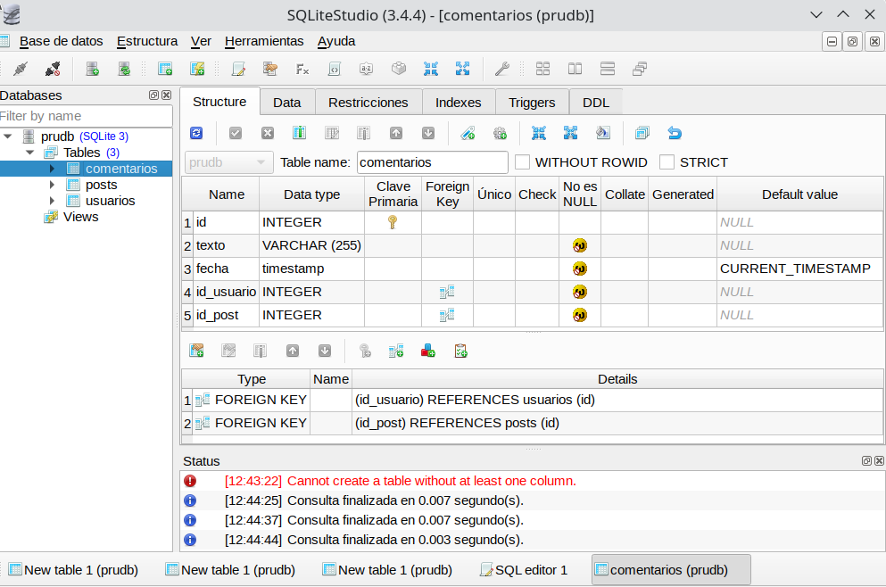
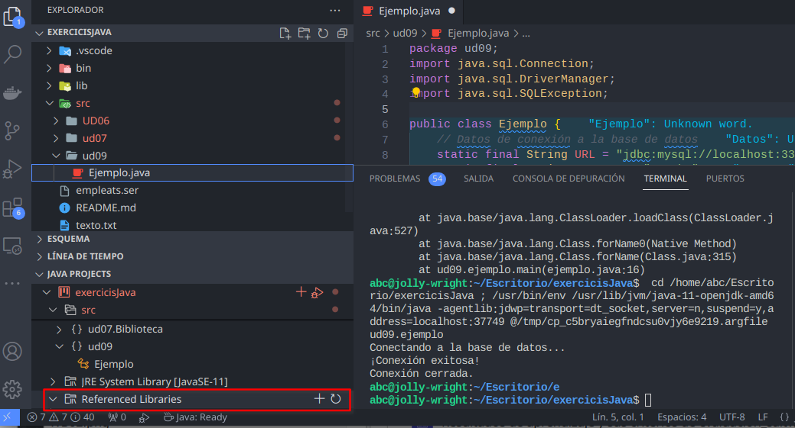

<div class="interactive-progress-tracker">
  <div class="tracker-header">
    <span>🏆 <strong>Progrés d'aquesta secció:</strong> <span class="tracker-count">0 de 4 superats (0%)</span></span>
    <span class="tracker-pts">⭐ <strong>0 punts</strong></span>
  </div>
  <div class="tracker-bar">
    <div class="tracker-fill" style="width: 0%;"></div>
  </div>
</div>

# 7.10 Treballar amb SQLite en Java

Per a poder treballar en casa, utilitzarem *Sqlite* que és un una base de dades senzilla que es guarda en un únic fitxer en disc.

El primer és instal·lar *SQLite*, en Ubuntu:

```java
sudo apt install sqlite3
```

Si queréis fer-ho en *Windows*, podéis seguir les instruccions en [http://www.sqlitetutorial.net/download-install-sqlite/](http://www.sqlitetutorial.net/download-install-sqlite/).

Per a poder treballar en *Java*, hem de descarregar el connector, des de [https://github.com/xerial/sqlite-jdbc/releases](https://github.com/xerial/sqlite-jdbc/releases).

El primer que hem de fer és crear una base de dades, des de la línia de comandes. Per a això ens situamos en el directori del projecte i la creem en el directori `bd` mitjançant el següent comanda:

```java
cd directorio-del-proyecto
# directorio-del-proyecto: EjerciciosJava

mkdir bd
cd bd

sqlite network.bd
```

## 1. Instal·lar SQLiteStudio

Podem instal·lar una aplicació gràfica com **SQLiteStudio** per a treballar (més fàcilment) amb SQLite des d'aquests enllaços:

- 

[https://sqlitestudio.pl/](https://sqlitestudio.pl/) (Ubuntu) i

- 

[https://github.com/pawelsalawa/sqlitestudio/releases](https://github.com/pawelsalawa/sqlitestudio/releases) (altres plataformes),



Mitjançant aquests comandes creem una base de dades en disc anomenada **prudb.bd**.

```sql
CREATE TABLE usuarios (
 id INTEGER PRIMARY KEY AUTOINCREMENT,
  nombre VARCHAR(50) NOT NULL,
  apellidos VARCHAR(255) NOT NULL
);

CREATE TABLE posts (
  id INTEGER PRIMARY KEY AUTOINCREMENT,
  texto VARCHAR(255) NOT NULL,
  likes INTEGER NOT NULL,
  fecha timestamp NOT NULL DEFAULT CURRENT_TIMESTAMP,
  id_usuario INTEGER NOT NULL,
  FOREIGN KEY (id_usuario) REFERENCES usuarios(id)
);

CREATE TABLE comentarios (
  id INTEGER PRIMARY KEY AUTOINCREMENT,
  texto VARCHAR(255) NOT NULL,
  fecha timestamp NOT NULL DEFAULT CURRENT_TIMESTAMP,
  id_usuario INTEGER  NOT NULL,
  id_post INTEGER  NOT NULL,
  FOREIGN KEY (id_usuario) REFERENCES usuarios(id),
  FOREIGN KEY (id_post) REFERENCES posts(id)
);
```

Ara haurem d'afegir la llibreria *JDBC* (fitxer *.jar) al nostre projecte. Per a això còpia el fitxer `mysql-connector-java-x.x.x.jar` (en Ubuntu es troba en la ruta  `/usr/share/java`) en *JAVA PROJECTS -> Referenced Libraries* de *VS Code*:



I ara modificamos `DatabaseConnection`:

```java
String host = "jdbc:sqlite:src/main/resources/network";
 con = java.sql.DriverManager.getConnection( host);
```

I fem una prova per a veure si funciona:

```java
import java.sql.SQLException; 

public class Main { 

      public static void main(String[] args) { 
          // TODO Aute-generated mettod stub 
          Test t = new Test(); 
          t.insertUser(); 

          try {
              t.getellUsers(); 
          } catch (SQLException sqle) { 
              System.out.println(sqle.getMessage()); 
          }
          t.closeConnection(); 
      }
}
```

I aquest ha de ser el resultat:

```java
Conexión realizada
1   Janet   Espinosa
```

## 2. Exemples

Crearem una xicoteta base de dades per a *Empleats* en Sqlite:

| **Num** | **Nom**bre | **Depart**amento | **Edat** | **Sueldo** |
| --- | --- | --- | --- | --- |
| 1 | Andreu | 10 | 32 | 1000.00 |
| 2 | Bernat | 20 | 28 | 1200.00 |
| 3 | Claudia | 10 | 26 | 1100.00 |
| 4 | Damià | 10 | 40 | 1500.00 |

Primer creem un nou Projecte en VSCode anomenat `EmpleadosBD` i li afegim la llibreria sqlite al build path.

Creem també la base de dades mitjançant la línia de comandes:

```java
cd directorio-del-proyecto
mkdir bd
cd bd
sqlite empleados.bd
```

Copiamos el fitxer `DatabaseConnection.java` de l'anterior projecte i modificamos la cadena de connexió:

```java
String host = "jdbc:sqlite:./bd/empleados.bd";
con = java.sql.DriverManager.getConnection( host);
```

### 2.1. Crear taula

Creem una classe `CreateTable` per a poder crear la taula:

```sql
import java.sql.SQLException; 
import java.sql.Statement; 

public class CreateTable {
    static java.sql.Connection con = DatabaseConnection.getInstance().getConnection(); 

    public static vold main(String[] args) { 
        Statement st = null; 
        String sql = "CREATE TABLE empleados ( " + 
                     " num INTEGER PRIMARY KEY, " + 
                     " nombre VARCHAR(255), " +
                     " departamento INTEGER, " + 
                     " edad INTEGER, " + 
                     " sueldo REAL);"; 
        try { 
            st = con.createStatement(); 
            st.executeUpdate(sql); 
        } catch (sQLException ex) { 
            system.out.println("Error " + ex.getMessage()); 
        } finally {
            try {
                if (st != null && !st.isClosed()) {
                    st.close(); 
                }
            } catch (SQLException ex) { 
                system.out.println ("No se ha podido cerrar el Statement por alguna razón");
            }
            try {
                if (con != null && !con.isClosed()) {
                    con.close(); 
                }
            } catch (SQLException ex) { 
                system.out.println ("No se ha podido cerrar el Statement por alguna razón");
            }
        }
    }
}
```

### 2.2. Inserir dades

I creem una altra per a inserir dades. Aquesta vegada el farem amb `PreparedStatement`:

```sql
import java.sql.PreparedStatement; 
import java.sql.SQLException; 

public class InsertData { 
  static java.sql.Connection con = DatabaseConnection.getInstance().getConnection(); 

  public static void main(String[] args) { 
      PreparedStatement st = null;
      String sql = "INSERT INTO empleados (num, nombre, departamento, edad, sueldo) VALUES (?, ?, ?, ?, ?)"; 
      try { 
          st = con.prepareStatement(sql); 
          st.setlnt(1, 1); 
          st.setString(2, "Andreu"); 
          st.setlnt(3, 10); 
          st.setlnt(4, 32); 
          st.setDouble(5, 1000.0); 
          st.executeUpdate(); 

          st.setlnt(1, 2); 
          st.setString(2, "Bernat"); 
          st.setlnt(3, 20); 
          st.setlnt(4, 28); 
          st.setDouble(5, 1200.0); 
          st.executeUpdate(); 

          st.setlnt(1, 3); 
          st.setString(2, "Claudia"); 
          st.setlnt(3, 10); 
          st.setlnt(4, 26);
          st.setDouble(5, 1400.0); 
          st.executeUpdate(); 

          st.setlnt(1, 4); 
          st.setString(2, "Damián"); 
          st.setlnt(3, 10); 
          st.setlnt(4, 40); 
          st.setDouble(5, 1300.0); 
          st.executeUpdate(); 

      } catch (SQLException ex) { 
          System.out.println("Error " + ex.getMessage()); 

      } finally { 
          try { 
              if (st != null && !st.isClosed()) { 
                  st.close(); 
              } 
          } catch (SQLException ex) { 
              System.out.println("No se ha podido cerrar el Statement por alguna razón"); 
          } 

          try { 
              if (con != null && !con.isClosed()) { 
                  con.close(); 
              } 
          } catch (SQLException ex) { 
              System.out.println("No se ha podido cerrar Connection por alguna razón"); 
          } 
      }
  }
}
```

Aquesta és la versió amb `Statement`:

```sql
import java.sql.Statement; 
import java.sql.SQLException; 

public class InsertDataStatement { 
  static java.sql.Connection con = Databaseconnection.getInstance().getConnection(); 

  public static void main(String[] args) { 
      Statement st = null; 
      String sql = ""; 

      try { 
          st = con.createStatement();
          sql = "INSERT INTO EMPLEADOS (num, nombre, departamento, edad, sueldo) VALUES (5, 'Arturo', 10, 32, 1088.8)"; 
          st.executeUpdate(sql); 

          sql = "INSERT INTO EMPLEADOS (num, nombre, departamento, edad, sueldo) VALSES (6, 'Juan', 28, 28, 1280.8)";
          st.executeUpdate(sql); 

          sql = "INSERT INTO EMPLEADOS (num, nombre, departamento, edad, sueldo) VALUES (2, 'Martín', 10, 26, 1488.8)"; 
          st.executeUpdate(sql); 

      } catch (SQLEXCeptiOn ex) {
          System.ont.println("Error: "+ ex.getMesSege());

      } finally {
          try { 
              if (st != null && !st.isClosed()) {
                  st.close(); 
              }
          } catch (SQLException ex) { 
              System.out.println("No se ha podido cerrar el Statement por alguna razón");
          }
          try { 
              if (con != null && !con.isClosed()) {
                  con.close(); 
              }
          } catch (SQLException ex) { 
              System.out.println("No se ha podido cerrar el Statement por alguna razón");
          }
      }
  }
}
```

#### Consultar dades

Creem una classe `getAllEmpleados` que ens retorne tots els empleats:

```sql
import java.sql.Resultset; 
import java.sql.SQLException; 
import java.sql.Statement; 

public class getAllEmpleados { 
    static java.sql.Connection con = DatabaseConnection.getInstance().getConnection(); 

    public static void main(String[] args) { 
        Statement st = null; 
        Resultset rs = null; 

        try {
            st = con.createStatement(); 
            rs = st.executeQuery("SELECT * FROM empleados"); 
            System.out.println("Núm. \tNombre \tDep \tEdad \tSueldo"); 
            System.out.println("------------------------------------------");
            while (rs.next()){ 
                System.out.print(rs.getInt(1) + "\t"); 
                system.out.print(rs.getString(2) + "\t"); 
                system.out.print(rs.getInt(3) + "\t"); 
                system.out.print(rs.getInt(4) + "\t"); 
                System.out.println(rs.getDouble(5)); 

        } catch(SQLException e) { 
                System.out.println("Se ha producido un error al leer los usuarios " + e.getMessage());           

        } finally { 
            try { 
                //Siempre se debe cerrar todo lo abierto 
                if (st != null) {
                    st.close(); 
                }
            } catch (java.sql.SQLException ex){
                System.out.println("Se ha producido un error: " + ex.getMessage()); 
            }
            try { 
                //Siempre se debe cerrar todo lo abierto 
                if (rs != null) {
                    rs.close(); 
                }
            } catch (java.sql.SQLException ex){
                System.out.println("Se ha producido un error: " + ex.getMessage()); 
            }
        }
    }
}
```

#### Modificar dades

Ara modificamos les dades. Simplement aumentamos el sueldo un 5% i modificamos el departament de l'empleat 3, poniéndole el departament 3.

```java
import java.sql.Statement; 
import java.sql.SQLException; 

public class ModifyData { 
  static java.sql.Connection con = Databaseconnection.getInstance().getConnection(); 

  public static void main(String[] args) { 
      Statement st = null; 
      String sql = "";
      try {
          st = con.createStatement(); 
          sql = "UPDATE EMPLEADOS SET sueldo = sueldo * 1.05";
          st.executeUpdate(sql);

          sql = "UPDATE EMPLEADOS SET departamento = 20 WHERE num = 3";
          st.executeUpdate(sql); 

      } catch (SQLException ex) { 
          system.out.printlnr("Error "+ ex.getMessage());

      } finally { 
          try { 
              if (st != null && !st.isClosed()) { 
                  st.close(); 
              } 
          } catch (SQLException ex) { 
              system.out.println("No se ha podido cerrar el Statement por alguna razón");
          }
          try { 
              if (con != null && !con.isClosed()) { 
                  con.close(); 
              } 
          } catch (SQLException ex) { 
              system.out.println("No se ha podido cerrar el Statement por alguna razón");
          }
      }
  }
}
```


---

## 🎮 Reptes Interactius d'Autoavaluació (+100 XP)

Comprova el teu domini sobre **7.10 Treballar amb SQLite en Java** superant aquests 4 reptes gamificats (+25 punts cadascun):

<div class="interactive-mcq" data-answer="A" data-hint="Revisa els conceptes teòrics i pràctics d'aquesta secció.">
  <div class="mcq-question">🎯 <strong>Repte 1 (+25 pts):</strong> Per què és fonamental utilitzar PreparedStatement amb paràmetres '?' en lloc de concatenar cadenes en Statement en accedir a bases de dades amb JDBC?</div>
  <div class="mcq-options">
    <button type="button" class="btn-mcq-opt" data-opt="A">A) Perquè precompila la sentència SQL i protegeix l'aplicació contra atacs d'Injecció SQL (SQL Injection).</button>
    <button type="button" class="btn-mcq-opt" data-opt="B">B) Perquè Statement no permet executar consultes SELECT.</button>
    <button type="button" class="btn-mcq-opt" data-opt="C">C) Perquè PreparedStatement no necessita connexió a la base de dades.</button>
    <button type="button" class="btn-mcq-opt" data-opt="D">D) Cap de les anteriors és correcta.</button>
  </div>
  <div class="quiz-feedback"></div>
</div>

<div class="interactive-mcq" data-answer="D" data-hint="Comprova l'apartat corresponent de la unitat.">
  <div class="mcq-question">🎯 <strong>Repte 2 (+25 pts):</strong> Quin patró de disseny de programari separa completament la lògica de negoci de la lògica d'accés i persistència a la base de dades mitjançant classes i interfícies dedicades?</div>
  <div class="mcq-options">
    <button type="button" class="btn-mcq-opt" data-opt="A">A) Patró Singleton d'impressió.</button>
    <button type="button" class="btn-mcq-opt" data-opt="B">B) Recursivitat indirecta.</button>
    <button type="button" class="btn-mcq-opt" data-opt="C">C) Cap de les anteriors és correcta.</button>
    <button type="button" class="btn-mcq-opt" data-opt="D">D) Patró DAO (Data Access Object).</button>
  </div>
  <div class="quiz-feedback"></div>
</div>

<div class="interactive-vf" data-answer="V" data-hint="Verifica l'afirmació amb els apunts de la unitat.">
  <div class="vf-statement">✅ <strong>Repte 3 (Vertader o Fals · +25 pts):</strong> En JDBC, el mètode executeQuery() s'utilitza per a consultes SELECT (retorna un ResultSet), mentre que executeUpdate() s'utilitza per a INSERT, UPDATE i DELETE.</div>
  <div class="vf-buttons">
    <button type="button" class="btn-vf" data-opt="V">Vertader (V)</button>
    <button type="button" class="btn-vf" data-opt="F">Fals (F)</button>
  </div>
  <div class="quiz-feedback" style="width: 100%;"></div>
</div>

<div class="interactive-quiz" data-answer="next" data-hint="Següent en anglès (4 lletres).">
  <div class="quiz-question">⌨️ <strong>Repte 4 (+25 pts):</strong> Quin mètode de l'objecte ResultSet s'invoca dins d'un bucle 'while' per a avançar el cursor a la següent fila de resultats?</div>
  <div class="quiz-controls">
    <input type="text" class="quiz-input" placeholder="Escriu la resposta..." />
    <button type="button" class="btn-quiz-check">Comprovar</button>
  </div>
  <div class="quiz-feedback"></div>
</div>

### 📋 Llista de Comprovació i Rúbrica d'Assoliment

Marca cada criteri a mesura que completes l'estudi o la resolució pràctica d'aquesta pàgina (**7.10 Treballar amb SQLite en Java**):

- [ ] He llegit detingudament la teoria o l'enunciat d'aquesta secció i he anotat els conceptes clau.
- [ ] He revisat els esquemes, taules o blocs de codi i he verificat que sé aplicar-los a l'entorn de treball.
- [ ] He resolt correctament els **4 reptes interactius** superiors obtenint els **100 punts XP**.
- [ ] He descarregat el comprovant oficial en PDF per a adjuntar-lo a la tasca d'**Aules**.

<div class="aules-delivery-card">
  <h3>📤 Comprovant de Lliurament per a Aules</h3>
  <p>Quan hages completat els reptes interactius i la llista d'autoavaluació d'aquesta pàgina, introdueix el teu nom i descarrega el teu certificat oficial en PDF per a adjuntar-lo a la tasca d'<strong>Aules</strong>.</p>
  <div class="aules-student-field">
    <label for="aules-student-name">👤 Nom i Cognoms de l'Alumne/a:</label>
    <input type="text" id="aules-student-name" class="aules-student-name" placeholder="Ex: Joan Garcia Pérez" />
  </div>
  <div class="aules-score-badge">
    <span class="aules-score-count">0/4 reptes completats (0%) · 0 punts · 0/4 criteris d'autoavaluació</span>
  </div>
  <div class="aules-actions">
    <button type="button" class="btn-aules-dl" data-module="PRG" data-unit="UD07" data-activity="ut0710">📥 Descarregar Comprovant PDF</button>
    <button type="button" class="btn-aules-copy">📋 Copiar Resum al Porta-retalls</button>
  </div>
  <div class="aules-toast"></div>
</div>

