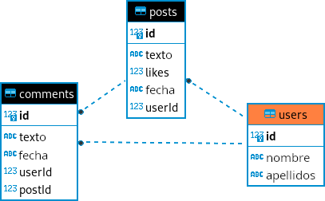

<div class="interactive-progress-tracker">
  <div class="tracker-header">
    <span>🏆 <strong>Progrés d'aquesta secció:</strong> <span class="tracker-count">0 de 4 superats (0%)</span></span>
    <span class="tracker-pts">⭐ <strong>0 punts</strong></span>
  </div>
  <div class="tracker-bar">
    <div class="tracker-fill" style="width: 0%;"></div>
  </div>
</div>

# 7.11 Patró de disseny DAO (Data Access Object)

> **📌  **
> 

> Per a realitzar l'exemple que seguirem en aquest apartat (i en el **exercici 12: paquet `redes`**) utilitzarem el següent fitxer sql **xarxes.sql** sobre una base de dades nova denominada `redes`.



En programació existeixen una sèrie d'estàndards denominats [Patrons de Disseny](https://refactoring.guru/es/design-patterns) que has de conèixer per a poder programar segons aquests patrons i no reinventar la rueda.

> **📌 Nota**
> 

> Nosaltres anem a implementar “**Repository Pattern**” perquè també us va a servir per a qualsevol aplicació tant web, mòbil o d'escriptori.
> 
Segons la documentació de [Android](https://developer.android.com/codelabs/basic-android-kotlin-training-repository-pattern?hl=es-419#0):

> *The repository pattern is **a design pattern that isolates the data layer from the rest of the app**. The data layer refers to the part of your app, separate from the UI, that handles the app’s data and business logic, exposing consistent APIs for the rest of your app to access this data.*

## 1. Patró DAO (Data Access Object)

El patró **DAO** és un patró de disseny que **separa la lògica d'accés a dades de la lògica de negoci**. Proporciona una abstracció d'accés a dades on cada entitat (com en el *exercici 12* d'activitats: *Usuari*, *Post*, *Comentari*) té el seu propi DAO que maneja les operacions **CRUD** (*Create*, *Read*, *Update*, *Delete*) específiques d'eixa entitat. Açò millora la modularitat i la reutilització del codi, ja que la lògica d'accés a dades està encapsulada en objectes DAO dedicats.

## 2. Implementació pas a pas

Anem a implementar un exemple bàsic utilitzant JDBC per a interactuar amb una base de dades relacional. Utilitzarem l'estructura de base de dades que es proporciona en el *exercici 12: paquet `redes`*:

### 2.1. Pas 0: Definir la classe `DbConnect`

Per a simplificar la implementar i connexió a la base de dades podem crear la classe `DbConnect` (com ja hem implementat anteriorment en alguns exercicis):

```java
package ut07.redes;

import java.sql.Connection;
import java.sql.DriverManager;
import java.sql.SQLException;

public class DbConnect {
    private static final String JDBC_URL = "jdbc:mysql://localhost:3306/redes";
    private static final String USUARIO = "pr_tuNombre";
    private static final String PASSWORD = "pr_tuContraseña";

    private static DbConnect dbInstance; // Variable para almacenar la única instancia de la clase
    private static Connection con;

    // Constructor vacío privado para evitar la instanciación directa
    private DbConnect() {
    }

    // Método estático para obtener la instancia única (Singleton)
    public static DbConnect getInstance() {
        if (dbInstance == null) {
            dbInstance = new DbConnect();
        }
        return dbInstance;
    }

    // Método estático para obtener la conexión a la base de datos
    public Connection getConnection() throws SQLException {
        if (con == null || con.isClosed()) {
            con = DriverManager.getConnection(JDBC_URL, USUARIO, PASSWORD);
        }
        return con;
    }
}
```

### 2.2. Pas 1: Definir les classes de les entitats

Definirem les classes `Usuario`, `Post`, `Comentario` que representen les nostres entitats:

<details markdown="1">

<summary>💡 Per exemple: `Usuari.java`</summary>

```java
package ut07.redes;

public class Usuario {
    private int id;
    private String nombre;
    private String apellido;

    // constructor
    public Usuario(int id, String nombre, String apellido) {
        this.id = id;
        this.nombre = nombre;
        this.apellido = apellido;
    }

    public int getId() {
        return id;
    }

    public void setId(int id) {
        this.id = id;
    }

    public String getNombre() {
        return nombre;
    }

    public void setNombre(String nombre) {
        this.nombre = nombre;
    }

    public String getApellido() {
        return apellido;
    }

    public void setApellido(String apellido) {
        this.apellido = apellido;
    }

    @Override
    public String toString() {
        return "Usuario [id=" + id + ", nombre=" + nombre + ", apellido=" + apellido + "]";
    }
}
```

</details>

### 2.3. Pas 2: Definir la interface DAO

Després, definirem la interfície DAO per a després implementar-les en cada entitat.

<details markdown="1">

<summary>💡 Per exemple: `IRepository.java`</summary>

```java
package ut07.redes;

import java.sql.SQLException;
import java.util.List;

public interface IRepository<T> {
    void crear(T entidad) throws SQLException;;      // C: Create
    T obtener(int id) throws SQLException;;          // R: Read
    List<T> obtenerTodos() throws SQLException;;     // R: Read (all)
    void actualizar(T entidad) throws SQLException;; // U: Update
    void eliminar(int id) throws SQLException;;      // D: Delete
}
```

</details>

### 2.4. Pas 3: Implementar les classes DAO

Després, implementarem les classes DAO per a cada entitat utilitzant JDBC per a interactuar amb la base de dades.

<details markdown="1">

<summary>💡 Per exemple: `UsuarioRepositoryImpl.java`</summary>

```sql
package ut07.redes;

import java.sql.*;
import java.util.ArrayList;
import java.util.List;

public class UsuarioRepositoryImpl implements IRepository<Usuario> {
    private static final String INSERT_QUERY = "INSERT INTO users (name, lastName) VALUES (?, ?)";
    private static final String SELECT_BY_ID_QUERY = "SELECT * FROM users WHERE id = ?";
    private static final String SELECT_ALL_QUERY = "SELECT * FROM users";
    private static final String UPDATE_QUERY = "UPDATE users SET name = ?, lastName = ? WHERE id = ?";
    private static final String DELETE_QUERY = "DELETE FROM users WHERE id = ?";

    @Override
    public void crear(Usuario usuario)  throws SQLException {
        try (Connection con = DbConnect.getInstance().getConnection();
        PreparedStatement pst = con.prepareStatement(INSERT_QUERY, Statement.RETURN_GENERATED_KEYS)) {

            pst.setString(1, usuario.getNombre());
            pst.setString(2, usuario.getApellido());

            int filasInsertadas = pst.executeUpdate();
            if (filasInsertadas > 0) {
                ResultSet rs = pst.getGeneratedKeys();
                if (rs.next()) {
                    int id = rs.getInt(1);
                    usuario.setId(id);
                }
            }
        }    
    }

    @Override
    public Usuario obtener(int id)  throws SQLException {
        Usuario usuario = null;
        try (Connection con = DbConnect.getInstance().getConnection();
        PreparedStatement pst = con.prepareStatement(SELECT_BY_ID_QUERY)) {

            pst.setInt(1, id);
            ResultSet rs = pst.executeQuery();
            if (rs.next()) {
                String nombre = rs.getString("name");
                String apellido = rs.getString("lastName");
                usuario = new Usuario(id, nombre, apellido);
            }
        } 
        return usuario;
    }

    @Override
    public List<Usuario> obtenerTodos()  throws SQLException {
        List<Usuario> usuarios = new ArrayList<>();
        try (Connection con = DbConnect.getInstance().getConnection();
        Statement st = con.createStatement();
        ResultSet rs = st.executeQuery(SELECT_ALL_QUERY)) {

            while (rs.next()) {
                int id = rs.getInt("id");
                String nombre = rs.getString("name");
                String apellido = rs.getString("lastName");
                Usuario usuario = new Usuario(id, nombre, apellido);
                usuarios.add(usuario);
            }
        } 
        return usuarios;
    }

    @Override
    public void actualizar(Usuario usuario)  throws SQLException {
        try (Connection con = DbConnect.getInstance().getConnection();
        PreparedStatement pst = con.prepareStatement(UPDATE_QUERY)) {

            pst.setString(1, usuario.getNombre());
            pst.setString(2, usuario.getApellido());
            pst.setInt(3, usuario.getId());

            pst.executeUpdate();
        } 
    }

    @Override
    public void eliminar(int id)  throws SQLException {
        try (Connection con = DbConnect.getInstance().getConnection();
        PreparedStatement pst = con.prepareStatement(DELETE_QUERY)) {

            pst.setInt(1, id);

            pst.executeUpdate();
        } 
    }
}
```

</details>

### 2.5. Pas 4: Implementar la lògica de l'aplicació

Finalment, implementarem la lògica de l'aplicació en una classe principal `Main` on podrem interactuar amb els DAOs i la base de dades.

<details markdown="1">

<summary>💡 Per exemple: `Main.java`</summary>

```java
package ut07.redes;

import java.sql.Connection;
import java.sql.SQLException;
import java.time.LocalDate;
import java.util.List;
import java.util.Scanner;

public class Main {
    public static void main(String[] args) {
        Scanner entrada = new Scanner(System.in);

        IRepository<Usuario> usuarioDAO = new UsuarioRepositoryImpl();
        IRepository<Post> postDAO = new PostRepositoryImpl();
        // IRepository<Comentario> comentarioDAO = new ComentarioRepositoryImpl();

        try (Connection con = DbConnect.getInstance().getConnection()) {
            while (true) {
                menuPrincipal();
                int opcion = entrada.nextInt();
                entrada.nextLine(); // Limpiar el buffer del entrada

                switch (opcion) {
                    case 1:
                        gestionarUsuarios(entrada, usuarioDAO);
                        break;
                    case 2:
                        // gestionarPosts(entrada, postDAO);
                        break;
                    case 3:
                        // gestionarComentarios(entrada, comentarioDAO, usuarioDAO, postDAO);
                        break;
                    case 0:
                        System.out.println("Saliendo...");
                        entrada.close();
                        System.exit(0);
                    default:
                        System.out.println("Opción inválida. Intenta de nuevo.");
                }
            }
        } catch (SQLException e) {
            System.out.println("Error en la conexión con la base de datos: " + e.getMessage());
        }
    }

    private static void gestionarUsuarios(Scanner entrada, IRepository<Usuario> usuarioDAO) {
        while (true) {
            menuUsuarios();
            int opcion = entrada.nextInt();
            entrada.nextLine(); // Limpiar el buffer del entrada

            switch (opcion) {
                case 1:
                    System.out.print("Introduce el nombre del usuario: ");
                    String nombre = entrada.nextLine();
                    System.out.print("Introduce el apellido del usuario: ");
                    String apellido = entrada.nextLine();
                    Usuario nuevoUsuario = new Usuario(0, nombre, apellido); // El ID se genera automáticamente
                    try {
                        usuarioDAO.crear(nuevoUsuario);
                        System.out.println("Usuario creado con ID: " + nuevoUsuario.getId());
                    } catch (SQLException e) {
                        System.out.println("Error al crear usuario: " + e.getMessage());
                    }
                    break;
                case 2:
                    System.out.print("Introduce el ID del usuario a consultar: ");
                    int idUsuario = entrada.nextInt();
                    entrada.nextLine(); // Limpiar el buffer del entrada
                    try {
                        Usuario usuario = usuarioDAO.obtener(idUsuario);
                        if (usuario != null) {
                            System.out.println("Usuario encontrado:");
                            System.out.printf(" %-3d %-15s %-15s%n",
                                                usuario.getId(),
                                                usuario.getNombre(),
                                                usuario.getApellido());
                        } else {
                            System.out.println("No se encontró ningún usuario con ese ID.");
                        }
                    } catch (SQLException e) {
                        System.out.println("Error al obtener usuario: " + e.getMessage());
                    }
                    break;
                case 3:
                    try {
                        List<Usuario> usuarios = usuarioDAO.obtenerTodos();
                        if (!usuarios.isEmpty()) {
                            System.out.println("Listado de Usuarios:");
                            for (Usuario u : usuarios) {
                                System.out.println("ID: " + u.getId() + ", Nombre: " + u.getNombre() + ", Apellido: " + u.getApellido());
                            }
                        } else {
                            System.out.println("No hay usuarios registrados.");
                        }
                    } catch (SQLException e) {
                        System.out.println("Error al obtener todos los usuarios: " + e.getMessage());
                    }
                    break;
                case 4:
                    System.out.print("Introduce el ID del usuario a actualizar: ");
                    int idActualizar = entrada.nextInt();
                    entrada.nextLine(); // Limpiar el buffer del entrada
                    try {
                        Usuario usuarioActualizar = usuarioDAO.obtener(idActualizar);
                        if (usuarioActualizar != null) {
                            System.out.print("Introduce el nuevo nombre del usuario (deja en blanco para mantener el actual): ");
                            String nuevoNombre = entrada.nextLine();
                            if (!nuevoNombre.isEmpty()) {
                                usuarioActualizar.setNombre(nuevoNombre);
                            }

                            System.out.print("Introduce el nuevo apellido del usuario (deja en blanco para mantener el actual): ");
                            String nuevoApellido = entrada.nextLine();
                            if (!nuevoApellido.isEmpty()) {
                                usuarioActualizar.setApellido(nuevoApellido);
                            }
                            usuarioDAO.actualizar(usuarioActualizar);
                            System.out.println("Usuario actualizado correctamente.");
                        } else {
                            System.out.println("No se encontró ningún usuario con ese ID.");
                        }
                    } catch (SQLException e) {
                        System.out.println("Error al actualizar usuario: " + e.getMessage());
                    }
                    break;
                case 5:
                    System.out.print("Introduce el ID del usuario a eliminar: ");
                    int idEliminar = entrada.nextInt();
                    entrada.nextLine(); // Limpiar el buffer del entrada
                    try {
                        Usuario usuarioActualizar = usuarioDAO.obtener(idEliminar);
                        if (usuarioActualizar != null) {
                            // eliminar primero los comentarios y posts asociados al usuario
                            // PostRepositoryImpl.eliminarPostPorUsuario(idEliminar);
                            // luego eliminar el usuario
                            usuarioDAO.eliminar(idEliminar);
                            System.out.println("Usuario eliminado correctamente.");
                        } else {
                            System.out.println("No se encontró ningún usuario con ese ID.");
                        }
                    } catch (SQLException e) {
                        System.out.println("Error al eliminar usuario: " + e.getMessage());
                    }
                    break;
                case 0:
                    return;
                default:
                    System.out.println("Opción inválida. Intenta de nuevo.");
            }
        }
    }

    // private static void gestionarPosts(Scanner entrada, IRepository<Post> postDAO) {
    //     while (true) {
    //         menuPosts();
    //         int opcion = entrada.nextInt();
    //         entrada.nextLine(); // Limpiar el buffer del entrada

    //         switch (opcion) {
    //             case 1:
    //                 System.out.print("Introduce el texto del post: ");
    //                 String texto = entrada.nextLine();

    //                 System.out.println("Elige un usuario: ");

    //                 UsuarioRepositoryImpl usuarioRepository = new UsuarioRepositoryImpl();
    //                 List<Usuario> usuarios;
    //                 int usuarioId = 0;
    //                 try {
    //                     usuarios = usuarioRepository.obtenerTodos();
    //                     for (Usuario usuario : usuarios) {
    //                         System.out.println(usuario.getId() + " - " + usuario.getNombre() + " " + usuario.getApellido());
    //                     }
    //                     System.out.print("Introduce el ID del usuario que publica el post:  ");
    //                     usuarioId = entrada.nextInt();
    //                 } catch (SQLException e) {
    //                     System.out.println("ERROR: " + e.getMessage());
    //                 }

    //                 Post nuevoPost = new Post(0, texto, 0, LocalDate.now().toString(), usuarioId); // El ID se genera automáticamente
    //                 try {
    //                     postDAO.crear(nuevoPost);
    //                     System.out.println("Post creado con ID: " + nuevoPost.getId());
    //                 } catch (SQLException e) {
    //                     System.out.println("Error al crear post: " + e.getMessage());
    //                 }
    //                 break;
    //             case 2:

    //                 break;
    //             case 3:

    //                 break;
    //             case 4:

    //                 break;
    //             case 5:

    //                 break;
    //             case 0:
    //                 return;
    //             default:
    //                 System.out.println("Opción inválida. Intenta de nuevo.");
    //         }
    //     }
    // }

    // private static void gestionarComentarios(Connection con, Scanner entrada, IRepository<Comentario> comentarioDAO, IRepository<Usuario> usuarioDAO, IRepository<Post> postDAO) {
    //     // Implementar lógica similar a gestionarUsuarios para Comentarios
    // }

    // MENÚ PRINCIPAL: menuPrincipal()
    private static void menuPrincipal() {
        System.out.println("\nMenú Principal:");
        System.out.println("1. Gestionar Usuarios");
        System.out.println("2. Gestionar Posts");
        System.out.println("3. Gestionar Comentarios");
        System.out.println("0. Salir");
        System.out.print("Selecciona una opción:  ");
    }

    // MENÚ SECUNDARIO: menuUsuarios()
    private static void menuUsuarios() {
        System.out.println("\nMenú de Usuarios:");
        System.out.println("1. Crear usuario");
        System.out.println("2. Consultar usuario por ID");
        System.out.println("3. Listar todos los usuarios");
        System.out.println("4. Actualizar usuario");
        System.out.println("5. Eliminar usuario");
        System.out.println("0. Volver al menú principal");
        System.out.print("Selecciona una opción:  ");
    }

    // MENÚ SECUNDARIO: menuPosts()
    private static void menuPosts() {
        System.out.println("\nMenú de Posts:");
        System.out.println("1. Crear post");
        System.out.println("2. Consultar post por ID");
        System.out.println("3. Listar todos los posts");
        System.out.println("4. Actualizar post");
        System.out.println("5. Eliminar post");
        System.out.println("0. Volver al menú principal");
        System.out.print("Selecciona una opción:  ");
    }

    // MENÚ SECUNDARIO: menuPosts()
    private static void menuComentarios() {
        System.out.println("\nMenú de Comentarios:");
        System.out.println("1. Crear comentario");
        System.out.println("2. Consultar comentario por ID");
        System.out.println("3. Listar todos los comentarios");
        System.out.println("4. Actualizar comentario");
        System.out.println("5. Eliminar comentario");
        System.out.println("0. Volver al menú principal");
        System.out.print("Selecciona una opción:  ");
    }

}
```

</details>

### 2.6. Consideracions

- **JDBC i SQL Queries:** Hem utilitzat JDBC per a connectar-nos i realitzar operacions en la base de dades. És important manejar excepcions i tancar correctament les connexions i recursos.

- **Patró DAO:** Aquest patró ens ajuda a mantindre un codi organitzat i aislado, separant la lògica d'accés a dades de la lògica de negoci.

- **Lògica de l'aplicació:** En la classe `Main`, hem implementat un menú interactivo que permet a l'usuari gestionar *usuaris*, *posts* i *comentaris* utilitzant els mètodes proporcionats pels DAOs.

- **Adaptabilitat:** Pots expandir aquest exemple afegint més funcionalitats o fent ajustes segons els requisits de la teua aplicació.


---

## 🎮 Reptes Interactius d'Autoavaluació (+100 XP)

Comprova el teu domini sobre **7.11 Patró de disseny DAO (Data Access Object)** superant aquests 4 reptes gamificats (+25 punts cadascun):

<div class="interactive-mcq" data-answer="A" data-hint="Revisa els conceptes teòrics i pràctics d'aquesta secció.">
  <div class="mcq-question">🎯 <strong>Repte 1 (+25 pts):</strong> Per què és fonamental utilitzar PreparedStatement amb paràmetres '?' en lloc de concatenar cadenes en Statement en accedir a bases de dades amb JDBC?</div>
  <div class="mcq-options">
    <button type="button" class="btn-mcq-opt" data-opt="A">A) Perquè precompila la sentència SQL i protegeix l'aplicació contra atacs d'Injecció SQL (SQL Injection).</button>
    <button type="button" class="btn-mcq-opt" data-opt="B">B) Perquè Statement no permet executar consultes SELECT.</button>
    <button type="button" class="btn-mcq-opt" data-opt="C">C) Perquè PreparedStatement no necessita connexió a la base de dades.</button>
    <button type="button" class="btn-mcq-opt" data-opt="D">D) Cap de les anteriors és correcta.</button>
  </div>
  <div class="quiz-feedback"></div>
</div>

<div class="interactive-mcq" data-answer="D" data-hint="Comprova l'apartat corresponent de la unitat.">
  <div class="mcq-question">🎯 <strong>Repte 2 (+25 pts):</strong> Quin patró de disseny de programari separa completament la lògica de negoci de la lògica d'accés i persistència a la base de dades mitjançant classes i interfícies dedicades?</div>
  <div class="mcq-options">
    <button type="button" class="btn-mcq-opt" data-opt="A">A) Patró Singleton d'impressió.</button>
    <button type="button" class="btn-mcq-opt" data-opt="B">B) Recursivitat indirecta.</button>
    <button type="button" class="btn-mcq-opt" data-opt="C">C) Cap de les anteriors és correcta.</button>
    <button type="button" class="btn-mcq-opt" data-opt="D">D) Patró DAO (Data Access Object).</button>
  </div>
  <div class="quiz-feedback"></div>
</div>

<div class="interactive-vf" data-answer="V" data-hint="Verifica l'afirmació amb els apunts de la unitat.">
  <div class="vf-statement">✅ <strong>Repte 3 (Vertader o Fals · +25 pts):</strong> En JDBC, el mètode executeQuery() s'utilitza per a consultes SELECT (retorna un ResultSet), mentre que executeUpdate() s'utilitza per a INSERT, UPDATE i DELETE.</div>
  <div class="vf-buttons">
    <button type="button" class="btn-vf" data-opt="V">Vertader (V)</button>
    <button type="button" class="btn-vf" data-opt="F">Fals (F)</button>
  </div>
  <div class="quiz-feedback" style="width: 100%;"></div>
</div>

<div class="interactive-quiz" data-answer="next" data-hint="Següent en anglès (4 lletres).">
  <div class="quiz-question">⌨️ <strong>Repte 4 (+25 pts):</strong> Quin mètode de l'objecte ResultSet s'invoca dins d'un bucle 'while' per a avançar el cursor a la següent fila de resultats?</div>
  <div class="quiz-controls">
    <input type="text" class="quiz-input" placeholder="Escriu la resposta..." />
    <button type="button" class="btn-quiz-check">Comprovar</button>
  </div>
  <div class="quiz-feedback"></div>
</div>

### 📋 Llista de Comprovació i Rúbrica d'Assoliment

Marca cada criteri a mesura que completes l'estudi o la resolució pràctica d'aquesta pàgina (**7.11 Patró de disseny DAO (Data Access Object)**):

- [ ] He llegit detingudament la teoria o l'enunciat d'aquesta secció i he anotat els conceptes clau.
- [ ] He revisat els esquemes, taules o blocs de codi i he verificat que sé aplicar-los a l'entorn de treball.
- [ ] He resolt correctament els **4 reptes interactius** superiors obtenint els **100 punts XP**.
- [ ] He descarregat el comprovant oficial en PDF per a adjuntar-lo a la tasca d'**Aules**.

<div class="aules-delivery-card">
  <h3>📤 Comprovant de Lliurament per a Aules</h3>
  <p>Quan hages completat els reptes interactius i la llista d'autoavaluació d'aquesta pàgina, introdueix el teu nom i descarrega el teu certificat oficial en PDF per a adjuntar-lo a la tasca d'<strong>Aules</strong>.</p>
  <div class="aules-student-field">
    <label for="aules-student-name">👤 Nom i Cognoms de l'Alumne/a:</label>
    <input type="text" id="aules-student-name" class="aules-student-name" placeholder="Ex: Joan Garcia Pérez" />
  </div>
  <div class="aules-score-badge">
    <span class="aules-score-count">0/4 reptes completats (0%) · 0 punts · 0/4 criteris d'autoavaluació</span>
  </div>
  <div class="aules-actions">
    <button type="button" class="btn-aules-dl" data-module="PRG" data-unit="UD07" data-activity="ut0711">📥 Descarregar Comprovant PDF</button>
    <button type="button" class="btn-aules-copy">📋 Copiar Resum al Porta-retalls</button>
  </div>
  <div class="aules-toast"></div>
</div>

