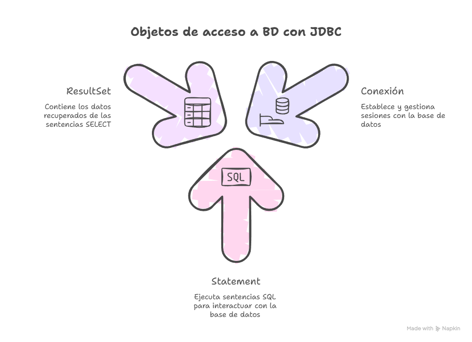
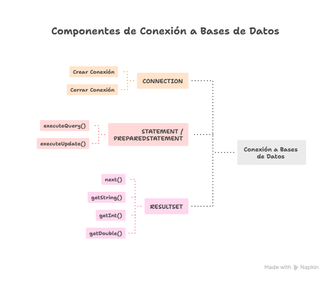
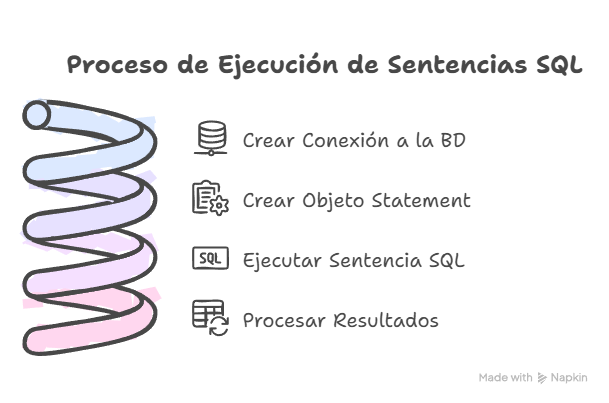
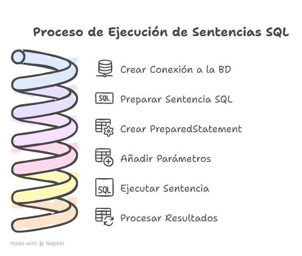

<div class="interactive-progress-tracker">
  <div class="tracker-header">
    <span>🏆 <strong>Progrés d'aquesta secció:</strong> <span class="tracker-count">0 de 4 superats (0%)</span></span>
    <span class="tracker-pts">⭐ <strong>0 punts</strong></span>
  </div>
  <div class="tracker-bar">
    <div class="tracker-fill" style="width: 0%;"></div>
  </div>
</div>

# 7.12 Repàs global d'accés a dades

## 1. Objectes JDBC

Com hem vist en sessions anteriors, hi ha tres tipus d'objectes que utilitzarem en la interacció amb la nostra Base de dades a l'usar JDBC. Aquests són: 



### 1.1 Connection

Ens va a permetre establir i finzalitzar la connexió a la nostra BD.

En les nostres activitats, l'hem realitzat a través del fitxer `DbConnect.java`:

```java
Connection con = DbConnect.getInstance().getConnection();
```

### 1.2 Statement o PreparedStatement

Ens permeten executar sentències SQL en la BD. El seu principal diferència reside en si la sentència portarà paràmetres (PreparedStatement) o no (Statement).

Al llarg de les activitats hem vist dos funcions bàsiques d'aquests objectes: 

- `executeQuery(sql)`: S'usa per a les sentències SQL de tipus **SELECT**.

- `executeUpdate()`: S'usa per a totes aquelles sentències SQL que modifiquen les dades de la BD (**INSERT, UPDATE, DELETE**).

```sql
Statement st = con.createStatement();
ResultSet rs = st.executeQuery("SELECT * FROM alumnos");
```

```sql
String sql = "INSERT INTO alumnos (nombre, edad) VALUES (?, ?)";
PreparedStatement pst = con.prepareStatement(sql)
pst.setString(1,nombre);
pst.setInt(2, edad);

int filasModificadas = pst.executeUpdate();
```

<details markdown="1">

<summary>💡 Aclaracions exemple anterior</summary>

Analitzarem amb calma l'exemple que acabamos de veure per a `PreparedStatement`:

1. El primer pas és prepara la sentència SQL. Els `?` fan referència a aquells dades que es incluiran com paràmetres.

1. A continuació, es crea l'objecte `PreparedStatement` usant el mètode `prepareStatement(sql)`.

1. Una vegada creat aquest objecte, hem d'afegir els paràmetres que requereix la sentència SQL declarada en el primer pas. Per a això, usarem les funcions `setString()`, `setInt()`, `setDouble()`, etc. 

1. Finalment, amb l'ús del mètode `executeUpdate()` es haran efectivos els canvis en la BD. *I què és això de `filasModificadas`? Perquè el vull?* La funció `executeUpdate()` va a retornar *(return)* un número *(int)* que indica el **número de files** modificades en la BD. Aquest dada em permet conèixer si la sentència es ha executat *(es han modificat més de 1 fila)* o no. 

</details>

### 1.3 ResultSet

L'últim dels objectes estudiats conté un conjunt de resultats (dades) obtinguts després d'executar una sentència SQL de tipus **SELECT**.

Per a accedir a les seues dades anem a necessitar diverses funcions: 

- `next()`: ens va a permetre recórrer l'estructura. És a dir, mentre queden dades en ella, anirà recorriendola perquè puguem anar accedint a les files de la BD. 

*Però, com em quedo amb cada un de les dades (columnes) emmagatzemats?* Per a això comptem amb els mètodes: 

- `getString(nombreColumna)`

- `getInt(nombreColumna)`

- `getDouble(nombreColumna)`

```java
ResultSet rs = pst.executeQuery();
//Recorrer datos devueltos
while (rs.next()) {
    String nombre = rs.getString("nombre");
    int edad = rs.getInt("edad");

    System.out.println("El alumno " + nombre + " tiene " +edad + " años.");
}
```



## 2. Control d'excepcions

Una vegada estudiats tots els objectes, els seus usos i mètodes, **Com puc saber si he d'usar les sentències `try-catch` per a controlar les excepcions?**

Usarem aquest tipus de sentències sempre que vayamos a realitzar una connexió o canvis en la BD que poden no tindre exito *(per fallada de connexió, falta de driver, errors en el SQL, etc)*. 

Alguns casos en els que **SEMPRE** les usarem són: 

1. Al crear la connexió en el mètode principal *(main)*:

```java
try (Connection con = DbConnect.getInstance().getConnection()) {
    //Realizar acciones...
} catch (SQLException ex) {
    System.out.println("ERROR al conectar: " + ex.getMessage());
}
```

1. Cada vegada que creemos un `Statement` o `PreparedStatement` en els fitxers de tipus *Repository*:

```java
try (Statement st = con.createStatement()) {
   //...
}
```

```java
try (PreparedStatement pst = con.prepareStatement(sql)) {
    //...
}
```

## 3. Passos per a construir el mètode complet

Amb tota la informació anterior asimilada, **Què passos he de seguir per a construir un mètode complet de consulta / modificació de BD?**

La meua primera tasca serà analitzar i decidir si vaig el meu mètode requereix l'ús de `Statement` o `PreparedStatement`. 

Amb aquesta decisió tomada, els passos seran els següents. 

### 3.1 Passos per a Statement

1. Crear la connexió a la BD, és a dir, l'objecte `Connection`.

1. Crear l'objecte `Statement` *(recorda l'ús de `try-catch`)*

1. Executar la sentència, usant `executeQuery(sql)` o `executeUpdate()`.

1. En cas d'una sentència *SELECT*, crear i recórrer l'objecte `ResultSet`. En cas d'una actualització, comprovar les files modificades. 

<details markdown="1">

<summary>💡 Analizemos un exemple complet amb Statement</summary>

```sql
public void listarAlumnos() throws SQLException{
    Connection con = DbConnect.getInstance().getConnection();
    try (Statement st = con.createStatement()) {
        ResultSet rs = st.executeQuery("SELECT * FROM alumnos");
        //Recorrer datos devueltos
        while (rs.next()) {
            String nombre = rs.getString("nombre");
            int edad = rs.getInt("edad");

            System.out.println("El alumno " + nombre + " tiene " +edad + " años.");
        }
    } 
}
```

</details>



### 3.2 Passos per a PreparedStatement

1. Crear la connexió a la BD, és a dir, l'objecte `Connection`.

1. Preparar la sentència SQL.

1. Crear l'objecte `PreparedStatement` *(recorda l'ús de `try-catch`)*

1. Afegir els paràmetres requerits a la sentència creada en el pas 2 amb l'ajuda de `setString(indice, parámetro)`, `setInt(indice, parámetro)`, etc. 

1. Executar la sentència, usant `executeQuery(sql)` o `executeUpdate()`.

1. En cas d'una sentència *SELECT*, crear i recórrer l'objecte `ResultSet`. En cas d'una actualització, comprovar les files modificades.

<details markdown="1">

<summary>💡 Analizemos un exemple de SELECT amb PreparedStatement</summary>

```sql
public void listarPostsUsuario(int usuario) throws SQLException {
    Connection con = DbConnect.getInstance().getConnection();
    String sql = "SELECT * FROM posts WHERE usuario_id = ?";

    try (PreparedStatement pst = con.prepareStatement(sql)) {
        pst.setInt(1, usuario);

        ResultSet rs = pst.executeQuery();

        System.out.println("Posts del usuario " + usuario + ":");
        while (rs.next()) {
            int id = rs.getInt("id");
            String titulo = rs.getString("titulo");
            String contenido = rs.getString("contenido");
            String fecha = rs.getString("fecha_publicacion");

            System.out.println(id + ". " + titulo + ": " + contenido + " (" + fecha + ")");
        }
    }
}
```

</details>

<details markdown="1">

<summary>💡 Analizemos un exemple de modificació amb PreparedStatement</summary>

```java
public void cambiarFecha(int id, String fecha) throws SQLException {
    Connection con = DbConnect.getInstance().getConnection();
    String sql = "UPDATE posts SET fecha_publicacion = ? WHERE id = ?";

    try (PreparedStatement pst = con.prepareStatement(sql)) {

        pst.setString(1, fecha);
        pst.setInt(2, id);

        int filasModificadas = pst.executeUpdate();

        if (filasModificadas > 0) {
            System.out.println("Post con id '" + id + "' modificado.");
        } else {
            System.out.println("No se encontró ningún posts para el id '" + id);
        }
    }
}
```

</details>




---

## 🎮 Reptes Interactius d'Autoavaluació (+100 XP)

Comprova el teu domini sobre **7.12 Repàs global d'accés a dades** superant aquests 4 reptes gamificats (+25 punts cadascun):

<div class="interactive-mcq" data-answer="A" data-hint="Revisa els conceptes teòrics i pràctics d'aquesta secció.">
  <div class="mcq-question">🎯 <strong>Repte 1 (+25 pts):</strong> Per què és fonamental utilitzar PreparedStatement amb paràmetres '?' en lloc de concatenar cadenes en Statement en accedir a bases de dades amb JDBC?</div>
  <div class="mcq-options">
    <button type="button" class="btn-mcq-opt" data-opt="A">A) Perquè precompila la sentència SQL i protegeix l'aplicació contra atacs d'Injecció SQL (SQL Injection).</button>
    <button type="button" class="btn-mcq-opt" data-opt="B">B) Perquè Statement no permet executar consultes SELECT.</button>
    <button type="button" class="btn-mcq-opt" data-opt="C">C) Perquè PreparedStatement no necessita connexió a la base de dades.</button>
    <button type="button" class="btn-mcq-opt" data-opt="D">D) Cap de les anteriors és correcta.</button>
  </div>
  <div class="quiz-feedback"></div>
</div>

<div class="interactive-mcq" data-answer="D" data-hint="Comprova l'apartat corresponent de la unitat.">
  <div class="mcq-question">🎯 <strong>Repte 2 (+25 pts):</strong> Quin patró de disseny de programari separa completament la lògica de negoci de la lògica d'accés i persistència a la base de dades mitjançant classes i interfícies dedicades?</div>
  <div class="mcq-options">
    <button type="button" class="btn-mcq-opt" data-opt="A">A) Patró Singleton d'impressió.</button>
    <button type="button" class="btn-mcq-opt" data-opt="B">B) Recursivitat indirecta.</button>
    <button type="button" class="btn-mcq-opt" data-opt="C">C) Cap de les anteriors és correcta.</button>
    <button type="button" class="btn-mcq-opt" data-opt="D">D) Patró DAO (Data Access Object).</button>
  </div>
  <div class="quiz-feedback"></div>
</div>

<div class="interactive-vf" data-answer="V" data-hint="Verifica l'afirmació amb els apunts de la unitat.">
  <div class="vf-statement">✅ <strong>Repte 3 (Vertader o Fals · +25 pts):</strong> En JDBC, el mètode executeQuery() s'utilitza per a consultes SELECT (retorna un ResultSet), mentre que executeUpdate() s'utilitza per a INSERT, UPDATE i DELETE.</div>
  <div class="vf-buttons">
    <button type="button" class="btn-vf" data-opt="V">Vertader (V)</button>
    <button type="button" class="btn-vf" data-opt="F">Fals (F)</button>
  </div>
  <div class="quiz-feedback" style="width: 100%;"></div>
</div>

<div class="interactive-quiz" data-answer="next" data-hint="Següent en anglès (4 lletres).">
  <div class="quiz-question">⌨️ <strong>Repte 4 (+25 pts):</strong> Quin mètode de l'objecte ResultSet s'invoca dins d'un bucle 'while' per a avançar el cursor a la següent fila de resultats?</div>
  <div class="quiz-controls">
    <input type="text" class="quiz-input" placeholder="Escriu la resposta..." />
    <button type="button" class="btn-quiz-check">Comprovar</button>
  </div>
  <div class="quiz-feedback"></div>
</div>

### 📋 Llista de Comprovació i Rúbrica d'Assoliment

Marca cada criteri a mesura que completes l'estudi o la resolució pràctica d'aquesta pàgina (**7.12 Repàs global d'accés a dades**):

- [ ] He llegit detingudament la teoria o l'enunciat d'aquesta secció i he anotat els conceptes clau.
- [ ] He revisat els esquemes, taules o blocs de codi i he verificat que sé aplicar-los a l'entorn de treball.
- [ ] He resolt correctament els **4 reptes interactius** superiors obtenint els **100 punts XP**.
- [ ] He descarregat el comprovant oficial en PDF per a adjuntar-lo a la tasca d'**Aules**.

<div class="aules-delivery-card">
  <h3>📤 Comprovant de Lliurament per a Aules</h3>
  <p>Quan hages completat els reptes interactius i la llista d'autoavaluació d'aquesta pàgina, introdueix el teu nom i descarrega el teu certificat oficial en PDF per a adjuntar-lo a la tasca d'<strong>Aules</strong>.</p>
  <div class="aules-student-field">
    <label for="aules-student-name">👤 Nom i Cognoms de l'Alumne/a:</label>
    <input type="text" id="aules-student-name" class="aules-student-name" placeholder="Ex: Joan Garcia Pérez" />
  </div>
  <div class="aules-score-badge">
    <span class="aules-score-count">0/4 reptes completats (0%) · 0 punts · 0/4 criteris d'autoavaluació</span>
  </div>
  <div class="aules-actions">
    <button type="button" class="btn-aules-dl" data-module="PRG" data-unit="UD07" data-activity="ut0712">📥 Descarregar Comprovant PDF</button>
    <button type="button" class="btn-aules-copy">📋 Copiar Resum al Porta-retalls</button>
  </div>
  <div class="aules-toast"></div>
</div>

