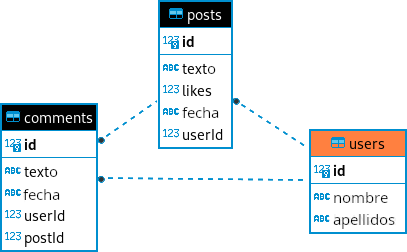

<div class="interactive-progress-tracker">
  <div class="tracker-header">
    <span>🏆 <strong>Progrés d'aquesta secció:</strong> <span class="tracker-count">0 de 4 superats (0%)</span></span>
    <span class="tracker-pts">⭐ <strong>0 punts</strong></span>
  </div>
  <div class="tracker-bar">
    <div class="tracker-fill" style="width: 0%;"></div>
  </div>
</div>

# Activitats pràctiques UT7

## Bloc 7.0

> **📌 Empaquetar activitats**
> 

> Empaqueta les activitats, dins de la carpeta **`ut07`**, en la carpeta **`/bloqueX`**.

### Activitat 01

Package: `A01_pedidos`

Desenvolupa una classe **`Pedido`** que permeta la gestió de comandes en una base de dades orientada a objectes. 

La taula `pedidos` té les columnes `id`, `cliente`, `producto`, `cantidad`, `fecha`. 

Implementa els mètodes necessaris per a:

- Crear un nou comanda per a un client.

- Mostrar tots els comandes d'un client específic.

- Eliminar tots els comandes d'un client específic.

## Bloc 7.1

### Activitat 02

Package: `A02_posts`

Desenvolupa una aplicació que permeta gestionar els comandes d'una botiga. 

La taula `posts` té les columnes `id`, `usuario_id`, `titulo`, `contenido`, `fecha_publicacion`.

Implementa els mètodes necessaris per a:

- Registrar un nou posts.

- Mostrar els posts d'un usuari específic.

- Eliminar tots els posts d'un usuari específic.

- Canviar la data d'un post *(filtra per id)*.

- Mostrar tots els posts de la BBDD.

En el `main` de la classe `Test`, implementa un menú perquè l'usuari puga executar totes les funcionalitats anteriors. 

<details markdown="1">

<summary>💡 Ajuda menú</summary>

```java
Scanner sc = new Scanner(System.in);
int opcion = 0;
PostsRepository postsDAO = new PostsRepository();

try (Connection con = DbConnect.getInstance().getConnection()) {
    do {
        System.out.println("\n MENÚ: ");
        System.out.println("1. Nuevo post");
        System.out.println("2. Mostrar posts de usuario");
        System.out.println("3. Eliminar posts usuario");
        System.out.println("4. Cambiar la fecha de un post");
        System.out.println("4. Mostrar todos los posts");
        System.out.println("0. Salir");
        System.out.print("Selecciona una opción: ");

        opcion = sc.nextInt();
        sc.nextLine(); // Limpiar buffer

        switch (opcion) {
            case 1:
                //Realizar acciones necesarias 
                break;
            case 2:
                //Realizar acciones necesarias
                System.out.println("Introduce el id de usuario:");
                int uid2 = sc.nextInt();

                postsDAO.listarPostsUsuario(uid2);
                break;
            case 3:
                //Realizar acciones necesarias
                break;
            case 4:
                //Realizar acciones necesarias 
                break;
            case 5:
                //Realizar acciones necesarias 
                break;
            case 0:
                System.out.println("Saliendo del sistema...");
                break;
            default:
                System.out.println("Opción inválida. Intenta de nuevo.");
        }
    } while (opcion != 0);
} catch (SQLException ex) {
        System.out.println("ERROR al conectar: " + ex.getMessage());
}
```

</details>

## Bloc 7.2

### Activitat 03

**Anàlisi d'índexs en una taula**: Crea una aplicació que permeta analitzar els índexs d'una taula en una base de dades relacional. Conéctate a la base de dades utilitzant JDBC i mostra els índexs associats a la taula `clientes`.

Operacions:

- Mostrar els índexs de la taula.

- Comprovar si hi ha claus primàries o foráneas associades.

### Activitat 04

**`_04_GestionProductos`**: Suposem que tens una base de dades que emmagatzema informació sobre productes. La taula `productos` té les següents columnes:

- `id`: Identificador únic del producte (enter).

- `nombre`: Nom del producte (cadena de text).

- `precio`: Preu del producte (decimal).

La teua tasca és escriure un programa Java `_02_GestionProductos` que realitze les següents operacions utilitzant els mètodes proporcionats:

1. **`mostrarProductosPorPagina()`**: mostrar una pàgina de productes cada vegada que l'usuari el solicite. Cada pàgina ha de contindre 5 productes. Implementa les funcions per a mover el cursor a la primera pàgina, pàgina següent, pàgina anterior, última pàgina i una pàgina específica utilitzant el mètode `absolute(int row)`.

1. **`buscarProductoPorNombre(String nombre)`**: permetre a l'usuari cercar un producte pel seu nom. Utilitza el mètode `relative(int registros)` per a desplazar el cursor cap a avant o cap a arrere segons la coincidencia del nom.

## Bloc 7.3

### Activitat 05

**`_05_GestionEmpleados`**: Tenim la nostra base de dades **`pr_tuNombre`** que emmagatzema informació sobre *empleats*. La taula `empleados` té les següents columnes:

- `id`: identificador únic de l'empleat (enter).

- `nombre`: nom de l'empleat (cadena de text).

- `salario`: salario de l'empleat (decimal).

És escriure un programa Java `_01_GestionEmpleados` que realitze les següents operacions utilitzant diferents tipus de resultat i opcions de concurrencia:

1. **`listarEmpleados`**: mostrar en la consola tots els empleats i els seus salarios.

1. **`incrementoSalarioAnual`**: incrementar el salario de tots els empleats en un 10%.

1. **`eliminarEmpleadosSalario`**: eliminar tots els empleats del qual salario siga menor que 3000€.

1. **`actualizarSalarioEmpleado`**: actualitza el salario d'un empleat filtrat per *nom*.

1. **`eliminarEmpleadoId`**: eliminar un empleat filtrat per *id*.

En el `main` crea un menú que permeta a l'usuari accedir a les diferents funcionalitats.

### Activitat 06

**`_06_GestionVentas`**: Suposem que tens una base de dades que emmagatzema informació sobre vendes. La taula `ventas` té les següents columnes:

- `id`: Identificador únic de la venda (enter).

- `producto`: Nom del producte venut (cadena de text).

- `cantidad`: Quantitat de productes vendits (enter).

- `total`: Total de la venda (decimal).

La teua tasca és escriure un programa Java `_05_GestionVentas` que realitze les següents operacions utilitzant els mètodes proporcionats:

1. **Calcular el total de vendes**: Mostra a l'usuari la suma del preu total de les vendes emmagatzemades en el sistema.

1. **Cercar vendes per producte**: Permet a l'usuari ingresar el nom d'un producte i retorna les vendes d'eixe producte.

1. **Calcular el total de € ganats amb un producte**: Permet a l'usuari ingresar el nom d'un producte i retorna el preu total de les vendes d'aquest producte.

En el `main` crea un menú que permeta a l'usuari accedir a les diferents funcionalitats.

### Activitat 07

**`_07_GestionLibros`**: Suposem que tens una base de dades que emmagatzema informació sobre llibres. La taula `libros` té les següents columnes:

- `id`: Identificador únic del llibre (enter).

- `titulo`: Títol del llibre (cadena de text).

- `autor`: Nom de l'autor del llibre (cadena de text).

- `anio_publicacion`: Any de publicació del llibre (enter).

La teua tasca és escriure un programa Java que realitze les següents operacions utilitzant els mètodes proporcionats:

- 

**`buscarLibroPorAutor(String autor)`**: permet a l'usuari ingresar el nom d'un autor i mostra tots els llibres escritos per eixe autor.

- 

**`mostrarLibrosPorDecada(int decada)`**: permet a l'usuari ingresar una década i mostrar tots els llibres publicats en eixa década. 

<details markdown="1">

<summary>💡 Ajuda</summary>

Sugerencia:

- Utilitza el mètode `preparedStatement(sql)` amb una consulta en la que es listen els llibres comprendits en una década i ordenats de forma descendent pel `anio_publiacion`.

- Si l'usuari em introdueix la decada *1990*, la consulta SQL serà: `SELECT * FROM libros WHERE anio_publicacion BETWEEN 1990 AND 1999 ORDER BY anio_publicacion DESC;`

</details>

En el `main` crea un menú que permeta a l'usuari accedir a les diferents funcionalitats.

## Bloc 7.4

### Activitat 08

**`_08_GestionLibros`**: Suposem que tens una base de dades que emmagatzema informació sobre llibres. La taula `libros` té les següents columnes:

- `id`: Identificador únic del llibre (enter).

- `titulo`: Títol del llibre (cadena de text).

- `autor`: Nom de l'autor del llibre (cadena de text).

- `anio_publicacion`: Any de publicació del llibre (enter).

La teua tasca és escriure un programa Java que realitze les següents operacions utilitzant els mètodes proporcionats:

- 

**`buscarLibroPorAutor(String autor)`**: permet a l'usuari ingresar el nom d'un autor i mostra tots els llibres escritos per eixe autor.

- 

**`mostrarLibrosPorDecada(int decada)`**: permet a l'usuari ingresar una década i mostrar tots els llibres publicats en eixa década. 

<details markdown="1">

<summary>💡 Ajuda</summary>

Sugerencia:

- Utilitza el mètode `preparedStatement(sql)` amb una consulta en la que es listen els llibres comprendits en una década i ordenats de forma descendent pel `anio_publiacion`.

- Si l'usuari em introdueix la decada *1990*, la consulta SQL serà: `SELECT * FROM libros WHERE anio_publicacion BETWEEN 1990 AND 1999 ORDER BY anio_publicacion DESC;`

</details>

En el `main` crea un menú que permeta a l'usuari accedir a les diferents funcionalitats.

### Activitat 09

**`_09_GestionEmpleados` (continuació)**: Continuant amb l'exercici de gestió d'empleats, còpia el programa `GestionEmpleados`, canvia el nom a `_09_gestionEmpleados` i agrega algunes funcionalitats addicionals:

1. **Mostrar informació de l'empleat per ID**: Permet a l'usuari ingresar el ID d'un empleat i mostra tota la informació relacionada amb eixe empleat. Utilitza el mètode `absolute(int row)` per a posicionarte en el registre de l'empleat especificat.

1. **Cercar empleats per salario**: Permet a l'usuari ingresar un rang de salarios i mostrar tots els empleats del qual salario estiga dins d'eixe rang. Utilitza el mètode `next()` per a recórrer totes les files i filtrar els empleats segons el criteri de salario.

### Activitat 10

**`_10_GestionEstudiantes`**: Suposem que tens una base de dades que emmagatzema informació sobre estudiants. La taula `estudiantes` té les següents columnes:

- `id`: Identificador únic de l'estudiant (enter).

- `nombre`: Nom de l'estudiant (cadena de text).

- `edad`: Edat de l'estudiant (enter).

- `promedio`: Promedio de qualificacions de l'estudiant (decimal).

La teua tasca és escriure un programa Java que realitze les següents operacions utilitzant els mètodes proporcionats:

1. **Mostrar la posició actual de l'estudiant**: Mostra la posició de l'estudiant actual en el conjunt de resultats. Utilitza el mètode `getRow()` per a obtindre el número de registre actual.

1. **Validar la posició del cursor**: Verifica si el cursor està abans del primer registre, en el primer registre, en l'últim registre o després de l'últim registre. Utilitza els mètodes `isBeforeFirst()`, `isFirst()`, `isLast()` e `isAfterLast()` per a realitzar aquestes verificacions.

En el `main` crea un menú que permeta a l'usuari accedir a les diferents funcionalitats.

### Activitat 11

**`_11_GestionProductos` (continuació)**: Continuant amb l'exercici de gestió de productes, còpia el programa `GestionProductos`, canvia el nom a `_11_gestionProductos` i i agrega algunes funcionalitats addicionals:

1. **Mostrar el número total de productes**: Mostra el número total de productes en la base de dades. Utilitza el mètode `getRow()` per a obtindre el número de registre actual i `last()` per a mover el cursor a la última fila.

1. **Verificar si hi ha productes disponibles**: Verifica si hi ha algun producte disponible en la base de dades. Utilitza els mètodes `isBeforeFirst()` e `isAfterLast()` per a determinar si el cursor està abans del primer registre o després de l'últim registre, respectivament.

En el `main` crea un menú que permeta a l'usuari accedir a les diferents funcionalitats.

## Bloc 7.5

### Activitat 12

`A12_GestionPosts` : Crea una aplicació que permeta gestionar els posts i comentaris emmagatzemats en una base de dades.

L'usuari podrà:

- Modificar el títol d'un post. 
    

```java
UPDATE posts SET titulo = ? WHERE id = ?
```

- Eliminar els posts obsoletos (aquells amb més d'un any des de la seua publicació).
    

```java
DELETE FROM posts WHERE fecha_publicacion < '2024-01-01'
```

- Afegir un comentari a un post.
    

```sql
INSERT INTO comentarios(usuario_id, post_id, contenido, fecha_comentario) VALUES (?, ?, ?, ?)
```

- Eliminar tots els comentaris d'un post.
    

```java
DELETE FROM comentarios WHERE post_id = ?
```

- Consultar els comentaris d'un post **(S'ha de mostrar el títol del post i el nom de l'usuari, no el seu id)**.

<details markdown="1">

<summary>💡 Ajuda</summary>

Per a aquest cas necessitarem tres mètodes:

- El primer sacará tota la informació de la taula comentaris filtrant pel id del post cercat. El seu SQL serà:

```sql
SELECT * FROM comentarios WHERE post_id=?
```

- Una vegada tinguem aquesta informació, li pasarem l'id de l'usuari obtingut a un altre mètode que ens retornarà el seu nom:

```java
public String nombreUsuario(int idUsuario) throws SQLException{
    //...RELLENAR...
}
```

El seu SQL serà:

```sql
SELECT nombre FROM usuarios WHERE id = ?
```

- Igual que l'hem fet per a l'usuari, necessitarem un mètode que ens permeta conèixer el nom d'un post a partir del seu id. **Basandote en l'exemple anterior, com l'harías?**

</details>

En el `main` crea un menú que permeta a l'usuari accedir a les diferents funcionalitats.

### Activitat 13

`A13_ActualizaciónProductos` : Desenvolupa una aplicació que permeta actualitzar els preus dels productes en la taula `productos`. 

Implementa:

- Mètode `actualizarPrecios()` que aplique un increment del 10% a tots els productes del qual preu siga inferior a 20 euros.
    

```java
UPDATE productos SET precio = precio*1.10 WHERE precio < 20
```

- Mètode `actualizarPrecioID(double precio)` que actualice el preu d'un producte determinat.
    

```java
UPDATE productos SET precio = ? WHERE id = ?
```

En el `main` crea un menú que permeta a l'usuari accedir a les diferents funcionalitats.

## Bloc 7.6

> **📌 Fitxers sql**
> 

> Per a realitzar les activitats d'aquest bloc hauràs d'importar el fitxer **ventasYbanco.sql** en el teu base de dades.

### Activitat 14

**`_14_ProductosObsoletos`**: Desenvolupa una aplicació que permeta gestionar els productes obsoletos d'una botiga. 

La taula `orders` conté els productes de la taula `products` vendits, amb la quantitat i la data de cada compra. 

Fes mètodes per a: 

- Mostrar tots els comandes realitzats **Mostrant el nom del producte *(taula products)*, NO el seu id**. 

- Mostrar els comandes d'un producte **(filtrat per nom)**.

- **EXTRA:** Eliminar els productes obsoletos (fa més d'un any que no es han venut).

En el `main` crea un menú que permeta a l'usuari accedir a les diferents funcionalitats.

### Activitat 15

**`_15_GestionClientesBanco`**: Suposem que tens una base de dades que emmagatzema informació sobre els clients d'un banco *(clients)* i els seus comptes bancaris *(accounts)*.

La teua tasca és escriure un programa Java que realitze les següents operacions:

1. Mostrar el nom de tots els clients juntament amb els seus comptes. 
    

```sql
SELECT * FROM accounts;
SELECT nombre FROM clients WHERE id = ?;
```

1. Actualitzar el telèfon d'un client.
    

```java
UPDATE clients SET telefono = ? WHERE id = ?;
```

1. Actualitzar l'adreça d'un client.
    

```java
UPDATE clients SET direccion = ? WHERE id = ?;
```

1. Mostrar el total de dinero emmagatzemat en el banco. 
    

```sql
SELECT saldo FROM accounts;
```

1. Inserir un nou client. 
    

```sql
INSERT INTO clients(nombre, direccion, telefono) VALUES (?, ?, ?);
```

1. Inserir una nova compta (associada a un client).
    

```sql
INSERT INTO accounts(saldo, id_cliente) VALUES (?, ?);
```

1. Mostrar el client propietari de la compta amb més dinero.
    

```sql
SELECT * FROM accounts ORDER BY saldo DESC LIMIT 1;
SELECT nombre FROM clients WHERE id = ?;
```

1. Actualitzar el dinero d'una compta.
    

```java
UPDATE accounts SET saldo = ? WHERE id = ?;
```

1. Eliminar una compta.
    

```java
DELETE FROM accounts WHERE id = ?;
```

1. Eliminar un client i totes els seus comptes.
    

```java
DELETE FROM accounts WHERE id_cliente = ?;
DELETE FROM clients WHERE id = ?;
```

En el `main` crea un menú que permeta a l'usuari accedir a les diferents funcionalitats.

### Activitat 16

**`_16_GestionPedidos`**: Suposem que tens una base de dades que emmagatzema informació sobre comandes. La taula `pedidos` té les següents columnes:

- `id`: Identificador únic de la comanda (enter).

- `cliente`: Nom del client que va realitzar la comanda (cadena de text).

- `producto`: Nom del producte comanda (cadena de text).

- `cantidad`: Quantitat del producte solicitada en la comanda (enter).

- `fecha`: Data en que es va realitzar la comanda (data).

La teua tasca és escriure un programa Java `_06_GestionPedidos` que realitze les següents operacions utilitzant els mètodes proporcionats:

1. **Llistar comandes per client**: Permet a l'usuari ingresar el nom d'un client i mostrar tots els comandes realitzats per eixe client. Utilitza el mètode `relative(int registros)` per a desplazarte a través dels registres segons les coincidencias del client.

1. **Cercar comandes per data**: Permet a l'usuari ingresar una data i mostrar tots els comandes realitzats en eixa data. Utilitza el mètode `afterLast()` i `previous()` per a mover el cursor al final i després retroceder, així pots començar des de la última fila.

### Activitat 17

**`_17_GestionEmpleados` (continuació)**: Continuant amb l'exercici de gestió d'empleats del setè exercici, còpia el programa `_10_GestionEmpleados` i agrega algunes funcionalitats addicionals:

1. **Verificar si hi ha empleats en la base de dades**: Verifica si hi ha algun empleat registrat en la base de dades. Utilitza els mètodes `isBeforeFirst()` e `isAfterLast()` per a determinar si el cursor està abans del primer registre o després de l'últim registre, respectivament.

1. **Mostrar el primer empleat**: Mostra la informació del primer empleat en la base de dades. Utilitza el mètode `first()` per a mover el cursor al primer registre i després mostra la informació de l'empleat.

### Activitat 18

**`_18_GestionClientes`**: Imagina que tens una base de dades que emmagatzema informació sobre clients. La taula `clientes` té les següents columnes:

- `id`: Identificador únic del client (enter).

- `nombre`: Nom del client (cadena de text).

- `correo`: Correu electrònic del client (cadena de text).

- `telefono`: Número de telèfon del client (cadena de text).

La teua tasca és escriure un programa Java `_11_GestionClientes` que realitze les següents operacions utilitzant els mètodes proporcionats:

1. **Mostrar la posició actual del client**: Mostra la posició actual del client en el conjunt de resultats. Utilitza el mètode `getRow()` per a obtindre el número de registre actual.

1. **Mostrar informació de l'últim client**: Mostra la informació de l'últim client en la base de dades. Utilitza el mètode `last()` per a mover el cursor a l'últim registre i després mostra la informació del client.

## Bloc 7.7

> **📌 Empaquetar activitats**
> 

> Empaqueta les activitats, dins de la carpeta **`ut07`**, en la carpeta **`/bloque7`**.

## Activitat 19

Empaqueta tota aquesta activitat en: `ut07/actividades/ce6acdef/`xarxes

Crea una aplicació que ens permeta gestionar la base de dades **xarxes.sql**. 



Ha de tindre un menú des del que es puguen gestionar (*Create*, *Read*, *Update*, *Delete*) usuaris, posts i comentaris.

<details markdown="1">

<summary>💡 Ajuda SQL</summary>

- SELECT: 

```sql
SELECT * FROM comments;
```

- INSERT: 

```sql
INSERT INTO comments(texto, fecha, userId, postId) VALUES(?, ?, ?, ?);
```

- UPDATE: 

```java
UPDATE comments SET texto = ? WHERE id = ?;
```

- DELETE: 

```java
DELETE FROM comments WHERE id = ?;
```

</details>


---

## 🎮 Reptes Interactius d'Autoavaluació (+100 XP)

Comprova el teu domini sobre **Activitats pràctiques UT7** superant aquests 4 reptes gamificats (+25 punts cadascun):

<div class="interactive-mcq" data-answer="A" data-hint="Revisa els conceptes teòrics i pràctics d'aquesta secció.">
  <div class="mcq-question">🎯 <strong>Repte 1 (+25 pts):</strong> Per què és fonamental utilitzar PreparedStatement amb paràmetres '?' en lloc de concatenar cadenes en Statement en accedir a bases de dades amb JDBC?</div>
  <div class="mcq-options">
    <button type="button" class="btn-mcq-opt" data-opt="A">A) Perquè precompila la sentència SQL i protegeix l'aplicació contra atacs d'Injecció SQL (SQL Injection).</button>
    <button type="button" class="btn-mcq-opt" data-opt="B">B) Perquè Statement no permet executar consultes SELECT.</button>
    <button type="button" class="btn-mcq-opt" data-opt="C">C) Perquè PreparedStatement no necessita connexió a la base de dades.</button>
    <button type="button" class="btn-mcq-opt" data-opt="D">D) Cap de les anteriors és correcta.</button>
  </div>
  <div class="quiz-feedback"></div>
</div>

<div class="interactive-mcq" data-answer="D" data-hint="Comprova l'apartat corresponent de la unitat.">
  <div class="mcq-question">🎯 <strong>Repte 2 (+25 pts):</strong> Quin patró de disseny de programari separa completament la lògica de negoci de la lògica d'accés i persistència a la base de dades mitjançant classes i interfícies dedicades?</div>
  <div class="mcq-options">
    <button type="button" class="btn-mcq-opt" data-opt="A">A) Patró Singleton d'impressió.</button>
    <button type="button" class="btn-mcq-opt" data-opt="B">B) Recursivitat indirecta.</button>
    <button type="button" class="btn-mcq-opt" data-opt="C">C) Cap de les anteriors és correcta.</button>
    <button type="button" class="btn-mcq-opt" data-opt="D">D) Patró DAO (Data Access Object).</button>
  </div>
  <div class="quiz-feedback"></div>
</div>

<div class="interactive-vf" data-answer="V" data-hint="Verifica l'afirmació amb els apunts de la unitat.">
  <div class="vf-statement">✅ <strong>Repte 3 (Vertader o Fals · +25 pts):</strong> En JDBC, el mètode executeQuery() s'utilitza per a consultes SELECT (retorna un ResultSet), mentre que executeUpdate() s'utilitza per a INSERT, UPDATE i DELETE.</div>
  <div class="vf-buttons">
    <button type="button" class="btn-vf" data-opt="V">Vertader (V)</button>
    <button type="button" class="btn-vf" data-opt="F">Fals (F)</button>
  </div>
  <div class="quiz-feedback" style="width: 100%;"></div>
</div>

<div class="interactive-quiz" data-answer="next" data-hint="Següent en anglès (4 lletres).">
  <div class="quiz-question">⌨️ <strong>Repte 4 (+25 pts):</strong> Quin mètode de l'objecte ResultSet s'invoca dins d'un bucle 'while' per a avançar el cursor a la següent fila de resultats?</div>
  <div class="quiz-controls">
    <input type="text" class="quiz-input" placeholder="Escriu la resposta..." />
    <button type="button" class="btn-quiz-check">Comprovar</button>
  </div>
  <div class="quiz-feedback"></div>
</div>

### 📋 Llista de Comprovació i Rúbrica d'Assoliment

Marca cada criteri a mesura que completes l'estudi o la resolució pràctica d'aquesta pàgina (**Activitats pràctiques UT7**):

- [ ] He llegit detingudament la teoria o l'enunciat d'aquesta secció i he anotat els conceptes clau.
- [ ] He revisat els esquemes, taules o blocs de codi i he verificat que sé aplicar-los a l'entorn de treball.
- [ ] He resolt correctament els **4 reptes interactius** superiors obtenint els **100 punts XP**.
- [ ] He descarregat el comprovant oficial en PDF per a adjuntar-lo a la tasca d'**Aules**.

<div class="aules-delivery-card">
  <h3>📤 Comprovant de Lliurament per a Aules</h3>
  <p>Quan hages completat els reptes interactius i la llista d'autoavaluació d'aquesta pàgina, introdueix el teu nom i descarrega el teu certificat oficial en PDF per a adjuntar-lo a la tasca d'<strong>Aules</strong>.</p>
  <div class="aules-student-field">
    <label for="aules-student-name">👤 Nom i Cognoms de l'Alumne/a:</label>
    <input type="text" id="aules-student-name" class="aules-student-name" placeholder="Ex: Joan Garcia Pérez" />
  </div>
  <div class="aules-score-badge">
    <span class="aules-score-count">0/4 reptes completats (0%) · 0 punts · 0/4 criteris d'autoavaluació</span>
  </div>
  <div class="aules-actions">
    <button type="button" class="btn-aules-dl" data-module="PRG" data-unit="UD07" data-activity="ut07actividades">📥 Descarregar Comprovant PDF</button>
    <button type="button" class="btn-aules-copy">📋 Copiar Resum al Porta-retalls</button>
  </div>
  <div class="aules-toast"></div>
</div>

