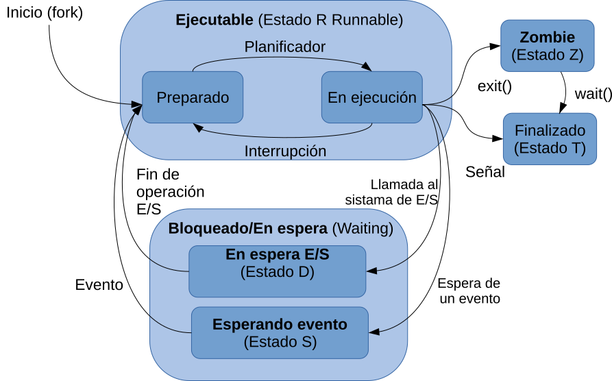
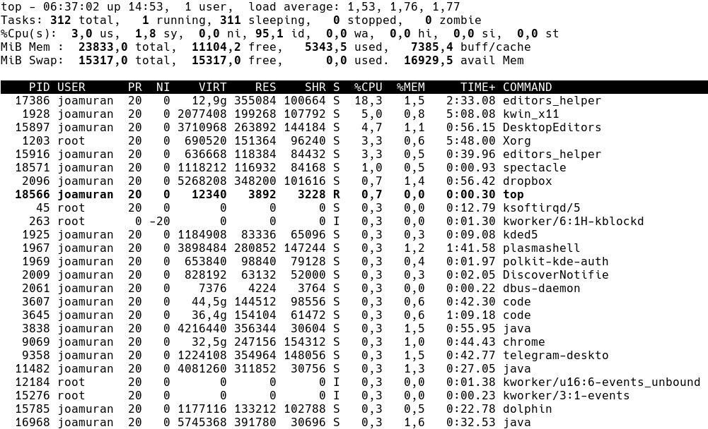
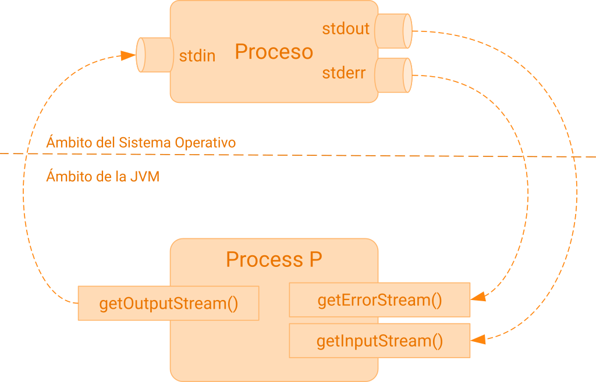
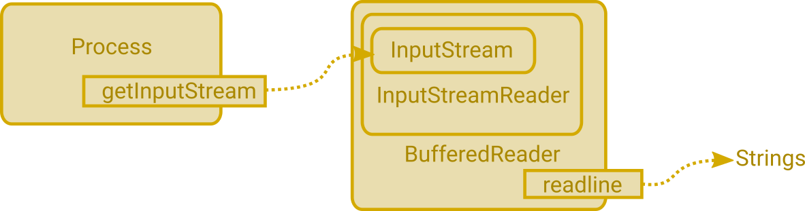

<div class="hero-course">
  <div class="hero-badge">UT01 · Multiproceso · 2n DAM · PSP</div>
  <h1 class="hero-title">Unidad 1: Programación Multiproceso</h1>
  <p class="hero-subtitle">
    Fundamentos de procesos en los sistemas operativos modernos, arquitectura de memoria independiente, la clase <code>ProcessBuilder</code> y <code>Process</code> de Java, control de ejecución, redirección de flujos estándar y el proyecto integrador <em>MyShell</em>.
  </p>
</div>

## 1. Los Procesos y el Sistema Operativo

Un **proceso** es un programa en ejecución. A diferencia de un archivo ejecutable almacenado en el disco (que es un ente pasivo), un proceso es una entidad activa que posee:
- Un espacio de direcciones de memoria virtual exclusivo y protegido.
- Un contador de programa (*Program Counter - PC*), registros de la CPU y una pila de llamadas (*stack*).
- Un bloque de control de proceso (**PCB - Process Control Block**) gestionado por el núcleo (*kernel*) del sistema operativo.
- Descriptores de archivos abiertos, credenciales de usuario y variables de entorno.

### 1.1. Ciclo de Vida y Transiciones de Estado
Un proceso pasa por diferentes estados a lo largo de su ciclo de vida, regulados por el planificador de la CPU (*scheduler*):

<div style="text-align: center; margin: 24px 0;">
  
  <p style="font-size: 0.85rem; color: var(--text-muted); margin-top: 8px;">Figura 1: Transiciones de estados de un proceso (Nuevo, Listo, Ejecución, Bloqueado, Terminado).</p>
</div>

1. **Nuevo (New):** El proceso está siendo creado y sus estructuras de control (PCB) se inicializan.
2. **Listo / Preparado (Ready):** El proceso se encuentra en memoria principal esperando a que el planificador le asigne tiempo de CPU.
3. **En Ejecución (Running):** Las instrucciones del proceso se están ejecutando físicamente en un núcleo de la CPU.
4. **Bloqueado / En Espera (Waiting / Blocked):** El proceso no puede ejecutarse porque está a la espera de un evento externo, típicamente una operación de Entrada/Salida (lectura de disco, teclado o red).
5. **Terminado (Terminated / Zombie):** El proceso ha finalizado su ejecución. Permanece en la tabla de procesos hasta que su proceso padre recoge su código de salida (*exit status*).

### 1.2. Supervisión de Procesos en GNU/Linux
En sistemas GNU/Linux podemos inspeccionar la tabla de procesos con herramientas como `ps` y el monitor en tiempo real `top`:

<div style="text-align: center; margin: 24px 0;">
  
  <p style="font-size: 0.85rem; color: var(--text-muted); margin-top: 8px;">Figura 2: Información de procesos activos y consumo de memoria y CPU con <code>top</code>.</p>
</div>

### 1.3. Cuestionario de Autoevaluación 1.1: Procesos y Sistema Operativo

<div class="interactive-mcq" data-quiz-id="psp_ut01_s1_q1" data-correct="2">
  <div class="mcq-question">❓ <strong>Pregunta 1:</strong> En el mecanismo de comunicación entre procesos mediante variables en bash, ¿cómo deben definirse las variables para que puedan ser utilizadas por otros procesos?</div>
  <div class="mcq-options">
    <button type="button" class="btn-mcq-opt" data-opt-index="0">Como variables locales dentro de la shell.</button>
    <button type="button" class="btn-mcq-opt" data-opt-index="1">Con el comando set.</button>
    <button type="button" class="btn-mcq-opt" data-opt-index="2">Definiéndolas como variables de entorno mediante export.</button>
    <button type="button" class="btn-mcq-opt" data-opt-index="3">Ninguna de las anteriores respuestas es la correcta.</button>
  </div>
  <div class="mcq-feedback"></div>
</div>

<div class="interactive-mcq" data-quiz-id="psp_ut01_s1_q2" data-correct="3">
  <div class="mcq-question">❓ <strong>Pregunta 2:</strong> ¿Cuál de las siguientes señales no puede capturarse ni ignorarse mediante el comando trap?</div>
  <div class="mcq-options">
    <button type="button" class="btn-mcq-opt" data-opt-index="0">SIGINT</button>
    <button type="button" class="btn-mcq-opt" data-opt-index="1">SIGTERM</button>
    <button type="button" class="btn-mcq-opt" data-opt-index="2">SIGSTOP</button>
    <button type="button" class="btn-mcq-opt" data-opt-index="3">SIGKILL</button>
  </div>
  <div class="mcq-feedback"></div>
</div>

<div class="interactive-mcq" data-quiz-id="psp_ut01_s1_q3" data-correct="3">
  <div class="mcq-question">❓ <strong>Pregunta 3:</strong> ¿Cuál de las siguientes señales no puede capturarse ni ignorarse mediante el comando trap?</div>
  <div class="mcq-options">
    <button type="button" class="btn-mcq-opt" data-opt-index="0">SIGINT</button>
    <button type="button" class="btn-mcq-opt" data-opt-index="1">SIGTERM</button>
    <button type="button" class="btn-mcq-opt" data-opt-index="2">SIGSTOP</button>
    <button type="button" class="btn-mcq-opt" data-opt-index="3">SIGKILL</button>
  </div>
  <div class="mcq-feedback"></div>
</div>

<div class="interactive-mcq" data-quiz-id="psp_ut01_s1_q4" data-correct="1">
  <div class="mcq-question">❓ <strong>Pregunta 4:</strong> ¿Qué es una señal en el contexto de los sistemas operativos tipo Unix/Linux?</div>
  <div class="mcq-options">
    <button type="button" class="btn-mcq-opt" data-opt-index="0">Un archivo que contiene información del proceso.</button>
    <button type="button" class="btn-mcq-opt" data-opt-index="1">Mensajes que el sistema operativo envía a un proceso en tiempo de ejecución, para informarle del suceso de un evento.</button>
    <button type="button" class="btn-mcq-opt" data-opt-index="2">Una orden exclusiva que solo puede ejecutar el usuario root.</button>
    <button type="button" class="btn-mcq-opt" data-opt-index="3">Un tipo de variable de entorno compartida entre procesos.</button>
  </div>
  <div class="mcq-feedback"></div>
</div>

<div class="interactive-mcq" data-quiz-id="psp_ut01_s1_q5" data-correct="0">
  <div class="mcq-question">❓ <strong>Pregunta 5:</strong> El comando utilizado para crear una tubería con nombre en Linux es mkfifo.</div>
  <div class="mcq-options">
    <button type="button" class="btn-mcq-opt" data-opt-index="0">Verdadero</button>
    <button type="button" class="btn-mcq-opt" data-opt-index="1">Falso</button>
  </div>
  <div class="mcq-feedback"></div>
</div>

<div class="interactive-mcq" data-quiz-id="psp_ut01_s1_q6" data-correct="2">
  <div class="mcq-question">❓ <strong>Pregunta 6:</strong> ¿Qué ocurre al ejecutar el comando echo &quot;Saludos!&quot; &gt; /dev/pts/1?</div>
  <div class="mcq-options">
    <button type="button" class="btn-mcq-opt" data-opt-index="0">Se muestra el texto en la misma terminal.</button>
    <button type="button" class="btn-mcq-opt" data-opt-index="1">Se guarda el texto en un fichero llamado pts/1</button>
    <button type="button" class="btn-mcq-opt" data-opt-index="2">Se muestra el texto en otra terminal conectada a /dev/pts/1</button>
    <button type="button" class="btn-mcq-opt" data-opt-index="3">Se borra el contenido de la terminal 1.</button>
  </div>
  <div class="mcq-feedback"></div>
</div>

<div class="interactive-mcq" data-quiz-id="psp_ut01_s1_q7" data-correct="3">
  <div class="mcq-question">❓ <strong>Pregunta 7:</strong> ¿Qué descriptor de fichero se utiliza normalmente para abrir un socket en bash sin interferir con stdin, stdout o stderr?</div>
  <div class="mcq-options">
    <button type="button" class="btn-mcq-opt" data-opt-index="0">0</button>
    <button type="button" class="btn-mcq-opt" data-opt-index="1">1</button>
    <button type="button" class="btn-mcq-opt" data-opt-index="2">2</button>
    <button type="button" class="btn-mcq-opt" data-opt-index="3">3 o superior</button>
  </div>
  <div class="mcq-feedback"></div>
</div>

<div class="interactive-mcq" data-quiz-id="psp_ut01_s1_q8" data-correct="0">
  <div class="mcq-question">❓ <strong>Pregunta 8:</strong> ¿Qué hace el siguiente comando? socat -u TCP-LISTEN:5555 STDOUT</div>
  <div class="mcq-options">
    <button type="button" class="btn-mcq-opt" data-opt-index="0">Envía los datos del puerto 5555 a la salida estándar.</button>
    <button type="button" class="btn-mcq-opt" data-opt-index="1">Escucha por el puerto 5555 y guarda los datos en un fichero temporal.</button>
    <button type="button" class="btn-mcq-opt" data-opt-index="2">Crea una conexión TCP bidireccional en el puerto 5555.</button>
    <button type="button" class="btn-mcq-opt" data-opt-index="3">Muestra los sockets abiertos en el sistema.</button>
  </div>
  <div class="mcq-feedback"></div>
</div>

<div class="interactive-mcq" data-quiz-id="psp_ut01_s1_q9" data-correct="0">
  <div class="mcq-question">❓ <strong>Pregunta 9:</strong> ¿Qué hace el siguiente comando? socat -u TCP-LISTEN:5555 STDOUT</div>
  <div class="mcq-options">
    <button type="button" class="btn-mcq-opt" data-opt-index="0">Envía los datos del puerto 5555 a la salida estándar.</button>
    <button type="button" class="btn-mcq-opt" data-opt-index="1">Escucha por el puerto 5555 y guarda los datos en un fichero temporal.</button>
    <button type="button" class="btn-mcq-opt" data-opt-index="2">Crea una conexión TCP bidireccional en el puerto 5555.</button>
    <button type="button" class="btn-mcq-opt" data-opt-index="3">Muestra los sockets abiertos en el sistema.</button>
  </div>
  <div class="mcq-feedback"></div>
</div>

<div class="interactive-mcq" data-quiz-id="psp_ut01_s1_q10" data-correct="1">
  <div class="mcq-question">❓ <strong>Pregunta 10:</strong> Las tuberías con nombre (named pipes) son ficheros especiales que permiten comunicación tipo LIFO entre procesos.</div>
  <div class="mcq-options">
    <button type="button" class="btn-mcq-opt" data-opt-index="0">Verdadero</button>
    <button type="button" class="btn-mcq-opt" data-opt-index="1">Falso</button>
  </div>
  <div class="mcq-feedback"></div>
</div>

<div class="interactive-mcq" data-quiz-id="psp_ut01_s1_q11" data-correct="3">
  <div class="mcq-question">❓ <strong>Pregunta 11:</strong> ¿Qué comando redirige los mensajes de error a un fichero sin mostrar nada por pantalla?</div>
  <div class="mcq-options">
    <button type="button" class="btn-mcq-opt" data-opt-index="0">comando 3&gt; error.log</button>
    <button type="button" class="btn-mcq-opt" data-opt-index="1">comando &lt; error.log</button>
    <button type="button" class="btn-mcq-opt" data-opt-index="2">comando &gt;&gt; error.log</button>
    <button type="button" class="btn-mcq-opt" data-opt-index="3">comando 2&gt; error.log</button>
  </div>
  <div class="mcq-feedback"></div>
</div>

<div class="interactive-mcq" data-quiz-id="psp_ut01_s1_q12" data-correct="1">
  <div class="mcq-question">❓ <strong>Pregunta 12:</strong> ¿Cuál de los siguientes flujos está asociado a la entrada estándar de un proceso?</div>
  <div class="mcq-options">
    <button type="button" class="btn-mcq-opt" data-opt-index="0">stdout</button>
    <button type="button" class="btn-mcq-opt" data-opt-index="1">stdin</button>
    <button type="button" class="btn-mcq-opt" data-opt-index="2">stderr</button>
    <button type="button" class="btn-mcq-opt" data-opt-index="3">stdfile</button>
  </div>
  <div class="mcq-feedback"></div>
</div>

<div class="interactive-mcq" data-quiz-id="psp_ut01_s1_q13" data-correct="2">
  <div class="mcq-question">❓ <strong>Pregunta 13:</strong> ¿Cuál de las siguientes frases define mejor el concepto de proceso?</div>
  <div class="mcq-options">
    <button type="button" class="btn-mcq-opt" data-opt-index="0">Un fichero ejecutable, que contiene órdenes para el procesador.</button>
    <button type="button" class="btn-mcq-opt" data-opt-index="1">El conjunto de programas, documentación y recursos, como imágenes y ficheros de configuración.</button>
    <button type="button" class="btn-mcq-opt" data-opt-index="2">Una instancia de un programa en ejecución, al que se le han asignado recursos del sistema.</button>
    <button type="button" class="btn-mcq-opt" data-opt-index="3">Una instancia de un programa en ejecución, que comparte recursos, como la memoria, con otros procesos.</button>
    <button type="button" class="btn-mcq-opt" data-opt-index="4">El conjunto de pasos necesario para hacer que un programa ejecutable se cargue en memoria y empiece su ejecución.</button>
  </div>
  <div class="mcq-feedback"></div>
</div>

<div class="interactive-mcq" data-quiz-id="psp_ut01_s1_q14" data-correct="0">
  <div class="mcq-question">❓ <strong>Pregunta 14:</strong> ¿Qué afirmación de las siguientes es correcta acerca del estado R (Runnable) de un proceso?</div>
  <div class="mcq-options">
    <button type="button" class="btn-mcq-opt" data-opt-index="0">Contiene los estados Preparado y En ejecución. Quien decide qué proceso pasa de preparado a En Ejecución es el planificador del sistema.</button>
    <button type="button" class="btn-mcq-opt" data-opt-index="1">Contiene los estados Preparado y En ejecución. Quien decide qué proceso pasa de En Ejecución a Preparado es el planificador del esistema.</button>
    <button type="button" class="btn-mcq-opt" data-opt-index="2">Contiene los estados D y S, y el paso de uno a otro lo determinan las operaciones de E/S.</button>
    <button type="button" class="btn-mcq-opt" data-opt-index="3">Contiene los estados Z y T, y el paso de uno a otro se realiza mediante señales.</button>
    <button type="button" class="btn-mcq-opt" data-opt-index="4">Se inicia mediante la llamada al sistema wait()</button>
  </div>
  <div class="mcq-feedback"></div>
</div>

<div class="interactive-mcq" data-quiz-id="psp_ut01_s1_q15" data-correct="2">
  <div class="mcq-question">❓ <strong>Pregunta 15:</strong> ¿Qué estado posee un proceso que ha finalizado su ejecución mediante exit(), pero su proceso padre todavía no ha consultado este estado de finalización?</div>
  <div class="mcq-options">
    <button type="button" class="btn-mcq-opt" data-opt-index="0">Estado D (En Espera E/S)</button>
    <button type="button" class="btn-mcq-opt" data-opt-index="1">Esado S (Esperando evento)</button>
    <button type="button" class="btn-mcq-opt" data-opt-index="2">Estado Z (Zombie)</button>
    <button type="button" class="btn-mcq-opt" data-opt-index="3">Estado T (Finalizado)</button>
    <button type="button" class="btn-mcq-opt" data-opt-index="4">Estado R (Runnable)</button>
  </div>
  <div class="mcq-feedback"></div>
</div>

<div class="interactive-mcq" data-quiz-id="psp_ut01_s1_q16" data-correct="0">
  <div class="mcq-question">❓ <strong>Pregunta 16:</strong> ¿Qué orden podemos utilizar para conocer en tiempo real los diferentes procesos y su consumo de recursos?</div>
  <div class="mcq-options">
    <button type="button" class="btn-mcq-opt" data-opt-index="0">top</button>
    <button type="button" class="btn-mcq-opt" data-opt-index="1">ps</button>
    <button type="button" class="btn-mcq-opt" data-opt-index="2">pidof</button>
    <button type="button" class="btn-mcq-opt" data-opt-index="3">pgrep</button>
    <button type="button" class="btn-mcq-opt" data-opt-index="4">systemctl</button>
  </div>
  <div class="mcq-feedback"></div>
</div>

<div class="interactive-mcq" data-quiz-id="psp_ut01_s1_q17" data-correct="0">
  <div class="mcq-question">❓ <strong>Pregunta 17:</strong> El demonio Systemd se encarga también de la secuencia de arranque del sistema y de gestionar los diferentes niveles de ejecución</div>
  <div class="mcq-options">
    <button type="button" class="btn-mcq-opt" data-opt-index="0">Verdadero</button>
    <button type="button" class="btn-mcq-opt" data-opt-index="1">Falso</button>
  </div>
  <div class="mcq-feedback"></div>
</div>

<div class="interactive-mcq" data-quiz-id="psp_ut01_s1_q18" data-correct="0">
  <div class="mcq-question">❓ <strong>Pregunta 18:</strong> Los demonios pueden ofrecer servicios o realizar otras tareas, como mantener la hora del sistema</div>
  <div class="mcq-options">
    <button type="button" class="btn-mcq-opt" data-opt-index="0">Verdadero</button>
    <button type="button" class="btn-mcq-opt" data-opt-index="1">Falso</button>
  </div>
  <div class="mcq-feedback"></div>
</div>

<div class="interactive-mcq" data-quiz-id="psp_ut01_s1_q19" data-correct="1">
  <div class="mcq-question">❓ <strong>Pregunta 19:</strong> El demonio Systemd utiliza el comando systemctl para consultar el estado de los servicios, pero no puede gestionar éstos</div>
  <div class="mcq-options">
    <button type="button" class="btn-mcq-opt" data-opt-index="0">Verdadero</button>
    <button type="button" class="btn-mcq-opt" data-opt-index="1">Falso</button>
  </div>
  <div class="mcq-feedback"></div>
</div>

<div class="interactive-mcq" data-quiz-id="psp_ut01_s1_q20" data-correct="1">
  <div class="mcq-question">❓ <strong>Pregunta 20:</strong> Los demonios pueden tener terminal asociada e interfaz gráfica</div>
  <div class="mcq-options">
    <button type="button" class="btn-mcq-opt" data-opt-index="0">Verdadero</button>
    <button type="button" class="btn-mcq-opt" data-opt-index="1">Falso</button>
  </div>
  <div class="mcq-feedback"></div>
</div>

<div class="interactive-mcq" data-quiz-id="psp_ut01_s1_q21" data-correct="0">
  <div class="mcq-question">❓ <strong>Pregunta 21:</strong> Los demonios son procesos que se ejecutan en segundo plano</div>
  <div class="mcq-options">
    <button type="button" class="btn-mcq-opt" data-opt-index="0">Verdadero</button>
    <button type="button" class="btn-mcq-opt" data-opt-index="1">Falso</button>
  </div>
  <div class="mcq-feedback"></div>
</div>

<div class="interactive-mcq" data-quiz-id="psp_ut01_s1_q22" data-correct="1">
  <div class="mcq-question">❓ <strong>Pregunta 22:</strong> En el comando ps aux | grep bash, el comando grep bash actúa como:</div>
  <div class="mcq-options">
    <button type="button" class="btn-mcq-opt" data-opt-index="0">El proceso productor.</button>
    <button type="button" class="btn-mcq-opt" data-opt-index="1">El proceso consumidor que recibe la salida de ps aux.</button>
    <button type="button" class="btn-mcq-opt" data-opt-index="2">El proceso que genera la entrada estándar.</button>
    <button type="button" class="btn-mcq-opt" data-opt-index="3">Un proceso independiente sin conexión con ps aux.</button>
  </div>
  <div class="mcq-feedback"></div>
</div>

<div class="interactive-mcq" data-quiz-id="psp_ut01_s1_q23" data-correct="1">
  <div class="mcq-question">❓ <strong>Pregunta 23:</strong> En el comando ps aux | grep bash, el comando grep bash actúa como:</div>
  <div class="mcq-options">
    <button type="button" class="btn-mcq-opt" data-opt-index="0">El proceso productor.</button>
    <button type="button" class="btn-mcq-opt" data-opt-index="1">El proceso consumidor que recibe la salida de ps aux.</button>
    <button type="button" class="btn-mcq-opt" data-opt-index="2">El proceso que genera la entrada estándar.</button>
    <button type="button" class="btn-mcq-opt" data-opt-index="3">Un proceso independiente sin conexión con ps aux.</button>
  </div>
  <div class="mcq-feedback"></div>
</div>

---

## 2. Programación Multiproceso en Java

A partir de Java 5 y optimizado en Java 9 y Java 21, la creación y gestión de procesos del sistema operativo se realiza principalmente mediante dos clases fundamentales del paquete `java.lang`:
- `ProcessBuilder`: Permite configurar el comando, los argumentos de la línea de comandos, el directorio de trabajo y las variables de entorno del proceso antes de iniciarlo.
- `Process`: Representa el proceso nativo en ejecución, proporcionando métodos para consultar su PID, esperar a su finalización (`waitFor()`), comprobar si sigue vivo (`isAlive()`) o forzar su terminación (`destroy()` / `destroyForcibly()`).

### 2.1. Ejemplo de Creación Básica: `Lanzador4.java`

El siguiente ejemplo compila y ejecuta una clase secundaria (`Suma.java`) como un proceso hijo independiente:

```java
import java.io.File;
import java.io.IOException;

public class Lanzador4 {
    public static void main(String[] args) {
        // Configuración del comando y los argumentos pasados al proceso hijo
        ProcessBuilder pb = new ProcessBuilder("java", "-cp", "./bin", "Suma", "10", "20");
        
        // Directorio de trabajo
        pb.directory(new File("."));
        
        // Heredar la entrada y salida estándar en la propia consola del padre
        pb.inheritIO();
        
        try {
            System.out.println("Lanzando proceso hijo Suma...");
            Process proceso = pb.start();
            
            // Esperar a que el proceso hijo finalice
            int codRetorno = proceso.waitFor();
            System.out.println("El proceso hijo ha finalizado con código: " + codRetorno);
        } catch (IOException e) {
            System.err.println("Error de E/S al lanzar el proceso: " + e.getMessage());
        } catch (InterruptedException e) {
            System.err.println("El proceso padre fue interrumpido mientras esperaba.");
        }
    }
}
```

Y la clase que realiza el cómputo (`Suma.java`):

```java
public class Suma {
    public static void main(String[] args) {
        if (args.length < 2) {
            System.err.println("Error: Se requieren dos argumentos enteros.");
            System.exit(1);
        }
        try {
            int n1 = Integer.parseInt(args[0]);
            int n2 = Integer.parseInt(args[1]);
            int suma = 0;
            for (int i = Math.min(n1, n2); i <= Math.max(n1, n2); i++) {
                suma += i;
            }
            System.out.println("La suma en el rango es: " + suma);
            System.exit(0);
        } catch (NumberFormatException e) {
            System.err.println("Argumentos no válidos.");
            System.exit(2);
        }
    }
}
```

### 2.2. Cuestionario de Autoevaluación 1.2: Procesos en Java

<div class="interactive-mcq" data-quiz-id="psp_ut01_s2_q1" data-correct="4">
  <div class="mcq-question">❓ <strong>Pregunta 1:</strong> ¿ Qué información NO podemos obtener mediante la interfaz ProcessHandle.Info?</div>
  <div class="mcq-options">
    <button type="button" class="btn-mcq-opt" data-opt-index="0">Los argumentos del proceso</button>
    <button type="button" class="btn-mcq-opt" data-opt-index="1">El comando lanzado</button>
    <button type="button" class="btn-mcq-opt" data-opt-index="2">La hora de inicio del proceso</button>
    <button type="button" class="btn-mcq-opt" data-opt-index="3">El tiempo de CPU acumulado del proceso</button>
    <button type="button" class="btn-mcq-opt" data-opt-index="4">El PID del proceso</button>
  </div>
  <div class="mcq-feedback"></div>
</div>

<div class="interactive-mcq" data-quiz-id="psp_ut01_s2_q2" data-correct="3">
  <div class="mcq-question">❓ <strong>Pregunta 2:</strong> ¿Cómo podemos obtener una instancia de la clase Process?</div>
  <div class="mcq-options">
    <button type="button" class="btn-mcq-opt" data-opt-index="0">Mediante la orden Process p=new Process()</button>
    <button type="button" class="btn-mcq-opt" data-opt-index="1">Sólamente mediante el método start de ProcessBuilder</button>
    <button type="button" class="btn-mcq-opt" data-opt-index="2">Sólamente mediante el método exec de Runtime</button>
    <button type="button" class="btn-mcq-opt" data-opt-index="3">Mediante el método start de ProcessBuilder o exec de Runtime.</button>
    <button type="button" class="btn-mcq-opt" data-opt-index="4">Mediante el método start de ProcessBuilder y el operador new Processs.</button>
  </div>
  <div class="mcq-feedback"></div>
</div>

<div class="interactive-mcq" data-quiz-id="psp_ut01_s2_q3" data-correct="1">
  <div class="mcq-question">❓ <strong>Pregunta 3:</strong> ¿Qué deberemos modificar en una instancia de ProcessBuilder si deseamos añadir una variable de entorno?</div>
  <div class="mcq-options">
    <button type="button" class="btn-mcq-opt" data-opt-index="0">command</button>
    <button type="button" class="btn-mcq-opt" data-opt-index="1">environment</button>
    <button type="button" class="btn-mcq-opt" data-opt-index="2">directory</button>
    <button type="button" class="btn-mcq-opt" data-opt-index="3">InputStream</button>
    <button type="button" class="btn-mcq-opt" data-opt-index="4">ErrorStream</button>
  </div>
  <div class="mcq-feedback"></div>
</div>

<div class="interactive-mcq" data-quiz-id="psp_ut01_s2_q4" data-correct="4">
  <div class="mcq-question">❓ <strong>Pregunta 4:</strong> ¿Qué hace exactamente la orden ProcessBuilder pb = new ProcessBuilder(&quot;firefox&quot;); ?</div>
  <div class="mcq-options">
    <button type="button" class="btn-mcq-opt" data-opt-index="0">Crea una instancia del proceso Firefox.</button>
    <button type="button" class="btn-mcq-opt" data-opt-index="1">Lanza el programa Firefox.</button>
    <button type="button" class="btn-mcq-opt" data-opt-index="2">Crea una instancia de la clase ProcessBuilder.</button>
    <button type="button" class="btn-mcq-opt" data-opt-index="3">Crea una instancia de la clase ProcessBuilder pasándole como argumento el proceso Firefox.</button>
    <button type="button" class="btn-mcq-opt" data-opt-index="4">Crea una instancia de la clase ProcessBuilder y establece su atributo command como “Firefox”</button>
  </div>
  <div class="mcq-feedback"></div>
</div>

<div class="interactive-mcq" data-quiz-id="psp_ut01_s2_q5" data-correct="1">
  <div class="mcq-question">❓ <strong>Pregunta 5:</strong> c. El método waitFor() devuelve siempre un Booleano.</div>
  <div class="mcq-options">
    <button type="button" class="btn-mcq-opt" data-opt-index="0">Verdadero</button>
    <button type="button" class="btn-mcq-opt" data-opt-index="1">Falso</button>
  </div>
  <div class="mcq-feedback"></div>
</div>

<div class="interactive-mcq" data-quiz-id="psp_ut01_s2_q6" data-correct="0">
  <div class="mcq-question">❓ <strong>Pregunta 6:</strong> b. El Método isAlive() retorna true si el proceso creado sigue en ejecución</div>
  <div class="mcq-options">
    <button type="button" class="btn-mcq-opt" data-opt-index="0">Verdadero</button>
    <button type="button" class="btn-mcq-opt" data-opt-index="1">Falso</button>
  </div>
  <div class="mcq-feedback"></div>
</div>

<div class="interactive-mcq" data-quiz-id="psp_ut01_s2_q7" data-correct="1">
  <div class="mcq-question">❓ <strong>Pregunta 7:</strong> d. El método destroy envía la señal SIGKILL al proceso</div>
  <div class="mcq-options">
    <button type="button" class="btn-mcq-opt" data-opt-index="0">Verdadero</button>
    <button type="button" class="btn-mcq-opt" data-opt-index="1">Falso</button>
  </div>
  <div class="mcq-feedback"></div>
</div>

<div class="interactive-mcq" data-quiz-id="psp_ut01_s2_q8" data-correct="0">
  <div class="mcq-question">❓ <strong>Pregunta 8:</strong> El método exitValue() nos devuelve el código de salida del proceso, una vez finalizdo</div>
  <div class="mcq-options">
    <button type="button" class="btn-mcq-opt" data-opt-index="0">Verdadero</button>
    <button type="button" class="btn-mcq-opt" data-opt-index="1">Falso</button>
  </div>
  <div class="mcq-feedback"></div>
</div>

<div class="interactive-mcq" data-quiz-id="psp_ut01_s2_q9" data-correct="1">
  <div class="mcq-question">❓ <strong>Pregunta 9:</strong> e. El método destroyForcibily envía la señal SIGTERM al proceso</div>
  <div class="mcq-options">
    <button type="button" class="btn-mcq-opt" data-opt-index="0">Verdadero</button>
    <button type="button" class="btn-mcq-opt" data-opt-index="1">Falso</button>
  </div>
  <div class="mcq-feedback"></div>
</div>

---

## 3. Gestión de la Entrada/Salida y Comunicación entre Procesos

Cada proceso dispone por defecto de tres descriptores de archivo estándar heredados del sistema operativo:
1. **Entrada Estándar (`stdin` / descriptor 0):** Por donde el proceso recibe datos.
2. **Salida Estándar (`stdout` / descriptor 1):** Por donde el proceso emite su salida normal.
3. **Salida de Error Estándar (`stderr` / descriptor 2):** Por donde se notifican los errores diagnósticos.

<div style="text-align: center; margin: 24px 0;">
  
  <p style="font-size: 0.85rem; color: var(--text-muted); margin-top: 8px;">Figura 3: Conexión entre los streams de Java y los descriptores estándar del proceso nativo.</p>
</div>

> [!NOTE]
> **Perspectiva de los Streams en Java:**
> - `proceso.getInputStream()`: Permite al programa padre **LEER** lo que el proceso hijo escribe en su `stdout`.
> - `proceso.getOutputStream()`: Permite al programa padre **ESCRIBIR** datos hacia el `stdin` del proceso hijo.
> - `proceso.getErrorStream()`: Permite al programa padre **LEER** los mensajes emitidos por el hijo en su `stderr`.

<div style="text-align: center; margin: 24px 0;">
  
  <p style="font-size: 0.85rem; color: var(--text-muted); margin-top: 8px;">Figura 4: Decoración de InputStream mediante InputStreamReader y BufferedReader para lectura por líneas.</p>
</div>

### 3.1. Cuestionario de Autoevaluación 1.3: Comunicación entre Procesos


---

## 4. Tareas Evaluables y Proyectos Prácticos

### 4.1. Tarea 1: Ejecución y Finalización Controlada de un Editor (`U1EditorControlado.java`)
Crea un programa en Java que permita abrir un editor de texto (por ejemplo `gedit` en Linux o `notepad.exe` en Windows) pasando un archivo como argumento, y gestione su ejecución:
- Si el usuario cierra el editor normalmente antes de un tiempo límite (10 segundos), el programa muestra el código de salida normal.
- Si transcurren los 10 segundos y el editor sigue abierto, el programa debe advertir al usuario y forzar la destrucción del proceso hijo mediante `destroyForcibly()`.

<div class="interactive-open-response" data-question-id="psp_ut01_open_tasca1">
  <div class="open-question">✍️ <strong>Tarea 1 (U1EditorControlado):</strong> Pega aquí la implementación de tu clase <code>U1EditorControlado.java</code> y explica cómo controlas el tiempo máximo mediante <code>waitFor(timeout, unit)</code> y el método <code>destroyForcibly()</code>:</div>
  <textarea class="open-response-input" rows="4" placeholder="public class U1EditorControlado Ellipsis"></textarea>
</div>

### 4.2. Tarea 2: Productor - Consumidor de Procesos mediante Tuberías
Diseña dos programas independientes:
1. `Consumidor.java`: Lee líneas desde su entrada estándar (`System.in`) utilizando un `BufferedReader`, las convierte a mayúsculas y las imprime en su salida.
2. `Productor.java`: Lanza a `Consumidor` mediante `ProcessBuilder`, obtiene su `OutputStream`, le envía una serie de cadenas y posteriormente lee la respuesta devuelta por el consumidor mostrando el resultado en pantalla.

<div class="interactive-open-response" data-question-id="psp_ut01_open_tasca2">
  <div class="open-question">✍️ <strong>Tarea 2 (Productor-Consumidor E/S):</strong> Pega el código de <code>Productor.java</code> y <code>Consumidor.java</code> detallando cómo cierras el flujo con <code>flush()</code> y <code>close()</code> para evitar bloqueos mutuos (*deadlocks*):</div>
  <textarea class="open-response-input" rows="4" placeholder="Código fuente y justificación del manejo de streams..."></textarea>
</div>

### 4.3. Proyecto 1 (Evaluación Continua): MyShell
Desarrollo de un intérprete de comandos interactivo en Java (`MyShell`) con soporte para ejecución de binarios del sistema, comando interno `cd`, `exit`, paso de argumentos, y redirecciones de entrada y salida con los operadores `>`, `>>` y `<`.

<div class="interactive-open-response" data-question-id="psp_ut01_open_myshell">
  <div class="open-question">✍️ <strong>Proyecto 1 (Memoria de MyShell):</strong> Resume las características implementadas en tu proyecto MyShell (gestión de rutas, comandos integrados, redirecciones o tuberías) y pega la clase principal <code>MyShell.java</code>:</div>
  <textarea class="open-response-input" rows="5" placeholder="Documentación de la arquitectura de MyShell y código de la shell interactiva..."></textarea>
</div>
