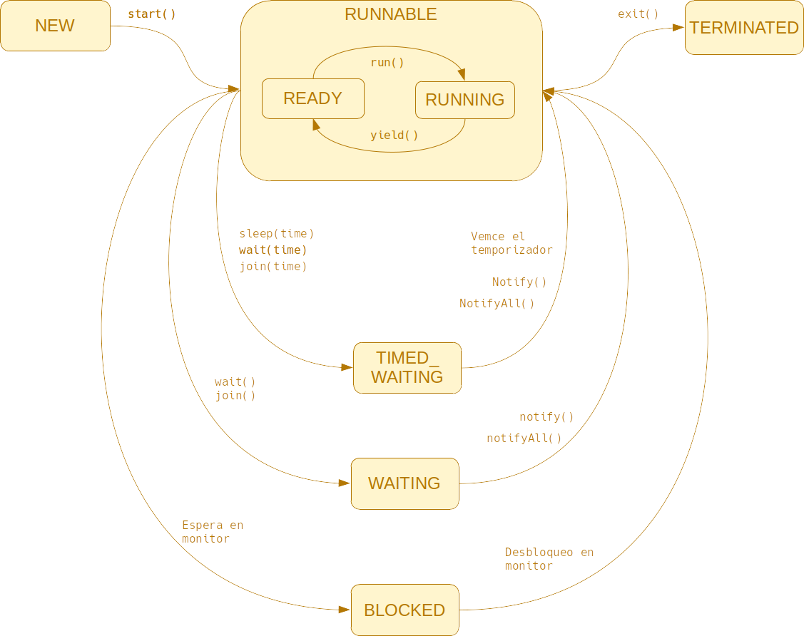
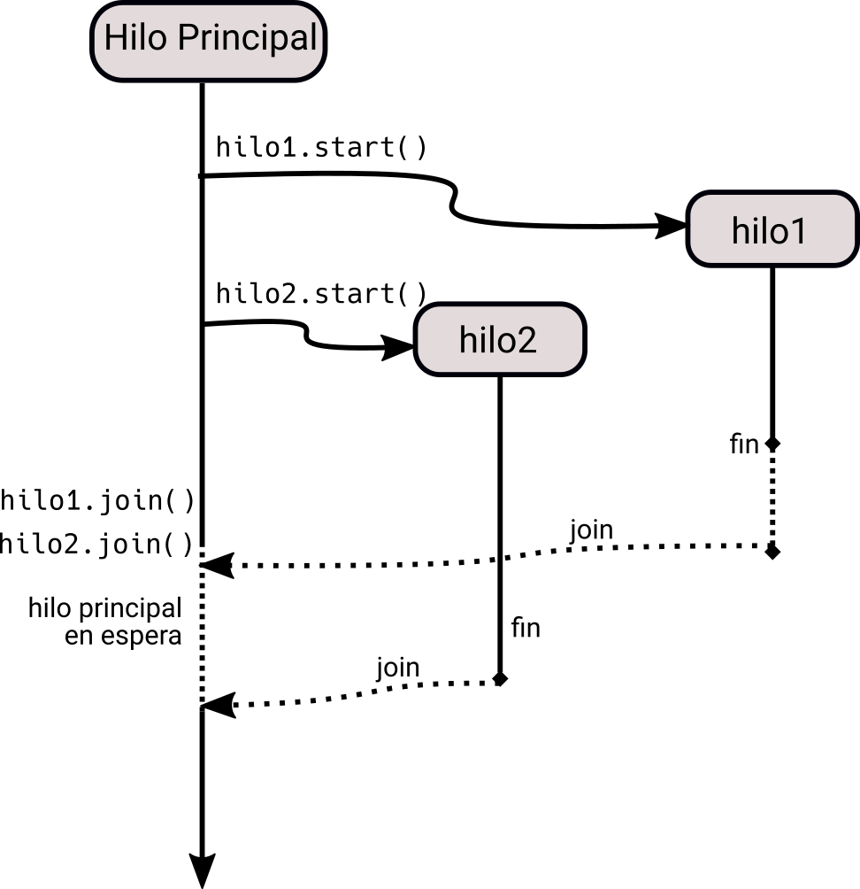
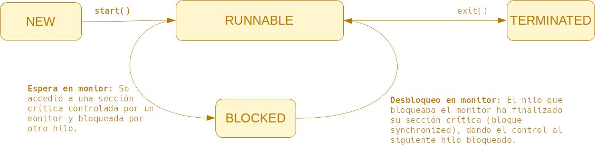
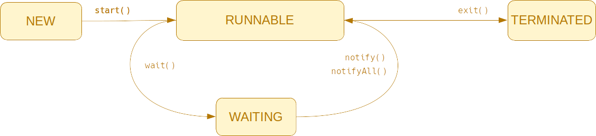

<div class="hero-course">
  <div class="hero-badge">UT02 · Multihilo · 2n DAM · PSP</div>
  <h1 class="hero-title">Unidad 2: Programación Multihilo (Threads)</h1>
  <p class="hero-subtitle">
    Arquitectura concurrente, creación y ciclo de vida de hilos en Java, mecanismos de sincronización de secciones críticas, comunicación con <code>wait()</code> / <code>notify()</code>, el paquete <code>java.util.concurrent</code> y tareas prácticas.
  </p>
</div>

## 1. Fundamentos de los Hilos de Ejecución

Un **hilo (*thread*)** es una unidad básica de utilización de CPU que comparte el mismo espacio de memoria y recursos con otros hilos del mismo proceso:
- **Proceso vs Hilo:** Crear un nuevo proceso requiere clonar el mapa de memoria y descriptores del sistema operativo (pesado). En cambio, crear un hilo dentro de un proceso existente comparte la memoria estática y la memoria dinámica (*heap*), teniendo únicamente su propia pila de llamadas (*stack*) y registros.
- **Multiprogramación y Paralelismo Real:** En sistemas multinúcleo modernos, los hilos de un proceso pueden ejecutarse de manera verdaderamente paralela en diferentes núcleos físicos.

### 1.1. Creación de Hilos en Java
Existen dos formas fundamentales para definir el código que ejecutará un hilo:

1. **Heredar de `java.lang.Thread`:**
```java
public class MiHilo extends Thread {
    @Override
    public void run() {
        System.out.println("Ejecutando en el hilo: " + getName());
    }
}
// Arranque:
MiHilo h = new MiHilo();
h.start(); // ¡OJO! Se llama a start(), nunca directamente a run()
```

2. **Implementar la interfaz funcional `java.lang.Runnable` (Recomendado):**
```java
Runnable tarea = () -> {
    System.out.println("Ejecutando tarea Runnable");
};
Thread t = new Thread(tarea);
t.start();
```

### 1.2. Ciclo de Vida de un Hilo
Un hilo en la máquina virtual de Java (JVM) transita entre los siguientes estados:

<div style="text-align: center; margin: 24px 0;">
  
  <p style="font-size: 0.85rem; color: var(--text-muted); margin-top: 8px;">Figura 1: Diagrama de transiciones de estado de java.lang.Thread.</p>
</div>

- **NEW:** Creado con `new Thread()`, pero todavía no se ha invocado `start()`.
- **RUNNABLE:** Listo para ejecutarse o ejecutándose en la CPU.
- **BLOCKED:** Esperando adquirir un cerrojo intrínseco (*monitor lock*) en un bloque o método `synchronized`.
- **WAITING:** Esperando indefinidamente la señal de otro hilo (`wait()`, `join()`).
- **TIMED_WAITING:** Esperando durante un tiempo determinado (`sleep(ms)`, `wait(ms)`, `join(ms)`).
- **TERMINATED:** Su método `run()` ha terminado.

<div style="text-align: center; margin: 24px 0;">
  
  <p style="font-size: 0.85rem; color: var(--text-muted); margin-top: 8px;">Figura 2: Secuencia temporal de un hilo principal esperando a hilos trabajadores mediante join().</p>
</div>

### 1.3. Cuestionario de Autoevaluación 2.1: Hilos y Creación

<div class="interactive-mcq" data-quiz-id="psp_ut02_s1_q1" data-correct="1">
  <div class="mcq-question">❓ <strong>Pregunta 1:</strong> Verdadero o falso: En Java, la forma recomendada de crear un hilo es extendiendo la clase Thread.</div>
  <div class="mcq-options">
    <button type="button" class="btn-mcq-opt" data-opt-index="0">Verdadero</button>
    <button type="button" class="btn-mcq-opt" data-opt-index="1">Falso</button>
  </div>
  <div class="mcq-feedback"></div>
</div>

<div class="interactive-mcq" data-quiz-id="psp_ut02_s1_q2" data-correct="1">
  <div class="mcq-question">❓ <strong>Pregunta 2:</strong> En Java, la forma recomendada de crear un hilo es extendiendo la clase Thread.</div>
  <div class="mcq-options">
    <button type="button" class="btn-mcq-opt" data-opt-index="0">Verdadero</button>
    <button type="button" class="btn-mcq-opt" data-opt-index="1">Falso</button>
  </div>
  <div class="mcq-feedback"></div>
</div>

<div class="interactive-mcq" data-quiz-id="psp_ut02_s1_q3" data-correct="1">
  <div class="mcq-question">❓ <strong>Pregunta 3:</strong> En Java, la forma recomendada de crear un hilo es extendiendo la clase Thread.</div>
  <div class="mcq-options">
    <button type="button" class="btn-mcq-opt" data-opt-index="0">Verdadero</button>
    <button type="button" class="btn-mcq-opt" data-opt-index="1">Falso</button>
  </div>
  <div class="mcq-feedback"></div>
</div>

<div class="interactive-mcq" data-quiz-id="psp_ut02_s1_q4" data-correct="0">
  <div class="mcq-question">❓ <strong>Pregunta 4:</strong> ¿Cuál es la principal diferencia entre un proceso y un hilo en Java?</div>
  <div class="mcq-options">
    <button type="button" class="btn-mcq-opt" data-opt-index="0">Los hilos de un mismo proceso comparten los mismos recursos como memoria o ficheros.</button>
    <button type="button" class="btn-mcq-opt" data-opt-index="1">Cada hilo se ejecuta en un ordenador distinto.</button>
    <button type="button" class="btn-mcq-opt" data-opt-index="2">Un proceso puede tener solo un hilo.</button>
    <button type="button" class="btn-mcq-opt" data-opt-index="3">Los hilos no pueden acceder a variables compartidas.</button>
  </div>
  <div class="mcq-feedback"></div>
</div>

<div class="interactive-mcq" data-quiz-id="psp_ut02_s1_q5" data-correct="0">
  <div class="mcq-question">❓ <strong>Pregunta 5:</strong> El método join(long millis) permite establecer un tiempo máximo de espera a que finalice un hilo.</div>
  <div class="mcq-options">
    <button type="button" class="btn-mcq-opt" data-opt-index="0">Verdadero</button>
    <button type="button" class="btn-mcq-opt" data-opt-index="1">Falso</button>
  </div>
  <div class="mcq-feedback"></div>
</div>

<div class="interactive-mcq" data-quiz-id="psp_ut02_s1_q6" data-correct="0">
  <div class="mcq-question">❓ <strong>Pregunta 6:</strong> En el ejercicio HolaThreadsParam.java, el método main debe esperar a que terminen todos los hilos antes de finalizar el programa.</div>
  <div class="mcq-options">
    <button type="button" class="btn-mcq-opt" data-opt-index="0">Verdadero</button>
    <button type="button" class="btn-mcq-opt" data-opt-index="1">Falso</button>
  </div>
  <div class="mcq-feedback"></div>
</div>

<div class="interactive-mcq" data-quiz-id="psp_ut02_s1_q7" data-correct="0">
  <div class="mcq-question">❓ <strong>Pregunta 7:</strong> ¿Qué método debe implementarse obligatoriamente al crear una clase que implemente la interfaz Runnable?</div>
  <div class="mcq-options">
    <button type="button" class="btn-mcq-opt" data-opt-index="0">run()</button>
    <button type="button" class="btn-mcq-opt" data-opt-index="1">start()</button>
    <button type="button" class="btn-mcq-opt" data-opt-index="2">execute()</button>
    <button type="button" class="btn-mcq-opt" data-opt-index="3">main()</button>
  </div>
  <div class="mcq-feedback"></div>
</div>

<div class="interactive-mcq" data-quiz-id="psp_ut02_s1_q8" data-correct="0">
  <div class="mcq-question">❓ <strong>Pregunta 8:</strong> ¿Qué ocurre si se llama directamente al método run() de un hilo en lugar de start()?</div>
  <div class="mcq-options">
    <button type="button" class="btn-mcq-opt" data-opt-index="0">El código se ejecuta de forma síncrona, en el mismo hilo actual.</button>
    <button type="button" class="btn-mcq-opt" data-opt-index="1">El hilo se ejecuta en paralelo.</button>
    <button type="button" class="btn-mcq-opt" data-opt-index="2">Se lanza una excepción.</button>
    <button type="button" class="btn-mcq-opt" data-opt-index="3">El hilo nunca se ejecuta.</button>
  </div>
  <div class="mcq-feedback"></div>
</div>

<div class="interactive-mcq" data-quiz-id="psp_ut02_s1_q9" data-correct="0">
  <div class="mcq-question">❓ <strong>Pregunta 9:</strong> ¿Qué hace el método join() en un programa multihilo?</div>
  <div class="mcq-options">
    <button type="button" class="btn-mcq-opt" data-opt-index="0">Hace que el hilo que lo invoca espere hasta que termine el hilo referenciado.</button>
    <button type="button" class="btn-mcq-opt" data-opt-index="1">Finaliza todos los hilos activos.</button>
    <button type="button" class="btn-mcq-opt" data-opt-index="2">Sincroniza los hilos automáticamente sin esperas.</button>
    <button type="button" class="btn-mcq-opt" data-opt-index="3">Duplica la ejecución del hilo principal.</button>
  </div>
  <div class="mcq-feedback"></div>
</div>

<div class="interactive-mcq" data-quiz-id="psp_ut02_s1_q10" data-correct="3">
  <div class="mcq-question">❓ <strong>Pregunta 10:</strong> ¿Qué estado NO forma parte del ciclo de vida de un hilo?</div>
  <div class="mcq-options">
    <button type="button" class="btn-mcq-opt" data-opt-index="0">NEW</button>
    <button type="button" class="btn-mcq-opt" data-opt-index="1">RUNNABLE</button>
    <button type="button" class="btn-mcq-opt" data-opt-index="2">TIMED_WAITING</button>
    <button type="button" class="btn-mcq-opt" data-opt-index="3">PAUSED</button>
  </div>
  <div class="mcq-feedback"></div>
</div>

<div class="interactive-mcq" data-quiz-id="psp_ut02_s1_q11" data-correct="0">
  <div class="mcq-question">❓ <strong>Pregunta 11:</strong> ¿Qué método permite suspender temporalmente un hilo durante un tiempo determinado?</div>
  <div class="mcq-options">
    <button type="button" class="btn-mcq-opt" data-opt-index="0">sleep(long ms)</button>
    <button type="button" class="btn-mcq-opt" data-opt-index="1">wait()</button>
    <button type="button" class="btn-mcq-opt" data-opt-index="2">pause()</button>
    <button type="button" class="btn-mcq-opt" data-opt-index="3">delay()</button>
  </div>
  <div class="mcq-feedback"></div>
</div>

<div class="interactive-mcq" data-quiz-id="psp_ut02_s1_q12" data-correct="0">
  <div class="mcq-question">❓ <strong>Pregunta 12:</strong> ¿Qué método de la clase Thread devuelve un objeto que representa el hilo de ejecución actual?</div>
  <div class="mcq-options">
    <button type="button" class="btn-mcq-opt" data-opt-index="0">currentThread()</button>
    <button type="button" class="btn-mcq-opt" data-opt-index="1">getThread()</button>
    <button type="button" class="btn-mcq-opt" data-opt-index="2">thisThread()</button>
    <button type="button" class="btn-mcq-opt" data-opt-index="3">myThread()</button>
  </div>
  <div class="mcq-feedback"></div>
</div>

<div class="interactive-mcq" data-quiz-id="psp_ut02_s1_q13" data-correct="0">
  <div class="mcq-question">❓ <strong>Pregunta 13:</strong> En el ejercicio práctico HolaThreadsParam.java, ¿para qué se utiliza el método setName()?</div>
  <div class="mcq-options">
    <button type="button" class="btn-mcq-opt" data-opt-index="0">Para asignar al hilo un nombre asociado al objeto, por ejemplo &quot;Thread-Joan&quot;.</button>
    <button type="button" class="btn-mcq-opt" data-opt-index="1">Para cambiar el nombre de la clase principal.</button>
    <button type="button" class="btn-mcq-opt" data-opt-index="2">Para imprimir el nombre del objeto en consola.</button>
    <button type="button" class="btn-mcq-opt" data-opt-index="3">Para renombrar el método run().</button>
  </div>
  <div class="mcq-feedback"></div>
</div>

<div class="interactive-mcq" data-quiz-id="psp_ut02_s1_q14" data-correct="1">
  <div class="mcq-question">❓ <strong>Pregunta 14:</strong> Verdadero o falso: El método yield() pone el hilo actual en estado WAITING.</div>
  <div class="mcq-options">
    <button type="button" class="btn-mcq-opt" data-opt-index="0">Verdadero</button>
    <button type="button" class="btn-mcq-opt" data-opt-index="1">Falso</button>
  </div>
  <div class="mcq-feedback"></div>
</div>

<div class="interactive-mcq" data-quiz-id="psp_ut02_s1_q15" data-correct="1">
  <div class="mcq-question">❓ <strong>Pregunta 15:</strong> El método yield() pone el hilo actual en estado WAITING.</div>
  <div class="mcq-options">
    <button type="button" class="btn-mcq-opt" data-opt-index="0">Verdadero</button>
    <button type="button" class="btn-mcq-opt" data-opt-index="1">Falso</button>
  </div>
  <div class="mcq-feedback"></div>
</div>

<div class="interactive-mcq" data-quiz-id="psp_ut02_s1_q16" data-correct="1">
  <div class="mcq-question">❓ <strong>Pregunta 16:</strong> El método yield() pone el hilo actual en estado WAITING.</div>
  <div class="mcq-options">
    <button type="button" class="btn-mcq-opt" data-opt-index="0">Verdadero</button>
    <button type="button" class="btn-mcq-opt" data-opt-index="1">Falso</button>
  </div>
  <div class="mcq-feedback"></div>
</div>

<div class="interactive-mcq" data-quiz-id="psp_ut02_s1_q17" data-correct="1">
  <div class="mcq-question">❓ <strong>Pregunta 17:</strong> asdfasdfEl método yield() pone el hilo actual en estado WAITING.</div>
  <div class="mcq-options">
    <button type="button" class="btn-mcq-opt" data-opt-index="0">Verdadero</button>
    <button type="button" class="btn-mcq-opt" data-opt-index="1">Falso</button>
  </div>
  <div class="mcq-feedback"></div>
</div>

<div class="interactive-mcq" data-quiz-id="psp_ut02_s1_q18" data-correct="1">
  <div class="mcq-question">❓ <strong>Pregunta 18:</strong> El método yield() pone el hilo actual en estado WAITING.</div>
  <div class="mcq-options">
    <button type="button" class="btn-mcq-opt" data-opt-index="0">Verdadero</button>
    <button type="button" class="btn-mcq-opt" data-opt-index="1">Falso</button>
  </div>
  <div class="mcq-feedback"></div>
</div>

<div class="interactive-mcq" data-quiz-id="psp_ut02_s1_q19" data-correct="1">
  <div class="mcq-question">❓ <strong>Pregunta 19:</strong> El método yield() pone el hilo actual en estado WAITING.</div>
  <div class="mcq-options">
    <button type="button" class="btn-mcq-opt" data-opt-index="0">Verdadero</button>
    <button type="button" class="btn-mcq-opt" data-opt-index="1">Falso</button>
  </div>
  <div class="mcq-feedback"></div>
</div>

---

## 2. Sincronización y Secciones Críticas

Cuando varios hilos acceden concurrentemente a variables compartidas en el *heap* y al menos uno de ellos realiza escrituras, se producen **condiciones de carrera (*race conditions*)** que corrompen el estado de la aplicación.

### 2.1. El Mecanismo `synchronized`
Java asocia un **cerrojo intrínseco (*mutex / monitor*)** a cada objeto:
- **Método sincronizado:** Adquiere el cerrojo del objeto receptor (`this`):
```java
public synchronized void incrementar() {
    this.contador++;
}
```
- **Bloque sincronizado:** Permite acotar estrictamente la sección crítica:
```java
synchronized (objetoCerrojo) {
    // Solo un hilo puede ejecutar este bloque simultáneamente
    saldo = saldo + importe;
}
```

<div style="text-align: center; margin: 24px 0;">
  
  <p style="font-size: 0.85rem; color: var(--text-muted); margin-top: 8px;">Figura 3: Transición al estado BLOCKED cuando un cerrojo synchronized está ocupado por otro hilo.</p>
</div>

### 2.2. Cuestionario de Autoevaluación 2.2: Métodos Sincronizados

<div class="interactive-mcq" data-quiz-id="psp_ut02_s2_q1" data-correct="2">
  <div class="mcq-question">❓ <strong>Pregunta 1:</strong> Qué definición de las siguientes se acerca más al concepto de variable o objeto en conflicto?</div>
  <div class="mcq-options">
    <button type="button" class="btn-mcq-opt" data-opt-index="0">Variable o objeto que accede a partes de código protegida.</button>
    <button type="button" class="btn-mcq-opt" data-opt-index="1">Variable o objeto que accede a posiciones de memoria reservada.</button>
    <button type="button" class="btn-mcq-opt" data-opt-index="2">Variable o objeto compartida por varios hilos de ejecución.</button>
    <button type="button" class="btn-mcq-opt" data-opt-index="3">Variable o objeto compartida por varios procesos</button>
    <button type="button" class="btn-mcq-opt" data-opt-index="4">Variable o objeto compartida por otros objetos.</button>
  </div>
  <div class="mcq-feedback"></div>
</div>

<div class="interactive-mcq" data-quiz-id="psp_ut02_s2_q2" data-correct="0">
  <div class="mcq-question">❓ <strong>Pregunta 2:</strong> ¿Qué es la sección crítica?</div>
  <div class="mcq-options">
    <button type="button" class="btn-mcq-opt" data-opt-index="0">Parte del código fuente de un hilo que accede a variables o objetos en conflicto</button>
    <button type="button" class="btn-mcq-opt" data-opt-index="1">Parte del código fuente de un proceso que accede a variables o objetos en conflicto.</button>
    <button type="button" class="btn-mcq-opt" data-opt-index="2">Parte del código fuente que puede lanzar una excepción de tipo InterruptedException.</button>
    <button type="button" class="btn-mcq-opt" data-opt-index="3">Parte del código fuente que puede lanzar una excepción de tipo UnhandledException.</button>
    <button type="button" class="btn-mcq-opt" data-opt-index="4">Método que accede a variables compartidas</button>
  </div>
  <div class="mcq-feedback"></div>
</div>

<div class="interactive-mcq" data-quiz-id="psp_ut02_s2_q3" data-correct="4">
  <div class="mcq-question">❓ <strong>Pregunta 3:</strong> ¿Qué estado posee un hilo que ha llegado a una sección Synchronized sobre un objeto que está utilizando otro hilo?</div>
  <div class="mcq-options">
    <button type="button" class="btn-mcq-opt" data-opt-index="0">NEW</button>
    <button type="button" class="btn-mcq-opt" data-opt-index="1">RUNNABLE</button>
    <button type="button" class="btn-mcq-opt" data-opt-index="2">TIMED_WAITING</button>
    <button type="button" class="btn-mcq-opt" data-opt-index="3">WAITING</button>
    <button type="button" class="btn-mcq-opt" data-opt-index="4">BLOCKED</button>
  </div>
  <div class="mcq-feedback"></div>
</div>

<div class="interactive-mcq" data-quiz-id="psp_ut02_s2_q4" data-correct="1">
  <div class="mcq-question">❓ <strong>Pregunta 4:</strong> ¿Qué mecanismo utilizamos en programación multihilo para garantizar la exclusión mútua en el acceso a un objeto o variable compartida?</div>
  <div class="mcq-options">
    <button type="button" class="btn-mcq-opt" data-opt-index="0">Semáforos</button>
    <button type="button" class="btn-mcq-opt" data-opt-index="1">Monitores</button>
    <button type="button" class="btn-mcq-opt" data-opt-index="2">Colas de prioridades</button>
    <button type="button" class="btn-mcq-opt" data-opt-index="3">Callbacks</button>
    <button type="button" class="btn-mcq-opt" data-opt-index="4">Objetos sincronizados</button>
  </div>
  <div class="mcq-feedback"></div>
</div>

<div class="interactive-mcq" data-quiz-id="psp_ut02_s2_q5" data-correct="0">
  <div class="mcq-question">❓ <strong>Pregunta 5:</strong> ¿Qué palabra reservada utilizamos para utilizar monitores en la sincronización y cuándo podemos utilizarla?</div>
  <div class="mcq-options">
    <button type="button" class="btn-mcq-opt" data-opt-index="0">Synchronized, y podemos utilizarla para definir un método sincronizado o sólamente una parte de código</button>
    <button type="button" class="btn-mcq-opt" data-opt-index="1">Synchronized, y se utiliza sólamente para definir un método sincronizado.</button>
    <button type="button" class="btn-mcq-opt" data-opt-index="2">Synchronized, y se utiliza sólamente para definir bloques de código sincronizados.</button>
    <button type="button" class="btn-mcq-opt" data-opt-index="3">Monitor, y se utiliza sólamente para definir un método sincronizado.</button>
    <button type="button" class="btn-mcq-opt" data-opt-index="4">Monitor, y se utiliza sólamente para definir bloques de código sincronizados.</button>
  </div>
  <div class="mcq-feedback"></div>
</div>

---

## 3. Coordinación de Hilos: `wait()` y `notify()`

Para implementar patrones de productor-consumidor y evitar la espera activa (*busy waiting*), los hilos deben ceder la CPU y suspenderse hasta que se cumpla una condición:

<div style="text-align: center; margin: 24px 0;">
  
  <p style="font-size: 0.85rem; color: var(--text-muted); margin-top: 8px;">Figura 4: Funcionamiento de la cola de espera de un monitor con wait(), notify() y notifyAll().</p>
</div>

```java
public class BufferSincronizado {
    private int dato;
    private boolean lleno = false;

    public synchronized void producir(int valor) throws InterruptedException {
        while (lleno) {
            wait(); // Libera el cerrojo y duerme el hilo productor
        }
        this.dato = valor;
        this.lleno = true;
        notifyAll(); // Despierta a los consumidores en espera
    }

    public synchronized int consumir() throws InterruptedException {
        while (!lleno) {
            wait(); // Espera a que haya datos producidos
        }
        this.lleno = false;
        notifyAll(); // Despierta a los productores en espera
        return this.dato;
    }
}
```

### 3.1. Cuestionario de Autoevaluación 2.3: Coordinación de Hilos


---

## 4. El Paquete `java.util.concurrent`

En aplicaciones profesionales se desaconseja crear hilos manuales mediante `new Thread()`. En su lugar se emplean las abstracciones del paquete `java.util.concurrent`:

### 4.1. `Callable<V>` y `FutureTask<V>`
A diferencia de `Runnable.run()` que no devuelve ningún valor ni lanza excepciones comprobadas, `Callable<V>.call()` devuelve un resultado tipado:

```java
import java.util.concurrent.Callable;
import java.util.concurrent.FutureTask;

Callable<Integer> calculo = () -> {
    int suma = 0;
    for (int i = 1; i <= 1000; i++) suma += i;
    return suma;
};

FutureTask<Integer> tarea = new FutureTask<>(calculo);
new Thread(tarea).start();

// Obtener el resultado bloqueando hasta que finalice
Integer resultado = tarea.get();
System.out.println("Resultado: " + resultado);
```

### 4.2. `ExecutorService` y Pools de Hilos
```java
import java.util.concurrent.ExecutorService;
import java.util.concurrent.Executors;
import java.util.concurrent.Future;

ExecutorService pool = Executors.newFixedThreadPool(4);
Future<Integer> f1 = pool.submit(calculo);
Future<Integer> f2 = pool.submit(calculo);

System.out.println("R1: " + f1.get());
System.out.println("R2: " + f2.get());

pool.shutdown();
```

---

## 5. Tareas Evaluables de la Unidad 2

### 5.1. Tarea 3: Creación de Hilos con Parámetros (`HolaThreadsParam.java`)
<div class="interactive-open-response" data-question-id="psp_ut02_open_tasca3">
  <div class="open-question">✍️ <strong>Tarea 3 (Creación de hilos):</strong> Implementa un programa donde se creen $N$ hilos a los que se les pasa como parámetro su identificador y un retardo aleatorio. Muestra el código de la clase del hilo y la clase lanzadora:</div>
  <textarea class="open-response-input" rows="4" placeholder="Código fuente de HolaThreadsParam..."></textarea>
</div>

### 5.2. Tarea 4: Cálculo Concurrente de un Sumatorio
<div class="interactive-open-response" data-question-id="psp_ut02_open_tasca4">
  <div class="open-question">✍️ <strong>Tarea 4 (Sumatorio):</strong> Divide el cálculo de la suma de los números del 1 al 1.000.000 entre 4 hilos concurrentes que acumulan en un objeto compartido. Pega el código y justifica la sincronización empleada:</div>
  <textarea class="open-response-input" rows="4" placeholder="Código de SumatorioThreads y Acumulador..."></textarea>
</div>

### 5.3. Tarea 6: Buffer Productor-Consumidor con `wait()` y `notify()`
<div class="interactive-open-response" data-question-id="psp_ut02_open_tasca6">
  <div class="open-question">✍️ <strong>Tarea 6 (Productor-Consumidor):</strong> Explica cómo gestionas las colas de espera en el buffer compartido y pega la clase del monitor y el método principal:</div>
  <textarea class="open-response-input" rows="4" placeholder="Código del modelo Productor-Consumidor..."></textarea>
</div>

### 5.4. Tarea 7: Gestión Avanzada de Hilos (The Simpsons)
<div class="interactive-open-response" data-question-id="psp_ut02_open_tasca7">
  <div class="open-question">✍️ <strong>Tarea 7 (The Simpsons):</strong> Describe la resolución del problema de sincronización de la caja de donuts o el sofá de los Simpson y pega el código de tu solución:</div>
  <textarea class="open-response-input" rows="4" placeholder="Resolución de la práctica The Simpsons..."></textarea>
</div>

### 5.5. Tareas 8 y 9: `Callable`, `FutureTask` y `ExecutorService`
<div class="interactive-open-response" data-question-id="psp_ut02_open_tasca8_9">
  <div class="open-question">✍️ <strong>Tareas 8 y 9 (Executors):</strong> Compara el rendimiento de ejecutar 100 tareas con hilos manuales frente a un <code>ExecutorService</code> con un pool de hilos reutilizables y pega el código de tu benchmark:</div>
  <textarea class="open-response-input" rows="4" placeholder="Comparativa de ejecución y código con Executors.newFixedThreadPool..."></textarea>
</div>
