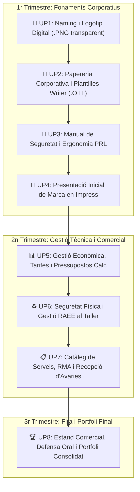

# 🚀 Guia de Desenvolupament del Projecte Intermodular: Creació d'una Empresa TIC

Benvingut a la guia integral del **Projecte Intermodular de 2n d'FP Bàsica**. Al llarg d'aquest curs escolar aplicaràs totes les competències professionals de muntatge d'ordinadors, xarxes locals, ofimàtica, atenció al client i prevenció de riscos laborals per a dissenyar, organitzar i defensar la teua pròpia **empresa de serveis informàtics**.

---

## 🗺️ Mapa de Fases del Projecte d'Empresa



---

## 📁 Organització de Carpetes del Portfoli de Treball

Des del primer dia has de crear i mantindre una estructura organitzada en la teua unitat d'emmagatzematge:

```text
📁 Projecte_Empresa_ElTeuNom/
├── 📁 01_Marca_i_Disseny/
│   ├── Esbossos_Marca.jpg
│   ├── Logotip_Editable.odg
│   └── Logotip_Final.png
├── 📁 02_Documentacio_Oficial/
│   ├── Plantilla_Corporativa.ott
│   └── Carta_Presentacio_i_Pressupost.pdf
├── 📁 03_Seguretat_i_PRL/
│   └── Manual_PRL_Taller.pdf
├── 📁 04_Defensa_Inicial/
│   └── Presentacio_Marca.odp
├── 📁 05_Gestio_Economica/
│   ├── Full_Inventari_Tarifes.ods
│   └── Pressupostos_Clients.pdf
├── 📁 06_Taller_i_RAEE/
│   └── Protocol_Seguretat_RAEE.pdf
├── 📁 07_Atencio_Clients_RMA/
│   ├── Cataleg_Serveis.pdf
│   ├── Full_Incidencies_RMA.pdf
│   └── Targetes_i_Retol.pdf
└── 📁 08_Portfoli_Final/
    ├── Portfolio_Empresa_Final.pdf
    └── Presentacio_Fira_Comercial.odp
```

---

## 🎯 Criteris Generals de Qualitat Professional
1. **Identitat Visual Unificada:** Totes les plantilles, factures, catàlegs i diapositives han d'utilitzar sempre els mateixos **2 o 3 colors corporatius** i el logotip original creat a la UP1.
2. **Normalització de Documents:** Els marges de pàgina es fixaran sempre a **2 cm**, amb encapçalament que continga el logotip i les dades de contacte, i peu de pàgina amb numeració automàtica estil `Pàgina X de Y`.
3. **Format de Lliurament Estàndard:** Tots els documents editables es conservaran en format obert (`.odg`, `.odt`, `.ods`, `.odp`) i es consolidaran en documents **PDF** d'alta qualitat per a la seua revisió.
4. **Defensa Oral i Comunicació:** L'alumnat aprendrà a expressar-se amb vocabulari tècnic precís, explicant amb seguretat les tarifes, el funcionament dels components i la qualitat del servei ofert.
