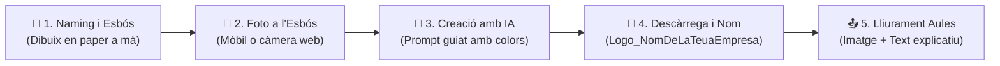

# 📘 UP1 — Creació de la Marca: Naming i Logotip Digital — Unitat Completa

# 1.0 RA1 i Criteris d'Avaluació (UP1)

**Resultat d'Aprenentatge 1 (RA1):** Defineix la idea de negoci i la imatge corporativa d'un servei tècnic informàtic, analitzant les necessitats del sector i dissenyant la seua identitat visual.

| Criteri d'Avaluació Oficial | Descripció de l'Indicador | Apartat de la Unitat | Pes / Puntuació |
| :--- | :--- | :--- | :---: |
| **1. Representació i disseny del logotip** | El logotip representa clarament la idea de negoci informàtic i l'esbós inicial en paper. És visualment atractiu, net i modern. | [1.2 Isotip i Logotip](./up0102.md) \| [1.3 Pas a pas](./up0103.md) | **35% (3,5 punts)** |
| **2. Format d'imatge i qualitat visual** | Arxiu d'imatge vàlid (JPG, PNG, WebP), nítid, sense píxels borrosos ni marques d'aigua invasives. | [1.2 Format .PNG](./up0102.md) \| [Tasca 1](./up01actividades.md) | **25% (2,5 punts)** |
| **3. Nom del fitxer normalitzat** | Nomenclatura corporativa correcta: `Logo_NomDeLaTeuaEmpresa` (ex: `Logo_ByteFix.jpg`). | [1.3 Pas a pas](./up0103.md) \| [Tasca 1](./up01actividades.md) | **15% (1,5 punts)** |
| **4. Dades de l'empresa (Text a Aules)** | Indicació clara al quadre de text del nom oficial de l'empresa i justificació dels colors corporatius triats. | [1.1 Naming i Paleta TIC](./up0101.md) | **15% (1,5 punts)** |
| **5. Treball a classe i autonomia** | Realització de l'activitat a l'aula amb autonomia, aprofitament de la sessió de treball i lliurament en termini. | [Tasca 1 a Aules](./up01actividades.md) | **10% (1,0 punt)** |
| **TOTAL UP1 / RA1** | **Superació de la Fase 1: Creació de la Marca** | **Tasca 1 Aules** | **100% (10,0 pts)** |

---

# 1.1 El Naming Comercial i la Paleta de Colors TIC

Abans de començar a reparar cap ordinador ni atendre clients al teu taller informàtic, necessites definir **qui eres**. La imatge corporativa és la carta de presentació de la teua empresa.

## 1. El Naming (Com es dirà la teua empresa?)

El *naming* és el procés de creació del nom comercial d'una marca. En el sector de la informàtica d'oficina i el manteniment d'equips, un bon nom ha de complir quatre regles:

- **Curt i directe:** Entre 1 i 2 paraules (ex: *BitCatadau*, *AlcalansTech*, *PCFix Ribera*, *MicroOfi*).
- **Fàcil de pronunciar i recordar:** Si un client no sap com s'escriu, no et trobarà.
- **Relacionat amb el món tecnològic:** Paraules com *Tech, Bit, Byte, Net, PC, Sistemes, Digital, Repair, Fix, Info*.
- **Professional:** Ha de transmetre confiança tècnica i serietat.

## 2. Psicologia de la Paleta de Colors Corporatius

Per evitar que el teu logotip i els teus futurs documents semblen sobrecarregats, has d'escollir una paleta de **2 o com a màxim 3 colors**:

| Color Corporatiu | Què transmet en el sector informàtic? | Marques de referència |
| --- | --- | --- |
| 🔵 **Blau (fosc o elèctric)** | Confiança, seguretat, tecnologia, estabilitat i rigor tècnic. | Intel, Dell, HP, IBM |
| ⚫ **Gris / Negre** | Elegància, modernitat, sobrietat i qualitat professional. | Apple, Asus, Corsair |
| 🟢 **Verd** | Sostenibilitat, reparació, reciclatge (RAEE), eficiència i estalvi. | Nvidia, Acer, Android |
| 🟠 **Taronja / Roig** | Energia, rapidesa d'assistència, innovació i proximitat. | PcComponentes, Ubuntu, AMD |

---

# 1.2 Isotip, Logotip i el Format .PNG Transparent

## 1. Parts d'una Marca Visual

- **Isotip (Símbol o icona):** El dibuix visual que identifica l'activitat del teu negoci d'un sol colp d'ull (un monitor, un tornavís creuat amb una clau, un xip electrònic, un engranatge, un núvol...).
- **Logotip (Text tipogràfic):** El nom comercial de la teua empresa escrit amb una font moderna, neta i fàcil de llegir.
- **Imagotip (Combinació):** La unió equilibrada del símbol (isotip) i el text (logotip).

> **💡 Per què és clau tindre una versió en format .PNG transparent?**
> El format `.JPG` no admet canal alfa i afegeix sempre un rectangle blanc al voltant de la imatge. En canvi, el format **`.PNG` transparent** permet col·locar el teu logotip sobre les capçaleres de cartes, factures i presentacions sense que quede un fons blanc tapat.

---

# 1.3 Guia Pràctica Pas a Pas (Paper i Generació amb IA)

## ✏️ Pas 1.1 — Pluja d'idees (Naming) [En paper]
1. Escriu en un full **10 noms curts i professionals** relacionats amb la informàtica.
2. Tria els 3 millors i valida el definitiu a classe amb el docent.

## 🎨 Pas 1.2 — L'esbós en paper i colors
1. Dibuixa a mà alçada **3 propostes diferents** de logotip.
2. Defineix els teus 2 o 3 colors corporatius de referència.

## 📸 Pas 1.3 — Foto a l'esbós
1. Fes una foto clara al teu dibuix en paper amb el mòbil o la càmera web.

## 🤖 Pas 1.4 — Creació amb Intel·ligència Artificial
1. Obre l'eina d'IA recomanada a l'aula, puja la teua foto i utilitza el prompt:
   > *"Crea un logotip modern, net i professional per a una empresa de serveis informàtics basat en aquest dibuix. Colors [posa els teus colors]."*

## 💾 Pas 1.5 — Descàrrega i Canvi de Nom
1. Descarrega la versió escollida i anomena el fitxer:
   📁 **`Logo_NomDeLaTeuaEmpresa`** *(ex: `Logo_TecnoCatadau.jpg`)*.

---

## 📝 Quadern d'Activitats Pràctiques — Tasca 1: El Logotip Digital

### 🎯 Lliurament a Aules (Termini: 24 setembre - 1 octubre 2026)
1. **Adjunta el fitxer d'imatge** amb nom normalitzat: `Logo_NomDeLaTeuaEmpresa` (ex: `Logo_TecnoCatadau.jpg`).
2. **Escriu al quadre de text d'Aules:**
   - Nom oficial de la teua empresa *(ex: "ReparaTIC Esteve")*.
   - Colors triats i per què t'agraden.
3. Consulta el [Quadern d'Activitats Pràctiques — Tasca 1](./up01actividades.html) per a veure la rúbrica detallada dels 4 nivells de qualificació.
