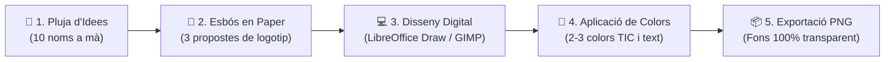

# 🎨 Quadern d'Activitats Pràctiques — Tasca 1: Creació de la Marca

Abans de començar a reparar cap ordinador ni atendre clients al teu taller informàtic, necessites saber qui eres! En aquesta primera tasca dissenyaràs el **nom comercial**, la **paleta de colors corporatius** i el **logotip 100% original** de la teua empresa de serveis TIC.

---

## 🗺️ Flux de Treball del Disseny de Marca

---

## 🎯 Procediment Pràctic Pas a Pas

### Pas 1.1: Pluja d'idees de Naming (Fase en paper)
1. En un full en blanc, escriu **10 possibles noms curts, professionals i tecnològics** per a la teua empresa (per exemple: *ByteFix*, *NovaTech*, *ReparAcció*, *ValènciaTIC*).
2. Tria'n els **3 millors** tenint en compte que siguen fàcils de recordar, pronunciar i escriure.
3. Selecciona el nom definitiu i defineix el lema comercial (*slogan*) en una frase curta (ex: *"Manteniment informàtic ràpid i de confiança"*).

### Pas 1.2: Esbossos del Logotip i Tria de Colors (Fase en paper)
1. Dibuixa a mà alçada **3 propostes diferents de logotip**:
   - Utilitza elements visuals informàtics clars: pantalles, plaques, connectors, tornavisos, ones de xarxa o combinacions geomètriques de les inicials de l'empresa.
2. Defineix la teua **paleta de 2 o 3 colors corporatius** i anota el seu significat:
   - Blau: Tecnologia, seguretat i serietat.
   - Verd: Sostenibilitat, eficiència energètica i reciclatge.
   - Taronja / Vermell: Dinamisme, rapidesa i resolució.

### Pas 1.3: Digitalització Vectorial a l'Ordinador
1. Obre **LibreOffice Draw** (o **GIMP** si prefereixes edició de mapa de bits).
2. Construeix el teu logotip definitiu utilitzant figures geomètriques netes (cercles, rectangles, corbes, línies).
3. Afegeix el nom comercial amb una tipografia clara i professional (evita tipografies de difícil lectura).
4. Agrupa tots els elements (`Format -> Agrupa`) per a evitar que es moguen.
5. Exporta el resultat en format **PNG amb fons transparent** (`Fitxer -> Exporta... -> Format PNG -> Marca l'opció Guarda la transparència`).

---

## 📋 Llista d'Autoavaluació de Qualitat

| Criteri de Qualitat | Comprovació de l'Alumnat | Estat |
| :--- | :--- | :---: |
| **Originalitat** | El logotip és 100% de creació pròpia (no és una descàrrega d'Internet). | ☐ Sí |
| **Transparència** | En col·locar el logotip sobre un fons fosc no es veu cap requadre blanc al voltant. | ☐ Sí |
| **Llegibilitat** | El nom de l'empresa es llegeix clarament fins i tot a mida reduïda ($3\text{ cm}$). | ☐ Sí |
| **Colorimetria** | S'utilitzen estrictament els 2 o 3 colors corporatius acordats. | ☐ Sí |
| **Arxiu editable** | Es conserva el fitxer font (`.odg` o `.xcf`) per a poder fer canvis en el futur. | ☐ Sí |

---

## 📦 Documents a Incloure en el Portfoli de l'Empresa
Guarda els següents fitxers a la carpeta `01_Marca_i_Disseny` del teu projecte:
1. `Esbossos_Marca_ElTeuNom.pdf` (o `.jpg`): Foto clara del full amb els 10 noms, el lema i els 3 esbossos a mà.
2. `Logotip_Editable_ElTeuNom.odg` (o `.xcf` / `.svg`): L'arxiu de treball editable.
3. `Logotip_Final_ElTeuNom.png`: La imatge final d'alta resolució amb canal alfa (fons transparent).
