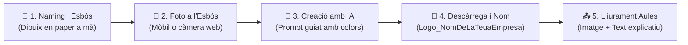

# 🎨 Quadern d'Activitats Pràctiques — Tasca 1: El Logotip Digital de la teua Empresa

> **🗓️ Terminis Oficials a Aules:**
> - **Obertura:** dijous, 24 de setembre 2026, 00:00
> - **Venciment:** dijous, 1 d’octubre 2026, 00:00

Abans de començar a reparar cap ordinador ni atendre clients al teu taller informàtic, necessites saber qui eres! En aquesta primera tasca dissenyaràs el **nom oficial**, la **paleta de colors corporatius** i el **logotip digital** de la teua nova empresa de serveis informàtics combinant el dibuix a mà alçada amb la **generació d'imatges per Intel·ligència Artificial (IA)**.

---

## 🗺️ Flux de Treball a Classe

---

## 🛠️ Passos a seguir a classe (Pas a pas)

### 1️⃣ Pas 1: Foto a l'esbós en paper
- Dibuixa en un full en blanc la idea del teu logotip informàtic (pantalles, eines, connectors, inicials).
- Fes una foto nítida al teu dibuix en paper utilitzant el teu telèfon mòbil o la càmera web de l'ordinador.
- Guarda la foto a la teua carpeta de treball.

### 2️⃣ Pas 2: Crear el logo amb la Intel·ligència Artificial
- Entra a l'eina d'Intel·ligència Artificial indicada pel professor a l'aula.
- Puja la foto del teu dibuix com a imatge de referència.
- Demana-li a la IA que cree el teu logotip professional utilitzant una instrucció (*prompt*) clara.
- **Exemple de frase (*prompt*) per a la IA:**
  > *"Crea un logotip modern, net i professional per a una empresa de serveis informàtics basat en aquest dibuix. Colors [posa els teus colors, ex: blau marí i taronja elèctric]."*

### 3️⃣ Pas 3: Descarregar la imatge
- Revisa les variants que ha generat la IA.
- Tria la versió que millor represente la teua empresa i que es veja més neta i descarrega-la al teu ordinador (en qualsevol format d'imatge: JPG, PNG, WebP, etc.).

### 4️⃣ Pas 4: Canviar el nom al fitxer
- Anomena el fitxer seguint estrictament la pauta corporativa:
- 📁 **`Logo_NomDeLaTeuaEmpresa`**
- *Exemples reals:* `Logo_TecnoCatadau.jpg`, `Logo_ReparaTIC.png`, `Logo_ByteFix.webp`.

---

## 📤 Què has de lliurar ací a Aules?

Per a completar el lliurament obligatori a la plataforma **Aules**, has de complir aquests dos requisits:

1. **Adjunta el fitxer d'imatge** del teu logotip correctament anomenat (ex: `Logo_TecnoCatadau.jpg`).
2. **Escriu en el quadre de text d'Aules:**
   - **Nom oficial de la teua empresa:** *(Exemple: "ReparaTIC Esteve")*.
   - **Colors triats:** Quins colors té el teu logo i per què t'agraden / què transmeten.

---

## 📊 Rúbrica Oficial d'Avaluació a Aules (Pes: 10 punts)

| Criteri d'Avaluació | Excel·lent (100%) | Notable (75%) | Suficient (50%) | Insuficient (25% - 0%) |
| :--- | :--- | :--- | :--- | :--- |
| **1. Representació i disseny del logotip** *(Pes: 35% - 3,5 punts)* | El logotip representa clarament la idea de negoci informàtic i el dibuix inicial. És visualment atractiu, net i modern. | El logotip és professional i informàtic, encara que s'allunya un poc de l'esbós original en paper. | El logotip és senzill, però compleix la funció bàsica d'identificar l'empresa. | La imatge és confusa, no té relació amb la informàtica o està deformada/irrecognoscible. |
| **2. Format d'imatge i qualitat visual** *(Pes: 25% - 2,5 punts)* | És un arxiu d'imatge vàlid (JPG, PNG, WebP...), es veu clar i nítid (sense estar borrós o molt pixelat). | Arxiu d'imatge vàlid amb bona visibilitat, amb alguna xicoteta pèrdua de nitidesa sense importància. | Arxiu d'imatge que es pot obrir, encara que la resolució és baixa o té marques d'aigua evidents. | No ha lliurat una imatge (ha pujat un Word, un PDF, un enllaç trencat o un fitxer danyat). |
| **3. Nom del fitxer** *(Pes: 15% - 1,5 punts)* | Ha canviat el nom del fitxer incloent el nom de la seua empresa (ex: `Logo_ByteFix.jpg`). | Nom identificable amb l'empresa, encara que té espais o caràcters estranys. | Nom massa genèric (ex: `logo.jpg` o `empresa.png`). | Nom per defecte de la descàrrega sense modificar (ex: `image(1).jpg`, `descarga.png`). |
| **4. Dades de l'empresa (Text a Aules)** *(Pes: 15% - 1,5 punts)* | Indica clarament el nom oficial de l'empresa i quins colors corporatius ha seleccionat. | Indica el nom de l'empresa i els colors, però de forma molt breu o incompleta. | Només indica el nom de l'empresa o només els colors. | No escriu res en el quadre de text d'Aules. |
| **5. Treball a classe i autonomia** *(Pes: 10% - 1 punt)* | Realitza l'activitat a l'aula amb autonomia i aprofita la sessió de treball davant l'ordinador. | Treballa a classe, però ha necessitat ajuda constant per a descarregar o pujar la imatge. | Li ha costat centrar-se en la tasca o ha lliurat fora del temps de classe. | No ha treballat a l'aula o no ha fet l'entrega. |

---

## 📁 Guardat al Portfoli de l'Alumnat
A més de pujar-lo a Aules, desa a la teua carpeta `01_Marca_i_Disseny` de l'ordinador:
1. La foto de l'esbós a mà (`Esbos_Paper_NomEmpresa.jpg`).
2. El logotip descarregat (`Logo_NomDeLaTeuaEmpresa.jpg` o `.png`).
3. *(Opcional recomanat)* Una versió en **PNG amb fons transparent** per a facilitar la seua inserció en el paper de carta de la Tasca 2.
