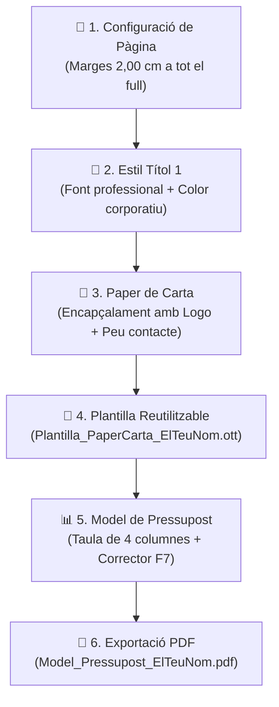

# 🏢 Quadern d'Activitats Pràctiques — Tasca 2: Identitat Corporativa i Paper de Carta amb LibreOffice Writer (RA2)

> **🗓️ Terminis Oficials a Aules:**
> - **Obertura:** divendres, 2 d’octubre 2026, 00:00
> - **Venciment:** divendres, 9 d’octubre 2026, 00:00

---

## 🏢 FASE 2: La Documentació Oficial de la teua Empresa Informàtica

En la tasca anterior vas crear el nom i el logotip de la teua nova empresa. Ara és el moment de fer un pas més cap a la professionalitat: crear la papereria oficial i les plantilles que faràs servir cada dia per a comunicar-te amb els clients i redactar pressupostos.

Tot aquest treball el realitzarem utilitzant el processador de textos **LibreOffice Writer**.

---

## 🗺️ Flux de Treball de la Fase 2

---

## 🎯 Què has de fer? (Pas a pas)

### 1️⃣ Pas 1: Configuració del full i marges
1. Obre **LibreOffice Writer** amb un document nou en blanc.
2. Vés al menú `Format > Estil de pàgina` (o `Pàgina`).
3. Configura tots els marges (**Dalt, Baix, Esquerra i Dreta**) exactament a **2,00 cm**.

### 2️⃣ Pas 2: Personalització dels estils i colors de marca
1. Obre el panell d'**Estils** (tecla `F11` o des de la barra lateral dreta).
2. Fes clic amb el botó dret sobre l'estil **Títol 1** i selecciona *Modifica...*:
   - **Tipografia:** Tria una tipografia neta i professional (ex: *Arial*, *Roboto* o *Liberation Sans*).
   - **Mida de lletra:** 18 o 20 pt, en **negreta**.
   - **Color de la lletra:** Vés a la pestanya *Efectes de lletra* i posa exactament el mateix color principal que vas triar per al teu logotip.

### 3️⃣ Pas 3: Disseny del Paper de Carta (Encapçalament i Peu de pàgina)
1. **Encapçalament:**
   - Activa'l des de `Insereix > Encapçalament i peu de pàgina > Encapçalament > Estil per defecte`.
   - Insereix la imatge del teu logotip en format `.PNG` (fons transparent).
   - Ajusta la mida perquè faça uns **2 o 3 cm d'alçada** i alinea'l a l'esquerra.
   - A la dreta de la capçalera, escriu el nom comercial de la teua empresa en gran i destacat.
2. **Peu de pàgina:**
   - Activa el peu de pàgina (`Insereix > Encapçalament i peu de pàgina > Peu de pàgina > Estil per defecte`).
   - Escriu les dades fictícies de contacte en **una sola línia centrada**:
   - *Exemple:* `Carrer Major, 12 | 46190 Catadau (València) | Telèfon: 96 123 45 67 | info@lateuaempresa.com`
3. **Guarda la plantilla buida:**
   - Vés a `Fitxer > Plantilles > Desa com a plantilla...` o desa l'arxiu amb el nom `Plantilla_PaperCarta_ElTeuNom.ott` (o `.odt`).
   - *Aquest full serà la teua base per a tots els documents del curs!*

### 4️⃣ Pas 4: Disseny del Model de Pressupost / Full de Servei
1. Partint del paper de carta que acabes de crear:
2. Afig com a **Títol 1**: `PRESSUPOST D'ASSISTÈNCIA TÈCNICA` (aplicant l'estil personalitzat).
3. Insereix una **Taula de 4 columnes i almenys 5 files** (`Taula > Insereix una taula...`):
   - **Capçaleres de les columnes:** `Quantitat` | `Descripció del servei / recanvi` | `Preu Unitari (€)` | `Total (€)`
4. Pinta el fons de la primera fila (capçalera de la taula) amb el color corporatiu de la teua empresa i posa el text en **blanc i negreta**.
5. Guarda aquest document de treball i **exporta'l a format PDF**.

---

## 📦 Quins arxius has de pujar a Aules?

Has de lliurar obligatòriament **2 fitxers**:

1. 📄 **L'arxiu de la plantilla reutilitzable:**
   - Nom del fitxer: `Plantilla_PaperCarta_ElTeuNom.ott` (o en format `.odt`).
2. 📑 **El model de pressupost acabat en PDF:**
   - Nom del fitxer: `Model_Pressupost_ElTeuNom.pdf`.

> **⚠️ MOLT IMPORTANT:**
> - Abans d'exportar el PDF, passa el **corrector ortogràfic** (`F7`) per a comprovar que no hi ha faltes.
> - Verifica que el logotip es veu amb bona resolució i **sense cap requadre de fons blanc tapat** sobre el paper de carta.

---

## 📊 Com es qualificarà aquesta tasca? (Rúbrica Oficial RA2)

| Criteri d'Avaluació | Què es valora? | Puntuació |
| :--- | :--- | :---: |
| **Configuració de pàgina (RA2-a)** | Marges aplicats correctament a 2 cm a tots els costats. | **1,5 punts** |
| **Estils corporatius (RA2-b)** | Estil de títol personalitzat amb tipografia i color del logo. | **1,5 punts** |
| **Paper de carta (RA2-c)** | Encapçalament amb logo PNG ben alineat i peu amb dades de contacte. | **2,5 punts** |
| **Plantilla reutilitzable (RA2-d)** | Lliurament correcte del fitxer de plantilla buida (`.ott` / `.odt`). | **1,5 punts** |
| **Taula de pressupost (RA2-e)** | Estructura de 4 columnes, disseny corporatiu i absència de faltes. | **2,0 punts** |
| **Format PDF i ordre (RA2-f)** | Exportació neta en PDF i nomenclatura correcta dels fitxers. | **1,0 punt** |
| **TOTAL** | **Superació de la Fase 2 / UP2** | **10,0 punts** |
