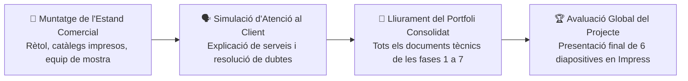

# 📘 UP8 — Fira Comercial Tecnològica i Defensa Final — Unitat Completa

# 8.0 RA1 a RA5 i Criteris d'Avaluació Globals (UP8 — Fira Comercial)

Segons la **Programació Didàctica oficial (mòdul 3160)**, la **Unitat de Programació 8** és el **projecte integrador global (30% del mòdul)** que tanca el curs abans de la incorporació de l'alumnat a la fase de **Formació en Empresa** al mes de març.

| Resultat d'Aprenentatge Oficial | Què s'avalua a l'Estand Comercial i al Portfolio Final? | Puntuació en UP8 |
| :--- | :--- | :---: |
| **RA1 — Anàlisi de Mercat i Identitat** | Coherència visual de la marca, rètol, targetes i estètica professional de l'estand. | **20% (2,0 pts)** |
| **RA2 — Proposta Innovadora i Catàleg** | Presentació del catàleg de serveis, packs a preu tancat i orientació a necessitats reals. | **20% (2,0 pts)** |
| **RA3 — Dossier i Pressupost en Viu** | Emissió en directe d'un pressupost exacte en Calc (amb IVA 21%) davant una consulta real. | **20% (2,0 pts)** |
| **RA4 — Seguretat, Taller i RAEE** | Aplicació de mesures antiestàtiques (ESD), ordre d'eines i protocol ambiental RAEE. | **20% (2,0 pts)** |
| **RA5 — Defensa Oral i Atenció al Client** | Exposició de la presentació en Impress (6 diapositives) i atenció assertiva als visitants. | **20% (2,0 pts)** |
| **TOTAL UP8** | **Superació del Projecte Integrador Previ a la Formació en Empresa** | **100% (10,0 pts)** |

---

# 8.1 Presentació Final de 6 Diapositives en LibreOffice Impress

Prepara la presentació global de la teua empresa (`Defensa_Final_Fira_ElTeuNom.odp`) amb aquestes **6 diapositives**:

1. **Diapositiva 1:** Portada oficial amb logotip `.PNG` , nom comercial i el teu nom com a Tècnic Responsable.
2. **Diapositiva 2:** Qui som, valors de la marca i serveis que oferim a la comarca.
3. **Diapositiva 3:** El nostre Catàleg de Serveis i Packs de manteniment a preu tancat.
4. **Diapositiva 4:** Protocol de recepció d'equips i mostra del Full d'Incidències Tècniques.
5. **Diapositiva 5:** Exemple real de Pressupost automatitzat en LibreOffice Calc (Base Imposable + 21% IVA).
6. **Diapositiva 6:** Compromís amb la Seguretat al Taller (PRL/ESD) i el Reciclatge Electrònic (RAEE).

---

# 8.2 Muntatge d'Estand, Atenció Comercial i Resolució Tècnica en Viu

## 1. Elements obligatoris a la teua taula (Estand de la Fira)

- 🪧 **Rètol corporatiu** ben visible i **Targetes de Visita** retallades.
- 📖 **Catàleg Comercial de Serveis** i exemplars del **Full d'Incidències** .
- 💻 **Ordinador operatiu** amb la presentació d'Impress i la plantilla de pressupostos de Calc obertes.
- 🔧 **Equip i components de demostració** (placa, RAM, SSD, font i polsera antiestàtica).

## 2. Dinàmica de la prova en directe

Atendràs un client visitant a qui rebràs amb cortesia, prendràs nota de l'avaria en el Full d'Incidències, faràs una breu demostració tècnica segura sobre el maquinari i li calcularàs el pressupost al moment amb LibreOffice Calc.

---

---

## 📝 Quadern del Portfoli Final — Tasca 8: Fira Comercial i Defensa Pública

### 🎯 Resum d'Objectius de la Tasca Final
Cloenda del projecte abans d'iniciar la **Formació en Empresa**! Munta el teu estand demostratiu a l'aula, presenta les 6 diapositives finals en Impress, resol una assistència tècnica en viu i consolida el teu Portfoli d'Empresa en un únic document PDF.

Consulta el [Quadern del Portfoli Final de la Tasca 8](./up08actividades.html) per a seguir el procediment detallat pas a pas i consultar la llista de comprovació de qualitat.

