# Servicios de transferencia de ficheros

!!! note "Resultados de aprendizaje y criterios de evaluacion que se evaluarán en esta unidad."
    **Resultados de aprendizaje de la unidad didáctica:**

    * **RA3. Gestiona servicios de transferencia de ficheros describiendo sus características e instalando los servidores y clientes correspondientes.**
    * **RA6. Gestiona métodos de acceso y administración remota describiendo sus características e instalando los servicios correspondientes.**

    **Criterios de evaluación de la unidad didáctica:**

    * **RA3-CEa)** Se han reconocido las características y modos de funcionamiento del servicio de transferencia de ficheros.
    * **RA3-CEb)** Se ha instalado y configurado un servidor de transferencia de ficheros.
    * **RA3-CEc)** Se han creado usuarios y grupos para el acceso al servicio.
    * **RA3-CEd)** Se han configurado permisos de acceso, carpetas públicas y aislamiento de usuarios.
    * **RA3-CEe)** Se ha verificado el funcionamiento del servicio mediante clientes gráficos (FileZilla).
    * **RA3-CEf)** Se ha asegurado el servicio mediante el cifrado de datos y credenciales (FTPS / SSL / TLS).
    * **RA3-CEg)** Se han registrado y analizado los eventos y logs del servicio de transferencia de ficheros.
    * **RA3-CEh)** Se han aplicado medidas de seguridad y buenas prácticas en la parada del laboratorio.
    * **RA6-CEa)** Se han reconocido las características del acceso y administración remota.
    * **RA6-CEb)** Se han instalado y configurado servicios de administración remota (SSH / RDP).
    * **RA6-CEc)** Se han configurado métodos de autenticación mediante parejas de claves pública/privada.
    * **RA6-CEd)** Se han asegurado y bastionado los servicios de acceso remoto.
    * **RA6-CEe)** Se han transferido ficheros mediante canales seguros (SFTP / SCP).
    * **RA6-CEf)** Se han auditado accesos e interconexiones cruzadas entre sistemas heterogéneos.

    **Sistema de evaluación y entregas en Aules (1 Cuestionario + 1 Único Documento PDF):**

    En esta unidad **NO se entregan PDFs sueltos por cada apartado**. Deberás crear desde el primer día un **único documento en Word** estructurado por apartados (del `Apartado 6` al `Apartado 15`), ir insertando en él las **27 evidencias numeradas (`Evidencia 1` a `Evidencia 27`)** conforme avances en las prácticas y, al finalizar la unidad, exportarlo a un **único fichero PDF** para subirlo a Aules:

    | Actividad en Aules | Criterios evaluados | Descripción y contenido | Entrega en Aules |
    |---|:---:|---|---|
    | **1. Cuestionario Teórico** | `RA3-CEa` / `RA6-CEa` | Comprensión teórica de protocolos FTP, FTPS, SFTP, SSH y modos Activo/Pasivo (Apartados 1 a 5). | **Cuestionario online en Aules (Sin subir archivo)** |
    | **2. Memoria Práctica Completa de la Unidad** | `RA3-CEb..h` / `RA6-CEb..f` | Documento único con todos los apartados prácticos (**Bloque Windows Server**, **Bloque Ubuntu Server** y **Bloque Interoperabilidad + Cierre AWS**) incluyendo las **Evidencias 1 a 27**. | **1 único archivo PDF:** `RA3-RA6-FTP-SSH-NombreApellidos.pdf` |

    **Guía de apartados que debe tener tu documento Word y qué evidencias incluye cada uno:**

    | Apartado en tu Word | Bloque | Criterios | Evidencias obligatorias del apartado |
    |---|:---:|:---:|---|
    | **Apartado 6:** Instalación de IIS FTP y OpenSSH en Windows Server | Windows Server | `RA3-CEb,c,d` | **Evidencias 1 a 7** (Instancia EC2, Security Group, RDP, usuario `alumne_redes`, modo pasivo IIS, sitio `FTP-AULA` y Firewall) |
    | **Apartado 7:** Transferencia con FileZilla hacia Windows Server | Windows Server | `RA3-CEe` | **Evidencia 8** (Conexión pasiva en FileZilla y subida de `Prova_ftp.txt`) |
    | **Apartado 8:** Aislamiento de usuarios (`LocalUser`) y acceso anónimo | Windows Server | `RA3-CEd` | **Evidencias 9 y 10** (Carpetas en `LocalUser`, vista aislada de `usuari_ventas` y error `550` en `anonymous`) |
    | **Apartado 9:** Seguridad y cifrado FTPS (TLS/SSL) en Windows Server | Windows Server | `RA3-CEf` | **Evidencias 11 y 12** (Certificado autofirmado en IIS, huella SHA-256 en FileZilla y candado FTPS) |
    | **Apartado 10:** Administración remota SSH con PuTTY y PuTTYgen | Windows Server | `RA6-CEb,c,d` | **Evidencias 13 y 14** (Generación de clave en PuTTYgen, login sin contraseña y rechazo tras bastionado) |
    | **Apartado 11:** SFTP, SCP y Auditoría de Logs IIS y Wireshark | Windows Server | `RA6-CEe` / `RA3-CEg` | **Evidencias 15 a 18** (SFTP puerto 22 en FileZilla, `scp` en PowerShell, log W3C en Notepad y captura en Wireshark) |
    | **Apartado 12:** Instalación de `vsftpd`, modo pasivo y `chroot` en Ubuntu | Ubuntu Server | `RA3-CEb,c,d,e` | **Evidencias 19 a 22** (Instancia `Ubuntu_FTPSSH`, `/etc/vsftpd.conf`, `systemctl status vsftpd` y FileZilla enjaulado) |
    | **Apartado 13:** Seguridad FTPS (OpenSSL), SSH y Logs en Ubuntu | Ubuntu Server | `RA3-CEf,g` / `RA6-CEf` | **Evidencias 23 y 24** (Certificado OpenSSL + FTPS en FileZilla, y logs `/var/log/vsftpd.log` y `auth.log`) |
    | **Apartado 14:** Pruebas cruzadas Inter-Servidores en AWS | Inter-Servidores | `RA3-CEf` / `RA6-CEf` | **Evidencias 25 y 26** (Transferencia `curl` y `ssh` desde Ubuntu a Windows, y desde Windows a Ubuntu) |
    | **Apartado 15:** Control de costes y parada de la infraestructura en AWS | Cierre AWS | `RA3-CEh` | **Evidencia 27** (Panel de instancias de AWS EC2 mostrando ambas máquinas en estado `Stopped`) |

---

## 1 - Introducción y evolución de los servicios de transferencia de ficheros

La transferencia de archivos a través de redes telemáticas constituye uno de los servicios cliente-servidor más antiguos y esenciales de la arquitectura TCP/IP. Antes del desarrollo de la World Wide Web y del protocolo HTTP, la necesidad primordial de los centros de cálculo universitarios y militares era compartir programas ejecutables, conjuntos de datos masivos y documentos entre ordenadores distantes y con sistemas operativos heterogéneos.

### 1.1 Evolución histórica: Del RFC 114 al RFC 959
El protocolo **FTP (File Transfer Protocol)** nació formalmente el 16 de abril de 1971 con la publicación del **RFC 114** por Abhay Bhushan en el MIT, operando sobre las primeras redes de conmutación de paquetes de ARPANET y la pila NCP (*Network Control Program*). Con la transición definitiva a la arquitectura de Internet basada en TCP/IP en 1980, el protocolo se rediseñó en el **RFC 765** y finalmente se consolidó en octubre de 1985 con la publicación del **RFC 959**, que continúa siendo el estándar fundacional vigente hoy en día.

A lo largo de las décadas, FTP ha evolucionado mediante diversas ampliaciones (*RFC extensions*), destacando:
* **RFC 2228 (FTP Security Extensions):** Introduce mecanismos de autenticación y cifrado mediante comandos como `AUTH TLS`.
* **RFC 2428 (FTP Extensions for IPv6 and NATs):** Define los comandos `EPRT` (*Extended Port*) y `EPSV` (*Extended Passive*) para dar soporte al direccionamiento IPv6 y facilitar la interoperabilidad con pasarelas NAT complejas.
* **RFC 3659 (Extensions to FTP):** Añade comandos modernos como `MLST` y `MLSD` para obtener listados de ficheros con metadatos estandarizados e información horaria en UTC.

### 1.2 Ubicación en la pila OSI y modelo TCP/IP
Dentro de la arquitectura de capas, FTP se sitúa en la **Capa de Aplicación** (Capa 7 de OSI / Capa 4 de TCP/IP). Para el transporte de la información, se apoya de forma estricta en el protocolo **TCP (Transmission Control Protocol)** en la Capa de Transporte. La elección de TCP (frente a protocolos no orientados a conexión como UDP) es indispensable por tres factores determinantes:
1. **Fiabilidad absoluta:** Cada paquete de datos debe ser confirmado mediante ACKs para asegurar que ni un solo byte del fichero transferido se pierda o llegue corrupto.
2. **Entrega secuencial y ordenada:** Garantiza que los segmentos fragmentados en la red se reensamblen en el destino en el orden exacto.
3. **Control de flujo y congestión:** Regula la velocidad de transmisión adaptándose a la capacidad del receptor y a las condiciones de congestión de los enlaces de red.

### 1.3 Casos de uso corporativos en la administración de sistemas
A pesar del auge de protocolos web (HTTP/HTTPS, WebDAV) y APIs REST, los servicios de transferencia de ficheros basados en FTP, FTPS y SFTP siguen siendo pilares en las infraestructuras de IT:
* **Despliegue y mantenimiento de portales web:** Carga de contenidos HTML, scripts PHP, hojas de estilo CSS y elementos multimedia en servidores web de alojamiento (*hosting* compartido o dedicado).
* **Gestión de dispositivos de red y telecomunicaciones:** Actualización masiva de firmwares e imágenes de sistemas operativos (Cisco IOS, JunOS), y volcado de configuraciones en *switches*, *routers* y cortafuegos.
* **Copias de seguridad remotas (*backups*):** Automatización nocturna del envío de volcados de bases de datos (SQL) y ficheros de archivo comprimidos hacia servidores de almacenamiento remoto (*off-site*).
* **Intercambio B2B (*Business-to-Business*):** Intercambio automático de albaranes, facturas electrónicas (EDI) y ficheros de transacciones bancarias entre sistemas centrales de diferentes organizaciones.

---

## 2 - Arquitectura interna y funcionamiento del protocolo FTP (RFC 959)

### 2.1 La doble conexión TCP: Canal de control vs Canal de datos
La gran particularidad arquitectónica de FTP frente a casi todos los demás protocolos de red (como HTTP, SSH o SMTP) radica en que **no utiliza una única conexión para todo**, sino que desacopla la comunicación en **dos conexiones TCP independientes con ciclos de vida y propósitos completamente distintos**:

* **Canal de control (Puerto 21 TCP por defecto):**  
  * Es la conexión principal (*out-of-band signaling*). Se establece al inicio de la sesión entre el cliente y el puerto de escucha 21 TCP del servidor.
  * Permanece **abierta de forma continua** durante toda la sesión del usuario.
  * Por este canal circulan exclusivamente órdenes cortas en texto ASCII (como `USER`, `PASS`, `LIST`, `RETR`, `QUIT`) emitidas por el cliente y las correspondientes respuestas numéricas de estado de 3 dígitos generadas por el servidor.
  * Por este canal **nunca viaja el contenido de los archivos** ni los listados de directorios.

* **Canal de datos (Puertos variables TCP / Puerto 20 en modo activo):**  
  * Es una conexión efímera que se abre **bajo demanda** únicamente cuando el cliente solicita una acción que implica intercambio de información volumétrica: transferir un fichero (subida con `STOR` o descarga con `RETR`) o solicitar el listado de archivos de una carpeta (`LIST` o `NLST`).
  * Una vez finalizada la transmisión del archivo o entregado el listado, el canal de datos **se cierra inmediatamente**. Si el usuario desea descargar otro fichero a continuación, se negociará y abrirá una nueva conexión de datos independiente.

```text
  ┌──────────────┐                                       ┌──────────────┐
  │              │ ─── Canal de Control (Puerto 21 TCP) ──>│              │
  │  Cliente FTP │ <── Códigos de Estado y Señalización ── │ Servidor FTP │
  │              │                                       │   (Daemon)   │
  │              │ <══ Canal de Datos (Puertos Efímeros) ═>│              │
  └──────────────┘     (Transferencia de Archivos/Listados)  └──────────────┘
```

!!! tip "¿Por qué FTP desacopló el control de los datos?"
    Este diseño permite al cliente enviar órdenes de interrupción (como el comando `ABOR` para abortar una descarga) a través del canal de control mientras un archivo enorme se está descargando por el canal de datos, sin tener que esperar a que termine de llegar la totalidad del flujo de bytes.

---

### 2.2 Tipos de datos y modos de representación: ASCII vs Binario
El RFC 959 contempla distintos modos de interpretar la información transmitida a través del canal de datos, siendo crucial seleccionar el tipo adecuado para evitar la corrupción irreversible de los ficheros:

| Modo de Transferencia | Comando FTP | Comportamiento del protocolo | Tipos de ficheros compatibles | Riesgo de corrupción |
|---|:---:|---|---|---|
| **Modo ASCII / Texto** | `TYPE A` | Convierte automáticamente los caracteres de salto de línea entre sistemas operativos emisores y receptores. En Windows las líneas terminan en `CR+LF` (`\r\n`, bytes `0x0D 0x0A`), mientras que en Linux/UNIX terminan únicamente en `LF` (`\n`, byte `0x0A`). | Ficheros de texto plano (`.txt`, `.html`, `.css`, `.csv`, `.php`). | **Muy alto:** Si se transfiere un ejecutable, imagen o zip en modo ASCII, el servidor alterará los bytes `0x0D` y `0x0A`, destruyendo por completo la estructura del archivo. |
| **Modo Binario / Imagen** | `TYPE I` | Transmite el archivo byte a byte de forma idéntica, sin interpretar ni modificar ningún carácter ni secuencia de escape. | Ejecutables (`.exe`), imágenes (`.png`, `.jpg`), comprimidos (`.zip`, `.tar.gz`), bases de datos, PDFs. | **Nulo:** Conserva la integridad matemática del fichero íntegra. Es el modo por defecto en clientes modernos como FileZilla. |

---

### 2.3 Repertorio de comandos estándar de FTP (RFC 959)
Las órdenes que viajan por el canal de control son palabras mnemotécnicas de 3 o 4 caracteres en texto plano ASCII seguidas de parámetros y delimitadas por el terminador `CRLF` (`\r\n`):

* **Autenticación e inicio de sesión:**
  * `USER <nombre>`: Envía el identificador del usuario que desea iniciar sesión.
  * `PASS <contraseña>`: Envía la contraseña de dicho usuario.
  * `QUIT`: Cierra la conexión de control y finaliza la sesión en el servidor.
* **Navegación e inspección del sistema de ficheros:**
  * `PWD` (*Print Working Directory*): Muestra la ruta del directorio de trabajo actual en el servidor.
  * `CWD <ruta>` (*Change Working Directory*): Cambia al directorio especificado (equivalente a `cd`).
  * `CDUP` (*Change to Parent Directory*): Sube un nivel en el árbol jerárquico de directorios (equivalente a `cd ..`).
  * `MKD <directorio>` (*Make Directory*): Crea una nueva carpeta en la ruta remota.
  * `RMD <directorio>` (*Remove Directory*): Elimina la carpeta remota indicada.
* **Operaciones de transferencia y gestión de ficheros:**
  * `LIST`: Solicita el listado detallado de ficheros y directorios (permisos, tamaño, fecha de modificación, similar a `ls -la`). Se entrega a través del canal de datos.
  * `NLST` (*Name List*): Solicita una lista simple con únicamente los nombres de los ficheros.
  * `RETR <fichero>` (*Retrieve*): Descarga el archivo solicitado desde el servidor hacia el cliente.
  * `STOR <fichero>` (*Store*): Sube y almacena un archivo desde el cliente en el servidor.
  * `DELE <fichero>` (*Delete*): Elimina el fichero especificado del servidor.
* **Negociación del canal de datos:**
  * `PORT <h1,h2,h3,h4,p1,p2>`: Indica al servidor la dirección IP y el puerto TCP en el que el cliente espera la conexión de datos (Modo Activo).
  * `PASV`: Solicita al servidor que abra un puerto pasivo y espere la conexión del cliente (Modo Pasivo).
  * `TYPE <A|I>`: Establece el tipo de representación de los datos (`A` para ASCII, `I` para binario/imagen).

---

### 2.4 Taxonomía y estructura de los códigos de respuesta del servidor
Cada vez que el cliente emite una orden por el canal de control, el servidor responde obligatoriamente con un **código numérico de tres dígitos** acompañado de un texto descriptivo legible para humanos. 

La taxonomía del primer dígito categoriza de manera unívoca la respuesta:

```text
 ┌─── 1xx: Respuesta preliminar positiva (acción iniciada, espere confirmación)
 │
 ├─── 2xx: Respuesta de finalización positiva / Éxito (orden completada satisfactoriamente)
 │
 ├─── 3xx: Respuesta intermedia positiva (orden aceptada, requiere más información del cliente)
 │
 ├─── 4xx: Fallo negativo transitorio / temporal (error temporal, puede reintentarse)
 │
 └─── 5xx: Fallo negativo permanente (error fatal de sintaxis, autenticación o permisos)
```

| Código | Significado canónico del RFC 959 | Contexto habitual en el laboratorio y producción |
|:---:|---|---|
| `150` | *File status okay; about to open data connection.* | Notificación previa al inicio del flujo de datos en operaciones `LIST`, `RETR` o `STOR`. |
| `200` | *Command okay.* | La orden solicitada (por ejemplo, `TYPE I` o `PORT`) se ha procesado con éxito. |
| `220` | *Service ready for new user.* | Mensaje de bienvenida (*banner*) enviado por el servidor nada más abrir el canal de control en el puerto 21. |
| `226` | *Closing data connection. Requested file action successful.* | La transferencia del archivo o el listado del directorio ha finalizado completamente sin errores. |
| `227` | *Entering Passive Mode (h1,h2,h3,h4,p1,p2).* | Respuesta a la orden `PASV`, proporcionando la IP y puerto efímero del servidor para la conexión de datos. |
| `230` | *User logged in, proceed.* | Autenticación correcta de las credenciales introducidas. El usuario entra a su directorio raíz. |
| `331` | *User name okay, need password.* | Respuesta al comando `USER`; el nombre de cuenta es reconocido y el servidor aguarda el comando `PASS`. |
| `421` | *Service not available, closing control connection.* | El servidor está saturado de conexiones o se ha superado el tiempo máximo de inactividad (*timeout*). |
| `425` | *Can't open data connection.* | Fallo de negociación de red al intentar abrir el canal de datos (típico cuando un firewall bloquea los puertos). |
| `500` | *Syntax error, command unrecognized.* | La orden enviada por el cliente no existe o contiene parámetros sintácticamente inválidos. |
| `530` | *Not logged in.* | Credenciales erróneas (usuario/contraseña incorrectos) o acceso anónimo denegado por directiva. |
| `550` | *Requested action not taken. File unavailable or access denied.* | **El código de error más frecuente:** El usuario intenta leer, escribir o borrar un fichero sobre el que no tiene permisos NTFS/Linux, o la ruta indicada no existe. |

---

### 2.5 Modos de transferencia en profundidad: Modo Activo (PORT) vs Modo Pasivo (PASV)
La diferencia fundamental entre ambos modos radica en **quién toma la iniciativa para abrir la conexión TCP del canal de datos**:

#### A) Modo Activo (Standard / `PORT`)
1. El cliente inicia una conexión saliente desde un puerto efímero local (ej. TCP 51500) hacia el puerto 21 TCP del servidor (Canal de Control).
2. Cuando el cliente necesita transferir un archivo, abre un segundo puerto local a la escucha (ej. TCP 51501) y le comunica al servidor su propia IP y puerto mediante la orden `PORT`:  
   `Puerto de datos = (p1 × 256) + p2`  
   *(Ejemplo: `PORT 192,168,1,50,201,45` indica que el puerto a la escucha es `(201 × 256) + 45 = 51501`).*
3. **El servidor inicia una conexión TCP entrante hacia el cliente:** El servidor abre un socket local en su puerto 20 TCP y envía un paquete `SYN` directo hacia la IP del cliente y su puerto 51501.

```text
  [ Cliente FTP (192.168.1.50) ]                      [ Servidor FTP (203.0.113.10) ]
        │                                                           │
        │── TCP SYN: Dst Port 21 (Canal de Control) ───────────────>│
        │<── 220 Service Ready (Control establecido) ───────────────│
        │                                                           │
        │── PORT 192,168,1,50,201,45 (Escucho en 51501) ───────────>│
        │<── 200 Command okay ──────────────────────────────────────│
        │                                                           │
        │    [PROBLEMA CON NAT / FIREWALL DOMÉSTICO]                │
        │<── TCP SYN: Src Port 20 -> Dst Port 51501 ────────────────│ (¡Conexión Entrante!)
        │ ❌ (El router con NAT descarta el paquete SYN)             │
```

!!! warning "¿Por qué el modo activo falla sistemáticamente a través de Internet?"
    En las redes actuales, prácticamente todos los clientes domésticos o corporativos están situados detrás de un router con **NAT/PAT** (*Network Address Translation*) y de cortafuegos con inspección de estado (*Stateful Firewalls*).  
    Cuando el servidor remoto intenta enviar un paquete TCP `SYN` hacia el puerto efímero del cliente, el cortafuegos del router cliente **descarta el paquete inmediatamente**, puesto que no existe ninguna conexión saliente previa registrada en su tabla de estados para ese puerto. Salvo que el router disponga de un módulo ALG (*Application Layer Gateway*) activo que inspeccione el tráfico no cifrado de FTP para mapear dinámicamente el puerto, la conexión de datos colapsará.

---

#### B) Modo Pasivo (`PASV`)
Para solventar el bloqueo originado por los cortafuegos de los clientes, se introdujo el modo pasivo:
1. El cliente establece la conexión de control hacia el puerto 21 del servidor.
2. Al requerir datos, el cliente envía la orden `PASV`.
3. El servidor reserva un puerto efímero libre en su propio sistema operativo (ej. TCP 50020) y le responde al cliente con el código `227 Entering Passive Mode (h1,h2,h3,h4,p1,p2)`.
4. **Es el cliente quien inicia la conexión TCP saliente hacia el puerto pasivo del servidor:** Como el cliente es el emisor de ambas conexiones (puerto 21 y puerto 50020), los cortafuegos locales y routers NAT permiten la salida de tráfico sin inconvenientes, admitiendo los paquetes de respuesta en estado *ESTABLISHED / RELATED*.

```text
  [ Cliente FTP (192.168.1.50) ]                      [ Servidor FTP (203.0.113.10) ]
        │                                                           │
        │── TCP SYN: Dst Port 21 (Canal de Control) ───────────────>│
        │<── 220 Service Ready (Control establecido) ───────────────│
        │                                                           │
        │── PASV ──────────────────────────────────────────────────>│
        │<── 227 Entering Passive Mode (203,0,113,10,195,100) ──────│ (Puerto: 195*256+100 = 50020)
        │                                                           │
        │── TCP SYN: Dst Port 50020 (Canal de Datos Iniciado) ─────>│ (¡Conexión Saliente!)
        │<── TCP SYN-ACK: Conexión de datos establecida ✔️ ──────────│
```

---

### 2.6 Problemática del Modo Pasivo en entornos NAT y Cloud (AWS EC2)
Aunque el modo pasivo traslada la carga de admitir conexiones entrantes del cliente al servidor, **plantea un desafío de configuración crítico cuando el servidor FTP se encuentra detrás de un NAT o en nubes públicas como Amazon Web Services (AWS)**:

1. **El problema de la IP privada interna:** En AWS EC2, la interfaz de red de la máquina virtual únicamente conoce su dirección IP privada interna (ej. `172.31.25.100`), mientras que la dirección IP pública de Internet la gestiona una pasarela perimetral de Amazon (*Internet Gateway*). Si no se configura adecuadamente, el servidor responderá a la orden `PASV` con su dirección privada: `227 Entering Passive Mode (172,31,25,100,...)`. Cuando el cliente intente conectarse desde su casa a dicha IP no enrutable en Internet, la conexión expirará por *timeout*.
2. **Definición obligatoria de la IP Externa:** El administrador debe indicar explícitamente en el software servidor (campo *Firewall External IP Address* en Windows IIS o parámetro `pasv_address` en `vsftpd`) cuál es la dirección IP pública asignada a la instancia.
3. **Acotación del rango de puertos pasivos:** Por defecto, un sistema operativo puede asignar puertos efímeros en un rango de más de 16.000 puertos (49152 a 65535). Resulta inviable y peligroso abrir miles de puertos en el cortafuegos. El administrador debe **delimitar un rango estricto de puertos pasivos** (por ejemplo, del `50000` al `50100`).
4. **Apertura perimetral en Security Groups y Firewall:** Dicho rango específico de puertos TCP debe quedar expresamente autorizado en las reglas de entrada (*Inbound Rules*) del **Security Group de AWS** y en el firewall interno de Windows/Linux.

---

## 3 - Seguridad, criptografía y comparativa de protocolos de transferencia y acceso remoto

### 3.1 Vulnerabilidades del protocolo FTP tradicional (Tráfico en texto claro y sniffing)
El protocolo FTP original fue concebido a principios de los años 80 bajo un paradigma de confianza mutua dentro de redes académicas cerradas. Como consecuencia, **carece por completo de mecanismos criptográficos nativos**:
* **Exposición total de credenciales:** Las órdenes `USER` y `PASS` viajan en texto plano por el canal de control. Cualquier analizador de protocolos conectado a la red local o en puntos intermedios de enrutamiento puede interceptar las contraseñas sin esfuerzo mediante técnicas de *sniffing* con herramientas como **Wireshark**.
* **Intercepción y manipulación de datos:** Los archivos transferidos carecen de firmas de integridad o cifrado confidencial, permitiendo a un atacante en posición de intermediario (*Man-in-the-Middle*) leer el contenido o inyectar código malicioso (*payloads*) en descargas de ejecutables.

---

### 3.2 FTPS: FTP sobre TLS/SSL (Modo Explícito vs Modo Implícito)
Para mitigar las carencias de seguridad de FTP sin romper la compatibilidad con su modelo de comandos, se estandarizó **FTPS (RFC 4217)**, que incorpora la capa criptográfica **TLS/SSL** mediante certificados digitales X.509:

#### A) FTPS Explícito (FTPES - Estándar recomendado)
* El cliente se conecta inicialmente al puerto convencional **21 TCP** en texto claro.
* Inmediatamente después del banner de bienvenida, el cliente envía la orden `AUTH TLS` solicitando elevar la seguridad de la conexión.
* Si el servidor acepta, se realiza el *handshake* criptográfico TLS, se presenta y valida el certificado digital (mostrando su huella digital SHA-256) y a partir de ese instante todo el canal de control queda blindado bajo cifrado simétrico robusto (AES-256).
* Para proteger también la transferencia de ficheros y listados, el cliente emite las directivas `PBSZ 0` (*Protection Buffer Size*) y `PROT P` (*Data Channel Protection Level: Private*).
* Si el servidor rechaza o no soporta TLS, la conexión puede abortarse obligatoriamente por política de seguridad.

#### B) FTPS Implícito (Legacy / Obsoleto)
* El cliente se conecta a un puerto TCP dedicado diferente (típicamente el **puerto 990 TCP** para control y **989 TCP** para datos).
* La capa TLS se negocia de forma inmediata y obligatoria nada más establecer la conexión física, antes de intercambiar cualquier comando FTP.
* **Estado actual:** El IETF lo considera obsoleto en favor del modo explícito, debido a que consume puertos adicionales y carece de la flexibilidad de negociación de capacidades que ofrece el puerto 21.

---

### 3.3 SFTP: SSH File Transfer Protocol (El estándar seguro monocanal)
Existe una confusión conceptual muy extendida entre alumnos y técnicos noveles: **SFTP NO es FTP con cifrado**.

* **SFTP (SSH File Transfer Protocol)** es un protocolo totalmente independiente diseñado desde cero por el grupo de trabajo de la IETF como un **subsistema de extensión de SSH-2 (Secure Shell)**.
* **Arquitectura de conexión única (Monocanal):** A diferencia de la doble conexión de FTP, SFTP canaliza absolutamente todo (autenticación, navegación, listados, transferencias y control de flujo) a través de **un único puerto TCP: el puerto 22**.
* **Beneficios operativos determinantes:**
  * **Cero problemas con NAT y cortafuegos:** Basta con permitir el puerto 22 TCP en los grupos de seguridad y reglas de red. No requiere rangos de puertos efímeros ni configuraciones de IP pública pasiva.
  * **Cifrado extremo a extremo nativo:** Todo el canal viaja protegido por los algoritmos de intercambio de claves Diffie-Hellman y cifrados simétricos de alta seguridad (ChaCha20, AES-GCM).
  * **Autenticación avanzada:** Se integra de forma nativa con los mecanismos de autenticación de SSH, permitiendo el acceso tanto por contraseñas como mediante **parejas de claves asimétricas pública/privada** sin intervención de contraseñas.

---

### 3.4 SCP: Secure Copy Protocol
* Es una utilidad de transferencia punto a punto no interactiva basada en el protocolo `rcp` (*Remote Copy*) de los sistemas BSD, operando igualmente sobre el túnel seguro de **SSH (puerto 22 TCP)**.
* **Diferencia con SFTP:** SCP está orientado a la copia directa de archivos mediante una orden puntual de línea de comandos (ej. `scp archivo.txt usuario@servidor:/ruta/`), optimizando la velocidad de transferencia al no mantener una sesión interactiva de gestión del sistema de ficheros. SFTP, por contra, es un protocolo de sistema de archivos distribuido completo que permite reanudar descargas, pausar transferencias, consultar cuotas, listar directorios y modificar atributos de ficheros.

---

### 3.5 Cuadro comparativo exhaustivo entre protocolos

| Criterio técnico | FTP clásico (RFC 959) | FTPS Explícito (FTPES) | FTPS Implícito (Legacy) | SFTP (SSH File Transfer) | SCP (Secure Copy) |
|---|:---:|:---:|:---:|:---:|:---:|
| **Protocolo base** | FTP | FTP + TLS/SSL | FTP + TLS/SSL | SSH-2 (Subsistema) | SSH-2 (Túnel RPC) |
| **Cifrado de datos y credenciales** | ❌ No (Texto claro) | ✔️ Sí (TLS 1.2 / 1.3) | ✔️ Sí (TLS 1.2 / 1.3) | ✔️ Sí (Cifrado SSH) | ✔️ Sí (Cifrado SSH) |
| **Puertos de red utilizados** | TCP 21 (control) + TCP 20/dinámicos (datos) | TCP 21 (control) + Puertos pasivos (datos) | TCP 990 (control) + TCP 989/dinámicos | **Únicamente TCP 22** | **Únicamente TCP 22** |
| **Número de conexiones TCP** | 2 independientes | 2 independientes | 2 independientes | **1 única multiplexada** | **1 única conexión** |
| **Complejidad en NAT / Firewalls** | Muy alta (bloqueo en modo activo) | Alta (requiere abrir rango pasivo e IP pública) | Alta (requiere abrir puertos específicos) | **Mínima (solo requiere abrir el puerto 22)** | **Mínima (solo requiere abrir el puerto 22)** |
| **Mecanismo de autenticación** | Usuario / Contraseña en texto plano | Usuario / Contraseña + Certificado X.509 | Usuario / Contraseña + Certificado X.509 | Contraseña o **Claves asimétricas (RSA/Ed25519)** | Contraseña o **Claves asimétricas (RSA/Ed25519)** |
| **Interoperabilidad interactiva** | Sí (cliente gráfico y consola) | Sí (cliente gráfico y consola) | Sí (compatibilidad reducida) | Sí (FileZilla, consola interactiva `sftp`) | No (comando directo de copia puntual) |

---

### 3.6 Ecosistema de software: Servidores y Clientes (Windows y Linux)

#### Software de Servidor
* **Internet Information Services (IIS - Rol Servidor FTP):** Servidor FTP empresarial desarrollado por Microsoft e integrado de forma nativa en las ediciones de Windows Server. Proporciona administración centralizada mediante interfaz gráfica (`inetmgr`) o PowerShell, soportando FTPS explícito, aislamiento de usuarios basado en directorios o Active Directory, y registro de logs en formato W3C.
* **vsftpd (Very Secure FTP Daemon):** Servidor FTP estándar de referencia en distribuciones Linux (Ubuntu, Debian, Red Hat). Reconocido por su seguridad extrema frente a desbordamientos de búfer, bajo consumo de recursos y alto rendimiento. Su configuración reside en el fichero de texto plano `/etc/vsftpd.conf`.
* **OpenSSH Server (`sshd`):** Servicio de administración y acceso remoto multiplataforma que proporciona simultáneamente servicios de consola remota, SFTP y SCP. Disponible de forma nativa tanto en distribuciones Linux (`/etc/ssh/sshd_config`) como característica opcional en Windows Server.

#### Software de Cliente
* **FileZilla Client:** Herramienta gráfica multiplataforma (Windows, Linux, macOS) líder en el sector. Presenta una interfaz de doble panel (árbol local a la izquierda y árbol remoto a la derecha), con soporte nativo para FTP, FTPS y SFTP, gestor de sitios protegidos y reanudación automática de transferencias interrumpidas.
* **PuTTY y PuTTYgen:** Suite de utilidades de conectividad para entornos Windows. Permite el acceso a la consola SSH remota de servidores y, mediante la herramienta **PuTTYgen**, la generación, conversión y gestión de parejas de claves criptográficas en formato propietario `.ppk` (*PuTTY Private Key*).
* **Clientes integrados de consola (CLI):** Utilidades nativas en terminales de Linux y PowerShell en Windows, como `ftp`, `sftp`, `scp`, `ssh` y `curl`.

---

## 4 - Gestión de usuarios, aislamiento, bastionado y auditoría

### 4.1 Tipologías de usuarios en un servidor de ficheros (Anónimos, Locales y Virtuales)
Un aspecto clave en la administración de un servicio de transferencia de ficheros es determinar cómo se identifican los usuarios y qué alcance de permisos reciben:

1. **Acceso anónimo (`anonymous` o `ftp`):**
   * **Propósito:** Permitir que cualquier usuario de Internet descargue recursos públicos (manuales, documentación, parches, distribuciones de software) sin necesidad de contar con una cuenta previa en el sistema.
   * **Credenciales:** Se utiliza convencionalmente el identificador `anonymous` y, como contraseña, cualquier cadena de texto (tradicionalmente la dirección de correo del visitante).
   * **Regla de seguridad vital:** Los usuarios anónimos deben configurarse con **permisos estrictos de solo lectura (`Read-only`)**. Otorgar permisos de escritura o borrado a usuarios anónimos constituye una negligencia crítica, ya que permitiría a actores maliciosos utilizar el almacenamiento del servidor para alojar contenido ilegal, herramientas de ataque o malware.

2. **Usuarios locales del sistema operativo:**
   * **Propósito:** Empleados o usuarios autorizados que disponen de una cuenta de usuario creada en la base de datos de seguridad local del sistema operativo anfitrión (la base de datos SAM en Windows Server o los ficheros `/etc/passwd` y `/etc/shadow` en Linux).
   * **Riesgo:** Si un atacante compromete la contraseña de un usuario local a través de FTP sin cifrar, podría llegar a reutilizar dichas credenciales para acceder a otros servicios locales del servidor (como RDP o SSH).

3. **Usuarios virtuales:**
   * **Propósito:** Cuentas de usuario que existen únicamente en la configuración interna del servicio FTP o en una base de datos externa (MySQL, MariaDB, ficheros Berkeley DB), sin correspondencia directa con cuentas de inicio de sesión del sistema operativo.
   * **Beneficio:** Todas las cuentas virtuales se mapean a un único usuario del sistema sin privilegios de ejecución (como el usuario `nobody` o `ftp`), logrando el máximo grado de aislamiento y seguridad frente a posibles brechas de acceso.

---

### 4.2 Mecanismos de enjaulado y aislamiento de usuarios (chroot y LocalUser)
Por defecto, si un servidor FTP autentica a un usuario local sin medidas de confinamiento, el usuario aterrizará en su carpeta personal pero tendrá la capacidad técnica de emitir órdenes `cd ..` y navegar libremente hacia directorios raíz del sistema (como `C:\Windows\System32` o `/etc`), pudiendo consultar ficheros confidenciales del sistema operativo.

Para impedirlo se aplica el mecanismo de **enjaulado** (*chroot jail* / *User Isolation*):

#### A) Enjaulado en Linux con `vsftpd` (`chroot`)
* La directiva `chroot_local_user=YES` instruye a `vsftpd` a realizar una llamada de sistema `chroot()`, convirtiendo el directorio asignado al usuario en su nueva raíz lógica del sistema de ficheros (`/`). Cualquier intento de subir a un nivel superior es bloqueado por el propio kernel.
* **La directiva `allow_writeable_chroot`:** Por motivos de seguridad estricta, `vsftpd` implementa una defensa contra vulnerabilidades conocidas de elevación de privilegios: si el directorio raíz donde queda confinado el usuario tiene permisos de escritura en Linux, el servidor aborta la conexión con el error:  
  `500 OOPS: vsftpd: refusing to run with writable root inside chroot()`  
  Para resolverlo de forma segura en entornos docentes y productivos se habilita la directiva:
  ```ini
  allow_writeable_chroot=YES
  ```
  *(o alternativamente, se retiran los permisos de escritura del directorio raíz con `chmod a-w` y se crea una subcarpeta interna con permisos de escritura).*

#### B) Aislamiento de usuarios en Windows Server (IIS `LocalUser`)
* En el Administrador de IIS, la característica **Aislamiento de usuarios FTP** (*FTP User Isolation*) se configura seleccionando la opción **Directorio de nombre de usuario**.
* El servidor exige crear una estructura de carpetas estricta bajo la raíz del sitio FTP denominada `LocalUser`:
  * `C:\inetpub\ftproot\LocalUser\<nombre_de_usuario>`: Cada usuario local autenticado es confinado automáticamente a su carpeta homónima. Desde su cliente FTP, esa carpeta aparecerá como la raíz `/`, sin permitirle ver ni acceder a las carpetas de otros compañeros ni al resto del disco duro.
  * `C:\inetpub\ftproot\LocalUser\Public`: Carpeta compartida a la que son dirigidos los usuarios anónimos o no aislados.

---

### 4.3 Administración remota segura con SSH y bastionado (Hardening)
La administración de servidores en entornos modernos exige canales cifrados y robustos frente a accesos no autorizados. El protocolo **SSH (Secure Shell)** sobre el **puerto 22 TCP** reemplazó a protocolos vulnerables antiguos como Telnet y Rlogin.

#### A) Autenticación por parejas de claves asimétricas
La autenticación tradicional por usuario y contraseña es susceptible a ataques de fuerza bruta mediante diccionarios automatizados. La mejor práctica de seguridad consiste en emplear **criptografía de clave pública**:

* **Clave Privada (*Private Key*):**  
  * Permanece **exclusivamente en el dispositivo cliente** del administrador.
  * Debe protegerse mediante una frase de paso (*passphrase*) que la cifra en disco.
  * **Bajo ninguna circunstancia debe enviarse por la red ni entregarse a terceros**.
* **Clave Pública (*Public Key*):**  
  * Puede distribuirse libremente sin comprometer la seguridad.
  * Se almacena en el servidor remoto en el fichero:
    * En Linux: `~/.ssh/authorized_keys` del usuario correspondiente.
    * En Windows Server: `C:\ProgramData\ssh\administrators_authorized_keys` (para miembros del grupo Administradores) o `C:\Users\<usuario>\.ssh\authorized_keys`.
* **Algoritmos recomendados:**
  * **RSA:** Mínimo de 2048 o 4096 bits.
  * **Ed25519:** Algoritmo moderno basado en curvas elípticas (EdDSA), con claves mucho más compactas, mayor velocidad de cálculo y resistencia criptográfica superior frente a ataques.

#### B) Bastionado (*Hardening*) del servicio OpenSSH
Para proteger un servidor expuesto a Internet en la nube frente a intrusiones automatizadas, se aplican las siguientes directivas en su fichero de configuración (`/etc/ssh/sshd_config` o `C:\ProgramData\ssh\sshd_config`):

1. **Desactivación de autenticación por contraseña (`PasswordAuthentication no`):**  
   Fuerza que cualquier conexión deba autenticarse obligatoriamente mediante una clave asimétrica válida. Si un atacante lanza un ataque de fuerza bruta con millones de contraseñas de diccionario, el servidor rechazará la conexión instantáneamente sin procesar la petición.
2. **Desactivación del acceso directo de superusuario (`PermitRootLogin no`):**  
   Impide que se intente iniciar sesión directamente como `root` o `Administrator`. Se debe ingresar con un usuario estándar y posteriormente elevar privilegios mediante `sudo`.
3. **Limitación de intentos de conexión (`MaxAuthTries 3`):**  
   Cierra la sesión tras tres intentos erróneos, bloqueando escaneos masivos.
4. **Cierre de sesiones inactivas (`ClientAliveInterval 300`):**  
   Envía paquetes nulos para desconectar automáticamente a usuarios que olviden cerrar su terminal tras 5 minutos de inactividad.

---

### 4.4 Auditoría, análisis forense y monitorización de registros (Logs y Wireshark)
La observabilidad y el registro de eventos son requisitos indispensables para garantizar la trazabilidad de accesos, detectar intrusiones y cumplir con normativas de ciberseguridad como el **Esquema Nacional de Seguridad (ENS)** y el **RGPD**:

#### A) Registros en formato W3C en Microsoft IIS
El servicio FTP de IIS almacena sus accesos en ficheros de texto estructurados conforme al estándar **W3C Extended Log Format** (ubicados por defecto en `C:\inetpub\logs\LogFiles\FTPSVC1\`):

```text
#Fields: date time c-ip cs-username s-ip s-port cs-method cs-uri-stem sc-status sc-win32-status
2026-10-21 10:15:32 198.51.100.25 usuari_ventas 172.31.25.10 21 USER usuari_ventas 331 0
2026-10-21 10:15:32 198.51.100.25 usuari_ventas 172.31.25.10 21 PASS *** 230 0
2026-10-21 10:16:05 198.51.100.25 usuari_ventas 172.31.25.10 21 RETR /manual.pdf 226 0
2026-10-21 10:17:12 198.51.100.25 anonymous 172.31.25.10 21 STOR /subir.exe 550 5
```

* `c-ip`: Dirección IP pública del cliente que realiza la conexión.
* `cs-username`: Nombre del usuario que intenta la operación.
* `cs-method`: Comando FTP ejecutado (`USER`, `PASS`, `LIST`, `RETR`, `STOR`, `DELE`).
* `cs-uri-stem`: Ruta y nombre del fichero afectado en el servidor.
* `sc-status`: Código de estado numérico devuelto por el servidor (ej. `230` para éxito de login, `226` para transferencia completada, `550` para acceso denegado).

#### B) Registros en servidores Linux
* `/var/log/vsftpd.log`: Registra cada conexión entrante, inicios de sesión y operaciones de subida y descarga con indicación exacta de bytes transferidos.
* `/var/log/auth.log` (o `/var/log/secure`): Registra todos los intentos de autenticación en el servidor (accesos aceptados por clave pública `Accepted publickey`, intentos fallidos por contraseña `Failed password for invalid user`, y elevaciones mediante `sudo`).

#### C) Inspección de paquetes de red con Wireshark
Mediante el uso de analizadores de tráfico en el aula o laboratorio, es posible visualizar la diferencia palpable entre la opacidad del tráfico cifrado y la vulnerabilidad del tráfico plano:
* **En FTP estándar (Puerto 21):** Los paquetes TCP revelan claramente las cabeceras `USER` y `PASS` con las contraseñas legibles en texto ASCII, así como los datos transferidos.
* **En FTPS (TLS) y SFTP (SSH):** Todos los paquetes TCP aparecen etiquetados como *Application Data* cifrado con *payloads* aleatorios ininteligibles, protegiendo la confidencialidad de la información frente a atacantes en el mismo segmento de red.

---

### 4.5 Buenas prácticas y control de costes en laboratorios Cloud
Al operar infraestructuras en entornos de nube pública (**AWS Academy / AWS Learner Lab**), el rol del administrador de sistemas incluye la gestión rigurosa de los recursos:
1. **Principio de mínimo privilegio:** Desactivar el acceso directo de cuentas con privilegios de superusuario (`Administrator` o `root`) al servicio FTP.
2. **Defensa en profundidad en cortafuegos:** Limitar la apertura de puertos pasivos en los grupos de seguridad estrictamente al rango acotado necesario para las transferencias del aula.
3. **Control y optimización de costes en AWS:** Las instancias virtuales EC2 consumen saldo del laboratorio mientras permanecen en estado `Running`. Al finalizar la sesión lectiva o el trabajo en casa, es **obligatorio detener las instancias (`Stop instance`)** desde la consola web de AWS. Detener la instancia congela el consumo de cómputo preservando íntegros los datos del disco SSD (EBS).

---

## 5 - Tarea RA3-CEa - Métodos y protocolos de transferencia de ficheros

!!! exercise "Trabajo a realizar."
    Para esta evaluación, deberéis responder a las preguntas de comprensión teórica sobre protocolos de red, la diferencia entre canal de control y canal de datos, los modos activo y pasivo, y la comparativa de seguridad entre FTP, FTPS y SFTP.
    
    El cuestionario se responderá directamente en la plataforma **Aules** dentro de la actividad **RA3-CEa - Cuestionario teórico de protocolos de transferencia**.

!!! info "Realización del cuestionario en Aules"
    Esta tarea **no requiere entregar ningún archivo ni captura**.

    * **Tipo de actividad:** Cuestionario en línea en **Aules**.
    * **Calificación:** Se registrará automáticamente en la plataforma al finalizar y enviar el cuestionario.
    * **Contenido evaluado:** Conceptos teóricos de los apartados 1, 2, 3 y 4 de esta unidad.

---

## 6 - [Windows Server] Instalación y configuración de IIS FTP y OpenSSH en AWS (RA3-CEb,c,d)

!!! warning "Obligatorio seguir las normas para la presentación de trabajos escritos."
    Todas las evidencias deberán incluir capturas de pantalla completas donde se aprecie claramente el nombre del equipo, usuario y la fecha/hora.

---

### 6.0 Lanzamiento de la instancia EC2 de Windows Server 2022 en AWS

1. Iniciar el laboratorio de **AWS Academy Learner Lab** pulsando **Start Lab** y, cuando el indicador superior pase a verde, hacer clic en **AWS** para abrir la consola de administración.
2. En la consola de **EC2** -> **Instances** -> pulsar en el botón naranja **Launch instances** (**Lanzar instancias**) y configurar la máquina con los siguientes parámetros técnicos:

| Parámetro de configuración | Valor requerido |
|---|---|
| **Name (Nombre)** | `Servidor_FTPSSH` |
| **Application and OS Images (AMI)** | `Microsoft Windows Server 2022 Base` (64 bits x86) |
| **Instance type (Tipo de instancia)** | `t2.medium` o `t3.medium` (2 vCPU, 4 GiB RAM — recomendado para fluidez gráfica en Windows Server) |
| **Key pair (login)** | `vockey` (par de claves RSA `.pem` proporcionado por AWS Academy) |
| **Network settings** | Asignar IP pública automáticamente (**Auto-assign public IP: Enable**) |
| **Configure storage** | `30 GiB` gp3 (SSD de uso general) |

3. Descargar desde la página de **AWS Academy** (botón **AWS Details** -> **Download PEM**) el archivo `labsuser.pem` (o `vockey.pem`), necesario para descifrar la contraseña del usuario `Administrator`.

> 📷 **Evidencia 1 (insertar en tu documento Word) — Realizar captura de pantalla** del resumen de creación de la instancia `Servidor_FTPSSH` en AWS EC2 mostrando su estado `Running`, el tipo de instancia y su dirección IPv4 pública.

---

### 6.1 Preparación de la instancia en AWS y apertura de puertos

Antes de configurar los servicios en la máquina, debemos garantizar que el **Security Group** de AWS autorice las conexiones RDP, SSH y los puertos requeridos por FTP.

1. Acceder a la consola de AWS -> **EC2** -> en el menú lateral izquierdo desplegar **Network & Security** y hacer clic en **Security Groups** (o **Grupos de seguridad**).

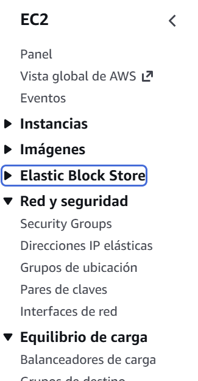
*Figura 1: Acceso a Security Groups en la sección Network & Security de EC2.*

2. En el panel superior, hacer clic en el botón naranja **Create security group** (**Crear grupo de seguridad**).

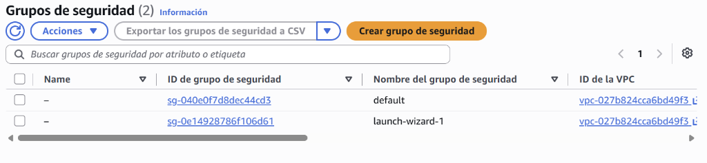
*Figura 2: Creación de un nuevo grupo de seguridad desde el panel de EC2.*

3. Indicar los detalles básicos del grupo (**Basic details**):
   * **Security group name:** `grup-servidors-ftp-ssh`
   * **Description:** `Regles per a RDP, SSH i FTP amb ports passius`
   * **VPC:** La VPC asignada por defecto en el laboratorio.

!!! tip "Regla de nomenclatura en AWS"
    En Amazon Web Services, el nombre de un grupo de seguridad **no puede comenzar por el prefijo `sg-`**, ya que AWS lo reserva internamente para los identificadores únicos del sistema (ej: `sg-0123456789abcdef`). Por ello nombramos el grupo como **`grup-servidors-ftp-ssh`** o **`servidores-ftp-ssh`**.

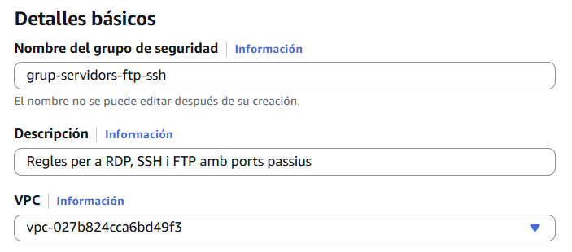
*Figura 3: Configuración del nombre, descripción y VPC del nuevo grupo de seguridad.*


4. En la sección **Inbound rules** (**Reglas de entrada**), pulsar en el botón **Add rule** (**Agregar regla**):

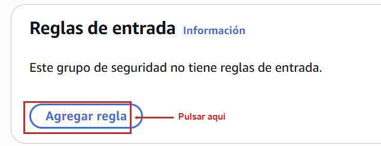
*Figura 4: Ubicación del botón Add rule para definir las aperturas de puertos.*

Añadir las 5 reglas requeridas:
   * **RDP:** Puerto `3389` TCP (para administrar gráficamente la máquina).
   * **SSH:** Puerto `22` TCP (para el servidor OpenSSH).
   * **FTP Control:** Puerto `21` TCP.
   * **FTP Pasivo (Windows):** Rango de puertos `50000-50100` TCP.
   * **FTP Pasivo (Ubuntu):** Rango de puertos `40000-40100` TCP.

> 📷 **Evidencia 2 (insertar en tu documento Word) — Realizar captura de pantalla** de la tabla de reglas de entrada del Security Group donde se vean los puertos 21, 22, 3389, 50000-50100 y 40000-40100.

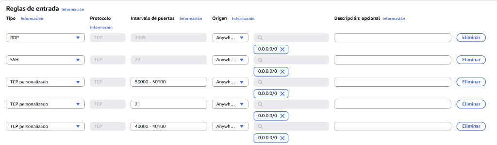
*Figura 5: Definición completa de las 5 reglas de entrada (RDP, SSH, FTP 21 y rangos pasivos).*

5. Bajar hasta el final de la página y pulsar el botón naranja **Create security group**:

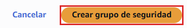
6. Una vez creado, se mostrará el panel resumen del grupo de seguridad con sus 5 reglas activas:

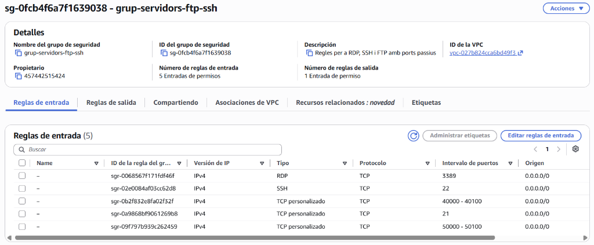
*Figura 7: Resumen del grupo de seguridad grup-servidors-ftp-ssh con sus 5 reglas de entrada operativas.*

7. **Asignación del grupo a la instancia Windows Server:**
   * En el menú lateral izquierdo, hacer clic en **Instances** (**Instancias**).
   * Marcar la casilla de `Servidor_FTPSSH`.
   * En el menú superior, pulsar en **Actions** -> **Security** -> **Change security groups**.

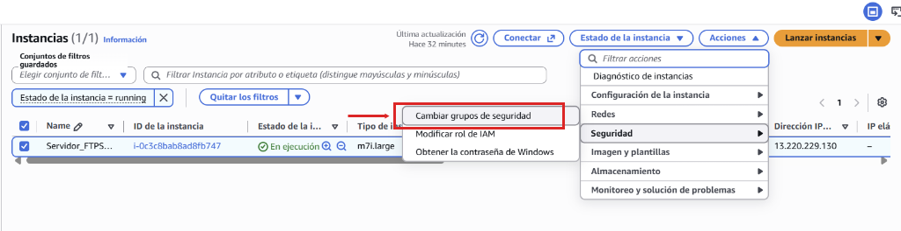
*Figura 8: Opción Change security groups en el menú Actions de la instancia.*

   * Seleccionar `grup-servidors-ftp-ssh`, eliminar el grupo anterior (`launch-wizard-1`) y hacer clic en el botón naranja **Save** (**Guardar**).

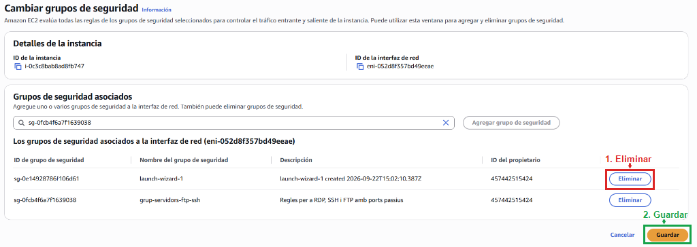
*Figura 9: Ventana de asociación del grupo grup-servidors-ftp-ssh y eliminación del grupo anterior.*

!!! tip "¿Por qué eliminamos launch-wizard-1? ¿Seguirá funcionando el RDP?"
    Al desasociar el grupo `launch-wizard-1` y dejar únicamente `grup-servidors-ftp-ssh`, garantizamos que toda la seguridad se centraliza en un único grupo ordenado y limpio. **No perderás el acceso por RDP**, ya que en el nuevo grupo hemos añadido explícitamente la regla de entrada para el puerto TCP `3389` (RDP).

---

### 6.2 Conexión RDP a la instancia de Windows Server

1. Comprobar que la instancia está en estado `Running` y con `2/2 checks passed` (**2/2 comprobaciones superadas**).
2. Descargar el archivo `.rdp` desde el botón **Connect** -> pestaña **RDP client** -> **Download remote desktop file** (o abrir `mstsc`).
3. Descifrar la contraseña de `Administrator` utilizando vuestro archivo de clave privada `vockey.pem` (o `labsuser.pem`) pulsando en **Get password**.
4. Conectarse al escritorio remoto de Windows Server.

!!! warning "Solo para usuarios con nombre de equipo vinculado a un dominio o SICE"
    Ir a **More choices** -> **Use a different account** e introducir `.\Administrator` en vez de solamente `Administrator`.

> 📷 **Evidencia 3 (insertar en tu documento Word) — Realizar captura de pantalla** del escritorio de Windows Server recién conectado mostrando el Administrador del Servidor (**Server Manager**).

---

### 6.3 Instalación del rol Servidor FTP (IIS) y Servidor OpenSSH

1. En el **Administrador del Servidor** (**Server Manager**), pulsar en el enlace central **Add roles and features** (o en el menú superior **Manage** -> **Add Roles and Features**).

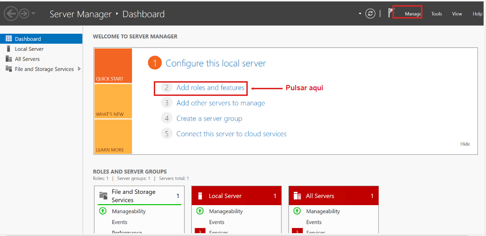
*Figura 10: Acceso al asistente para agregar roles y características desde el Administrador del Servidor (Server Manager).*

2. Avanzar por las pantallas preliminares (**Before You Begin**, **Installation Type** y **Server Selection**) manteniendo los valores por defecto pulsando **Next**.
3. En la pantalla **Server Roles**:
   * Marcar la casilla **Web Server (IIS)** (si aparece la ventana emergente solicitando características requeridas, confirmar haciendo clic en **Add Features**).
4. Avanzar por **Features** y **Web Server Role (IIS)** hasta llegar a la pantalla **Role Services**:
   * Desplegar la categoría **FTP Server** y marcar las casillas **FTP Service** y **FTP Extensibility**.
   * Verificar que en **Management Tools** queda marcada la **IIS Management Console**.

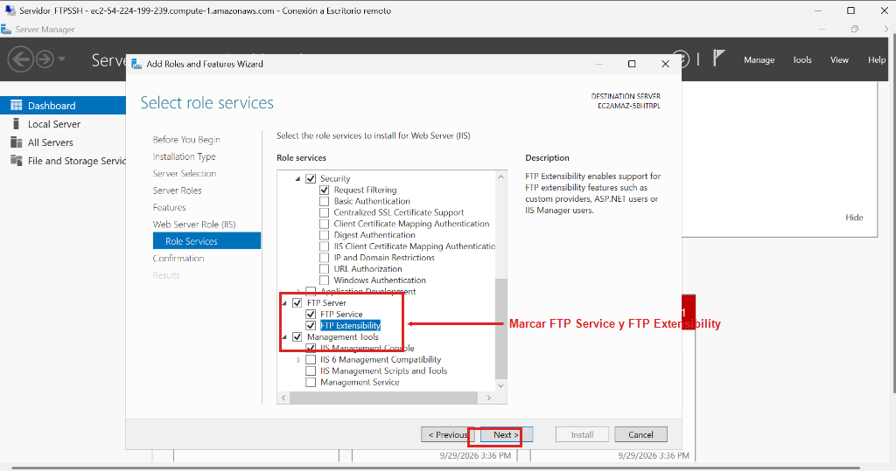
*Figura 11: Selección de los servicios de rol FTP Service y FTP Extensibility en el asistente de instalación.*

5. En la pantalla **Confirmation**, revisar los elementos y pulsar el botón **Install**.
6. Una vez completado el proceso, la barra de progreso mostrará el mensaje **Installation succeeded** y se activará el botón **Close**.

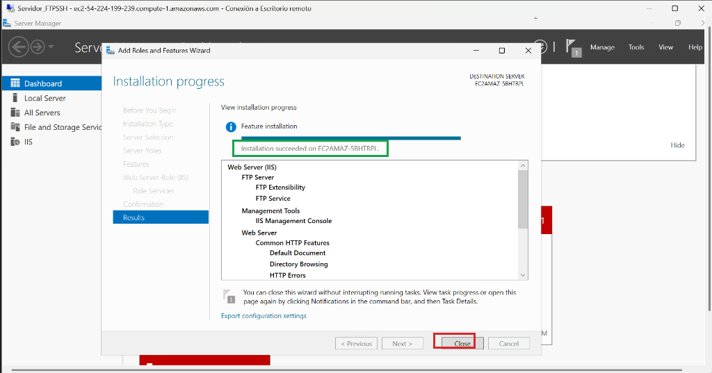
*Figura 12: Barra de instalación completada con éxito para el Servidor Web (IIS) y el Servicio FTP.*

7. Pulsar en el botón **Close** para cerrar el asistente.

---

### 6.3.1 Comprobación y activación del Servidor OpenSSH (Método Gráfico)

En las imágenes oficiales de Windows Server proporcionadas por Amazon Web Services (AWS EC2), la característica de **OpenSSH Server** ya viene preinstalada en el sistema como característica opcional (**Optional feature**), por lo que únicamente es necesario verificar su presencia e iniciar su servicio.

**Comprobación gráfica mediante Configuración:**
1. Pulsar en el botón **Inicio** de Windows -> hacer clic en el icono de **Configuración** (**Settings** - icono de rueda dentada).
2. Entrar en la sección **System** -> **Optional features** (o buscar `optional` en el buscador superior).
3. En la sección **Added features** (Características añadidas), escribir `ssh` en el filtro de búsqueda.
4. Comprobar que **OpenSSH Server** figura ya como instalado (no pulsar el botón **Remove**; pulsar en **Close** para cerrar la ventana).

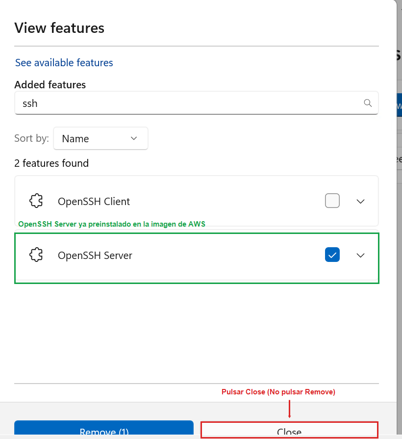
*Figura 13: Comprobación de la característica OpenSSH Server ya preinstalada en la imagen EC2 de AWS.*

**Inicio y arranque del servicio OpenSSH (Consola gráfica de Servicios):**
1. Pulsar `Windows + R`, escribir `services.msc` y pulsar Enter (o desde **Server Manager** -> menú superior **Tools** -> **Services**).
2. Localizar en la lista el servicio **OpenSSH SSH Server**.
3. Hacer clic derecho sobre él -> **Propiedades** (**Properties**):
   * Cambiar el **Tipo de inicio** (**Startup type**) a **Automático** (**Automatic**).
   * Pulsar en el botón **Iniciar** (**Start**).
   * Pulsar **OK**.

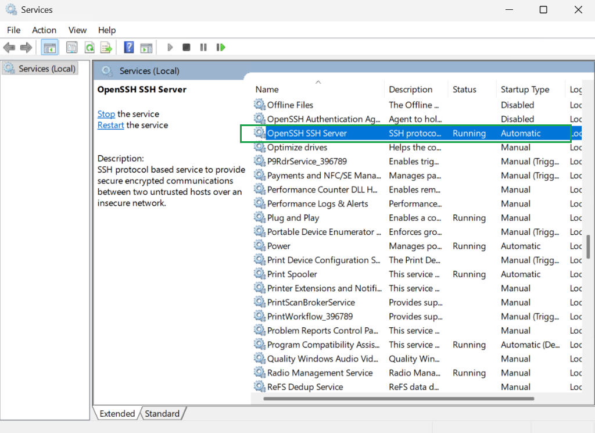
*Figura 14: Consola gráfica de Servicios mostrando OpenSSH SSH Server en estado En ejecución (Running) y con tipo de inicio Automático.*

!!! tip "Alternativa rápida por PowerShell para administradores de sistemas"
    Si prefieres instalar y activar OpenSSH por línea de comandos, abre una consola de **PowerShell como Administrador** y ejecuta:
    ```powershell
    Add-WindowsCapability -Online -Name OpenSSH.Server~~~~0.0.1.0
    Start-Service sshd
    Set-Service -Name sshd -StartupType Automatic
    ```

---

### 6.4 Creación de usuarios locales para el servicio

1. Pulsar clic derecho sobre el botón Inicio de Windows -> **Computer Management** (o ejecutar `compmgmt.msc`).
2. En el panel izquierdo, desplegar **Local Users and Groups** -> carpeta **Users**.
3. Clic derecho en el panel central -> **New User...**:
   * **User name:** `alumne_redes`
   * **Full name:** `Alumne Redes`
   * **Description:** `Usuari per a proves de transferència`
   * **Password:** `Smx2026..@` (y confirmar la contraseña).
   * Desmarcar **User must change password at next logon**.
   * Marcar **User cannot change password** y **Password never expires**.
   * Pulsar en **Create** y luego en **Close**.

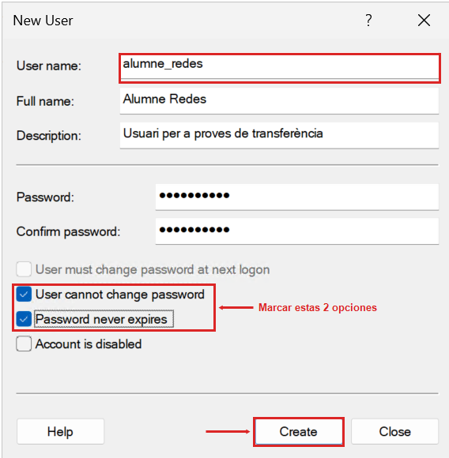
*Figura 15: Ventana de creación del usuario local alumne_redes con las directivas de contraseña configuradas.*

4. Hacer doble clic sobre el usuario `alumne_redes` en la lista -> pestaña **Member Of**:
   * Pulsar en **Add...** -> escribir `Remote Desktop Users` -> pulsar en **Check Names** y **OK**.
   * Pulsar de nuevo en **Add...** -> escribir `Administrators` -> pulsar en **Check Names** y **OK** (imprescindible en las instancias Windows Server de AWS para que el servidor **OpenSSH** autorice el inicio de sesión por SSH y SFTP en el puerto `22`).
   * Comprobar que el usuario pertenece a los tres grupos (`Administrators`, `Remote Desktop Users` y `Users`), y pulsar en **Apply** y **OK**.

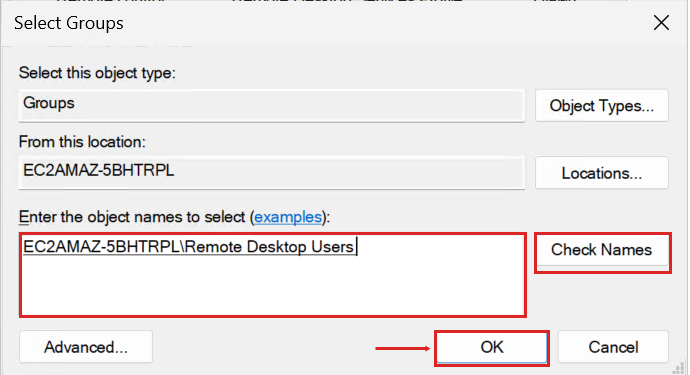
*Figura 16: Selección y comprobación del grupo Remote Desktop Users para el usuario alumne_redes.*

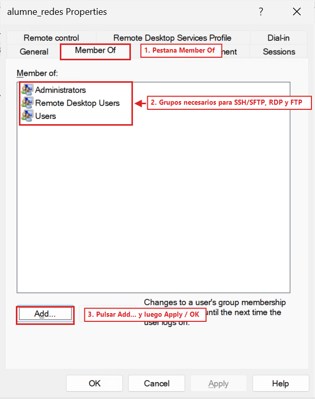
*Figura 16b: Pestaña Member Of mostrando al usuario alumne_redes dentro de Administrators, Remote Desktop Users y Users.*

> 📷 **Evidencia 4 (insertar en tu documento Word) — Realizar captura de pantalla** de la ventana de propiedades (**Properties** -> **Member Of**) del usuario `alumne_redes` mostrando su pertenencia a los grupos `Administrators`, `Remote Desktop Users` y `Users`.

---

### 6.5 Configuración de Compatibilidad de Firewall de FTP y Modo Pasivo en IIS (FTP Firewall Support)

1. Abrir **Internet Information Services (IIS) Manager** (escribir `inetmgr` en Inicio o desde **Server Manager** -> **Tools** -> **Internet Information Services (IIS) Manager**).
2. En el panel izquierdo (**Connections**), hacer clic sobre el nombre del servidor (nodo raíz).
3. En el panel central, localizar la sección **FTP** y hacer doble clic sobre el icono **FTP Firewall Support**:

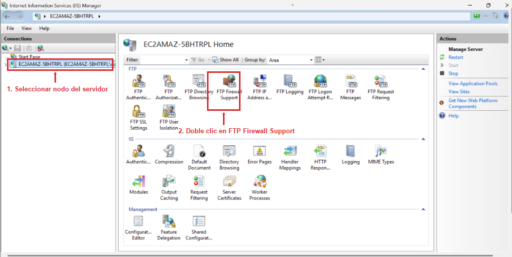
*Figura 17: Selección del nodo raíz del servidor y acceso a FTP Firewall Support en el Administrador de IIS.*

4. Para obtener la dirección IPv4 pública de la máquina virtual, volver a la pestaña del navegador con la consola de **AWS EC2** -> **Instancias** -> seleccionar `Servidor_FTPSSH` y, en la pestaña inferior **Detalles** (**Details**), copiar la **Dirección IPv4 pública** (pulsando sobre el icono de los dos cuadraditos azules situado a la izquierda de la IP):

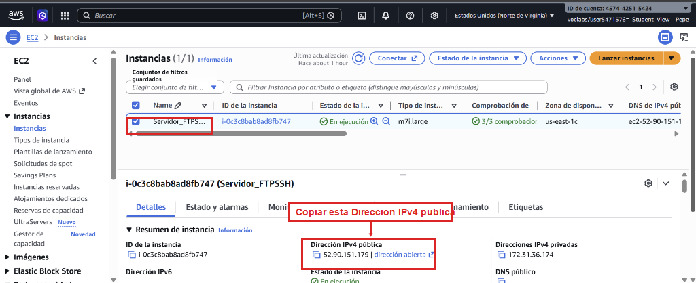
*Figura 18: Localización y copia de la Dirección IPv4 pública de la instancia en la consola de AWS EC2.*

5. De vuelta en la ventana **FTP Firewall Support** de IIS, configurar los parámetros del canal de datos pasivo:
   * **Data Channel Port Range:** Escribir `50000-50100`.
   * **External IP Address of Firewall:** Pegar la **Dirección IPv4 pública actual** de vuestra instancia en AWS (en nuestro ejemplo, `52.90.151.179`).
   * En el panel lateral derecho (**Actions**), hacer clic en **Apply**.

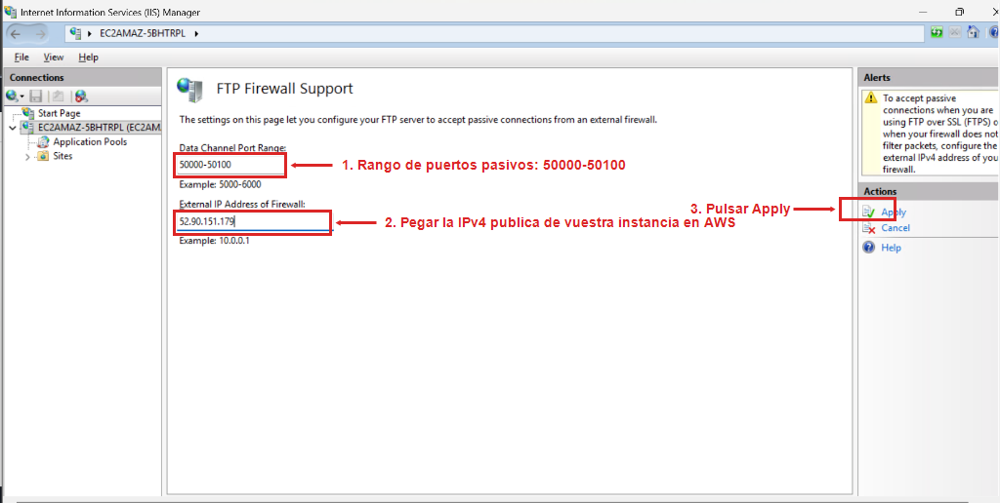
*Figura 19: Configuración del rango de puertos pasivos (50000-50100) y la dirección IPv4 pública externa de AWS.*

6. Al pulsar en **Apply**, aparecerá una ventana informativa recordando que es necesario abrir también dicho rango de puertos en el cortafuegos del sistema (lo cual realizaremos en el apartado 6.7). Pulsar en **OK**.

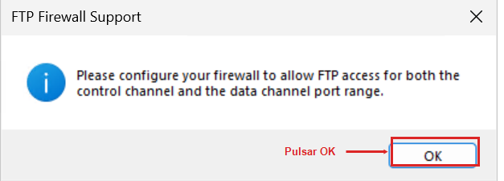
*Figura 19b: Aviso informativo recordando configurar la regla de puertos en el Firewall de Windows.*

!!! warning "¡No olvides poner la IPv4 Pública de AWS!"
    En Amazon Web Services la máquina virtual solo conoce su IP privada interna (`172.31.x.x`). Si dejas en blanco el campo **External IP Address of Firewall**, el servidor FTP responderá a los clientes externos con su IP privada y **FileZilla fallará al listar los directorios** en modo pasivo. Además, recuerda que si detienes y vuelves a iniciar la instancia en otro día de clase, deberás actualizar aquí la nueva IP pública.

> 📷 **Evidencia 5 (insertar en tu documento Word) — Realizar captura de pantalla** del panel FTP Firewall Support con el rango de puertos 50000-50100 y la IP pública de AWS introducidos.

---

### 6.6 Creación del sitio FTP en IIS (Add FTP Site)

1. En el panel izquierdo de IIS (**Connections**), desplegar el servidor, hacer clic derecho sobre la carpeta **Sites** y seleccionar **Add FTP Site...**:

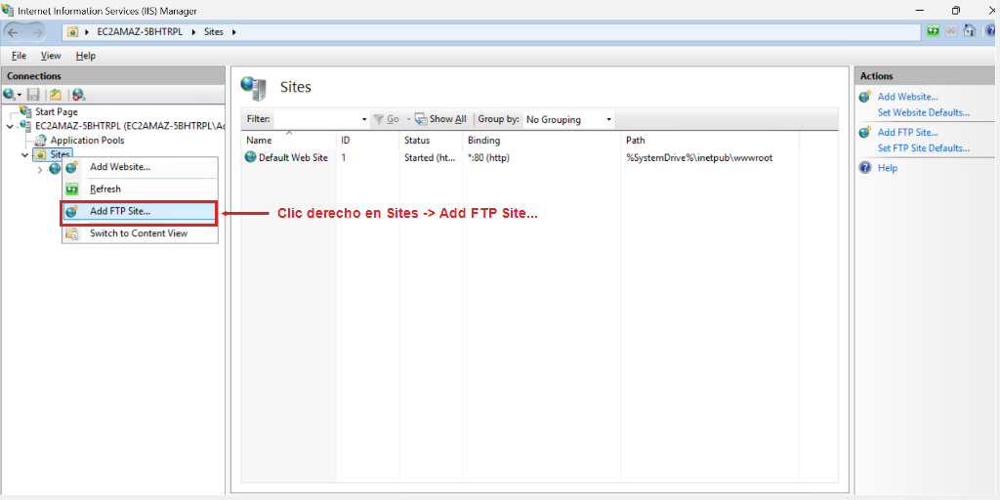
*Figura 20: Menú contextual sobre la carpeta Sites para añadir un nuevo sitio FTP.*

2. **Site Information:**
   * **FTP site name:** `FTP-AULA`
   * **Physical path:** `C:\inetpub\ftproot` -> Pulsar **Next**.

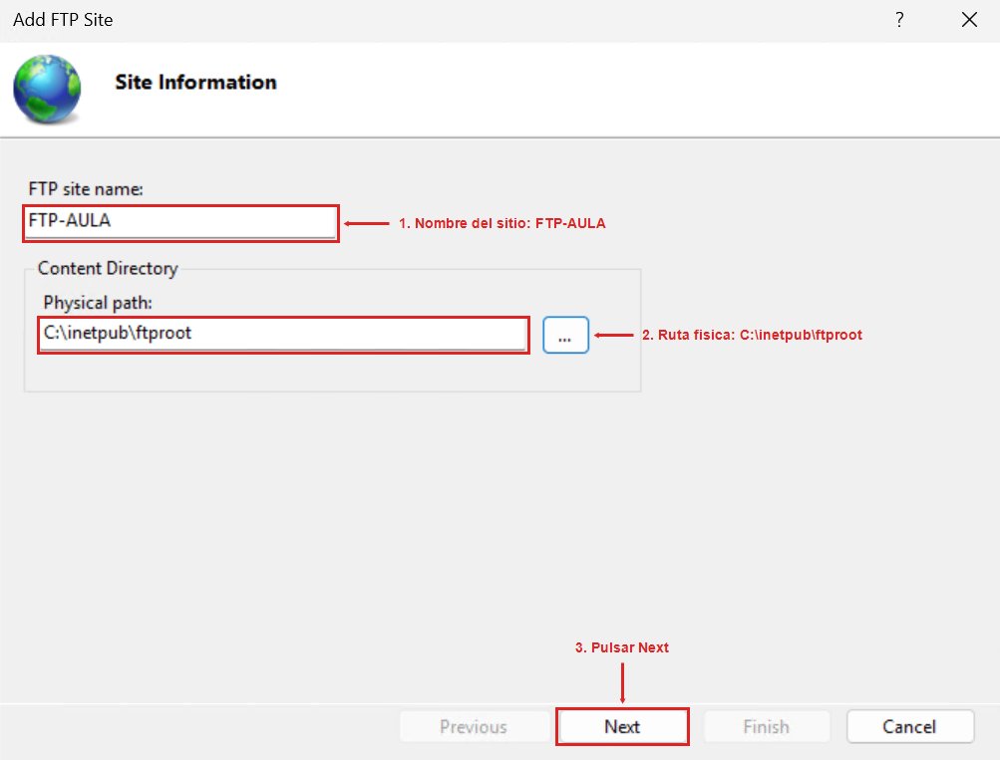
*Figura 21: Definición del nombre del sitio (FTP-AULA) y su directorio raíz físico (C:\inetpub\ftproot).*

3. **Binding and SSL Settings:**
   * **IP Address:** **All Unassigned** | **Port:** `21`.
   * **SSL:** Marcar **No SSL** -> Pulsar **Next**.

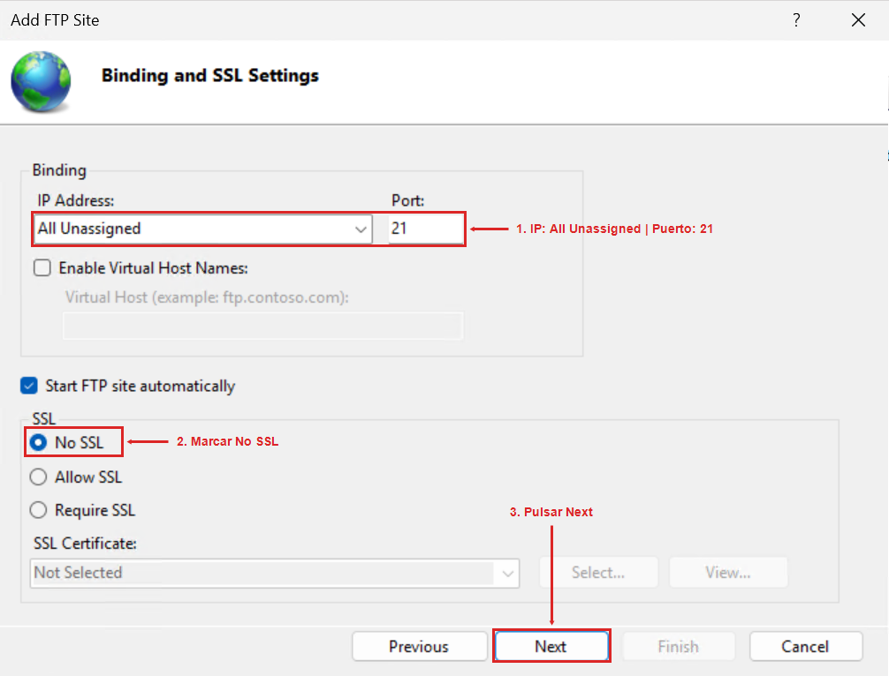
*Figura 22: Configuración del puerto de control 21 TCP y desactivación inicial de SSL.*

4. **Authentication and Authorization Information:**
   * **Authentication:** Marcar **Basic**.
   * **Authorization:** Seleccionar **Specified users** y escribir debajo `alumne_redes`.
   * **Permissions:** Marcar **Read** y **Write** -> Pulsar **Finish**.

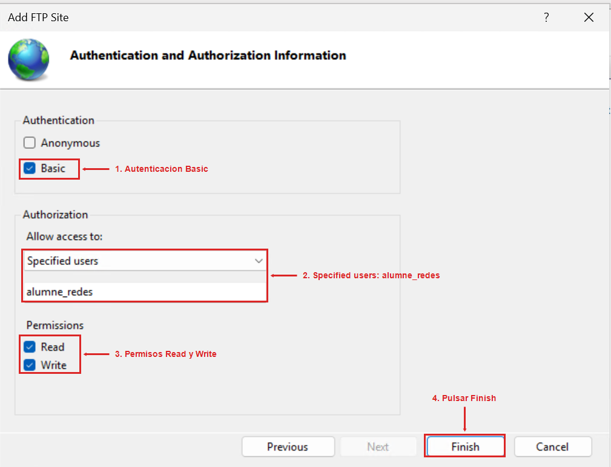
*Figura 23: Habilitación de autenticación básica y permisos de lectura y escritura para el usuario alumne_redes.*

5. Una vez finalizado el asistente, comprobar que el sitio `FTP-AULA` aparece en la lista de **Sites** en estado **Started (ftp)** escuchando por el puerto `21`:

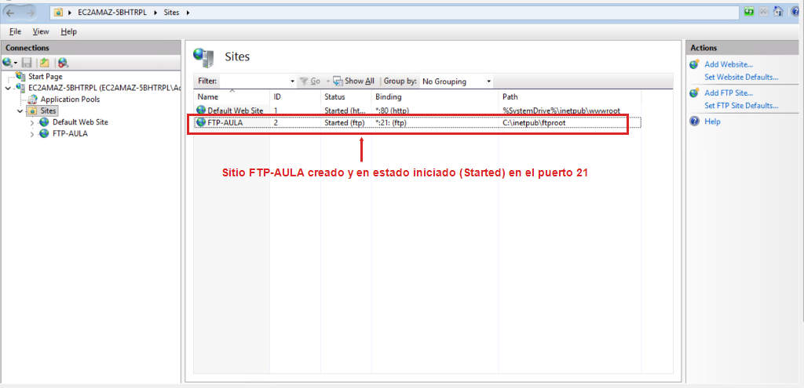
*Figura 24: Sitio FTP-AULA activo y en estado iniciado (Started) en el Administrador de IIS.*

> 📷 **Evidencia 6 (insertar en tu documento Word) — Realizar captura de pantalla** de IIS Manager mostrando el sitio `FTP-AULA` creado y en estado iniciado (**Started**).

---

### 6.6.1 Asignación de permisos NTFS de escritura sobre C:\inetpub\ftproot

Por defecto, Windows Server concede únicamente permisos de **lectura** al grupo de usuarios estándar sobre el directorio físico `C:\inetpub\ftproot`. Aunque en IIS hayamos autorizado **Read** y **Write** para `alumne_redes`, cuando un usuario intenta subir un fichero, Windows comprueba **tanto los permisos FTP de IIS como los permisos NTFS del sistema de archivos** (aplicando siempre el más restrictivo). Por ello, debemos otorgar el permiso **Modify** (**Modificar**) al usuario `alumne_redes` en la carpeta:

1. Abrir el **Explorador de archivos** de Windows, navegar hasta `C:\inetpub`, hacer **clic derecho** sobre la carpeta **`ftproot`** y seleccionar **Properties** (**Propiedades**):

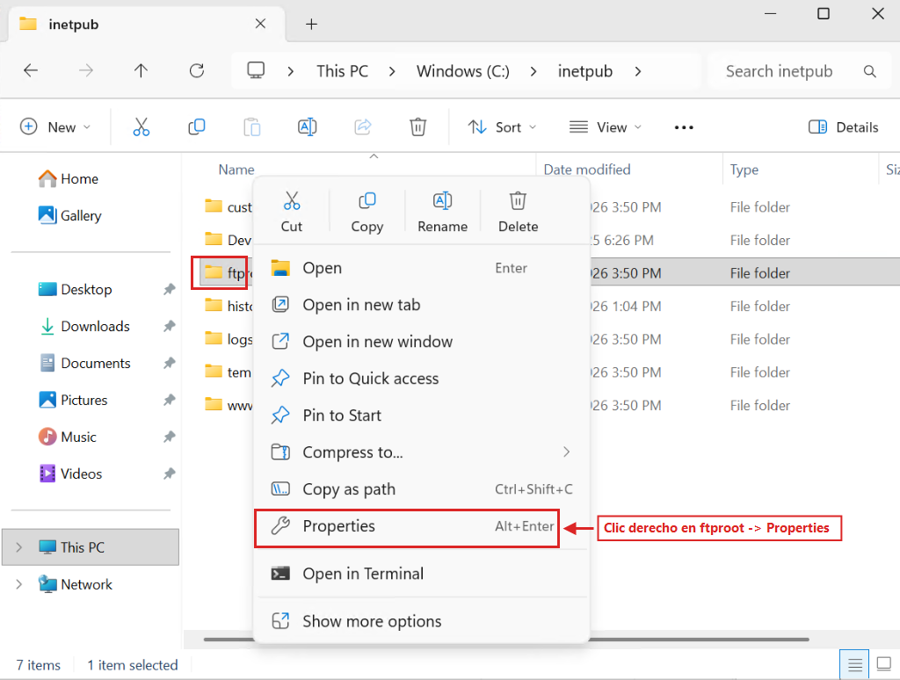
*Figura 24b: Acceso a las propiedades de la carpeta física C:\inetpub\ftproot desde el Explorador de archivos.*

2. En la ventana **ftproot Properties**, abrir la pestaña superior **Security** (**Seguridad**) y pulsar en el botón **Edit...** (**Editar...**):

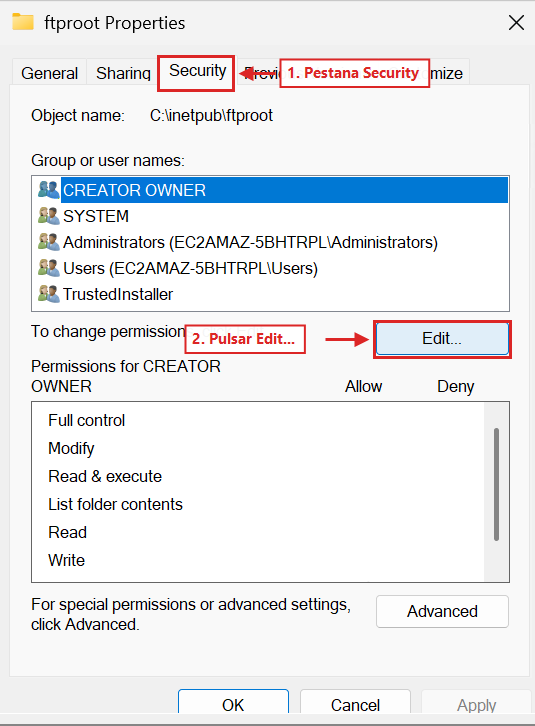
*Figura 24c: Pestaña Security de las propiedades de ftproot y acceso a la edición de permisos NTFS.*

3. En la ventana de permisos, hacer clic en el botón **Add...**, escribir `alumne_redes`, pulsar en **Check Names** para resolver el nombre local completo y hacer clic en **OK**:

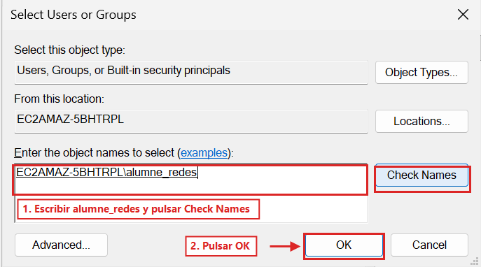
*Figura 24d: Adición del usuario local alumne_redes a la lista de control de acceso (ACL) de la carpeta.*

4. Con el usuario **Alumne Redes (`alumne_redes`)** seleccionado en la lista superior, marcar la casilla **Modify** (**Modificar**) en la columna **Allow** (lo cual activará automáticamente también el permiso **Write**). Finalmente, pulsar en **Apply** y en **OK**:

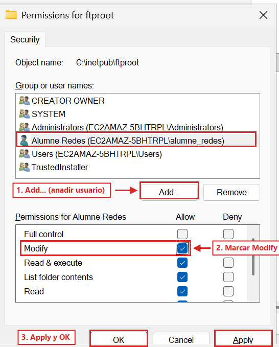
*Figura 24e: Concesión del permiso NTFS Modify (lectura, escritura y modificación) al usuario alumne_redes sobre C:\inetpub\ftproot.*

!!! tip "Permisos válidos tanto para FTP (puerto 21) como para SFTP/SSH (puerto 22)"
    Al asignar estos permisos NTFS directamente a la cuenta local `alumne_redes` sobre `C:\inetpub\ftproot`, el usuario no solo podrá subir y borrar archivos conectándose por **FTP tradicional o FTPS (puerto 21)**, sino que también tendrá acceso completo a dicho directorio cuando se conecte mediante **SSH o SFTP (puerto 22)**.

---

### 6.7 Regla en el Firewall de Windows Defender

1. En el **Administrador del Servidor** (**Server Manager**), desplegar el menú superior **Tools** y seleccionar **Windows Defender Firewall with Advanced Security** (o pulsar `Windows + R` y ejecutar `wf.msc`):

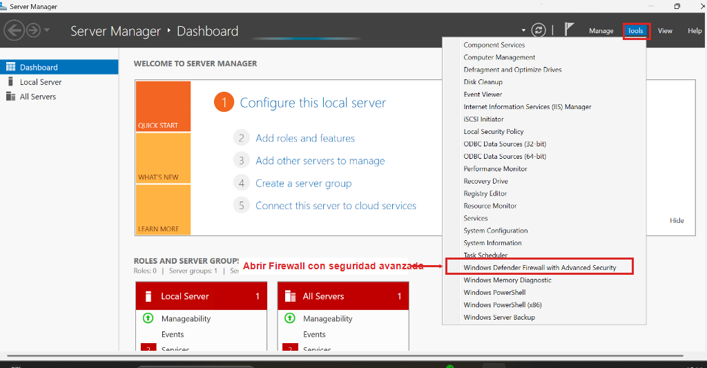
*Figura 25: Apertura de Windows Defender Firewall with Advanced Security desde el menú Tools de Server Manager.*

2. En el árbol izquierdo, seleccionar **Inbound Rules** (**Reglas de entrada**) y en la columna derecha (**Actions**) hacer clic en **New Rule...**:

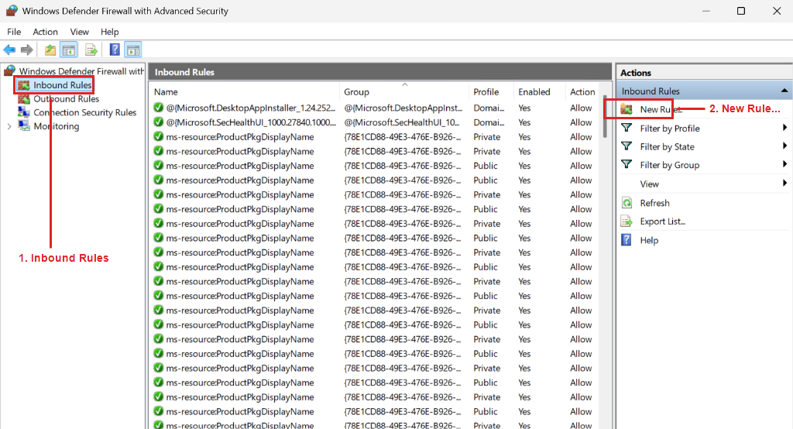
*Figura 26: Selección de Inbound Rules y creación de una nueva regla de entrada.*

3. Configurar los pasos del asistente **New Inbound Rule Wizard**:
   * **Rule Type:** Marcar **Port** y pulsar **Next**.

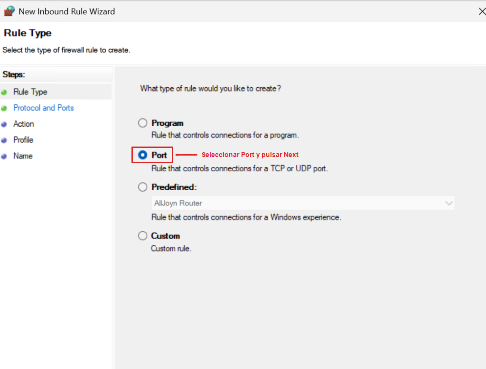
*Figura 27: Selección de regla basada en puerto (Port).*

   * **Protocol and Ports:** Marcar **TCP**, seleccionar **Specific local ports** e introducir el rango `50000-50100` (o escribir directamente `22, 50000-50100` para dejar abierto a la vez el puerto `22` de **OpenSSH Server / SFTP** en el Firewall de Windows). Pulsar **Next**.

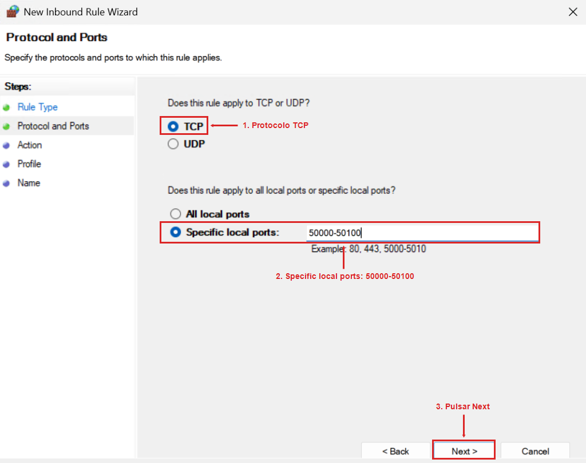
*Figura 28: Apertura del rango de puertos TCP 50000-50100 para el canal de datos pasivo.*

!!! tip "Añadir el puerto 22 (SSH/SFTP) a la regla del Firewall de Windows"
    En las imágenes de Windows Server de AWS, aunque **OpenSSH Server** viene preinstalado, el Firewall de Windows Defender trae cerrado el puerto `22` TCP. Si ya habías creado la regla solo con `50000-50100`, puedes hacer **doble clic** sobre la regla creada (`FTP Pasivo Datos (50000-50100)`), ir a la pestaña **Protocols and Ports**, cambiar **Local port** a **`22, 50000-50100`** y pulsar **Apply** y **OK**:

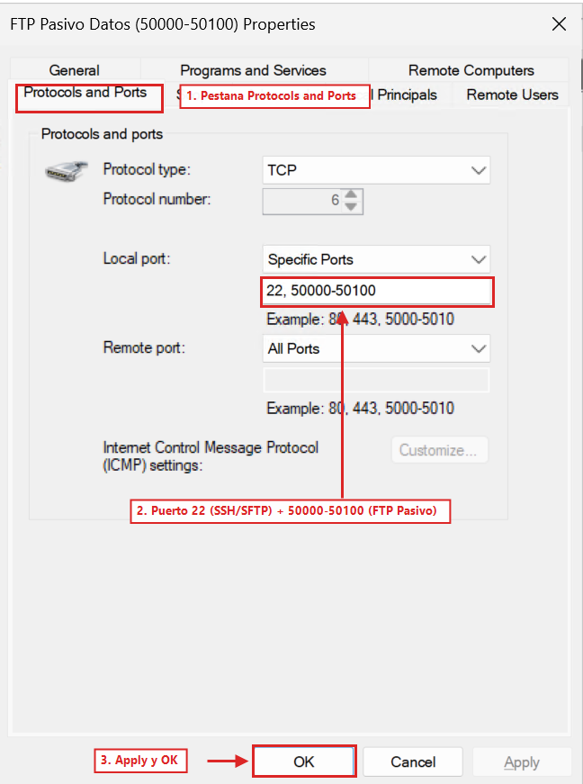
*Figura 28b: Pestaña Protocols and Ports permitiendo simultáneamente el puerto 22 (SSH/SFTP) y el rango 50000-50100 (FTP Pasivo).*

   * **Action:** Marcar **Allow the connection** y pulsar **Next**.

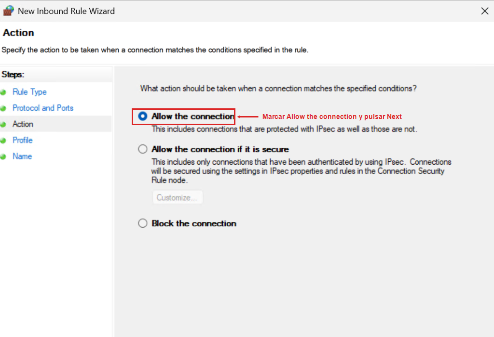
*Figura 29: Autorización de las conexiones entrantes (Allow the connection).*

   * **Profile:** Mantener marcados los tres perfiles (**Domain**, **Private** y **Public**) y pulsar **Next**.
   * **Name:** Escribir `FTP Pasivo Datos (50000-50100)` y pulsar **Finish**.

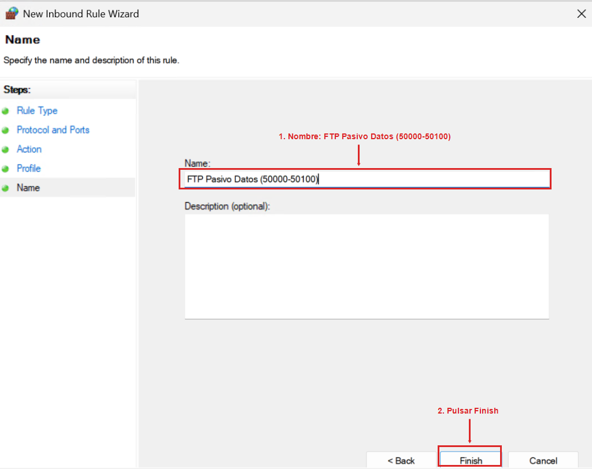
*Figura 30: Nombre descriptivo de la regla para identificar los puertos pasivos de FTP.*

4. **Reiniciar el servicio FTP** para aplicar todos los cambios:
   * Abrir la consola gráfica de **Services** (`services.msc` o desde **Server Manager** -> **Tools** -> **Services**).
   * Localizar **Microsoft FTP Service**, hacer clic derecho sobre él y pulsar en **Restart**.

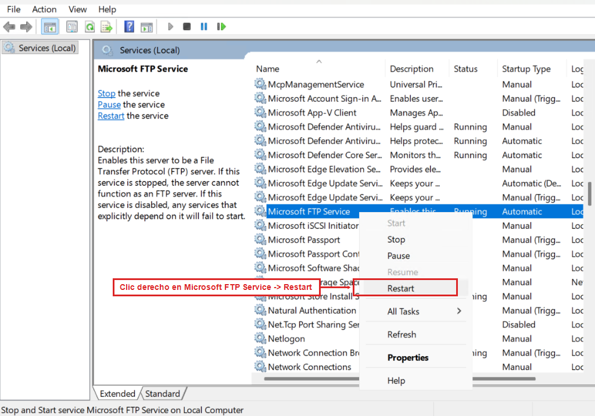
*Figura 31: Reinicio del servicio Microsoft FTP Service desde la consola gráfica de Servicios.*

> 📷 **Evidencia 7 (insertar en tu documento Word) — Realizar captura de pantalla** de la regla `FTP Pasivo Datos (50000-50100)` creada en el Firewall de Windows y del servicio `Microsoft FTP Service` en ejecución.

!!! info "Qué debes añadir a tu documento Word al terminar el Apartado 6"
    En el **Apartado 6** de tu documento Word de la unidad, asegúrate de haber insertado y explicado brevemente las **Evidencias 1 a 7**:
    
    * **Evidencia 1:** Instancia `Servidor_FTPSSH` en estado `Running` en AWS EC2.
    * **Evidencia 2:** Tabla de reglas de entrada del Security Group `grup-servidors-ftp-ssh` (puertos `21`, `22`, `3389`, `50000-50100` y `40000-40100`).
    * **Evidencia 3:** Escritorio de Windows Server conectado por RDP mostrando **Server Manager**.
    * **Evidencia 4:** Propiedades del usuario `alumne_redes` (**Member Of**: `Administrators`, `Remote Desktop Users`, `Users`).
    * **Evidencia 5:** Configuración de `FTP Firewall Support` en IIS con el rango `50000-50100` y la IP pública de AWS.
    * **Evidencia 6:** Sitio `FTP-AULA` creado y en estado `Started` en IIS Manager.
    * **Evidencia 7:** Regla `FTP Pasivo Datos (50000-50100)` en el Firewall de Windows y servicio `Microsoft FTP Service` en ejecución.

---

## 7 - [Windows Server] Transferencia de ficheros con FileZilla y diagnóstico de modo pasivo (RA3-CEe)

!!! warning "Obligatorio seguir las normas para la presentación de trabajos escritos."
    Todas las evidencias deberán incluir capturas de pantalla completas donde se aprecie claramente el nombre del equipo, usuario y la fecha/hora.

Una vez instalado y configurado el servidor FTP en **Windows Server (`Servidor_FTPSSH`)**, vamos a verificar inmediatamente desde nuestro equipo del aula que el canal de control (`21` TCP) y el canal de datos en **modo pasivo** (`50000-50100` TCP) funcionan correctamente antes de avanzar a configuraciones más complejas.

---

### 7.1 Conexión y transferencia hacia Windows Server con FileZilla

1. Abrir **FileZilla Client** en vuestro ordenador del aula.
2. En la barra superior de **Conexión rápida** introducir:
   * **Servidor:** `<IP_PUBLICA_WINDOWS>` (en nuestro ejemplo, `52.90.151.179`)
   * **Nombre de usuario:** `alumne_redes`
   * **Contraseña:** `Smx2026..@`
   * **Puerto:** `21` (si se deja en blanco, FileZilla utiliza por defecto el puerto `21`)
3. Pulsar en el botón **Conexión rápida**.
4. Al tratarse inicialmente de una conexión FTP estándar sin cifrar (antes de configurar FTPS en la Tarea 9), FileZilla mostrará la ventana emergente **Conexión FTP insegura** (**Este servidor no es compatible con FTP sobre TLS**). Pulsar en **Aceptar**:

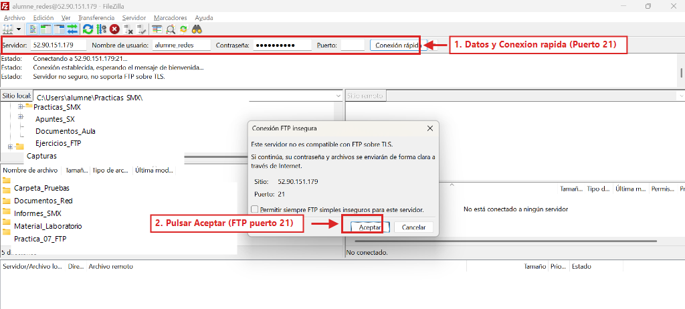
*Figura 32: Introducción de credenciales en la barra de Conexión rápida de FileZilla y confirmación del diálogo de conexión FTP en el puerto 21.*

5. Comprobar que en el log de conexión superior aparece el listado correcto del directorio (`Directorio "/" listado correctamente`) gracias al modo pasivo configurado.
6. Crear en vuestro PC un archivo llamado `Prova_ftp.txt` (o `prueba_win.txt`) y subirlo arrastrándolo al panel derecho (Sitio remoto `/`). Comprobar en la pestaña inferior **Transferencias satisfactorias (1)** que el fichero se ha transferido sin errores:

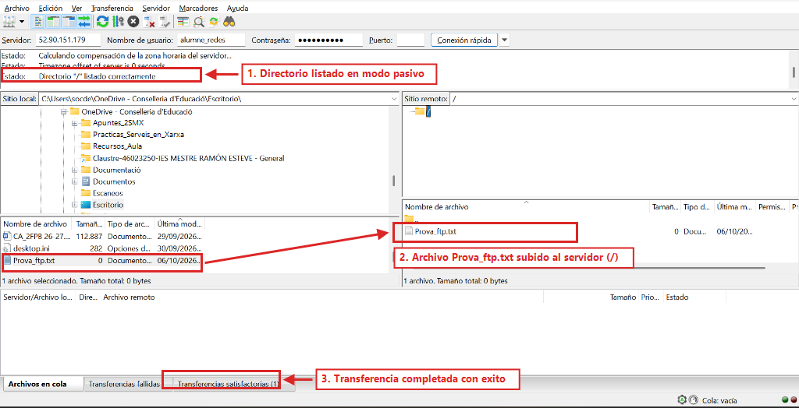
*Figura 33: Directorio raíz listado en modo pasivo y archivo Prova_ftp.txt transferido con éxito al servidor Windows Server.*

> 📷 **Evidencia 8 (insertar en tu documento Word) — Realizar captura de pantalla** de FileZilla mostrando la conexión exitosa en modo pasivo y el archivo subido al servidor Windows Server.

---

### 7.2 Diagnóstico de avería: Bloqueo del modo pasivo por cortafuegos o IP externa

* **Escenario de la incidencia:** Un usuario introduce su usuario y contraseña en FileZilla correctamente (`230 User logged in`), pero justo después la conexión se queda congelada mostrando `Comando: MLSD` o `LIST` y tras 20 segundos devuelve `Error: Conexión superó el tiempo de espera. No se pudo recuperar el listado del directorio`.
* **Causa técnica:** El canal de control (puerto `21`) está abierto, pero el canal de datos pasivo (`50000-50100`) está bloqueado por el Firewall de Windows Defender (`wf.msc`), por el Security Group de AWS, o bien se olvidó introducir la IPv4 pública de AWS en **FTP Firewall Support** de IIS.
* **Comprobación práctica:**
  1. Verificar en el log superior de FileZilla que el servidor responde al comando `PASV` con la IP pública correcta y un puerto del rango `50000-50100`.
  2. Verificar en Windows Server que la regla `FTP Pasivo Datos (50000-50100)` está activa en `wf.msc`.

!!! info "Qué debes añadir a tu documento Word al terminar el Apartado 7"
    En el **Apartado 7** de tu documento Word, incluye:
    
    * **Evidencia 8:** Captura de FileZilla mostrando la conexión exitosa en modo pasivo hacia Windows Server y el archivo `Prova_ftp.txt` transferido en la pestaña de **Transferencias satisfactorias**.

---

## 8 - [Windows Server] Aislamiento de usuarios (User Isolation), carpeta pública y permisos NTFS (RA3-CEd)

!!! warning "Obligatorio seguir las normas para la presentación de trabajos escritos."
    Todas las evidencias deberán incluir capturas de pantalla completas donde se aprecie claramente el nombre del equipo, usuario y la fecha/hora.

En un entorno empresarial real, cada departamento o usuario debe disponer de un espacio privado exclusivo para almacenar sus ficheros confidenciales, sin que otros usuarios puedan acceder ni manipularlos. Además, suele habilitarse una carpeta pública compartida (para catálogos, formularios o drivers) accesible por cualquier usuario de forma anónima, pero con permisos estrictos de solo lectura.

---

### 8.1 Creación de usuarios departamentales y estructura LocalUser en Windows Server

1. Abrir **Computer Management** (`compmgmt.msc`).
2. Desplegar **Local Users and Groups** -> carpeta **Users**.
3. Crear dos usuarios locales nuevos (**New User...**):
   * **User 1:** `usuari_ventas` (Password: `Smx2026..@`).
   * **User 2:** `usuari_compras` (Password: `Smx2026..@`).
   * Para ambos usuarios: desmarcar **User must change password at next logon**, y marcar **User cannot change password** y **Password never expires**.
4. Abrir **File Explorer** en `C:\inetpub\ftproot` y crear la siguiente estructura exacta de carpetas y archivos de prueba dentro de `LocalUser` (en IIS, cuando se activa el aislamiento por nombre de usuario, los usuarios locales entran en `LocalUser\<usuario>` y el usuario `anonymous` entra automáticamente en `LocalUser\Public`):
   ```text
   C:\inetpub\ftproot\
   └── LocalUser\
       ├── alumne_redes\
       ├── usuari_ventas\
       │   └── informe_ventas_privado.txt
       ├── usuari_compras\
       │   └── presupuesto_compras_privado.txt
       └── Public\
           └── catalogo_empresa_2026.pdf
   ```
5. Conceder permisos NTFS de modificación (**Modify**) a `usuari_ventas` sobre su carpeta `C:\inetpub\ftproot\LocalUser\usuari_ventas` y a `usuari_compras` sobre `C:\inetpub\ftproot\LocalUser\usuari_compras` (pestaña **Security** -> **Edit...** -> **Add...**), manteniendo la carpeta `LocalUser\Public` únicamente con permisos de lectura para `IUSR` / `Users`:

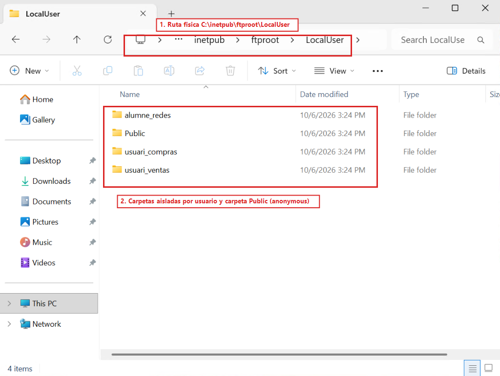
*Figura 33b: Estructura física de carpetas en C:\inetpub\ftproot\LocalUser para usuarios locales aislados y carpeta Public para acceso anónimo.*

> 📷 **Evidencia 9 (insertar en tu documento Word) — Realizar captura de pantalla** de File Explorer en Windows Server mostrando la estructura de carpetas dentro de `C:\inetpub\ftproot\LocalUser`.

---

### 8.2 Configuración del Aislamiento de Usuarios en IIS (FTP User Isolation)

1. Abrir **Internet Information Services (IIS) Manager** (`inetmgr`).
2. Desplegar el servidor -> carpeta **Sites** -> hacer clic sobre el sitio **`FTP-AULA`**.
3. En el panel central, hacer doble clic sobre el icono **FTP User Isolation**.
4. Dentro de **Isolate users. Restrict users to the following directory:**, seleccionar la opción: **User name directory (disable global virtual directories)**.
5. En el panel lateral derecho (**Actions**), hacer clic en **Apply**:

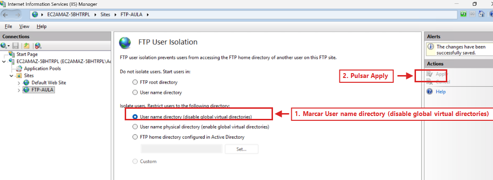
*Figura 33c: Activación de la directiva User name directory (disable global virtual directories) en FTP User Isolation.*

---

### 8.3 Configuración de Acceso Anónimo (Solo Lectura) y Reglas de Autorización

1. En IIS, seleccionar el sitio **`FTP-AULA`** -> hacer doble clic en el icono **FTP Authentication**:
   * Seleccionar **Anonymous Authentication** y en el panel derecho (**Actions**) pulsar en **Enable** para que su estado pase a **Enabled** (junto con **Basic Authentication** en **Enabled**).
2. Volver al sitio **`FTP-AULA`** -> hacer doble clic en el icono **FTP Authorization Rules**:
   * Pulsar en **Add Allow Rule...** en el panel derecho:
     - **Regla 1 (Usuarios departamentales con Lectura y Escritura):** Seleccionar **Specified users**, escribir `alumne_redes, usuari_ventas, usuari_compras` y marcar los permisos **Read** y **Write** -> pulsar **OK**.
     - **Regla 2 (Usuarios anónimos con Solo Lectura):** Pulsar de nuevo en **Add Allow Rule...**, seleccionar **All anonymous users** y en **Permissions** marcar únicamente **Read** (manteniendo **Write** desmarcado) -> pulsar **OK**:

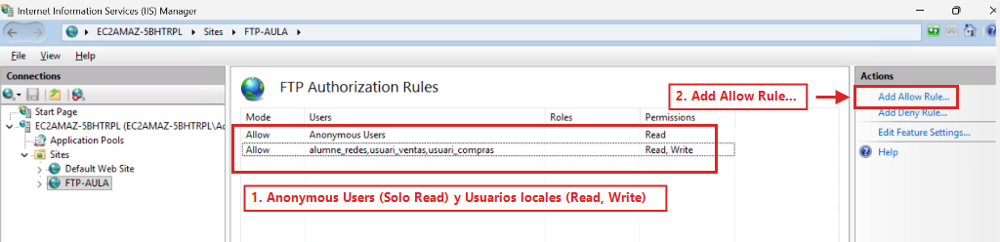
*Figura 33d: Reglas de autorización en FTP Authorization Rules concediendo solo lectura a Anonymous Users y lectura/escritura a los usuarios locales.*

---

### 8.4 Verificación del aislamiento y permisos desde FileZilla

1. Abrir **FileZilla Client** en vuestro PC del aula.
2. **Prueba de usuario aislado (`usuari_ventas`):**
   * En la barra de **Conexión rápida**, introducir Servidor `<IP_PUBLICA_WINDOWS>`, Nombre de usuario `usuari_ventas`, Contraseña `Smx2026..@` y Puerto `21` -> pulsar **Conexión rápida**.
   * Comprobar que accede directamente a su raíz privada (`/`) donde ve exclusivamente su archivo `informe_ventas_privado.txt`, sin posibilidad de subir de nivel ni ver la carpeta de `usuari_compras`:

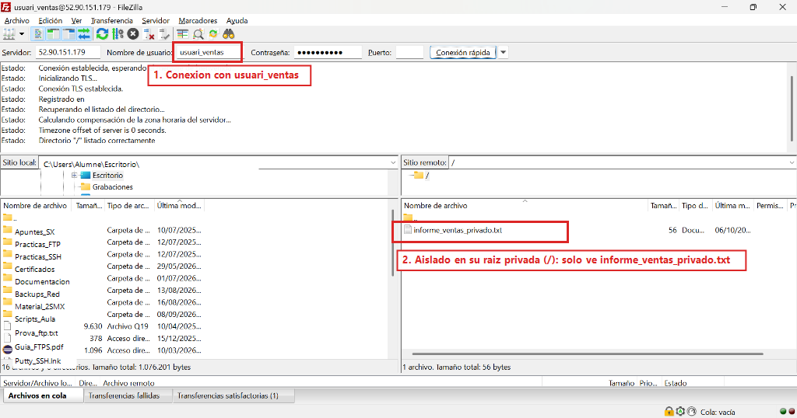
*Figura 33e: Usuario usuari_ventas enjaulado en su directorio privado viendo únicamente informe_ventas_privado.txt.*

3. **Prueba de usuario anónimo (`anonymous` - Solo Lectura):**
   * En la barra de **Conexión rápida**, introducir Servidor `<IP_PUBLICA_WINDOWS>`, Nombre de usuario `anonymous` (o dejar usuario y contraseña en blanco) y Puerto `21` -> pulsar **Conexión rápida**.
   * Comprobar que accede directamente a la carpeta pública (`LocalUser\Public`) y ve el archivo `catalogo_empresa_2026.pdf` (pudiendo descargarlo sin problema).
   * Intentar **borrar `catalogo_empresa_2026.pdf`** (o subir un archivo desde el panel izquierdo hacia el servidor).
   * Comprobar que el servidor FTP deniega la escritura o el borrado devolviendo el código de error **`Respuesta: 550 Access is denied`**:

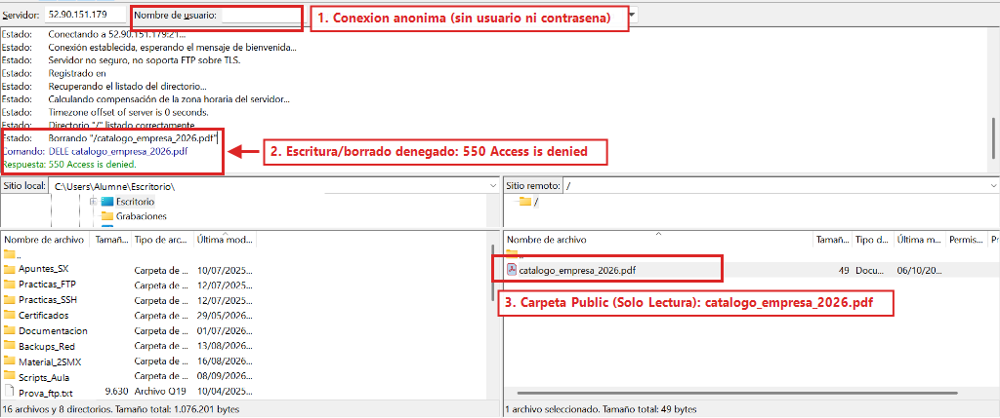
*Figura 33f: Acceso anónimo de solo lectura a la carpeta Public con denegación de borrado/escritura (550 Access is denied).*

> 📷 **Evidencia 10 (insertar en tu documento Word) — Realizar captura de pantalla** de FileZilla mostrando la vista privada de `usuari_ventas` y otra captura mostrando el error `550 Access is denied` al intentar subir o borrar un fichero como usuario `anonymous`.

---

### 8.5 Diagnóstico de avería: Error 550 en usuarios locales por discrepancia de permisos NTFS

* **Escenario de la incidencia:** El usuario `usuari_ventas` se conecta por FTP correctamente, pero al intentar subir un fichero o crear una carpeta en su propio directorio recibe `Respuesta: 550 Access is denied`.
* **Causa técnica:** Aunque en IIS Manager las **FTP Authorization Rules** permitan escribir (`Read, Write`), los permisos de seguridad del sistema de ficheros de Windows (**NTFS**) de la carpeta física `C:\inetpub\ftproot\LocalUser\usuari_ventas` no conceden permiso de modificación (`Modify`) al usuario local.
* **Resolución:** Hacer clic derecho sobre la carpeta del usuario -> **Properties** -> pestaña **Security** -> **Edit...** -> **Add...** -> añadir al usuario y marcar **Modify** y **Write**.

!!! info "Qué debes añadir a tu documento Word al terminar el Apartado 8"
    En el **Apartado 8** de tu documento Word, incluye las **Evidencias 9 y 10**:
    
    * **Evidencia 9:** Estructura de carpetas dentro de `C:\inetpub\ftproot\LocalUser` en el Explorador de archivos de Windows Server.
    * **Evidencia 10:** Capturas en FileZilla mostrando la vista privada aislada de `usuari_ventas` (`informe_ventas_privado.txt`) y el error `550 Access is denied` al intentar borrar o subir archivos como usuario `anonymous`.

---

## 9 - [Windows Server] Seguridad y cifrado con FTPS (FTP sobre TLS/SSL) (RA3-CEf)

!!! warning "Obligatorio seguir las normas para la presentación de trabajos escritos."
    Todas las evidencias deberán incluir capturas de pantalla completas donde se aprecie claramente el nombre del equipo, usuario y la fecha/hora.

El protocolo FTP tradicional transmite contraseñas y datos en texto claro sin cifrar. En esta tarea aseguraremos nuestro servidor **Windows Server (`Servidor_FTPSSH`)** mediante **FTPS (FTP sobre SSL/TLS)**, creando un certificado digital autofirmado en IIS e implementando cifrado obligatorio.

---

### 9.1 Creación de un Certificado Digital Autofirmado en Windows Server

1. Abrir **Internet Information Services (IIS) Manager** (`inetmgr`).
2. En el panel izquierdo (**Connections**), hacer clic sobre el **nombre del servidor** (nodo raíz).
3. En el panel central, dentro del bloque **IIS**, hacer doble clic en el icono **Server Certificates**:

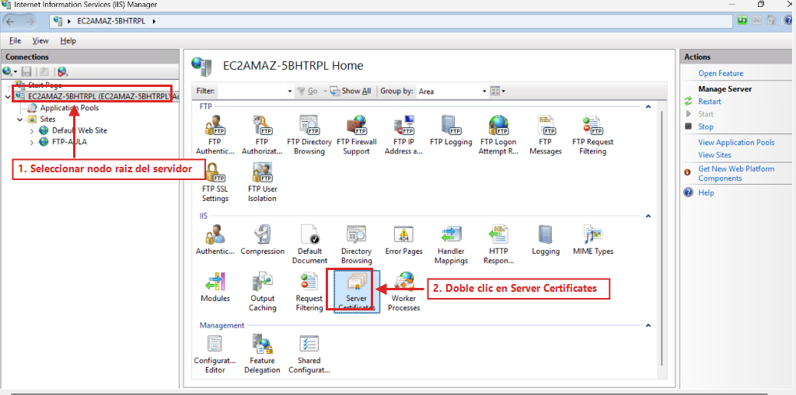
*Figura 36: Selección del nodo raíz del servidor y acceso a Server Certificates en IIS Manager.*

4. En el panel lateral derecho (**Actions**), hacer clic en el enlace **Create Self-Signed Certificate...**:

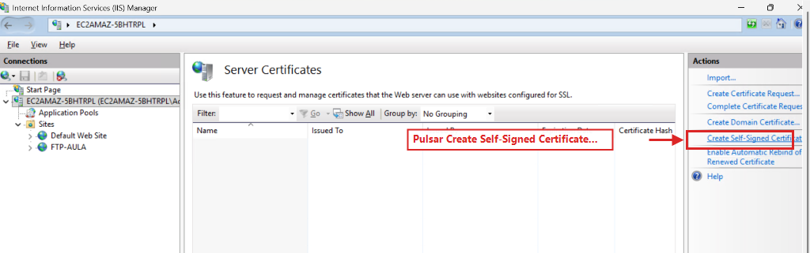
*Figura 37: Acceso al asistente de creación de certificado autofirmado.*

5. En la ventana **Specify Friendly Name**:
   * **Specify a friendly name for the certificate:** `Certificado-FTPs-Aula`
   * **Select a certificate store for the new certificate:** Mantener seleccionado `Personal`.
   * Pulsar en **OK**.

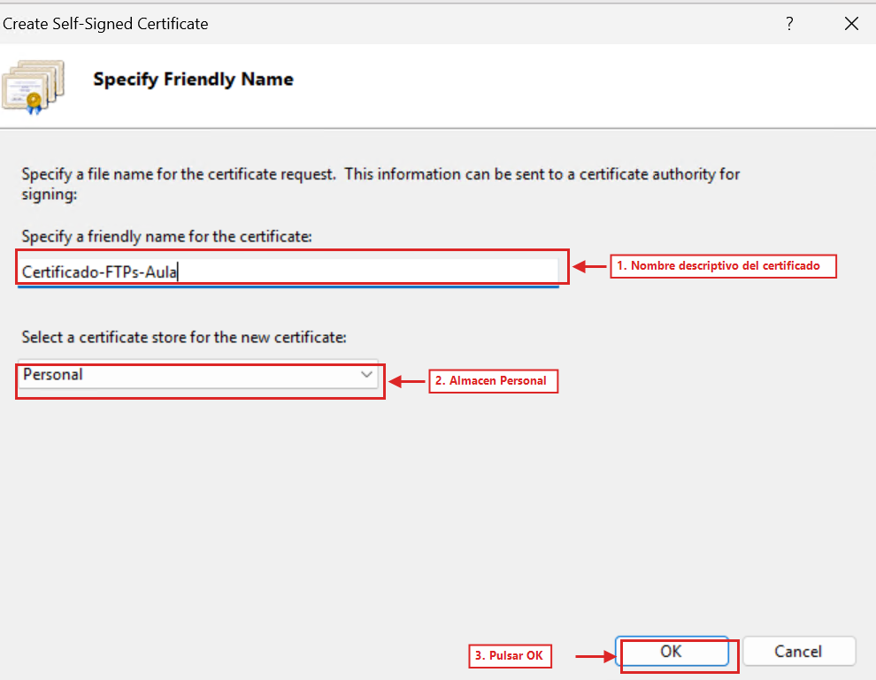
*Figura 38: Configuración del nombre descriptivo Certificado-FTPs-Aula en el almacén Personal.*

6. Comprobar que el certificado `Certificado-FTPs-Aula` aparece listado en el panel central de **Server Certificates** con su fecha de caducidad (**Expiration Date**) y su huella (**Certificate Hash**):

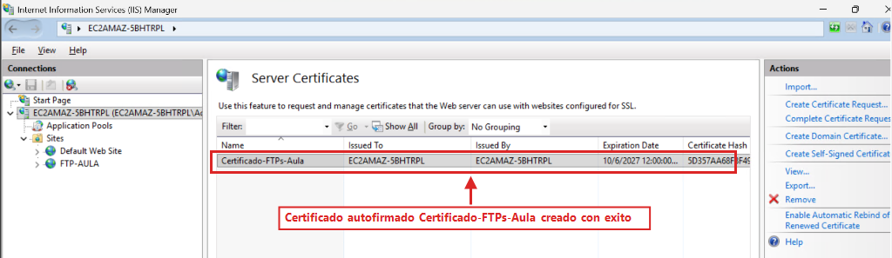
*Figura 39: Certificado digital Certificado-FTPs-Aula generado en el servidor.*

> 📷 **Evidencia 11 (insertar en tu documento Word) — Realizar captura de pantalla** del panel Server Certificates mostrando el nuevo certificado creado con su fecha de caducidad y emisor.

---

### 9.2 Configuración del cifrado SSL en el sitio FTP (FTP SSL Settings)

1. En el panel izquierdo de IIS, desplegar **Sites** y hacer clic sobre el sitio FTP **`FTP-AULA`**.
2. En el panel central, hacer doble clic en el icono **FTP SSL Settings**:

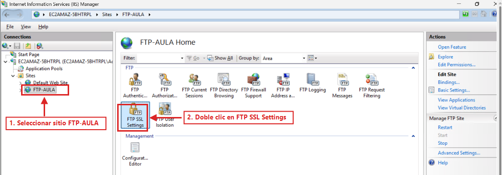
*Figura 40: Selección del sitio FTP-AULA y apertura de FTP SSL Settings.*

3. Configurar el cifrado del sitio:
   * En el desplegable **SSL Certificate**, seleccionar `Certificado-FTPs-Aula`.
   * En la directiva **SSL Policy**, marcar **Require SSL connections**.
   * En el panel lateral derecho (**Actions**), hacer clic en **Apply**.


*Figura 41: Asignación del certificado Certificado-FTPs-Aula y activación de Require SSL connections en FTP SSL Settings.*

4. Reiniciar el sitio FTP pulsando en **Restart** dentro de la sección **Manage FTP Site** de la columna derecha de IIS (o reiniciando **Microsoft FTP Service** desde `services.msc`).

---

### 9.3 Conexión segura con FileZilla y validación de certificado TLS

1. Abrir **FileZilla Client** en vuestro PC del aula.
2. Conectar hacia el servidor en el puerto **`21`** (podéis hacerlo directamente desde la barra de **Conexión rápida** introduciendo Servidor `<IP_PUBLICA_WINDOWS>`, Usuario `alumne_redes`, Contraseña `Smx2026..@` y Puerto `21`, ya que FileZilla negocia automáticamente **FTP explícito sobre TLS** si el servidor lo soporta, o bien guardando el perfil en **Archivo** -> **Gestor de sitios...** con cifrado **Requiere FTP explícito sobre TLS**).
3. Pulsar en **Conexión rápida** (o **Conectar**).
4. Al establecer la negociación segura en el puerto `21`, aparecerá la ventana emergente **Certificado desconocido**:
   * Revisar la información del bloque **Certificado**: huella digital (**SHA-256**) y período de validez, así como los **Detalles de la sesión** (`Protocolo: TLS1.2`, `Cifrado: AES-256-GCM`).
   * Marcar la casilla **Confiar siempre en este certificado en futuras sesiones**.
   * Pulsar en **Aceptar**:


*Figura 42: Verificación del certificado digital autofirmado (SHA-256) y sesión cifrada TLS 1.2 (AES-256-GCM) en el puerto 21.*

5. Comprobar en el panel de log de FileZilla que se negocia el cifrado del canal de datos (`Respuesta: 200 PBSZ command successful` y `Comando: PROT P` -> `200 PROT command successful`) y se lista el directorio raíz (`Directorio "/" listado correctamente`).
6. En la barra de estado inferior derecha de FileZilla, comprobar que aparece el **icono del candado cerrado** indicando que tanto el canal de control como el canal de datos viajan cifrados mediante TLS 1.2:


*Figura 43: Conexión FTPS establecida en el puerto 21 con cifrado del canal de datos (PROT P) y candado de seguridad activo.*

> 📷 **Evidencia 12 (insertar en tu documento Word) — Realizar captura de pantalla** de la ventana del certificado en FileZilla mostrando la huella digital SHA-256 y de FileZilla conectado con el candado de conexión segura activo.

!!! info "Qué debes añadir a tu documento Word al terminar el Apartado 9"
    En el **Apartado 9** de tu documento Word, incluye las **Evidencias 11 y 12**:
    
    * **Evidencia 11:** Panel **Server Certificates** de IIS mostrando el certificado `Certificado-FTPs-Aula` creado.
    * **Evidencia 12:** Ventana de validación del certificado TLS (huella SHA-256) en FileZilla y sesión FTPS conectada mostrando los comandos `PBSZ 0` / `PROT P` y el candado de seguridad activo.

---

## 10 - [Windows Server] Administración remota y bastionado de SSH con PuTTY y PuTTYgen (RA6-CEb,c,d)

!!! warning "Obligatorio seguir las normas para la presentación de trabajos escritos."
    Todas las evidencias deberán incluir capturas de pantalla completas donde se aprecie claramente el nombre del equipo, usuario y la fecha/hora.

El acceso por contraseña convencional está expuesto a ataques de fuerza bruta. En esta tarea aprovecharemos el servicio **OpenSSH Server** que dejamos activo en **Windows Server (`Servidor_FTPSSH`)** en el apartado 6.3.1 para conectar remotamente por el puerto `22` con **PuTTY**, generar un par de claves asimétricas con **PuTTYgen** y bastionar el servidor deshabilitando el acceso por contraseña.

---

### 10.1 Conexión SSH básica hacia Windows Server con PuTTY

1. Abrir **PuTTY** en vuestro PC del aula.
2. En el campo **Host Name (or IP address)** introducir la **IP pública de Windows Server** (`<IP_PUBLICA_WINDOWS>`), **Port** `22` y **Connection type** `SSH`.
3. Pulsar en **Open**, aceptar la advertencia inicial de clave host del servidor (**PuTTY Security Alert** pulsando `Accept`) e iniciar sesión indicando el usuario `alumne_redes` y su contraseña (`Smx2026..@`).
4. Al entrar, ejecutar `whoami` y `hostname` para verificar que estáis conectados a la consola de comandos remota de Windows Server.

No obstante, el método profesional y seguro recomendado para entornos de producción es **sustituir las contraseñas por autenticación asimétrica de clave pública** y bastionar el servicio, tal y como configuramos a continuación.

---

### 10.2 Generación del par de claves con PuTTYgen

1. En vuestro ordenador del aula, abrir **PuTTYgen** (**PuTTY Key Generator**).
2. En la parte inferior (**Parameters**), mantener seleccionado el tipo de clave **RSA** (`2048` bits) o **EdDSA (Ed25519)**.
3. Pulsar en el botón **Generate** y mover continuamente el cursor del ratón sobre el área vacía para generar entropía criptográfica aleatoria:


*Figura 45b: Selección del tipo de clave RSA (2048 bits) y ubicación del botón Generate en PuTTYgen.*

4. En el campo **Key comment**, escribir: `alumne_redes@ies-mre`.
5. Pulsar en **Save private key** (confirmar guardar sin contraseña de paso para este laboratorio) y guardarla como `clave_privada_smx.ppk` en vuestra carpeta de trabajo.
6. En el cuadro superior que indica **Public key for pasting into OpenSSH authorized_keys file**, seleccionar y **copiar todo el texto completo de la clave pública** (`ssh-rsa AAAA...`):


*Figura 46: Clave pública RSA generada en PuTTYgen con comentario identificativo alumne_redes@ies-mre y guardado de clave privada (.ppk).*

> 📷 **Evidencia 13 (insertar en tu documento Word) — Realizar captura de pantalla** de la ventana de PuTTYgen mostrando la clave generada y el comentario `alumne_redes@ies-mre`.

---

### 10.3 Instalación de la clave pública en Windows Server y ajuste de sshd_config

1. En el Escritorio Remoto (RDP) de **Windows Server**:
   * Abrir el **Bloc de notas (Notepad)** como Administrador.
   * Abrir el fichero `C:\ProgramData\ssh\sshd_config` (seleccionando **All Files `(**.**)`** en el diálogo de apertura).
   * Bajar hasta las dos últimas líneas del archivo (`Match Group administrators` y `AuthorizedKeysFile __PROGRAMDATA__/ssh/administrators_authorized_keys`) y comprobar que están comentadas con una almohadilla `#` delante para que Windows utilice siempre la carpeta `.ssh` estándar de cada usuario:
     ```ini
     #Match Group administrators
     #       AuthorizedKeysFile __PROGRAMDATA__/ssh/administrators_authorized_keys
     ```
2. Crear la carpeta `C:\Users\alumne_redes\.ssh` (si no existe) y dentro de ella crear/abrir con **Notepad** el archivo **`authorized_keys`** (sin extensión `.txt`), pegando en una sola línea la clave pública copiada desde PuTTYgen:


*Figura 46b: Clave pública RSA pegada en una sola línea dentro del archivo authorized_keys de alumne_redes.*

3. Reiniciar el servicio **OpenSSH SSH Server** desde la consola gráfica `services.msc`:


*Figura 46c: Reinicio del servicio OpenSSH SSH Server en Windows Server tras actualizar las claves autorizadas.*

---

### 10.4 Conexión automática mediante clave privada en PuTTY

1. Abrir **PuTTY** en vuestro PC del aula.
2. En el menú izquierdo, ir a **Connection** -> **Data** y en **Auto-login username** escribir `alumne_redes`:


*Figura 46d: Configuración del inicio de sesión desatendido para alumne_redes en Connection -> Data.*

3. En el árbol izquierdo, desplegar **Connection** -> **SSH** -> **Auth** -> **Credentials**:
   * En el campo **Private key file for authentication**, hacer clic en **Browse...** y seleccionar vuestro archivo `clave_privada_smx.ppk`:


*Figura 46e: Asociación del archivo de clave privada clave_privada_smx.ppk en Connection -> SSH -> Auth -> Credentials.*

4. Volver arriba a **Session**:
   * **Host Name:** IP pública de Windows Server (`<IP_PUBLICA_WINDOWS>`). **Port:** `22`.
   * En **Saved Sessions**, escribir `Windows-Clave-SSH` y hacer clic en **Save**:


*Figura 46f: Perfil de sesión Windows-Clave-SSH guardado en PuTTY con IP pública, puerto 22 y clave asimétrica vinculada.*

5. Pulsar en **Open** y comprobar que la consola accede directamente a Windows Server **sin solicitar contraseña**:


*Figura 47a: Sesión SSH abierta en el puerto 22 conectando de forma directa y autenticada con la clave privada de alumne_redes.*

---

### 10.5 Bastionado del servidor SSH en Windows Server (Deshabilitar contraseña)

1. En **Windows Server**, volver a abrir `C:\ProgramData\ssh\sshd_config` con **Notepad (como Administrador)**.
2. Añadir o asegurar al final del archivo la directiva de seguridad que prohíbe el acceso mediante contraseña convencional:
   ```ini
   PasswordAuthentication no
   ```


*Figura 47b: Bastionado de OpenSSH mediante la directiva PasswordAuthentication no en sshd_config.*

3. Guardar los cambios (`Ctrl + S`) y reiniciar el servicio **OpenSSH SSH Server** en `services.msc`.
4. Abrir una nueva ventana limpia de **PuTTY** poniendo solo la IP de Windows Server (sin cargar la clave `.ppk`) e intentar entrar como `alumne_redes`: comprobar que el servidor rechaza inmediatamente el acceso mostrando el error de seguridad:
   ```text
   No supported authentication methods available (server sent: publickey,keyboard-interactive)
   ```


*Figura 47c: Rebuig d'accés en PuTTY (No supported authentication methods available) demostrant que el servidor només accepta claus públiques criptogràfiques.*

> 📷 **Evidencia 14 (insertar en tu documento Word) — Realizar captura de pantalla** de la sesión de PuTTY entrando automáticamente sin contraseña mediante clave privada (`Figura 47a`) y otra captura del bloqueo por bastionado (`Figura 47c`) al intentar acceder sin clave.

!!! info "Qué debes añadir a tu documento Word al terminar el Apartado 10"
    En el **Apartado 10** de tu documento Word, incluye las **Evidencias 13 y 14**:
    
    * **Evidencia 13:** Generación del par de claves asimétricas en PuTTYgen con el comentario `alumne_redes@ies-mre`.
    * **Evidencia 14:** Sesión de PuTTY entrando automáticamente sin contraseña mediante clave pública y captura del rechazo (`No supported authentication methods available`) al intentar acceder sin clave privada.

---

## 11 - [Windows Server] Transferencia segura con SFTP/SCP y auditoría de Logs y Wireshark (RA6-CEe / RA3-CEg)

!!! warning "Obligatorio seguir las normas para la presentación de trabajos escritos."
    Todas las evidencias deberán incluir capturas de pantalla completas donde se aprecie claramente el nombre del equipo, usuario y la fecha/hora.

Para completar todo el bloque práctico sobre **Windows Server (`Servidor_FTPSSH`)**, realizaremos transferencias seguras por el puerto `22` mediante **SFTP** y **SCP**, y auditaremos tanto los registros de actividad W3C de IIS como los paquetes de red capturados con **Wireshark**.

---

### 11.1 Transferencia gráfica por SFTP hacia Windows Server en FileZilla (Puerto 22)

1. Abrir **FileZilla Client**.
2. Dado que en el apartado anterior hemos bastionado el servidor SSH deshabilitando la autenticación por contraseña (`PasswordAuthentication no`), para conectar por SFTP debemos utilizar la clave privada generada con PuTTYgen (`clave_privada_smx.ppk`):
   * Ir al menú **Archivo** -> **Gestor de sitios...** (o pulsar `Ctrl + S`).
   * Crear un **Nuevo sitio** (por ejemplo, `Windows-SFTP`).
   * En **Protocolo**, seleccionar **SFTP - SSH File Transfer Protocol**.
   * En **Servidor**, escribir la IP pública de Windows Server (`54.198.204.170`) y en **Puerto** `22`.
   * En **Modo de acceso**, seleccionar **Archivo de claves** (**Key file**).
   * En **Usuario**, indicar `alumne_redes`.
   * En **Archivo de claves**, pulsar **Examinar...** y seleccionar vuestro archivo `clave_privada_smx.ppk`.


*Figura 34b: Parámetros del sitio SFTP en FileZilla: protocolo SFTP (puerto 22), IP pública del servidor y autenticación mediante clave privada (.ppk).*

3. Pulsar en **Conectar**. Al ser la primera vez, aceptar la clave del servidor (**Hostkey is trusted**).
4. Comprobar que en el log superior se autentica con la clave y lista el directorio remoto `C:/Users/alumne_redes`.
5. Arrastrar un archivo local de prueba (por ejemplo, `Llista Regals.xlsx` o cualquier documento de texto) hacia la carpeta remota para realizar la subida cifrada.
6. Verificar que la transferencia se completa con éxito y que en la esquina inferior derecha aparece el **candado dorado cerrado**:


*Figura 35: Conexión SFTP activa en el puerto 22 hacia Windows Server con subida completada con éxito y candado de seguridad activo.*

> 📷 **Evidencia 15 (insertar en tu documento Word) — Realizar captura de pantalla** de FileZilla conectado por el protocolo SFTP al puerto 22 de Windows Server mostrando la transferencia completada y el icono del candado inferior.

---

### 11.2 Transferencia por línea de comandos mediante SCP hacia Windows Server

1. En vuestro ordenador del aula, abrir una ventana de **Windows PowerShell**.
2. Dado que el servidor tiene deshabilitada la contraseña tras el bastionado, `scp` utilizará automáticamente el par de claves asimétricas alojado en vuestro perfil (`~/.ssh/id_rsa` o indicando `-i .\clave_privada_smx.pem`).
3. Crear un archivo local de prueba y enviarlo hacia Windows Server mediante `scp`:
   ```powershell
   Set-Content -Path .\backup_aula.txt -Value "Copia de seguridad realizada mediante SCP - 2SMX"
   scp .\backup_aula.txt alumne_redes@<IP_PUBLICA_WINDOWS>:C:/Users/alumne_redes/
   ```
4. Comprobar en la consola la barra de progreso al `100%` y descargar el archivo de vuelta con un nuevo nombre (`fichero_recuperado.txt`) para verificar su integridad:
   ```powershell
   scp alumne_redes@<IP_PUBLICA_WINDOWS>:C:/Users/alumne_redes/backup_aula.txt .\fichero_recuperado.txt
   Get-Content .\fichero_recuperado.txt
   ```


*Figura 48: Subida y descarga segura de archivos hacia Windows Server por línea de comandos mediante SCP sobre el puerto 22 autenticando por clave.*

> 📷 **Evidencia 16 (insertar en tu documento Word) — Realizar captura de pantalla** de PowerShell ejecutando los comandos `scp` de subida y descarga mostrando la transferencia completada al `100%`.

---

### 11.3 Auditoría de registros de actividad en Windows Server (Logs W3C de IIS)

1. En Windows Server, abrir **File Explorer** y navegar a la ruta donde IIS almacena los registros de FTP:
   ```text
   C:\inetpub\logs\LogFiles\FTPSVC1\
   ```
2. Abrir el fichero de log más reciente (`u_exAAMMDD.log`, por ejemplo `u_ex261006.log`) con **Notepad**:


*Figura 44: Inspección en Notepad del fichero de registro W3C (u_ex261006.log) mostrando la autenticación (230), apertura de puertos pasivos (50000-50003), subida de archivo (STOR Prova_ftp.txt -> 226) y negociación FTPS (AUTH TLS -> 234 y PROT P -> 200).*

3. Identificar en el log los códigos de estado de vuestras operaciones:
   * `234`: Negociación de cifrado `AUTH TLS` aceptada.
   * `230`: Inicio de sesión correcto (`PASS ***`).
   * `227`: Entrada en Modo Pasivo (`PASV`).
   * `226`: Transferencia de archivo completada (`STOR Prova_ftp.txt`).
   * `550`: Permiso denegado (cuando el usuario `anonymous` intentó borrar el catálogo).

> 📷 **Evidencia 17 (insertar en tu documento Word) — Realizar captura de pantalla** del fichero de log de IIS en Notepad destacando una línea con un comando de subida exitoso (`STOR` con código `226`) y la negociación FTPS (`AUTH TLS` con código `234`).

---

### 11.4 Auditoría de tráfico con Wireshark: FTP en texto claro vs. FTPS y SFTP cifrados

Para comprobar empíricamente por qué nunca debe utilizarse FTP sin cifrar en redes públicas o corporativas, realizaremos una captura de paquetes con **Wireshark** desde el ordenador del aula mientras nos comunicamos con nuestro servidor Windows Server.

#### 11.4.1 Instalación y preparación previa de Wireshark
1. Si no disponéis de Wireshark en vuestro equipo del aula, descargar el instalador oficial de Windows (64-bit) desde [wireshark.org](https://www.wireshark.org/download.html).
2. Durante el asistente de instalación, es imprescindible mantener marcada la casilla de **Npcap** (controlador de captura de paquetes en modo promiscuo de Windows) con las opciones predeterminadas.

#### 11.4.2 Selección de la interfaz e inicio de la captura
1. Abrir **Wireshark**.
2. En la pantalla inicial de bienvenida (**Welcome to Wireshark**), identificar la tarjeta de red activa del equipo (la que muestra una línea con picos de actividad o tráfico):
   * En los ordenadores de sobremesa del aula suele ser **Ethernet**.
   * Si estáis trabajando con un ordenador portátil, seleccionar **Wi-Fi**.
3. Hacer doble clic sobre la interfaz activa o seleccionarla y pulsar el botón azul con forma de **aleta de tiburón** (esquina superior izquierda) para comenzar a capturar tráfico en tiempo real.
4. En la barra superior de filtro de visualización (**Apply a display filter ...**), escribir el siguiente filtro y pulsar `Enter` (la barra se pondrá en color verde claro si la sintaxis es correcta):
   ```text
   ftp || tls || ssh
   ```
   *(Opcional: Si queréis aislar exclusivamente el tráfico con vuestro servidor Windows en AWS, podéis usar: `(ftp || tls || ssh) && ip.addr == <IP_PUBLICA_WINDOWS>`)*.


*Figura 44c: Selección de la interfaz activa de red (Ethernet/Wi-Fi), inicio de captura con la aleta de tiburón y aplicación del filtro ftp || tls || ssh en Wireshark.*

#### 11.4.3 Procedimiento de generación de tráfico de prueba
Con la captura de Wireshark corriendo en segundo plano:
1. **Generar tráfico FTP plano (en texto claro):**
   * En FileZilla, conectar por FTP ordinario sin cifrado (`ftp://<IP_PUBLICA_WINDOWS>`, puerto `21`) con el usuario `alumne_redes` y su contraseña `Smx2026..@`.
2. **Generar tráfico FTPS (cifrado con TLS):**
   * Conectar con FileZilla requiriendo TLS explícito (**Requiere FTP explícito sobre TLS**).
3. **Generar tráfico SFTP (cifrado con SSH):**
   * Conectar con FileZilla por el puerto `22` (SFTP) o ejecutar un comando `scp` en PowerShell.
4. Volver a Wireshark y pulsar el botón **rojo cuadrado** (**Stop capturing packets**) en la barra de herramientas para detener la captura.

#### 11.4.4 Inspección y análisis comparativo de paquetes (Auditoría de seguridad)
Al examinar la lista de tramas filtradas comprobaremos la diferencia fundamental entre protocolos:

1. **FTP plano (Vulnerabilidad crítica):**
   * En las tramas de color rosa asociadas al protocolo FTP, buscar la petición de autenticación:
     * `Request: USER alumne_redes`
     * `Request: PASS Smx2026..@`
   * Al hacer clic sobre el paquete `PASS`, en el panel inferior de inspección de datos se comprueba que **la contraseña viaja en texto completamente plano y legible**, lo que permitiría a cualquier atacante en la red interceptarla (*sniffing* o ataque Man-In-The-Middle).
2. **FTPS sobre TLS (Cifrado de canal):**
   * Se aprecia la negociación inicial en el puerto 21 (`AUTH TLS -> 234 AUTH command ok`).
   * A partir de ese instante, todos los comandos y datos viajan cifrados bajo el protocolo **`TLSv1.2`** clasificados como **`Application Data`**.
3. **SFTP sobre SSH (Blindaje total):**
   * En el puerto `22`, toda la sesión queda encapsulada bajo **`SSHv2`** mostrando únicamente paquetes de tipo **`Encrypted packet`**. Ni las credenciales ni los nombres de los archivos transferidos son accesibles.


*Figura 44b: Auditoría en Wireshark contrastando la exposición de credenciales en FTP plano (Request: PASS Smx2026..@) frente al tráfico cifrado en FTPS (TLSv1.2 Application Data) y SFTP (SSHv2 Encrypted packet).*

> 📷 **Evidencia 18 (insertar en tu documento Word) — Realizar captura de pantalla** de Wireshark mostrando los paquetes capturados donde se contrasten los paquetes en texto claro de FTP frente a los paquetes cifrados `TLSv1.2 Application Data` (FTPS) y `SSHv2 Encrypted packet` (SFTP).

!!! info "Qué debes añadir a tu documento Word al terminar el Apartado 11 (Fin del Bloque Windows Server)"
    En el **Apartado 11** de tu documento Word, incluye las **Evidencias 15 a 18**:
    
    * **Evidencia 15:** FileZilla conectado por SFTP (puerto `22`) a Windows Server con el candado activo.
    * **Evidencia 16:** Consola de PowerShell ejecutando la subida y descarga con `scp` al `100%`.
    * **Evidencia 17:** Fichero de log de IIS (`u_exAAMMDD.log`) en Notepad destacando las líneas `STOR` (`226`) y `AUTH TLS` (`234`).
    * **Evidencia 18:** Captura de paquetes en Wireshark comparando FTP plano frente a `TLSv1.2 Application Data` (FTPS) y `SSHv2 Encrypted packet` (SFTP).

---

## 12 - [Ubuntu Server] Instalación de vsftpd, modo pasivo, jaula chroot y pruebas en FileZilla (RA3-CEb,c,d,e)

!!! warning "Obligatorio seguir las normas para la presentación de trabajos escritos."
    Todas las evidencias deberán incluir capturas de pantalla completas donde se aprecie claramente el nombre del equipo, usuario y la fecha/hora.

Una vez completadas y verificadas todas las prácticas sobre Windows Server, pasamos al segundo bloque del laboratorio desplegando el servicio de transferencia de ficheros en **Linux (`Ubuntu Server 24.04 LTS`)** mediante el demonio **`vsftpd`**. *(Mientras trabajes exclusivamente en esta tarea y en la Tarea 13, puedes mantener detenida la máquina de Windows Server para ahorrar saldo en AWS Academy).*

---

### 12.0 Lanzamiento de la instancia EC2 de Ubuntu Server 24.04 LTS en AWS

1. En la consola de **AWS EC2** -> **Instances** -> pulsar en **Launch instances** (**Lanzar instancias**) y desplegar la segunda máquina virtual del laboratorio con las siguientes especificaciones:

| Parámetro de configuración | Valor requerido |
|---|---|
| **Name (Nombre)** | `Ubuntu_FTPSSH` |
| **Application and OS Images (AMI)** | `Ubuntu Server 24.04 LTS (HVM), SSD Volume Type` (64 bits x86) |
| **Instance type (Tipo de instancia)** | `t2.micro` o `t3.micro` (1 vCPU, 1 GiB RAM) |
| **Key pair (login)** | `vockey` (o par de claves del laboratorio) |
| **Network settings (Security group)** | Seleccionar **Select existing security group** y elegir **`grup-servidors-ftp-ssh`** (creado en el apartado 6.1) |
| **Configure storage** | `8 GiB` o `10 GiB` gp3 (SSD) |

2. Esperar a que la instancia pase a estado `Running` y anotar su **Dirección IPv4 pública**:


*Figura 49: Instancia Ubuntu_FTPSSH en estado En ejecución (Running) en el panel de instancias de AWS EC2 con su dirección IPv4 pública asignada.*

> 📷 **Evidencia 19 (insertar en tu documento Word) — Realizar captura de pantalla** del panel de instancias de AWS EC2 mostrando la instancia `Ubuntu_FTPSSH` en ejecución (`Running`) con el grupo de seguridad `grup-servidors-ftp-ssh` asignado.

---

### 12.1 Verificación de puertos en el Security Group de Ubuntu

1. En la consola de AWS -> **EC2** -> comprobar que el Security Group (`grup-servidors-ftp-ssh`) asociado a la instancia `Ubuntu_FTPSSH` tiene abiertos los puertos:
   * Puerto `22` TCP (SSH).
   * Puerto `21` TCP (FTP Control).
   * Rango de puertos `40000-40100` TCP (FTP Pasivo en Linux).

---

### 12.2 Instalación del servicio vsftpd

1. Conectarse a la instancia `Ubuntu_FTPSSH` por SSH utilizando AWS EC2 Instance Connect (o mediante cliente SSH / PuTTY con la clave del laboratorio):


*Figura 49b: Sesión interactiva en la terminal de Ubuntu Server abierta directamente en el navegador con EC2 Instance Connect, mostrando el prompt `ubuntu@ip-...` y la barra inferior con la instancia e IP pública asignada.*

2. Actualizar el índice de repositorios e instalar el paquete `vsftpd`:
   ```bash
   sudo apt update && sudo apt install -y vsftpd
   ```

---

### 12.3 Configuración de modo pasivo, NAT y jaula chroot en /etc/vsftpd.conf

1. Abrir el fichero de configuración principal del servicio:
   ```bash
   sudo nano /etc/vsftpd.conf
   ```
2. Modificar las siguientes directivas para garantizar el funcionamiento en IPv4, habilitar la escritura, el enjaulado (`chroot`) y el rango pasivo en AWS:

   * **Al principio del fichero:** Comprobar que el servicio escucha en modo IPv4 independiente y comentar la directiva de IPv6:
     ```ini
     listen=YES
     #listen_ipv6=YES
     ```
     *(Importante: En Ubuntu 24.04, si `listen_ipv6=YES` está activo, entrará en conflicto con `pasv_address` y provocará desconexiones `ECONNABORTED` al intentar transferir archivos).*

   * **Al final del fichero:** Añadir el bloque de enjaulado, modo pasivo para AWS y compatibilidad de llamadas al sistema (`seccomp_sandbox`):
     ```ini
     # Acceso de usuarios locales con permisos de escritura
     anonymous_enable=NO
     local_enable=YES
     write_enable=YES
     local_umask=022

     # Enjaulado (chroot jail) de usuarios en su directorio /home/<usuario>
     chroot_local_user=YES
     allow_writeable_chroot=YES

     # Configuración de modo pasivo para AWS Cloud
     pasv_enable=YES
     pasv_min_port=40000
     pasv_max_port=40100
     pasv_address=<TU_IP_PUBLICA_UBUNTU>
     seccomp_sandbox=NO
     ```


*Figura 50: Configuración del fichero /etc/vsftpd.conf en nano mostrando las directivas de enjaulado chroot_local_user, modo pasivo pasv_enable, rango de puertos 40000-40100 y la dirección IP pública en pasv_address.*

> 📷 **Evidencia 20 (insertar en tu documento Word) — Realizar captura de pantalla** del fichero `/etc/vsftpd.conf` editado donde se aprecien las directivas `chroot_local_user=YES`, `pasv_enable=YES`, `pasv_address` y el rango `40000-40100`.

---

### 12.4 Creación de usuarios locales y activación del servicio

1. Crear los usuarios `alumne_redes` y `usuari_ventas` en Ubuntu Server:
   ```bash
   sudo adduser alumne_redes
   # Asignar la contraseña: Smx2026..@
   sudo adduser usuari_ventas
   # Asignar la contraseña: Smx2026..@
   ```
2. Reiniciar el servicio `vsftpd` y verificar que se encuentra activo (`active (running)`):
   ```bash
   sudo systemctl restart vsftpd
   sudo systemctl status vsftpd
   ```


*Figura 51: Terminal de Ubuntu Server mostrando la ejecución de systemctl status vsftpd con el estado active (running) y el proceso principal vsftpd en ejecución.*

> 📷 **Evidencia 21 (insertar en tu documento Word) — Realizar captura de pantalla** de la terminal de Ubuntu mostrando el estado `active (running)` del servicio `vsftpd`.

---

### 12.5 Prueba de transferencia y verificación de enjaulado (chroot) desde FileZilla

1. Abrir **FileZilla Client** en vuestro PC del aula y conectar hacia **Ubuntu Server**:
   * **Servidor:** `<IP_PUBLICA_UBUNTU>`
   * **Nombre de usuario:** `alumne_redes` (y posteriormente probar con `usuari_ventas`)
   * **Contraseña:** `Smx2026..@`
   * **Puerto:** `21`
2. Subir un archivo llamado `prueba_ubuntu.txt` y comprobar que la transferencia en modo pasivo (`40000-40100`) se completa con éxito.
3. Verificar que gracias a la directiva `chroot_local_user=YES`, el usuario aparece enjaulado en `/` (que corresponde físicamente a su directorio personal `/home/alumne_redes`), impidiendo que pueda subir de nivel hacia `/home` o `/etc`.


*Figura 52: Cliente FileZilla conectado a Ubuntu Server mostrando el inicio de sesión exitoso, la transferencia completada de prueba_ubuntu.txt y el enjaulado chroot del usuario en su directorio raíz /.*

> 📷 **Evidencia 22 (insertar en tu documento Word) — Realizar captura de pantalla** de FileZilla conectado a Ubuntu Server mostrando la subida de `prueba_ubuntu.txt` y el enjaulado del usuario en su directorio raíz `/`.

!!! info "Qué debes añadir a tu documento Word al terminar el Apartado 12"
    En el **Apartado 12** de tu documento Word, incluye las **Evidencias 19 a 22**:
    
    * **Evidencia 19:** Instancia `Ubuntu_FTPSSH` en ejecución (`Running`) en AWS EC2.
    * **Evidencia 20:** Fichero `/etc/vsftpd.conf` con las directivas `chroot_local_user=YES`, `pasv_enable=YES`, `pasv_address` y puertos `40000-40100`.
    * **Evidencia 21:** Salida de `sudo systemctl status vsftpd` mostrando `active (running)`.
    * **Evidencia 22:** FileZilla conectado a Ubuntu Server mostrando la subida de `prueba_ubuntu.txt` y el enjaulado del usuario en `/`.

---

## 13 - [Ubuntu Server] Seguridad FTPS con OpenSSL, claves SSH y auditoría de logs en Linux (RA3-CEf,g / RA6-CEf)

!!! warning "Obligatorio seguir las normas para la presentación de trabajos escritos."
    Todas las evidencias deberán incluir capturas de pantalla completas donde se aprecie claramente el nombre del equipo, usuario y la fecha/hora.

En esta tarea aseguraremos nuestro servidor **Ubuntu Server (`Ubuntu_FTPSSH`)** implementando cifrado **FTPS con OpenSSL**, configurando el acceso **SSH por clave pública** y auditando los registros del sistema en `/var/log/`.

---

### 13.1 Configuración de FTPS (TLS/SSL) en Ubuntu Server con OpenSSL y vsftpd

1. En la consola SSH de **`Ubuntu_FTPSSH`**, generar un certificado digital autofirmado X.509 RSA de `2048 bits` válido por 365 días en `/etc/ssl/private/vsftpd.pem`:
   ```bash
   sudo openssl req -x509 -nodes -days 365 -newkey rsa:2048 \
     -keyout /etc/ssl/private/vsftpd.pem \
     -out /etc/ssl/private/vsftpd.pem
   ```
2. Cumplimentar los datos identificativos del certificado cuando los solicite OpenSSL:
   * **Country Name (2 letter code):** `ES`
   * **State or Province Name:** `Valencia`
   * **Locality Name:** `Catadau`
   * **Organization Name:** `IES Mestre Ramon Esteve`
   * **Organizational Unit Name:** `2SMX - Serveis en Xarxa`
   * **Common Name (FQDN):** `ftp.iesmre.local`
3. Restringir los permisos del archivo `.pem`:
   ```bash
   sudo chmod 600 /etc/ssl/private/vsftpd.pem
   ```
4. Editar `/etc/vsftpd.conf` (`sudo nano /etc/vsftpd.conf`) y añadir al final el bloque de cifrado SSL/TLS obligatorio:
   ```ini
   # Cifrado explicito FTPS (TLS/SSL) en vsftpd
   ssl_enable=YES
   allow_anon_ssl=NO
   force_local_data_ssl=YES
   force_local_logins_ssl=YES
   ssl_tlsv1=YES
   ssl_sslv2=NO
   ssl_sslv3=NO
   require_ssl_reuse=NO
   ssl_ciphers=HIGH
   rsa_cert_file=/etc/ssl/private/vsftpd.pem
   rsa_private_key_file=/etc/ssl/private/vsftpd.pem
   ```


*Figura 53: Ventana emergente de certificado X.509 en FileZilla al conectar por FTPS a Ubuntu Server, validando el cifrado TLS 1.3 con AES-256-GCM y los datos del IES Mestre Ramon Esteve (Catadau).*

> 📷 **Evidencia 23 (insertar en tu documento Word) — Realizar captura de pantalla** de la ventana de verificación del certificado X.509 en FileZilla mostrando los datos de la entidad (`IES Mestre Ramon Esteve`, `Catadau`, `ftp.iesmre.local`) y la sesión TLS 1.3 con Ubuntu Server.

---

### 13.2 Instalación de la clave pública SSH y bastionado en Ubuntu Server

1. En la sesión SSH de **Ubuntu Server** (conectado como `alumne_redes`), crear el directorio `.ssh` e instalar la misma clave pública que generamos en PuTTYgen en la Tarea 10:
   ```bash
   mkdir -p ~/.ssh
   chmod 700 ~/.ssh
   nano ~/.ssh/authorized_keys
   # Pegar la clave pública ssh-rsa ... en una sola línea, guardar (Ctrl+O) y salir (Ctrl+X)
   chmod 600 ~/.ssh/authorized_keys
   ```
2. Probar desde **PuTTY** en vuestro PC que podéis entrar a `Ubuntu_FTPSSH` con el usuario `alumne_redes` y el fichero `clave_privada_smx.ppk` sin que pida contraseña.
3. Bastionar el servidor SSH de Ubuntu editando `/etc/ssh/sshd_config`:
   ```bash
   sudo nano /etc/ssh/sshd_config
   ```
   Asegurar las directivas `PubkeyAuthentication yes` y `PasswordAuthentication no`, y reiniciar el servicio (`sudo systemctl restart ssh`).

---

### 13.3 Auditoría de registros en Ubuntu Server (vsftpd.log y auth.log)

1. En la consola SSH de Ubuntu Server, consultar las últimas transferencias registradas por `vsftpd` (descomentando `xferlog_enable=YES` en `/etc/vsftpd.conf` si no estuviera activo):
   ```bash
   sudo tail -n 25 /var/log/vsftpd.log
   ```
2. Consultar el registro de autenticaciones y accesos SSH del sistema:
   ```bash
   sudo cat /var/log/auth.log | grep -E "sshd.*(Accepted|Failed)" | tail -n 20
   ```
3. Identificar en la salida la dirección IP pública del cliente y el método de autenticación empleado (`publickey` o `password`).


*Figura 54: Auditoría de seguridad en Ubuntu Server mostrando el registro de subida exitosa en /var/log/vsftpd.log (OK UPLOAD de prueba_ubuntu.txt) y el registro de comandos privilegiados y accesos en /var/log/auth.log.*

> 📷 **Evidencia 24 (insertar en tu documento Word) — Realizar captura de pantalla** de la terminal de Ubuntu mostrando las últimas líneas del registro `/var/log/vsftpd.log` y de `/var/log/auth.log`.

!!! info "Qué debes añadir a tu documento Word al terminar el Apartado 13 (Fin del Bloque Ubuntu Server)"
    En el **Apartado 13** de tu documento Word, incluye las **Evidencias 23 y 24**:
    
    * **Evidencia 23:** Generación del certificado X.509 con `openssl` en Ubuntu Server y validación del certificado en FileZilla al conectar por FTPS.
    * **Evidencia 24:** Terminal de Ubuntu mostrando las últimas líneas de auditoría en `/var/log/vsftpd.log` y `/var/log/auth.log`.

---

## 14 - [Inter-Servidores] Pruebas cruzadas bidireccionales en AWS Cloud (RA3-CEf / RA6-CEf)

!!! warning "Obligatorio seguir las normas para la presentación de trabajos escritos."
    Todas las evidencias deberán incluir capturas de pantalla completas donde se aprecie claramente el nombre del equipo, usuario y la fecha/hora.

En esta tarea comprobaremos la interoperabilidad bidireccional conectando los dos servidores entre sí a través de la nube de Amazon Web Services.

---

### 14.1 Conexión FTP y SSH desde Ubuntu Server hacia Windows Server

!!! warning "Comprobaciones previas en Windows Server antes de realizar las pruebas cruzadas"
    Para que las conexiones entrantes desde Linux hacia Windows Server funcionen correctamente, verifica en Windows Server los siguientes puntos técnicos:

    1. **Autenticación por contraseña en OpenSSH:** En el Apartado 10 habíamos bastionado el servidor OpenSSH desactivando las contraseñas (`PasswordAuthentication no`). Para que podamos iniciar sesión desde Ubuntu mediante contraseña con `ssh alumne_redes@<IP_WINDOWS>`, abre PowerShell en Windows Server como Administrador y permite temporalmente las contraseñas:
       ```powershell
       (Get-Content C:\ProgramData\ssh\sshd_config) -replace 'PasswordAuthentication no', 'PasswordAuthentication yes' | Set-Content C:\ProgramData\ssh\sshd_config
       Restart-Service sshd
       ```
    2. **Certificado FTPS activo en IIS:** En **IIS Manager** -> **Sitio FTP** (o `FTP-AULA`) -> **FTP SSL Settings**, comprueba que está seleccionado `Certificado-FTPs-Aula` con la directiva **Allow SSL connections** (o *Require*) y pulsa **Apply**. Si no estuviera seleccionado, el servidor devolverá el error `534 Local policy on server does not allow TLS secure connections`.
    3. **IP pública en FTP Firewall Support:** Si has reiniciado la máquina y la IP pública de Windows ha cambiado, actualiza la dirección en **FTP Firewall Support** y reinicia el servicio (`Restart-Service ftpsvc`).

1. Desde la sesión SSH de **Ubuntu Server**, transferir un fichero al servidor Windows Server mediante `curl`:
   ```bash
   echo "Hola desde Linux hacia Windows Server en AWS" > saludo_linux.txt
   curl --ssl-reqd -k -T saludo_linux.txt -u alumne_redes:Smx2026..@ ftp://<IP_PUBLICA_WINDOWS>/
   ```
   *(Nota: incluimos `--ssl-reqd -k` dado que el servidor Windows exige cifrado explícito FTPS con certificado autofirmado).*
2. Desde la misma consola de Ubuntu Server, iniciar una sesión remota SSH hacia el servidor Windows y comprobar que el archivo se ha recibido en el directorio FTP del usuario:
   ```bash
   ssh alumne_redes@<IP_PUBLICA_WINDOWS>
   ```
   *Una vez dentro del prompt remoto de Windows Server (`alumne_redes@EC2AMAZ-...>`), listar el directorio raíz FTP del usuario:*
   ```cmd
   dir C:\inetpub\ftproot\LocalUser\alumne_redes
   exit
   ```
   *(Nota de verificación: Al ejecutar `dir` dentro de la sesión SSH, ya estáis gestionando e inspeccionando el sistema de archivos de Windows Server directamente desde la terminal remota. Opcionalmente, si tenéis el escritorio remoto (RDP) de Windows abierto, también podéis abrir el Explorador de archivos en `C:\inetpub\ftproot\LocalUser\alumne_redes` para verlo en la interfaz gráfica).*


*Figura 55: Transferencia cruzada desde Ubuntu Server hacia Windows Server mediante curl bajo FTPS explícito (saludo_linux.txt transferido al 100%) y apertura de sesión SSH interactiva en Windows Server verificando la recepción del archivo con dir.*

> 📷 **Evidencia 25 (insertar en tu documento Word) — Realizar captura de pantalla** de la consola de Ubuntu mostrando la subida del fichero por FTP/FTPS con `curl` y la apertura de sesión SSH en Windows validando la presencia del fichero con `dir`.

---

### 14.2 Conexión FTP y SSH desde Windows Server hacia Ubuntu Server

!!! warning "Desbloqueo obligatorio de autenticación por contraseña en Ubuntu Server (AWS EC2)"
    En las imágenes oficiales de Ubuntu en AWS EC2 (como Ubuntu 24.04 LTS), el aprovisionamiento en la nube (`cloud-init`) desactiva por defecto el inicio de sesión mediante contraseña mediante una plantilla prioritaria en `/etc/ssh/sshd_config.d/60-cloudimg-settings.conf` con el parámetro `PasswordAuthentication no`.

    Por este motivo, cuando intentéis conectaros desde Windows Server mediante `scp` o `ssh` con el usuario local `alumne_redes`, el cliente de Windows recibirá inmediatamente el error:
    ```text
    alumne_redes@<IP_UBUNTU>: Permission denied (publickey).
    C:\Windows\System32\OpenSSH\scp.exe: Connection closed
    ```

    **Solución obligatoria en Ubuntu Server (ejecutar en su terminal):**
    Para permitir que los usuarios locales se autentiquen con su contraseña (`Smx2026..@`), sobrescribid la directiva y reiniciad el demonio SSH:
    ```bash
    echo "PasswordAuthentication yes" | sudo tee /etc/ssh/sshd_config.d/60-cloudimg-settings.conf
    sudo systemctl restart ssh
    ```
    *(Comprobad que no muestra ningún error. A partir de este momento, el servidor Ubuntu aceptará contraseñas).*

**Procedimiento paso a paso desde Windows Server:**

1. Dentro de vuestro escritorio remoto (RDP) de **Windows Server**, abrid una ventana de **PowerShell** como Administrador.
2. Cread un archivo de texto de prueba para enviar al servidor Linux:
   ```powershell
   "Hola desde Windows Server hacia Linux" | Out-File -FilePath test_windows.txt -Encoding utf8
   ```
3. Transferid el archivo hacia la carpeta personal del usuario `alumne_redes` en Ubuntu Server mediante **SCP** (Secure Copy Protocol):
   ```powershell
   scp test_windows.txt alumne_redes@<IP_PUBLICA_UBUNTU>:~/
   ```
   *(La primera vez que os conectéis os preguntará si deseáis confiar en la huella ED25519 del host: escribid `yes` y pulsad Enter. A continuación, introducid la contraseña `Smx2026..@`).*
4. Abrid una sesión remota interactiva **SSH** desde Windows Server hacia Ubuntu Server para verificar que el archivo ha llegado y comprobar su contenido:
   ```powershell
   ssh alumne_redes@<IP_PUBLICA_UBUNTU>
   ```
   *Una vez dentro del prompt de Ubuntu (`alumne_redes@ip-...:~$`), listad el archivo y mostradlo en pantalla:*
   ```bash
   ls -la test_windows.txt
   cat test_windows.txt
   exit
   ```
   *(Alternativa opcional con `curl` por FTPS desde PowerShell: `curl.exe --ssl-reqd -k -T test_windows.txt -u alumne_redes:Smx2026..@ ftp://<IP_PUBLICA_UBUNTU>/`).*


*Figura 56: Consola de PowerShell en Windows Server mostrando la transferencia del archivo test_windows.txt mediante scp hacia Ubuntu Server y la sesión remota SSH posterior verificando el archivo con ls -la y cat.*

> 📷 **Evidencia 26 (insertar en tu documento Word) — Realizar captura de pantalla** de la consola de PowerShell en Windows Server mostrando el envío del archivo con `scp` hacia Ubuntu Server y la apertura de sesión interactiva `ssh` validando la presencia y contenido de `test_windows.txt`.

!!! info "Qué debes añadir a tu documento Word al terminar el Apartado 14"
    En el **Apartado 14** de tu documento Word, incluye las **Evidencias 25 y 26**:
    
    * **Evidencia 25:** Consola de Ubuntu Server subiendo `saludo_linux.txt` por FTPS con `curl` y abriendo sesión SSH hacia Windows Server verificando el archivo con `dir`.
    * **Evidencia 26:** Consola de PowerShell en Windows Server transfiriendo `test_windows.txt` con `scp` y abriendo sesión interactiva `ssh` en Ubuntu Server comprobando el archivo con `ls -la`.

---

## 15 - Control de costes, parada de la infraestructura en AWS y entrega final (RA3-CEh)

!!! warning "Obligatorio seguir las normas para la presentación de trabajos escritos."
    Todas las evidencias deberán incluir capturas de pantalla completas donde se aprecie claramente el nombre del equipo, usuario y la fecha/hora.

Una vez completadas con éxito todas las pruebas técnicas en **Windows Server**, **Ubuntu Server** y las **pruebas cruzadas de interoperabilidad** entre ambos sistemas operativos, el paso imprescindible en cualquier despliegue profesional en la nube es aplicar las políticas de **control de costes y parada controlada de los recursos** para no consumir créditos innecesarios.

---

### 15.1 Cierre de sesiones y parada controlada de las instancias en AWS

!!! warning "¡Obligatorio al finalizar cada sesión de trabajo y al terminar la práctica!"
    Los laboratorios de AWS Academy disponen de un crédito limitado (\$50). Dejar las instancias encendidas consume saldo continuamente y puede provocar que os quedéis sin horas de laboratorio antes de que termine el curso.

1. **Desconexión de las sesiones activas:** Cerrar las ventanas de Escritorio Remoto (RDP), FileZilla, Wireshark y las sesiones de PuTTY o PowerShell abiertas en vuestro ordenador físico.
2. **Detener las instancias en AWS (`Stop instance`):**
   * Abrid la consola de AWS -> **EC2** -> **Instances** (**Instancias**).
   * Seleccionad las casillas de vuestras dos máquinas: **`Servidor_FTPSSH`** y **`Ubuntu_FTPSSH`**.
   * Haced clic en el desplegable superior **Instance state** -> **Stop instance** (**Detener la instancia**).
   * Esperad unos segundos y pulsad el botón de refrescar (⟳) hasta que en la columna **Instance state** aparezca claramente **`Stopped`** (**Detenido**) en ambas máquinas.


*Figura 57: Consola de AWS EC2 mostrando las dos instancias del laboratorio (Servidor_FTPSSH y Ubuntu_FTPSSH) en estado Stopped (Detenido) para garantizar el control de costes.*

> 📷 **Evidencia 27 (insertar en tu documento Word) — Realizar captura de pantalla** del panel de instancias de EC2 mostrando ambas máquinas (`Servidor_FTPSSH` y `Ubuntu_FTPSSH`) seleccionadas y en estado `Stopped` (**Detenido**).

3. **Cerrar el laboratorio:** Volved a la pestaña de **AWS Academy** (Vocareum) y pulsad en el botón rojo superior **`End Lab`**.

---

### 15.2 Entrega única de la Memoria Práctica en Aules (Checklist final de las 27 Evidencias)

!!! warning "Entrega única en Aules: Memoria Práctica Completa (RA3 y RA6)"
    Una vez completados todos los apartados en tu documento de Word, verifica que incluye las **27 evidencias numeradas** organizadas por apartados, expórtalo a un **único archivo PDF** y súbelo a la tarea de **Aules**:

    **Bloque I — Windows Server (`Servidor_FTPSSH`):**
    1. **Evidencia 1 (Ap. 6.0):** Instancia `Servidor_FTPSSH` creada y en estado `Running` en AWS EC2.
    2. **Evidencia 2 (Ap. 6.1):** Tabla de las 5 reglas de entrada del Security Group `grup-servidors-ftp-ssh`.
    3. **Evidencia 3 (Ap. 6.2):** Conexión por Escritorio Remoto (RDP) a Windows Server mostrando **Server Manager**.
    4. **Evidencia 4 (Ap. 6.4):** Usuario `alumne_redes` miembro de `Administrators`, `Remote Desktop Users` y `Users`.
    5. **Evidencia 5 (Ap. 6.5):** Panel `FTP Firewall Support` en IIS con rango `50000-50100` e IP pública de AWS.
    6. **Evidencia 6 (Ap. 6.6):** Sitio `FTP-AULA` creado y en estado `Started` en IIS Manager.
    7. **Evidencia 7 (Ap. 6.7):** Regla `FTP Pasivo Datos (50000-50100)` (y puerto `22`) en el Firewall de Windows y servicio `Microsoft FTP Service` activo.
    8. **Evidencia 8 (Ap. 7.1):** Conexión en modo pasivo desde FileZilla y subida de `Prova_ftp.txt` a Windows Server.
    9. **Evidencia 9 (Ap. 8.1):** Estructura de carpetas departamentales dentro de `C:\inetpub\ftproot\LocalUser`.
    10. **Evidencia 10 (Ap. 8.4):** FileZilla conectado como `usuari_ventas` (aislado) y como `anonymous` recibiendo `550 Access is denied` al intentar borrar/subir.
    11. **Evidencia 11 (Ap. 9.1):** Certificado autofirmado `Certificado-FTPs-Aula` en **Server Certificates** de IIS.
    12. **Evidencia 12 (Ap. 9.3):** Validación del certificado TLS (huella SHA-256) y conexión FTPS con candado en FileZilla.
    13. **Evidencia 13 (Ap. 10.2):** Par de claves generado en PuTTYgen con comentario `alumne_redes@ies-mre`.
    14. **Evidencia 14 (Ap. 10.5):** Acceso automático sin contraseña en PuTTY y rechazo tras el bastionado (`PasswordAuthentication no`).
    15. **Evidencia 15 (Ap. 11.1):** Transferencia por SFTP (puerto `22`) en FileZilla con el candado dorado activo.
    16. **Evidencia 16 (Ap. 11.2):** Subida y descarga por línea de comandos con `scp` en PowerShell al `100%`.
    17. **Evidencia 17 (Ap. 11.3):** Auditoría del log W3C (`u_exAAMMDD.log`) en Notepad mostrando los códigos `230`, `234`, `226` y `550`.
    18. **Evidencia 18 (Ap. 11.4):** Captura de tráfico en Wireshark comparando FTP plano frente a FTPS (`TLSv1.2`) y SFTP (`SSHv2`).

    **Bloque II — Ubuntu Server (`Ubuntu_FTPSSH`):**
    19. **Evidencia 19 (Ap. 12.0):** Instancia `Ubuntu_FTPSSH` en ejecución (`Running`) en AWS EC2.
    20. **Evidencia 20 (Ap. 12.3):** Fichero `/etc/vsftpd.conf` configurado con modo pasivo (`40000-40100`), `pasv_address` y `chroot_local_user=YES`.
    21. **Evidencia 21 (Ap. 12.4):** Estado `active (running)` del servicio `vsftpd` en la terminal de Ubuntu.
    22. **Evidencia 22 (Ap. 12.5):** FileZilla conectado a Ubuntu Server subiendo `prueba_ubuntu.txt` con el usuario enjaulado en `/`.
    23. **Evidencia 23 (Ap. 13.1):** Generación del certificado X.509 con `openssl` en Ubuntu y conexión FTPS en FileZilla.
    24. **Evidencia 24 (Ap. 13.3):** Auditoría de registros en `/var/log/vsftpd.log` y `/var/log/auth.log` en Ubuntu Server.

    **Bloque III — Pruebas Cruzadas de Interoperabilidad y Control de Costes en AWS:**
    25. **Evidencia 25 (Ap. 14.1):** Subida FTPS con `curl` y conexión SSH desde Ubuntu Server hacia Windows Server.
    26. **Evidencia 26 (Ap. 14.2):** Conexión SSH/SCP desde Windows Server hacia Ubuntu Server.
    27. **Evidencia 27 (Ap. 15.1):** Panel de instancias de AWS EC2 mostrando ambas máquinas (`Servidor_FTPSSH` y `Ubuntu_FTPSSH`) en estado **`Stopped`** (**Detenido**).

    * **Nombre del único fichero a entregar:** `RA3-RA6-FTP-SSH-NombreApellidos.pdf` (ejemplo: `RA3-RA6-FTP-SSH-JoanPerez.pdf`).
    * **Entrega:** Subir el archivo en formato PDF a la tarea de entrega única de la unidad en **Aules** antes de la fecha límite.


